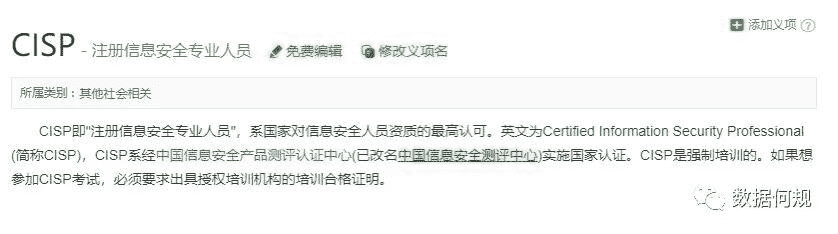
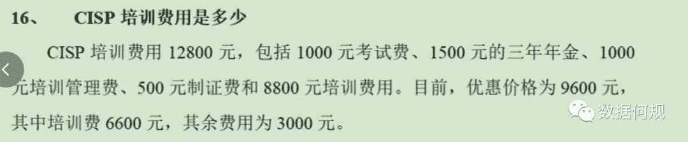

# CISP等证书的含金量

> 来源：[https://docs.feishu.cn/docx/KgTod86FzotkYKx6Z1WcBsKPngd](https://docs.feishu.cn/docx/KgTod86FzotkYKx6Z1WcBsKPngd)

**-问：**有了解这个证的朋友吗？

**-答1：**不用这么贵的，7000~8000的样子吧。可以系统了解一下信息安全，5天全脱产培训，考试的话，有题库的，之前背完200题包过。

**-答2：****没啥含金量**，给钱就能过。

**-答3：**你要便宜的有，软考信息安全工程师，含金量高。中级职称证书，在上海可以居转户落户。积分直接积100分。130元报名费，通过率20%+。

**-追问：**求问，**cissp**相对cisp，在安全合规行业的认可度和含金量高吗？

**-答4：**cissp属于安全行业顶级认证了。我说的是难度方面。效力方面，**因为也是商**业认证，在中国也没太多用。乙方招投标认可的。

**-答5：**我推荐cisa，**知识体系很全**，适合律师学。

**-答6：****CISA**也不容易过的。据说也挺难的，只是作弊方面**比cis**sp容易。CISA学完后，可以做安全审计。所以对律师来说确实很有帮助。

**-答7：**还有个公安三所的重要系统保护人员。我觉得也蛮好的。围绕着等保来的。等保搞明白，其实iso27001也基本明白了。整个安全管理体系也搞清楚了。所以证书效力是一方面，能不能学到有用的是另外一方面。

总结：证书很多，学到东西才是自己的。

[证书](https://cbe8t1r4a5.feishu.cn/wiki/Pk80wUT8YiVaYJkgB27c8CTTnne)