# Intern-S1 技术报告（草稿）

> 来源：`https://aicarrier.feishu.cn/docx/K72Ed7bWQoItQhxz4aEc1zqNn6e`

`https://huggingface.co/papers/2508.15763`

近年来，开源基础模型如雨后春笋般涌现，在一些热门领域取得了显著进展，其性能已十分接近闭源模型。然而，在高价值但更具挑战性的科学专业领域，这些领域要么仍依赖专家模型，要么这些领域中通用基础模型的进展显著滞后于热门领域，远不足以支撑科研变革，开源模型与闭源模型在这些科学领域仍存在巨大差距。为缩小这一差距并探索通往通用人工智能（`AGI`）的新路径，我们推出了`InternS1`——一个具备通用理解推理能力且能分析多模态科学数据的专业通才模型。`InternS1`采用多模态混合专家（`MoE`）架构，激活参数达280亿，总参数规模2410亿，基于包含超过2.5T科学领域token在内的5T token总量进行持续预训练。在后训练阶段，`Intern-S1`先后通过离线与在线强化学习（`RL`）在`InternBootCamp`框架中进行训练，其中我们提出混合奖励机制（`MoR`）来实现千余任务的同步`RL`协同训练。依托算法、数据与训练系统的整合创新，`Intern-S1`经过在线`RL`训练后达到顶级性能。综合评估显示：在通用推理任务上，`Intern-S1`在开源模型中表现亮眼；在科学领域更是显著超越其他开源模型，并在分子合成规划、反应条件预测、晶体热力学稳定性预测等专业任务上超越闭源SOTA模型。模型已发布于`https://huggingface.co/Internlm/Intern-S1`。

## 介绍

过去几年，以视觉-语言模态为核心的开源多模态大模型及大规模推理模型（`LRMs`）取得了飞速进展。尤其在公众广泛关注的领域——例如自然图像理解、数学解题和代码生成——这些开源模型（Zhu等，2025；Guo等，2025a；Yang等，2025）已接近甚至部分超越了闭源模型（OpenAI等，2024；OpenAI，2025；Anthropic，2025；DeepMind，2025）。这一进展使人们对其在更具挑战性的科学领域应用产生了更高期待。然而，在高价值但难度更大的科学场景中，开源基础模型的进展明显滞后于数学、代码等热门领域的发展水平。此外，在科学领域中开源模型与闭源模型之间仍存在显著差距，(OpenAI, 2025;xAI, 2025;DeepMind, 2025)限制了开源模型在尖端研究中的实质性作用。

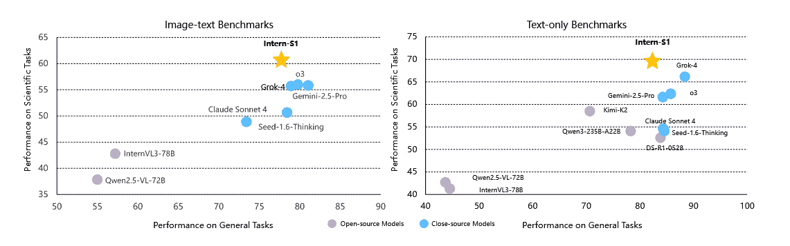

图1：开源与闭源模型在图文结合及纯文本基准测试中的性能对比。结果表明，`Intern-S1`在开源模型中具备顶尖的通用推理能力，并在科学领域超越闭源模型。通用基准测试包括：`MMLU-Pro`（纯文本）、`GPQA`（纯文本）、`AIME2025`（纯文本）、`MMMU`、`MMStar`；科学类基准测试包括：`SmolInstruct`（纯文本）、`ChemBech`（纯文本）、`MatBench`（纯文本）、`SFE`、`Physics`。

并推动开源模型向`AGI`迈进一步，在本报告中，我们分享了构建`Intern-S1`的经验和主要发现，这是一个旨在解决复杂科学任务的开源科学多模态模型。该模型能够处理图像、文本和科学数据，包括非自然视觉数据、分子结构和时间序列信号。如图1所示，`Intern-S1`在图像-文本或纯文本科学任务上的表现均优于开源和闭源模型。

除了展示一个强大的模型，`Intern-S1`还标志着我们在探索通往通用人工智能（`AGI`）可行路径上的重要一步。图2表明，尽管近期模型在数学和通用推理方面取得了显著进步，但在数据相对较少的科学领域仍存在困难。即便业界能进一步加速开源模型的发展，它们在不同领域的能力增长并不均衡，开发一个适用于通用领域的智能系统依然充满挑战。

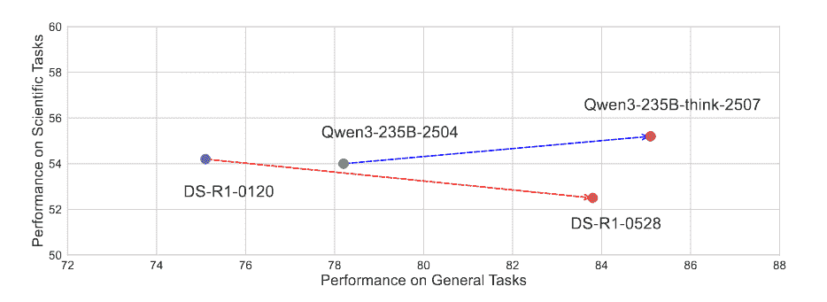

图2：`LLMs`在通用任务与低资源（科学）任务中的表现趋势。X轴为三个主流通用基准测试（`MMLU-Pro`、`GPQA`、`AIME2025`）的平均值，Y轴为三个科学领域基准测试（`SmolInstruct`、`ChemBench`、`MatBench`）的平均值。尽管顶尖开源大模型在通用任务上的性能提升迅速，但其在科学任务中的表现并未同步增长。

我们认为有必要探讨这一问题：如何以可扩展的方式增强模型处理低资源任务的能力？需注意，可扩展性至关重要。与热门领域不同，我们无法为每个低资源任务过度依赖启发式方法和先验知识。因此，我们分别从预训练和训练后阶段中更具扩展性的视角来解决该问题。

在预训练阶段，关键挑战在于为低资源但高价值的科学领域准备大规模预训练数据。为构建高质量科学数据，我们采用两条处理流程：（1）通过智能代理工作流建立召回与过滤机制，从网络数据中挖掘预训练数据并确保知识覆盖度。经过人工评估，该流程将目标领域的原始数据纯度从约2%（网络爬取数据中科学数据占比极低）提升至50%以上；（2）`PDF`文档作为科学知识的富集载体，我们采用页面级`PDF`解析流程，通过合理配置低成本与高精度解析器组合，以中等成本获取高质量解析文档。这两条流程为`Intern-S1`的持续预训练贡献了超过2.5万亿词元的科学数据。

预训练完成后，我们基于`InternBootCamp`（一个为基础模型设计的大规模交互环境，包含1000多种任务）开展离线和在线强化学习研究。为了协同处理海量任务与多样化反馈信号的学习，我们提出名为“混合奖励”（`MoR`）的创新算法框架，将多形式、多任务的反馈统一为标量奖励值。针对创意写作、对话等难验证任务，该框架采用`POLAR`方法统一生成反映当前响应与预期分布距离的奖励标量；对于各类易验证任务，则通过验证模型组合、规则系统和环境反馈精准生成表征准确度的奖励数值。这种灵活精准的奖励机制设计赋予`MoR`框架处理多样化任务时更高的效率、可扩展性和适应性。我们还将`MoR`与多种强化学习算法技术及基础设施优化方案深度整合，稳定并加速了大规模混合专家模型的训练。最终实现了以10倍少于同类研究的强化训练时长，激励模型通过更少样本掌握专业技能，达到SOTA表现。

凭借多样化的数据策展策略、高效的基础设施和先进的算法，`Intern-S1`在当代开源模型中实现了SOTA性能，并在我们的评估基准测试中与领先的闭源模型（如`OpenAI o3`、`Gemini-2.5-Pro`、`Grok-4`）相媲美，有时甚至超越。`Intern-S1`在纯文本和多模态两种模式的科学推理基准测试中均表现出色，同时在通用推理任务上保持顶尖性能。我们开源了模型权重及配套工具链；这种通用与专用相结合的集成设计旨在推动未来通用推理领域的探索，并在多样化科学场景中实现实质性突破。

## 模型架构

`Intern-S1`的架构如图3所示。对于大语言模型（`LLM`），我们分别在`Intern-S1`与`Intern-S1-mini`中采用`Qwen3-235B`混合专家（`MoE`）模型和`Qwen3-8B`模型。基于`LLM`，我们将科学模态按其表征形式分为三类，并采用不同策略将其映射至`LLM`的表征空间。具体而言，对可视化表征（如气象图像）采用视觉Transformer（`ViT`）编码器，针对线性化离散表征（如分子结构）提出新型动态分词器，而领域专用表征（如时序信号）则采用专门设计的编码器进行处理。

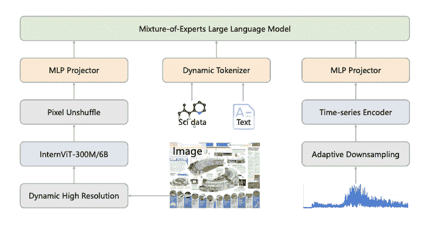

图3：`Intern-S1`架构图，包含一个配备视觉编码器、时序编码器及动态分词器的混合专家大语言模型，该分词器可根据自然语言与科学输入切换分词策略和嵌入方案。`Intern-S1`采用`InternViT-6B`模型，而考虑到效率因素，`Intern-S1-mini`版则搭载`InternViT-300M`模型。

### 视觉编码器 Vision Encoder

我们采用`InternViT`系列模型（Chen et al., 2024c）作为视觉编码器：`Intern-S1`使用基于`ViT`架构的大规模模型`InternViT-6B`，该模型通过从对比预训练逐步优化至与大语言模型耦合的下一词预测，可生成强表征的高分辨率细粒度视觉特征。而轻量版`Intern-S1-mini`则采用其精简版本`InternViT-300M`——该模型通过对60亿参数教师模型进行蒸馏训练并融入自然语言处理损失函数，在保留教师模型大部分识别定位能力及视觉世界知识的同时，提供了高效编码方案。这两种编码器形成了算力-精度的灵活配置：`InternViT-6B`能实现最强的表征能力，而`InternViT-300M`则为下游多模态任务提供了优异的效率-性能平衡。

这些编码器可以工作在固定的448×448像素输入尺寸或动态分辨率（Chen等人，2024b）上，以更好地处理高分辨率内容。为了与语言模型结合，我们采用像素反洗牌操作将视觉标记数量缩减至四分之一，这意味着一个448×448的图像由256个视觉标记表示。这些视觉标记随后通过一个多层感知机（`MLP`）投影器，以将其与语言模型的嵌入空间对齐。视觉变换器（`ViT`）的参数在图文训练阶段进行联合训练，以进一步提升其对视觉和科学模态的理解能力。

### 动态 Tokenizer

受到先前研究（Xia等人，2025年）的启发，我们将科学数据结构（包括分子式和蛋白质序列）形式化为带标签的序列。例如，`<SMILES>C1CCCCC1</SMILES>`表示一个`SMILES`格式的分子。先前的研究表明，这种带标签的序列有助于语言模型在单一模型中区分不同的数据结构类型。然而，仍存在两个重要问题：（1）分词器对所有序列采用相同的分割策略；（2）不同模态中的相同标记共享相同的嵌入表示。

第一个问题限制了模型在科学领域实现更高压缩比的能力。以`SMILES`格式为例，尽管它在化学领域被广泛使用，但在通用文本语料库中却很少出现。因此，通用`LLM`在编码`SMILES`格式时效率低下。由于静态分词器在所有情况下都使用同一种切分策略，优化科学模态往往会以自然语言文本压缩比的下降为代价。

第二个问题涉及共享嵌入。例如，若字符`C`同时出现在`DNA`序列、分子式和选择题中，强制共享同一嵌入可能会使其表征偏向最高频的用法。这种现象会限制模型在科学模态中的表现。虽然高维嵌入空间允许模型在单个向量中存储多重语义表征，但这种频率失衡会阻碍模型精确学习这些表征。

先前的研究（Feher等人，2024年）曾指出静态分词器的局限性，并提出通用型动态分词器。然而相关研究仍处于早期阶段，常存在鲁棒性问题，例如分词策略可能对微小的上下文变化敏感。现有改进方案仍存在收敛速度慢于标准分词方法等缺陷（Provilkov等人，2019年）。有趣的是，我们发现这些局限在处理科学模态时能得到很大程度的缓解。这是因为科学字符串（如`SMILES`或`FASTA`格式）可以精确且轻松地被识别，从而规避了上下文敏感性的问题。

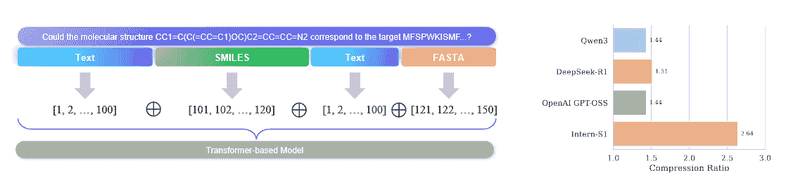

图4：左图展示了动态分词器的工作流程。该分词器首先通过基于规则的检测器或用户标注的特殊标签识别输入字符串中的模式，随后将输入字符串分割为不同部分。每个部分采用不同的分词策略进行处理，其嵌入空间彼此正交。最终，这些向量会被拼接成常规的`Transformer`输入。右图对比了不同分词器在科学数据（`SMILES`格式）上的压缩率。`Intern-S1`以超过70%的优势领先其他方法，表明其能用更少的token表示科学数据，显著节省计算开销。

动态分词器的工作流程如图4所示。该分词器首先识别输入字符串中的模态类型，随后针对每种模态采用不同的切分策略，最终将生成的序列拼接成单一输入序列，确保与现代大语言模型架构保持兼容性。

`Intern-S1`目前支持四种模式，并计划在未来版本中扩展支持范围。每种模式可通过用户输入中的特殊标签（如`<FASTA>`、`<SMILES>`）进行明确标识。我们还采用启发式规则和领域专用工具（例如`RDKit`）来自动识别分子与蛋白质字符串。

我们的实验证明了动态分词器的有效性。如图4所示，其实现了显著更高的压缩比，相较于OpenAI的`GPT-OSS-120B`、`Deepseek-R1`以及`Qwen3`系列模型，提升幅度高达70%。

我们比较了不同分词器`τ`在一个包含丰富`SMILES`格式数据的化学数据集`D`上的压缩比（`CR`）。分词效率通过“字符每标记”进行量化，其正式定义为：

其中字符串长度以Unicode字符衡量。

### 时序编码器 Time Series Encoder

`Intern-S1`集成了一个时间序列编码器，以更好地处理顺序数值数据，其中每个元素通常代表随时间记录的测量结果，例如地震波、重力波、天文光变曲线和脑电图（`EEG`）记录。此类数据通常较长、连续且缺乏明确的语义结构，因此与大型语言模型的兼容性较低。时间序列编码器能够捕捉时间依赖性，并将输入压缩为更适合基于`LLM`理解和推理的表示形式。

编码器直接接收并处理以连续数值形式表示的原始信号。这些信号在采样率（从每日一个样本到千兆赫级别）、持续时间（从几十到数百万个时间步长）以及物理语义上可能存在极大差异。编码器内置专用的自适应降采样模块，其后接基于`Transformer`的组件，从而实现对科学时序信号高效且统一的表征。它作为图像模态的补充，增强了模型理解多样化科学数据的能力。

## Infra

`Intern-S1`的训练基础设施将在`XTuner`中开源（Contributors，2023c），这是一个高效灵活的`LLM`预训练与后训练工具包。我们将该基础设施分为两部分：基于下一词元预测范式的训练（包括预训练和有监督微调）以及强化学习范式的训练。

### Pre-training and SFT Infrastructure

并行处理：我们采用全分片数据并行（`FSDP`）技术，在多个`GPU`间分配模型参数，以支持持续预训练和有监督的微调。

`FP8`训练：遵循`DeepGEMM`（Liu等人，2024年）的方法，我们对矩阵乘法（`GEMM`）采用`FP8`精度，并应用每块（1×128）动态缩放。在前向传播过程中，计算涉及`GEMM`操作中输入数据的块级缩放和权重的块级缩放。在反向传播中，梯度通过两类`GEMM`计算得出：（1）采用块级梯度和块级权重的`GEMM`，（2）采用块级梯度和块级输入数据的`GEMM`。此外，视觉塔模块保持`BF16`精度以确保训练稳定性。

核心组件：（1）分组通用矩阵乘法核：针对混合专家模型中动态分组规模（由`top-k`路由的变长特性引发）的挑战，我们采用`TMA`自适应`FP8`分组通用矩阵乘法（Su等人，2025）来降低混合专家计算的内存与算力开销。（2）`Liger`核：通过集成线性层与交叉熵层的融合学习交叉熵核（Hsu等人，2025）实现算子融合。（3）闪电注意力：训练阶段采用支持变长序列的`Flash Attention-3`版本来提升注意力计算效率。

可变长度平衡策略：我们发现`FSDP`在变长序列训练中存在严重的工作负载不平衡问题，在规模化场景下尤其突出。为此提出可变长度平衡策略（`VLBS`）：（1）随机将文档打包至桶并记录最大序列长度，（2）采用滑动窗口（`S`）对桶进行分组，（3）在窗口内按最大长度排序。该方法确保所有计算节点负载均衡，在我们的训练框架中平均实现2倍加速效果。

### RL Infrastructure

并行策略：我们采用全分片数据并行（`FSDP`）结合单向专家并行（`1-way EP`）进行强化学习训练。该配置消除了专家间通信，避免了在长序列训练中将无丢弃`MoE`与更高阶`EP`并行结合时出现的内存爆炸性增长问题。

`FP8`训练与推理：为最大化轨迹生成吞吐量，我们在训练和推理中均使用`FP8`精度。这种统一方法通过显著降低内存带宽压力并提升计算吞吐量，加速了数据生成过程。

并置设计：类似`HybridFlow`（Sheng等人，2025），我们的架构将训练引擎与推理引擎部署在同一组设备上。每个强化学习步骤开始时，模型会从训练网格透明地重分配到推理网格；完成轨迹收集后，保持优化器状态完整地重分配回训练网格。轻量级的重分配和集体同步机制保障了内存清洁与权重一致性，无需资源分区。

轨迹生成：我们使用`LMDeploy`（Contributors，2023a）进行8路专家并行（`EP8`）推理。服务后端由`PyTorch`实现并以`FP8`格式存储权重以最小化内存占用。启用`CPU`卸载和持续批次处理以最大化吞吐量。为避免可变长度解码阶段的滞后问题，当各计算节点工作量不均衡时，我们会动态重新分配计算槽位。

图5:`Intern-S1`的培训分为四个阶段，只有第一阶段是单一模态的培训。

## continue 预训练

`Intern-S1`的完整训练流程包含四个独立阶段，如图5所示。每个阶段都有特定目标，通过不同形式的数据准备和训练策略实现。本节将详细阐述各阶段的具体实施细节。

### 科学数据

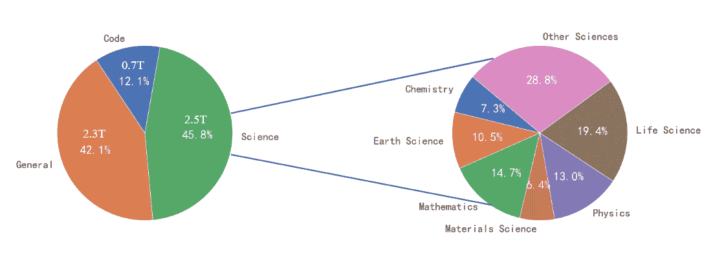

图6：文本`CPT`数据的整体统计。左图：我们继续在总计5T的高质量文本标记上对`Intern-S1`进行预训练，其中科学数据占比超过2.5T标记。右图：饼图展示了我们在数据构建过程中重点关注并调整分布的六大科学领域。例如，生命科学数据采用严格过滤标准，而材料科学则放宽过滤，因为它们的自然分布存在数量级差异。

#### 文本数据

在文本与图文持续预训练（`CPT`）过程中，我们从高比例科学数据构成的数据池中采样。统计数据如图6所示。由于基础文本语料处理流程已在其他开源模型的技术报告中充分说明（例如`Qwen`系列[杨等人，2025]、`Deepseek`系列[刘等人，2024]），我们重点介绍预训练数据流程的三个组成部分。

页面级`PDF`文档解析 我们从网络及存档图书馆收集`PDF`文档，采用混合`OCR`与`VLM`技术流程将文档转化为图文混合或纯文本语料库。实践发现，解析质量对`PDF`文档至关重要，而`PDF`文档的质量会显著影响模型表现——尤其在科学领域，因为这些文档包含了网络数据中鲜少提及的广博知识。我们还发现解析质量问题主要存在于公式与符号标记较多的文档中。

# PDF文档解析与质量控制

基于人工评估，我们发现现有的PDF解析工具（无论商用还是开源）均无法完美处理所有类型的PDF文档，且其成本也存在较大差异。为平衡质量与成本，我们开发了页面级解析流程：首先由低成本解析器（`MinerU`（Wang等人，2024a））处理每个PDF页面，随后检测数学公式数量、符号标记及其他启发性特征（这些往往是低成本解析器的错误高发区）。根据检测结果，我们将多数可疑页面送入高成本解析器（如`InternVL`（Zhu等人，2025）和`Qwen-VL`（Bai等人，2025）等视觉语言模型）。视觉语言模型也存在特定错误模式，其解析结果将通过规则或小型大语言模型进行清洗后再整合到其他已解析的页面。需要注意的是，我们采用了全局页面级别的图去重机制，以移除诸如版权页或其他常见内容的页面。

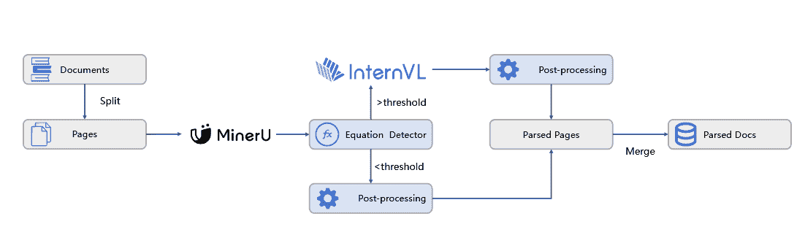

图7:页面级PDF文档解析管道的工作流程。PDF文档将被分割成多个页面，并使用一个低成本的解析器来获取文本数据。我们采用方程和符号标记检测器来检查页面是否应该通过高成本解析器(`vlm`)进行高级处理，还是准备进行后处理。请注意，低成本和高成本解析器的后处理是不同的，因为它们有专门的负面案例模式。所有解析过的页面将被合并为单个数据样本。

尽管PDF文档相较于网页数据是更为清洁的来源，我们发现质量控制仍是必不可少的环节。即便使用强大的视觉语言模型(`VLM`)，通过乱码检测和页面级去重处理后，存档文献库中仍有约20%的文本被清除。针对网络爬取的PDF文件，我们额外采用了类似网页数据处理的教育内容评分机制，最终保留比例仅为50%。

由于高成本解析器（即`VLMs`）的速度比低成本解析器慢20倍，我们仅筛选出包含公式和符号标记的页面，并将其发送至高成本解析器进行处理。在归档文献库中，已有5%的页面经高成本解析器解析，而对于网络爬取的PDF文件，这一比例为3%。

## 域中心的网页数据解析

网络爬取数据作为预训练数据的主要来源已被广泛研究。然而不同`URL`域名展现出多样且独特的特性，这使得设计适用于所有网页的通用解析方案具有挑战性。先前研究通过主题和格式分类器对网页进行归类，我们进一步提出更细粒度的解决方案——基于领域的网页数据解析流程。该流程将同一域名下的网页视为连贯整体，并通过基于大语言模型的智能代理为每个域名实施定制化策略。

具体而言，我们从特定域名下抽取数百个网页，将其输入高成本的基于大语言模型的智能代理。根据该代理标注的标签，我们在域名层级聚合结果，并决定对该域名下的页面采取丢弃、重写或保留操作。此外，我们还在页面层级整合了常用的基于规则的过滤、去重、质量及格式分类器。

采用以域为中心的处理流程，是因为同域名下的页面往往具有共性特征——例如反复出现的解析问题（如代码片段提取失败），或自定义导航栏等标准过滤器难以识别的元素。另一方面，由于基于大语言模型的智能代理成本过高，无法应用于所有页面，域名层级的解析使我们既能识别轻量级分类器无法检测的结构化模式，又能将成本控制在可接受范围内。

## 科学数据召回与过滤

为增强模型在科学领域的表现，我们从开源预训练语料（Su等，2024；Chang等，2024；Tang等，2024）和网络爬取数据中召回并筛选相关数据。参考（Du等，2025）的方法构建三级数据领域分类树，选定数学、物理、化学、生命科学、地球科学和材料科学六大科学领域进行细粒度处理。

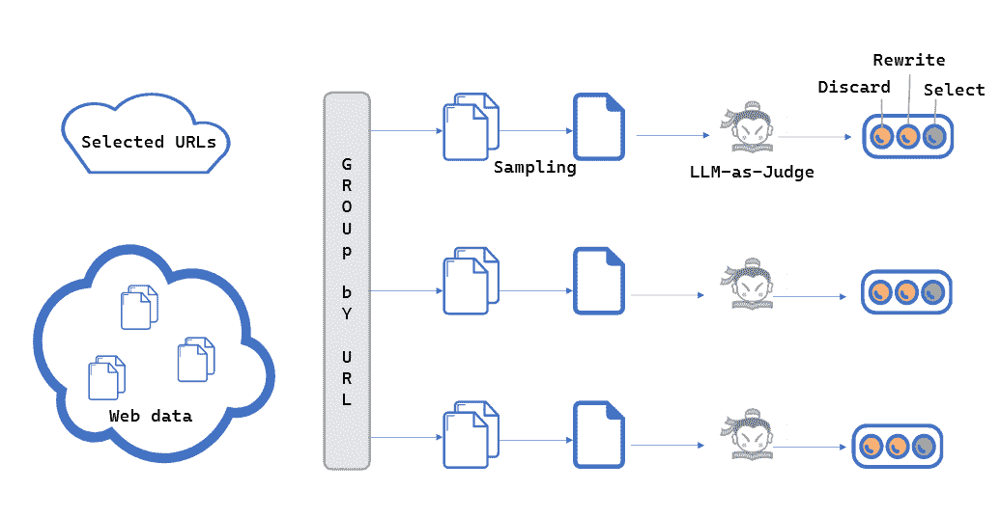

图8：我们以领域为中心的网页数据解析流程工作流程。网页按其`URL`地址分组。对于每个`URL`域名，我们抽取数百个页面并输入基于大语言模型的分类器。通过汇总来自同一`URL`域名的所有抽样页面的分类结果，我们根据启发式规则做出决策。存在三种可能的处理方式：若该域名下页面质量低且信息贫乏，则丢弃该域名下所有页面；若页面质量较低但内容具备信息价值，则使用大语言模型重写该域名下所有页面；若页面质量达标，则将该域名下所有页面选为训练数据候选集。

如图9所示，针对每个目标领域，我们利用性能强大的大语言模型对数据子集进行标注，这些标注数据将作为轻量级分类器（`fastText`模型（Joulin等人，2016年）和15亿参数的大语言模型）的训练集。我们同时为每个目标领域构建了域内验证集与域外验证集——域内验证集数据来自同源，而域外验证集则取自不同领域（例如使用PDF文档作为网页数据解析任务的域外验证集）。这些验证集用于优化训练数据标注的提示模板。最终六个领域的人工评估结果显示，目标领域数据占比从2%提升至50%，印证了我们采用的召回与过滤策略的有效性。

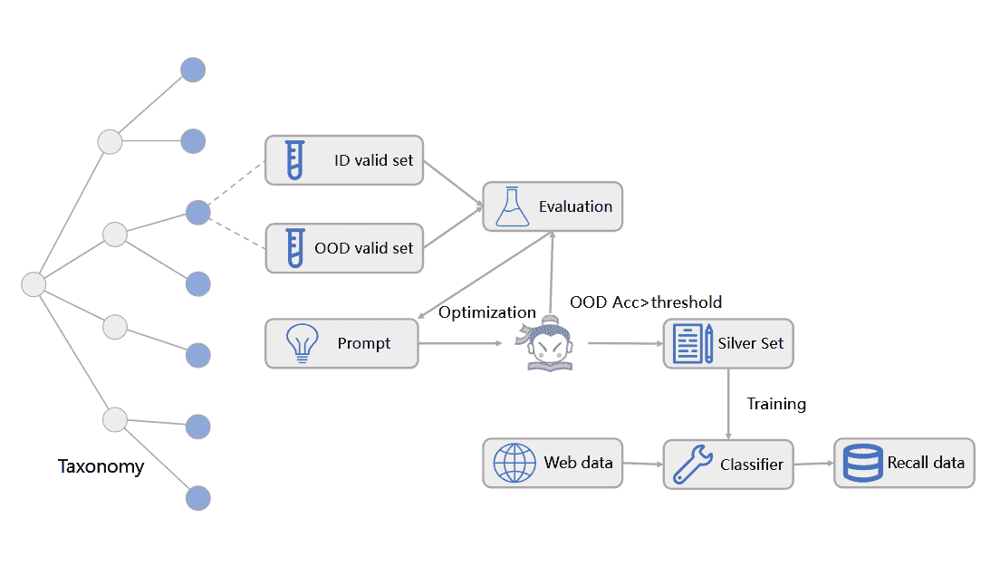

图9：科学数据召回与筛选流程的工作机制。依据一个涵盖多个科学与通用领域的分类体系，我们为每个目标领域构建了专门的召回与筛选流程。通过准备域内与域外验证集来自动优化提示模板，该模板将驱动大语言模型标注大规模银级数据集，进而训练低成本分类器对网络数据池进行筛选，最终实现需求数据的精准召回。

## 多模态数据

在图像-文本`CPT`阶段，我们整理了两类数据集：交错排列的图像-文本数据集和纯文本数据集。为保证数据质量、领域多样性和学科覆盖的全面性，我们的数据源主要来自三方面：1）`InternVL3`的多模态预训练语料库，涵盖图像描述、通用问答、数学、图表、光学字符识别（`OCR`）、知识关联、文档理解、多轮对话及医疗数据等多个领域；2）从第4.1.1节所述数据集中采样的文本语料，旨在保持模型的文本理解与推理能力；3）多模态科学数据，覆盖专业领域以提升专家任务性能。

在此配置下，训练总标记数约为2500亿，其中语言数据700亿，交错图像-文本数据1800亿（科学数据部分占300亿标记）。

多模态科学数据管道。在4.1.1中介绍的纯文本科学管道的基础上，我们构建了一个多模态(图像-文本)管道，以1)保存细粒度的科学结构(图形、方程、符号、表格、图表)，2)将视觉数据与周围的文本内容在页面/图/片段的颗粒度上对齐，以及3）生成适用于科学推理的指导式和考题式监督内容。

针对六个科学领域的试题类问题，我们采用过滤器检测结构完整性。每个样本必须包含题干、选项（如适用）、答案及解析；缺失字段的实例将被剔除。实际操作中，我们采用基于规则的过滤器剔除不清晰的题干、不完整的选项集或与题干/选项不符的答案。对于含有多道子题的填空题，我们额外调用`Qwen2.5`等大语言模型（Team，2024）评估答案完整性。

对于包含`LaTeX`和`Markdown`公式的解析PDF文档及其他数据，我们通过视觉语言模型的判断验证符号标记的渲染结果，防止公式损坏与排版错误。在通用图文配对数据中，基础规则过滤器会检测异常情况，包括空白图像、明显模糊/变形的图表，以及题干与视觉素材链接断裂等问题。

## 训练策略

`Intern-S1` 采用分阶段训练策略，在保证效果的同时优化训练效率。如图5所示，纯文本训练阶段仅包含文本续预训练（`Text CPT`），其余阶段均为多模态联合训练，体现了我们对于跨模态融合与对齐的高度重视。为提升训练效率，我们采用了批次大小渐进调节策略，在保持良好训练损失的前提下，通过扩大批次规模实现基础设施利用率优化。

### batch size warmup

批处理大小是一个至关重要的超参数，它极大影响模型优化和基础设施效率。然而这在最佳模型性能与最优训练效率之间形成了两难抉择，尤其在训练初期会引发严重问题。如图10所示，我们发现使用较小批处理规模训练的模型在前中期阶段（前7000亿标记）表现优于大批量训练。与之相对，较大批量虽然能带来更高的训练效率。根据我们的扩展定律分析，我们得出最佳方案是将训练阶段拆分并采用不同的批次大小。最简单的版本初始使用较小的批次大小，随后切换到大批次以实现更高的训练效率。

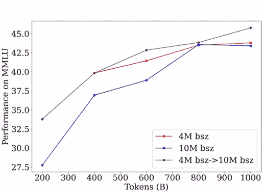

图10：采用不同批量大小策略训练的性能趋势。我们使用10亿参数的轻量级大语言模型，在1万亿token上进行训练，并以`MMLU`任务中的表现为模型下游能力的衡量标准。红色与蓝色曲线代表训练期间保持固定批量大小的策略，紫色曲线则展示了在训练4000亿token后将批量大小从400万调整至1000万的动态调整过程。

### 起始点选择

为更高效利用计算资源并聚焦科学研究，我们基于现有开源模型（`Qwen3`（杨等人，2025）和`InternVL-Vit`（陈等人，2024c））持续开展训练。这些模型通常包含基础模型和指令模型两个版本，引发关于选择何种模型的思考。简而言之，我们的研究表明指令模型表现略优于基础模型。虽然指令模型在下游任务中普遍表现更好，但其输出分布往往更为狭窄。我们从两个角度探讨起点的选择：1）初始性能优势是否能转化为最终性能提升？2）初始输出多样性是否影响强化学习过程？

我们首先使用小模型进行四种实验设置：1）直接微调指令模型；2）继续预训练后微调指令模型；3）直接微调基础模型；4）继续预训练后微调基础模型。如图11所示，指令模型仅在代码基准测试中显现优势。根据近期研究（Ward等人，2025；董等人，2025），我们认为存在两种情况：1）后训练激活基础模型已有能力。此时无论从基础模型还是指令模型开始，结果相似。2）后训练带来新技能并增强模型能力。此情况下从指令模型出发可获得更好表现。我们推测测试指令模型的后训练提升了其编码能力，这解释了观察到的优势。相比之下，其他领域的后训练可能仅激活预训练阶段已学习的能力，导致基础模型与指令模型表现趋同。

另一个关注点是使用基础模型或指令模型作为起点时的输出多样性差异。具体而言，初始熵值对强化学习过程至关重要，因其显著影响超参数选择和潜在性能上限。我们评估了两种设置：1）直接微调基础模型；2）继续预训练后微调指令模型。在数学推理强化学习提示的子集测试中，基础模型初始熵值（0.19）略高于指令模型持续预训练后的结果（0.15）。根据经验，这种程度的差异通常可通过调整强化学习超参数来缓解，不太可能导致根本性的性能差异。

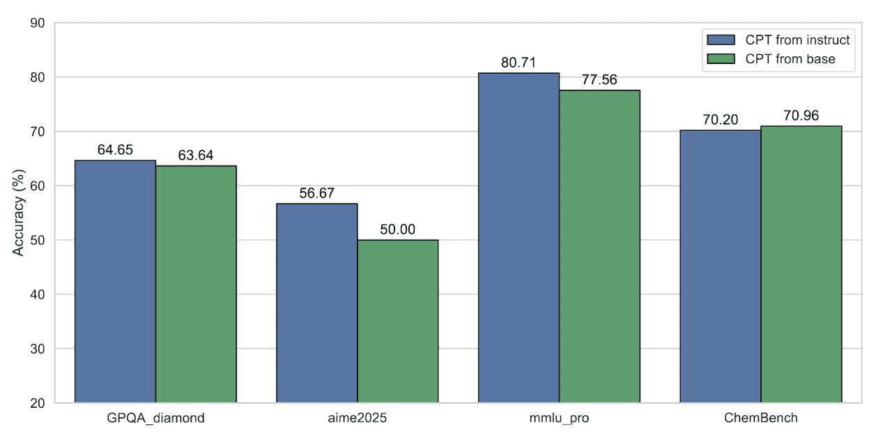

图11：不同起始点选择（基础模型与指令模型）的对比。

综上所述，我们的研究结果表明:

- 从`SFT`和`RL`之后的最终性能来看，使用指令模型作为`CPT`起点是可以接受的。
- 当后训练显著提高模型能力时，指令模型是比基础模型更好的选择。然而，我们只在特定领域观察到这种结果。

### 超参数

在自主研发的`Xtuner`（Contributors，2023c）训练框架中，我们对批次调度器与学习率的设置进行了精细化研究。最初，学习率调度器的“预热-稳定-衰减”（`Warmup-Stable-Decay`, `WSD`）范式因其能将调度过程与训练数据总量解耦而广受青睐。经过深入分析，我们证实：当采用基于梯度的优化器时，若使用`WSD`学习率调度器，为了让模型达到特定训练质量（即损失函数收敛至某一数值），梯度噪声与批次大小必须满足以下关系：

其中`η`代表学习率，`B`为批处理大小，`Bsimple`表示梯度噪声，其具体含义可参考McCandlish等人(2018)的研究。根据McCandlish团队既定的研究结论，`Bsimple`与训练损失`Loss`之间存在幂律关系。这意味着在整个预训练过程中，配合`WSD`学习率调度器使用的批处理规模应遵循渐进式增长模式。在`Xtuner`框架内，经过对训练效率和效果的综合评估，我们将批处理量从6600万词元提升至1.32亿词元。更关键的是，通过临界批处理规模与训练损失之间的关联规律，我们不仅精准确定了转换时机——在当前训练配置下处理完4000亿词元后进行批处理规模切换，还确保了整个训练过程的计算效率始终保持在最优状态。

完成批处理规模调度设计后，接下来需要明确`WSD`学习率调度器下的具体学习率设定。为避免大规模资源浪费，业内常规做法是通过小规模资源确定"最优"学习率，再迁移至大模型训练(Yang等人，2021；Bi等人，2024)。但这类方法对学习率调度策略、批处理规模、训练数据等多种训练设置较为敏感。为降低其他训练变量的影响，我们开发了基于缩放定律的学习率设定方法：首先建立训练损失`L`与训练过程中每一步学习率集合`Ω={ηi}`的关联关系，其具体表达式详见Luo等人(2025)和Tissue等人(2024)的研究。受Luo团队研究成果启发，在拟合`L(Ω)`关系后，我们将学习率设定转化为关于`Ω`的优化问题形式化处理。在此基础上，我们提出了一个更通用的优化表达式，如下:

其中`ϕ(Ω)`表示学习率的约束条件。通过求解这个优化问题，我们最终确定了整个预训练过程中的学习率。

在整个`CPT`文本处理过程中，依托自主研发的`Xtuner`训练框架的高效适配能力、对训练数据质量的严格把控以及超参数的科学配置，`Intern-S1`预训练质量得到了良好控制。全程未出现任何损失异常波动。此外，基于`Intern-S1`所使用的预训练数据，根据拟合的`Scaling Laws`理论预测最终训练损失约为1.16。实际训练中，`Intern-S1`的最终损失值稳定在1.17至1.18之间，这表明我们能够将预训练质量的控制精度提升至0.02量级。

### 多模态训练

在完成`CPT`阶段的文本处理后，我们对交错的多模态数据（如图文对、视频-文本对或混合的图文序列）与大规模文本语料进行联合优化。传统方法在适配多模态大语言模型时通常冻结`LLM`组件的某些层，甚至冻结视觉`Transformer`编码器。而我们的方法则是在多模态`CPT`过程中同步更新所有模型参数。设`M`为一个基于`Transformer`架构、由参数`θ`定义的模型，它能以统一方式处理文本、图像和视频。给定任意训练样本`x={x₁, x₂, ..., xL}`（令牌长度为`L`时），我们采用标准自左向右的自回归训练目标：

其中`wi`表示第`i`个词元的损失权重。遵循`InternVL3`（Zhu等，2025年）的方法，我们采用平方平均方案以缓解梯度偏差。具体而言，对于一个包含`l`个贡献损失词元的训练样本，我们设定

视觉标记仅作为文本预测的条件背景使用，其本身并不被预测。这种设计方式促使模型以有利于下游语言生成任务的方式整合多模态信息。

## 后训练

经过多模态持续预训练（`CPT`）后，`Intern-S1`进入两阶段的多模态后训练，其中文本数据与多模态数据混合使用，以在文本和多模态基准测试中均获得最佳性能。

### 离线强化学习

在`Intern-S1`的训练后阶段，我们首先对精心整理的指令数据进行离线强化学习（`RL`）。其中每个训练查询的响应都是通过基于特定标准（如准确性、流畅性和安全性）的`N`选1最佳采样（`BoN`）获得。基于多领域精选指令数据，我们进一步开展数据混合实验，以确定该阶段最优的数据组合方案。尽管这一阶段通常被称为监督微调（`SFT`），但我们将其视为离线`RL`，以强调所有使用的响应本质上都因`BoN`采样而获得了奖励。

#### 指令数据管理(instruction data curation)

纯文本数据。大量研究（Li等，2023；Liu等，2023；Shen，2024）表明指令微调数据的质量与多样性至关重要。少量低质量或有害数据样本可能导致模型崩溃或学习到不良模式，而更丰富平衡的数据通常能带来更优的模型表现。为此，我们开发了确保指令数据多样性与高质量的数据处理流程。对于`Intern-S1`模型，其指令分布经过精心设计，并通过大量消融实验得出最优训练数据集。

该数据处理流程包含三大核心环节：过滤、标注与增强。在过滤阶段，我们结合规则与模型双重视角，剔除可能阻碍模型训练的重复表达、截断数据或幻觉内容。基于过滤后的数据，我们实施双维度标注策略以支持后续数据筛选：数据类别与数据难度。

- 在数据类别维度，我们预先建立至少三级的手工标签体系（如数学→高等数学→线性代数），通过标注模型对数据分类，同时提取上下文信息生成场景标签（如线性代数证明题）；
- 对于含标准答案的数据，采用小规模模型多次推演，根据通过率判定难度；对于无标准答案数据，则制定领域难度标准并由标注模型分级。

基于样本的类别与难度标签，我们实施分层抽样以保持领域与难度均衡分布。针对特定领域数据量不足或低质量样本过量情况，通过响应重构或合成数据生成技术（Cao等，2025）进行补充。

经此流程，我们构建了涵盖智能体、编程、通用对话、指令遵循、数学、推理、长文本、安全、化学、生命科学、物理等多元领域的候选数据集，并通过消融实验确定最优数据配比。

多模态数据方面，`Intern-S1`初始视觉语言（`VL`）指令数据与`InternVL3`（Chen等，2024c）共享，包含3D场景理解、`GUI`操作、长上下文推理、视频理解、科学图表和创意写作等专项能力数据。为增强模型的视觉输入长程思考能力，我们在`SOPHIA`流程（Shen等，2025）基础上强化质量控制（如拒绝采样、去重、长度/格式约束、自洽校验及可编程验证），构建视觉语言推理数据。此外专门纳入科学领域`VL`指令数据以强化科学推理能力。

#### 数据混合实验

基于精选文本和多模态指令数据，我们仍需确定最佳混合比例，以在通用语言与多模态理解推理、科学推理基准测试中获得均衡表现。实验分为两大步骤：

原子能力验证：首先验证各增量数据集的有效性。为加速消融实验，我们从`InternLM3`的监督微调(`SFT`)数据中按比例抽样，构建核心数据集作为消融研究的基线。在此基础上逐步引入特定领域数据子集，同时监测基准测试指标的对应提升。例如，将新增数学数据集与核心数据集联合训练，并评估是否在相关数学基准上带来性能提升。

组合能力验证：在验证所有独立数据组件的有效性后，我们通过合并这些数据集进行综合评估。该集成阶段主要解决跨领域数据冲突，并通过超参数调优最终确定最佳训练配置，包括超参数与数据混合比例。具体而言，我们首先根据初始启发式比例对各领域数据进行采样训练，随后基于基准表现调整比例，并通过风格对齐和课程学习等技术解决数据冲突，最终获得最优数据混合方案与超参数。

训练过程中，我们还采用了随机`JPEG`压缩增强技术，以及`InternVL3`（Zhu等人，2025年）提出的平方损失目标函数。我们将最大上下文长度设定为32K tokens，从而减少截断效应，增强模型对长程依赖关系的捕捉能力，并提升文档级和多图像推理任务的性能。

### 在线强化学习

#### 混合奖励框架

# 后训练第二阶段：在线强化学习

后训练的第二阶段是在线强化学习，该阶段涵盖对1000多项任务的同步学习。为此，Intern-S1采用了混合奖励（MoR）框架（图12），该框架整合了来自多模态任务的多样化奖励信号，使模型能够在统一的优化过程中同时获得领域专长和通用能力。与孤立优化单一能力不同，MoR协调了来自逻辑推理、领域特定学术问题、指令跟随任务、视觉-文本推理问题及开放对话等异构任务类型的多样化奖励信号。这种跨任务策略优化使模型既能保持专项任务的高性能，又能在开放式对话场景中维持鲁棒性和适应性。

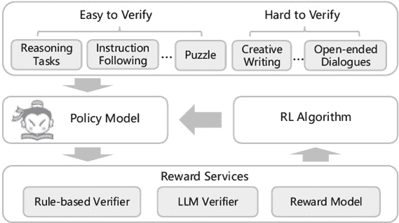

图12:奖励混合框架

然而，在多任务混合训练过程中，会出现难度水平参差、不同任务收敛速度迥异等挑战。为解决这些问题，我们为强化学习训练设计了一套离线与在线相结合的混合数据过滤策略。首先，我们在各任务领域分别进行模拟训练，评估其难度等级和收敛速度指标。基于这些量化结果确定最终的数据混合比例。训练过程中，我们采用超出训练批次规模的提示量生成轨迹数据，并根据数据准确性和输出质量等标准进行在线筛选。一旦生成数据量达标即终止生成过程。这种离线与在线相结合的策略，既平衡了多任务间的性能表现——避免对某些任务过拟合而对其他任务欠拟合，又显著提升了整体训练效率。

## 任务和验证器

### 大规模沙盒环境

在Intern-S1中，我们利用InternBootcamp（Li等人，2025）提供多样化的大规模合成推理任务，涵盖算法、字符推理、密码学、图形谜题、棋盘游戏推理、逻辑推理以及物理公式、化学方程式和医学推理等科学场景。我们通过训练营案例生成器共创建了1000余种任务类型，并能生成无限量训练数据。这些任务采用InternBootcamp框架，为混合奖励机制提供可验证的奖励信号。每个任务通过数据生成器产生超过10万个训练样本，并依据启发式规则进行降采样处理。最终我们筛选出覆盖混合强化学习不同场景的20,000余个优质样本。

### 指令跟随能力

作为模型泛化基础的指令跟随能力需要可验证的奖励信号进行针对性优化。我们采用Guo等人（2025b）的数据集，该数据集提供难度分布均衡的指令数据。通过SFT模型计算`passrate@64`分数，筛选得分在[0.2,0.8]区间内的提示词，有效排除过于简单或困难的案例。这种数据-奖励驱动机制使模型在指令跟随（Zhou等人，2023）方面持续提升。

### 多模态推理任务

为增强Intern-S1的推理能力，我们构建了高质量的多任务多模态数据集（RLVR）。文本数据侧重数学推理能力强化，汇集开源数据集如OREA1-RL-Prompts（Lyu等人，2025）、DAP0-Math-17k（Yu等人，2025）、Skywork-OR1-RL-Data（He等人，2025）以及大学课程和竞赛级内部数据。多模态数据覆盖通用视觉问答、科学推理、图表问答、数学推理、文档理解和OCR等领域，来源包括MMPR（Wang等人，2024c）、MMK12（Meng等人，2025）及私有收藏。部分纯文本题目通过渲染技术转化为图像格式进行训练，并将选择题重构为填空题形式以避免强化学习中的随机猜测干扰。

所有多模态推理问题均具备可验证的参考答案。我们采用`CompassVerifier`（Liu等人，2025a）作为生成式轻量验证器，结合基于规则的验证器对数学、知识及多样化推理任务的输出正确性进行二元奖励判定。这种组合方案提升了正确性评估的鲁棒性，有效缓解规则验证器的假阴性问题。

### 人类偏好对齐

为使Intern-S1适应开放场景的人类偏好，我们采用POLAR-78（Dou等人，2025）作为核心奖励函数。该模型基于策略判别学习范式训练，能识别相同策略并区分差异策略。相比依赖绝对偏好的传统奖励建模方法，POLAR通过捕捉策略间相对差异，提供适合通用排序关系建模的可扩展高级优化目标。POLAR-78预训练使用了3.67规模的合成语料库，并在15万组带参考答案的偏好对上完成微调。

强化学习阶段的数据集提示词主要源自UltraFeedback（Cu1等人，2023）、HH-RLHF（Ba1等人，2022；Gangul1等人，2022）等开源指令数据集，并补充真实场景匿名用户查询。每个提示词的参考轨迹由随机选择的开源/闭源SOTA大语言模型生成，这种全自动化方法确保了大规模RL数据集的高质量构建。

## 策略优化

在长链条思维强化学习领域的最新研究显示，推理任务取得了显著进展，尤其是GRPO（Shao等人，2024）及其变体（Yu等人，2025；Liu等人，2025b；Wang等人，2025b）。然而，这些研究大多主要在密集模型上得到验证，针对混合专家模型应用强化学习所面临的独特挑战仍待深入探索。

我们的观察表明，直接将GRPO风格算法适配到大规模混合专家模型会导致严重的训练不稳定性。根本问题源于推理引擎与训练引擎之间的计算差异：在我们的训练框架中，这两个引擎使用的计算内核存在差异，从而引发细微的数值偏差。在大规模混合专家模型中，动态专家路由与FP8量化的使用显著放大了这种差异，导致推理阶段与训练阶段激活的专家模块不匹配。这使得推理与训练使用的策略产生严重偏离，导致训练过程比预期更具"离策略"特性。此外，为加速策略更新频率引入的小批量更新机制，进一步加剧了新老策略间激活专家模块的差异。类似问题在同期的MiniMax-M1（陈等，2025）和GSPO（郑等，2025）等研究中亦有发现——MiniMax-M1提出用重要性权重代替基于令牌级别的裁剪重要性采样，防止关键令牌的梯度更新被忽略；GSPO则建议用序列级重要性采样替代令牌级方案。尽管表述形式不同，这些方法的本质洞见是一致的：由于专家路由的差异性，基于新旧策略对数概率比的令牌级裁剪对于混合专家模型并不可靠。

本研究采用我们先前提出的OREAL（吕等，2025）算法，该算法对正样本使用监督微调损失进行行为克隆，对负样本实施策略梯度更新。其不依赖于新旧策略对数概率比的令牌级裁剪机制，因此天然规避了混合专家模型训练崩溃的问题。然而将OREAL应用于大规模混合专家模型时面临新挑战：该算法需要在线训练令牌级奖励模型实现信用分配，相比GRPO等方法需要更高计算开销。为加速训练，我们移除了该奖励模型，但信用分配系数的缺失导致训练中熵值快速下降，策略模型迅速丧失探索能力并收敛至次优解，阻碍性能提升。为此，我们结合CPGD（刘等，2025c）的策略漂移研究和新近熵机制（崔等，2025）的KL-Cov策略，在强化学习损失函数中增加了KL散度约束项以缓解该问题。

该约束仅选择性应用于协方差处于指定范围`I = {i | Rank(Cov(yi)) ≤ k · N}`内的标记（如Cui等人2025年所述），在有效防止熵坍塌的同时，保持模型在整个训练过程中的探索能力。因此，总体目标如下：

其中包含对正样本 `(x, y) ∈ D+` 应用的 SFT 损失 `Lsft`，对带优势估计 `A(x, y)` 的负样本 `(x, y) ∈ D−` 应用的策略梯度损失 `Lpg`，以及一个熵控制项 `LKL-Cov(θ)`。权重系数 `λsft` 和 `λpg` 分别用于平衡 SFT 损失与策略损失的贡献。

## 实验

### 混合数据过滤策略

近期研究如He等(2025)、Team等(2025)及Yu等(2025)探索了多种推理数据的在线与离线过滤方法。借鉴这些思路，我们采用离线和在线过滤相结合的混合策略来优化训练数据。

在离线过滤阶段，我们首先使用较小规模的密集SFT模型和大规模MoE SFT模型对原始数据集进行多次推演采样。每个问题生成8次答案，并与参考解决方案进行比对以计算通过率`br`。

首先，我们剔除`brdense(x)`值为1.0的条目，这些问题被认为过于简单。相反，我们也会排除`brdense(x)`值≤0.25的题目，这类问题通常包含模糊提问或错误标注答案等噪声数据。在线过滤阶段，每个问题还会以8次运行为一组进行处理。我们会过滤掉组内所有运行结果要么完全正确、要么完全错误的轨迹。此外，在错误样本中，我们会删除包含乱码文本或无限循环的数据。根据实证经验，基于此类问题数据优化策略常会导致训练崩溃。

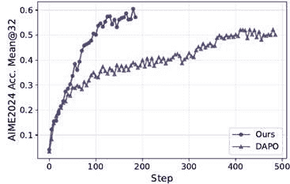

图13：采用我们策略的模型与DAPO在Qwen2.5 32B基础模型训练过程中，于AIME2024评估集上32次平均准确率的对比。

为验证我们数据过滤策略的有效性，我们在Qwen2.5 32B基础模型上进行了数学领域数据的实验，并与DAPO进行对比。如图13所示，采用我们的数据过滤策略后，模型在AIME2024评估集上的进步速度显著快于DAPO的过滤方法。因此我们将该策略应用于所有可验证的训练数据。

### 熵控制

熵是强化学习训练过程中影响模型探索与利用的关键因素。虽然DAPO提出`clip-higher`机制来防止熵的过早下降，但这种方法依赖token级别的截断操作——如前文所述，由于专家激活不一致性，该操作无法有效应用于MoE训练。我们采用KL-Cov熵控制策略来解决这一局限，从而在训练全程保持探索能力。不过Cui等人（2025年）最初设计的超参数针对的是初始熵较高的Qwen2.5模型系列，而我们冷启动后的Intern-S1 MoE模型初始熵相对较低。为此我们增大了熵控制项的系数来增强其效果。实际应用中，我们将有效token比例`k`设为0.2，KL系数`β`设为0.01。如图14所示，在熵控制策略下，模型熵值稳定维持在0.2左右，且在多个评估集上的正确率持续上升，证明了熵控制机制的有效性。

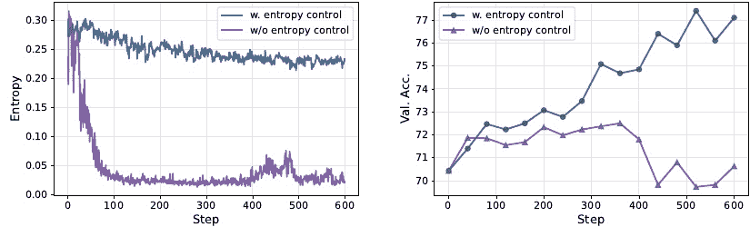

图14:Intern-S1 MoE模型在训练过程中有无熵控制的熵和平均验证集精度。

### 训练细节

针对Intern-S1 MoE模型的强化学习训练，我们采用了5.2.2节提及的数据。在进行开放式对话训练时，我们也采用思维链方法生成输出——仅提交`think`段落后方的内容至奖励模型进行评分。

为使目标函数与我们的损失函数及其他RLVR风格数据兼容，我们将满足`Â(x, y) > 0`的样本视为正样本，其余作为负样本。在整个强化学习过程中，我们在推演和训练阶段均采用FP8量化以提高计算效率。针对每个提示，我们生成8条推演响应，训练批次大小设置为4096，并拆分为8个微批次进行梯度更新。使用`AdamW`优化器，学习率设为5e-7，权重衰减为0.1，`beta`参数分别配置为0.9和0.95。训练期间冻结ViT编码器和MoE路由器的参数。模型共训练600步，为降低噪声样本对稳定性的影响，我们应用梯度范数过滤器：排除梯度范数＞0.3的批次不参与更新，约3%的训练样本因此被剔除。最终选取在完整评估集上表现最佳的若干检查点进行权重平均，以获得更均衡的性能表现。

## 评测

我们在各种基准测试上进行了广泛的实验，包括纯文本和多模态任务。我们的评估可以大致分为两个领域:一般推理和科学推理。在本节中，我们首先介绍评估配置，然后简要描述所使用的基准。然后，我们提出了Intern-S1和其他最先进的模型之间的性能比较。

### 评测配置

我们使用`VLMEvalKit`（Duan等人，2024年）和`OpenCompass`（贡献者，2023b）对模型进行评估。除非另有说明，我们会启用思维模式（`enable thinking=True`）。为了缓解与贪婪解码相关的重复问题，我们采用了采样解码策略；具体来说，Intern-S1的温度设置为0.7，Intern-S1-mini的温度设置为0.8。

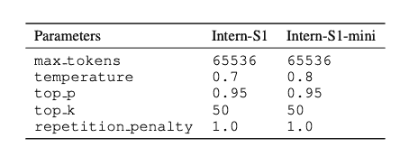

表1:评估时使用的解码参数

### 评测基准

为评估Intern-S1，我们选取了一系列具有影响力且具代表性的通用及科学推理基准测试。这些基准涵盖数学、物理、化学、生命科学、材料科学和地球科学等核心学科领域，包含纯文本与多模态场景，确保了对顶级模型专业推理能力的公平比较。本小节将简要介绍各基准测试。

#### 一般推理

MMLU- pro通过强调对召回的推理来扩展原始的MMLU:它将答案选项扩展到10个，去除有噪声的项目，并扩展到跨越14个领域的超过12K个问题，为模型比较提供了更困难和更健壮的基准(Wang et al.， 2024d)。

GPQA是一组由448个专家撰写的研究生水平的生物、物理和化学多项选择题，旨在“防谷歌”，这意味着不受限制的网络访问的非专家仍然在努力，使其适合评估深度知识和推理(Rein et al.， 2024)。我们的评估是在Diamond子集上进行的。

AIME-2025包括来自美国邀请数学考试的30道简答题(AIME I & II, 2025)，其中每个答案是000-999之间的整数;它被广泛用于探索小的、高难度的测试集上的数学推理，我们使用来自`OpenCompass`(贡献者，2023b)的收集版本。

IFEval通过可验证的约束(例如，字数统计、关键词提及、格式)评估指令遵循，在大约500个提示中对25种指令类型进行编目，以实现客观、可重复的自动评分(Zhou等人，2023)。

MathVista以视觉环境中的数学推理为目标，从28个现有数据集和3个新创建的数据集(IQTest, FunctionQA, PaperQA)中聚合6141个示例，需要细粒度的视觉理解和组合推理(Lu et al.， 2023)。

MMMU是一个11.5 k的问题，大学水平的多模态基准测试，跨越6个核心学科，30个科目，183个子字段和30个图像类型，旨在测试高级感知和特定领域的推理(Yue et al.， 2024)。

MathVision在16个学科和5个难度级别上策划了3040个具有视觉背景的竞赛式数学问题，揭示了当前lmm与人类在多模态数学推理中的表现之间的显著差距(Wang et al.， 2024b)。

MMStar是一个视觉不可或缺的基准，由1500个人类策划的项目在6个核心能力和18个轴上平衡，明确过滤掉无需图像即可解决的样本，并提出量化泄漏和真正的多模态增益的指标(Chen et al.， 2024a)。

#### 科学推理

SmolInstruct是一个以小分子为核心的大规模化学指令调优数据集，涵盖14个精选任务和约330万组查询-应答对，同时提供SMILES和SELFIES两种分子表示格式（Yu等人，2024年）。我们采用官方测试集划分进行评估。

ChemBench是一个自动化评估框架，包含2,788组经过专业筛选的化学问答对，覆盖本科至研究生阶段的化学知识，用于比较大语言模型与专业化学家在知识和推理能力上的差异（Mirza等人，2025年）。

MatBench是由十个开源数据集中的13个监督式材料属性预测任务组成的标准化测试套件，其固定数据分割和Automatminer参考基线确保了公平可重复的基准测试（Dunn等人，2020年）。

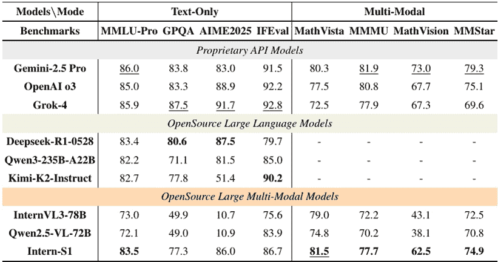

表2:Intern-S1在一般推理基准上的量化表现。下划线表示所有模型中表现最好的;粗体表示在所有开源模型中性能最好。

ProteinLMBench包含944个手动验证的选择题，涵盖序列、结构和功能，为评估大语言模型对蛋白质的理解提供了一个集中的基准(附带预训练/SFT语料库)(Shen et al.， 2024)。

SFE科学家第一次考试(SFE)从感知、属性理解和比较推理三个方面考察了MLLMs的科学认知，包括五个学科66个任务的830个专家验证的VQA项目(Zhou et al.， 2025)。

PHYSICS在六个核心子领域的1,297个博士资格考试物理问题(包括298个多模态项目)上对基础模型进行基准测试，并使用自动符号等效检查来验证答案(Feng et al.)。

MicroVQA是一个以显微镜为中心的多模态基准，包含1,042个选择题，涵盖多种成像模式和生物学主题，以科学分析和推理为目标(Burgess et al.， 2025)。

MSEarth- mcq是MSEarth地球科学基准的选择题子集，提供了≈2.78K个专家衍生的图形基础问题，涉及大气、冰冻圈、水圈、岩石圈和生物圈(Zhao et al.， 2025;PrismaX, 2025)。

XLRS-Bench在超高分辨率遥感图像(平均~ 8.5k ×8.5k像素)上评估MLLMs，并在反映真实RS场景的各种任务中使用人类验证的注释(Wang等人，2025a)。

### 评测对比

在本节中，我们将Intern-S1与近期发布的LLM和VLM进行对比，包括专有API模型和开源模型。

#### Intern-S1

Intern-S1提供最先进的开源性能，尤其在科学推理方面与专有API相比具有竞争力。

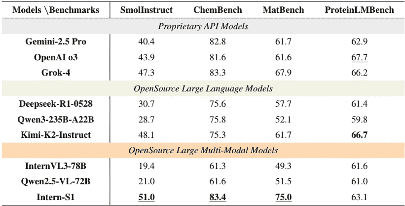

表3:Intern-S1在科学相关基准上的定量表现(纯文本)。下划线表示所有模型中表现最好的;粗体表示在所有开源模型中性能最好。

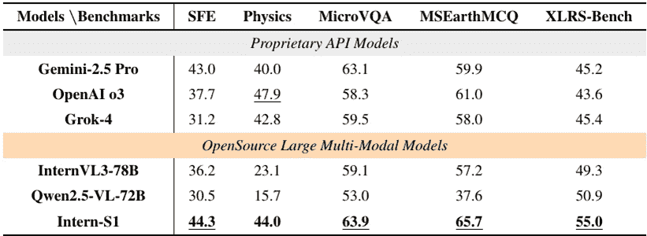

表4:Intern-S1在科学相关基准(多模态)上的定量表现。下划线表示所有模型中表现最好的;粗体表示在所有开源模型中性能最好。

在通用推理基准测试（表2）中，Intern-S1成为所有八项任务中表现最佳的开源多模态模型，并在MathVista上取得最优综合成绩（81.5分）。其显著超越此前开源多模态大语言模型——例如MathVista分数较InternVL3-78B/Qwen2.5-VL-72B分别高出2.5/6.7分，MathVision领先19.4/24.4分——不过在纯文本GPQA和IFEval测试中仍落后于领先的API模型，在AIME2025上则表现相当。

在科学领域的纯文本基准测试（表3）中，Intern-S1在四分之三的数据集（SmolInstruct 51.0分、ChemBench 83.4分、MatBench 75.0分）上取得综合最优成绩，相较既往开源模型优势显著（如MatBench：较InternVL3-78B高25.7分，较Qwen2.5-VL-72B高23.5分）。科学多模态基准测试（表4）显示，该模型在五分之四的数据集（SFE 44.3分、MicroVQA 63.9分、MSEarthMCQ 65.7分、XLRS-Bench 55.0分）上综合得分第一，Physics测试位列第二（44.0分 vs o3模型47.9分）。相较开源基线模型的优势具有持续性和显著性。

总体结果表明，Intern-S1大幅缩小了与闭源大模型在通用推理领域的差距，并为开源多模态科学推理树立了新标杆，但在指令遵循约束方面仍存在提升空间。

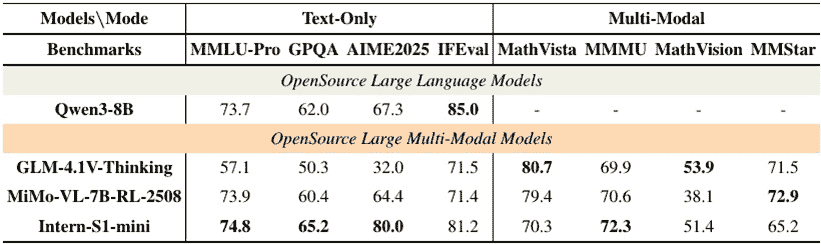

表5:Intern-S1-mini在通用推理基准上的定量表现。Bold表示在所有开源模型中表现最好。

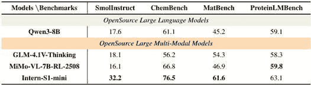

表6:Intern-S1-mini在科学相关基准上的定量表现(纯文本)。加粗表示在所有开源模型中表现最好。

## Intern-S1-mini

我们进一步将Intern-S1-mini与近期开源的大语言模型和多模态模型进行比较，包括Qwen3-8B（杨等，2025）、GLM-4.1V-Thinking（洪等，2025）以及MiMo-VL-7B-RL-2508（小米等，2025）。结果总结在表5、6、7中。

### 通用推理（纯文本）

如表5所示，Intern-S1-mini在多个纯文本基准测试中创造了新的开源最佳成绩：MMLU-Pro上74.8分（较最佳基线73.9提升0.9）、GPQA上65.2分（较62.0提升3.2）、AIME2025上80.0分（较67.3提升12.7）。这些结果表明其具备强事实推理能力、竞赛级数学能力及指令遵循能力。

### 通用推理（多模态）

在视觉推理方面（表5），Intern-S1-mini以72.3分在MMMU上取得最佳开源成绩（较70.6提升1.7）。MathVista（70.3分）和MathVision（51.4分）表现具有竞争力但稍逊于GLM-4.1V-Thinking，而MMStar（65.2分）则落后MiMo-VL-7B-RL-2508约7.7分，表明其在视觉密集型数学问题上仍有提升空间。

### 科学推理（纯文本）

表6显示其在领域科学基准上的显著进步。Intern-S1-mini在SmolInstruct（+14.1至32.2分）、ChemBench（+9.7至76.5分）、MatBench（+20.7至75.0分）及ProteinLMBench（+3.3至63.1分）上均超越最强开源基线，稳定的优势反映出其扎实的科学知识与组合推理能力。

### 科学推理（多模态）

在多模态科学评测集（表7）中，Intern-S1-mini在4/5的数据集上领先：Physics（28.8分，较23.9提升4.9）、MicroVQA（56.6分，+5.6）、MSEarthMCQ（58.1分，+7.8）和XLRS-Bench（51.6分，+1.8）。

总体而言，在17项基准测试中，Intern-S1-mini在11项上获得开源最佳成绩，与纯文本大模型Qwen3-8B持平或超越，同时与当代多模态模型保持高度竞争力。这些结果表明Intern-S1-mini不仅是具有竞争力的通用多模态模型，更是轻量级科学推理的佼佼者。我们预期这一强大模型将推动各类科学任务的发展。

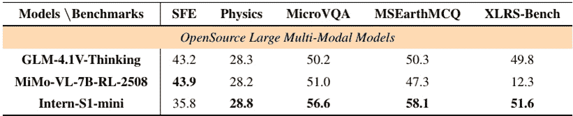

表7:Intern-S1-mini在科学相关基准(多模态)上的定量表现。Bold表示在所有开源模型中表现最好。

## 结论

在本报告中，我们介绍了最先进的科学多模态模型Intern-S1及其轻量级版本Intern-S1-mini。Intern-S1在开源模型中具备顶尖的通用推理能力，与闭源模型相比也拥有顶级科学推理能力。通过超过2.5T科学数据的预训练，Intern-S1建立了与科学任务相关的广阔知识背景，确保其能作为科研与应用领域的优质基础模型。依托InternBootCamp和混合奖励框架，我们的强化学习训练流程实现了相较于公开基准10倍的成本降低，这种高效样本利用率对于培养模型在科学领域的专业技能至关重要。
