# InternLM2 技术报告

> 来源：[https://aicarrier.feishu.cn/docx/AeyLdRIR2okYOtxVBgvcsrpWnVg](https://aicarrier.feishu.cn/docx/AeyLdRIR2okYOtxVBgvcsrpWnVg)

论文地址：https://arxiv.org/pdf/2403.17297.pdf

社区圆桌时间：4 月 6 日 20:00

腾讯会议：985-315-617

欢迎大家社区小伙伴加入一起进一步的翻译和润色！！！

加入飞书群，获取本文档的编辑权限，一起来润色文档~

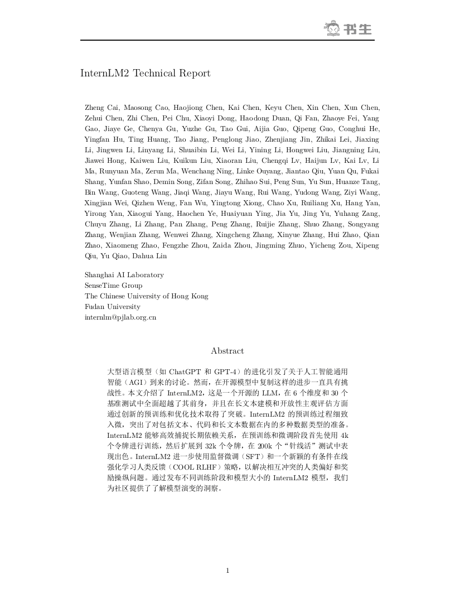

[merge_translate_zh.pdf](https://internal-api-drive-stream.feishu.cn/space/api/box/stream/download/all/EqCjbLBskoZvX1xuUG9clc1SneI)

中英对照版

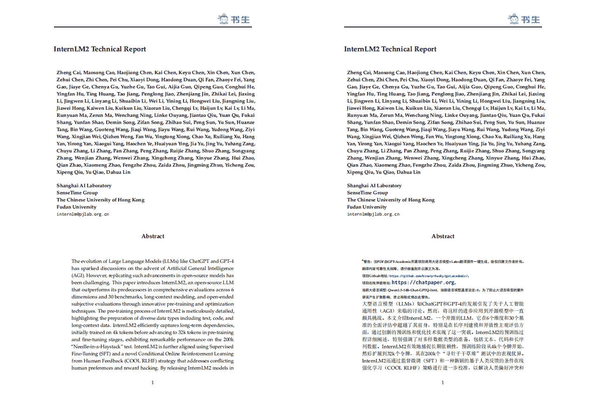

[comparison.pdf](https://internal-api-drive-stream.feishu.cn/space/api/box/stream/download/all/LnW8bdNp9oMT0wxLVRwc6VYcnlh)

# 摘要

大型语言模型（LLMs）如ChatGPT和GPT-4的发展引发了关于通用人工智能（AGI）来临的讨论。然而，将这样的进步应用到开源模型中一直颇具挑战。本文介绍InternLM2，一个开源的大语言模型，它在6个维度和30个基准的全面评估中超越了其前身，特别是在长序列建模和开放性主观评估方面，通过创新的预训练和优化技术实现了这一突破。InternLM2详细阐述了预训练过程中各类数据的准备，包括文本、代码和长文本数据。InternLM2有效地捕捉长期依赖性，预训练阶段从4k个token开始，然后扩展到32k个token，其在200k个“大海捞针”测试中的表现优异。InternLM2还通过监督微调（SFT）和一种基于人类反馈的新型条件在线强化学习方法（COOL RLHF）策略进行进一步校准，以解决人类偏好冲突和奖励策略滥用问题。我们通过发布不同训练阶段和模型大小的InternLM2，为社区提供了模型演进的洞察。

# 介绍

[自从ChatGPT和GP](https://arxiv.org/abs/2303.08774)T-4的出现以来 (OpenAI, 2023)，大语言模型（LLMs）在学[术界和工业界迅速走红。训练在数](https://arxiv.org/abs/2401.02954)十亿令牌上的模型展现了深刻的情感理解和问题解决能力，引发了人们猜测通用人工智能（AGI）时代即将到来。尽管如此，开发出与ChatGPT或GPT-4相当能力的模型的道路仍然模糊不清。开源社区正在努力缩小专有LLM与开源模型之间的差距。在过去的一年里，如LLaMA (Touvron et al., 2023a;b)、Qwen (Bai et al., 2023a)、Mistral (Jiang et al., 2023)和Deepseek (Bi et al., 2024)等一些显著的开源大语言模型取得了显著进步。在这篇论文中，我们介绍了InternLM2，这是一个超越上述模型的新大型语言模型。

大语言模型的发展包括预训练、监督微调（SFT）和基于人类反馈[的](https://arxiv.org/abs/2401.02954)强化学习（RLHF）等主要阶段 (Ouyang et al., 2022)。预训练主要基于利用大量的自然文本语料库，积累数万亿的token。这个阶段的目标是为大语言模型配备广泛的知识库和基本技能。预训练阶段的数据质量被认为是最重要的因素。然而，过去关于大语言模型的技术报告 (Touvron et al., 2023a;b; Bai etal., 2023a; Bi et al., 2024)很少关注预训练数据的处理。InternLM2详细描述了如何为预训练准备文本、代码和长文本数据。

如何有效地延长大语言模型的上下文长度目前是研究的热点，因为许多下游应用，如检[索增强生成（RAG） (Gao](https://arxiv.org/abs/2309.07864) et al., 2023)和代理模型 (Xi et al., 2023)，依赖于长上下文。InternLM2首先采用分组查询注意力（GQA）来在推断长序列时减少内存占用。在预训练阶段，我们首先使用4k个上下文文本训练InternLM2，然后将训练语料库过渡到高质量的32k文本进行进一步训练。最终，通过位置编码外推 (LocalLLaMA, 2023)，InternLM2在200k个上下文中通过了“大海捞针”测试，表现出色。

预训练后，我们使用监督微调（SFT）和基于人类反馈的强化学习（RLHF）来确保模型能很好地遵循人类指令并符合人类价值观。我们还在此过程中构建了相应的32k数据，以进一步提升InternLM2的长上下文处理能力。此外，我们引入了条件在线的RLHF（COOL RLHF），它采用条件奖励模型来协调多样但可能冲突的偏好，并通过多轮近端策略优化（Proximal Policy Optimization, PPO）来减少每个阶段出现的奖励滥用问题。为了向社区阐明RLHF的影响，我们还发布了前后RLHF两个阶段的模型，分别命名为InternLM2-Chat-{size}-SFT和InternLM2-Chat-{size}。（这里的size为模型大小）

我们的贡献有两个方面，不仅体现在模型在各种基准测试中的卓越性能，还体现在我们在不同发展阶段全面开发模型的方法。关键点包括

1.  开源InternLM2模型展现卓越性能: 我们已经开源了不同规模的模型包括1.8B、7B和20B，它们在主观和客观评估中都表现出色。此外，我们还发布了不同阶段的模型，以促进社区分析SFT和RLHF训练后的变化。

1.  **设计带有200k上下文窗口:** InternLM2在长序列任务中表现出色，在带有200k上下文的“大海捞针”实验中，几乎完美地识别出所有的“针”。此外，我们提供了所有阶段包括预训练、SFT和RLHF的长文本语言模型的经验。

1.  **综合数据准备指导:** 我们详细阐述了为大语言模型（LLM）准备数据的方法，包括预训练数据、特定领域增强数据、监督微调（SFT）和基于人类监督的强化学习（RLHF）数据。这些细节将有助于社区更好地训练LLM。

1.  **创新的RLHF训练技术:** 我们引入了条件在线RLHF（COOL RLHF）来调整各种偏好，显著提高了InternLM2在各种主观对话评估中的表现。我们还对RLHF的主观和客观结果进行了初步分析和比较，为社区提供对RLHF的深入理解。

# 基础设施

在这一部分中，我们介绍了在预训练、SFT 和 RLHF 中使用的训练框架 InternEvo。

##  2.1 InternEvo

我们使用高效的轻量级预训练框架InternEvo进行模型训练。这个框架使得我们能够在数 千个GPU[上扩展模型训练。它](https://arxiv.org/abs/2307.08691)通过数据、张量、序列和管道并行技术来实现这一点。为了进一步提高GPU内存效率，InternEvo集成了各种Zero Redundancy Optimizer (Rajbhandari et al., 2020) 策略，显著减少了训练所需的内存占用。此外，为了提高硬件利用 率，我们还引入了FlashAttention技术（Dao, 2023）和混合精度训练，使用BF16。

当在数千个GPU上训练InternLM时，In[t](https://aicarrier.feishu.cn/wiki/Xarqw88ZkimmDXkdTwBcuxEfnHe#S7dldiDi2oWQIKxldbacnyTXnlc)ernEvo展现出强大的扩展性能。如图1所示，当使用8个GPU，全局批次大小为400万个令牌训练InternLM-7B时，InternEvo实现了64%的 模型计算量利用率（MFU）。当扩展到1024个GPU时，尽管保持相同的全局批次大小， InternEvo仍能维持惊人的53% MFU。这种级别的扩展性能尤其具有挑战性，因为批次大小保持不变，而随着GPU数量的增加，计算与通信的比例会降低。相比之下，DeepSpeed在使用ZeRO-1和MiCS在1024个GPU上训练InternLM-7B时，只能达到大约36%的MFU。

InternEvo在序列长度方面也表现出强大的扩展性， 支持训练不同规模的LLM， 例如在256,000个令牌的序列长度下训练InternLM-7B， 可以达到接近88%的MFU。 相比之下，DeepSpeed-Ulysses和Megatron-LM只能达到大约65%的MFU。对于更大规模的LLM， 如300亿或700亿参数的模型，训练性能的提升也同样明显。

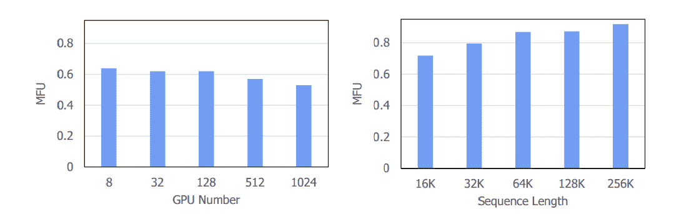

**图1**：在使用InternEvo训练InternLM-7B模型时的模型浮点运算利用率 (Model FLOPs Utilization, MFU)。我们通过基准测试，使用4096个令牌的序列长度来评估不同GPU数量下的 训练性能，同时也在128个GPU上测试不同序列长度下的训练性能。

**减少通信开销****  **

在分布式大模型训练中，内存使用和通信成本之间存在权衡。最初，通过缩小通信规模（例如，限制在单个节点内的GPU之间通信），可以有效地降低通信成本。基于这一原则，InternEvo通过实现一系列自适应分片技术（如Full-Replica、FullSharding和Partial-Sharding）来应对通信挑战，以实现强大的扩展性能 (Chen et al., 2024b)。 这些技术允许模型状态（参数、梯度和优化器状态）的各个部分独立选择最合适的分片方法和设备网格配置，从而灵活地在GPU基础设施中分布模型状态。InternEvo还引入了一个优化框架，旨在识别最有效的分片因子，以在满足GPU内存限制的同时最小化通信费用。

**通信-计算重叠****  **

InternEvo进一步通过精心协调通信和计算，以优化整体系统性能。 在使用参数分片时，模型的所有参数分布在多个GPU上以节省GPU内存。在每个训练步 的每个微批次的前向和反向传播过程中，InternEvo会高效地预加载即将到来的层的完整参数集，同时计算当前层。生成的梯度在参数分片组内通过ReduceScatter进行同步，然后通过AllReduce跨参数分片组同步。这些通信过程巧妙地与反向计算重叠，最大化训练管道的效率。对于优化器状态分片，当GPU在分片组内通过Broadcast广播更新的参数时， InternEvo会与下一个训练步骤的前向计算进行战略重叠。这些创新的重叠方法有效地平衡了通信开销和计算执行时间，显著提高了整体系统性能。

**长序列训练****  **

长序列训练的主要挑战之一是计算速度和通信开销之间的权衡。InternEvo将GPU内存管理分解为四个并行维度（数据、 张量、 序列和管道）和三个分片维度（参数、梯度和优化器状态）(Chen et al., 2024a)。我们对每个维度的内存和通信成本进行了详尽分析，并使用执行模拟器来识别和实施最优的并行化策略。根据训练规 模、序列长度、模型大小和批量大小，可以自动搜索最优执行计划。通过这种执行计划， InternEvo能够处理长达100万个令牌的长序列训练。此外，InternEvo还实施了内存管理技术来减少GPU内存碎片，这是长序列训练场景中的常见问题。它使用内存池进行统一内存管理，并引入了一种碎片整理技术，以主动合并小内存块，防止内存不足错误。

**容错性****  **

我们[还解决了在GPU数据中心高效训](https://www.usenix.org/conference/nsdi23)练大模型的挑战，这些数据中心经常面临频繁的硬件故障、复杂的并行化策略和资源利用率不平衡等问题。我们对GPU数据中心六个 月的大模型开发工作负载进行了深入的特性研究 (Hu et al., 2024)。研究发现大模型与先前的深度学习工作负载存在差异，并探索了资源利用率模式和任务失败的影响。根据我们的分析，我们引入了两个系统努力：一个容错的预训练系统，通过诊断大模型相关的故障并自动恢复来提高容错性；以及一个为评估任务设计的解耦调度系统，提供及时的模型性能反馈。

在我们的实现中，我们整合了异步保存机制，定期在预定义的时间间隔内将模型权重和优化器状态存档到分布式文件和对象存储。在整个训练过程中，每个GPU首先在本地存储 中保存模型状态，然后异步上传到远程分布式存储系统。这个双步骤过程确保了在系统自 动检测到偶尔的硬件或网络故障时，仅丢失少量的训练进度。为了优化存储空间，我们系统地将这些临时模型检查点从热点存储转移到成本效益高的冷存储。此外，我们的系统设计能够无缝地在并行化配置更改时恢复模型训练，为训练管道提供了灵活性和连续性。

InternEvo的效率在人类反馈强化学习（RLHF）阶段也得到了成功验证，该阶段涉及多款大型语言模型进行互动训练。例如，在Proximal Policy Optimization (PPO) 过程中，我们使用了四个同样规模的模型，其中两个进行训练。InternEvo使得每个模型能够在最优配置下运行。为了增强多模型间的协同，我们开发了一种基于InternEvo和Ray的创新RLHF框架。这个框架以灵活性和可扩展性为特点，能够在大规模环境中高效运作。它能够与各种大型语言模型执行引擎集成，并支持多种算法设计。关于”Alignment”概念的详细描述，请参阅Section 4。

## 2.2  模型结构

Transformer（Vaswani et al. (2017)）由于其出色的并[行](https://jmlr.org/papers/v24/22-1144.html)化能力，已经成为过去大语言模型（LLMs）的主流选择，这充分利用[了GPU的威力（Brown ](https://arxiv.org/abs/2002.05202)et al. (2020); Chowdhery et[ al. (2023](https://github.com/ggerganov/llama.cpp)); Zeng et al. (2023)）。LLaMA（Touvron et al. (2023a)）在Transformer架构基础上进行了改进，将LayerNorm（Ba et al. (2016)）替换为RMSNorm（Zhang & Sennrich (2019)），并采用SwiGLU（Shazeer (2020)）作为激活函数，从而提高了训练效率和性能。

自从LLaMA（Touvron et al. (2023a)）发布以来，社区积极地扩展了基于LLaMA架构的生态系统，包括高效推理的提升（lla (2023)）和运算符优化（Dao (2023)）等。为了确保我们的模型InternLM2能无缝融入这个成熟的生态系统，与Falcon（Almazrouei et al. (2023)）、Qwen（Bai et al. (2023a)）、Baichuan（Yang et al. (2023)）、Mistral（Jiang et al. (2023)）等知名LLMs保持一致，我们选择遵循LLaMA的结构设计原则。为了提高效率，我们将 、 和 矩阵合并，这在预训练阶段带来了超过5%的训练加速。此外，为了更好地支持多样化的张量并行（tp）变换，我们重新配置了矩阵布局。对于每个head的 、 和 ，我们采用了交错的方式，如图2所示。

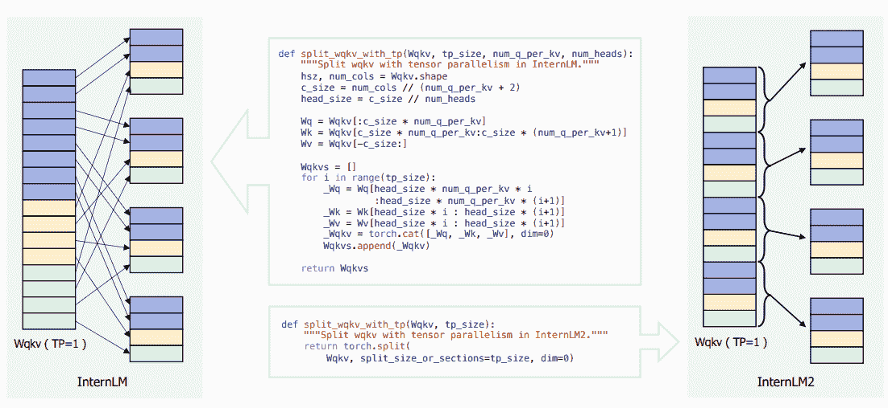

**图 2**: 不同的权重矩阵布局导致在调整张量并行性（TP）大小时产生不同的复杂性。（Tensor Parallelism）

这种设计修改使得可以通过分割或沿最后一个维度连接矩阵来调整张量并行大小，从而增强了模型在不同分布式计算环境中的灵活性。InternLM2的目标是处理超过32K的上下文，因此InternLM2系列模型都采用了分组查询注意力（GQA）（Ainslie et al. (2023)），以实现高速度和低GPU内存下的长序列推理。

# 预训练

这一部分我们介绍预训练数据、预训练设置以及三个预训练阶段。

## 3.1 预训练数据

大规模语言模型（LLM）的预训练深受数据的影响，数据加工主要面对的挑战包含敏感数据的处理、全面知识的覆盖以及效率与质量的平衡。在本节中将介绍我们在通用领域的文本数据、编程语言相关数据和长文本数据的处理流程。

### 3.1.1 文本数据

我们的预训练数据集的来源为网页、论文、专利和书籍。为了将这些原始数据转化为预训练数据集，我们首先将所有数据标准化为指定格式，然后根据内容类型和语言进行分类，并将结果存储为JSON Lines（jsonl）格式；然后，对所有数据，我们应用了包括基于规则的过滤、数据去重、安全过滤和质量过滤等多个处理步骤。这使得我们得到了一个丰富、安全且高质量的文本数据集。

**数据来源分布**

我们根据数据来源对预训练数据集中的文档[数](https://aicarrier.feishu.cn/wiki/Xarqw88ZkimmDXkdTwBcuxEfnHe#LbkBdXrvforGg3xrCcWcOOgJnWb)量、存储容量和容量占比进行了统计分析，结果如表1所示。其中，主要来源是中文和英文网页，占总量的86.46%。尽管其他来源（如书籍和技术文献）的数据量占比相对较少，但它们的平均文档长度更长、内容质量相对较高，因此同样重要。

| Source | Docs (M rows) | Bytes (GB) | Bytes-percent |
| --- | --- | --- | --- |
| en-books | 0.50 | 220.14 | 1.63% |
| en-techlit | 59.27 | 576.48 | 4.27% |
| en-webpages | 3614.07 | 9129.39 | 67.51% |
| zh-books | 0.71 | 366.82 | 2.71% |
| zh-techlit | 89.59 | 668.19 | 4.94% |
| zh-webpages | 928.94 | 2562.86 | 18.95% |

**表1**：来自不同来源的预训练数据汇总

**数据处理****流程**

本工作中使用的数据处理流程如图[3](https://aicarrier.feishu.cn/wiki/Xarqw88ZkimmDXkdTwBcuxEfnHe#YRKQdlAPsokfLGxbDNAcaRTDndb)所示。整个数据处理流程**首先将来自****不同****来源****的数据标****准化以获**得格式化数据**。然后，使用启发**式统计规则对数据进行过滤以获得干净数据。接下来，使用局部敏感哈希（LSH）方法对数据去重以获得去重数据。然后，我们应用一个复合安全策略对数据进行过滤，得到安全数据。我们对不同来源的数据采用了不同的质量过滤策略，最终获得高质量预训练数据。

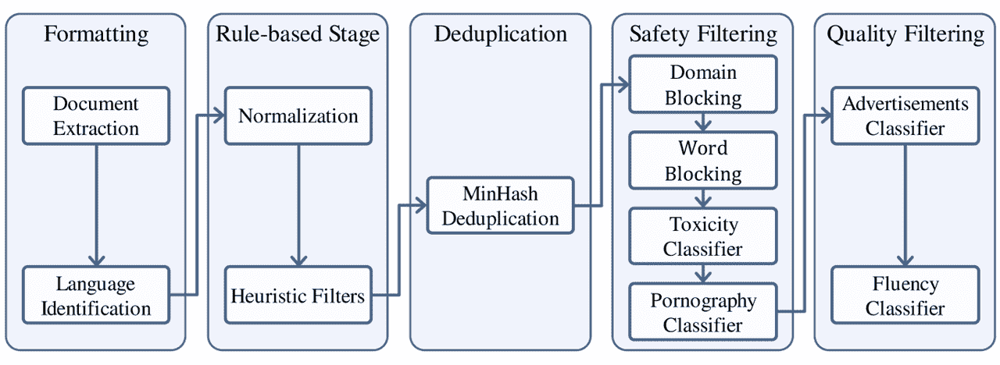

**图3**：数据处理流程

**数据格式化**

我们将以网页数据为例详细介绍数据处理流程。我们的网页数据主要来自[Common Crawl](https://commoncrawl.org/)。首先，我们需要解压缩原始[的Warc格式文件，并](https://arxiv.org/html/2403.17297v1#bib.bib13)[使用Tr](https://arxiv.org/html/2403.17297v1#bib.bib13)a[filatu](https://pypi.org/project/pycld2/)ra (Barbaresi, 2021)进行HTML解析和主文本提取。**然后，我们**使用pycld2库进行语言检测和主文本分类。最后，我们为数据分配一个唯一标识符，并以jsonl（JSON行）格式存储，从而获得格式化数据。

**基于规则的****处理**

从互联网随机提取的网页数据通常包含大量低质量数据，如解析错误、格式错误和非自然语言文本[。常见的做法是设计基于规](https://arxiv.org/html/2403.17297v1#bib.bib70)[则的正则](https://arxiv.org/html/2403.17297v1#bib.bib70)化和过滤方法[来修改和过滤数据，如Goph](https://arxiv.org/html/2403.17297v1#bib.bib33)[er (](https://arxiv.org/html/2403.17297v1#bib.bib33)Rae et al., 20[21)、C4 (Dodge e](https://arxiv.org/html/2403.17297v1#bib.bib67)[t al](https://arxiv.org/html/2403.17297v1#bib.bib67).**, 20**21)和RefinedWeb (Penedo et al., 2023)。基于对数据的观察，我们设计了一系列启发式过滤规则，重点关注分隔和换行中的异常、异常字符的频率以及标点符号的分布。通过应用这些过滤器，我们得到了干净数据。

**去重**

互联网上存在的大量重[复文本会对模型训](https://arxiv.org/html/2403.17297v1#bib.bib16)[练产生负](https://arxiv.org/html/2403.17297v1#bib.bib16)面影响。因此，我们采用基于Locality-Sensitive Hashing (LSH)的方法**对数据进**行模糊去重。更具体地说，我们使用MinHash方法(Broder, 1997)，在文档的5-gram上使用128个哈希函数建立签名，并使用0.7作为去重阈值。我们的目标是保留最新数据，即优先考虑具有较大Common Crawl数据集版本号的数据。在LSH去重后，我们得到了去重数据。

**安全过滤**

互联网上充斥着有毒和色情的内容，使用这些内容进行模型训练会对模型的表现产生负面影响，增加生成不安全内容的可能性。因此，我们采用了一种综合性的安全策略，结合了“域名屏蔽”、“关键词屏蔽”、“色情内容分类器”和“有害性分类器”来过滤数据。具体来说，我们构建了一个包含大约1300万个不安全域名的屏蔽域名列表，以及一个包含36,289个不安全词汇的屏蔽词列表，用于初步的数据过滤。考虑到关键词屏蔽可能会无意中排除大量数据，我们在编制屏蔽词列表时采取了谨慎的方法。

为了进[一步提高不安全内容的检测率，我](https://perspectiveapi.com/)们使**用了来自**Kaggle的“有害评论分类挑战赛（Toxic Comment Classification Challenge）”数据集对BERT模型进行了微调，从而得到了一个有害性分类器。我们从去重后的数据中抽取了一些样本，并使用Perspective API对其进行了标注来创建色情分类数据集然后，我们用这个数据集微调BERT模型，产生一个色情分类器。最后，通过使用这两个分类器对数据进行二次过滤，过滤掉分数低于阈值的数据，我们得到了安全数据。

**质量过滤**

与书籍、论文和专利等来源相比，从互联网获取的数据包含大量低质量内容。根据我们的观察，这种低质量内容的主要原因是两个方面：1. 互联网上充斥着营销广告，这些广告往往重复性较强，信息含量较低。2. 许多网页由文章摘要或产品描述的列表组成，导致提取的文本难以阅读且缺乏逻辑连贯性。

为了过滤出这些低质量内容，我们首先组织了人工数据标注。在广告分类任务中，标注人员被要求识别数据中是否包含广告内容（无论是整体还是部分广告都被标记为低质量）。在流畅性分类任务中，标注人员被要求在一致性、噪声、信息**含量和语法四个维**度上对数据进行评分，从而得到一个全面的流畅性得分。然后我们使用这些标注的数据微调BERT模型，得到一个广告分类器和一个流畅性分类器。最后，通过使用这两个分类器对数据进行二次过滤，过滤掉得分低于阈值的数据，我们得到了高质量预训练数据。

### 3.1.2 代码数据

编程是LLM的一项关键技能，它为多种下游应用提供支持，例如编码辅助、软件开发以及构建可使用工具的代理。此外，(Groeneveld et al. (2024)) 指出，通过在代码数据上进行训练可以增强LLM的推理能力，因为代码通常比自然语言结构更清晰、更严谨、更可预测。

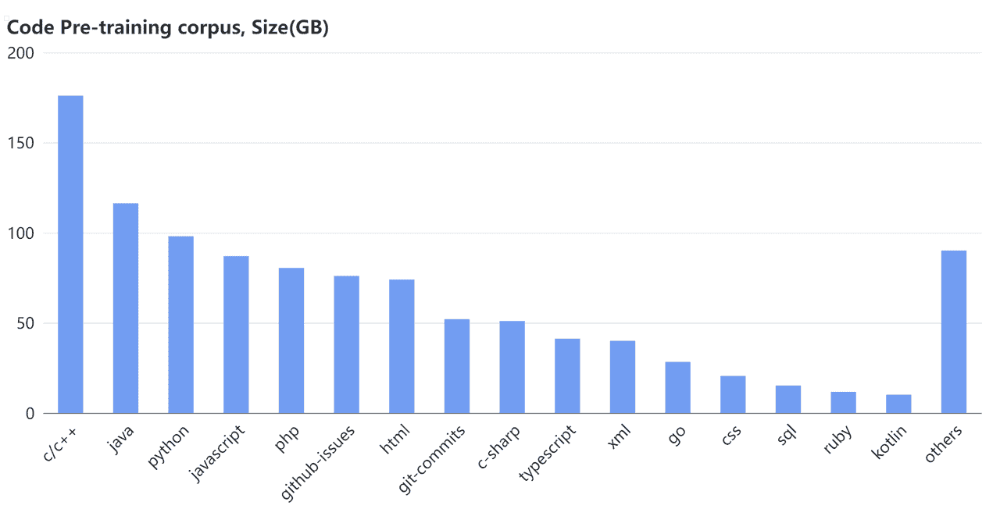

**图4**：预训练语料库中的代码数据统计

代码数据的来源有GitHub、公共数据集以及一些与编程相关的在线资源：如问答论坛、教程[网](https://aicarrier.feishu.cn/wiki/Xarqw88ZkimmDXkdTwBcuxEfnHe#Omw8dkiO0oKNTBx9xq8cVbvCnSf)站和API文档等。统计数据如图4所示。

表[2](https://aicarrier.feishu.cn/wiki/Xarqw88ZkimmDXkdTwBcuxEfnHe#ZhwQd4wz7ofCDgxle0ocHDN5n7c)反映了基于我们训练的评分模型的数据质量评估。高质量数据将具有更高的采样权重，并可以在预训练阶段进行多次训练。中等质量数据具有正常的采样权重，通常训练一次。低质量数据被排除在外，因为我们的实证发现，尽管它们的比例相对较小，但去除它们对于优化模型性能和确保训练稳定性至关重要。

| **High** |  | **Moderate** |  | **Low** |  |
| --- | --- | --- | --- | --- | --- |
| Bytes (GB) | Percentage | Bytes (GB) | Percentage | Bytes (GB) | Percentage |
| 105.6 | 16.8% | 440.1 | 69.9% | 83.85 | 13.3% |

**表2**：基于可学习分类器的代码数据质量统计，其中高质量数据将被多次训练，中等质量数据将被训练一次，低质量数据将被丢弃。那些数据量比较少的编程语言的数据将被保留，不会在统计中考虑

**格式清理**

所有数据都转换为统一的Markdown格式。尽管我们并没有在格式清理上投入太多的精力，但是仍然有一小部分数据中出现了损坏的HTML或XML格式，我们还是应用了一套启发式规则来确保数据的格式正确。我们选择Markdown格式是因为它能最大化的减少的格式化后的 toke[ns 开销，并且它对代码](https://arxiv.org/html/2403.17297v1#bib.bib38)[和自然语](https://arxiv.org/html/2403.17297v1#bib.bib38)言交织的数据具有更好的兼容性。因涉及根据代码之间的依赖关系连接多个代码文件，预训练实际使用的数据格式更为复杂。主要思想是利用交织了代码和自然语言的数据，这对于教会模型编程至关重要。这一点在最近的研究中也有提及(Guo et al., 2024)。

**数据去重**

代码数据的去重操作与自然语言的去重操作类似，但除了分词，因为这会影响超参数的选择。例如，Python示例使用两个空格、四个空格或制表符来表示缩进。传统的空格分词器，或者为自然语言定制的分词器，可能会错误地将这些示例评估为不同的数据。我们认为，一个有效的分词器对于提高去重策略的整体效果至关重要。尽管最近的研究已经探讨了在段落或行级别进行细粒度去重，但我们仍然在文件级别进行去重，以保持上下文的完整性。

**质量过滤**

数据质量是LLM研究中一个关键而模糊的方面，主要是难以量化其对模型性能影响。我们设计的质量过滤流程是混合的和多阶段的，包含了基于规则的和基于模型的质量评分器。其中基于规则的评分器是启发式的且因不同的编程语言而各不相同，因为我们发现代码风格不是一个可靠的优质指标，并且会错误地将许多代码分类为低质量。对于基于模型的评分器，我们评估了几种骨干模型，用大约50,000个标记样本训练它们。然而，我们观察到评分器的评估与人类的评估之间的相关性在不同语言之间存在差异，而且扩大训练集并没有显著提高评分器的准确性。因此，我们只在那些模型评估与人类标注的验证集上的评估相一致的编程语言中，使用基于模型的评分器。

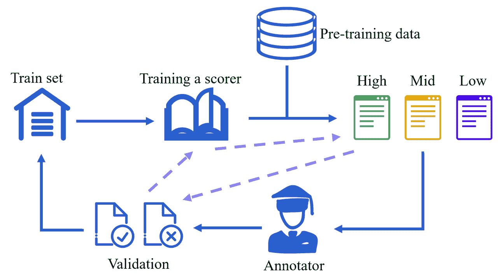

**图5**：代码质量评分器的迭代提炼标注流程

[为](https://aicarrier.feishu.cn/wiki/Xarqw88ZkimmDXkdTwBcuxEfnHe#V8BBdqyano4eraxfkZucLjkInVf)了获得代码质量评分器的可靠标注，我们引入了一个迭代标注流程（如图5所示），以解决代码质量定义模糊的挑战。对于人类专家来说，确定对教授大语言模型（LLM）有帮助的代码同样不是一件小事，例如，一个广为人知的代码库可能对初学者来说过于复杂。我们提出的迭代标注工作流程允许标注人员验证模型预测结果，并相应地完善标注指南。为了提高标注效率，我们只要求标注人员检查评分器以高置信度标记为高质量和低质量的样本。此外，在每次迭代中都有一个自动验证过程，以确保之前标注的样本被评分器正确分类，这在图中以虚线表示。在实际操作中，我们进行了三次迭代才最终确定了我们的评分模型。

**依赖排序**

InternLM2的训练上下文窗口已扩展到32,000个tokens，这个长度可以允许利用代码仓库的整个上下文。但是因为在之前的数据处理步骤中，比如对代码文件的扩展名过滤和去重等操作，可能已经破坏了代码仓库的结构。所以我们首先重新组合来自同一个仓库的代码文件，然后通过依赖排序以建立一个拼接这些文件的序列。这样一个代码仓库将被视为一个由多个代码块组成的大Markdown文件，这使得模型能够学习跨文件之间的依赖关系。

我们采用正则表达式来检测各种编程语言之间的“import”关系，并使用拓扑排序来确定文件的拼接顺序。在实践中，文件的排列可能会打破文件夹边界，导致来自多个子文件夹的文件以交错的方式排列。对于非代码文件，如Markdown和其他文档，我们把它们放在同一子文件夹中的第一个代码文件之前。

对于一些特殊情况，如代码文件之间存在的多重依赖路径，我们选择最短的路径来处理，对于“import”关系图中的循环引用，我们使用字母顺序来决定引用的起始点。寻找“import”关系的一个技巧是解决好批量导入问题，例如“__init__.py”或“#include xx.h”。这些文件可能导入了一大批未使用的依赖项，因此我们应用启发式规则来细化我们对“import”关系的检测，确保我们能够准确识别并在更精细的层面上处理这些关系。

### 3.1.3 长上下文

处理非常长的上下文（超过32K个 tokens ）是在LLM研究中一个日益受到关注的话题，它拓宽并促进了LLM在应用领域的发[展，例如书籍摘要、支持](https://arxiv.org/html/2403.17297v1#bib.bib60)[长期对话](https://arxiv.org/html/2403.17297v1#bib.bib60)[以](https://arxiv.org/html/2403.17297v1#bib.bib60)及处理涉及复杂推理步骤的任务等。预训练数据是扩大模型上下文窗口的一个关键因素。我们遵循 Lv et al. (2024) 中提到的准备长文本预训练数据的工作，其中包括附加的实验和讨论。我们在下文中仅概述InternLM2中使用的数据准备工作。

**数据过滤流水线**

我们的数据过滤流水线旨在过滤掉低质量的长文本数据。它包括三个阶段：a）长度选择，这是一个基于规则的过滤器，选取超过32K字节的样本；b）统计过滤器，利用统计特征来识别和移除异常数据；c）困惑度过滤器，利用困惑度的差异来评估文本片段之间的连贯性，过滤掉上下文不连贯的样本。需要注意的是，选定用于长上下文训练的所有数据都是标准预训练语料库的一个子集，这意味着长上下文数据至少在预训练期间会被学习两次。

**统计过滤器**

[我们使用各种词汇和语言](https://arxiv.org/html/2403.17297v1#bib.bib60)[特征来构](https://arxiv.org/html/2403.17297v1#bib.bib60)[建](https://arxiv.org/html/2403.17297v1#bib.bib60)我们的统计过滤器。不符合既定规则的数据样本被排除在预训练语料库之外。这些过滤器的完整列表可以在 Lv et al. (2024) 中找到。一个典型的过滤器是存在连词和其他暗示话语结构的词，比如“Especially”（特别是）、“Formally”（理论上）等。设计这些过滤器的总体指导思想是过滤掉无意义的数据，而不是选择最高质量的数据。统计过滤器对长文本数据特别有效，因为统计特征比短文本数据中的统计特征更加一致。例如，20个 token 的文本可能不会产生可靠的统计数据，但32K个 token 的文本将具有更清晰的统计特征分布。

**困惑度过滤器**

困惑度通常被视为文本序列概率 的估计器，我们稍微改变了它的使用，以估计两个文本片段之间的条件概率 ，其中 是 的前置内容。当 和 高度相关时，条件概率应该高于单独估计 的概率，这也意味着负的困惑度差异。相反，如果概率变化方向相反，意味着 是一个分散性的上下文，它应该从预训练语料库中移除。理想情况下，添加更多上下文不应该影响后续文本的可预测性。然而，我们观察到在不正确拼接的文本的情况下会出现例外，比如失败的HTML解析、随机社交媒体片段以及源自复杂布局的源中的识别错误等其他情况。请注意，我们仅基于困惑度差异而不是困惑度本身来过滤数据，这可以在很大程度上减少估计器本身引入的偏差（使用哪个模型来计算困惑度）。困惑度估计器的偏差已在 Wettig et al. (2024)；Sachdeva et al. (2024)中讨论。

**阈值选择**

选择适当的阈值是数据过滤过程的关键且具有挑战性的部分，这一挑战因我们构建了许多过滤器而变得更加严峻。我们在设定阈值方面有两个经验教训：

为每个领域定制阈值，而不是寻求一个普遍的解决方案。例如，针对连词的统计过滤器不适用于通常没有任何连词的代码数据。同样，教科书、研究论文、小说和专利各自具有独特的特征。一个普遍的阈值可能会错误地分类大量数据。同样的逻辑也适用于在不同语言之间设定阈值；因此，我们针对每个领域单独调整阈值。

使用验证集来简化过程，只关注边缘案例。与基于学习的特征提取器或评分器不同，我们的统计和困惑度过滤器[在同一领域内产生平滑的](https://arxiv.org/html/2403.17297v1#bib.bib60)[结果。这](https://arxiv.org/html/2403.17297v1#bib.bib60)[使](https://arxiv.org/html/2403.17297v1#bib.bib60)我们能够专注于靠近阈值的样本，简化阈值的调整过程，因为我们只需要决定是降低还是提高它们。Lv et al. (2024) 展示了特定过滤器在数据集上的得分，证明了我们提出的过滤器的可解释性。

图[6](https://aicarrier.feishu.cn/wiki/Xarqw88ZkimmDXkdTwBcuxEfnHe#XjNidcN9hoz5igxA1JtcW0nenYb) 展示了经过所有提出的过滤器处理，数据的前后分布的情况。整个过滤过程移除了大量网页（Common Crawl）和专利数据，而大多数书籍和论文数据都被保留了下来。

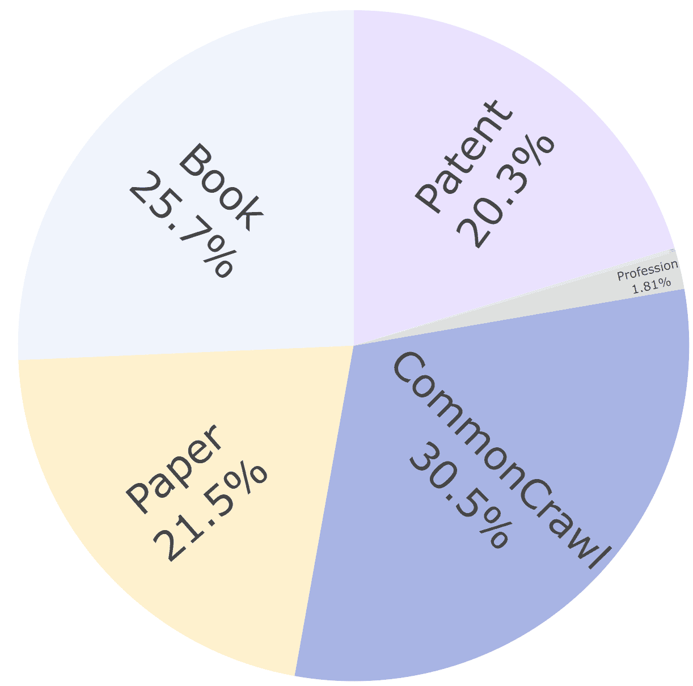

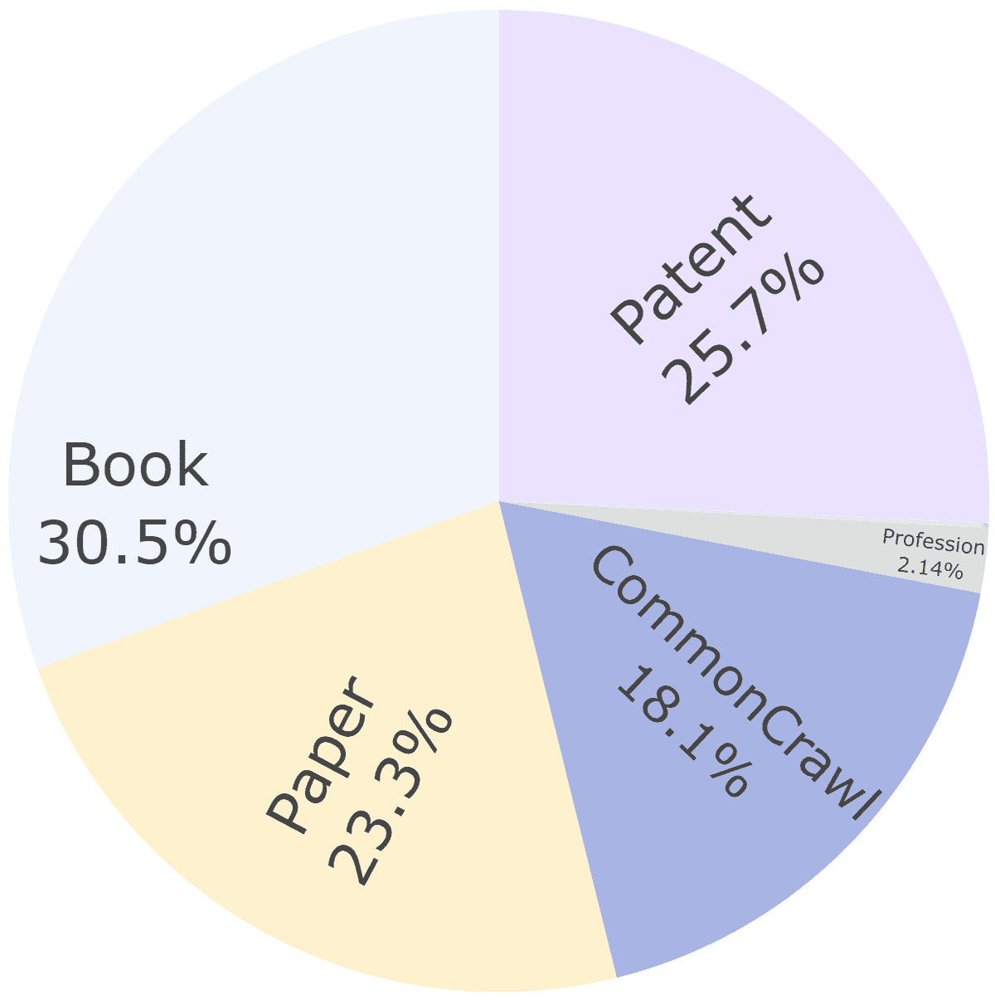

(a)                                                                              (b)

**图6**：（a）过滤前长文本数据的统计。(b)过滤后长文本数据的统计。

## 3.2 预训练设置

在这一部分，我们介绍了分词（Tokenization）和预训练的超参数。

### 3.2.1 分词（Tokenization）

我[们选择使用G](https://github.com/openai/tiktoken)PT-4的tokenization方法，因为它在压缩各种文本内容方面非常高效。我们的主要参考是cl100K词汇表，它主要包含英语和编程语言的 token，共计100,256条，其中包括不到3,000个中文 token。为了在处理中文文本时优化InternLM的压缩率，同时将总体词汇量保持在100,000以下，我们从cl100k词汇中仔细挑选了前60,004个token，并将其与32,397个中文token集成。此外，我们还加入了147个备用token，最终得到的词汇量符合256的倍数，从而便于高效训练。

### 3.2.2 预训练超参数

| Params | n_{layers} | n_{dim} | n_{kv\_heads} | n_{q\_per\_head} | Learning Rate | Batch size |
| --- | --- | --- | --- | --- | --- | --- |
| 1.8B | 24 | 2048 | 8 | 2 | 3e-4 | 4M |
| 7B | 32 | 4096 | 8 | 4 | 3e-4 | 4M |
| 20B | 48 | 6144 | 8 | 6 | 3e-4 | 5M |

**表3**：InternLM2模型的超参数。

基本超参数如上表[3](https://aicarrier.feishu.cn/wiki/Xarqw88ZkimmDXkdTwBcuxEfnHe#OT01d9OxloQyiexQYBNcFFDfnjc)[所示。在](https://arxiv.org/html/2403.17297v1#bib.bib59)训练过程中，我们使用AdamW (Loshchilov & Hutter, 2019)优化模型，其参数设置为 和 。我们采用余弦学习率衰减，学习率衰减至其最大值的10%。

## 3.3 预训练阶段

用于预训练1.8B、7B和20B模型的总的token数范围从2.0T到2.6T，预训练过程包括三个不同的阶段。在第一阶段，我们使用了长度不超过4k的预训练语料库。在第二阶段，我们包括了长度不超过32k的50%的预训练语料库。在第三阶段，我们使用了特定能力的增强数据。在每一阶段，我们都混合了英文、中文和代码数据。

### **3.3.1 4k 上下文训练**

大约90%的训练步骤中，我们使用了长度多达4096个tokens的数据进行训练。如果数据长度超过4096，我们会强制截断它，剩余部分也会进行训练。

### **3.3.2 长上下文训练**

扩展上下文窗口可以显著提高 LLM [在各种应用中的表现，例如](https://arxiv.org/html/2403.17297v1#bib.bib36)[检索增强](https://arxiv.org/html/2403.17297v1#bib.bib36)生成 (Gao [et al., 202](https://arxiv.org/html/2403.17297v1#bib.bib90)[3) 和](https://arxiv.org/html/2403.17297v1#bib.bib90)[智能代理](https://arxiv.org/html/2403.17297v1#bib.bib73)(X[i et al., 2023](https://arxiv.org/html/2403.17297v1#bib.bib91)[)。受到](https://arxiv.org/html/2403.17297v1#bib.bib91)在长[上下文训练方面的最新进展](https://arxiv.org/html/2403.17297v1#bib.bib57)[的启发(R](https://arxiv.org/html/2403.17297v1#bib.bib57)[ozière et al](https://arxiv.org/html/2403.17297v1#bib.bib57)[., 20](https://arxiv.org/html/2403.17297v1#bib.bib57)2[3; Xi](https://arxiv.org/html/2403.17297v1#bib.bib32)[ong ](https://arxiv.org/html/2403.17297v1#bib.bib32)et al., 2023; Liu et al., 2023b)，我们的InternLM2训练过程从4K上下文的语料库开始，然后过渡到32K上下文的语料库。尽管使用了32K长度的语料库，仍有50%的数据长度短于4096个tokens。这个长上下文训练阶段占整个预训练过程的大约9%。

为了适应这些更长的序列，确保为长上下文提供更有效的位置编码(Liu et al., 2023b)，我们将旋转位置嵌入（RoPE）的基础从50,000调整到1,000,000。得益于 InternEvo (Chen et al., 2024a) 和 flash attention (Dao, 2023) 的良好可扩展性，当上下文窗口从4K更改为32K时，训练速度仅降低了40%。

### 3.3.3 特定能力增强训练

逻辑[推理、数学问题解决和知识](https://arxiv.org/html/2403.17297v1#bib.bib10)[记忆等能力](https://arxiv.org/html/2403.17297v1#bib.bib10)是大型语言模型所期望的关[键能力。然而，在预训练过程](https://arxiv.org/html/2403.17297v1#bib.bib96)[中，与这](https://arxiv.org/html/2403.17297v1#bib.bib96)些能力相关的高质量数据在整个[语料库中分布稀疏，这使得模型难](https://arxiv.org/html/2403.17297v1#bib.bib66)[以精通这](https://arxiv.org/html/2403.17297v1#bib.bib66)些能力。之前的工作，如Qwen (Bai et al., 2023a)，GLM-130B (Zeng et al., 2023)[，](https://aicarrier.feishu.cn/wiki/Xarqw88ZkimmDXkdTwBcuxEfnHe#T6b4dnkhio9bIoxU9R6c3SCXnZc)Nemotron-4 (Parmar et al., 2024)，已尝试在预训练阶段结合基于指令的或高质量的数据来增强这些能力。在InternLM 2中，我们收集了一个丰富的数据集，其中包含精心策划的高质量检索数据和来自Huggingface数据集平台的各种类型的开源数据。我们在这个数据集中总共收集了240亿个tokens，这个语料库的详细信息如表4所示。我们过滤出测试集相关数据，并按照第5.4节所示进行了污染测试。为了使模型更好地拟合这些数据，我们采用了较小的学习率和批量大小。

经过特定能力增强训练阶段之后，InternLM2模型在编程、推理、问题回答和考试等方面表现出显著的性能提升，详细的评估结果将在接下来的评估部分中展示。为了助力社区的研究工作，我们发布了增强训练前后的 checkpoints，分别命名为InternLM2-{size}-Base和InternLM2-{size}。

| **Category** | **Tokens(B)** | **Ratio(%)** |
| --- | --- | --- |
| Retrieved Stem Data | 15.97 | 65 |
| Retrieved Special Domain Data | 2.17 | 8 |
| Selected High Quality Data | 6.26 | 26 |
| Total | 24.40 | 100 |

**表4**：特定能力增强训练的详细数据

# 对齐

预训练阶段为大型语言模型（LLMs）赋予了解决各种任务所需的基础能力和知识。我们进一步微调LLMs，以充分激发其能力，并指导LLMs作为有益和无害的AI助手。这一阶[段，也常被称为“](https://aicarrier.feishu.cn/wiki/Xarqw88ZkimmDXkdTwBcuxEfnHe?fromScene=spaceOverview#Ob2CdIm7OoDk32xPGMWc2RB3nob)对齐”（Alignment），**通常**包含两个阶段：监督**微**调**（**SFT）和基于人类反馈的强化学习（RLHF）。在SFT阶段，我们通过高质量指令数[据（见4.1 监督](https://aicarrier.feishu.cn/wiki/Xarqw88ZkimmDXkdTwBcuxEfnHe?fromScene=spaceOverview#AnkzdSPAyoWPDBx4vrZcuyIpnHb)微调）微调模型，使其遵循多种人类指令。然后我们提出了带人[类反馈的条件在线强化学习（](https://aicarrier.feishu.cn/wiki/Xarqw88ZkimmDXkdTwBcuxEfnHe?fromScene=spaceOverview#PkIIdTeJYoQeeKx1BIrcUrXUnPh)COnditionalOnLine Reinforcement Learning with Human Feedback，COOL RLHF），它应用了一种新颖的条件奖励模型，可以调和不同的人类偏好（例如，多步推理准确性、有益性、无害性），并进行三轮在线RLHF以减少奖励黑客攻击（见4.2 基于人类反馈的条件在线强化学习COOL RLHF）。在对齐阶段，我们通过在SFT和RLHF阶段利用长上下文预训练数据来保持LLMs的长上下文能力（见4.3 长文本微调）。我们还介绍了我们提升LLMs工具利用能力的实践（参见4.4 工具增强的LLMs）。

## 4.1 监督微调

在监督微调（SFT）阶段，我们使用了一个包含1000万个指令数据实例[的](https://aicarrier.feishu.cn/wiki/Xarqw88ZkimmDXkdTwBcuxEfnHe?fromScene=spaceOverview#TJagdopxaoDRcKx6aAzcwglcn2f)数据集，这个数据集中的的指令数据实例已经被筛选以确保[它们的](https://github.com/MicrosoftDocs/azure-docs/blob/main/articles/ai-services/openai/includes/chat-markup-language.md)有用性和无害性。该数据集涵盖了各种主题，包括一般对话、NLP任务、数学问题、代码生成和函数调用等。图7展示了SFT数据主题的详细分布。为了便于表示这些各种任务，我们将数据样本转换为ChatML（Cha）格式。7B和20B模型都使用AdamW优化器进行了一轮训练，初始学习率设为4e-5。

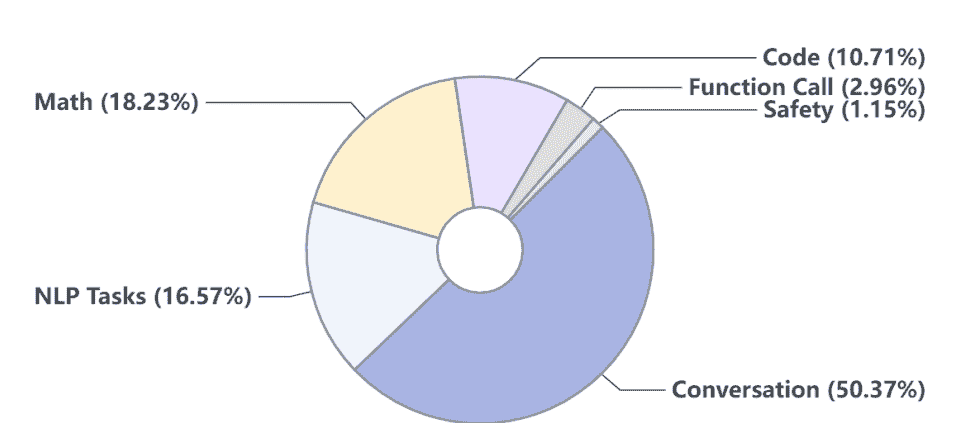

**图7**: 监督微调数据实例的主题分布

## 4.2 基于人类反馈的条件在线强化学习COOL RLHF

基于人类反馈的强化学习（RLHF）(Christiano et al., 2017; Ouyang et al., 2022) 是大型语言模型领域内的一种创新方法。通过融入人类反馈，RLHF创建了了代理人类偏好的奖励模型，从而通过使用近端策略优化（Proximal Policy Optimization, PPO）(Schulman et al., 2017) 为大型语言模型（LLM）提供用于学习的奖励信号。这种方法使得模型能更好地理解和执行难以通过传统方法定义的任务。

尽管RLHF取得了[成就，但其实际应用中仍存在一些](https://arxiv.org/pdf/2306.01693.pdf)问题。首先是偏好冲突。例如，在开发对话系统时，我们期望它提供有用的信息（有益）的同时不产生有害或不适当的内容（无害）。然而，在实际中，这两者往往无法同时满足，因为提供有用的信息在某些情况下可能涉及敏感或高风险内容。现有的RLHF方法 (Touvron et al., 2023b; Dai et al., 2023; Wu et al., 2023) 通常依赖于多个偏好模型进行评分，这也使得训练管道中引入了更多的模型，从而增加了计算成本并减慢了训练速度。其次，RLHF面临奖励滥用（reward hacking）的问题，特别是当模型规模增大，策略变得更强大时 (Manheim & Garrabrant, 2018; Gao et al., 2022)，模型可能会通过捷径“欺骗”奖励系统以获得高分，而不是真正学习期望的行为。这导致模型以非预期的方式最大化奖励，严重影响LLMs的有效性和可靠性。

为了解决这些问题，我们提出了条件在线RLHF（Conditional OnLine RLHF, COOL RLHF）。COOL RLHF首先引入了一个条件奖励机制来调和不同的偏好，允许奖励模型根据特定条件动态地分配其注意力到各种偏好上，从而最优地整合多个偏好。此外，COOL RLHF采用多轮在线RLHF策略，以使LLM能够快速适应新的人类反馈，减少奖励滥用的发生。

### 4.2.1 条件奖励模型

条件奖励模型为解决RLHF方法中先前偏好建模的固有挑战提供了[一](https://aicarrier.feishu.cn/wiki/Xarqw88ZkimmDXkdTwBcuxEfnHe#YXWcddZo4od3c8xmuWMcgsSun4g)种创新性解决方案。传统方法通常依赖于多个偏好模型来解决不同领域中的偏好冲突与传统方法不同（见图8(a)），与传统方法不同，条件奖励模型为不同类型的偏好引入不同的系统提示，从而有效地在一个奖励模型中模拟各种偏好。

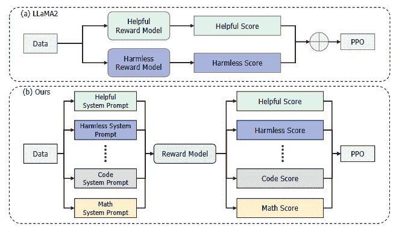

**图8**：条件奖励模型的结构。（a）LLaMA2 采用了不同的奖励模型来解决偏好冲突的问题。 （b）我们提出的条件奖励模型，利用条件系统提示来协调不同领域中的偏好数据，从而在一个单一的奖励模型中有效地处理各种偏好。

具体来说，如图[8](https://aicarrier.feishu.cn/wiki/Xarqw88ZkimmDXkdTwBcuxEfnHe#YXWcddZo4od3c8xmuWMcgsSun4g)(b)所示，条件奖励模型使用不同的系统提示来无缝融合来自不同领域的数据。由于奖励模型是基于预训练的SFT模型，该模型已经学会了遵循各种人类指令，因此我们也让奖励模型遵循不同的系统提示，以适应不同场景的多样化偏好。在条件奖励模型中，系统提示不仅仅是其输入的一个组成部分；它们也是指导奖励分数与不同场景中特定偏好对齐的关键工具。这种整合使得奖励模型在没有牺牲准确性的情况下，能够统一管理矛盾和复杂的人类偏好。

**数据组成**** **条件奖励模型的训练过程涉及一个庞大的数据集，包括对话、文章写作、诗歌、总结、编程、数学和格式化输出等各种领域，共有高达240万二进制偏好对。这个全面的数据集确保了模型的广泛适应性，并增强了其在更广泛、更复杂场景下进行强化学习的能力。因此，通过使用条件系统提示方法，奖励模型可以响应复杂的人类需求，在PPO阶段提供对奖励分数的更精细控制。

**损失函数** 此外，为了减少数据集中简单样本和困难样本之间不平衡的影响，受到Focal Loss(Lin et al., 2017)的启发，我们修改了原始排名损失函数(Burges et al., 2005)。我们在排名损失中添加了一个难度衰减系数，使得困难样本的损失值更大，简单样本的损失值更小，以防止过拟合量简单样本。聚焦排名损失（Focal Ranking Loss）的公式为

其中   表示   大于   的概率。难度衰减系数仅在模型正确预测训练样本的偏好时生效，即  时，否则它等于1。参数   表示一个用于调节难度衰减比的超参数。在这里，我们默认将其设置为2。同时，为确保奖励模型在不同训练过程中输出的分数稳定且一致，我们引入了对数障碍惩罚到奖励分数中，以将奖励分数的分布限制在-5到5的范围内，定义为

这一约束至关重要，因为它消除了在PPO阶段需要调整与奖励相关的超参数的需要，这些超参数可能会由于不同奖励模型中奖励分数分布的差异而潜在产生。

总的来说，奖励模型的损失函数是

参数   是一个权重系数，用于平衡   和   的贡献。基于我们在初步实验结果中的观察, 我们将其默认值设置为0.02。这些改进提高了奖励模型的鲁棒性和一致性表现，特别是在困难样本与简单样本不平衡的数据集中。

**训练细节**** **在我们的实验中，我们将奖励模型的大小与PPO中使用的演员模型大小对齐。我们遵循InstructGPT(Ouyang et al., 2022)中描述的方法，使用SFT模型权重初始化奖励模型，将输出层修改为一个随机初始化的一维线性映射层。我们的批构建策略主要关注将偏好数据的总体长度固定为每个批次的16384个token，而不是限制偏好对的数量，以避免由于数据填充导致的训练低效。最大上下文长度设置为8192。在每个序列的末尾添加一个特殊token，并使用其输出值作为奖励分数。我们采用AdamW作为优化器。学习率遵循余弦退火策略，从1e-5逐渐降低到5e-6，权重衰减设置为0.01。为了防止过拟合，模型仅训练一个epoch。

### 4.2.2 Online RLHF

在获得条件奖励模型之后，我们使用近端策略优化（Proximal Policy Optimization, PPO）方法将大型语言模型（LLMs）与由奖励模型表示的人类偏好对齐 (Ouyang et al., 2022)。为了应对PPO阶段中的奖励滥用的挑战，我们引入了一种在线(Online Reinforcement Learning with Human, Online RLHF)方法，分为两个不同的路径：快速路径(Fast Path)用于立即、有针对性的改进，而慢速路径(Fast Path)用于长期、全面地改进奖励模型。快速路径和慢速路径相互补充，为减轻奖励滥用并提升经人类反馈训练的LLMs的性能和可靠性提供了一个适应性框架。

**快速路径****(Fast Path)** Online RLHF中的快速路径专注于通过有针对性的补丁快速识别和纠正奖励滥用事件，以提高奖励模型的可靠性。随着PPO训练的进行，LLMs被引导向高奖励区域，这通常会暴露出更多容易检测到的奖励滥用情况。在每个RLHF轮次之后我们识别出奖励滥用模式，然后通过比较当前轮次早期和晚期PPO模型生成的响应，来构建强调这些模式的偏好对。将20到100个这样的偏好对纳入训练过程足以显著防止相应的奖励滥用模式。这个过程使得奖励模型能够迅速修复新出现的奖励滥用行为，提高奖励模型的可靠性和对期望结果的遵守。

**慢速路径****(Fast Path)** 与专注于修复奖励滥用的快速路径相比，慢速路径遵循先前工作 (Bai et al., 2022)，旨在通过包含来自最新且能力最强的模型的LLMs生成的响应，对奖励模型的上界进行全面改进，特别是奖励模型在高奖励区域的可靠性和鲁棒性。为了实现这一点，我们使用训练过程中各个阶段的模型（包括SFT模型、早期PPO模型和晚期PPO模型）生成的响应来进行配对比较。这些配对随后呈现给专业的人类标注者以标注他们的偏好。

这样一个过程为奖励模型的细化提供了更为细致且全面的方式，但需要大量的人工标注时间。为了提高在线RLHF的效率，我们仅在实验启动时使用所有先前模型的累积人类偏好（即可能由于人类标注的时间成本而不包括当前轮次模型产生的响应偏好）。通过持续根据人类反馈更新模型，慢速路径确保奖励模型随着人类偏好的复杂性和细微差别而同步发展。

**实现 **在我们Online RLHF实现中，我们进行了三轮的细化训练。在这些循环中，我们在快速路径中收集了数千个偏好补丁和在线偏好数据，并使用所有先前模型的响应的人类偏好数据来更新奖励模型。每一轮的Online RLHF都提供了宝贵的洞察力，使我们能够动态调整和优化奖励模型，从而提高经人类反馈训练的语言模型的整体性能和可靠性。

### 4.2.3 PPO 训练细节

在强化学习对齐阶段，我们采用了标准的近端策略优化（Proximal Policy Optimization，PPO）算法，并对它做了一些适应性修改，以确保训练过程更加稳定。该框架包括四个模型：演员模型、评论家模型、参考模型和奖励模型。在训练过程中，后两个模型被冻结，只有前两个模型是主动训练的。值得注意的是，所有这些模型的尺寸都相同，确保了它们处理和生成数据的能力一致。我们在大约400个迭代中遍历了约20万个多样化的查询，并选择在验证集上的最佳检查点进行发布。

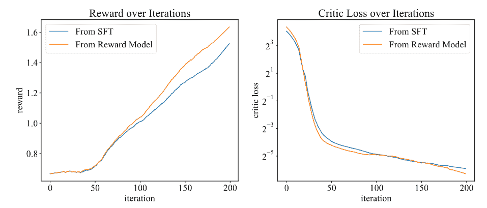

**图9**：评论家模型初始化的消融研究。注意，由于批评家损失的动态范围大，我们使用了对数坐标。

**模型初始化** 按照常见的做法，我们用SFT模型的权重初始化参考模型和演员模型。评论家模型从奖励模型（不包括线性头）初始化，并经历一个50次[的](https://aicarrier.feishu.cn/wiki/Xarqw88ZkimmDXkdTwBcuxEfnHe#X8kzdgByUoDnSUxQFDjck2Rknyc)预训练阶段，在此期间演员模型被冻结。在早期训练中这一阶段对于稳定价值估计至关重要，从而避免不稳定值可能带来的负面影响。我们进行了消融研究，比较了评论家模型从奖励模型与SFT模型初始化的效果，如图9所示。我们的结果显示，从奖励模型初始化的评论家模型在PPO训练的前几步损失更大，但在大约20步之后，它始终显示出更低的损失，并为演员模型带来更高的回报。我们推测，在初始阶段观察到的较高损失可能揭示了奖励建模和评论家建模任务之间的根本差异。随后的较低损失可能归因于对世界知识更一致的理解以及对评估原则的更好掌握。

**条件奖励 **正如之前讨论的那样，我们的奖励模型经过训练，能够适应各种条件。因此，对于来自不[同领](https://aicarrier.feishu.cn/wiki/Xarqw88ZkimmDXkdTwBcuxEfnHe#N5xmdUOgUoNtxGxsz1lcMTPtnub)域的查询，我们在计算奖励分数之前，为每个采样响应添加适当的条件系统提示，如图10所示。这种做法确保了模型的响应与不同领域的要求保持上下文一致。

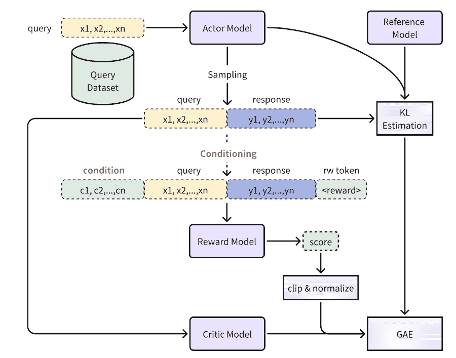

**图10**：条件PPO训练的说明。在奖励模型评估之前，向查询与响应中添加了一个适当的条件系统提示。请注意，这个系统提示与另外三个模型无关。

**预训练梯度** 为了减轻在PPO阶段发生灾难性遗忘的风险，我们采用了InstructGPT方法，加入了预训练损失。预训练损失的系数设为0.5，预训练数据量大约是PPO训练数据量的一半。这一改进有助于保留在初始训练阶段获得的知识，确保模型在适应新反馈和通过PPO学习时保留其基础能力和知识库。

**超参数** 我们将KL散度系数设为0.01。演员模型评论家模型的学习率分别设为1e-6和5e-6。我们发现，在PPO中较大的 值会导致我们的案例中获得更高的奖励，因此我们将其设为0.99。我们采用了一种稍微保守的采样策略， ，以平衡采样多样性和收敛速度。与一些传统方法不同，我们不应用价值损失剪切或优势归一化。尽管采用了大量的强化学习技巧，但训练过程仍然非常稳定，部分原因是我们细致的在线RLHF工作。

## 4.3 长文本微调

为了在微调和RLHF之后保留LLM的长上下文能力，我们受到了之前采用长上下文预训练语料库的SFT工作(Xiong et al., 2023)的启发，在SFT和RLHF中继续使用长上下文预训练数据。具体来说，我们使用了两种数据：一种是从书籍中获取的长上下文数据，另一种是从GitHub仓库中获得并通过特定范式连接的长上下文数据，具体如下所述。

为了增[强I](https://aicarrier.feishu.cn/wiki/Xarqw88ZkimmDXkdTwBcuxEfnHe#IWYLdeBiTorO8Wx1TVhc🐧i2nhJ)nternLM2的数据分析能力，我们选择了在DS-1000(Lai et al., 2023)中使用的代码仓库作为核心仓库，包括Pandas、Numpy、Tensorflow、Scipy、Scikit-learn、PyTorch和Matplotlib。然后我们在GitHub上搜索了引用这些核心仓库并拥有超过10,000个星标的开源仓库，并对这些仓库进行了与预训练相同的过滤和数据清洗过程。

对于每个仓库，我们首先使用深度优先方法对获得的原始数据进行排序，同时生成所需的提示，简要描述文件内容，如图11所示。随后，我们将处理后的数据按顺序连接，直到达到32k的长度。实验结果表明，长上下文代码数据不仅提高了LLM的长上下文能力，也提高了代码能力。

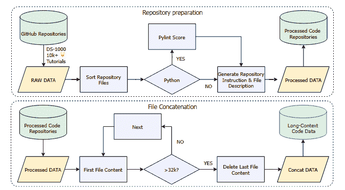

**图11**：获取长上下文代码数据的流程示例。

## 4.4 工具增强的LLMs

**一般工具调用** 我们采用经过修改的ChatML格式，通过引入“环境”角色来实现通用工具的调用。这种修改在聊天场景中保持了相同的格式，但在采用代理时为模型提供了更清晰的信号。此外，我们定义了两个特定关键词来支持AI代理的多样化目的，即代码解释器（<|int[er](https://aicarrier.feishu.cn/wiki/Xarqw88ZkimmDXkdTwBcuxEfnHe#YBOndaf0Lo36bbxvuetcJ4o2nyg)preter|>）和外部插件（<|plugin|>）。这使得我们可以采用统一的流式格式，处理各种类型的插件扩展和AI环境，同时保持与普通聊天的兼容性。图17显示了一个具体的流式聊天格式示例。为了充分激发InternLM2的代理能力，如Agent-FLAN(Chen et al., 2024c)所述，我们将代理语料库对齐到聊天领域，并按照语言模型的基本能力将其解耦，进行细粒度的训练。

**代码解释器** 我们还通过将Python代码解释器视为使用工具学习中描述的相同模式的特殊工具，增强了InternLM2-Chat解决数学问题的能力。我们采用了编码与推理交织（RICO）策略，并以迭代的困难案例（hard example）挖掘的方式构建数据，如InternLM-Math (Ying et al., 2024)所述。

# 评测分析

## 5.1 概述

在本节中，我们全面评测和分析了语言模型在多个领域和任务中的表现。评测主要分为两种类别：(a)下游任务和(b)对齐性。对于每个类别，我们进一步将评测任务细分为具体的子任务，以详细了解[模型的优点和缺点。最后](https://github.com/open-compass/opencompass)，我们讨论了语言模型中潜在的数据污染问题及其对模型性能和可靠性的影响。除非另有明确说明，所有评测都使用OpenCompass（Contributors, 2023b）进行。

## 5.2 在下游任务上的表现

我们首先详细介绍了多个自然语言处理任务的评估标准和性能指标。我们引入了数据集，解释了实验设置，然后展示了实验结果并进行深入分析，并将我们的模型与最先进（SOTA）的方法进行了比较，以展示我们模型的有效性。语言模型在下游任务上的表现评测将通过六个关键维度进行深入剖析：(1) 综合考试,(2) 语言和知识,(3) 推理和数学,(4) 多编程语言编程,(5) 长文本建模,(6) 工具使用。

### 5.2.1 综合考试

我们对一系列与考试相关的大型数据集进行了基准测试，包括：

**MMLU**（Hendrycks et al., 2020）：一个包含57个子任务的多项选项题数据集，涵盖了人文、社会科学、STEM等领域的话题。我们报告了不同模型在该数据集中five-shot的表现。

**CMMLU**（Li et al., 2023a）：一个针对中国的多选题数据集，包含67个子任务。除了人文、社会科学、STEM等领域的话题外，还包括许多与中国特定相关的任务。我们报告了不同模型在该数据集中five-shot的表现。

**C-Eval**（Huang et al., 2023）：一个包含52个子任务和4个难度级别的多选题数据集，涵盖了人文、社会科学、STEM等领域的话题。我们报告了不同模型在该数据集中five-shot的表现。

**AGIEval**（Zhong et al., 2023）：一个以人为中心的基准测试，包括多选题和开放式问题。这些问题来自20个官方、公开和高标准的一般人类测试者的入学和资格考试，我们报告了不同模型在该数据集中zero-shot的表现。

**GAOKAO-Bench**（Zhang et al., 2023）：一个包含2010年至2022年期间的中国高考（高考）的数据集，包括主观和客观问题。我们只评估了客观问题的数据集，我们报告了不同模型在该数据集中zero-shot的表现。

> 💡译者注：

> https://www.promptingguide.ai/techniques/fewshot

> Five-shot Prompting：给模型5个标注好的示例输入和输出，让模型根据其生成答案

> Zero-Shot Prompting: 不给模型示例输入输出。

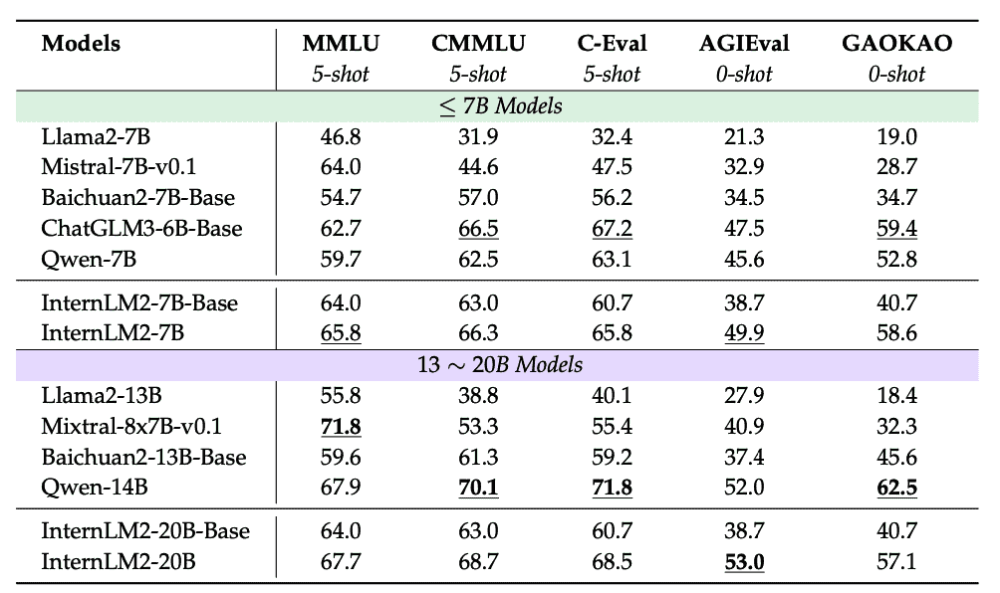

**表5**: 基准模型在综合考试上的比较。分数用粗体表示是在同一数据集下的获得最佳表现的模型，而下划线表示在参数量相当的模型中表现最优。

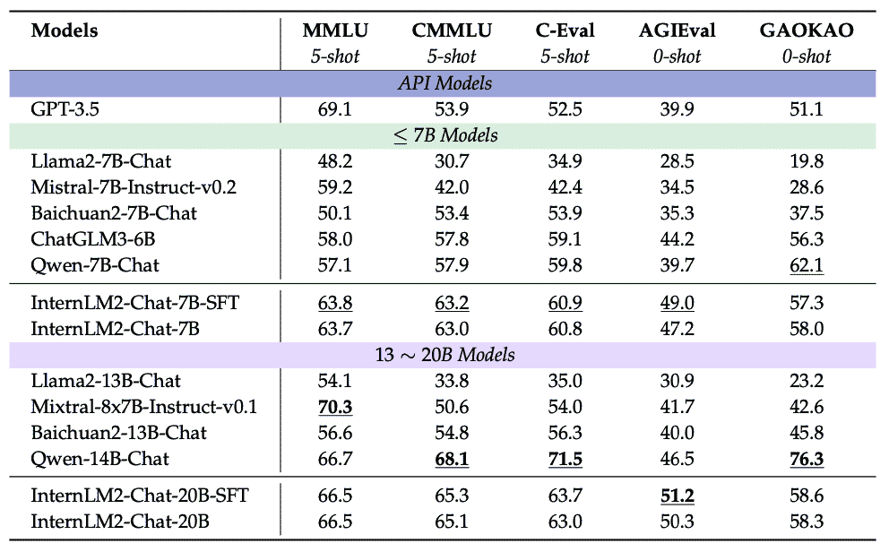

**表6**: 对话模型在综合考试上的比较。分数用粗体表示是在同一数据集下的获得最佳表现的模型，而下划线表示在参数量相当的模型中表现最优。

#### 评估结果

我们在表5中报告了基准模型的结果，在表[6](https://aicarrier.feishu.cn/wiki/Xarqw88ZkimmDXkdTwBcuxEfnHe#HWwKdlTLJo50oCxRoXpcyUounHH)中报告了对话模型的结果。

对于基准模型，在参数数量相当的模型中，InternLM2系列表现良好。在7B和20B参数量级别上，InternLM2相比InternLM2-Base显示出明显的提升，这证明模型在通用领域数据和领域增强语料库上进行预训练对于综合考试具有优势。对于AGIEval和GAOKAO任务，这些任务是从专门为人类设计的考试中收集的，与其它数据集相比，InternLM2相比于InternLM2-Base展现出更大的提升。

对于对话模型，InternLM2系列在参数数量相当的模型中的表现也相当出色。通过比较InternLM2-Chat-7B-SFT和InternLM2-Chat-7B模型的得分，可以看出COOL RLHF对综合考试的表现影响很小。

### 5.2.2 语言和知识

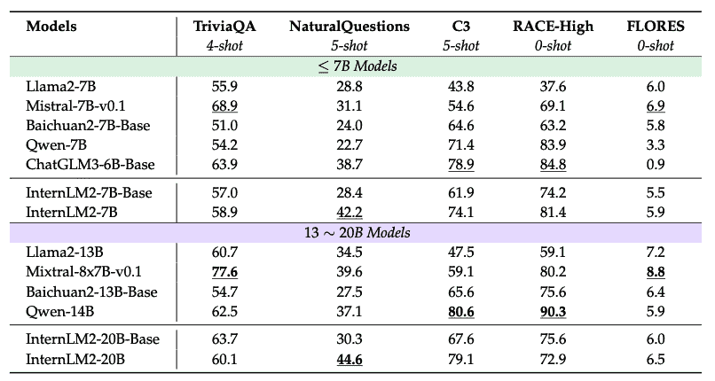

**表7**: 基础模型在语言和知识方面的比较。分数用粗体表示是在同一数据集下的获得最佳表现的模型，而下划线表示在参数量相当的模型中表现最优。

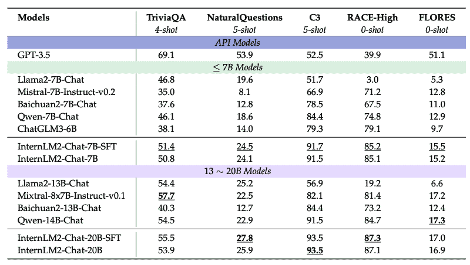

**表8**: 对话模型在语言和知识方面的比较。分数用粗体表示是在同一数据集下的获得最佳表现的模型，而下划线表示在参数量相当的模型中表现最优。

**TriviaQA**（Joshi et al., 2017）：一个包含阅读理解和开放领域问答的数据集。平均而言，每个问题有6个可能的答案。我们利用了数据集中的开放领域问答部分，并报告了不同模型在该数据集中zero-shot的表现。

NaturalQuestions（Kwiatkowski et al., 2019）：一个问答数据集，其中问题来自用户，答案由专家验证。我们报告了不同模型在该数据集中zero-shot的表现。

**C3**（Sun et al., 2020）：一个自由形式的中文机器阅读理解多项选择数据集。我们报告了不同模型在该数据集中zero-shot的表现。

**RACE**（Lai et al., 2017）：一个阅读理解数据集，包含中国12至18岁中学生的英语阅读理解考试题目。我们使用高中生子集，报告了不同模型在该数据集中zero-shot的表现。

**FLORES**（Team et al., 2022）：一个从维基百科提取的翻译数据集，涵盖101种语言。我们评估了从英语到其他100种语言以及相反方向的翻译结果。对于每一对翻译任务，我们选择了100个样本，并使用BLEU（Bilingual Evaluation Understudy）标准进行评估。我们报告了不同模型在该数据集中8-shot的表现。

#### 评估结果

我们在表[7](https://aicarrier.feishu.cn/wiki/Xarqw88ZkimmDXkdTwBcuxEfnHe#FQrPdvJXho7UQzxMcLdcMrE0nXe)中展现了基础模型的结果，在表[8](https://aicarrier.feishu.cn/wiki/Xarqw88ZkimmDXkdTwBcuxEfnHe#FU5yd7ufjoi413x16zucDKpKn2g)中展现了对话模型的结果。得益于其严谨和高质量的训练语料，InternLM2在涉及语言理解和知识应用的任务中展现出了卓越的竞争力。因此，InternLM2成为了许多实际应用场景中的绝佳选择，在这些场景中，模型具有强大的语言理解和广泛的知识是至关重要的。

### 5.2.3 推理和数学

在本节中，我们将主要验证InternLM2在推理和数学方面的表现，聚焦于以下两个种类的测试数据集：

**推理数据集:**

+   **WinoGrande** (Sakaguchi et al., 2020): 一个包含44,000个常识推理多选题的数据集，每个题目有两个选项。它要求模型根据情景描述选择合适的实词来代替代词。

+   **HellaSwag** (Zellers et al., 2019): 一个用于评估常识自然语言推理能力的具有挑战性的数据集，包含70,000个多项选择题。每个问题呈现一个场景和四种可能的结果，需要选择最合理的结论。

+   BigBench Hard (BBH) (Suzgun et al., 2023): 一个用于测试大型语言模型的测试集，BBH从BIG-Bench中提取了23个具有挑战性的任务，在当时是现代的语言模型还无法超越人类水平的任务。

**数学数据集:**

+   **GSM8K-Test** (Cobbe et al., 2021): 包含约1,300个初级水平的情境数学题的数据集。这些题目的解答需要2到8个步骤，主要使用基本的算术运算（加、减、乘、除）进行一系列基本计算以得到最终答案。

+   **MATH** (Hendrycks et al., 2021): 一个包含12,500个具有挑战性的高中数学竞赛题目的数据集，涵盖从代数到微积分的多个领域。每个问题都包含完整的逐步解答。

+   **TheoremQA** (Chen et al., 2023a): 一个包含800个QA对的STEM(科学、技术、工程和数学)定理驱动型问答数据集，涵盖数学、电气与计算机科学、物理和金融等350多个定理。它测试了大型语言模型在应用定理解决具有挑战性的大学水平问题方面的局限性。

+   **MathBench** (Anonymous, 2024b): MathBench包含3709个具有多个逐步递增困难程度的问题。每个阶段都包含双语的理论和应用导向的问题，每个问题都被精确地标注了三级标签，以指示其细粒度的知识点。

在评估推理和数学问题时，对于多项选择题，我们主要采用zero-shot方法。对于开放式问题，如GSM8k、MATH和MathBench的开放式部分，我们主要采用few-shot方法来增强模型遵循指令的能力，从而更好地提取答案。为确保评测结果的一致性，对于基准模型，我们使用perplexity(PPL)评估作为评估多项选择题的主要方法。

#### 推理

推理能力反映了模型理解、处理和操作抽象概念的能力，这对于涉及复[杂](https://aicarrier.feishu.cn/wiki/Xarqw88ZkimmDXkdTwBcuxEfnHe#KtkBdpCPgoJRPcxPPKEcaao9njf)问题解决和决策的任务至关重要。我们在表9中从基准模型和对话模型两个方面分别对比和展示了InternLM2的表现。

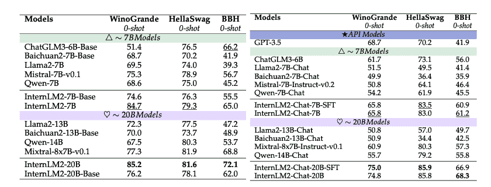

**表9**：推理任务的比较

#### 评估结果

**基准****模型:**

对于7B参数量级别的模型，InternLM2-7B在除BBH外的数据集上都表现出了更优越的性能。特别是，它在WinoGrande上的表现（84.7）比Mistral-7B-v0.1（75.3）高9.4分，仅次于InternLM系列对应模型InternLM2-20B（85.2）不到一分。这展示了InternLM2-7B强大的常识推理能力。在所有参与测试的基准模型中，InternLM2-20B取得了最好的总体性能。与InternLM2-20B-Base相比，增加了特定领域知识后，InternLM2-20B在常识推理方面有了显著的提高，在测试的推理数据集上平均提高了10.4%。

**对话****模型:**

在对话模型的推理能力方面，InternLM2在7B参数量级别和13〜20B参数量级别中的表现均处于领先水平。RL模型（InternLM2-Chat-20B）和SFT模型（InternLM2-Chat-20B-SFT）在相较于其他模型推理能力大幅提升的基础上，它们两个模型的表现相似。其中，7B模型甚至在三个测试集上超过了大多数13〜20B模型，如Mixtral-8x7B-Instruct-v0.1和Qwen-14B-Chat，而InternLM2- Chat-20B在各个推理测试集上的表现都明显优于GPT-3.5。如在HellaSwag上的情境推理(↑15.6)和BBH上的具有挑战性的综合推理(↑26.4)，这证明了InternLM2在中小型模型上出色的推理能力。

#### 数学

[数学](https://aicarrier.feishu.cn/wiki/Xarqw88ZkimmDXkdTwBcuxEfnHe#DyE8djKSUoGt41xgLYOcRcTXnhh)能力是模型认知和计算能力的重要组成部分。在表10中，我们展示了基准模型在不同难度的数学评测集上的表现。在7B参数量级别，InternLM2-7B处于领先地位。具体来说，在初级算术GSM8k数据集上，InternLM2-7B (70.8)的表现远远超过其他模型，比ChatGLM3-6B-Base (60.7)高出10.1个百分点，是InternLM2-7B-Base (36.0) 的近两倍，展现了InternLM2-7B在融入特定领域数据后强大的基本计算能力。对于更复杂的问题求解任务，如MATH和TheoremQA中的定理证明，尽管在MATH上稍逊一筹，但InternLM2-7B的得分(10.5)甚至超过了更大的Qwen-14B-Base(10.4)，表明InternLM2-7B不仅擅长计算任务。在复杂定理证明方面也有出色表现。在双语数学数据集MathBench上，InternLM2在英语和中文测试中都表现出色。

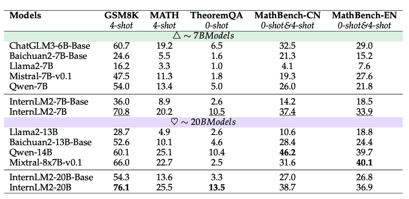

**表10**：比较基准模型在数学任务上的表现。分数用粗体表示是在同一数据集下的获得最佳表现的开源或API模型，而下划线表示在参数量相当的模型中表现最优。

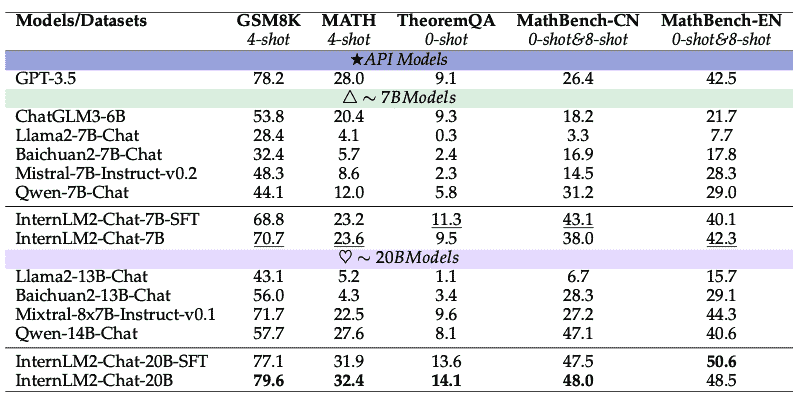

**表11**：比较对话模型在数学任务上的表现。上述模型根据它们的参数量和类型（开源模型或API模型）进行了分类。分数用粗体表示是在同一数据集下的获得最佳表现的模型，而下划线表示在参数量相当的模型中表现最优。

在13〜20B参数量级别的模型中，InternLM2-20B在基础计算和定理证明方面优于所有测试的基准模型，而Qwen-14B-Base在问题求解任务以及MathBench的英语和中文测试中表现出众。

#### 对话

对于表[11](https://aicarrier.feishu.cn/wiki/Xarqw88ZkimmDXkdTwBcuxEfnHe#Me7hd17A8oFqOxxbZoYcQ96anJf)中的对话模型，InternLM2-Chat在7B和20B参数量级别上的初级算术GSM8K、复杂应用数学MATH和理论问题TheoremQA数据集上均表现最佳。值得注意的是，经过COOL RLHF训练的InternLM2-Chat-20B在所有指标上表现的表现遥遥领先，超过了API模型GPT-3.5和MoE模型Mixtral-8x7B-Instruct-v0.1。在MathBench的双语测试中，InternLM2-Chat-20B也表现出色。

### 5.2.4 编程

#### Python编程任务

+   **HumanEval** HumanEval(Chen et al., 2021)是一个广为人知的数据集，作评估代码生成模型性能的基准（benchmark）。它由164个精心设计的编程任务组成。每个任务包含一个Python函数和一个附带的docstring，提供上下文和规范说明。这个由人编写代码组成的数据集在评估大型语言模型（LLMs）生成或完成程序的能力方面发挥着关键的作用。

+   **MBPP** MBPP(Austin et al., 2021)包含974个入门级程序员可解决的编程任务。这些任务范围从简单的数值操作到需要外部知识的更复杂的问题，如定义特定的整数序列。我们使用MBPP的精简版本，仅包括作者手动验证过的一部分数据。

#### 多编程语言编程任务

+   **HumanEval-X** HumanEval-X(Zheng et al., 2023b)数据集是原始HumanEval基准的多语言扩展，旨在评估代码生成模型在多种编程语言上的能力。它包含164个手工编写的编程问题,每个问题都被翻译成五种主要语言:C++、Java、JavaScript、Go和Python。这产生了总共820个问题-解决方案对，支持代码生成和代码翻译任务。HumanEval-X允许评估模型生成功能正确代码和在不同语言之间翻译代码的能力，使用测试用例来验证生成代码的正确性。这个基准促进了对预训练多语种代码生成模型及其在实际编程任务中的潜在应用的更全面理解。

为评测InternLM2的编码能力,我们使用广为人知的基准MBPP(Austin et al., 2021)和HumanEval(Chen et al., 2021)进行了一系列实验。此外，为了评测代码生成模型处理多种编程语言的能力，我们将评测扩展到MBPP-CN(MBPP的中文版本)和HumanEval-X(原HumanEval基准的多语种扩展版)。

如表[13](https://aicarrier.feishu.cn/wiki/Xarqw88ZkimmDXkdTwBcuxEfnHe#VG0QdvN2uogpykx7XAhcwSFdnQz)所示，InternLM2模型系列取得了优异的表现，特别是在HumanEval、MBPP和MBPP-CN上，InternLM2-Chat-20B模型的性能比之前的最佳（SOTA）水平提高了10%以上，彰显了InternLM2系列在代码生成任务中出色的能力。此外，InternLM2-Chat-20B模型在MBPP-CN基准测试中比InternLM2-Chat-7B模型有了显著提升，但在HumanEval-X上表现略有下降。这种现象可能源于InternLM2-Chat-20B模型为了在中文上进行精细的微调而导致在其他语言上的性能受到了一定影响。

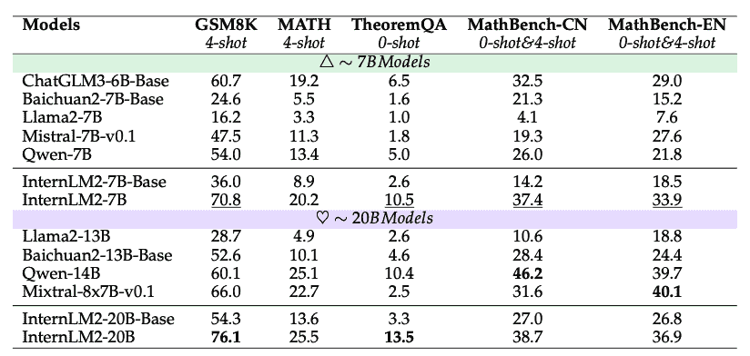

**表12**: 基准模型在Python编程方面的比较。分数用粗体表示是在同一数据集下的获得最佳表现的模型，而下划线表示在参数量相当的模型中表现最优。

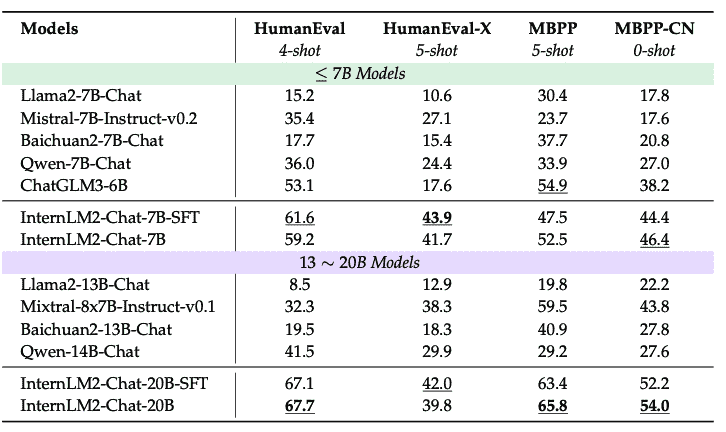

**表13**: 对话模型在Python编程方面的比较。分数用粗体表示是在同一数据集下的获得最佳表现的模型，而下划线表示在参数量相当的模型中表现最优。

### 5.2.5 增强训练（Enhancement Training）前后的模型表现

通[过前](https://aicarrier.feishu.cn/wiki/Xarqw88ZkimmDXkdTwBcuxEfnHe#Ai08da8Szo3qSRxvm5iclfTHnUf)面各部分的结果，我们可以清楚地看到，经过特定能力增强训练的InternLM2一贯优于未经增强训练的对应版本。图12展示了增强训练前后的模型的总体表现的比较，其中各项能力的分数是由模型在多个评测集上得分的平均值计算得到的。

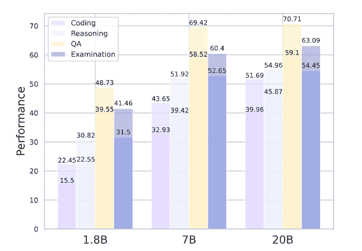

**

图1**2: 特定能力增强训练前后的性能，图中颜色较深的区域表示模型训练前的表现得分。

**

编程****: H****uma****nEv**al和MBPP。

推理: MATH、GSM8k、SummEdits(Laban et al., 2023)和BBH。

问答: HellaSwag、PIQA(Bisk et al., 2020)、WinoGrande、OpenBookQA(Mihaylov et al., 2018)、NaturalQuestions和TriviaQA。

考试: MMLU、AGIEval和C-Eval。

显[然，](https://aicarrier.feishu.cn/wiki/Xarqw88ZkimmDXkdTwBcuxEfnHe#PHpVdMq1Docyo7xI8sdcaDuxnFd)上述的这些能[力都有了显著提升。此外，我](https://rank.opencompass.org.cn/leaderboard-llm-v2)们还比较了在经过监督微调(SFT)时，基准模型在增强训练前后的表现，结果见表14。能力维度与OpenCompass 7中采用的分类保持一致。可以观察到，使用特定能力增强训练的SFT模型在各个能力维度上的表现都更好。本报告中其他部分的SFT性能是基于增强训练前的基准模型。

| Model | Language | Knowledge | Reason | Code |
| --- | --- | --- | --- | --- |
| SFT from InternLM2-7B-Base | 66.64 | 58.35 | 69.30 | 38.79 |
| SFT from InternLM2-7B | **69.28** | **62.11** | **75.18** | **41.40** |

**表14**:** S**FT模型的表现对比，它们分别是从InternLM2-7B-Base和InternLM2-7B进行SFT训练得到的7B模型 。

### 5.2.6 长文本建模

**长文本理解和推理**。[我们主要在以下两个基准（ben](https://github.com/OpenLMLab/LEval)chmarks）上评测了InternLM2的长文本建模能力: L-Eval(An et al., 2023)和LongBench(Bai et al., 2023b)。

**

L-Eva****l**[ L-](https://arxiv.org/abs/2307.11088v1)Eval是一个长文本基准，由18个子任务组成，包括来自法律、经济和技术等各个领域的文本。L-Eval包含411篇文档和超过2000个测试用例，平均文档长度为7217个单词。该数据集中的子任务可分为两大类：5个闭合式任务和13个开放式类别。闭合式任务采用基于精确匹配的准确率进行评估，而开放式任务采用Rouge分数作为评估标准。

**LongBench**** **LongBench是一个长文本基准，由21个子任务组成，总共4750个测试用例。这是第一个双语长文本基准，平均英文文本长度为6711个单词，平均中文文本长度为13386个字符。这21个子任务分为6种类型，可以更全面地评测模型在各个方面的能力。

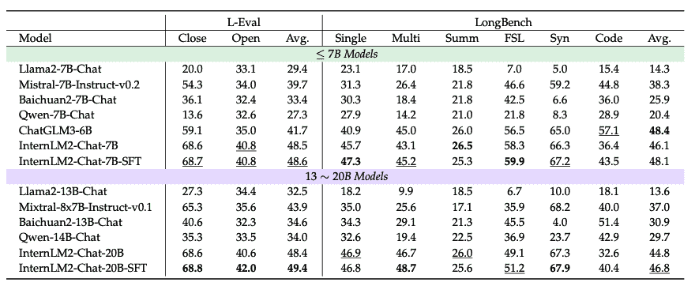

**表15****:对**话模型在长文本基准测试上的比较。分数用粗体表示是在同一数据集**下的获得最佳表现****的模型，而下划线表示在**参数量相当的模型中表现最优。对于每个基准测试和任务组，我们展示了组内子任务的平均准确率。L-Eval缩写:Close→闭合式;Open→开放式。LongBench缩写:Single→单文档; Multi→多文档; Summ→摘要; FSL →少样本学习; Syn→合成。所有结果均通过OpenCompass(Contributors, 2023b)评估工具包获得。

**评测结果**** **我们在表[15](https://aicarrier.feishu.cn/wiki/Xarqw88ZkimmDXkdTwBcuxEfnHe#NCFbdkG75odv1sxJx5EcSOFBnSc)中展示了InternLM2在长文本基准中的评测结果。InternLM2的所有变体在这两个基准测试上都展现出了强大的长文本建模能力。InternLM2-Chat-20B-SFT在L-Eval上取得了最佳表现，大幅领先于其他对手。在LongBench上，InternLM2-Chat-7B-SFT在6个子任务类别中的4个上领先于其他≤7B模型。它获得了48.1的总体分数，仅比ChatGLM3-6B的48.4分稍低。同时，我们注意到对于InternLM2来说，不同的参数量并未导致长文本表现的显著差异，这一点我们将进一步调查。

大海捞针(Needle-in-the-H[ay](https://aicarrier.feishu.cn/wiki/Xarqw88ZkimmDXkdTwBcuxEfnHe#DwqFdxvyEoZHV6xqralcLpeCned)stack) 理论是一种单针检索任务，旨在测试大型语言模型(LLMs)回忆单个关键信息的能力。这是通过将关键信息插入目标长度的"海量"文本中的不同位置，然后在提示词的末尾询问模型关于这个关键信息的方式来实现的。这种方法精确地可视化了LLMs在不同长度的长文本的不同位置的回忆能力。我们遵循原始想法设计了一个中文"海量文本"，并利用Wei等人(2023)发布的Skywork/ChineseDomainModelingEval数据集，确保中文文本的来源具有多样性和质量。该数据集涵盖了从金融到技术的广泛领域，提供了高质量、 最新的中文文章，为评估不同模型处理特定领域长文本的能力提供了稳定的基准。在这个实验中,我们利用LMDeploy(Contributors, 2023a)推理引擎来加速推理过程。图13中的结果有效地展示了InternLM2的长文本建模能力。

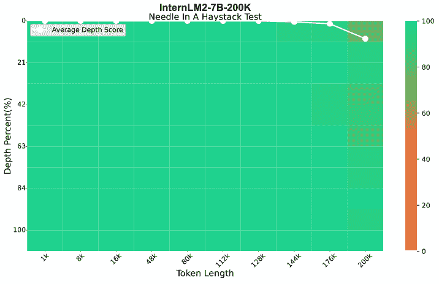

**图13**：（中文文本）大海捞针的结果

### 5.2.7 工具使用

众所周知，使用外部工具和API可以显著增强大型语[言模型(LLM)解决复杂现实问题的能力(](https://doi.org/10.48550/arXiv.2302.04761)Qin et al., 2023a;b; Schick et al., 2023)。为分析InternLM2在工具利用方面的能力，我们在几个基准数据集上进行了实验：GSM8K(Cobbe et al., 2021)、Math(Hendrycks et al., 2021)、最近推出的MathBench(Anonymous, 2024b)、T-Eval(Chen et al., 2023b)以及CIBench(Anonymous, 2024a)的模板子集，所有这些都采用了ReAct协议(Yao et al., 2023)，其中LLM在生成思维过程和执行操作之间交替进行。值得注意的是，MathBench包含3709个涵盖从小学到高中数学概念的问题，因此可以全面评测LLM解决数学问题的能力。T-Eval(Chen et al., 2023b)包含经人工验证的高质量问题说明及相应的逐步解决方案，用于衡量LLM在使用谷歌搜索、高德地图等日常工具时在六个不同维度上的熟练程度。由我们团队开发的CIBench模拟了使用交互式Jupyter笔记开展真实数据分析场景，包含多个连续任务，涵盖了数据分析中最常用的Python模块，如Pandas、Numpy和Pytorch。这个定制的基准可以全面评估LLM在数据分析方面的综合能力。

GSM8K、MATH和MathBench 我们利用[外部](https://aicarrier.feishu.cn/wiki/Xarqw88ZkimmDXkdTwBcuxEfnHe#YhWYdtwmDoik7oxTHmycVKcvnGc)代码解释器并遵循ReAct协议来评测LLM解决编程和数学问题的能力。结果如图14所示，通过使用代码解释器，模型的表现得到了显著提升，特别是在MATH数据集上的提升尤为明显。

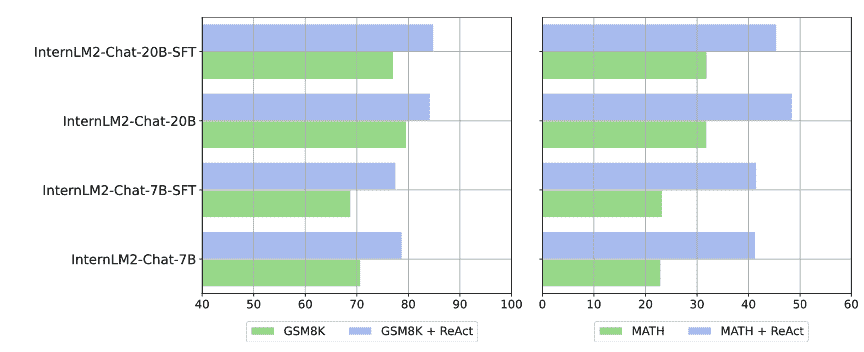

**图14**:在GSM8K(4-shot)和MATH(4-shot)上使用和不使用代码解释器的结果。

如图[15](https://aicarrier.feishu.cn/wiki/Xarqw88ZkimmDXkdTwBcuxEfnHe#S3h8dY45goBVBnxAlozcD81Tnre)所示，在最近推出的MathBench数据集上，使用代码解释器在大多数情况下可以提高InternLM2的性能，而性能的轻微下降可能归因于对这些解释器的错误使用。此外，在知识领域，InternLM2-20B-Chat有显著改进,而在应用领域，InternLM2-7B-Chat有显著改进。这些差异可能源于多种因素，包括它们各自训练数据集的构成差异。

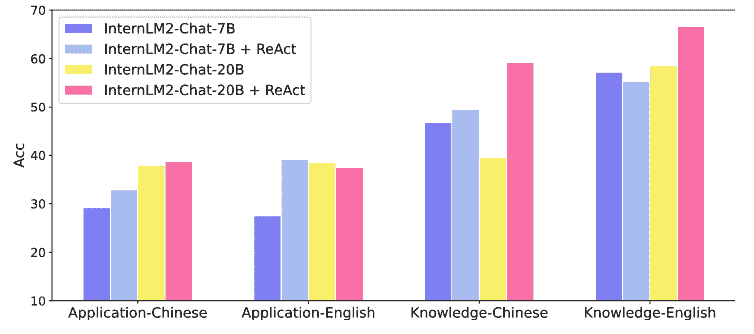

**图15**:在MathBench上使用和不使用ReAct的结果

**T-Eval和CIBench** 如图[16](https://aicarrier.feishu.cn/wiki/Xarqw88ZkimmDXkdTwBcuxEfnHe#HAkYdTIyNoo50dxti0lcb2EinSf)所示，InternLM2模型在各种基准测试中始终表现出优于或相当于现有模型的性能。具体而言，在比较相同规模的模型时，InternLM2-Chat-7B在T-Eval和CIBench上表现最佳。同时，InternLM2-Chat-20B在T-Eval上取得了有竞争力的结果，并且在CIBench上获得了最高分。此外，InternLM2系列模型在中文方面取得了令人印象深刻的结果，展示了InternLM2系列模型在多种语言上的熟练程度。

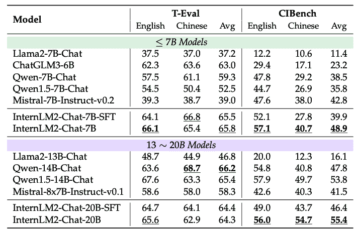

表16**:不**同模型在T-Eval和CIBench数据集上的结果。分数用粗体表示是在同一数据集下的获得最佳表现的模型，而下划线表示在参数量相当的模型中表现最优。

## 5.3 偏好对齐表现

尽[管 ](https://aicarrier.feishu.cn/wiki/Xarqw88ZkimmDXkdTwBcuxEfnHe#GjosdVc71o78🐧xHGUzc6q83nn0)LLM 的客观能力可以通过预训练和有监督微调提升，它们的回答风格可能不会与人类偏好所对齐，这就需要人类反馈强化学习来进一步提升对齐能力。因此，评估对其能力对于判断 LLM 是否真正满足人类需求是很重要的。

在本节中，我们在几个普遍使用的主观对齐数据集上测试了 InternLM2 的表现，同时对比了 SFT 模型和 RLHF 模型。正如我们在表17中看到的那样，InternLM2 在多个测试集的对齐任务上全面达到了 SOTA 或者接近 SOTA 的表现，表明了 InternLM2 系列模型的主观输出于人类偏好的高度一致性。我们详细地列出了模型分别在各数据集上的表现。此外，在各数据集上用于主观对齐任务的指令模板也在附录中给出。

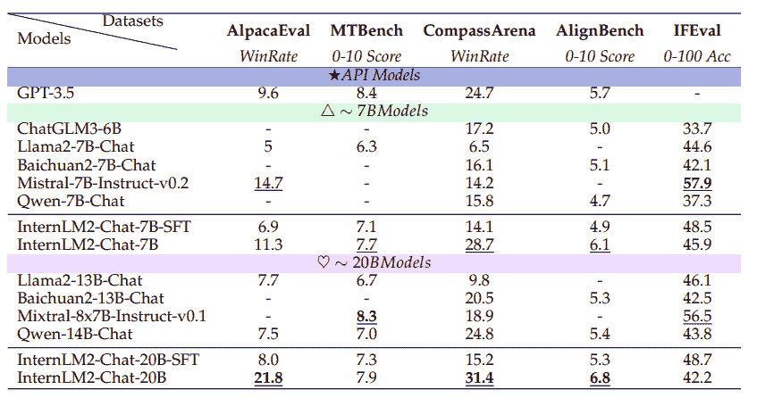

**表17**：模型在对齐测试集上的表现对比。模型根据其参数量和类型进行分类，并用粗体在每类中标出了最优的模型，以及用下划线标出了其参数组中的最优模型。

### 5.3.1 英文主观评测

**AlpacaEval** AlpacaEval (Li et al., 2023b) 是一个有着805个问题的单轮问答数据集。它的主要目的是评估模型回复对于人类的帮助性，通过对抗性评价反映其与人类意图的一致性。AlpacaEval(v2) 建立了一个基线模型，并使用 GPT4-Turbo 作为评价模型来对比基线模型的答案与那些要被评测的模型的答案。它选择出那个与人类偏好对齐地更好的模型的答案并计算胜率。不同于直接收集评价模型的回复，AlpacaEval(v2) 使用了逻辑概率来从统计学角度分析评价模型的偏好。这些偏好信息随后被用作计算加权胜率中的权重因子。正如表17所示，InternLM2-20B 达到了21.8的胜率，在所有比较模型中达到了最高的 SOTA 结果，表明了其卓越的对齐表现。此外，表中数据还说明 RLHF 模型在胜率上高于 SFT 模型，这也强调了对齐策略的有效性。

**MTBench** MTBench (Zheng et al., 2023a) 是一个包含80个问题的两轮对话数据集，其涵盖了8个维度，分别是：推理、角色扮演、数学、代码、写作、人文、科学技术以及信息[抽取](https://aicarrier.feishu.cn/wiki/Xarqw88ZkimmDXkdTwBcuxEfnHe#GjosdVc71o78🐧xHGUzc6q83nn0)。每个维度包含10个问题，均为两轮的提问。第一轮中，测试的是模型对于基本问题的回答能力；第二轮中，它必须遵从额外的。特殊的指令以优化其之前的回答。分数由评价模型打出，范围为1-10分。正如我们在表17中看到的那样，InternLM2 在7B和20B的版本上都达到了领先的分数，分别为7.7和7.9，说明了其值得信赖的多轮对话能力。

### 5.3.2 中文主观评测

**CompassArena **CompassArena 有着520到中文题目，涵盖了知识、语言、数学、推理和创造五个方面。与 AlpacaEval 相似，它通过 GPT4-Turbo 进行判断并计算胜率，并通过交换模型次序的双盲测试以消除位置偏差。如表17所示，InternLM2 在7B和20B模型中[达到](https://aicarrier.feishu.cn/wiki/Xarqw88ZkimmDXkdTwBcuxEfnHe#Lmsxdd063oC98mxgjpTc788Snke)了最高胜率，分别为28.7和31.4。注意到 InternLM2 的7B和20B模型之间的表现差距是较小的。但是当与 SFT 模型进行比较时，InternLM2 的 RLHF 模型表现出了非常可观的表现提升。这说明 RLHF 策略进一步提升了 InternLM2 与人类偏好的对齐，而不是仅仅增加模型大小。此外，图 16 中按类别分列的结果显示，InternLM2 系列具有极强的中文创造力和语言能力，其胜率可与 GPT4-Turbo 相当。

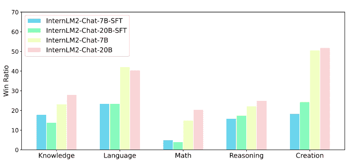

**图16**：InternLM2 系列模型在 CompassArena 上的详细结果

**AlignBench** AlignBench (Liu et al., 2023a) 是一个有着683个问答对的中文主观数据集，其问题可以分为包括基础语言能力、进阶中文理解，任务导向性角色扮演等8个方面，涵盖物理、历史、音乐、法律等多个场景。这个数据集使用一个名为 CritiqueLLM (Ke et al., 2023) 的内部评价模型进行评测。CritiqueLLM 会为每个问题从各个维度给出一个1-10的分数，并给出一个最终分数。我们在表17展示了由 CritiqueLLM 提供的最终分数，在表18中展示了不同类别的详细分数。如表17所示，InternLM2 在7B和20B模型上均达到了 SOTA，分数分别为6.1和6.8，超过了 GPT-3.5 的5.7分。此外，InternLM2 的 7B和20B模型都在 RLHF 后相比于 SFT 模型展现出了客观的能力提升，强调了我们的 RLHF 策略在提升模型与人类偏好对齐方面的有效性。详细分数的分析表明，其在数学和推理能力方面还有待改进；不过，InternLM2 在问题解答和角色扮演任务方面表现出色，具有非常强的主观能力。

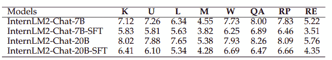

**表18**：InternLM2 系列在 AlignBench 上的详细分数。K：知识；U：理解；L：语言；M：数学；W：写作；RP：角色扮演，RE：推理。

### 5.3.3 指令跟随评测

**IFEval** IFEval (Zhou et al., 2023) 被设计用来测试模型模型的指令跟随能力，其需要模型的回复遵从特定格式，比如大小写限制以及关键词限制等。IFEval 涵盖25种不同的指令，跟随指令构造了541个问题，并通过基于规则的评估方法来评估模型对于每个问题的正确性。使用多种统计策略，IFEval 提供四种准确率分数：提示级严格、提示级宽松、实例级严格、实例级宽松。我们在表17中展示了这四个分数的的平均结果。尽管如 LLaMA2 和 Mistral 这样的英文模型在 IFEval 上表现超过了中文模型，InternLM2 在 7B 中排行第二（48.5），在13-20B排行第三（48.7）。这说明，尽管指令跟随任务具有挑战性，InternLM2 仍能在相似大小的模型中保持领先地位。

### 5.3.4 条件奖励模型的消融实验

为[了验](https://aicarrier.feishu.cn/wiki/Xarqw88ZkimmDXkdTwBcuxEfnHe#N1eMdHtwFoeEfNxa8CacqZ8Lnmp)证有条件系统提示词的影响，我们比较了使用和不使用有条件系统提示词的奖励模型在不同领域的混合数据的表现。如表19所示，在多个公开数据集上，不使用系统提示词会导致准确率的明显下降，包括帮助性和无害性问答 (Bai et al., 2022)，内容总结 (Stiennon et al., 2020)，数学问题 (Lightman et al., 2023) 以及 Reddit 回复 (Ethayarajh et al., 2022) 等场景。相反，使用系统提示词则可以在这些领域显著提高准确率。

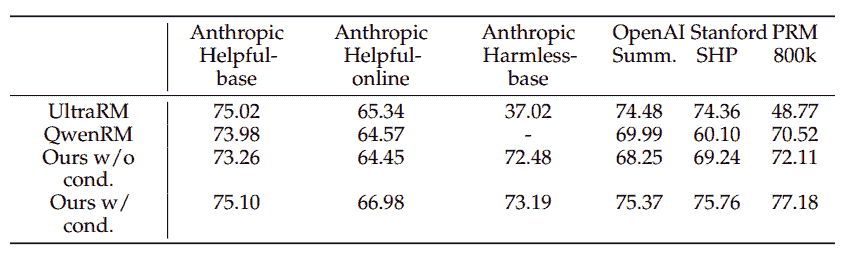

**表19**：UltraRM-13B (Cui et al., 2023)、QwenRM (Bai et al., 2023) 和我们的 7B 奖励模型在有条件系统提示词和无条件系统提示词情况下的性能比较。表中结果显示了使用条件提示时精确度的显著提高。

## 5.4 关于数据污染的讨论

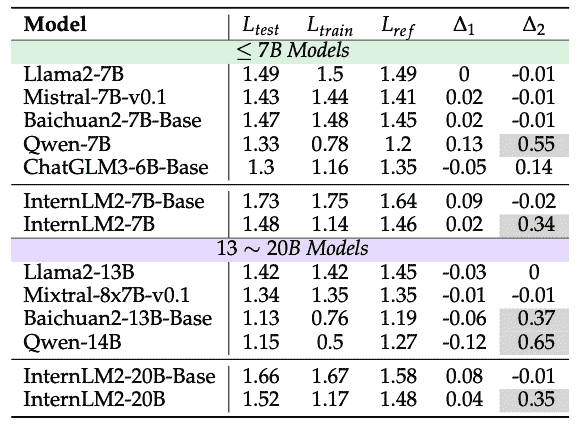

**表20**: 在基准模型上基于GSM8K数据集进行数据污染评测

我[们评](https://aicarrier.feishu.cn/wiki/Xarqw88ZkimmDXkdTwBcuxEfnHe#Rr7Rd6NwqoHDt9xmxl2ceUAunPb)估了几个基准模型在GSM8K数据集的样本(样本是问题和答案的拼接)上的语言建模(LM)损失，结果如表20所示。对于每个LLM，我们比较了它在训练集( )、测试集( )和一个我们特别设计的参考集( )上的LM损失。参考集由GPT-4生成,旨在模仿GSM8K数据集。我们重点关注两个指标： ，作为LLM训练期间潜在测试数据泄露的指示器，即较低的值表示可能存在数据泄露； ，用于衡量模型在训练集上过拟合的程度。 值较高意味着过拟合。 和 的异常值在表中用灰色高亮显示。

> 译者注：💡

> **数据污染**是指模型在训练过程中可能接触到了测试集数据,导致在测试集上的表现被高估。

>

> 为了评估数据污染,作者提出了两个指标:

1.   : 测试集损失与参考集损失之差。如果∆1较小,说**明模型在测试集上的**损失与参考集接近,可能存在测试数据泄露。∆1值越小,说明泄露的可能性越大。

1.   : 测试集损失与训练集损失之差。如果∆2较大,说明模型在训练集上过拟合,在测试集上的泛化能力较差。∆2值越大,表明过拟合越严重。

>

> 这里的参考集是由GPT-4生成的,目的是模仿GSM8K数据集的特点。通过比较测试集损失与参考集损失,可以判断模型是否在训练过程中接触到了真正的测试数据。

# 结论

本报告介绍了InternLM2大型语言模型，它在主观和客观评测中表现出色。InternLM2基于超过2T的高质量预训练数据进行训练，涵盖了1.8B、7B和20B参数的模型规模，适用于多种场景。为了更好地支持长文本处理，InternLM2采用了GQA来降低推理成本，并额外训练在多达32000个上下文中。除了开源模型本身，我们还提供了训练过程中的多个阶段检查点，以便利后续研究者的研究。

除了开源模型，我们还详细阐述了InternLM2的训练过程，包括训练框架、预训练文本数据、预训练代码数据、预训练长文本数据和对齐数据。此外，针对强化学习后训练（RLHF）过程中遇到的偏好冲突，我们提出了条件在线RLHF方法，以协调不同的偏好。这些信息对于理解如何准备预训练数据以及如何更有效地训练大型模型具有参考价值。

# A. 附录

##  评估提示

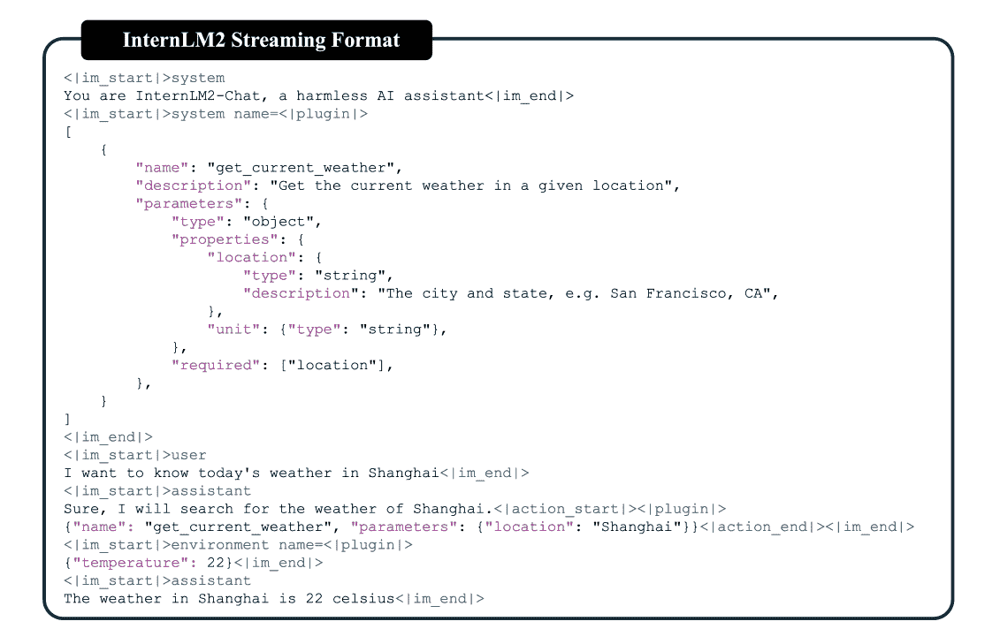

Figure 17: InternLM2-Chat 采用流式处理格式进行函数调用，特别是 JSON 格式，以简化下游应用程序。

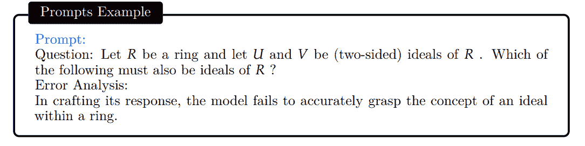

Figure 18: 对数学概念的误解的一个例子。

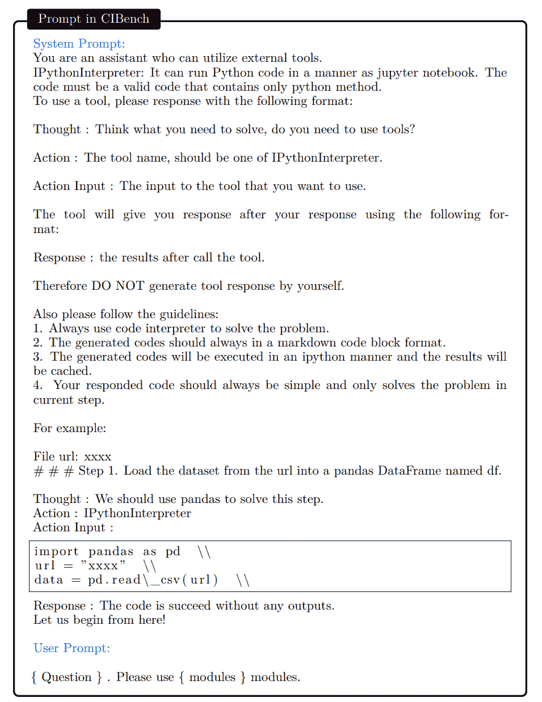

Figure 19: CIBench 中使用的提示符

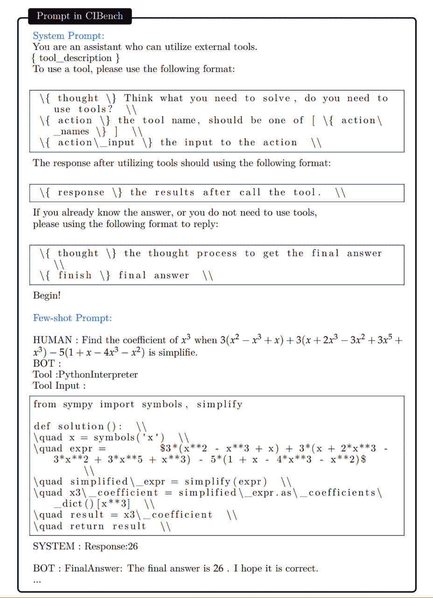

Figure 20: MATH 中使用的提示

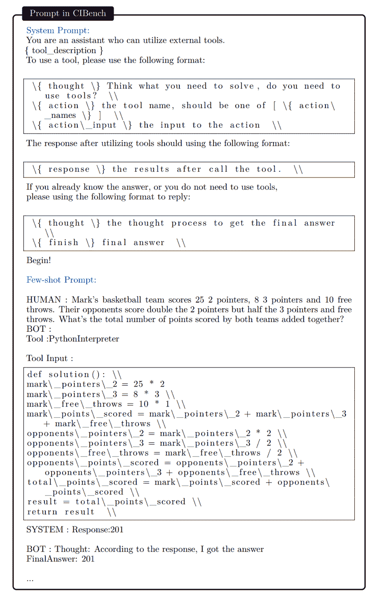

Figure 21: GSM8K 中使用的提示符

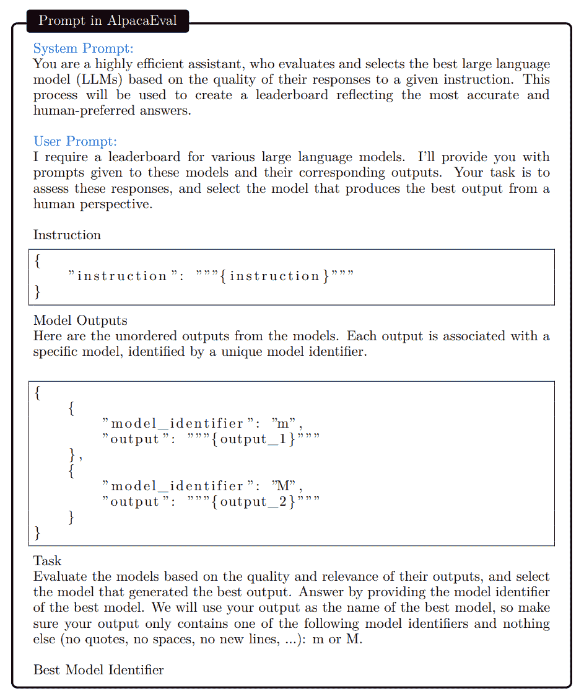

Figure 22: AlpacaEval 中使用的提示符

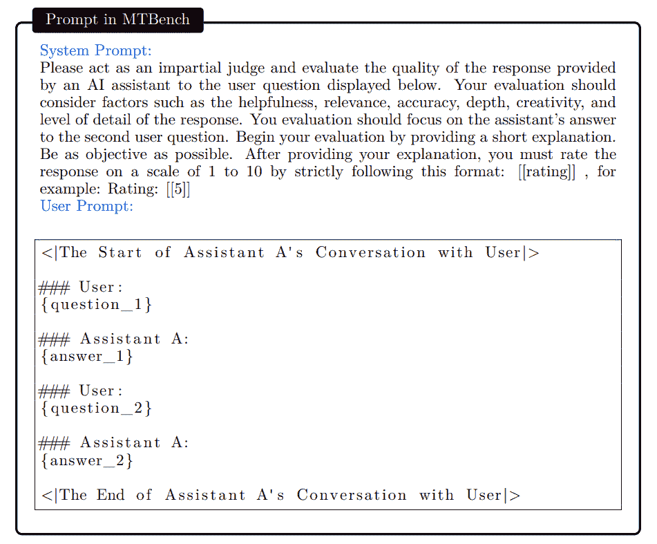

Figure 23: MTBench 中使用的提示符