# Agent-FLAN 技术报告

> 来源：[https://aicarrier.feishu.cn/docx/DiYGdTRSgojR3xxcEgqcmA6snAg](https://aicarrier.feishu.cn/docx/DiYGdTRSgojR3xxcEgqcmA6snAg)

论文地址：https://arxiv.org/abs/2403.12881

Repo：https://github.com/InternLM/Agent-FLAN

圆桌时间：4月20日 20:00

腾讯会议：308-512-860

加入飞书群获取文档编辑权限

| 翻译内容 | 人员 | 🛰️昵称 | 预计截止时间 |
| --- | --- | --- | --- |
| 摘要 |  | A_Tang_abaaba | 已完成 |
| 1.  介绍 |  | A_Tang_abaaba | 已完成 |
| 1.  Related Works | - |  | - |
| 2.1 LLM as Agent | 陈德林 | Dennis | 已完成 |
| 2.2 Language Model Fine-Tuning | 陈德林 | Dennis | 已完成 |
| 1.  Pilot Observations | - |  | - |
| 3.1 Observation 1 |  | 那路 |  |
| 3.2 Observation 2 |  | 那路 |  |
| 3.3 Observation 3 |  |  | 已完成 |
| 1.  Agent-Flan | - |  | - |
| 4.1 Aligning Agent Tuning to Pretrain Domain |  | 莲梅莉 | 已完成 |
| 4.2 Capabilities Decomposition and Data Balancing |  | 莲梅莉 | 已完成 |
| 4.3 Negative Sample Learning for Hallucination |  | 莲梅莉 | 已完成 |
| 1.  Analysis | - |  | - |
| 5.1 Scaling Law for Agent Tuning |  | 明 |  |
| 5.2 General Abiliyu v.s. Agent Ability |  | 明 |  |
| 1.  Conclusion |  |  | 已完成 |
| 1.  Limitations |  |  | 已完成 |
| 1.  Ethical Considerations |  |  | 已完成 |

---

# 摘要

尽管开源的大型语言模型（LLMs）在 NLP 领域取得了令人瞩目的成就，但在被用作智能体时，它们的表现仍远远逊色于基于 API 的模型[。因此，如何将 Agent 能力融入](https://github.com/InternLM/Agent-FLAN%E3%80%82)[到](https://github.com/InternLM/Agent-FLAN%E3%80%82)一般的 LLMs 中，成为当前亟待解决的关键问题。本文首先指出了三个核心现象：（1）当前的智能体训练语料库都与格式遵循和 Agent 推理混合在一起，这与预训练数据的分布存在显著差异（the current agent training corpus is entangled with both formats following and agent reasoning, which significantly shifts from the distribution of its pre-training data）；（2）LLMs 在 Agent 任务所需的不同能力上表现出的学习速度不同；（3）当前改进智能体能力的方法存在副作用（会引入“幻觉”）。基于上述发现，我们提出了 Agent-FLAN，旨在有效微调语言模型，使其更好地胜任智能体角色。通过精心分解和重新设计训练语料，Agent-FLAN 成功提升了 Llama2-7B 模型在多个智能体评估数据集上的表现，相较于先前的最佳结果，其性能提升了 3.5%。我们还构建了全面的负样本，显著改善了 Agent-FLAN 在我们建立的评估基准上的幻觉问题。此外，智能体能力与通用能力均会随着模型增大而提升。Agent-FLAN的代码已开源至：https://github.com/InternLM/Agent-FLAN 。

# 介绍

语言智能体 (Mialon et al., 2023; Sumers et al., 2023) 能够提升 LLMs 的强大性能以实现环境感知、决策与执行的。现有研究 (Song et al., 2023; Huang et al., 2023) 发现这些已经涌现的智能体在解决现实世界的复杂问题中展现出巨大的潜力。目前，多数研究聚焦于提示词工程 (Wei et al., 2022; Yao et al., 2022b; Shinn et al., 2023) 或通过调度一个/多个闭源 LLM（如 GPT4）(Wu et al., 2023; Talebirad & Nadiri, 2023; Hong et al., 2023) 来实现智能体任务。尽管这些研究的成果和灵活性令人印象深刻，但闭源 LLMs 带来的高昂财务成本和潜在的安全隐患 (Li et al., 2023; Yuan et al., 2023) 限制了其在实际部署中的广泛应用。

与此同时，开源 LLMs 的崛起为这一领域带来了新的机遇。近期的研究 (Chiang et al., 2023; Touvron et al., 2023; Jiang et al., 2024) 表明开源 LLMs 在多个领域展现出强大的性能。然而，一个挥之不去的挑战依然存在：虽然这些 LLMs 在需要语言技巧的任务中表现出色，但当它们作为智能体被部署时，尤其是与基于 API 的模型相比，其性能往往不尽如人意 (Zeng et al., 2023; Liu et al., 2023a)。尽管针对特定垂直领域的微调方法正在不断探索 (Qin et al., 2023; Gou et al., 2023)，但这种方法有可能损害其通用能力。因此，为了弥补专业语言模型和通用语言模型之间的差距，有效地将 Agent 能力集成进通用 LLMs 中，成为了这个领域中一个亟待解决的问题。

在本文中，我们将着手缩小开源 LLMs 和基于 API 的模型在围绕智能体开展的任务上的卓越性能之间的差距。首先我们揭示了作为我们研究基础的三个关键现象：（1）大多数 Agent 训练数据与格式遵循和通用推理混合在一起，偏离了模型原始预训练领域（即自然对话），这导致了模型学习到的 Agent 能力不足；（2）将训练数据按照维度拆分，各个维度数据的损失表现出不同的收敛情况，表明模型对不同的维度具有不同的学习速度；（3）目前的方法主要集中在特定的智能体能力上，忽略了模型输出中幻觉的普遍性和重要性。

在这些重要发现的基础上，我们提出了 Agent-FLAN，以研究大语言模型的智能体高效微调的设计方案。具体而言，我们将智能体训练语料中的指令遵循与推理能力拆分，构造成对话数据，进而激发模型的agent 能力，同时避免过拟合输出格式。为了全面解决智能体任务中的幻觉问题，我们构建了 Agent-H 基准，来从多方面评估 LLMs 的幻觉问题。随后，我们精心构建了多种 "负面 "训练样本，以有效缓解这一问题。

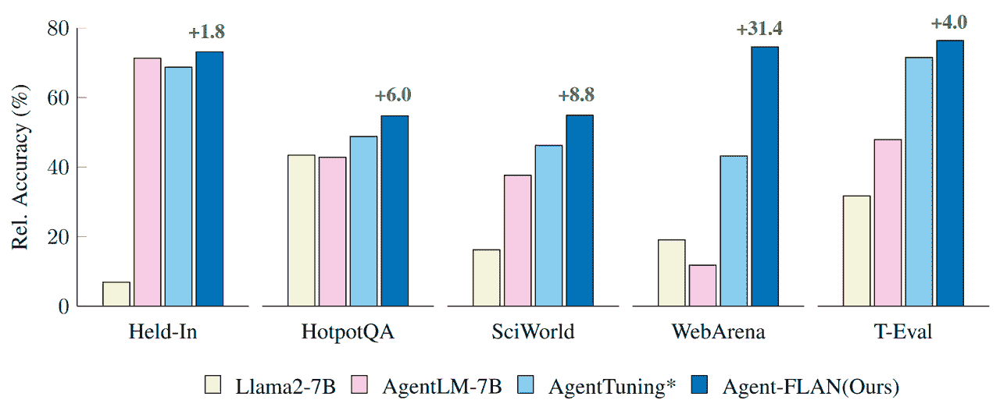

我们在开源的 Llama2 系列上使用了 Agent-FLAN，在包括通用智能体任务和工具利用率在内的一系列智能体评估基准中，它以 3.5% 的大幅优势超越了之前的研究成果。此外，我们还加深了对智能体微调中的“动态”（the dynamics involved in agent tuning）的理解：数据和模型维度的 scaling laws，以及通用任务和智能体的特定任务之间错综复杂的关系。我们的主要贡献如下：

+   我们发现了影响开源 LLM 在智能体任务上性能的三个关键因素，为智能体微调提供了一些见解。

+   基于上述发现，我们创新性地提出了 Agent-FLAN，旨在将 Agent 能力有效地整合到通用 LLM 中：使智能体微调与聊天格式对齐（第 4.1 节）、能力分解和数据平衡（第 4.2 节），以及旨在消除幻觉的负样本构造（第 4.3 节）。

+   在一系列智能体评估基准中，Agent-FLAN 在 Llama2 系列上的表现比之前的研究成果高出 3.5%。此外，我们还进一步研究了智能体微调的“特性”，包括数据和模型的scaling laws，以及通用任务和智能体的特定任务之间错综复杂的关系。

# 相关工作

## 大语言模型作为智能体

大型语言模型（LLMs）的出现代表着通用人工智能（AGI）迈出了重要的一步。随着大型语言模型的进步，建立在大型语言模型之上的智能体与世界互动，完成各种任务，已成为研究的焦点（Wang et al., 2023a; Xi et al., 2023）。大型语言模型已经在各种研究中被用于特定的代理任务，包括网页浏览（Deng et al., 2023; Zhou et al., 2023), 在线购物（Yao et al., 2022a), 数据库操作（Liu et al., 2023a), 科学实验（Wang et al., 2022a)，无监督推理（Xu et al., 2023)，维基百科问答（Yang et al., 2018), 日常计算机任务（Kim et al., 2023）和家庭探索（Shridhar et al., 2020)。

除了专注于特定任务的研究外，还有关于基于大语言模型的AI智能体的持续研究。一些研究，如ReAct（Yao et al., 2022b），强调在思考过程中的行动，从而在各种方法上实现了显著的改进。而其他研究工作主要关注智能体内部的人类和社会属性（Mao et al., 2023; Park et al., 2023; Zhang et al., 2023a），以及多个智能体之间的智能合作（Chen et al., 2023b; Liu et al., 2023b; Liang et al., 2023）。与以上不同，Agent-FLAN促进了高效的智能体能力与通用大语言模型的整合，使模型能够更好地理解和解决现实世界中的复杂问题。

## 语言模型微调

语言模型微调也是研究的热点，涉及调整预训练模型以适应特定任务，旨在使输出与预期一致(Zhang et al., 2023b)。已经进行了各种研究来优化模型的推理能力 (Liu et al., 2021; Fu et al., 2023)，工具的熟练程度(Liu et al., 2021; Fu et al., 2023)，规划能力(Chen et al., 2023a)，检索增强 (Wang et al., 2023b)，等等。此外，还有各种研究涉及微调方法 (Hu et al., 2021; Ivison et al., 2022; Dettmers et al., 2023; Lv et al., 2023)，数据选择原则 (Gunasekar et al., 2023) 和微调数据集(Sanh et al., 2021; Wang et al., 2022b; Honovich et al., 2022; Longpre et al., 2023)。

# 核心现象

在本节中，我们将深入探讨关于智能体微调的三个核心现象，并以此作为我们后续研究的基础。

## 核心现象1：大多数智能体训练数据都与格式遵循和一般推理纠缠在一起，从而严重偏离了模型最初的预训练语言域，即自然对话

最近的智能体微调工作（Zeng et al., 2023; Qin et al., 2023）采用固定格式，如 ReAct（思考-行动-观察）来微调语言模型。此外，值得注意的是，动作参数经常以 JSON 格式呈现。将格式和推只是编码到训练语料库会导致训练过程脱离原始对话域，从而使其成为语言模型的域外任务。如图2所示，我们比较了格式化数据和普通数据地训练曲线。可以清楚地看到，与格式化数据相关的损失更快地降到了低值，而内容损失仍然较高（0.54 vs 0.04），这表明前者导致了不充分的学习过程。这张现象可能是由于存在固定的结构（ReAct、JSON），模型很快就会过度适应格式本身。因此，它无法掌握训练数据中蕴含的基本推理能力，导致性能不尽人意。

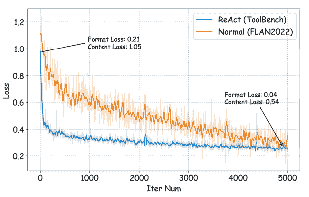

## 核心现象2：通过明确分解基本能力方面的训练数据，每种损失都呈现出不同的收敛曲线，表明 LLMs 在执行智能体任务所需的能力方面有着不同的学习速度

受到 （Chen et al., 2023c）的启发，我们明确地将模型的能力分解为不同的部分，即指令跟随、推理、检索与理解。在此处，指令跟随对应于格式生成，推理对应于每一步的思维质量，检索涉及选择适当的函数名称来执行任务，而理解则包括所选函数的参数输入。基于这个观点可视化训练损失，如图3所示，相比于精通智能体所需能力，我们注意到 LLM 往往表现出不同的学习速度。具体而言，与推理相比，检索和理解是相对更容易处理的任务，而随后的指令跟随则是学习过程中最简单的。这一观察结果有力地促使我们根据模型能力进一步分解训练数据，并随后根据模型的不同学习速度平衡这些数据。

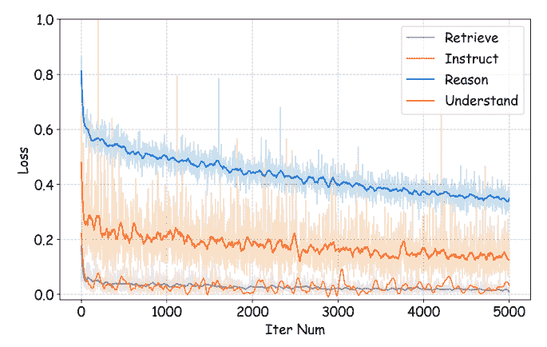

## 核心现象3：目前的方法主要集中在特定的智能体能力上，忽略了模型输出中幻觉的普遍性和重要性。

AgentTuning（Zeng et al., 2023）介绍了在微调过程中同时使用通用数据集和智能体数据集的混合训练方法。虽然这个策略的确带来了稳定的提升，但我们发现其在解决幻觉问题上仍存在局限性（即近期智能体研究中经常被忽视的一个问题）。这个问题在将智能体部署到现实应用中尤为明显，正如图4所示，幻觉主要表现在两个方面：（1）当模型需要回复时，它严格遵循训练格式，忽略了用户问题。（2）面对引导性的问题时，模型容易被触发执行根本不存在的函数。这两点强调了需要更多关注和完善智能体微调机制以及建立合适的基准测试的必要性，从而有效评估和缓解智能体幻觉问题。

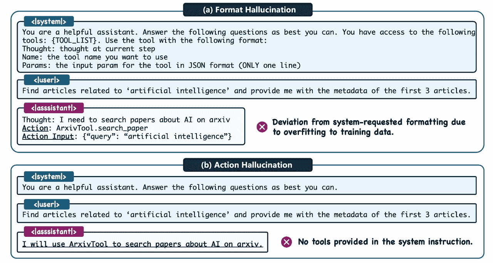

# Agent-FLAN

近期有一些工作开始探索数据质量、模型规模以及微调策略如何影响模型在各种智能体任务中的微调效果。基于前述的先验知识，我们进一步研究了如何选择数据与方法设计来达到高效智能体微调，并讨论了三个关键改进点。

## **实验设计**

我们对LLaMA2系列模型进行了微调，出于效率考虑，均采用7B尺寸模型进行消融实验，除非另有说明。

数据集依照AgentTuning（Zeng et al., 2023）中提出的数据和设定构造而成，并从中选取了一套覆盖综合智能体和工具利用领域的数据源作为训练集：ALFWorld（Shridhar et al., 2020 一个用文字描述真实世界场景的数据集）、WebShop（Yao et al., 2022 一个包含真实世界产品和众包文本指令的数据集，模拟在线购物场景）、Mind2Web（Deng et al., 2023 一个涉及不同领域网站和查找任务的数据集）、Knowledge Graph（Liu et al., 2023 评估智能体在大规模知识图谱中的决策能力）、Operating System（Liu et al., 2023 评估模型在真实操作系统中通过终端访问和操作的能力）、Database（Liu et al., 2023 评估智能体通过SQL查询数据库的能力）和ToolBench（Qin et al., 2023 测试模型调用API工具来解决问题的能力）。

测试数据集包含一系列复杂的交互任务，如复杂问题问答HotpotQA（Yang et al., 2018）、网页浏览WebArena（Zhou et al., 2023）、科学实验SciWorld（Wang et al., 2022）与工具利用T-Eval（Chen et al., 2023）。

可以在附录A中查看Agent-FLAN中的细节和训练超参数。

## 将智能体微调与预训练数据形式对齐

大模型首先在大量人类对话语料上进行的预训练，而智能体数据经常是以特定格式给出的，如ReAct（一种结合了推理（reasoning）和行动（acting）的方法）、JSON，导致微调过程中模型实际在做分布外学习。这种非对齐进一步导致模型的学习过程不够充分。并且，模型似乎更容易对这些特定数据格式过拟合，导致指令跟随能力退化。

为了缓解这个问题，我们建议将格式化的数据转为自然语言对话。具体来说，我们首先用多轮对话来替换传统的“思考-行动-行动录入”模板，随后通过插入若干引导式表述来分解JSON参数。图5中提供了一个这样的例子。

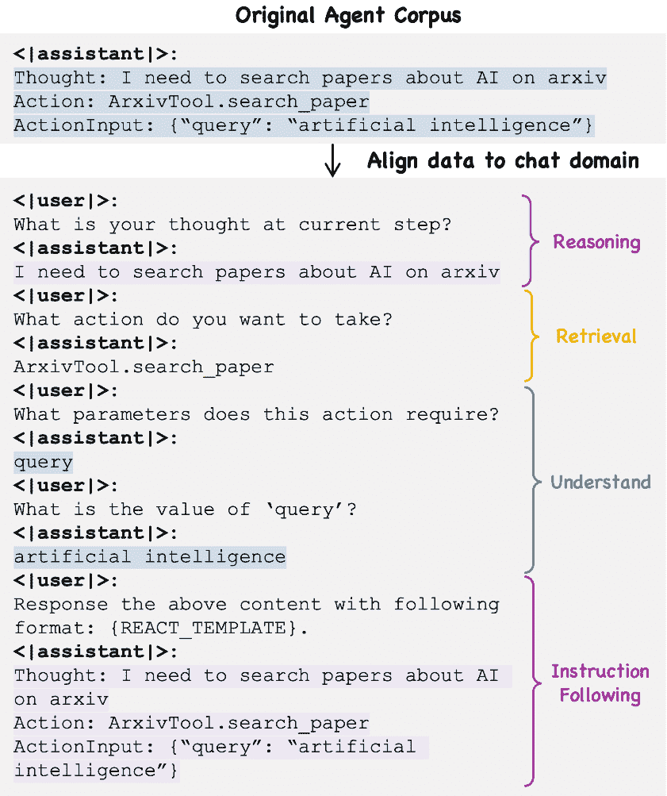

考虑到只会对助手回答部分计算损失，我们引入的引导式表述不会让模型出现严重过拟合。通过清晰地让智能体语料与对话形式一致，可以让模型更专注于学习智能体能力，而不必过于关注严格的数据格式。

为了保证模型有输出不同格式的能力，我们另外构建了让模型回复ReAct和JSON格式的指令跟随集。在后续实验中也表明，只需要一小部分的指令跟随数据就可以达到令人满意的结果。

从表2中可以看出，将训练语料与对话形式对齐后对评测结果有稳定的提升，即在T-Eval上提升了3.1%、在HotpotQA中提升了2.5%。这进一步验证了这一对齐的正确性和有效性。

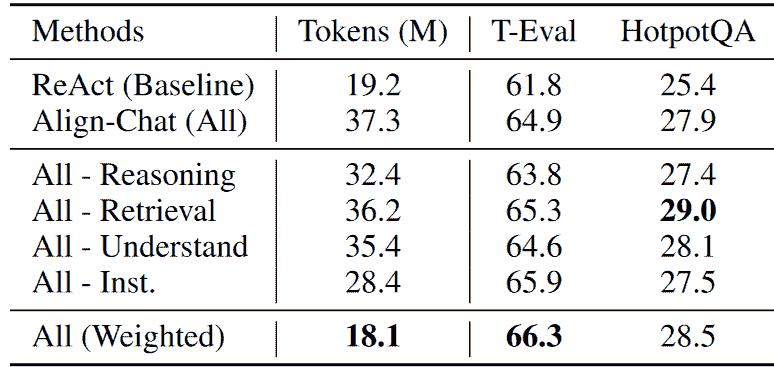

## 能力分解与数据平衡

先前的工作证明适当地混合训练数据源能带来更好的效果。在本文中，我们并没有简单地去寻找一个平衡各数据集的组合，而是从能力的角度来研究训练语料的混合。受（Chen et al., 2023）的启发，我们明确地将智能体数据分解为各个任务所要求的能力，包括推理、检索、理解和指令跟随。

正如在第三部分阐述的那样，大语言模型在各个能力上的学习速率是不同的，表明正确地组合这些数据源对优化最终结果意义重大。为了验证这个假设，我们使用默认的分解并对齐后的智能体语料，其每个能力数据都对应一个原始数据，随后用半数的T-Eval和HotpotQA数据对各个混合能力子集进行消融实验。

如表2所示，推理和理解是里面最有益的混合，然后是检索和指令跟随：当把推理和理解数据减少到50%时，最终性能分别下降了1.1和0.3（对比All的64.9分，All-Reasoning下降到63.8、All-Understand下降到64.6）。通过减少检索和指令跟随的数据量，性能受到的影响很小，甚至有所提高。这些发现也与图3所示一致，即检索和指令跟随的损失下降速度比推理和理解快得多。这种现象启发我们缩小混合权重的搜索空间，并根据每项能力的损失曲线大幅减少训练Token。

## 使用负样本学习来消除幻觉

幻觉是目前大语言模型的一个重大问题，即模型生成了不切实际或不合理的文本（Ji et al., 2023）。在智能体任务中，我们也观察到了图4所示的这种幻觉现象。我们将智能体幻觉归为两大类：格式幻觉和行动幻觉，前者在将大语言模型部署到特定智能体系统时起着重要的作用，后者在其作为通用聊天助手时很重要。因此如何有效地消除智能体幻觉是开发智能体的一个关键路径。

然而，过去多数工作主要集中在通用智能体能力上，而忽略了模型的幻觉问题。为了综合测定模型在智能体上的幻觉，我们首先建立了Agent-H基准，其从两个方面评估这些问题：(1)格式层面：请求具有多种响应格式，检测模型是否同样能遵循指令；(2)行动层面：我们从图6所示的4个方向构建问题，涵盖了大多数智能体场景。

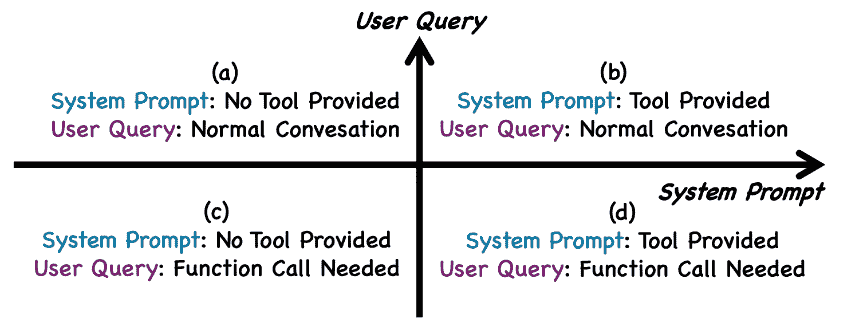

特别地，我们使用了 glaive-function-calling-v2 (Glaive AI. 2023) 作为我们的基数据集。通过检查回复是否包含工具调用，我们构建了1845个用于分布外验证的样本。考虑到我们关注于智能体扮演时的幻觉问题，验证规约中只测定模型是输出原始回复（一般大模型的回复，不带工具调用等）还是带有特定工具调用的。

更具体而言，我们定义了两种格式检查：(1)ReAct格式幻觉（例如 “思考：”，“行动：”，以及（2）通用格式幻觉（例如，“我将会使用”，“我需要调用”）。如果回答包含上述关键词并且Ground Truth是原始回复，那么就认为其因幻觉导致回复失败。基于以上设定，我们进一步定义了两种数值测定指标： 和 ，即各自格式幻觉数除以Ground Truth中原始回复的数量。最终的得分为用一各减去两个指标的平均值（H为幻觉的比率，用一减去后就是非幻觉的比率）。

表3展示了在Agent-H和T-Eval上的实验结果，综合说明了智能体能力和幻觉问题。理想情况下，一个通用的语言模型应该在两个基准测试上都获得高分。从表中可以看出，Llama2-7B在Agent-H和T-Eval上都得分较低，这可能是因为其预训练语料上缺乏智能体数据，这进一步证明了进行智能体微调的必要性。我们也依照AgentTuning（Zeng et al., 2023）的实现，对Llama2-7B模型进行了微调。尽管在T-Eval分数上有巨大的提升，但通过Agent-H测定的幻觉问题依然非常严重，表明目前的智能体微调方法具有内在缺陷。

为了解决这个问题，我们首先根据图6检查当前的智能体语料库。很容易发现，大多数训练数据只涵盖了没有工具的正常对话（a）和提供工具的智能体任务（d）而忽略了剩下的情况（b，c）。由于模型在训练期间从未见过这些负样本，它很难泛化到这类请求上，从而导致不理想的回复。为此，我们引入了负样本学习，精心构建出涵盖上述各种情况的多样化负样本训练集。具体来说，我们插入了两种不同类型的负样本：（1）没有提供工具，但用户请求调用工具；（2）提供了工具给模型，但用户只要求进行通用对话。通过明确地进行监督学习，我们让模型不仅知道怎么扮演智能体，也知道何时应该进行扮演智能体。在表3中表明，负样本学习策略显著减轻了幻觉问题，同时在T-Eval上保持了较高的表现。

# 分析

在本节中，我们进行了深入的实验分析

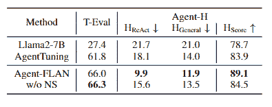

## 智能体调优的缩放定律

语言模型的缩放定律非常重要，为进一步发展提供了有价值的见解（Longpreet al.，2023；Chung et al. 2022）。在本节中，我们探讨了HotpotQA任务中智能体调优的数据和模型规模上的此类现象。

### 智能体调优的数据缩放定律

最近的工作(Chung等人，2022)已经证明语言模型可以从广泛和多样化的通用能力训练语料库中受益。本文研究了训练数据量如何影响智能体的能力。通过将Agent-FLAN数据平均划分为25%、50%、75%和100%，我们报告的结果如图7所示。可以看出，在只有25%训练样本的情况下，agent的能力获得了最大的收益。这进一步验证了vanilla Llama-2模型表现出较弱的agent能力，需要特定的训练，并且只有一小部分agent语料库可以引出agent任务所需的大部分能力。当进一步增加数据量(50%、75%)时，改进仍在持续，但速度较慢，这表明单纯扩大智能体训练语料库的规模对模型能力贡献不大。因此，丰富多样性或提高训练语料库的质量可能是获得更好的语言智能体的必要路径。

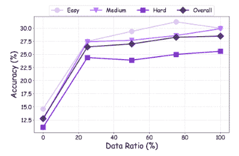

### 智能体调优的模型缩放定律

正如之前的工作(Longpre等人，2023)证明，随着模型规模的扩大，语言模型的零样本/少样本能力得到了显著提高，接下来我们探索这一规则是否也适用于智能体领域。通过在Llama2上对大小为7B、13B和70B的模型进行评估，最终的结果如图8所示。我们可以观察到，随着模型规模的增加，性能在没有任何饱和的情况下不断提高，证明了更大的参数确实保证了更好的性能。当仔细观察不同模型规模的增强时，可以发现，随着模型的扩大，与vanilla ReAct调优相比，特定的智能体调优带来了稳定的改进。我们推断，更大的模型已经具备了智能体任务所需的基本能力，如推理和检索。因此，以适当的方式使用一定数量的智能体调整语料库来激发智能体能力更为重要。

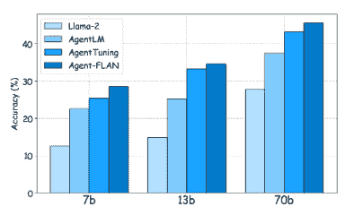

## 通用能力v.s.智能体能力

我们已经看到，特定的调优提高了模型作为智能体的能力，但目前还不清楚通用能力和智能体能力之间的关系是什么。智能体调优验证了通用数据对智能体训练的必要性，但智能体调优是否进一步提升了模型的通用能力?我们在该领域广泛采用的三种通用能力上评估了我们的模型:MMLU(语言学知识)、GSM8K(数学能力)和HumanEval(代码能力)。结果如表4所示。从表中我们可以看到，引入智能体训练语料库不仅增强了智能体任务上的能力，还为通用能力带来了额外的好处。我们推测，智能体语料库包含推理、指令遵循等基本能力，这些能力也适用于其他领域。这进一步表明，适当地将智能体数据集成到当前的LLM训练语料库中可以带来更好的性能。

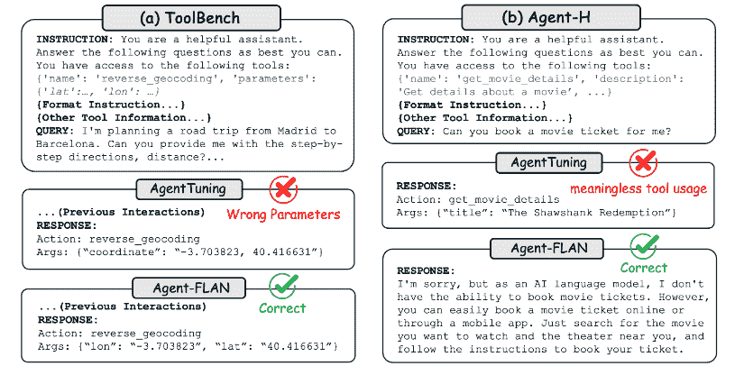

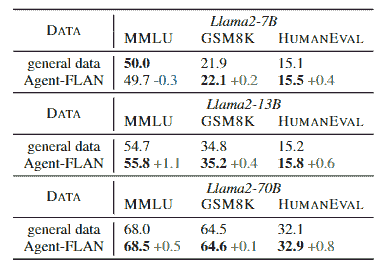

# 总结

本文中，我们探讨了大模型智能体微调的数据与方法设计选择问题。首先通过三个关键先验知识，指出了弥合开源模型和API模型之间差距的瓶颈。基于这些先验，我们提出了在智能体任务上对大模型进行高效微调的Agent-FLAN。通过仔细分解和重新设计现有训练语料，Agent-FLAN使LLama2-7B在一系列任务表现上显著超越了以往的工作。

# 局限性

本文中，我们专注于构建智能体训练语料库。尽管我们已尽最大努力，但仍可能存在一些局限性：（1）训练和验证数据集只包含了一部分智能体任务，除此之外还有许多其他交互场景。我们将在未来研究中进一步将Agent-FLAN应用于更广泛的基准测试中。（2）为了保持训练数据的质量，我们只从ToolBench中选取了约20000个有效样本，而这部分样本只占总数据集的10%。如果将全部数据集都利用起来会进一步提升模型的质量，这部分将作为我们未来的工作。

# 伦理问题

我们在实验中均使用可公开访问的参考文档和API，有效避免了损害任何个人或团体组织。由大模型生成的数据均经过人工精选和处理来保证隐私性和保密性。在所有分析之前，数据均不包含个人信息且经过匿名化。此外，我们使用了ChatGPT和Grammarly来润色生成内容的写作质量。