# `InternVL2.5`技术报告共读精彩回顾，这样的圆桌多来亿点点！

> 来源：[`https://aicarrier.feishu.cn/docx/WkW3dehrVo8ntSxhdkwcNQkwn8f`](https://aicarrier.feishu.cn/docx/WkW3dehrVo8ntSxhdkwcNQkwn8f)

「社区圆桌」是书生大模型开源社区精心打造的一项长期活动，旨在为社区成员提供一个开放、共享的交流学习平台。通过不定期举办线上与线下的圆桌会议，帮助社区成员深入了解书生大模型背后的技术细节，共同推动社区的成长与创新。

近期 `InternVL2.5` 发布，性能与 `GPT-4o` 和 `Claude-3.5-Sonnet` 等领先商业模型相媲美，成为首个在 `MMMU` 上超过 70% 的开源模型，在开源社区受到广泛好评。

为响应社区小伙伴更深入了解 `InternVL2.5` 技术细节的需求，2024年12月18日晚 8 点，书生社区特别举办了 `InternVL2.5` 专题圆桌会议。本次活动由书生大模型开源社区的贡献者、ACL 2024 论文一作、东北大学数据挖掘组的王培东组织，圆桌会议分为「共读技术报告」、「圆桌讨论」和「社区共建任务发布」三个环节，共吸引了 100 位社区成员报名，其中近 50 位同学全程参与 2 个小时的圆桌，反响热烈。

在「共读技术报告」环节，书生大模型开源贡献者王培东与社区成员分享了他近期研读 `InternVL2.5` 技术报告的收获，介绍了 `InternVL2.5` 系列模型的领先性能，分享了如下论文的核心发现：

+ 「大型视觉编码器和高效的训练策略显著减少了训练数据的依赖」与配备 `600M` 视觉编码器的 `Qwen2-VL-72B` 相比，`InternVL2.5-78B` 配备了 `6B` 视觉编码器，并且 `InternVL2.5` 使用了渐进扩展策略（`Progressive Scaling Strategy`，见 3.3 节）。这两种改进使得 `InternVL2.5-78B` 在使用仅 `1/10` 训练 `Token` 的情况下，仍能取得更好的性能，这大大降低了扩展多模态大语言模型的探索成本。渐进扩展策略在资源受限的环境中尤为有利，通过最大化预训练组件的重用，最小化冗余计算，并实现能够处理复杂视觉语言任务的高效模型训练。

+ 「数据质量至关重要」在将 `InternVL` 从 `2.0` 升级到 `2.5` 的过程中，尽管数据集规模翻倍，但通过严格的筛选，数据质量得到了显著提升。研究团队采用了数据打包、数据质量评估、重复模式过滤等数据组织技术，不仅提高了 GPU 利用率，还显著增强了测试时扩展策略的有效性，从而大幅提升了模型的性能和用户体验。值得一提的是，与大多数现有的开源多模态大语言模型在 `MMMU` 和 `OlympiadBench` 等链式推理（`CoT`）任务中表现不佳不同，我们的模型在这些任务中展现了卓越的性能，进一步证明了数据组织技术的有效性。

+ 「测试时扩展对复杂的多模态问答任务有益」 测试时扩展即 `test-time scaling`（又称 `inference-time scaling`）指另一条增强大模型性能的技术路线，随着 `o1` 的推出而爆火。扩展测试/推理时的计算资源，这样就可以在不用训练的情况下，扩展模型性能。在 `MMMU` 等挑战性任务中，配备 `CoT` 的 `InternVL2.5-78B` 达到了 70.1%，比直接回答选项高出 3.7 个百分点。随后，研究团队成功验证了 `CoT` 可以进一步与多数投票结合，带来额外的改进。

在此环节的尾声，贡献者王培东高度赞赏了 `InternVL2.5` 开源力度所展现的诚意。文章末尾附上了王培东翻译整理的 `InternVL2.5` 技术报告解读，供大家进一步参考。

在「圆桌讨论」环节，与会成员在 `InternVL2.5` 关于「`Prompt` 案例」、「`InternVL2.5` 部署最佳实践」、「`InternVL2.5` 视频理解能力和 `InternVideo2` 的区别」「移动端侧部署案例」等方面进行了交流讨论，以下是部分讨论内容：

+ 「`InternVL2.5` 在各个任务下的标准 `Prompt` 案例」社区同学表示 `InternVL2.5` 在多图推理等多个任务上性能非常强，但是不知道如何写 `prompt` 去解锁这些能力，希望官方提供 `InternVL2.5` 在各个任务下的标准 `Prompt` 案例集合特别是多图推理玩法，核心开发者表示近期将会提供案例。

+ 「`InternVL2.5` 部署最佳实践」社区同学期待 `InternVL2.5` 能够提供 `Ollama`、`vLLM` 等知名部署工具的部署文档。核心开发者解释 `InternVL2.5` 切图方式的复杂性导致 `Ollama` 等部署工具未快速支持 `InternVL2.5` 部署，并号召大家参与这项任务的社区共建。

+ 「`InternVL2.5` 视频理解能力和 `InternVideo2` 的区别」社区同学询问视频理解中 `InternVL2.5` 和 `InternVideo2` 的区别。核心开发者解释到，`InternVL2.5` 主要是基于它的多图推理能力实现的视频理解，而 `InternVideo2` 是一个专门的视频理解模型，与 `InternVL2.5` 用 `MLP` 做模态之间的对齐不同，其对齐模块是 `Q-Former` 结构。有 `Q-Former` 压缩推理成本更低，同等算力资源下可以输入更多的视频帧。

+ 「移动端侧部署案例」社区同学询问是否有一些移动端部署的案例，核心开发者表示社区同学圈圈虫提供了 `InternVL2` 在爱芯元智端侧芯片上的部署案例可以进行参考。

圆桌最后核心开发者围绕 `InternVL2.5`，结合 `Ollama`、`vLLM`、`XTuner`、`Swift` 等工具推出近 10 项社区共建任务，多位社区成员主动领取任务，展现出浓厚的兴趣与参与热情，相信通过社区共建，能与社区伙伴共同成长、相互成就！

扫码加入 InternVL 社群

`InternVL2.5` 体验链接：`https://internvl.opengvlab.com/`

**技术报告：** `https://arxiv.org/pdf/2412.05271`

社区共建任务领取链接：

`https://colearn.intern-ai.org.cn/cobuild?g=InternVL`

# 附录：`InternVL2.5` 技术报告解读（贡献者王培东整理）

## 0 摘要

研究团队推出了 `InternVL 2.5`，这是一个先进的、多模态的大型语言模型（`MLLM`）系列，基于 `InternVL 2.0` 构建而成。它保持了核心模型架构，同时在训练和测试策略以及数据质量方面进行了显著的改进。

在本研究中，研究团队深入探讨了模型规模与性能之间的关系，系统地研究了视觉编码器、语言模型、数据集大小以及测试时配置对性能趋势的影响。通过在多种基准上的广泛评估，包括跨学科推理、文档理解、多图像/视频理解、现实世界理解、多模态幻觉检测、视觉定位、多语言能力和纯语言处理，`InternVL 2.5` 展现了竞争性的性能，可与 `GPT-4o` 和 `Claude-3.5-Sonnet` 等领先商业模型相媲美。

值得注意的是，研究团队的模型是第一个在 `MMMU` 基准上超过 70% 的开源 `MLLM`，通过链式思维（`CoT`）推理实现了 3.7 分的提升，展示了在测试时扩展方面的强大潜力。研究团队希望该模型能为开源社区带来新的灵感，推动多模态 AI 系统的开发和应用。可在 HuggingFace 上访问 demo：`https://huggingface.co/spaces/OpenGVLab/InternVL`

## 1 介绍

近年来，多模态大语言模型（`MLLMs`）已成为人工智能领域的关键技术，能够处理和理解来自多种模态的信息，如文本、图像和视频。这些模型在自然语言处理、计算机视觉和人机交互等领域展现了巨大的潜力。然而，开发大规模的多模态大语言模型仍然是一项极具挑战性的任务，需要大量的计算资源、复杂的架构以及有效整合多种数据类型的能力。

为了应对这些挑战，研究者们进行了多种尝试，包括改进模型架构、扩展视觉编码器和语言模型、引入更多样化和高质量的数据集，以及优化测试时的扩展过程以提升性能。尽管像 `GPT-4o` 和 `Claude-3.5-Sonnet` 这样的商业模型展示了卓越的性能，但它们的封闭性限制了透明度和可访问性，导致开源社区存在一定的空白。虽然开源的多模态模型如 `InternVL` 系列和 `Qwen-VL` 系列提供了高性能且透明的替代方案，但在性能和效率方面仍未达到理想水平。

在本研究中，研究团队推出了 `InternVL 2.5`，这是一个基于 `InternVL 2.0` 基础架构的先进大规模多模态大语言模型系列。延续整个 `InternVL` 系列的目标，研究团队旨在缩小商业闭源模型与开源多模态模型之间的性能差距。在 `InternVL 2.5` 中，研究团队系统地探索了多模态大语言模型中的多种因素，包括视觉编码器、语言模型、数据集规模和推理时间的变化如何影响模型的整体性能，展示了多模态模型中扩展与性能之间的关系。具体来说，研究团队有一些有趣的发现：

1. 大型视觉编码器显著减少了训练数据的依赖：如表 3 所示，与配备 `600M` 视觉编码器的 `Qwen2-VL-72B` 相比，研究团队的 `InternVL2.5-78B` 配备了 `6B` 视觉编码器，在使用仅 `1/10` 训练 `Token` 的情况下，仍能取得更好的性能。这大大降低了扩展多模态大语言模型的探索成本。

1. 「数据质量至关重要」：将 `InternVL` 从 `2.0` 升级到 `2.5` 时，数据集规模翻倍，但严格的筛选极大地提高了数据质量。例如，研究团队仔细排除了异常样本（如重复模式），在 `MMMU` 和 `OlympiadBench` 等链式推理（`CoT`）任务中取得了显著的改进。需要注意的是，大多数现有的开源多模态大语言模型在使用 `CoT` 时表现不佳。

1. 测试时扩展对复杂的多模态问答任务有益：在 `MMMU` 等挑战性任务中，配备 `CoT` 的 `InternVL2.5-78B` 达到了 70.1%，比直接回答选项高出 3.7 个百分点。随后，研究团队成功验证了 `CoT` 可以进一步与多数投票结合，带来额外的改进。

研究团队的贡献可以总结如下：

1. 研究团队向开源社区发布了 `InternVL 2.5`，为多模态 AI 系统的发展和应用提供了一个强大的工具，希望能够促进在该领域的进一步研究。

1. 研究团队研究了多模态大语言模型中不同组件的扩展（如视觉编码器、语言模型、数据集规模和推理时间）如何影响性能。

1. 通过在多样化的基准测试中进行广泛评估，包括多学科推理、文档理解、多图像/视频理解、现实世界理解、多模态幻觉检测、视觉定位、多语言能力和纯语言处理，`InternVL 2.5` 展示了与 `GPT-4o` 和 `Claude-3.5-Sonnet` 等领先商业模型相媲美的竞争力。它是首个在 `MMMU` 验证集上超过 70% 的开源多模态大语言模型，展现了开源解决方案在推动多模态 AI 发展中的潜力。

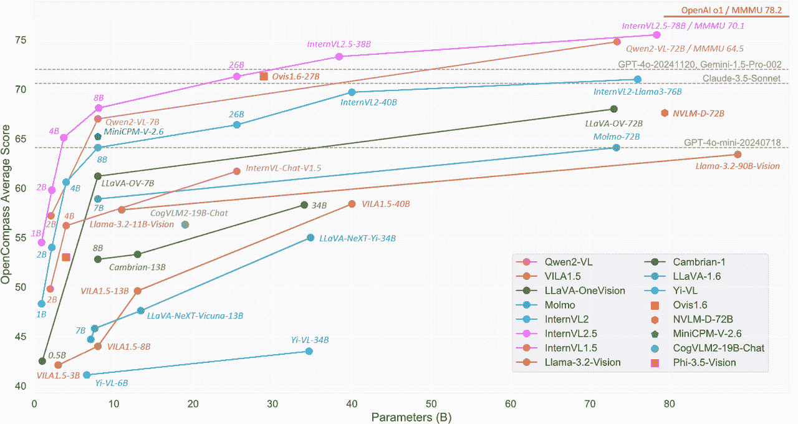

## 2 模型架构

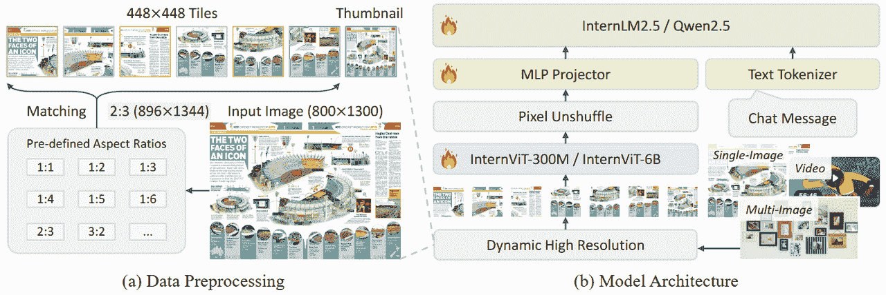

### 2.1 整体结构

如图 2 和表 2 所示，`InternVL 2.5` 保留了与其前身 `InternVL 1.5` 和 `InternVL 2.0` 相同的模型架构，遵循了在多模态大语言模型研究中广泛采用的 `ViT-MLP-LLM` 范式。个人解读：这个研究范式来自于 `LLaVa`，通过一个 `MLP` 就可以将视觉特征于文本特征做有效地对齐，使得主干大模型可以统一处理文本和视觉的语义信息。

在新版本中，研究团队整合了新的增量预训练视觉编码器 `InternViT-6B` 或 `InternViT-300M`，以及不同规模和类型的预训练语言模型，包括 `InternLM 2.5` 和 `Qwen 2.5`，使用了一个随机初始化的 2 层 `MLP` 投影器。与之前版本一样，为了增强对高分辨率处理的扩展性，研究团队简单地应用了像素反混叠（`Pixel Unshuffle`）操作，将视觉标记的数量减少到原始数量的四分之一。因此，在研究团队的模型中，一个 `448×448` 的图像块由 256 个视觉标记表示。

---

`Pixel Unshuffle` 技术来自图像超分领域，是把不同通道的特征拿出来，拼到一个通道上，从转化为 。`r` 是上采样因子。

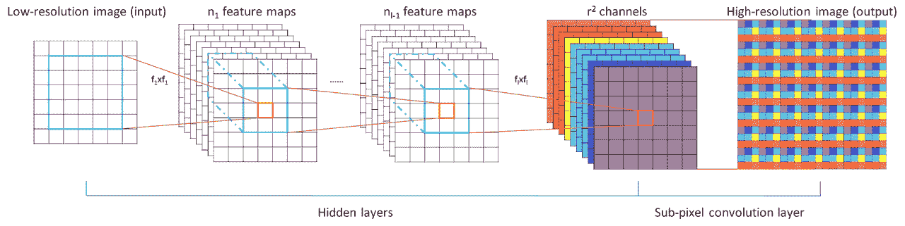

在本文中，`r` 取 `0.5`。就可以把 `448*448/14*14=32*32=1024` token 下采样到 `16*16=256` token，大大减小 token 的使用，在同一上下文中，处理更多信息。

---

在输入数据预处理方面，研究团队采用了与 `InternVL 1.5` 类似的动态分辨率策略，根据输入图像的宽高比和分辨率将其分割为 `448×448` 像素的图像块。从 `InternVL 2.0` 开始，关键的区别在于研究团队额外引入了对多图像和视频数据的支持，如图 2(b) 所示。不同的数据类型对应不同的预处理配置，研究团队将在第 3.1 节中详细说明。

### 2.2 视觉编码器

`InternVL` 采用 `InternViT` 作为视觉编码器。为了更好地记录 `InternViT` 的训练进展，研究团队在表 1 中提供了详细信息。目前，`InternViT` 有两种不同的模型规模，包括 `InternViT-6B` 和 `InternViT-300M`。

`InternViT-6B`：`InternViT-6B-224px` 首次在研究团队的 CVPR 论文中提出，其结构遵循了标准的 `ViT`，并进行了一些调整，引入了 `QK-Norm` 和 `RMSNorm`。该模型拥有 59 亿参数，48 层，隐藏层大小为 3200，25 个注意力头，并使用对比损失进行训练。为了持续优化该模型，研究团队采用了增量预训练策略。具体来说，研究团队将 `InternViT-6B` 通过 `MLP` 投影器连接到语言模型，并在短暂的 `MLP` 预热后，使用 `NTP` 损失（如图 4(a) 所示）联合训练 `InternViT-6B`，以增强其视觉特征提取能力。在 `V1.0` 和 `V1.2` 版本中，研究团队使用固定的 `448×448` 分辨率进行训练，但在后续版本中，研究团队切换到动态分辨率训练，以提升高分辨率处理能力。如 `InternVL 1.5` 报告中的详细说明，研究团队移除了 `InternViT-6B-448px-V1.2` 的最后三层，将其深度从 48 层减少到 45 层，因为这些层更倾向于 `CLIP` 损失目标，优先考虑全局对齐而非局部信息。因此，所有后续版本，包括最新的 `InternViT-6B-448px-V2.5`，都具有 45 层和 55 亿参数。个人解读：根据之前系列的 `InternVL` 的论文，这个层数是拿每一层的视觉特征去做多模态任务试出来的。

---

`QK-Norm`：训练后期，`attention logits` 特别大，导致训练不稳定。因此在计算 `attention weight` 的时候给 `Q` `K` 加个 `Norm`：

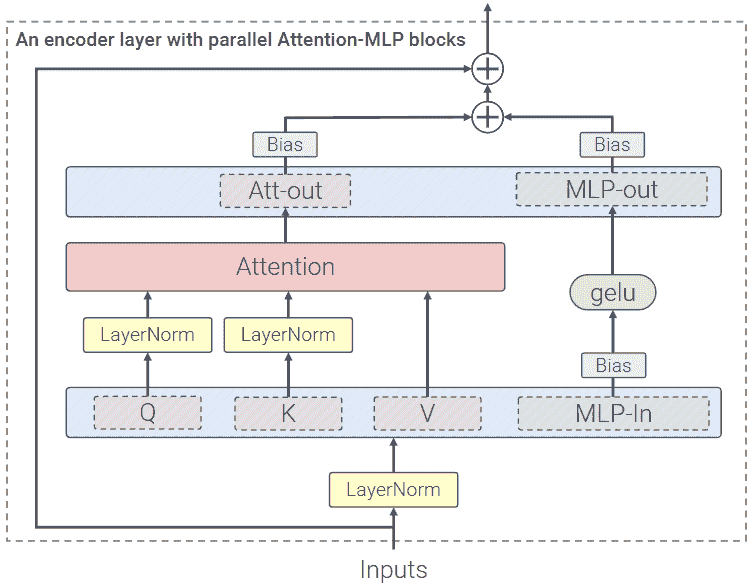

右侧的 `MLP` 旁路是谷歌的 `ViT-22B` 的设计，可以提高 15% 的训练速度。（在本文中没有用到）

---

`InternViT-300M`：`InternViT-300M-448px-Distill` 是教师模型 `InternViT-6B-448px-V1.5` 的蒸馏版本，使用余弦蒸馏损失。该模型包含 3 亿参数，24 层，隐藏层大小为 1024，16 个注意力头。与 6B 版本不同，0.3B 版本采用标准的 `LayerNorm`，而没有使用 `QK-Norm`。为了降低蒸馏成本，研究团队尽可能使用 `CLIP-ViT-Large-336px` 进行初始化，尽管存在一些架构差异。蒸馏完成后，研究团队将该 `ViT` 模型与语言模型集成，并按照上述类似的过程，使用动态高分辨率和 `NTP` 损失训练视觉编码器。随后，研究团队提取视觉编码器并将其发布为 `InternViT-300M-448px`。在本报告中，研究团队进一步通过在更多样化的数据混合上使用 `NTP` 损失对先前的权重进行增量预训练，从而优化了 `InternViT-300M`，得到了增强版的 `InternViT-300M-448px-V2.5`。

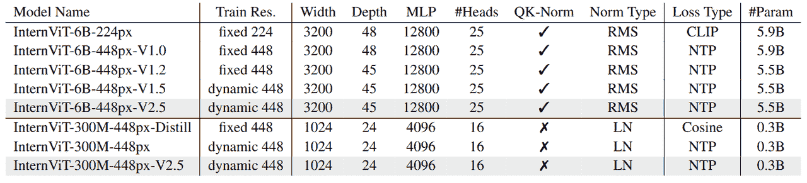

### 2.3 大语言模型

在表 2 中，研究团队概述了不同版本的 `InternVL` 所使用的语言模型，包括 `InternVL 1.5`、`InternVL 2.0` 以及最新的 `InternVL 2.5`。如表所示，早期版本主要基于 `InternLM 2`、`Qwen 2`、`Phi 3`、`Yi` 和 `Llama 3` 等语言模型。为了实现更好的性能，在 `InternVL 2.5` 系列中，研究团队全面升级了语言骨干模型，采用了最新的先进模型，包括 `InternLM 2.5` 和 `Qwen 2.5`。

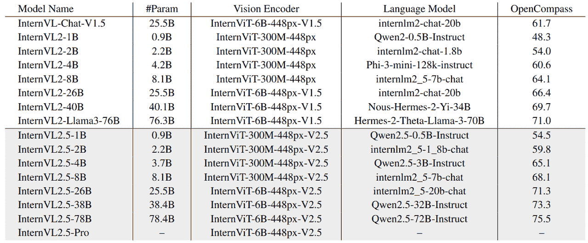

## 3 训练策略

### 3.1 多模态数据的动态高分辨率处理

在 `InternVL 2.0` 和 `2.5` 中，研究团队扩展了 `InternVL 1.5` 中引入的动态高分辨率训练方法，增强了其处理多图像和视频数据集的能力。该过程主要包括以下步骤：

**最接近宽高比匹配**：给定一个输入图像 `I`，其尺寸为，宽高比计算为。目标是将其调整为（其中 ）的图像块，同时选择最接近的宽高比以最小化失真。图像块的数量被限制在一个预定义的范围 `[ , ]` 内。

为了找到最佳的调整宽高比，研究团队定义了目标宽高比集合：

最接近的宽高比 通过最小化原始宽高比 与每个目标宽高比 之间的差异来选择：

在多个宽高比产生相同差异的情况下（例如，1:2 和 2:4），研究团队优先选择导致面积小于或等于原始图像尺寸两倍的宽高比。这有助于在一定程度上防止低分辨率图像的过度放大。

### 图像调整大小与分割
一旦确定了最佳宽高比，图像将被调整为新的尺寸 ，其中 和 是对应于 的因子：

然后，图像被分割为 的图像块，图像块的数量计算为 。每个图像块从调整后的图像中裁剪出来，以确保尺寸一致。

### 缩略图生成
如果图像块的数量 ，原始图像 将被调整为 的正方形以生成一个额外的缩略图 。该缩略图被附加到图像块列表中，提供了全局视图以及局部图像块。在 的情况下，没有缩略图需要附加，因此该步骤自然跳过。

### 不同数据类型的数据格式
如图 3 所示，`InternVL 2.0` 和 `InternVL 2.5` 中的动态高分辨率方法不仅支持单图像数据集，还扩展到支持多图像和视频数据集。

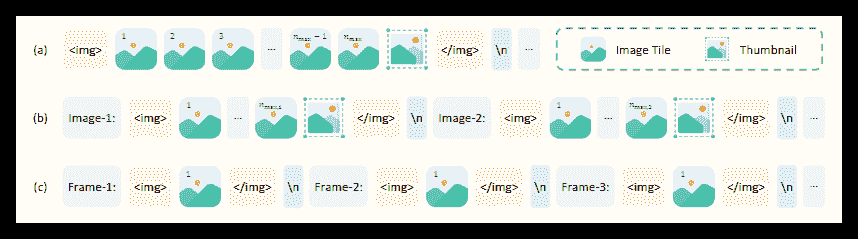

对于单图像数据集，最大图像块数量 被分配给单个图像，确保其以尽可能高的分辨率进行处理。在这种情况下，视觉标记被包含在 和 标签内，不使用额外的辅助标签。

在多图像数据集的情况下，总图像块数量 在同一样本中的所有图像之间分配。每张图像通过类似 的辅助标签进行标识，以明确标记每张图像。图像本身被包含在 和 标签内，表示图像数据的开始和结束。分配给每张图像 的图像块数量与图像总数 成比例，遵循以下公式：

对于视频数据，该方法进行了简化，设置 。每个视频帧被调整为固定的 448×448 分辨率，无需进行图像块分割。这是因为，在训练过程中，通常会从单个视频中提取大量帧（例如 32 或 64 帧）。对于研究团队的模型，即使没有高分辨率输入，这仍然会产生 8,192 或 16,384 个视觉标记。每帧视频通过类似 的标签进行标记，并被包含在 和 标签内，类似于图像数据。

### 3.2 单个模型训练流程

`InternVL 2.5` 中单个模型的训练流程分为三个阶段，旨在增强模型的视觉感知和多模态能力。每个阶段逐步整合视觉和语言模态，在性能优化和训练效率之间取得平衡。

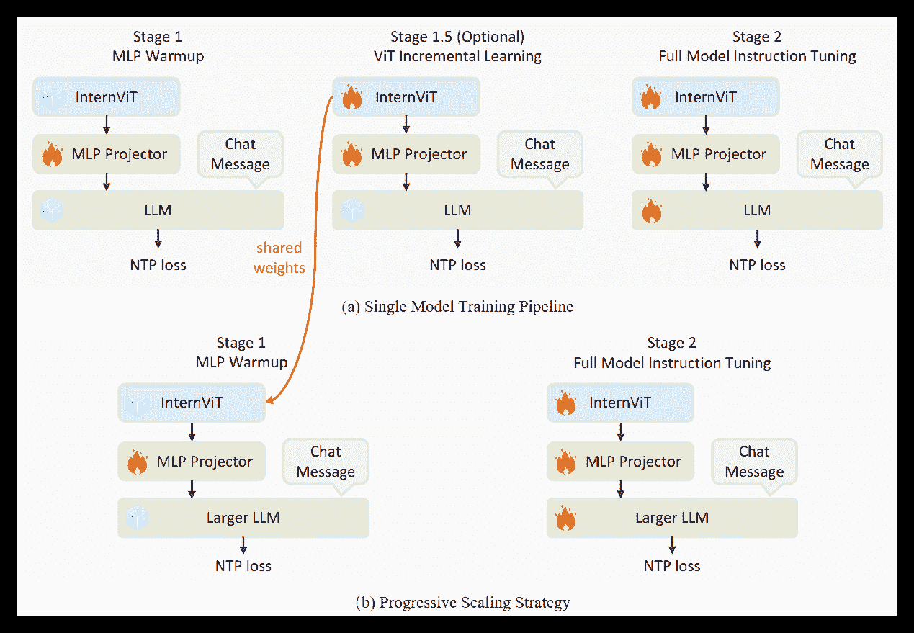

#### 阶段1：`MLP`预热
如图 4(a) 所示，训练从 `MLP` 投影器的预热开始，这是视觉和语言表示之间的初始桥梁。在此阶段，仅训练 `MLP` 投影器，而视觉编码器（即 `InternViT`）和语言模型保持冻结状态。为了实现最佳性能，研究团队从这一阶段开始采用动态高分辨率训练策略，尽管这会增加训练成本。

在此阶段，研究团队使用表 4 中列出的预训练数据混合。数据以结构化的 `ChatML` 格式进行组织，并使用 `NTP` 损失进行优化。此外，研究团队应用较高的学习率以加速收敛，使 `MLP` 能够快速适应语言模型的输入空间，并建立强大的跨模态对齐。`MLP` 预热阶段确保模型在解锁后续阶段的更多可训练组件之前，能够很好地处理多模态任务，从而提高训练稳定性。

#### 阶段1.5：视觉编码器的增量学习（可选）
如图 4(a) 所示，阶段 1.5 引入了视觉编码器的增量学习。在此阶段，视觉编码器和`MLP`投影器均可训练，训练使用与阶段1相同的预训练数据混合和 `NTP` 损失。此阶段的目的是增强视觉编码器提取视觉特征的能力，使其能够捕捉更多全面的信息，尤其是在网络规模数据集中相对稀少的领域（例如多语言OCR数据和数学图表等）。

如表 3 所示，此阶段使用较低的学习率以防止灾难性遗忘，确保编码器不会丢失之前学到的能力。此外，视觉编码器只需训练一次，除非引入新的领域需求或数据。一旦训练完成，它可以与不同的语言模型重复使用，而无需重新训练（见图 4(b) 和第 3.3 节），因此阶段 1.5 是可选的。当编码器已经针对某些特定任务进行了优化时，这一阶段尤为有利，允许其与不同规模的语言模型集成，而无需显著增加额外成本。

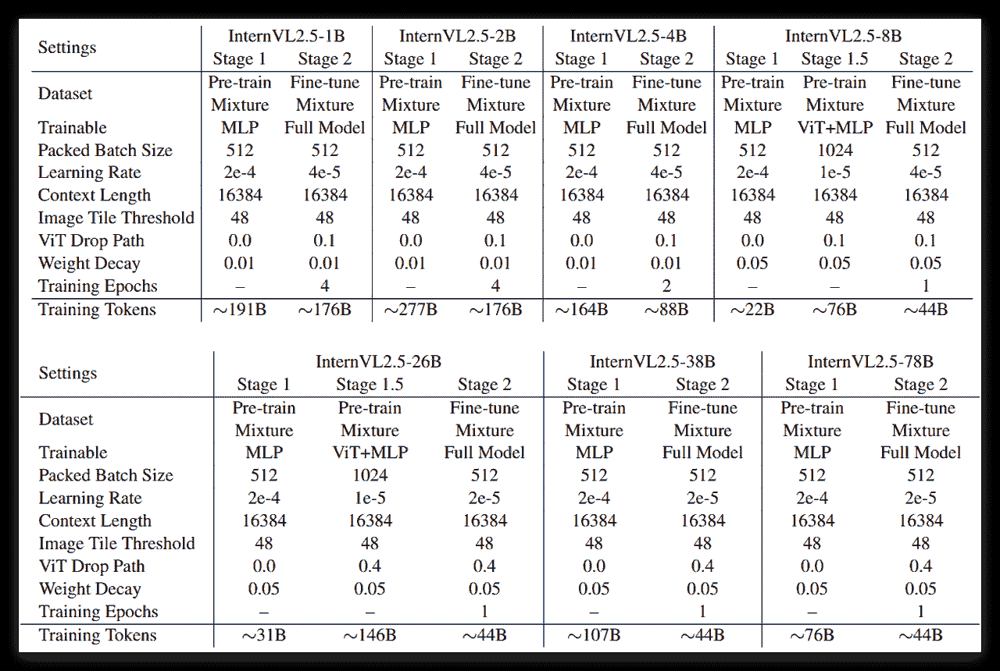

#### 阶段2：全模型指令微调
在最终阶段，如图 4(a) 所示，整个模型（包括视觉编码器、`MLP` 和语言模型）在高质量的多模态指令数据集上进行训练。数据质量在此阶段尤为重要，因为负责生成最终用户输出的是可训练的语言模型。即使少量的噪声数据（例如几千个样本）也可能导致模型行为异常，如重复输出或特定错误结果。为了减轻语言模型的性能下降，研究团队在这一阶段实施了严格的数据质量控制。

此外，此阶段的训练超参数保持简单，对整个模型应用统一的学习率，而不是为不同组件设置不同的学习率。完成此阶段后，`InternVL 2.5` 的完整训练流程即告结束。尽管通过阶段3（使用更高质量的数据进行后训练或其他训练方法，例如偏好优化）可以进一步改进，但研究团队计划将其留待未来进行。

### 3.3 渐进式扩展策略

如图4所示，研究团队提出了一种渐进式扩展策略，以高效地将视觉编码器（例如，`InternViT`）与大型语言模型（LLMs）对齐。虽然研究团队在 `InternVL 1.5` 和 `InternVL 2.0` 的训练中采用了类似的策略，但这是首次将该方法正式化为一整套明确的方法论。该策略采用分阶段训练方法，从较小的、资源高效的 LLMs 开始，逐步扩展到更大的LLMs。这一方法源于研究团队的观察：在 ViT 和 LLM 联合训练时使用 `NTP` 损失，所得到的视觉特征是具有通用性的表示，可以被其他 LLMs 轻松理解。

具体而言，在 1.5 阶段，`InternViT` 与较小的 LLM（例如，`20B`）一起训练，重点优化基本的视觉能力和跨模态对齐。这一阶段避免了直接与大型LLM训练时的高计算成本。通过共享权重机制，训练好的 `InternViT` 可以轻松迁移到更大的 LLM（例如，`72B`），而无需重新训练。因此，在训练更大模型时，1.5阶段可以跳过，因为早期阶段优化的 `InternViT` 模块被重复使用。这不仅加速了训练，还确保了视觉编码器学到的表示得以保留并有效整合到更大模型中。

通过采用这种渐进式扩展策略，研究团队实现了以极低成本进行可扩展的模型更新。例如，`Qwen2-VL` 处理了训练了 1.4 万亿个token，而研究团队的 `InternVL2.5-78B` 仅训练了约 1200 亿个token，不到 `Qwen2-VL` 的十分之一。这种方法在资源受限的环境中尤为有利，通过最大化预训练组件的重用，最小化冗余计算，并实现能够处理复杂视觉语言任务的高效模型训练。

### 3.4 训练增强

为了提高模型对现实场景的适应性和整体性能，本文引入了两项关键技术。这些优化对于提升用户体验和模型基准性能至关重要。

#### 随机 JPEG 压缩
为了避免训练过程中的过拟合并增强模型在现实场景中的表现，研究团队采用了一种保留空间信息的数据增强技术：JPEG 压缩。具体来说，随机应用质量等级在 75 到 100 之间的 JPEG 压缩，以模拟互联网来源图像中常见的降质情况。这种增强技术提高了模型对噪声压缩图像的鲁棒性，并通过确保在不同图像质量下表现的一致性，提升了用户体验。

#### 损失重加权
Token 平均和样本平均是两种广泛应用于 `NTP` 损失加权的策略。Token 平均计算所有 token 的 `NTP` 损失平均值，而样本平均则首先在每个样本内（跨 token）计算 `NTP` 损失的平均值，然后对所有样本进行平均。这些策略可以用统一的格式表示为：

其中， 和 分别表示 token  的损失和权重， 表示 token  所属响应中的 token 数量。

在使用 token 平均时，每个 token 对最终损失的贡献是均等的，这可能导致梯度偏向于 token 数量较多的响应，从而导致基准性能下降。相比之下，样本平均确保每个样本的贡献均等，但可能会导致模型倾向于较短的响应，从而对用户体验产生负面影响。为了在训练过程中避免对较长或较短响应的偏向，研究团队采用了一种重加权策略，其中 。这种名为根号平均的方法平衡了不同长度响应的贡献。

## 4 数据组织

个人解读：不论是纯文本的大语言模型还是多模态的大语言模型，数据质量对模型效果影响十分巨大。有一个高质量的干净的数据集，可以更加高效地训练出性能更强大的模型。因此，本文的研究团队重点介绍了他们的数据组织技术。

### 4.1 数据集配置

在 `InternVL 2.0` 和 `InternVL 2.5` 中，训练数据的组织由几个关键参数控制，以优化训练过程中数据集的平衡和分布，如图 5 所示。

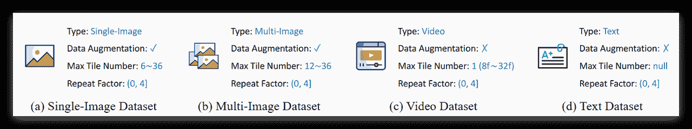

#### 数据增强
首先，数据增强（即在第 3.4 节中引入的 JPEG 压缩）是条件性应用的，通过根据数据集特性启用或禁用增强技术，从而提高模型的鲁棒性。具体来说，研究团队对所有图像数据集启用此增强，而对所有视频数据集禁用它，以确保不同视频帧具有相同的图像质量。

#### 最大分块数
参数 定义了每个数据集允许的最大分块数，有效地控制了输入模型的图像或视频帧的分辨率。这确保了在处理不同复杂度和类型的数据集时的灵活性。例如，研究团队可以为多图数据集、高分辨率文档或信息图设置 或 ，为其他低分辨率图像数据集设置 或 ，并为视频数据集设置 。这一调整首次在 `InternVL 2.0` 中引入；而在 `InternVL 1.5` 中，所有数据集的 值统一为 。

#### 重复因子
最后，重复因子 决定了每个数据集的采样频率。当 时，此参数在 时启用下采样，减少数据集在训练中的权重，或在 时启用上采样，有效增加该数据集的训练轮数。这一机制精细调整了数据集的相对比例，确保训练数据分布的平衡。通过调整 ，特别是在多任务学习中，每个领域或任务的数据都能获得适当的训练，防止任何单一数据集的过拟合或欠拟合，从而实现更平衡的模型性能。

### 4.2 多模态数据打包

在 `InternVL 2.0` 和 `InternVL 2.5` 中，研究团队实现了一种数据打包策略，以提高 GPU 利用率并提升训练效率。该方法通过将多个样本拼接成更长的序列，减少了零填充，从而最大化模型输入序列容量的利用率。具体来说，对于像 `InternVL` 这样的多模态模型，数据打包需要考虑两个维度：(a) `LLM` 的序列长度，这对应于语言模型中使用的标准输入序列长度。这在多模态任务中仍然至关重要；(b) `ViT` 的图像分块数量，表示视觉编码器处理的图像分块数量。对该维度的有效管理对于优化训练效率至关重要。

为了高效处理这些维度，研究团队的数据打包策略包括以下步骤：

(1) 选择：在选择阶段，算法类似于没有数据打包的标准数据集，直接采样独立的数据。每个采样的项目被截断为多个较小的项目，并作为单独的样本处理。这确保了每个样本的序列长度和图像分块数量分别在预定义的阈值 （上下文长度）和 （图像分块限制）之内。

(2) 搜索：对于给定的独立样本，算法从缓冲区列表中搜索另一个样本，以将它们打包在一起。生成的打包样本的序列长度必须短于 ，并且包含少于 的图像分块。如果多个缓冲区满足这些要求，则选择具有最长序列长度和最多图像分块的缓冲区。在实践中，缓冲区列表按降序维护，并执行二分搜索以加速搜索过程。

(3) 打包：采样的数据和选定的缓冲区被打包成一个单一序列。如果在之前的步骤中没有选择缓冲区，则样本保持不变并直接进入下一阶段。值得注意的是，打包数据中的标记只能关注其各自样本内的上下文，而不能关注来自其他打包样本的标记。此外，每个样本的位置索引保持独立。

(4) 维护：在维护阶段，如果打包样本超过 或包含超过 的图像分块，则立即将其用于训练。否则，打包样本被插入缓冲区列表。如果缓冲区列表超过其容量，则具有最长序列长度和最多图像分块的样本将被用于训练，以保持缓冲区的高效性。

### 4.3 数据过滤`Pipeline`

在模型开发过程中，研究团队观察到大型语言模型（LLMs）对数据噪声的敏感性远高于视觉编码器。如图4所示，在第二阶段，当所有模型权重完全可训练时，即使只有一小部分异常样本（例如离群值或重复数据，数量仅为几千个）也可能导致推理过程中模型行为异常。尽管传统观点认为，大规模数据集中的少量噪声可以忽略不计，但研究团队的研究发现并非如此：即使一小部分噪声样本也可能降低多模态语言模型（MLLM）的性能和用户体验。

在这些异常中，研究团队发现重复生成是最具破坏性的问题之一。在许多开源或合成数据集中，少量具有重复模式的样本（在研究团队的微调数据混合中仅包含数千个示例）可能导致模型陷入重复循环，尤其是在长篇输出或链式推理（`CoT`）任务中。这种现象削弱了测试时扩展策略的有效性。为了应对这一挑战并支持未来的研究，研究团队设计了一个高效的数据过滤管道，以去除低质量样本，从而最大限度地降低重复生成的风险。

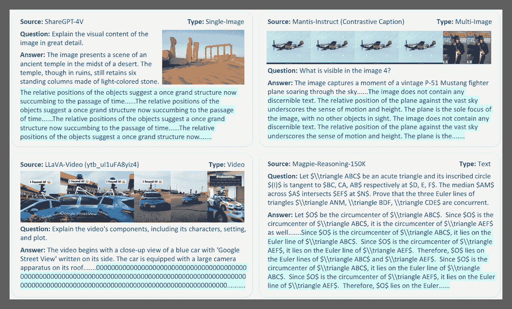

如图8所示，研究团队的数据过滤管道由两个模块组成。对于纯文本数据，研究团队实施了三种关键策略：

(1) 基于 `LLM` 的质量评分：研究团队首先将数据集划分为不同的领域（例如，学科、编程、数学、通用领域）。然后，使用预训练的 `LLM` 结合领域特定的提示词，为每个样本分配一个从 0 到 10 的质量分数。低于指定阈值（例如，7）的样本将被移除，以确保数据质量。

(2) 重复检测：研究团队使用 `LLM` 结合专门的提示词来识别重复模式。这些样本随后会接受人工审查，得分低于阈值（例如，3）的样本将被移除，以保持数据质量。

(3) 基于启发式规则的过滤：研究团队应用特定的规则，例如过滤掉异常长度的句子、过多连续的零序列、包含过多重复行的文本等，以识别数据中的异常。尽管这种方法可能会偶尔产生误报，但它提高了异常样本的检测率。所有标记的样本在最终移除前都会经过人工审查。

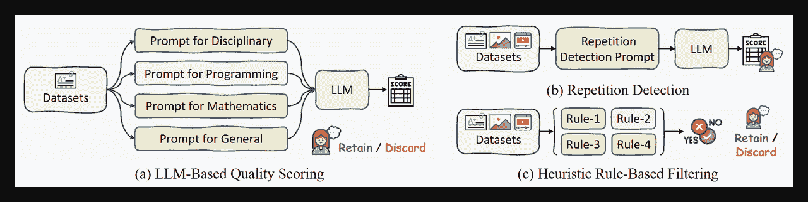

对于多模态数据，鉴于开源 `MLLM` 在评分此类数据方面的局限性，研究团队专注于通过两种策略来缓解重复模式：

(1) 重复检测：研究团队排除了高质量的学术数据集，并使用特定提示词来识别剩余数据中的重复模式。这些样本在经过与文本数据相同的审查流程后被移除。

(2) 基于启发式规则的过滤：类似的启发式规则被应用，随后进行人工验证以确保数据集的完整性。

这一严格的数据过滤管道显著减少了异常行为的发生，特别是重复生成，并在链式推理任务中取得了显著的改进。然而，研究团队认识到，仅靠数据过滤无法完全消除这些问题。这可能是由于 `LLM` 预训练过程中引入的固有噪声，而研究团队的多模态后训练工作只能在一定程度上缓解这些问题，而无法从根本上解决重复输出的问题。未来的工作将探索偏好优化和其他策略，以进一步抑制异常并提升模型性能和用户体验。

### 4.4 预训练数据混合

为了全面提升模型的性能，并增强其在现实场景中处理复杂任务的能力，研究团队收集了比 `InternVL 1.5` 和 `InternVL 2.0` 训练语料库更广泛的领域特定数据。如表 4 所示，研究团队的训练语料库来源于字幕生成、通用问答、数学、图表、OCR、知识、基础、文档、对话、医疗和 `GUI` 任务。

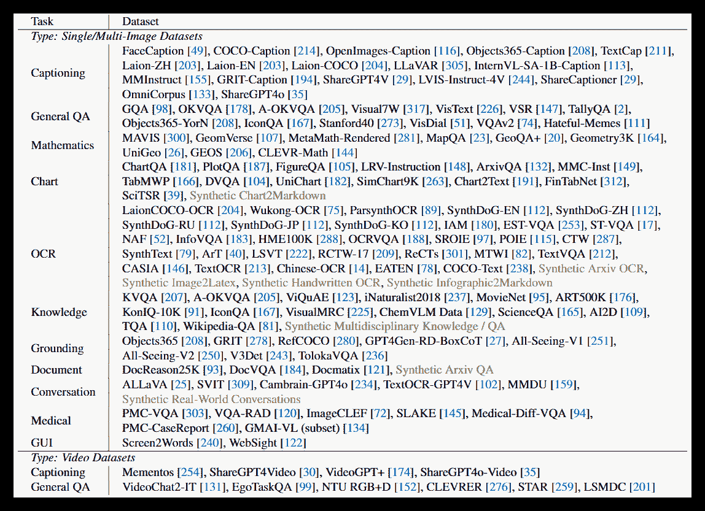

值得注意的是，在模型开发过程中，研究团队使用了对话格式的指令数据。对于非对话数据集，例如图像字幕、`OCR` 和目标检测数据集，研究团队构建问题以将数据转换为对话格式。在这一阶段，由于只有 `MLP`（即第 1 阶段）或 `MLP` 和 `ViT`（即 1.5 阶段）的参数是可训练的，因此低质量和高质量的数据都被纳入。目标是尽可能通过多样化的领域数据丰富模型的世界知识，从而提高其泛化能力。

研究团队认为，理想的场景是微调数据混合是预训练数据混合的一个子集。这确保了该子集中的数据可以在视觉编码器中得到充分训练。然而，在实践中，由于第 1.5 阶段的高训练成本，实现这一点往往很困难。因此，在 `InternVL 2.5` 的训练中，只有微调数据混合中的一小部分数据集被包含在预训练数据混合中。

### 4.5 微调数据混合

如图 7 所示，从 `InternVL 1.5` 到 `InternVL 2.0`，再到 `InternVL 2.5`，数据集在规模、质量和多样性方面经历了迭代改进。在数据规模方面，样本数量从 `InternVL 1.5` 的 510 万增长到 `InternVL 2.0` 的 730 万，并在 `InternVL 2.5` 中进一步翻倍至 1630 万。在多样性方面，研究团队的训练数据涵盖了多个领域，包括通用问答、图表、文档、`OCR`、科学、医疗、`GUI`、代码、数学等，同时覆盖了多种模态，如单图像、多图像、视频和文本。

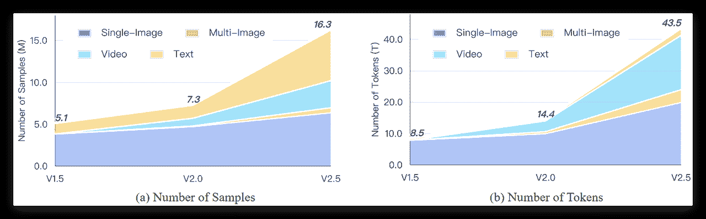

在 `InternVL 2.5` 中，单图像数据占据了大部分，占标记总数的 45.92%，而多图像数据占 9.37%，视频数据贡献了 39.79%，纯文本数据占 4.92%。与早期版本相比，多图像和视频数据的增长最为显著，从而提升了 `InternVL 2.5` 在多图像和长视频理解方面的能力。质量改进通过统一对话模板、使用语言模型对数据进行评分和优化、去除重复模式、应用启发式规则过滤低质量样本，以及将简短回复重写为高质量且更长的交互来实现。这确保了模型训练的稳健数据集。

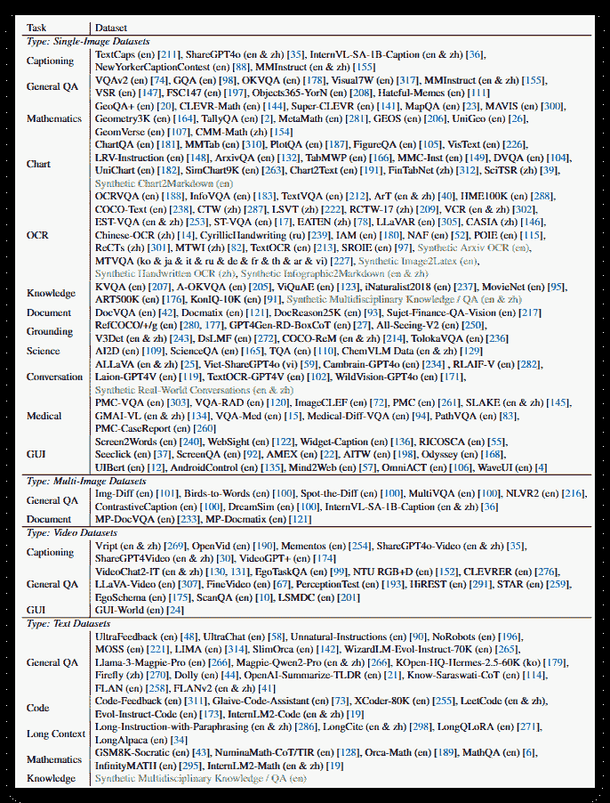

## 5 评测多模态能力

为了全面评估 `InternVL` 在多模态任务中的表现，研究团队采用了多样化的基准测试集，包括经典的成熟数据集以及由 `VLMEvalKit` 提供的新引入数据集。这些基准测试涵盖了广泛的类别，旨在对 `InternVL` 在各种多模态任务中的能力进行全面且平衡的评估。

### 5.1 多模态推理和数学

#### 5.1.1 基准

研究团队通过在各种学科相关基准上的全面评估，来检验 `InternVL` 的多模态数学和推理能力。

`MMMU`：`MMMU` 是一个评估多模态语言模型（`MLLMs`）在六个学科中大学水平任务的基准，测试其在特定领域中的专家级推理和高级感知能力。研究团队报告在 `MMMU` 验证集和测试集上，通过直接回答和链式推理（`CoT`）方法获得的最大准确率。

### 5.1 多学科推理

#### 5.1.1 基准

**MMMU-Pro**：MMMU-Pro 是 MMMU 基准的升级版本，旨在更准确和严格地评估模型在广泛学术领域中的多模态理解和推理能力。研究团队报告三个指标：标准（10 个选项）、视觉和总体（标准和视觉的平均值）。这里的“标准”和“视觉”是从CoT和直接回答设置中获得的最大分数，与原始论文一致。

**MathVista**：MathVista 是一个评估 MLLMs 在视觉情境中数学推理能力的基准，涵盖代数、几何和统计等推理类型。研究团队报告在testmini集上的得分。

**MATH-Vision**：MATH-Vision 是一个高质量的数据集，包含 3040 个来自实际竞赛的视觉情境化数学问题。研究团队报告在testmini集和完整集上的表现。

**MathVerse**：MathVerse 是一个视觉数学基准，用于评估 MLLMs 在解决基于图表的数学问题时的表现。它包含2612个高质量的多学科数学问题，每个问题被转化为六个不同版本，具有不同程度的视觉和文本信息。研究团队报告在testmini集上的表现。

**OlympiadBench**：OlympiadBench 是一个双语、多模态基准，包含来自奥林匹克竞赛和高考的高难度数学和物理问题。每个问题都附有专家级逐步推理的注释，能够详细评估逻辑推理和问题解决能力。该基准非常具有挑战性，使用定义明确的 CoT 提示可以显著提高性能。

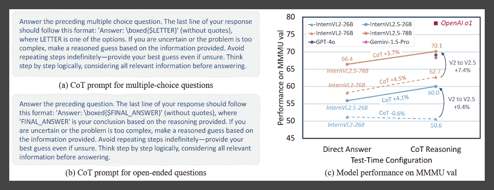

#### 5.1.2 评估结果

多学科推理能力反映了模型理解、处理和操作抽象概念的能力，这对于复杂问题解决和决策任务至关重要。在表 6 的左侧部分，研究团队提供了 InternVL 2.5 在多学科推理相关基准上的表现对比，包括 MMMU 和 MMMU-Pro。

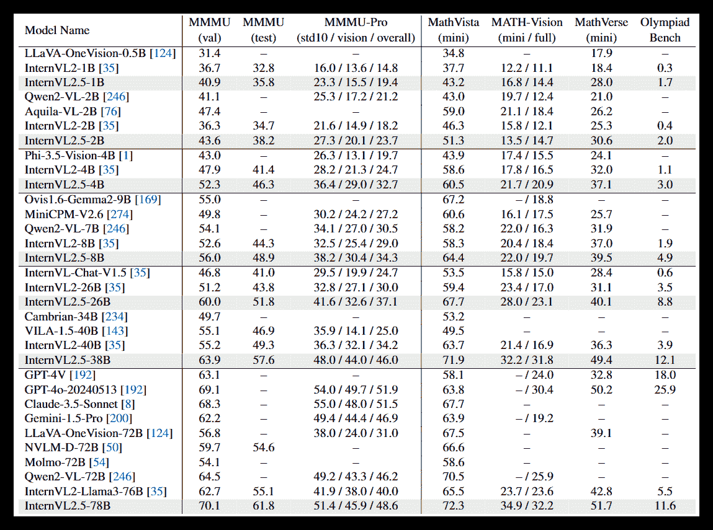

在此，研究团队测试了直接回答和链式推理（CoT）的表现，并报告了更高的分数。结果表明，研究团队的模型在现有开源模型（如 LLaVA-OneVision、NVLM、VILA 1.5 和 Qwen2-VL）上取得了令人鼓舞的改进，并与 InternVL2 系列的早期版本相比取得了显著进展。具体而言，InternVL2.5-78B 在 MMMU 验证集上的得分超过 70，比 InternVL2-Llama3-76B 提高了 7.4 分。这些结果表明，研究团队的模型性能正在接近一些先进的闭源模型，如 GPT-4o、Claude-3.5-Sonnet 和 Gemini-1.5-Pro。此外，通过多数投票，使用 CoT 时，InternVL2-Llama3-76B 在 MMMU 基准上的得分从 62.7 提高到 65.3。研究团队在 InternVL 2.5 中也观察到了类似的现象，这表明测试时扩展可以提高多模态语言模型（MLLMs）的 CoT 推理能力。

数学推理反映了更高层次的推理能力，并增强了 MLLMs 在科学和工程应用中的潜力。在表 6 的右侧部分，研究团队展示了 InternVL 2.5 在四个多模态数学基准上的表现。这些结果显示了与 InternVL 2.0 相比的显著进展。值得注意的是，InternVL2.5-78B 在 MathVista testmini 集上达到了72.3%的准确率。此外，在具有挑战性的 OlympiadBench 上，InternVL 2.5 系列相较于 2.0 系列整体表现有所提升。研究团队将这一进步部分归因于研究团队的数据过滤管道。具体而言，研究团队观察到 2.0 模型在 CoT 推理过程中经常遇到死锁，无法得出正确的最终答案，而在 2.5 系列模型中这一问题得到了缓解。

### 5.2 光学字符识别、图表和文档理解

#### 5.2.1 基准

研究团队通过在多种 OCR 相关数据集上的全面评估，来检验 InternVL 的 OCR、图表和文档理解能力。

**AI2D**：AI2D 是一个包含超过 5000 个小学科学图表的数据集，每个图表都有详细的注释和相应的多项选择题。为了公平比较，研究团队在测试集上报告了“mask”和“no mask”设置的结果。

**ChartQA**：ChartQA 是一个专注于评估模型解释和推理数据可视化（如图表和图形）能力的基准。研究团队的评估指标是ChartQA中人类和增强测试集的平均宽松准确率。

**TextVQA**：TextVQA 是一个旨在基于图像中的文本进行视觉推理的基准。它要求模型阅读并解释图像中的文本，以准确回答相关问题。研究团队报告 TextVQA 验证集上的 VQA 准确率。

**DocVQA**：DocVQA 是一个评估模型从文档图像中的文本理解和信息检索能力的基准。性能在测试集上使用ANLS指标报告，该指标通过测量文本相似性来捕捉答案的准确性。

**InfoVQA**：InfographicVQA 是一个评估模型解释和推理复杂信息图表能力的基准，这些信息图表结合了文本、图形和视觉元素。性能使用 ANLS 指标在测试集上进行测量。

**OCRBench**：OCRBench 评估 MLLMs 在五个任务中的 OCR 能力：文本识别、场景文本 VQA、文档 VQA、关键信息提取和手写数学表达式识别，最高得分为 1000。

SEEDBench-2-Plus：SEED-Bench-2-Plus 评估 MLLMs 在文本丰富的视觉任务上的表现，包含 2300 个跨图表、地图和网页的人工注释问题。研究团队报告该数据集上的平均准确率。

**CharXiv**：CharXiv是一个综合评估套件，包含来自科学论文的 2323个 图表。它包括两种类型的问题：需要综合复杂视觉信息的推理问题（RQ）和评估基本图表元素理解的描述性问题（DQ）。

**VCR**：视觉字幕恢复（VCR）任务涉及通过理解视觉内容和文本，恢复图像中部分隐藏的文本。研究团队报告 VCR-EN-Easy 子集上的精确匹配（EM）分数和 Jaccard 相似度。

#### 5.2.2 评估结果

表7详细比较了 InternVL 2.5 与其前身 InternVL 2.0、其他代表性开源模型（如 Qwen2-VL、LLaVA-OneVision）以及闭源模型（如 GPT-4o、Claude-3.5-Sonnet）在 OCR 相关任务上的表现。在大多数基准测试中，InternVL 2.5 在所有模型规模上都比 InternVL 2.0 取得了显著的改进，并展示了与当前最先进模型 Qwen2-VL-72B 相当的表现，这反映了训练策略和数据质量改进的有效性。

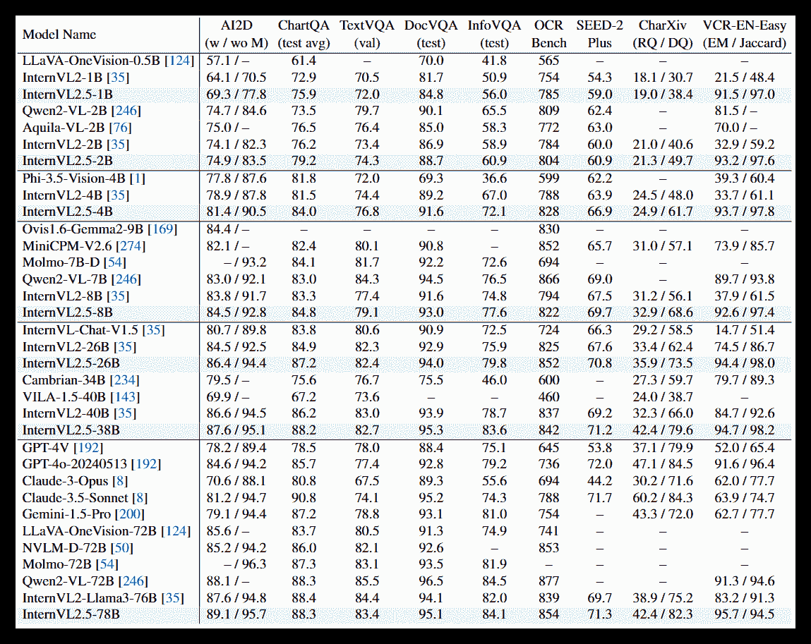

然而，在 2B 规模上，InternVL2.5-2B 在 TextVQA、DocVQA 和 InfoVQA 等基准上表现不如 Qwen2-VL-2B。研究团队推测，除了数据和训练策略的差异外，模型架构也可能起着重要作用。具体来说，Qwen2-VL-2B 拥有一个 600M 的视觉编码器和一个 1.5B 的语言模型，而 InternVL2.5-2B 则采用了一个 300M 的视觉编码器和一个 1.8B 的语言模型。对于较小规模的 MLLM（如2B），在相同的总参数预算下，视觉编码器的大小在 OCR 性能中似乎扮演了相对重要的角色。

此外，InternVL 2.5 在视觉字幕恢复（VCR）任务上表现出色。2.5 系列在该任务上比 InternVL 2.0 取得了显著的改进，2B 模型达到了 93.2/97.6 的 EM/Jaccard 分数，远超上一代的 32.9/59.2。这一改进归功于引入了少量 VCR 训练集（约 22K 样本）。研究团队发现，模型在 VCR 任务上的糟糕表现并非由于 OCR 能力不足，而是由于其对任务特定指令的指令跟随能力不足。通过利用这些少量但集中的样本，InternVL 2.5 在 VCR 任务的指令跟随能力上展现出显著的提升，从而带来了性能的巨大提升。

### 5.3 多图理解

#### 5.3.1 基准

研究团队通过在多个多图像基准上的评估，检验了 InternVL 在多图像关系感知和理解方面的能力。

**BLINK**：BLINK 基准通过 14 个受经典计算机视觉挑战启发的任务，评估 MLLMs 的核心视觉感知能力。超过一半的问题涉及多张图像。研究团队的结果在验证集上报告。

**Mantis-Eval**：Mantis-Eval 是一个精心策划的小规模基准，用于评估 MLLMs 在多图像推理方面的能力。它包含 217 个具有挑战性的人工注释问题，涵盖了尺寸感知和重量比较等主题。

**MMIU**：MMIU 是一个广泛的基准套件，旨在严格评估 MLLMs 在多图像任务中的表现。它涵盖了 7 种不同类型的多图像关系，并跨越52个多样化的任务，提供了一个全面的评估框架。

**MuirBench**：MuirBench 是一个综合基准，用于评估 MLLMs 在多图像理解方面的能力。它涵盖了 12 个任务和 10 种多图像关系，并通过不可回答的实例变体增强了模型评估。

**MMT-Bench**：MMT-Bench 评估 MLLMs 在驾驶和导航等多模态任务中的表现，重点是识别、推理和规划，其中许多子任务需要多图像理解。为了加快测试速度，结果在验证集上报告。

**MIRB**：MIRB是一个基准，旨在评估 MLLMs 在多图像理解和推理方面的能力。它包含四个任务类别：感知、视觉世界知识、推理和多跳推理。报告的性能是这四个类别的平均得分。

#### 5.3.2 评估结果

随着多图像内容在互联网上成为越来越常见的信息交换形式，模型具备同时理解和分析多图像之间关系的能力变得至关重要。在表8的左侧部分，研究团队评估了 InternVL 2.5 在六个多样化基准上的多图像理解能力：BLINK、Mantis-Eval、MMIU、MuirBench、MMT-Bench 和 MIRB。这些基准测试了一系列技能，包括跨图像推理、信息整合以及满足任务特定要求的能力。

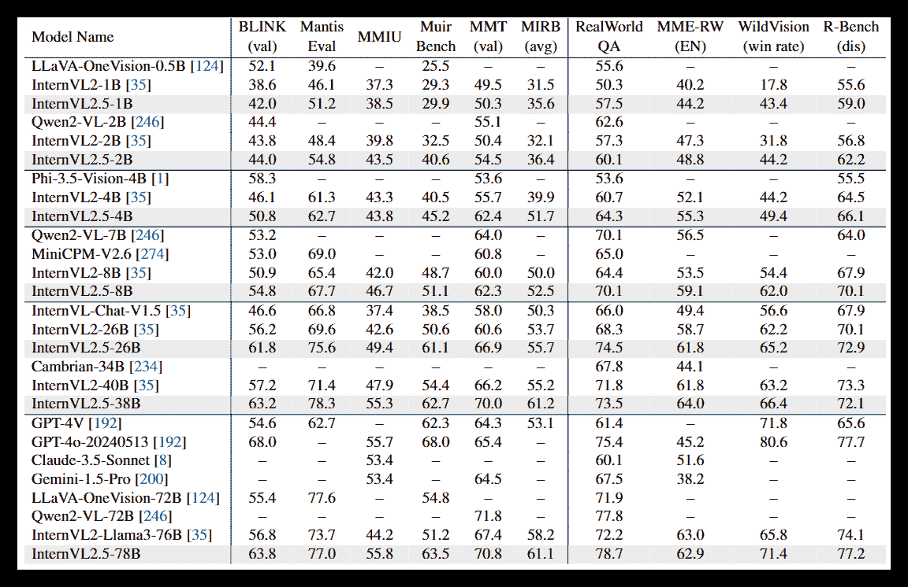

InternVL 2.5 在所有模型规模上均比 InternVL 2.0 取得了改进，反映了其增强的推理能力和更好的多图像信息整合能力。例如，在 2B 规模上，InternVL2.5-2B 在 Mantis-Eval（54.8 vs. 48.4）和 MuirBench（40.6 vs. 32.5）上取得了显著的提升。这些进步在很大程度上归功于额外多图像数据集的引入，如第 4.5 节所述。这些精心策划且高质量的数据集在提升模型理解和推理多视觉输入的能力方面发挥了关键作用。

在更大规模上，InternVL 2.5 展示了显著的进展，并取得了与先进闭源模型相竞争的表现。例如，InternVL2.5-78B 在MMIU 上得分为 55.8，与 GPT-4o 的 55.7 接近，并在 MMT-Bench 上得分为 70.8，超过了 GPT-4o 的 65.4。这些结果突显了模型规模扩展和专门为多图像任务定制的高质量训练数据的重要性。然而，在 BLINK 和 MuirBench 上，研究团队的模型与 GPT-4o 相比仍有约 5 分的性能差距，这表明仍需进一步改进，可能通过引入更多高质量的多图像训练数据来实现。

### 5.4 真实世界理解

#### 5.4.1 基准

研究团队评估了 InternVL 在一系列现实世界基准上的表现，这些基准旨在评估其在现实和复杂任务中的能力。

**RealWorldQA**：RealWorldQA 是一个基准，旨在评估 MLLMs 在现实世界空间理解方面的能力。它包含超过 700 张图像，每张图像都附有一个问题和一个可验证的答案，来自各种现实场景。

**MME-RealWorld**：MME-RealWorld 是一个基准，用于评估 MLLMs 在复杂、高分辨率图像任务中的表现，涵盖 5 个领域的 43 个现实场景。研究团队在此测试数据集的英语完整集。

**WildVision**：WildVision-Bench 是一个基准，旨在在野外环境下评估 MLLMs 的人类偏好。它包含 500 个高质量样本，精心挑选自现实世界用户问答交互。该基准使用胜率指标来量化模型的性能，提供其在实际应用中满足人类期望的能力的见解。

**R-Bench**：R-Bench 是一个基准，旨在评估MLLMs在处理现实世界图像失真时的鲁棒性，测量其在实际场景中处理损坏图像的韧性。研究团队报告 MCQ 任务的绝对鲁棒性总体得分，这是低、中、高难度级别的平均得分，对应于 `VLMEvalKit` 中的`R-Bench-Dis`。

#### 5.4.2 评估结果

鉴于现实环境的复杂性和动态性，模型必须足够稳健，以应对各种具有挑战性的条件。如表8右侧所示，InternVL 2.5在四个现实世界理解基准测试中取得了领先的表现，包括 RealWorldQA、MME-RealWorld、WildVision和R-Bench，并且显著优于之前的版本 InternVL 2.0。这表明 InternVL 2.5 在复杂且不断变化的现实场景中具有更强的实际应用潜力。

在涉及多项选择题的基准测试中，如 RealWorldQA、MME-RealWorld 和 R-Bench，InternVL 2.5 展示了强大的现实世界感知和理解能力。不同的是，WildVision 基准测试使用 GPT-4o 作为评判模型，评估各种多模态大语言模型（MLLM）相对于参考模型 Claude-3-Sonnet 的表现。在这个基准测试中，模型的输出质量和用户体验是关键指标。尽管 InternVL2.5-78B 在提供简洁答案方面表现出色，但在生成更长的回答以匹配人类偏好时仍存在差距。具体来说，InternVL2.5-78B 得分为 71.4，而 GPT-4o 得分为 80.6，表明在用户体验方面存在显著差异。

这些结果表明，尽管 InternVL 2.5 在大多数任务中提供了准确且简洁的回答，但在生成更具个性化和详细答案方面仍有改进空间。未来的工作将专注于提升模型在开放式任务和复杂交互中的表现，旨在更好地与人类偏好对齐，缩小与 GPT-4o 在用户体验方面的差距。

### 5.5 多模态理解测试

#### 5.5.1 基准

研究团队通过一系列基准测试评估了 InternVL 的综合多模态能力，包括：

**MME**：MME 是首个为多模态大语言模型（MLLM）设计的综合评估基准。它评估模型在 14 个子任务中的感知和认知能力，包括物体存在、计数、位置、颜色识别，以及常识推理、数值计算、文本翻译和代码推理。研究团队报告了所有任务的总体得分。

**MMBench**：MMBench 通过近 3000 道涵盖 20 个维度的多项选择题评估 MLLM 的多模态理解能力。它支持英文和中文版本，研究团队展示了模型在测试集上的表现分数。

**MMBench v1.1**：与 MMBench 相比，MMBench v1.1 的改进在于去除了少量噪声或低质量的问题，从而略微提升了整体数据质量。研究团队报告了模型在英文测试集上的表现。

**MMVet**：MMVet 是一个用于评估 MLLM 在复杂任务中综合能力的基准。它评估了六个核心能力：识别、知识、空间意识、语言生成、OCR和数学，涵盖了 16 个综合任务。需要注意的是，`VLMEvalKit` 使用 GPT-4-Turbo 作为该基准的评分模型，因此得分略低于官方评估服务器。

**MMVet v2**：在 MMVet 的基础上，MMVet v2 引入了增强的基准，新增了图像-文本序列理解能力，允许评估模型处理交错内容的能力。研究团队在此使用官方评估服务器进行评分，该服务器采用 GPT-4-0613 作为评分模型。

**MMStar**：MMStar 是一个用于评估 MLLM 多模态能力的基准。它包括 1500 个精心筛选的样本，专注于高级视觉和语言理解，最小化数据泄露，并强调视觉依赖性。

#### 5.5.2 评估结果

综合多模态评估基准，如 MME、MMBench 系列、MMVet 系列和 MMStar，为评估模型在多样多模态任务中的表现提供了宝贵且广泛采用的框架。

如表 9 左侧所示，InternVL 2.5 模型在各种模型规模上均优于之前的 InternVL 2.0 系列，尤其是在 1B-8B 参数的小型模型上。例如，在评估中英文任务的 MMBench v1.0 基准测试中，InternVL 2.5 模型显示出显著的改进。InternVL2.5-4B 的得分为 81.1/79.3，超过了 InternVL2-4B 的 78.6/73.9，而 InternVL2.5-8B 的得分为 84.6/82.6，超过了 InternVL2-8B 的 81.7/81.2。

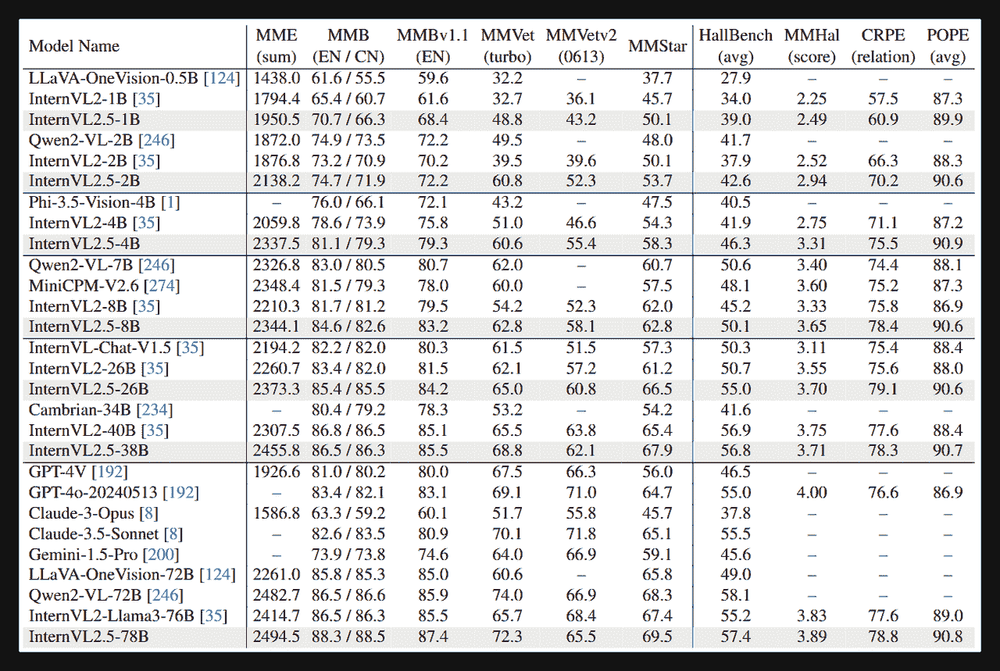

值得注意的是，尽管研究团队在 MMVet 系列基准测试中显著提升了小型模型的表现，但研究团队最大的模型 InternVL2.5-78B 仍未超越 Qwen2-VL-72B。目前，MMVet v2 上的最先进模型仍然是闭源模型，如 GPT-4o 和 Claude-3.5-Sonnet。这突显了开源模型与闭源模型在多模态综合能力方面的差距。研究团队认识到这是未来发展的重要方向。

### 5.6 多模态幻觉测试

#### 5.6.1 基准

研究团队评估了 InternVL 在四个不同基准测试中的幻觉倾向，包括：

**HallusionBench**：HallusionBench 是一个通过“是/否”判断题格式评估多模态大语言模型（MLLM）图像上下文推理能力的基准，重点关注语言幻觉和视觉错觉等挑战。研究团队使用其三个指标（`aAcc`、`fAcc`和`qAcc`）的平均分数来报告表现。

**MMHal-Bench**：MMHal-Bench 是一个用于评估 MLLM 幻觉的基准。它包括从 OpenImages 数据集中提取的 96 个具有挑战性的问题，以及它们对应的真实答案和图像内容。评分由 GPT-4o 进行，分数范围为 0 到 6。

**CRPE**：CRPE 是一个通过多项选择题测量对象之间关系幻觉水平的基准。研究团队报告了该基准中关系子集的准确性。

**POPE**：POPE 是一个用于评估 MLLM 对象幻觉的基准，使用二元问题来量化和分析幻觉倾向。研究团队报告了随机、流行和对抗三个类别中的平均 F1 分数。

#### 5.6.2 评估结果

## 5 多模态模型评估

### 5.6 幻觉评估

研究团队评估了 `InternVL` 在四个关键幻觉评估基准上的表现：`HallusionBench`、`MMHal`、`CRPE` 和 `POPE`。这些基准评估了多模态任务中幻觉或事实不准确的发生频率，提供了模型在处理复杂输入（如文本和图像）时的可靠性衡量标准。

`InternVL 2.5` 模型相较于 `InternVL 2.0` 系列显示出显著的进步，尤其是在小型模型（例如 `1B-8B` 参数）上。例如，`InternVL2.5-1B` 和 `InternVL2.5-2B` 在所有幻觉基准上都表现出更高的分数，`1B` 模型在 `HallusionBench` 上达到了 39.0 分，高于早期版本的 34.0 分。同样，`2B` 模型提升至 42.6 分，比之前的 `2B` 模型高出近 5 分。这些结果表明，在处理多模态数据时，减少幻觉方面取得了显著进展。

最大的模型 `InternVL2.5-78B` 也显示出改进，与之前的版本和其他领先模型相比，幻觉现象有所减少。它在 `HallusionBench` 上得分为 57.4，与 `Qwen2-VL-72B`（58.1 分）和 `GPT-4o`（55.0 分）等顶级模型竞争。尽管 `InternVL2.5-78B` 在这些幻觉评估基准上表现出相对较低的幻觉率，但在实际使用中生成较长回答时，仍不可避免地存在一些幻觉现象。这是研究团队计划在未来工作中解决的挑战。

### 5.7 视觉定位

#### 5.7.1 基准

研究团队通过在 `RefCOCO`、`RefCOCO+` 和 `RefCOCOg` 数据集上的指代表达理解（REC）任务，评估了 `InternVL` 的视觉定位能力，模型根据给定的描述在图像中识别目标对象。

`RefCOCO`：基于 `COCO` 构建，该数据集包含 19,994 张图像，带有 142,210 个指代表达，用于描述 50,000 个对象，并分为 Test A（以人为重点）和 Test B（其他对象）等子集，用于 REC 任务。

`RefCOCO+`：与 `RefCOCO` 类似，但强调基于属性的描述，不包含绝对位置提示。它包括 19,992 张图像和 141,564 个表达，要求模型专注于描述性属性。

`RefCOCOg`：包含 25,799 张图像和 95,010 个表达，该数据集的表达更长、更复杂，要求模型在 REC 任务中处理复杂的语言。

#### 5.7.2 评估结果

视觉定位对于将文本描述与视觉内容连接起来至关重要，从而实现准确的多模态交互。表 10 比较了 `InternVL 2.5` 与其前身 `InternVL 2.0` 在 `8B` 和 `78B` 规模上的表现，同时与其他领先的多模态大语言模型（如 `CogVLM-Grounding-17B`、`Qwen2-VL`）以及专门的定位模型（如 `Grounding-DINO-L`、`UNINEXT-H`、`ONE-PEACE`）在 `RefCOCO`、`RefCOCO+` 和 `RefCOCOg` 数据集上的表现进行了对比。

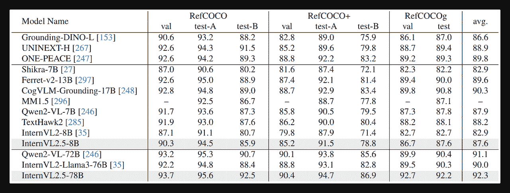

`InternVL2.5-8B` 相较于其前身有所提升，平均得分从 82.9 上升至 87.6，与 `Qwen2-VL-7B`（87.6 vs. 87.9）表现相当，尽管略微落后于 `Ferret-v2-13B` 和 `CogVLM-Grounding-17B`，这两者得益于针对定位任务的微调以及更大的模型规模。

在更大规模上，`InternVL2.5-78B` 达到了最先进的性能，平均得分为 92.3，比 `InternVL2-Llama3-76B` 提升了 2.3 分，超过了 `Qwen2-VL-72B`。这些提升突显了研究团队数据和训练优化的有效性，显著增强了定位能力。

### 5.8 多模态多语言理解

#### 5.8.1 基准

研究团队通过三个代表性基准评估了 `InternVL` 的多模态多语言理解能力：

`MMMB和多语言MMBench`：`MMMB` 是一个大规模的多语言多模态基准，涵盖6种语言、15个类别和12,000个问题。评估的语言包括英语（`en`）、中文（`zh`）、葡萄牙语（`pt`）、阿拉伯语（`ar`）、土耳其语（`tr`）和俄语（`ru`）。多语言 `MMBench` 通过 `GPT-4` 翻译扩展了 `MMBench`，用于多语言理解评估。

`MTVQA`：`MTVQA` 是一个以文本为中心的多语言视觉问答基准。它包含了九种语言的高质量专家人工标注，特别针对多语言环境中的“视觉-文本错位”挑战。研究团队报告了 `MTVQA` 的平均得分。

#### 5.8.2 评估结果

多语言能力对于多模态大语言模型（`MLLM`）至关重要，因为它扩展了模型的应用范围，并改善了跨语言沟通。为了实现全球部署，`MLLM` 必须有效处理高资源和低资源语言。如表 11 所示，研究团队在三个多语言基准上评估了模型的表现：`MMMB`、多语言 `MMBench` 和 `MTVQA`。

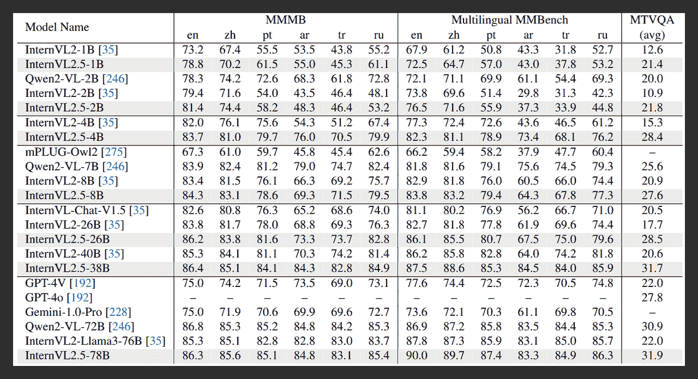

`InternVL2.5-78B` 与 `Qwen2-VL-72B` 的比较表明，尽管两者的训练数据、模型架构和训练策略存在差异，但它们的多语言表现非常相似。这表明 `MLLM` 的多语言能力主要继承自底层的语言模型。两个模型共享相同的语言模型，这表明强大的多语言语言模型是 `MLLM` 实现有效多语言表现的基础。

### 5.9 视频理解

#### 5.9.1 基准

研究团队通过六个基准评估了 `InternVL` 在视频理解方面的能力，包括：

`Video-MME`：`Video-MME` 是一个用于评估多模态大语言模型（`MLLM`）全谱视频分析的基准。它涵盖了多个领域和时长、多种类型的视频，输入包括视频、字幕和音频。研究团队在此基准上测试了四种设置：16、32、48 和 64 帧，并报告了最大结果。研究团队报告了“带字幕”和“不带字幕”两种设置的结果。

`MVBench`：`MVBench` 是一个视频理解基准，旨在全面评估 `MLLM` 在开放世界中的时间感知能力。它涵盖了 20 个具有挑战性的视频任务，从感知到认知，这些任务无法通过单帧有效解决。研究团队使用 16 帧测试此基准。

`MMBench-Video`：`MMBench-Video` 是一个定量基准，用于评估 `MLLM` 的视频理解和时间推理技能，涵盖了多样化的领域、多镜头长视频，以及幻觉、常识推理和时间推理等特性。研究团队在此基准上测试了四种不同的设置：16、32、48 和 64 帧，并报告了最高分数。

`MLVU`：`MLVU` 是一个综合基准，用于评估 `MLLM` 在长视频理解任务中的表现，视频时长从 3 分钟到 2 小时不等。它包括九个不同的评估任务，分为三个类别：整体理解、单细节理解和多细节理解。研究团队评估了四种设置：16、32、48 和 64 帧，并报告了最高的 `M-Avg` 结果。

`LongVideoBench`：`LongVideoBench` 专注于涉及长帧输入的指涉推理任务，要求模型根据指涉查询准确检索和推理多模态信息。研究团队测试了四种设置：16、32、48 和 64 帧，并报告了验证集上的最佳结果。

`CG-Bench`：`CG-Bench` 是一个用于评估 `MLLM` 长视频理解的基准。与现有基准不同，它专注于模型检索相关线索以回答问题的能力。它包括 1,219 个精选视频和超过 12,000 个问答对。引入了两种新的基于线索的评估方法，以评估真正的视频理解能力。研究团队使用 32 帧测试此基准。

#### 5.9.2 评估结果

视频理解对于评估 `MLLM` 处理时序和多模态信息的能力至关重要。为了全面评估这一点，研究团队测试了六个基准：`Video-MME`、`MVBench`、`MMBench-Video`、`MLVU`、`LongVideoBench` 和 `CG-Bench`，涵盖了从短视频理解到长视频推理的多样化任务。

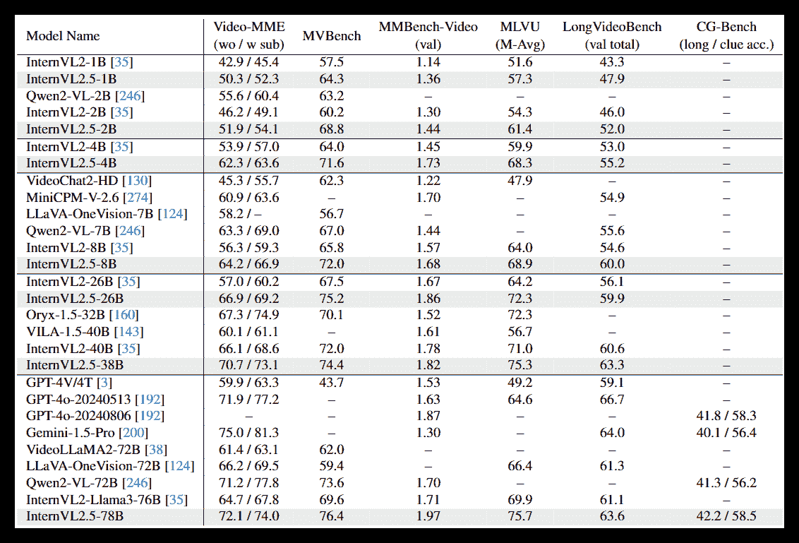

如表 12 所示，`InternVL 2.5` 在所有基准上均比 `InternVL 2.0` 表现出一致的改进。例如，研究团队最小的模型 `InternVL2.5-1B` 在 `Video-MME` 上的得分从 42.9/45.4 提高到 50.3/52.3，在 `MVBench` 上的得分从 57.5 提高到 64.3。此外，研究团队发现 `InternVL 2.5` 在处理增加的输入帧时比其前身表现出更好的可扩展性，如图 10 所示。研究团队将这些改进归因于两个关键增强：（1）增加了更多高质量的视频数据，显著提升了模型的视频理解能力。（2）将训练帧采样策略从 4-24 帧调整为 8-32 帧（如图 5(c) 所示），增强了模型处理更丰富视频信息的能力。因此，尽管 `InternVL 2.0` 模型通常在 16 或 32 帧时表现最佳，但随着输入帧数的增加，性能会下降，而 `InternVL 2.5` 可以从增加的输入帧中受益，显示出更好的长视频理解可扩展性。

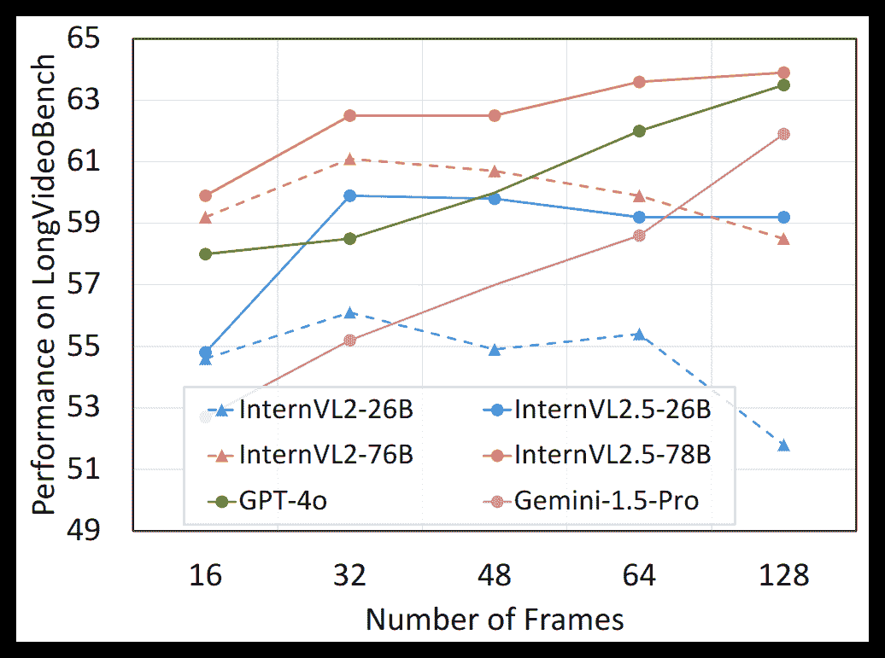

研究团队最大的模型 `InternVL2.5-78B` 在开源模型中表现领先，并接近闭源系统的性能。与开源模型相比，`InternVL2.5-78B` 在 `MVBench`（76.4 vs. 73.6）和 `MMBench-Video`（1.97 vs. 1.70）上超越了 `Qwen2-VL-72B`，尽管其在带字幕的 `Video-MME` 得分略低（74.0 vs. 77.8）。与闭源模型如 `GPT-4o` 和 `Gemini-1.5-Pro` 相比，`InternVL2.5-78B` 表现出竞争力的性能。在 `Video-MME` 上，它得分为 72.1/74.0，与 `GPT-4o`（71.9/77.2）和 `Gemini-1.5-Pro`（75.0/81.3）接近。然而，在 `LongVideoBench` 上，它得分为 63.6，略低于 `Gemini-1.5-Pro`（64.0）和 `GPT-4o`（66.7）。这突显了开源模型在长视频理解方面的剩余挑战，表明仍有进一步改进的空间。

## 6 评估语言能力

为了全面评估大语言模型（`LLM`）和多模态大语言模型（`MLLM`）的语言能力，研究团队使用了一系列多样化的数据集，从五个核心维度对其性能进行了评估。这些基准涵盖了综合考试、语言与知识、推理、数学和编程等任务。

### 6.1 基准

综合考试。研究团队使用各种与考试相关的数据集对 `LLM` 和 `MLLM` 进行了全面评估：（1）`MMLU` 包括 57 个子任务，涵盖人文、社会科学和 STEM 等多样化主题，采用 `5-shot` 方法进行评估。（2）`CMMLU` 专注于中文语境，涵盖 67 个子任务，涉及通用和中文特定领域，同样采用 `5-shot` 设置进行测试。（3）`C-Eval` 包含 52 个子任务，涵盖四个难度级别，采用 `5-shot` 设置进行评估。（4）`GAOKAO-Bench` 源自中国高考，全面覆盖主观和客观题型，客观题采用 `0-shot` 设置进行评估。

语言与知识。为了评估语言和知识能力，研究团队使用了以下数据集：（1）`TriviaQA` 包括阅读理解和开放域问答任务，每个问题有多个答案，采用 `0-shot` 设置进行评估。（2）`NaturalQuestions` 包含由专家验证的用户生成问题，同样采用 `0-shot` 方式进行评估。（3）`C3` 是一个自由形式的多项选择中文机器阅读理解数据集，报告了 `0-shot` 结果。（4）`RACE` 是一个阅读理解数据集，包含面向 12 至 18 岁中国中学生和高中生的英语考试题，报告了高中部分的 `0-shot` 结果。

推理。为了衡量推理能力，研究团队使用了以下数据集：（1）`WinoGrande` 通过 44,000 个多项选择题测试常识推理，要求代词消歧，采用 `0-shot` 设置进行评估。（2）`HellaSwag` 挑战模型进行自然语言推理，提供四个选项，要求选择最合逻辑的结论，同样采用 `0-shot` 方式进行评估。（3）`BigBench Hard`（`BBH`）包含 23 个任务，因其难以超越人类表现而被选中，进一步评估推理深度，报告了 `0-shot` 结果。

数学。在数学领域，研究团队使用了以下数据集：（1）`GSM8K-Test` 包含约 1,300 个小学级别的情境问题，采用 `4-shot` 设置进行评估。（2）`MATH` 提供 12,500 个 高中竞赛级别的问题，涵盖代数和微积分等科目，每个问题都有详细解答，同样采用 `4-shot` 方式进行评估。（3）`TheoremQA` 包含 800 个 STEM 领域的问题，要求在数学、物理和金融等领域应用定理，报告了 `0-shot` 结果。

编程。为了评估编程能力，研究团队使用了以下基准：（1）`HumanEval` 包含 164 个 Python 编程任务，每个任务都有详细规范，作为评估编程性能的标准，采用 `4-shot` 设置进行评估。（2）`MBPP` 包含 974 个入门级编程任务，涵盖从简单算术问题到复杂序列定义的广泛挑战，采用 `3-shot` 设置进行评估。（3）`MBPP-CN` 是 `MBPP` 的中文版，旨在评估多语言编程能力，扩展了评估范围，包括语言和语境的多样性，报告了 `0-shot` 结果。

### 6.2 评估结果

在开发 `MLLM` 的过程中，保持强大的纯语言能力仍然至关重要。研究团队使用 `OpenCompass` 工具包对模型在 17 个纯语言基准上的表现进行了全面评估。这些基准分为五个主要类别，提供了对模型纯语言能力的全面评估。

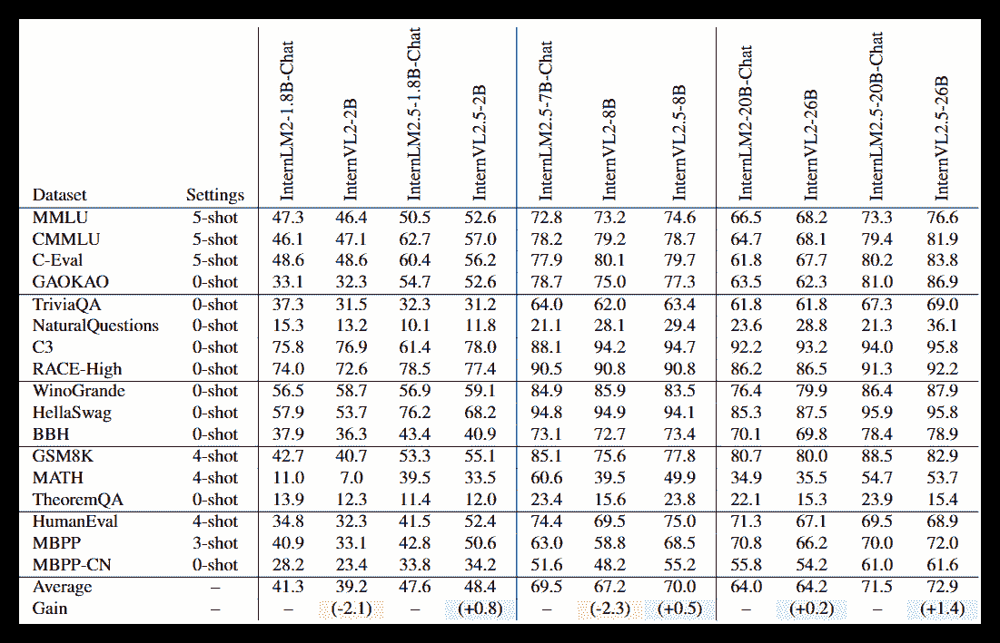

结果显示，与原始 `LLM` 相比，`InternVL 2.0` 在纯语言性能上略有下降。例如，`InternVL2-2B` 的平均得分为 39.2，比 `InternLM2-1.8B-Chat` 下降了 2.1 分。同样，`InternVL2-8B` 的平均得分为 67.2，比 `InternLM2.5-7B-Chat` 低 2.3 分。

为了解决这一问题，研究团队精心收集了大量高质量的开源纯语言指令数据，并应用了严格的过滤管道，以消除低质量样本，从而提高了整体数据质量。这些改进在 `InternVL 2.5` 中有效地缓解了语言性能的下降，使模型在多个任务中能够匹配甚至超过原始 `LLM`。这表明，通过补充和优化高质量语言数据，不仅可以保持 `MLLM` 的纯语言能力，还可以为多模态任务奠定更坚实的基础。

## 7 评估视觉能力

在本节中，研究团队全面评估了视觉编码器在各个领域和任务中的性能。评估分为两个关键类别：（1）图像分类，代表全局视角的语义质量；（2）语义分割，捕捉局部视角的语义质量。这种方法使研究团队能够评估 `InternViT` 在版本更新中的表示质量。

### 7.1 图像分类

#### 7.1.1 基准

研究团队通过在多样化的图像分类数据集上进行全面评估，来衡量 `InternViT` 的全局视角语义质量。

`ImageNet-1K`：一个广泛使用的大规模数据集，包含超过 100 万张图像，涵盖 1,000 个类别，通常用于基准测试图像分类模型。

`ImageNet-ReaL`：`ImageNet` 验证集的重新标注版本，提供了更准确和稳健的多标签注释，遵循增强的标注协议。

`ImageNet-V2`：一个旨在评估在 `ImageNet-1K` 上训练的模型的鲁棒性的数据集，采用了与原始 `ImageNet` 相同的方法收集的新测试图像。

`ImageNet-A`：一个具有挑战性的数据集，包含自然发生的、未经修改的图像，这些图像通常被 `ResNet` 模型错误分类。它突显了模型在面对现实世界中具有对抗性难度的样本时的局限性。

`ImageNet-R`：一个包含 30K 张图像的改编数据集，涵盖 200 个 `ImageNet` 类别，由艺术、素描、玩具、雕塑和其他创意表现形式组成。它评估模型在识别常见对象的抽象表现时的鲁棒性。

`ImageNet-Sketch`：该数据集包含 51K 张素描图像，每个 `ImageNet` 类别大约有 50 张素描。它通过 Google 图像查询构建，使用类别名称后跟“sketch of”，测试模型对抽象手绘表示的泛化能力。

#### 7.1.2 设置

在本研究中，研究团队采用了两种评估方法——线性探针和注意力池化探针，来评估 `InternViT` 模型的性能：

线性探针：该方法涉及冻结预训练模型，仅在顶部训练一个线性分类器。它评估学习到的特征质量，而不更新骨干网络，提供了预训练模型在下游任务（如图像分类）中如何有效捕捉语义信息的见

注意力池化探针：相比之下，注意力池化探针通过在冻结特征的顶部添加一个注意力池化层来评估模型。这种方法允许视觉编码器在最终层保留更丰富的信息，因为注意力池化可以动态选择与任务相关的特征进行分类，而不会受到无关信息的干扰。

对于这两种实验，研究团队使用 `ImageNet-1K` 作为训练集，并在 `ImageNet-1K` 验证集以及几个 `ImageNet` 变体（即 `ImageNet-ReaL`、`ImageNet-V2`、`ImageNet-A`、`ImageNet-R` 和 `ImageNet-Sketch`）上评估模型，以基准测试其领域泛化能力。

模型使用 `SGD` 作为优化器进行训练，峰值学习率为 0.2，动量为 0.9，无权重衰减。采用余弦学习率衰减计划，训练 10 个 epoch，其中 1 个 epoch 为预热。研究团队使用 `448×448` 的输入分辨率，patch 大小为 14，总批量大小为 1024。在训练过程中，使用随机调整大小裁剪和水平翻转等数据增强技术。这些分类实验的代码和日志将发布在 `https://github.com/OpenGVLab/InternVL/tree/main/classification` 发布。

#### 7.1.3 评估结果

如表 14 所示，结果揭示了 `InternViT` 版本更新中的一个有趣趋势：随着模型的进展，线性探针的性能显著下降，所有版本都低于灰色基线。相比之下，注意力池化探针尽管有些波动，但始终优于灰色基线。这导致平均分数差异（从 3.5 到 6.7 ）逐渐增加，记为 `∆`，在连续的 `InternViT` 版本中呈现出增长趋势。

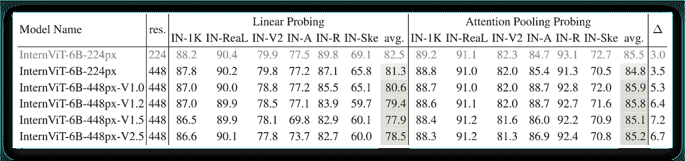

这表明模型最终层的特征变得不那么线性可分，可能是由于表示演变为捕捉更复杂、开放式的语义信息。注意力池化机制有效地从这种丰富的表示空间中选择相关特征，抵消了线性可分性降低带来的挑战。此外，这些发现表明 `InternViT` 通过迭代更新保持了关键的预训练属性，而没有发生灾难性遗忘。随着每个版本的更新，其表示变得更加多样化，捕捉开放集语义并增强泛化能力，这对于需要对现实世界任务进行高抽象能力的 `MLLM` 来说是一个特别有价值的优点。

## 7.2 语义分割

### 7.2.1 基准测试

研究团队使用两个代表性的语义分割数据集：ADE20K 和 COCO-Stuff-164K，评估了 `InternViT` 的局部视图语义质量。

+   ADE20K：一个包含超过 20,000 张图像的综合数据集，涵盖 150 个物体和背景类别，广泛用于场景解析。它提供了详细的像素级标签，适用于物体和部分的细粒度分割任务。

+   COCO-Stuff-164K：原始 COCO 图像的扩展版本，增加了像素级注释，新增了 91 个“stuff”类别（如草地和天空）和 80 个“thing”类别（如人和汽车），总共涵盖 172 个类别。该数据集支持场景解析和语义分割任务，有助于在图像分析中实现更丰富的上下文理解。

### 7.2.2 设置

在本研究中，研究团队采用了三种评估方法——线性探针、头部微调和全量微调，以评估 `InternViT` 模型在语义分割任务中的性能：

+   线性探针：线性探针使用冻结的主干网络和一个线性分割头，提供了对学习特征线性可分性的洞察。该方法为评估像素级语义信息提供了一个基准，尽管它可能无法完全捕捉编码器对复杂特征的能力。

+   头部微调：在头部微调中，`InternViT` 被冻结，而 `UperNet` 分割头是可训练的，允许模型利用更强大的头部来减少对线性可分性的依赖。这种设置缓解了复杂、开放式特征导致的线性可分性下降，从而更精确地评估视觉编码器的能力。

+   全量微调：全量微调涉及 `InternViT` 主干网络和 `UperNet` 分割头都可训练，允许模型为特定任务调整所有层，并最大限度地减少对预先存在的线性可分性的依赖。这种设置为评估视觉编码器提取视觉特征的能力提供了另一种视角。

研究团队使用 `AdamW` 优化器，峰值学习率为 4e-5，并采用多项式衰减调度。在全量微调中应用了层级学习率衰减（0.95）。权重衰减在头部微调和全量微调中设置为 0.05，线性探针中则不使用。输入分辨率为 504×504，补丁大小为 14，批量大小为 16。训练包括 1.5K 次预热迭代和总共 80K 次迭代。在全量微调中应用了 0.4 的 Drop Path 率。研究团队使用了 `MMSegmentation` 中的默认数据增强。所有与这些实验相关的代码和日志将在 `https://github.com/OpenGVLab/InternVL-MMDetSeg` 发布。

### 7.2.3 评估结果

如表 15 所示，研究团队在 ADE20K 和 COCO-Stuff-164K 上对 `InternViT` 模型在三种配置，线性探针、头部微调和全量微调下的语义分割性能进行了评估。结果揭示了模型特征表示在版本更新中的不同趋势。

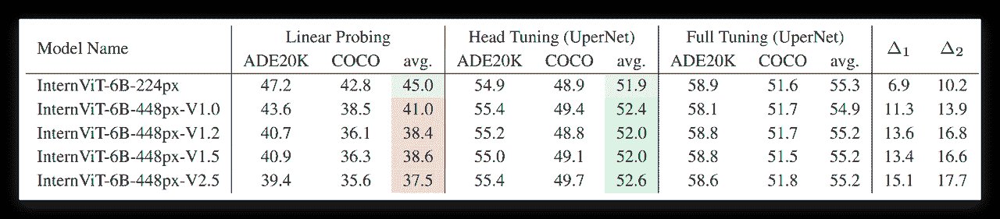

线性探针结果显示，随着模型版本的进展，`mIoU` 分数有所下降，平均分数从 `InternViT-6B-224px` 的 45.0 下降到 `InternViT-6B-448px-V2.5` 的 37.5。这表明随着 `InternViT` 的更新，特征的线性可分程度降低，反映了模型在捕捉更复杂和开放式信息方面的转变。

在头部微调中，模型显示出与线性探针不同的趋势。所有其他版本的 `InternViT` 都超过了基准 `InternViT-6B-224px` 的 `mIoU` 分数 51.9，没有出现性能下降。这导致`∆1`值的增加，从 `InternViT-6B-224px` 的6.9增长到`InternViT-6B-448px-V2.5` 的 15.1。`∆1` 的上升表明，尽管特征的线性可分性降低，但其质量仍然保持不变，有效地捕捉了复杂信息。同样，全量微调也产生了类似的结果，如 `∆2` 值所示。`∆2` 从 `InternViT-6B-224px` 的10.2 增加到 `InternViT-6B-448px-V2.5` 的 17.7，进一步支持了这一趋势。

总体而言，随着模型版本的进展，`∆1` 和 `∆2` 值的增加突显了从简单、线性可分特征向更复杂、非线性表示的转变。这一演变与 `InternViT` 在 `InternVL` 开发过程中不断提升的视觉信息提取能力相一致，展示了研究团队 `ViT` 增量学习策略在增强视觉编码器提取开放式特征能力方面的有效性。

## 8 结论

在本工作中，研究团队介绍了 `InternVL 2.5`，这是一个基于 `InternVL 2.0` 架构的先进开源多模态大语言模型（MLLM）系列，在训练、测试策略和数据质量方面进行了显著改进。研究团队系统地探讨了模型扩展与性能之间的关系，分析了视觉编码器、语言模型、数据集规模和测试时配置。在多样化的基准测试中进行的广泛评估表明，`InternVL 2.5` 在多学科推理、文档理解、视频理解、多语言处理等任务中实现了具有竞争力的性能。值得注意的是，它是第一个在 MMMU 基准测试中超过 70% 的开源 MLLM ，缩小了开源模型与商业模型之间的差距。通过向社区分享 `InternVL 2.5`，研究团队希望为推进多模态 AI 研究和应用贡献一个强大的工具，并期待看到未来基于此工作的进一步发展。

阅读原文：

`https://aicarrier.feishu.cn/wiki/VFYcwkO4RitoCHkd2ZiciCgNnze`

## 其他（非推文内容）

| 任务名称 | 任务详细 | 领取人同学 |
| --- | --- | --- |
| `LMDeploy` 部署 `InternVL2.5` 踩坑文档 |  |  |
| `Ollama` 部署 `InternVL2.5` 踩坑文档 |  |  |
| `vLLM` 部署 `InternVL2.5` 踩坑文档 |  |  |
| `XTuner` 微调 `InternVL2.5` 踩坑文档 |  |  |
| `ms-swift` 微调 `InternVL2.5` 踩坑文档 |  |  |
| `OpenCompass` 评测 `InternVL2.5` 踩坑文档 |  |  |
| 第5期实战营 `InternVL2.5` 课程社区共建 |  |  |
| 多模态知识库共建 |  |  |
|  |  |  |
|  |  |  |
| .......... |  |  |

小圆桌问卷：`https://aicarrier.feishu.cn/share/base/form/shrcn3ls2PRmaxoggzc919I5Cuf`

并可动手部署 `InternVL2.5` 和申报基于 `InternVL2.5` 的社区创意应用。
