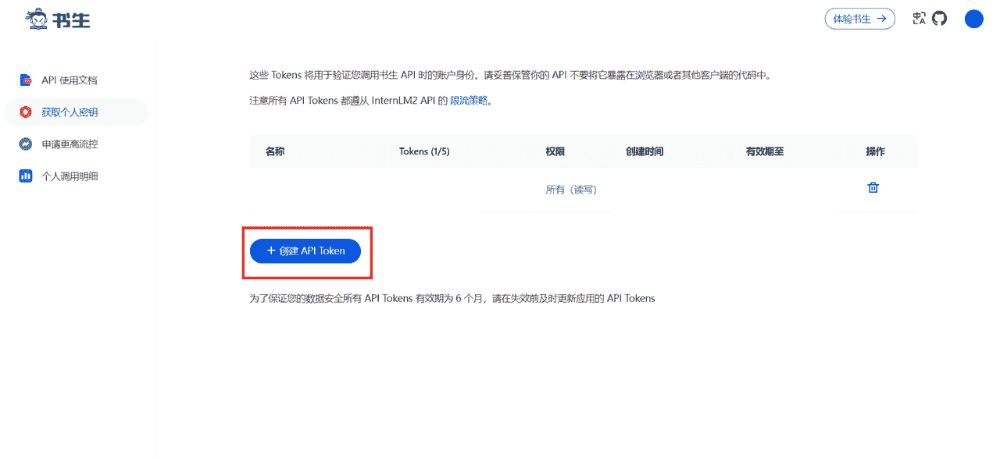
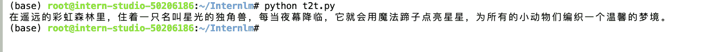
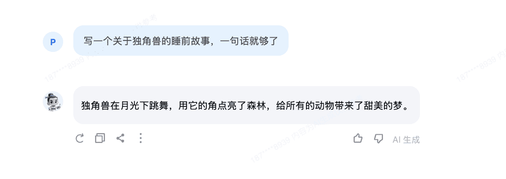
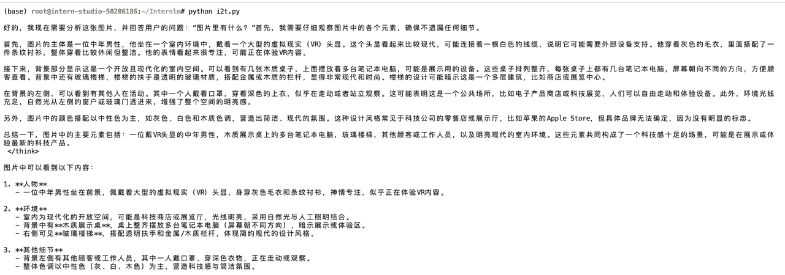
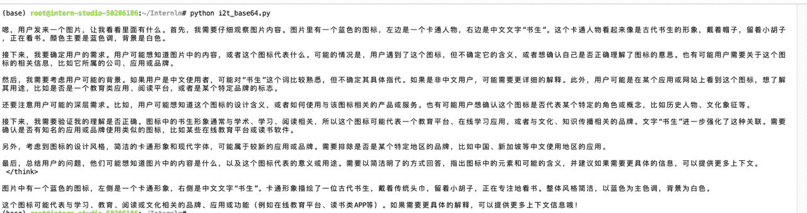
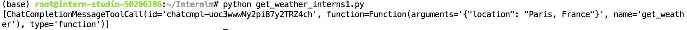
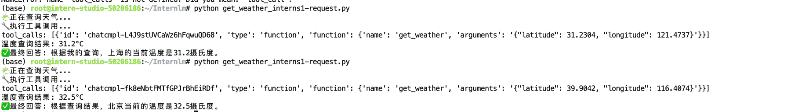
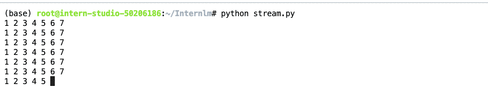
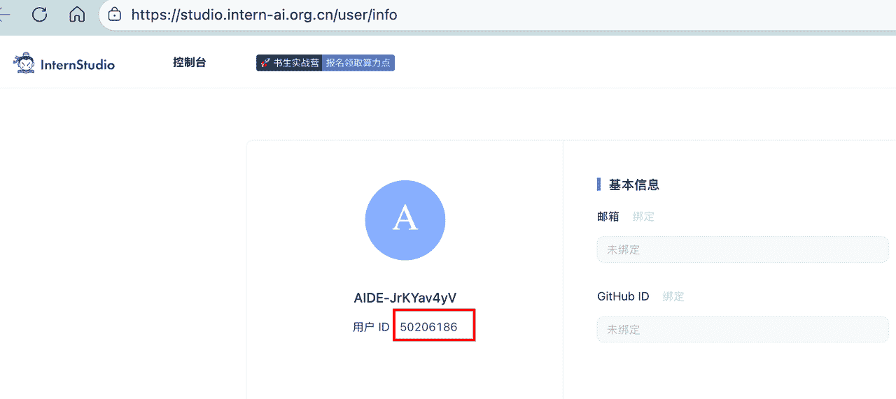
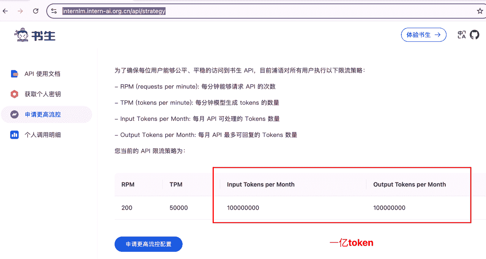

# Intern-S1 API 文档

> 来源：[https://aicarrier.feishu.cn/docx/N9FidkEwoo3WORxRFTBcRtDdnJd](https://aicarrier.feishu.cn/docx/N9FidkEwoo3WORxRFTBcRtDdnJd)

## 获取 API KEY

InternLM 系列模型提供了免费的 `OpenAI` 兼容格式 API，我们首先需要获取 API Key，可以从 https://internlm.intern-ai.org.cn/api/tokens 获取。

请确保您拥有一个正常注册且可使用的账户。要生成您的私有 API KEY可以参考我们的图示。



## 快速开始

### 环境安装

```
pip install openai
```

### 文本生成

Intern API 兼容 `OpenAI` API，为最新的 Intern-S1 模型提供了一个简单的接口，用于文本生成、自然语言处理、计算机视觉等。本示例是文生文，根据提示生成文本输出——像您在使用网页端 Intern 一样。

```
from openai import OpenAI
client = OpenAI(
    api_key="eyJ0eXxx",  # 此处传token，不带Bearer
    base_url="https://chat.intern-ai.org.cn/api/v1/",
)

completion = client.chat.completions.create(
    model="intern-s1",
    messages=[
        {
            "role": "user",
            "content": "写一个关于独角兽的睡前故事，一句话就够了。"
        }
    ]
)

print(completion.choices[0].message.content)
```





### 分析图像输入

你也可以向模型提供图像输入。扫描收据、分析截图，或使用计算机视觉技术在现实世界中寻找物体。

#### 输入图像为 url

```
from openai import OpenAI

client = OpenAI(
    api_key="eyJ0eXxx",  # 此处传token，不带Bearer
    base_url="https://chat.intern-ai.org.cn/api/v1/",
)

response = client.chat.completions.create(
    model="intern-s1",
    messages=[
        {
            "role": "user",
            "content": [
                {"type": "text", "text": "图片里有什么？"},
                {
                    "type": "image_url",
                    "image_url": {
                    },
                },
            ],
        }
    ],
    extra_body={"thinking_mode": True,},
)

print(response.choices[0].message.content)
```



#### 输入图像为文件


```
import base64
from openai import OpenAI

client = OpenAI(
    api_key="eyJ0eXxx",  # 此处传token，不带Bearer
    base_url="https://chat.intern-ai.org.cn/api/v1/",
)
# Function to encode the image
def encode_image(image_path):
    with open(image_path, "rb") as image_file:
        return base64.b64encode(image_file.read()).decode("utf-8")


# Path to your image
image_path = "/root/share/intern.jpg"

# Getting the Base64 string
base64_image = encode_image(image_path)

completion = client.chat.completions.create(
    model="intern-s1",
    messages=[
        {
            "role": "user",
            "content": [
                {"type": "text", "text": "图片里有什么?"},
                {
                    "type": "image_url",
                    "image_url": {
                        "url": f"data:image/jpeg;base64,{base64_image}",
                    },
                },
            ],
        }
    ],
)

print(completion.choices[0].message.content)
```



### 模型使用工具

#### Openai 格式

```
from openai import OpenAI

client = OpenAI(
    api_key="sk-lYQQ6Qxx",  # 不带Bearer
    base_url="https://chat.intern-ai.org.cn/api/v1/",
)
tools = [{
    "type": "function",
    "function": {
        "name": "get_weather",
        "description": "Get current temperature for a given location.",
        "parameters": {
            "type": "object",
            "properties": {
                "location": {
                    "type": "string",
                    "description": "City and country e.g. Bogotá, Colombia"
                }
            },
            "required": [
                "location"
            ],
            "additionalProperties": False
        },
        "strict": True
    }
}]

completion = client.chat.completions.create(
    model="intern-s1",
    messages=[{"role": "user", "content": "What is the weather like in Paris today?"}],
    tools=tools
)

print(completion.choices[0].message.tool_calls)
```



#### Python 原生调用


```python
import requests
import json

# API 配置
API_KEY = "eyJ0exxxxQ"
BASE_URL = "https://chat.intern-ai.org.cn/api/v1/"
ENDPOINT = f"{BASE_URL}chat/completions"

# 定义天气查询工具
WEATHER_TOOLS = [{
    "type": "function",
    "function": {
        "name": "get_weather",
        "description": "获取指定城市或坐标的当前温度（摄氏度）",
        "parameters": {
            "type": "object",
            "properties": {
                "latitude": {"type": "number", "description": "纬度"},
                "longitude": {"type": "number", "description": "经度"}
            },
            "required": ["latitude", "longitude"],
            "additionalProperties": False
        },
        "strict": True
    }
}]

def get_weather(latitude, longitude):
    """
    获取指定坐标的天气信息
    
    Args:
        latitude: 纬度
        longitude: 经度
    
    Returns:
        当前温度（摄氏度）
    """
    try:
        # 调用开放气象API
        response = requests.get(
            f"https://api.open-meteo.com/v1/forecast?latitude={latitude}&longitude={longitude}&current=temperature_2m,wind_speed_10m&hourly=temperature_2m,relative_humidity_2m,wind_speed_10m"
        )
        data = response.json()
        temperature = data['current']['temperature_2m']
        return f"{temperature}"
    except Exception as e:
        return f"获取天气信息时出错: {str(e)}"

def make_api_request(messages, tools=None):
    """发送API请求"""
    headers = {
        "Content-Type": "application/json",
        "Authorization": f"Bearer {API_KEY}"
    }
    
    payload = {
        "model": "intern-s1",
        "messages": messages,
        "temperature": 0.7
    }
    
    if tools:
        payload["tools"] = tools
        payload["tool_choice"] = "auto"
    
    try:
        response = requests.post(ENDPOINT, headers=headers, json=payload, timeout=30)
        response.raise_for_status()
        return response.json()
    except requests.exceptions.RequestException as e:
        print(f"API请求失败: {e}")
        return None

def main():
    # 初始消息 - 巴黎的坐标
    messages = [{"role": "user", "content": "请查询当前北京的温度"}]
    
    print("🌤️ 正在查询天气...")
    
    # 第一轮API调用
    response = make_api_request(messages, WEATHER_TOOLS)
    if not response:
        return
    
    assistant_message = response["choices"][0]["message"]
    
    # 检查工具调用
    if assistant_message.get("tool_calls"):
        print("🔧 执行工具调用...")
        print("tool_calls:", assistant_message.get("tool_calls"))
        messages.append(assistant_message)
        
        # 处理工具调用
        for tool_call in assistant_message["tool_calls"]:
            function_name = tool_call["function"]["name"]
            function_args = json.loads(tool_call["function"]["arguments"])
            tool_call_id = tool_call["id"]
            
            if function_name == "get_weather":
                latitude = function_args["latitude"]
                longitude = function_args["longitude"]
                weather_result = get_weather(latitude, longitude)
                print(f"温度查询结果: {weather_result}°C")
                
                # 添加工具结果
                tool_message = {
                    "role": "tool", 
                    "content": weather_result,
                    "tool_call_id": tool_call_id
                }
                messages.append(tool_message)
        
        # 第二轮API调用获取最终答案
        final_response = make_api_request(messages)
        
        if final_response:
            final_message = final_response["choices"][0]["message"]
            print(f"✅ 最终回答: {final_message['content']}")
    else:
        print(f"直接回答: {assistant_message.get('content', 'No content')}")

if __name__ == "__main__":
    main()
```



## 使用流式传输

将`stream=True`[,打开流式传输](https://chat.intern-ai.org.cn/)，体验如同网页端 Intern 吐字的感觉。

```python
from openai import OpenAI

client = OpenAI(
    api_key="eyxxxx",
    base_url="https://chat.intern-ai.org.cn/api/v1/",
)

stream = client.chat.completions.create(
    model="intern-s1",
    messages=[
        {
            "role": "user",
            "content": "Say '1 2 3 4 5 6 7' ten times fast.",
        },
    ],
    stream=True,
)

# 只打印逐字输出的内容
for chunk in stream:
    if chunk.choices[0].delta.content:
        print(chunk.choices[0].delta.content, end="", flush=True)  # 逐字输出，不换行
```



## 开关think 模式

通过`extra_body={"thinking_mode": True}`打开思考模式

```python
from openai import OpenAI
client = OpenAI(
      api_key="eyxxA",  # 此处传token，不带Bearer
    base_url="https://chat.intern-ai.org.cn/api/v1/",
)

completion = client.chat.completions.create(
    model="intern-s1",
    messages=[
        {
            "role": "user",
            "content": "写一个关于独角兽的睡前故事，一句话就够了。"
        }
    ],
    extra_body={"thinking_mode": True,},
)

print(completion.choices[0].message)
```

```python
from openai import OpenAI
client = OpenAI(
      api_key="eyJ0xxxmA",  # 此处传token，不带Bearer
    base_url="https://chat.intern-ai.org.cn/api/v1/",
)

completion = client.chat.completions.create(
    model="intern-s1",
    messages=[
        {
            "role": "user",
            "content": "写一个关于独角兽的睡前故事，一句话就够了。"
        }
    ],
    extra_body={"thinking_mode": False,},
)

print(completion.choices[0].message)
```

## 参考

1. `https://platform.openai.com/`
1. `https://internlm.intern-ai.org.cn/api/document`

### QA：怎么兑换活动API token

1. 登录网页获取用户 `id`（算力 `id`）：`https://studio.intern-ai.org.cn/user/info`



1. 入群联系小助手私发用户 `id`（算力 `id`）

1. 获取 `API Key`，可以从 `https://internlm.intern-ai.org.cn/api/tokens` 获取。

1. 等小助手发完，API token 到账。

查收链接：`https://internlm.intern-ai.org.cn/api/strategy`


