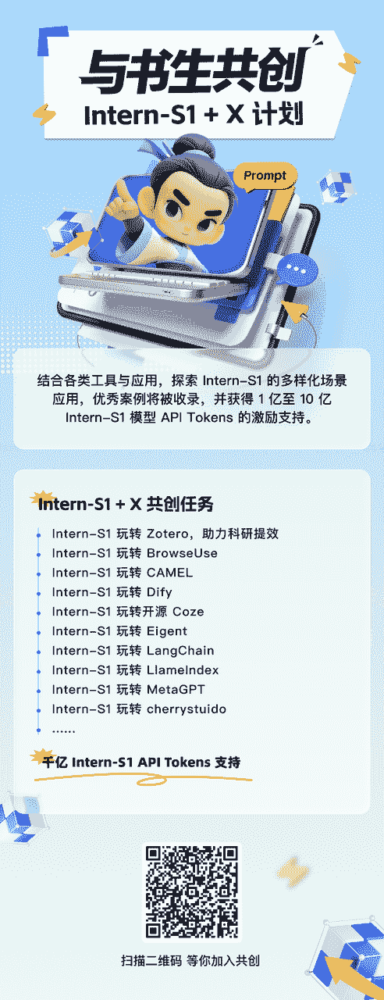

# 与书生共创 ｜Intern-S1 + X 计划🔥

> 来源：[https://aicarrier.feishu.cn/docx/DnlqdmGLwozUt1xil69cfh3snMb](https://aicarrier.feishu.cn/docx/DnlqdmGLwozUt1xil69cfh3snMb)

在 WAIC 2025 世界人工智能大会期间，上海人工智能实验室隆重发布强推理科学多模态大模型 Intern-S1。为推动开源生态繁荣与技术创新，我们重磅启动“与书生共创 | Intern-S1 + X 计划"，诚邀社区开发者结合各类工具与应用，探索 Intern-S1 的多样化场景应用。优秀案例将被收录，并获得 1 亿至 10 亿 Intern-S1 模型 API Tokens 的激励支持。

| 共创内容 | 进度 |  |
| --- | --- | --- |
| Intern-S1 玩转 Zotero，助力科研提效 |  | [Intern-S1 玩转 Zotero，助力科研提效 (基本完结)](https://aicarrier.feishu.cn/wiki/SGi5wobHlifJjjkShXMcBNnynPc) |
| Intern-S1 玩转 BrowseUse |  | [Intern-S1 玩转 BrowseUse（基本完结）](https://aicarrier.feishu.cn/wiki/DB4nwkySzirAWxkzDyOc8cFWnQc) |
| Intern-S1 玩转 CAMEL |  | [Intern-S1 + CAMEL 构建智能多模态 AI 系统](https://aicarrier.feishu.cn/wiki/CabLwCE3nijnV4kBlsPcs58Enlf) |
| Intern-S1 玩转 Dify |  | [Intern-S1 玩转 Dify（完结）](https://aicarrier.feishu.cn/wiki/MGUrw5OxyiMtkhkXE6zcJL9qnag) |
| Intern-S1 玩转开源 Coze |  | [Intern-S1 玩转开源 Coze](https://aicarrier.feishu.cn/wiki/BqywwdOx2i7gtOkYsOmcsvuCnJg) |
| Intern-S1 玩转 Eigent |  | [Intern-S1 玩转 Eigent（尝试中...）](https://aicarrier.feishu.cn/wiki/Ie55wtHXdimpJfkOriJcauqZn8c) |
| Intern-S1 玩转 cherrystudio |  | [Intern-S1 玩转 cherrystudio](https://aicarrier.feishu.cn/wiki/PJTdwKpw8irSegkwjjqcvJOyn3e) |
| ........更多共创案例在路上......... |  |  |

被收录的 Intern-S1 + X 案例将获得 1 亿至 10 亿 Intern-S1 模型 Tokens 支持（有效期一个月）

扫描下方二维码加入群聊联系小助手加入 Intern-S1 + X 计划

