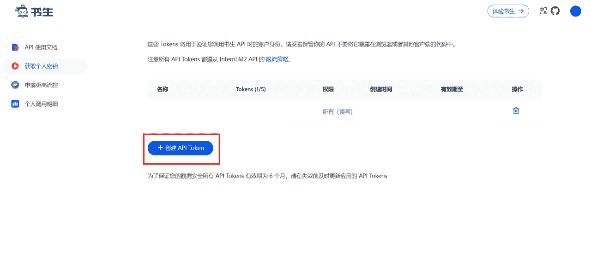
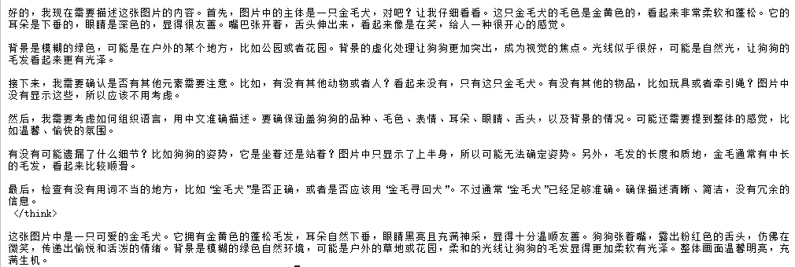
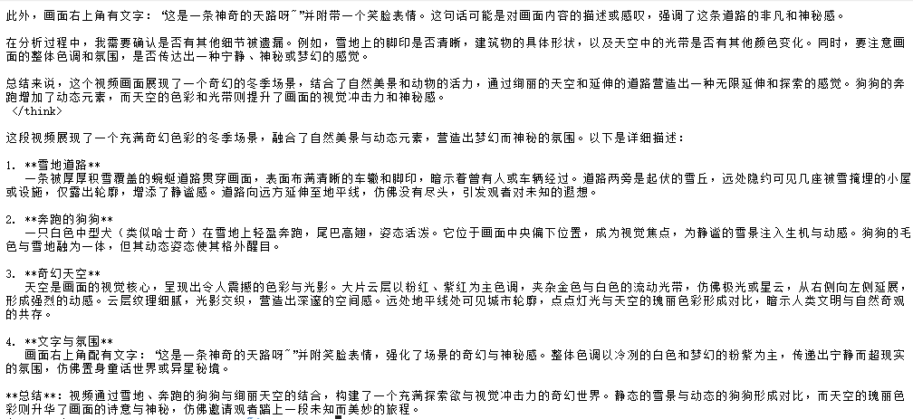
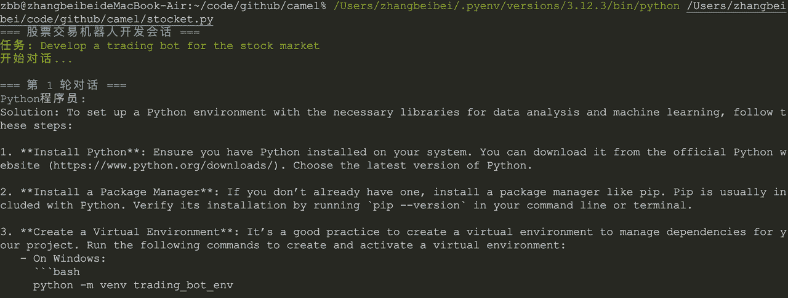
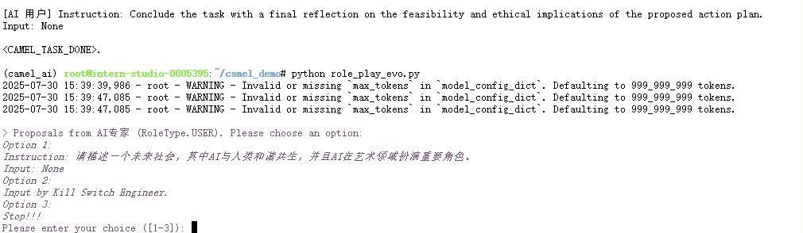
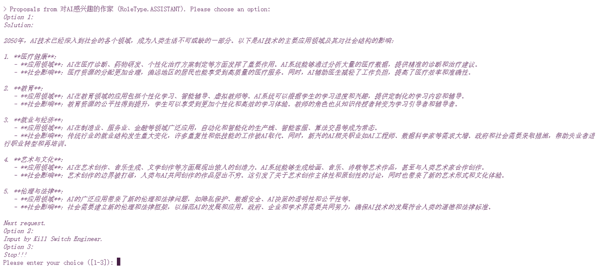
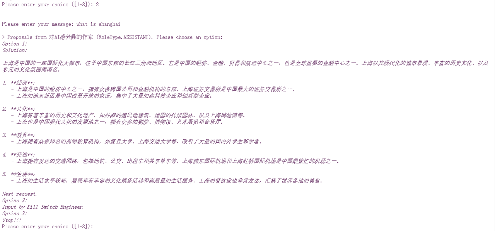

# Intern-S1 + CAMEL 构建智能多模态 AI 系统

> 来源：[https://aicarrier.feishu.cn/docx/UVhAdQeP9oa9bHx6NhwcfVdwnJh](https://aicarrier.feishu.cn/docx/UVhAdQeP9oa9bHx6NhwcfVdwnJh)


在世界人工智能大会（WAIC）上，上海人工智能实验室重磅发布了其强推理科学多模态大模型——Intern-S1。一经发布，书生大模型的开源社区便涌现出大量精彩的创新应用，开发者们巧妙地将 Intern-S1 与 CAMEL、Dify、Coze等知名工具相结合，探索着 AI 的无限可能。

本文将聚焦其中一个亮眼的组合：Intern-S1 + CAMEL，为你详细解读如何利用这个强大的多智能体框架，轻松实现视频理解、构建角色扮演机器人等高级功能。

## 什么是 CAMEL?

在众多AI框架中，CAMEL (Communicative Agents for "Mind" Exploration of Large Language Models) 因其独特的多智能体协作机制而备受关注。它是一个开源框架，专注于通过角色扮演 (Role-Playing) 和结构化对话，让多个AI智能体高效协作，共同完成复杂任务。

CAMEL 的核心组件包括：

+   `ChatAgent`: 框架中最基础的智能体单元，负责处理对话逻辑和执行任务。

+   `RolePlaying` 和 `Workforce`: 更上层的多智能体系统，专门用于协调多个 `ChatAgent` 进行协同工作。

如果你想深入了解，可以查看它的开源仓库和项目主页：

+   **论文:** [https://ghli.org/camel.pdf](https://ghli.org/camel.pdf)

+   **项目主页:** [https://www.camel-ai.org/](https://www.camel-ai.org/)

## 核心模块：ChatAgent 简介

ChatAgent 是构建一切功能的基础。它的核心设计理念是回答一个问题：“如何让一个交互式智能体，在最少的人工干预下，自主地通过对话来完成指定任务？”

为了实现这一目标，每个 `ChatAgent` 都具备以下关键特性：

+   角色 (Role)：结合目标和内容规范，设定智能体的初始状态，引导智能体在连续交互过程中采取行动。

+   大语言模型 (LLMs)：每个智能体都使用大语言模型来增强认知能力。大语言模型使智能体能够理解和生成自然语言，从而解释指令、生成响应并参与复杂对话。

+   记忆 (Memory)：包括上下文记忆和外部记忆，使智能体能够以更扎实的方式进行推理和学习。

+   工具 (Tools)：智能体可以使用的一组功能，用于与外部世界交互，本质上是为智能体提供具身化能力。

+   通信 (Communication)：我们的框架允许智能体之间进行灵活且可扩展的通信，这是解决关键研究问题的基础。

+   推理 (Reasoning)：我们为智能体配备了不同的规划和奖励（评论员）学习能力，使其能够以更有指导性的方式优化任务完成。

## 上手实践：环境配置与基础调用

接下来，让我们动手实践，看看如何配置环境并调用 Intern-S1 模型。

### 3.1 安装 Conda 并创建环境

```
# 创建conda环境
conda create -n camel_ai python=3.10 -y

# 激活环境
conda activate camel_ai
```

### 3.2 安装 CAMEL 框架

```
# 克隆仓库
git clone https://github.com/camel-ai/camel.git

# （如果 GitHub 连接不畅，可尝试使用以下国内镜像地址）
# git clone https://gh.llkk.cc/https://github.com/camel-ai/camel.git

# 进入项目目录
cd camel

# 从源码安装 CAMEL 及其所有依赖
pip install -e .[all]
```

### 3.3 配置 API 密钥

关于如何部署智能体的问题，可以选择使用 API 或者本地模型。总的来说，选择使用 API 还是本地模型部署智能体，取决于具体的应用场景和资源限制。如果网络连接稳定且可以承受一定的使用费用，那么 API 可能是一个好选择。如果硬件资源充足且希望智能体能在离线环境下工作（注重数据隐私和安全），那么本地模型可能更合适。

#### 获取 API KEY

本文我们使用 API 方式。InternLM 系列模型提供了免费的 OpenAI 兼容格式 API，我们首先需要获取 API Key，可以从 https://internlm.intern-ai.org.cn/api/tokens 获取，。

请确保您拥有一个正常注册且可使用的账户。要生成您的私有 API KEY可以参考我们的图示。



## 代码实战：从图文到视频

我们在这里使用 CAMEL 框架中的 `ChatAgent` 模块对模型进行基础调用。可以将其简单理解为一个通用的模型调用组件，便于快速集成与测试。

### 基础语言模型调用

代码如下:

```
from camel.agents import ChatAgent
from camel.models import ModelFactory
from camel.types import ModelPlatformType, ModelType

api_key = "你的API_KEY"

model = ModelFactory.create(
    model_platform=ModelPlatformType.OPENAI_COMPATIBLE_MODEL,
    model_type="intern-s1",
    url="https://chat.intern-ai.org.cn/api/v1/",
    api_key=api_key
)

agent = ChatAgent(
    model=model,
    output_language='中文'
)

response = agent.step("你好，你是谁？")
print(response.msgs[0].content)
```

运行结果：


### 使用多模态模型

原始图片：


代码如下：

```
from camel.agents import ChatAgent
from camel.models import ModelFactory
from camel.types import ModelPlatformType
from camel.messages import BaseMessage

from io import BytesIO
import requests
from PIL import Image


api_key = "你的API_KEY"


model = ModelFactory.create(
    model_platform=ModelPlatformType.OPENAI_COMPATIBLE_MODEL,
    model_type="intern-s1",
    url="https://chat.intern-ai.org.cn/api/v1/",
    api_key=api_key
)

agent = ChatAgent(
    model=model,
    output_language='中文'
)

# 图片URL
url = "https://img0.baidu.com/it/u=2205376118,3235587920&fm=253&fmt=auto&app=120&f=JPEG?w=846&h=800"
response = requests.get(url)
img = Image.open(BytesIO(response.content))

user_msg = BaseMessage.make_user_message(
    role_name="User", 
    content="请描述这张图片的内容", 
    image_list=[img]  # 将图片放入列表中
)

response = agent.step(user_msg)

print(response.msgs[0].content)
```

运行结果：



### 视频理解


[vedio_test.mp4](https://internal-api-drive-stream.feishu.cn/space/api/box/stream/download/all/VLzQbFjT3oXLSwxUc5mc00FonBN)

```
from camel.agents import ChatAgent
from camel.models import ModelFactory
from camel.types import ModelPlatformType
from camel.messages import BaseMessage

api_key = "你的API_KEY"

model = ModelFactory.create(
    model_platform=ModelPlatformType.OPENAI_COMPATIBLE_MODEL,
    model_type="intern-s1",
    url="https://chat.intern-ai.org.cn/api/v1/",
    api_key=api_key
)

# 创建代理
agent = ChatAgent(
    model=model,
    output_language='中文'
)

# 读取本地视频文件
video_path = "vedio_test.mp4"
with open(video_path, "rb") as video_file:
    video_bytes = video_file.read()

# 创建包含视频的用户消息
user_msg = BaseMessage.make_user_message(
    role_name="User", 
    content="请描述这段视频的内容", 
    video_bytes=video_bytes  # 将视频字节作为参数传入
)

# 获取模型响应
response = agent.step(user_msg)
print(response.msgs[0].content)
```

运行结果



## Role-Playing：构建角色扮演机器人

`RolePlaying` 是 CAMEL 框架中独特的协作式智能体架构。该框架通过预设提示词为各智能体分配明确的初始角色设定，有效缓解角色混淆、指令重复、回复模糊、对话循环及终止条件不明确等常见问题。

### 5.1 基本概念

**角色定义**

+   `Assistant` 角色: 负责执行具体任务并提供解决方案的智能体

+   `User` 角色: 负责提供指令和任务需求的智能体

+   特定领域角色: 如程序员、交易员等专业智能体

**交互规则**

```
# 初始prompt示例参考，详情见源码camel/camel/prompts/ai_society.py
ASSISTANT_PROMPT = """
===== RULES OF ASSISTANT =====
Never forget you are a {assistant_role} and I am a {user_role}. Never flip roles! Never instruct me!
We share a common interest in collaborating to successfully complete a task.
You must help me to complete the task.
Here is the task: {task}. Never forget our task!
I must instruct you based on your expertise and my needs to complete the task.

I must give you one instruction at a time.
You must write a specific solution that appropriately solves the requested instruction and explain your solutions.
You must decline my instruction honestly if you cannot perform the instruction due to physical, moral, legal reasons or your capability and explain the reasons.

<YOUR_SOLUTION> should be very specific, include detailed explanations and provide preferable detailed implementations and examples and lists for task-solving.
Always end <YOUR_SOLUTION> with: Next request.
"""
```

**关键机制**

+   角色固定: 防止角色翻转，维持对话的稳定性

+   格式规范: 要求回复具有固定的开始和结束格式

+   任务分解: 自动将复杂任务分解为可执行的子任务

+   循环对话: 通过轮流发言推进任务进展

### 5.2 股票交易机器人详解

以下是一个对于Role-Playing的经典应用， 股票交易实例。在本案例中，我们通过角色扮演的方式来构建一个交易机器人。初始阶段，人类用户提出一个概念性任务，由一个专用Agent精确化为详细的任务描述。参与完成任务的有两个agent：一个扮演股票交易员，另一个扮演Python程序员。

**代码如下：**


```python
import os

from colorama import Fore

from camel.models import ModelFactory
from camel.societies import RolePlaying
from camel.types import ModelPlatformType
from camel.utils import print_text_animated

# 获取API密钥
api_key = os.getenv("INTERN_API_KEY")

# 创建模型实例, 添加max_tokens配置
model = ModelFactory.create(
    model_platform=ModelPlatformType.OPENAI_COMPATIBLE_MODEL,
    model_type="intern-s1",
    url="https://chat.intern-ai.org.cn/api/v1/",
    api_key=api_key,
    model_config_dict={
        "max_tokens": 4000,  # 添加max_tokens配置
        "temperature": 0.7,
    },
)

def main(model=model, chat_turn_limit=3) -> None:
    task_prompt = "Develop a trading bot for the stock market"

    # 初始化角色扮演会话
    role_play_session = RolePlaying(
        assistant_role_name="Python Programmer",
        assistant_agent_kwargs=dict(model=model),
        user_role_name="Stock Trader",
        user_agent_kwargs=dict(model=model),
        task_prompt=task_prompt,
        with_task_specify=True,
        task_specify_agent_kwargs=dict(model=model),
    )

    print(f"{Fore.CYAN}=== 股票交易机器人开发会话 ==={Fore.RESET}")
    print(f"{Fore.YELLOW}任务: {task_prompt}{Fore.RESET}")
    print(f"{Fore.GREEN}开始对话...{Fore.RESET}\n")

    # 初始化会话
    input_msg = role_play_session.init_chat()

    # 开始多轮对话
    for i in range(chat_turn_limit):
        try:
            print(f"{Fore.BLUE}=== 第 {i + 1} 轮对话 ==={Fore.RESET}")

            # 助手回应
            assistant_response, user_response = role_play_session.step(
                input_msg
            )

            if assistant_response.terminated or user_response.terminated:
                print(f"{Fore.RED}对话结束{Fore.RESET}")
                break

            # 打印助手回应
            print(f"{Fore.MAGENTA}Python程序员:{Fore.RESET}")
            print_text_animated(assistant_response.msg.content)
            print()

            # 打印用户回应
            print(f"{Fore.CYAN}股票交易员:{Fore.RESET}")
            print_text_animated(user_response.msg.content)
            print()

            # 准备下一轮输入
            input_msg = assistant_response.msg

        except KeyboardInterrupt:
            print(f"\n{Fore.YELLOW}用户中断对话{Fore.RESET}")
            break
        except Exception as e:
            print(f"{Fore.RED}发生错误: {e}{Fore.RESET}")
            break

if __name__ == "__main__":  # 修复了这里的语法错误
    # 检查API密钥
    if not api_key:
        print(f"{Fore.RED}错误: 请设置环境变量 INTERN_API_KEY{Fore.RESET}")
        exit(1)

    main()
```



## 5.3 沉浸式写AI小说

引入 `CrticAgent`，`with_critic_in_the_loop` 设置为 `True` 的时候将会在循环中引入 `CrticAgent`，如果我们将 `"human"` 赋值给 `critic_role_name`，我们人类将可以在与智能体之间交互中掌握主动权，去选择优化和调整，并且提升角色表现。


```python
import json
import os
import signal
import sys
from datetime import datetime

from colorama import Fore

from camel.models import ModelFactory
from camel.societies import RolePlaying
from camel.types import ModelPlatformType

# 设置代理
# os.environ["http_proxy"] = "http://127.0.0.1:7897"
# os.environ["https_proxy"] = "http://127.0.0.1:7897"

api_key = (
    "xxxx"
)

model = ModelFactory.create(
    model_platform=ModelPlatformType.OPENAI_COMPATIBLE_MODEL,
    model_type="intern-s1",
    url="https://chat.intern-ai.org.cn/api/v1/",
    api_key=api_key,
)

task_kwargs = {
    'task_prompt': '写一本关于AI社会的未来的书。',
    'with_task_specify': True,
    'task_specify_agent_kwargs': {'model': model},
}

user_role_kwargs = {
    'user_role_name': 'AI专家',
    'user_agent_kwargs': {'model': model},
}

assistant_role_kwargs = {
    'assistant_role_name': '对AI感兴趣的作家',
    'assistant_agent_kwargs': {'model': model},
}

society = RolePlaying(
    **task_kwargs,  # 任务参数
    **user_role_kwargs,  # 指令发送者的参数
    **assistant_role_kwargs,  # 指令接收者的参数
    critic_role_name='human',
    with_critic_in_the_loop=True,
    output_language="中文",
)

class ConversationLogger:
    """聊天记录记录器，用于保存结构化的对话历史"""

    def __init__(
        self,
        task_prompt: str,
        user_role: str,
        assistant_role: str,
        critic_role: str = "human",
    ):
        self.session_info = {
            "task_prompt": task_prompt,
            "ai_expert_role": user_role,
            "writer_role": assistant_role,
            "critic_role": critic_role,
            "start_time": datetime.now().isoformat(),
            "end_time": None,
            "total_rounds": 0,
        }
        self.conversation_rounds = []
        self.termination_info = {}

    def add_round(
        self,
        round_id: int,
        user_response,
        assistant_response,
        human_feedback=None,
    ):
        """添加一轮对话记录"""
        round_data = {
            "round_id": round_id,
            "user_response": {
                "role": user_response.msg.role_name
                if user_response.msg
                else "AI专家",
                "role_type": user_response.msg.role_type.name
                if user_response.msg
                else "USER",
                "content": user_response.msg.content
                if user_response.msg
                else "",
                "timestamp": datetime.now().isoformat(),
            },
            "assistant_response": {
                "role": assistant_response.msg.role_name
                if assistant_response.msg
                else "对AI感兴趣的作家",
                "role_type": assistant_response.msg.role_type.name
                if assistant_response.msg
                else "ASSISTANT",
                "content": assistant_response.msg.content
                if assistant_response.msg
                else "",
                "timestamp": datetime.now().isoformat(),
            },
            "human_feedback": human_feedback,
        }
        self.conversation_rounds.append(round_data)
        self.session_info["total_rounds"] = len(self.conversation_rounds)

    def set_termination(self, terminated_by: str, reason: str):
        """设置终止信息"""
        self.termination_info = {
            "terminated_by": terminated_by,
            "termination_reason": reason,
        }
        self.session_info["end_time"] = datetime.now().isoformat()

    def save_to_json(self, filepath: str | None = None):
        """保存对话记录到JSON文件"""
        if filepath is None:
            # 创建日志目录
            os.makedirs("conversation_logs", exist_ok=True)
            timestamp = datetime.now().strftime("%Y%m%d_%H%M%S")
            filepath = f"conversation_logs/conversation_log_{timestamp}.json"

        full_log = {
            "session_info": self.session_info,
            "conversation_rounds": self.conversation_rounds,
            "termination_info": self.termination_info,
        }

        with open(filepath, 'w', encoding='utf-8') as f:
            json.dump(full_log, f, ensure_ascii=False, indent=2)

        print(f"\n📝 对话记录已保存到: {filepath}")
        return filepath

def is_terminated(response):
    """
    当会话应该终止时给出对应信息。
    """
    if response.terminated:
        role = response.msg.role_type.name
        reason = response.info['termination_reasons']
        print(f'AI {role} 因为 {reason} 而终止')

    return response.terminated

# 全局变量用于信号处理
conversation_logger = None

def signal_handler(sig, frame):
    """处理中断信号，确保保存对话记录"""
    print(f"\n\n🚨 检测到中断信号 (signal {sig})，正在保存对话记录...")
    if conversation_logger:
        conversation_logger.set_termination(
            "SIGNAL_INTERRUPT", f"用户中断 (signal {sig})"
        )
        saved_file = conversation_logger.save_to_json()
        print(f"✅ 对话记录已保存: {saved_file}")
    else:
        print("⚠️ 没有对话记录需要保存")
    print("👋 程序已安全退出")
    sys.exit(0)

def run(society, round_limit: int = 10):
    global conversation_logger

    # 注册信号处理器
    signal.signal(signal.SIGINT, signal_handler)  # Ctrl+C
    signal.signal(signal.SIGTERM, signal_handler)  # 终止信号

    # 初始化对话记录器
    conversation_logger = ConversationLogger(
        task_prompt=society.task_prompt,
        user_role="AI专家",
        assistant_role="对AI感兴趣的作家",
        critic_role="human",
    )

    try:
        # 获取AI助手到AI用户的初始消息
        input_msg = society.init_chat()

        # 开始互动会话
        for round_num in range(1, round_limit + 1):
            try:
                # 获取这一轮的两个响应
                assistant_response, user_response = society.step(input_msg)

                # 记录当前轮对话
                conversation_logger.add_round(
                    round_num, user_response, assistant_response
                )

                # 检查终止条件
                if is_terminated(assistant_response):
                    conversation_logger.set_termination(
                        "ASSISTANT",
                        assistant_response.info.get(
                            'termination_reasons', 'Unknown'
                        ),
                    )
                    break
                elif is_terminated(user_response):
                    conversation_logger.set_termination(
                        "USER",
                        user_response.info.get(
                            'termination_reasons', 'Unknown'
                        ),
                    )
                    break

                # 获取结果
                print(Fore.GREEN + f'[AI 用户] {user_response.msg.content}.\n')
                # 检查任务是否结束
                if 'CAMEL_TASK_DONE' in user_response.msg.content:
                    conversation_logger.set_termination(
                        "CAMEL_TASK_DONE", "任务完成"
                    )
                    break
                print(
                    Fore.BLUE
                    + f'[AI 助手] {assistant_response.msg.content}.\n'
                )

                # 获取下一轮的输入消息
                input_msg = assistant_response.msg

            except KeyboardInterrupt:
                # 这个应该被信号处理器捕获，但以防万一
                print("\n🚨 检测到键盘中断...")
                conversation_logger.set_termination(
                    "KEYBOARD_INTERRUPT", "用户键盘中断"
                )
                break
            except Exception as e:
                print(f"\n❌ 运行时错误: {e}")
                conversation_logger.set_termination(
                    "RUNTIME_ERROR", f"运行时错误: {str(e)}"
                )
                break

        # 如果循环正常结束(达到轮数限制)
        if round_num >= round_limit:
            conversation_logger.set_termination(
                "ROUND_LIMIT", f"达到最大轮数限制 {round_limit}"
            )

    except Exception as e:
        print(f"\n❌ 初始化或运行错误: {e}")
        if conversation_logger:
            conversation_logger.set_termination(
                "INITIALIZATION_ERROR", f"初始化错误: {str(e)}"
            )

    finally:
        # 确保总是保存对话记录
        saved_file = None
        if conversation_logger:
            saved_file = conversation_logger.save_to_json()
            print(f"\n✅ 最终保存对话记录: {saved_file}")
        else:
            print("\n⚠️ 没有对话记录需要保存")

    return saved_file

if __name__ == "__main__":
    try:
        result = run(society)
        if result:
            print(f"🎉 程序完成，对话记录保存在: {result}")
    except Exception as e:
        print(f"💥 程序异常退出: {e}")
        if conversation_logger:
            conversation_logger.set_termination(
                "PROGRAM_CRASH", f"程序崩溃: {str(e)}"
            )
            saved_file = conversation_logger.save_to_json()
            print(f"🚑 紧急保存对话记录: {saved_file}")
```


上述 根据 “写一本关于AI社会的未来的书” 的任务，将会在更详细的选择中引入人工与其交互。



输入数字可以选择你想要让`AI_Assistant`去执行的选项



例如输入【1】执行输出结果



输入【2】执行输出结果

输入【3】就是退出

其实玩的还有点上头，聊天历史如下：


[`conversation_log_20250812_225359.json`](https://internal-api-drive-stream.feishu.cn/space/api/box/stream/download/all/Kb1wbj2dPoN6PixmYMIclyonnAf)

# 结束语

从基础的图文视频理解，到进阶的多智能体角色扮演，我们通过`CAMEL` 框架，一步步见证了`Intern-S1` 作为强推理多模态大模型的卓越能力。当`Intern-S1` 的感知与推理能力与如`CAMEL`框架相结合时，其所能制作更多有趣agent。期待每一位开发者都能基于`Intern-S1` 开启自己的创想之旅，联系小助手转发海报即可获得丰富 token 奖励！

# 参考文献

[L2G5-CAMEL 书生多智能体系统实践](https://aicarrier.feishu.cn/wiki/Xh9Mw01KkiN2eAkBx2McbFg1nkV)
