# Intern-S1 玩转 Eigent（尝试中...）

> 来源：[https://aicarrier.feishu.cn/docx/QEJkdMjyZo5cslxGDvfcCqdgnLg](https://aicarrier.feishu.cn/docx/QEJkdMjyZo5cslxGDvfcCqdgnLg)

在 WAIC 期间，上海人工智能实验室重磅发布了强推理科学多模态大模型 Intern-S1。书生大模型开源社区的开发者们积极响应，结合 Dify、Coze、BrowseUse、CAMEL、Zotero、Eigent等知名工具与应用，贡献了众多 Intern-S1 的创新使用案例。本文将分享 Intern-S1 与知名智能体框架 CAMEL 结合的视频理解等精彩案例。

我们诚邀更多社区开发者参与书生共创 ｜Intern-S1 + X 的计划，探索更多可能性！被收录的优秀案例将获得 1 亿至 10 亿 API Tokens 的激励支持，助力开发者进一步释放创造力。快来加入我们，共同推动开源社区的蓬勃发展！

# Eigent简单介绍：

Eigent与2005年7月30号正式开源， 是全球首个多智能体工作流桌面应用程序，帮助您构建、管理和部署定制化的 AI 工作团队，将最复杂的工作流程转化为自动化任务。

⭐ 100% 开源 - 🥇 本地部署 - 🏆 MCP 集成

+   ✅ 零配置 - 无需技术设置

+   ✅ 多智能体协作 - 处理复杂的多智能体工作流

+   ✅ 企业级功能 - SSO/访问控制

+   ✅ 本地部署

+   ✅ 开源

+   ✅ 支持自定义模型

+   ✅ MCP 集成

# 版本选择: Windows版

打开网址：

https://www.eigent.ai/

下载 Windows版本.

优势：

适合偏好本地控制、数据隐私或定制的用户：

+   数据隐私 - 敏感数据保留在您的基础设施内。

+   定制化 - 修改和扩展平台以满足需求。

+   成本控制 - 避免大规模部署的持续云费用。

**本地部署：**完全开源，免费使用！支持本地模型接入，私有化、可控性高。

# 安装Windows版本的Eigent

### 3.1 前提条件

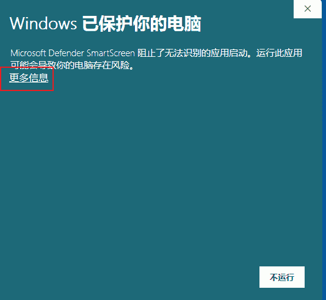

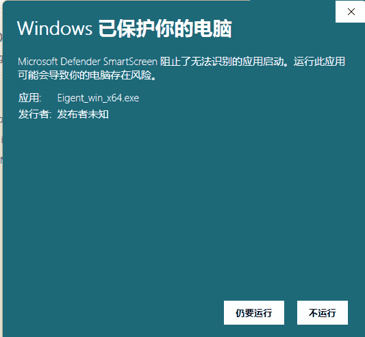

### 3.2 开始安装

安装文件很大，大概有1个G。

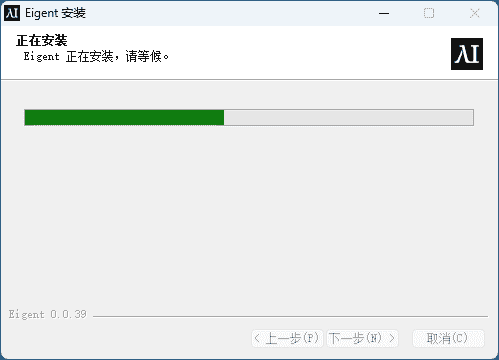

#### 3.2.2 启动Eigent

可以用Google和Github登录，也可以用自己的邮箱

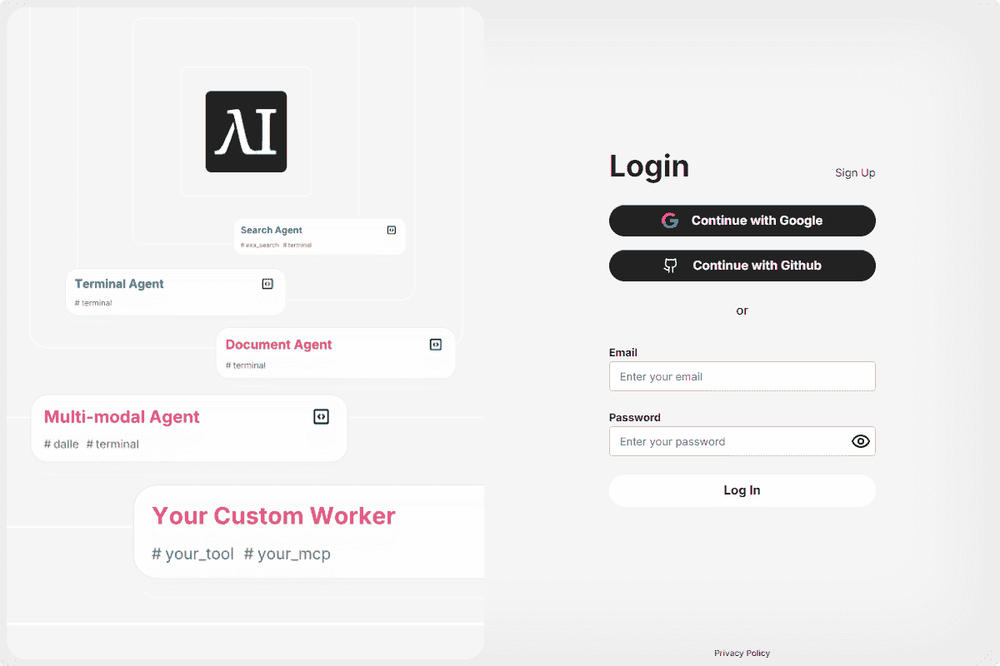

登录成功后开始system installing：

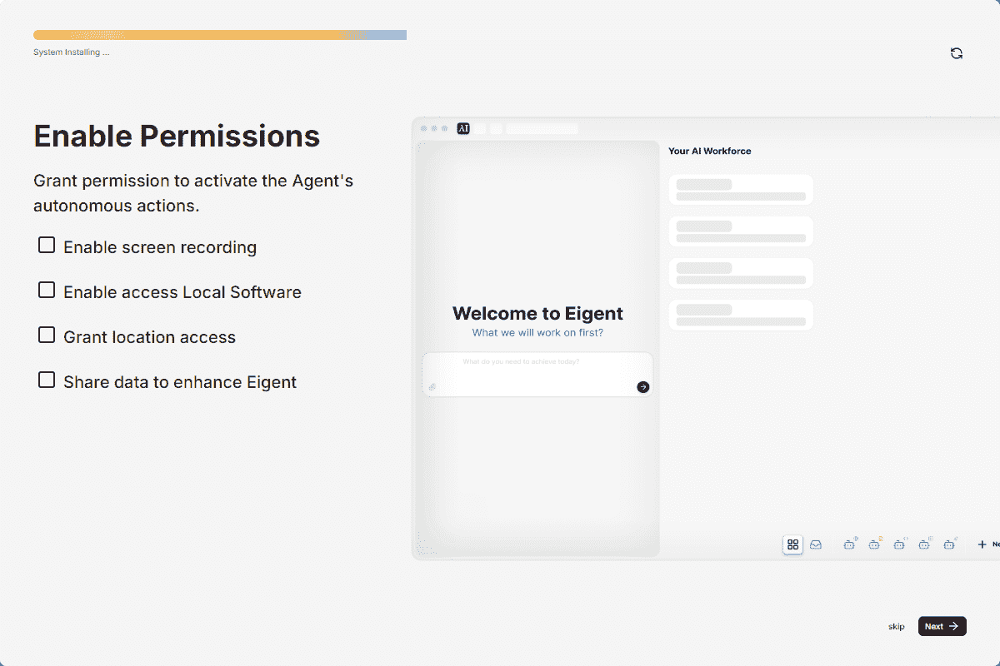

左边赋予权限选项，建议不要选择最后一个：分享数据给Eigent

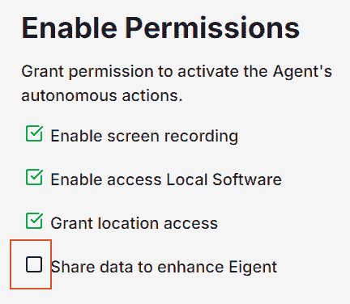

点击下一步，接着点下一步。

等待后台服务启动，时间稍微有点久：

#  4  Eigent 核心功能

通过 Eigent 的强大功能释放卓越生产力的全部潜力——专为无缝集成、智能任务执行和无边界自动化而设计。

### 4.1 工作流

部署一支专业 AI 智能体团队，协作解决复杂任务。Eigent 动态分解任务并激活多个智能体 并行工作。

Eigent 预定义了以下智能体工作者：

+   开发智能体：编写和执行代码，运行终端命令。

+   搜索智能体：搜索网络并提取内容。

+   文档智能体：创建和管理文档。

+   多模态智能体：处理图像和音频。

###  4.2 MCP 工具集成

Eigent 内置大量 模型上下文协议（MCP） 工具（用于网页浏览、代码执行、Notion、Google 套件、Slack 等），并允许您 安装自己的工具。为智能体配备适合您场景的工具——甚至集成内部 API 或自定义功能——以增强其能力。

### 4.3 人工介入

如果任务卡住或遇到不确定性，Eigent 会自动请求人工输入。

# API 设置

关于如何部署智能体的问题，可以选择使用 API 或者本地模型。总的来说，选择使用 API 还是本地模型部署智能体，取决于具体的应用场景和资源限制。如果网络连接稳定且可以承受一定的使用费用，那么 API 可能是一个好选择。如果硬件资源充足且希望智能体能在离线环境下工作（注重数据隐私和安全），那么本地模型可能更合适。

## 5.1 获取  API KEY

使用 API 调用大模型需要 API 密钥，这里我们以InternLM为例，您可以从 https://internlm.intern-ai.org.cn/api/tokens 获取，它提供InternLM系列的免费（OpenAI）兼容格式的API。

请确保您拥有一个正常注册且可使用的账户。要生成您的私有 API KEY可以参考我们的图示。

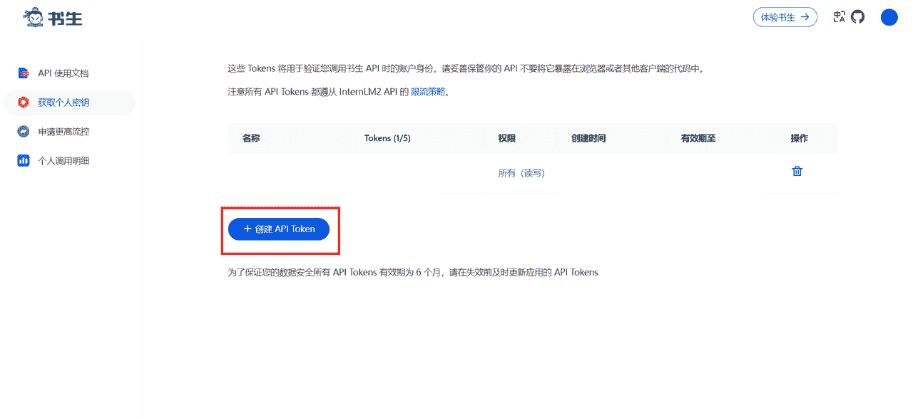

## 5.2 使用Eigent调用Intern S1模型的API

进去后输入框不可用：

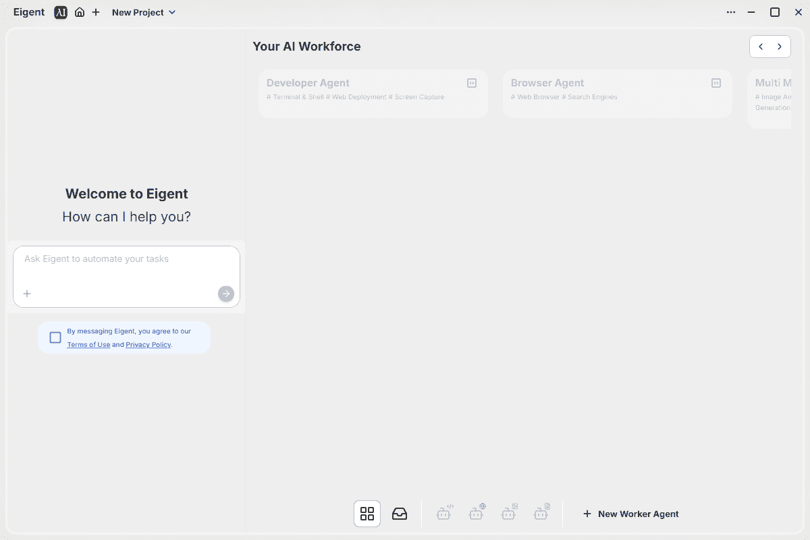

需勾选 Terms of Use and Privacy Policy后输入框才可用。

点击右上角的三个点，打开setting。

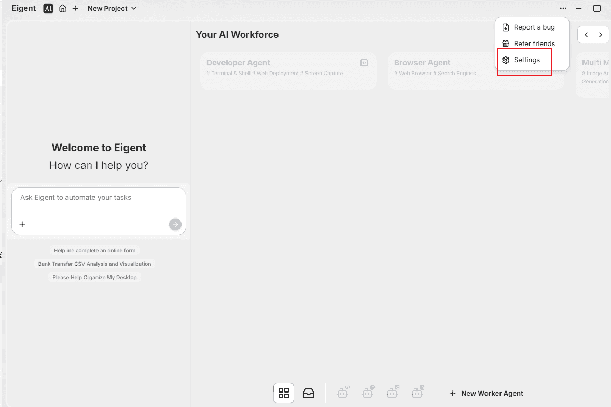

隐私策略：打开设置，点击Privacy查看。

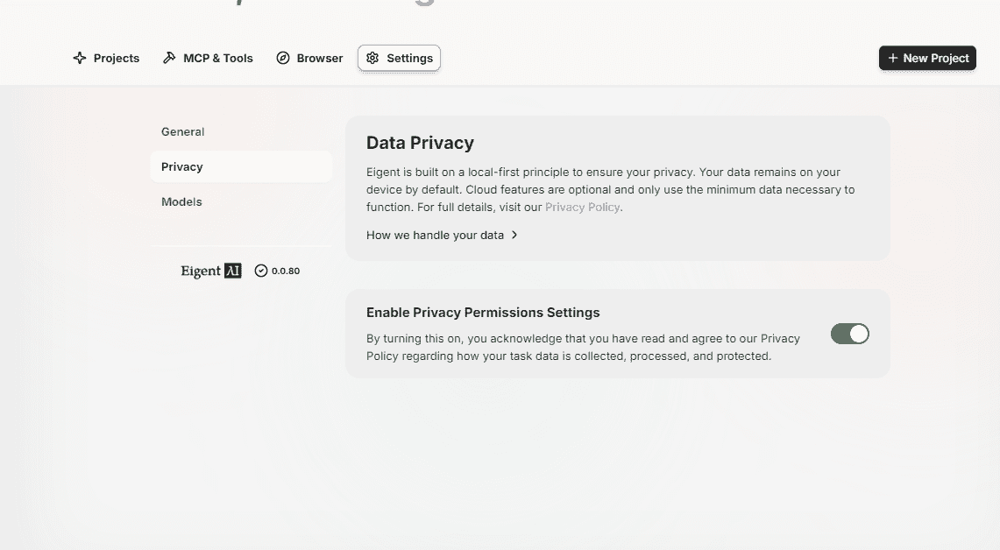

选择左边Model选项。免费用户默认有1200 credit

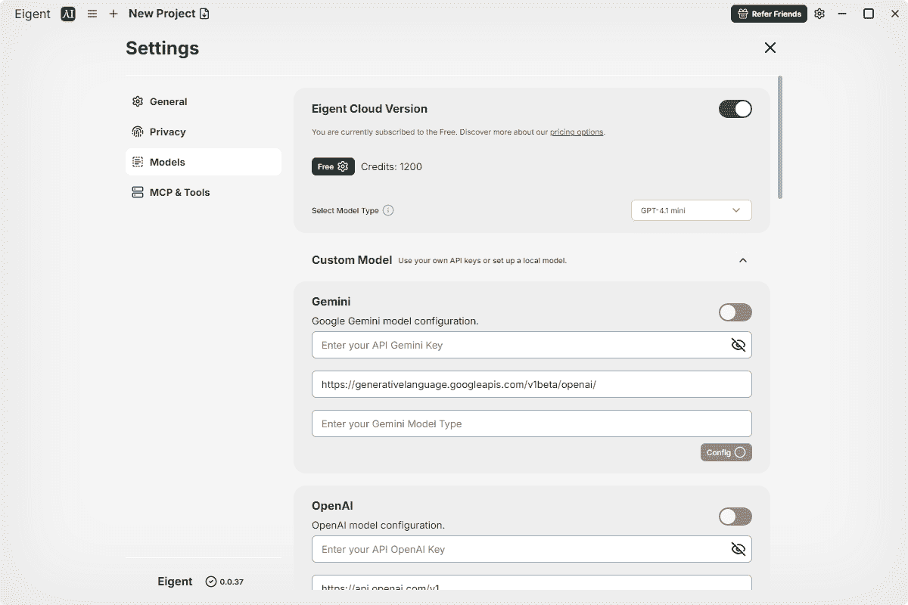

尝试配置Intern S1模型的API, 因为没有Intern的专有模型设置，我们选择 OpenAI Compatible

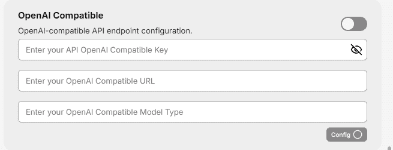

配置模型遇到错误：

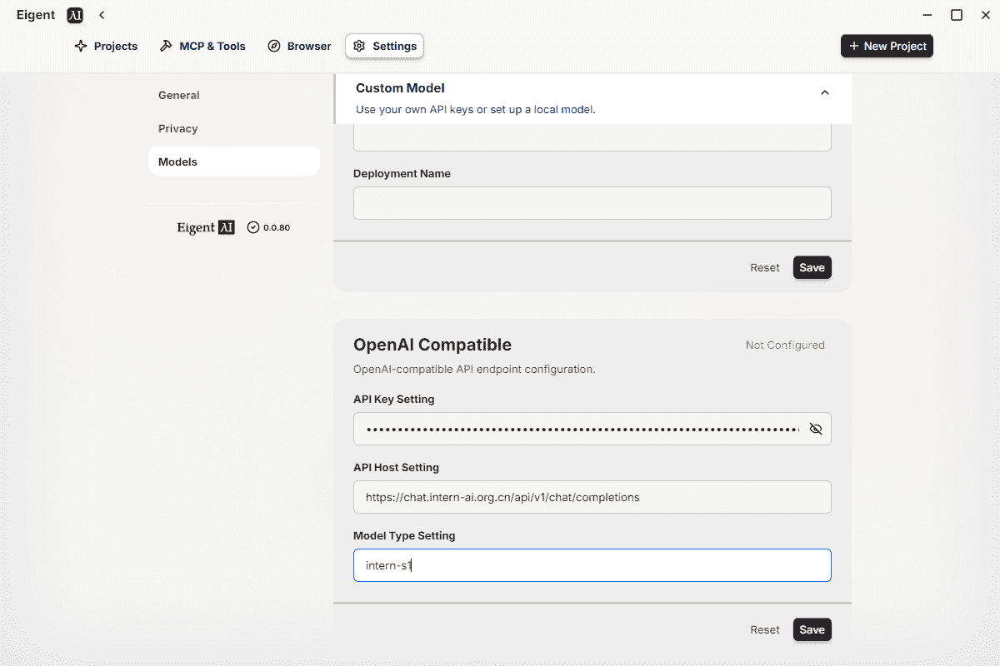

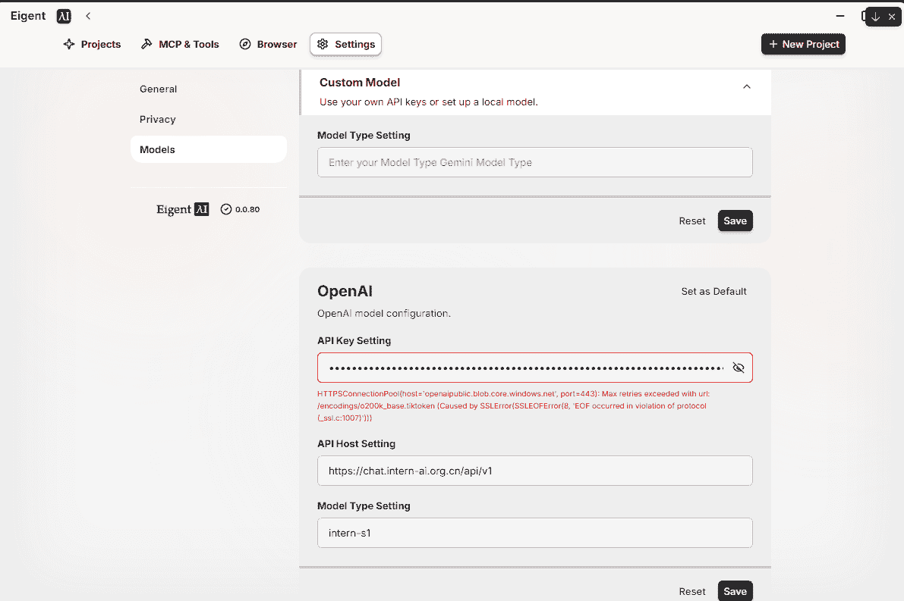

试了下Deepseek，也是validate failed。 查看了下Github的issue清单，都在说这个配置问题。开发正在紧锣密鼓的修复。

明天继续.....