# Intern-S1 玩转开源 Coze

> 来源：[https://aicarrier.feishu.cn/docx/G7wBd7cFFoF17kxoLCacJLTpnrh](https://aicarrier.feishu.cn/docx/G7wBd7cFFoF17kxoLCacJLTpnrh)

## 0. 写在开头

上海AI LAB在7月26日发布并开源了通专结合的科学多模态大模型——Intern-S1，在多模态综合能力方面领先InternVL3、Qwen2.5-VL等主流开源模型，同时在面对复杂科学数据的深度理解上表现更加出色。

Coze 是一个低代码快速创建、调试和部署 AI Agent 的平台。也在7月26日正式推出了开源本地部署版（这样看来两者很有缘分呢👨‍❤️💋‍👨），共开源了两个项目：Coze-Studio 一站式 AI Agent 开发工具，提供各类最新大模型和工具、多种开发模式和框架，并提供`Prompt`、`RAG`、`Plugin`、`Workflow`等Agent开发中的核心能力；Coze Loop 则是扣子的 Agent 评估&监控引擎。

相关链接：

1. Intern Large Models（Intern-S1体验页面）
1. [`github.com`](https://github.com/InternLM/Intern-S1)（Intern-S1 github链接）
1. `https://huggingface.co/internlm/Intern-S1-FP8`（HuggingFace链接）
1. `https://modelscope.cn/models/Shanghai_AI_Laboratory/Intern-S1`（ModelScope链接）
1. `https://github.com/coze-dev/coze-studio`（coze项目地址）
1. [Coze开源项目-社区内容分享](https://bytedance.larkoffice.com/docx/DNmTdFokHoRF6CxaG3ScA7KBnSc)（Coze社区文章）

## 开源Coze本地部署及启动

Coze的本地部署版本是借助`Docker`运行的，可避免用户自己反复安装环境，只需要安装`docker`并运行`docker compose`服务，就可以自动拉取所有组件的镜像并运行容器，在本地启动coze服务。

### 1.1 docker及docker-compose安装

如果是直接安装在windows或mac本机，可直接在`https://www.docker.com/products/docker-desktop/`下载安装包，全部选择默认设置即可。但要注意windows须在安装前启动Hyper-V，并按提示重启。win10专业版操作过程如下（如果非专业版遇到启动Hyper-V不成功的情况可以某宝花5块钱买一个激活密钥）：

+ 打开“设置-系统-可选功能”，点击右侧“更多Windows功能”，然后勾选Hyper-V，点确定：

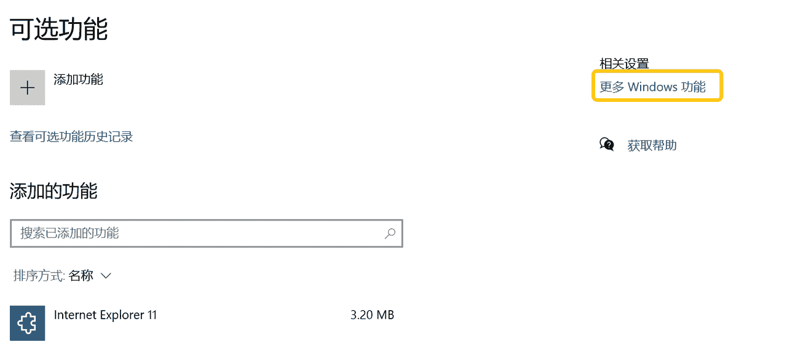

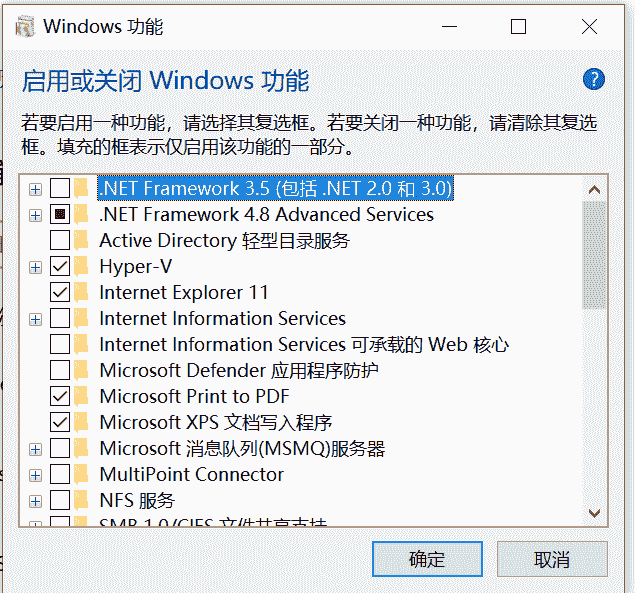

+ 等待系统搜索并安装完成后，点击重启：

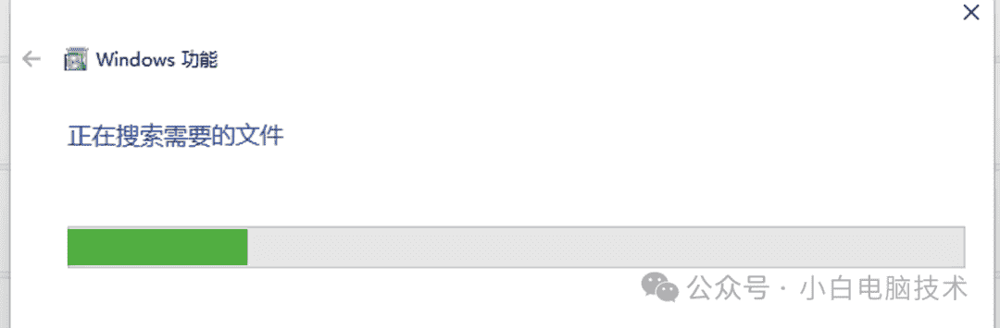

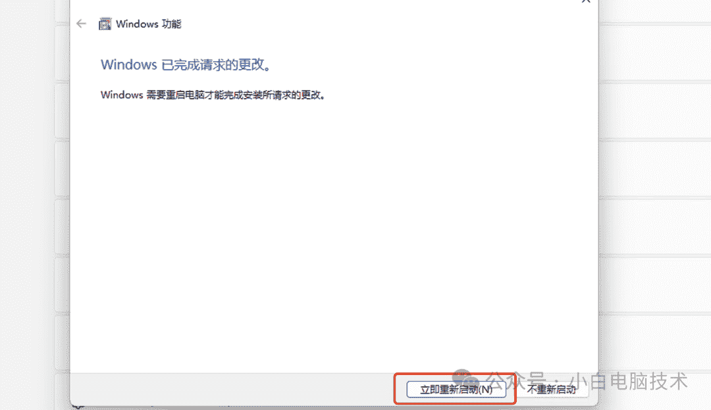

+ 开始菜单的windows管理工具中可找到Hyper-V，运行如下说明安装成功：

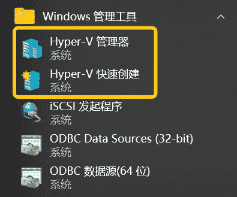

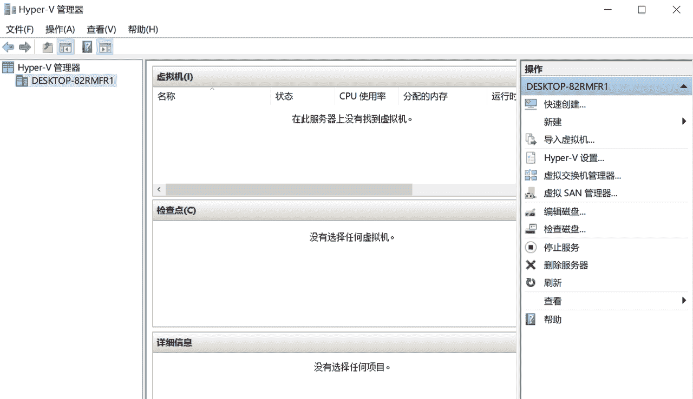

如果是在linux环境安装（以centOS通过阿里镜像源安装举例），安装脚本参考如下：

```
# 1. 添加基础软件
curl -o /etc/yum.repos.d/CentOS-Base.repo http://mirrors.aliyun.com/repo/Centos-7.repo
yum install -y yum-utils device-mapper-persistent-data lvm2 wget
# 2. 设置阿里云 Docker 的yum源
vi /etc/yum.repos.d/docker-ce.repo
# 3. 输入以下内容
[docker-ce-stable]
name=Docker CE Stable - $basearch
baseurl=https://mirrors.aliyun.com/docker-ce/linux/centos/7/$basearch/stable
enabled=1
gpgcheck=1
gpgkey=https://mirrors.aliyun.com/docker-ce/linux/centos/gpg

[docker-ce-stable-debuginfo]
name=Docker CE Stable - Debuginfo $basearch
baseurl=https://mirrors.aliyun.com/docker-ce/linux/centos/7/debug-$basearch/stable
enabled=0
gpgcheck=1
gpgkey=https://mirrors.aliyun.com/docker-ce/linux/centos/gpg

[docker-ce-stable-source]
name=Docker CE Stable - Sources
baseurl=https://mirrors.aliyun.com/docker-ce/linux/centos/7/source/stable
enabled=0
gpgcheck=1
gpgkey=https://mirrors.aliyun.com/docker-ce/linux/centos/gpg

[docker-ce-edge]
name=Docker CE Edge - $basearch
baseurl=https://mirrors.aliyun.com/docker-ce/linux/centos/7/$basearch/edge
enabled=0
gpgcheck=1
gpgkey=https://mirrors.aliyun.com/docker-ce/linux/centos/gpg

[docker-ce-edge-debuginfo]
name=Docker CE Edge - Debuginfo $basearch
baseurl=https://mirrors.aliyun.com/docker-ce/linux/centos/7/debug-$basearch/edge
enabled=0
gpgcheck=1
gpgkey=https://mirrors.aliyun.com/docker-ce/linux/centos/gpg

[docker-ce-edge-source]
name=Docker CE Edge - Sources
baseurl=https://mirrors.aliyun.com/docker-ce/linux/centos/7/source/edge
enabled=0
gpgcheck=1
gpgkey=https://mirrors.aliyun.com/docker-ce/linux/centos/gpg

[docker-ce-test]
name=Docker CE Test - $basearch
baseurl=https://mirrors.aliyun.com/docker-ce/linux/centos/7/$basearch/test
enabled=0
gpgcheck=1
gpgkey=https://mirrors.aliyun.com/docker-ce/linux/centos/gpg

[docker-ce-test-debuginfo]
name=Docker CE Test - Debuginfo $basearch
baseurl=https://mirrors.aliyun.com/docker-ce/linux/centos/7/debug-$basearch/test
enabled=0
gpgcheck=1
gpgkey=https://mirrors.aliyun.com/docker-ce/linux/centos/gpg

[docker-ce-test-source]
name=Docker CE Test - Sources
baseurl=https://mirrors.aliyun.com/docker-ce/linux/centos/7/source/test
enabled=0
gpgcheck=1
gpgkey=https://mirrors.aliyun.com/docker-ce/linux/centos/gpg

[docker-ce-nightly]
name=Docker CE Nightly - $basearch
baseurl=https://mirrors.aliyun.com/docker-ce/linux/centos/7/$basearch/nightly
enabled=0
gpgcheck=1
gpgkey=https://mirrors.aliyun.com/docker-ce/linux/centos/gpg

[docker-ce-nightly-debuginfo]
name=Docker CE Nightly - Debuginfo $basearch
baseurl=https://mirrors.aliyun.com/docker-ce/linux/centos/7/debug-$basearch/nightly
enabled=0
gpgcheck=1
gpgkey=https://mirrors.aliyun.com/docker-ce/linux/centos/gpg

[docker-ce-nightly-source]
name=Docker CE Nightly - Sources
baseurl=https://mirrors.aliyun.com/docker-ce/linux/centos/7/source/nightly
enabled=0
gpgcheck=1
gpgkey=https://mirrors.aliyun.com/docker-ce/linux/centos/gpg%

# 4.查看仓库中所有Docker版本
yum list docker-ce --showduplicates | sort -r

# 5. 安装Docker
yum install docker-ce-19.03.11 -y

# 6. 启动并加入开机启动
systemctl start docker
systemctl enable docker
```

完成安装后可在命令行执行`docker --version`或`docker-compose --version`查看安装情况，desktop也可通过客户端左下角状态栏“Running”状态来确认。

### 1.2 源码中配置书生大模型yaml文件

克隆源码

```
git clone https://github.com/coze-dev/coze-studio.git
```

在书生大模型平台获取`API-token`

在书生api token申请界面 `https://internlm.intern-ai.org.cn/api/tokens` 按如下步骤操作，注意每条`Token`只显示一次，要妥善保存：

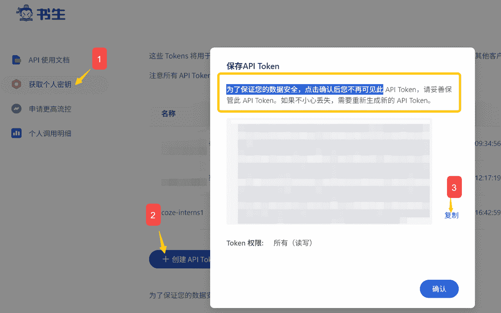

参考书生api文档：`https://internlm.intern-ai.org.cn/api/document`

获取另外两个调用参数：模型名及模型url。模型名参考`获取模型列表`，如调用`intern-s1`，可以配置成`intern-s1`或`intern-latest`：

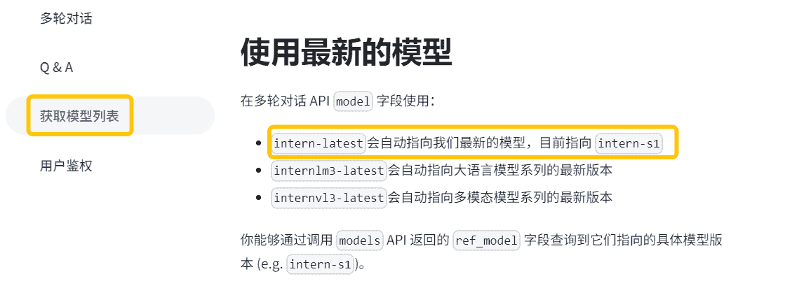

复制模型配置模板并编辑

由于当前`coze-studio`官方源码中未给出`intern-s1`的配置文件，且`intern-s1`与`doubao-seed-1.6`均支持`curl`调用和`openai` python sdk调用方式，这里我们可以将`doubao-seed-1.6`的模板`backend/conf/model/template/model_template_ark_doubao-seed-1.6.yaml`拷贝至前一级路径并改名为：`backend/conf/model/ark_interns1.yaml`，如下：

```
cd coze-studio
# 复制模型配置模版
cp backend/conf/model/template/model_template_ark_doubao-seed-1.6.yaml backend/conf/model/intern-s1.yaml
```

将部分配置项修改后的代码文件如下所示：


## 模型配置说明

```
id: 65536
name: intern-s1
icon_uri: default_icon/intern.png
icon_url: &quot;&quot;
description:
    zh: &#x27;通专结合的科学多模态大模型——Intern-S1,在多模态综合能力方面领先InternVL3、Qwen2.5-VL等主流开源模型，同时在面对复杂科学数据的深度理解上表现更加出色.&#x27;
    en: &#x27;A brand-new multimodal deep_format
      label:
        zh: 输出格式
        en: Response format
      desc:
        zh: &#x27;- **JSON**: 将引导模型使用JSON格式输出&#x27;
        en: &#x27;**Response Format**:\n\n- **JSON**: Uses JSON format for replies&#x27;
      type: int
      min: &quot;&quot;
      max: &quot;&quot;
      default_val:
        default_val: &quot;0&quot;
      options:
        - label: Text
          value: &quot;0&quot;
        - label: JSON
          value: &quot;1&quot;
      style:
        widget: radio_buttons
        label:
            zh: 输入及输出设置
            en: Input and output settings
meta:
    name: intern-s1
    protocol: ark
    capability:
        function_call: true
        input_modal:
            - text
            - image
            - video
        input_tokens: 224000
        json_mode: true
        max_tokens: 256000
        output_modal:
            - text
        output_tokens: 32000
        prefix_caching: true
        reasoning: true
        prefill_response: false
    conn_config:
        base_url: &quot;https://chat.intern-ai.org.cn/api/v1/&quot;
        api_key: &quot;你的api-key&quot;
        timeout: 0s
        model: &quot;intern-s1&quot;
        temperature: 0.1
        frequency_penalty: 0
        presence_penalty: 0
        max_tokens: 4096
        enable_thinking: True
        top_p: 0.7
        top_k: 0
        stop: []
        openai: null
        claude: null
        ark:
            region: &quot;&quot;
            access_key: &quot;&quot;
            secret_key: &quot;&quot;
            retry_times: null
            custom_header: {}
        deepseek: null
        qwen: null
        gemini: null
        custom: {}
    status: 0
```

### 配置注意事项

+ 如需要配置多个`yaml`文件，要注意区分首行`id`编号，必须是非 `0` 的整数，且全局唯一，不能重复

+ `name: intern-s1`

`icon_uri: default_icon/intern.png`将模型在应用中显示的名称和图标进行修改；

+ 如果需要给你的`intern-s1`专属`coze`应用添加一个喜欢的icon，可以在`docker/volumes/minio/default_icon`文件夹中贴入`png`格式图片，比如这里我们加入了书生的标志😎（启动后可见显示效果）


+ 修改`description`为`intern-s1`的官方描述，方便我们在应用的多个模型中依据模型描述做出选择；

+ 修改`meta`中`conn_config`:

`base_url: "https://chat.intern-ai.org.cn/api/v1/"`

`api_key: "填写你的api-key"`

`model: "intern-s1"`

+ 如果想充分测试`intern-s1`的多模态（读图、读视频）能力，支持多模态数据在`coze`上传，需要按需增加`input_modal`配置项如下:

    - `text`
    - `image`
    - `video`

### 1.3 启动Coze Studio服务

启动服务指令如下：

```
# Start the servicecd docker
cp .env.example .env
docker compose up -d
# 首次启动可用docker compose --profile "&quot;*&quot;" up -d
```

注意：首次启动`docker`服务的时候会从镜像源拉取镜像，默认镜像源`https://registry-1.docker.io/v2/` 需要挂🪜访问，也可按如下方式修改为国内镜像源：

+ linux环境下 打开`/etc/docker/deamon.json`文件，若配置阿里镜像源，编辑如下：

```
{
&quot;registry-mirrors&quot;: [&quot;https://registry.cn-hangzhou.aliyuncs.com&quot;]
}
```

+ windows环境下 打开`docker-desktop`，按如下顺序点击，并在编辑框内配入镜像源：

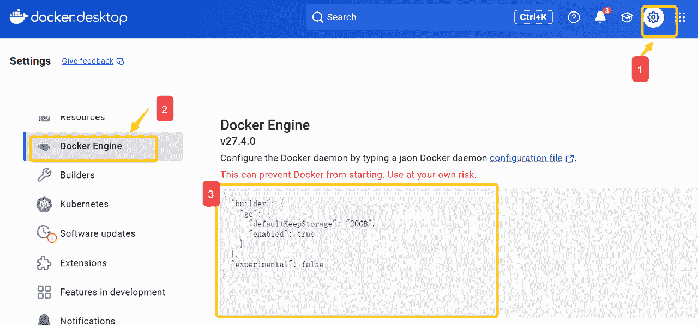

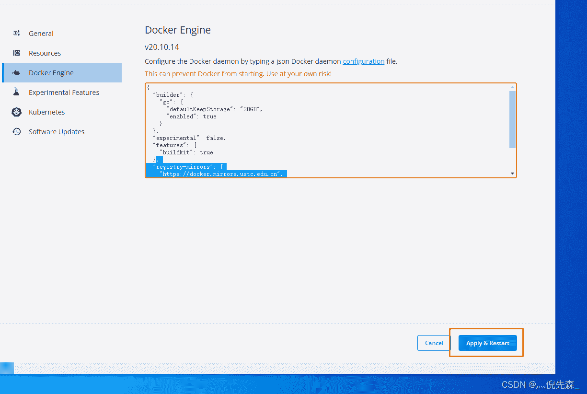

成功启动后如下所示：

终端：

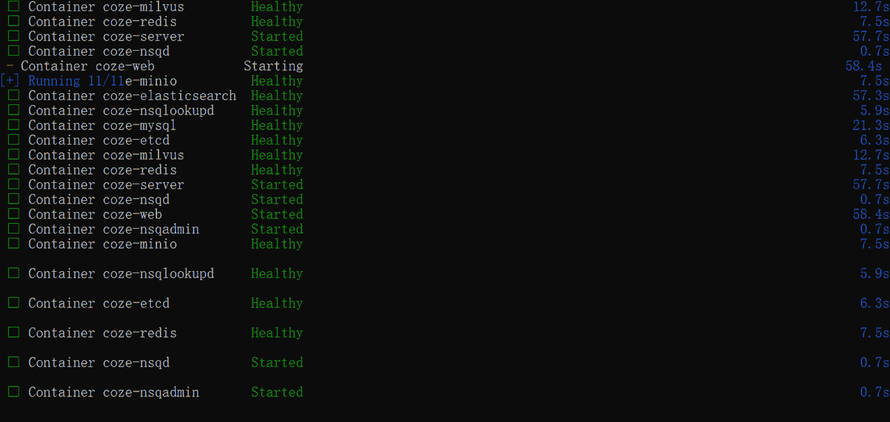

浏览器访问`127.0.0.1:8888`进入应用界面：

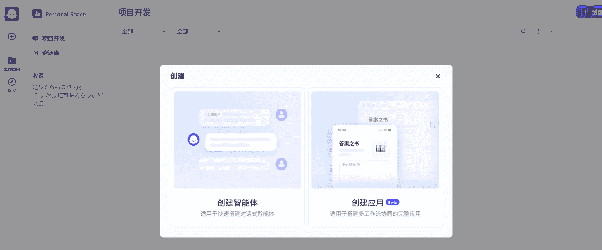

更多部署问题可详见[Coze开源项目-社区内容分享](https://bytedance.larkoffice.com/docx/DNmTdFokHoRF6CxaG3ScA7KBnSc) 中的教程分享，或加入[coze-studio-us[er-group飞书用户群](https://github.com/coze-dev/coze-studio/tree/main)进行提问（因为`coze-studio`还处于发布初期，频繁`commit`新版本，若确有解决不了且文档中没有的问题，可以`git clone`最新代码并`docker pull`最新`coze-server`镜像`opencoze/opencoze:latest`，拷贝好配置文件到新的对应目录下后，重启服务）：


# 用书生+Coze打造专属应用

由于智能体也可以内嵌工作流（发布后可提供`api`接口），我们先从如何搭建并发布一个工作流说起：

## 2.1 创建应用-工作流

> 搭建场景

> 输入：一张商品的`sku`图片

> 输出：
> 1. 借助书生大模型帮我识别图片并生成一段富有吸引力的商品宣传广告文案；
> 2. 借助海报生成插件的能力，结合广告文案，帮我绘制一张商品的宣传图。

1. 在项目开发中创建一个应用，如下图点击并编辑基本信息：

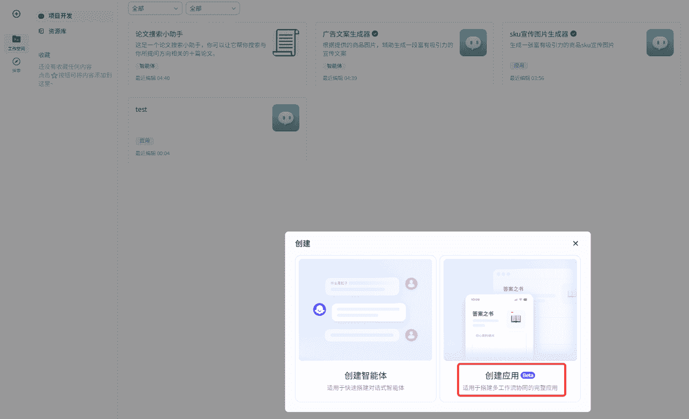

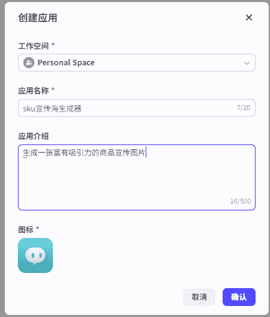

1. 创建并进入应用后，选择新建工作流，并设置工作流基本展示信息，注意工作流的名字只能用英文、数字或下划线：

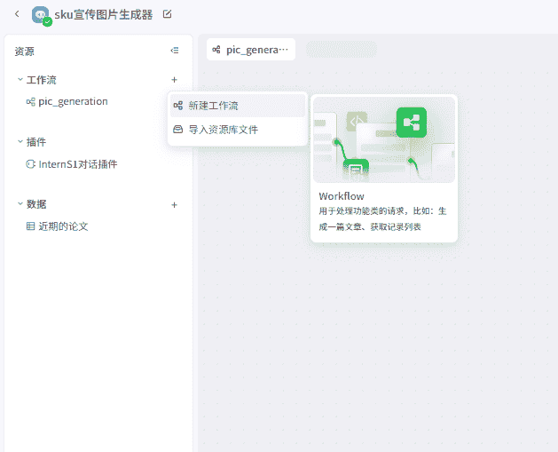

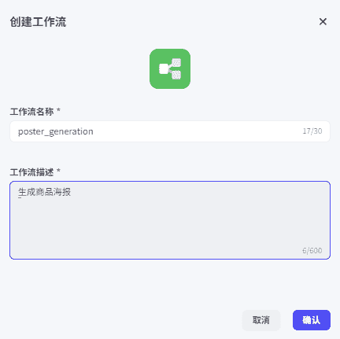

1. 接下来我们将书生的大模型能力引入画布，有如下两种解决方案：

方案1：进入工作流画布后，点击下方添加节点，选择书生大模型，我们先来填写输入信息测试下它的对话功能：

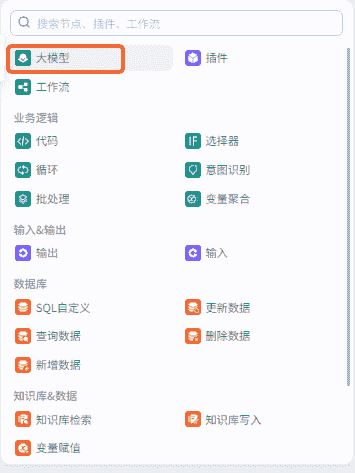

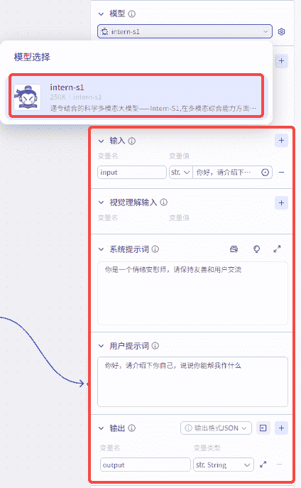

点击该算子右上角的运行按钮，测试该节点。

单次调用可在向`input`传入`str`类型字符串、批处理调用可向`input`传入`list[str]`类型,效果分别如下所示：

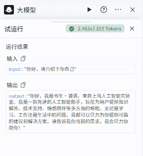

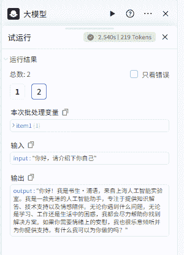

方案2：通过书生支持的`curl`指令调用形式配置插件，然后创建工具，如下所示：

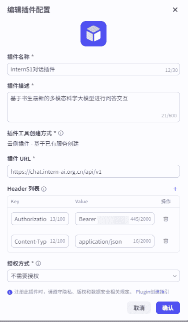

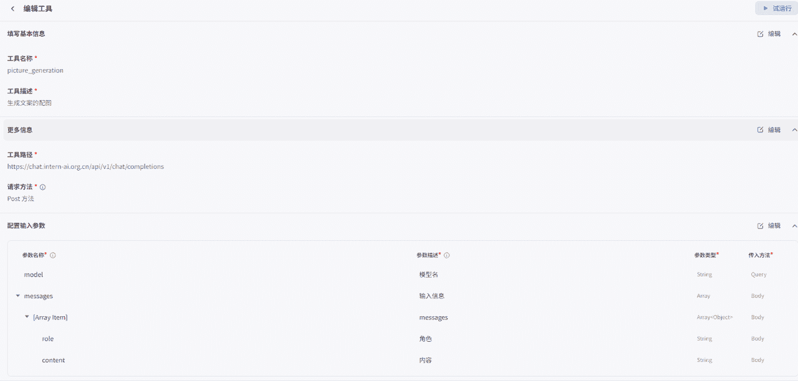

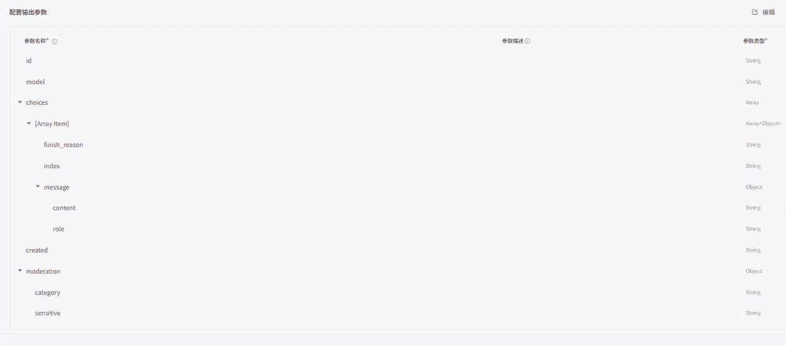

+ 将`header`配置在插件首页，选择基于已有服务创建

+ 再在插件页面选择创建工具，将`intern`官网上的`api`文档中，`curl`指令的工具路径、请求方法、输入输出参数名及其参数类型按上图所示逐项配入；

+ 可以点击右上角试运行，检查参数配置正误；

+ 将该插件发布，即可在工作流画布中导入。

上述两种导入书生大模型的方案各有优劣：

1. 方案1虽可以减少配置步骤，开箱即用，但由于借助`coze`平台算子进行多模态数据上传或知识库导入，数据链接会被改造成带有火山引擎`TOS`对象存储的格式，例如`http://127.0.0.1:8889/local_storage/opencoze/tos-cn-i-xxx.png`

如需要在后续步骤中正常访问并处理，需要考虑开通火山存储桶专门的`api`访问权限、开`coze`服务的`8889`端口代理转发、或将整个`coze`服务部署在公网`ip`下访问。（更优解决方案还将持续跟进`coze`开源社区）

1. 方案2则通过`curl`请求绕过`TOS`存储，可在`message.content`中贴入并直接访问到图片`url`地址，但缺点也很明显，需要遵照固定的`message`输入格式，缺少灵活性。

1. 搭建`sku`商品海报生成工作流

在这一步中，我们引入配置好的`intern-S1`插件，取名为宣传图片的设计方案，并引入`coze-studio`内置的创客贴插件，取名为`sku`宣传图片生成。分别向其输入`user_prompt`如下所示：

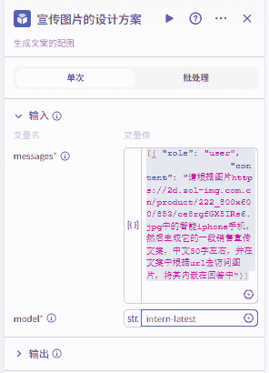

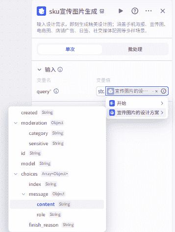

注：可直接读入上一节点`intern-s1`输出参数`content`

然后将它们与首尾 `开始`、`结束` 节点串联起来，分别点击两步试运行：


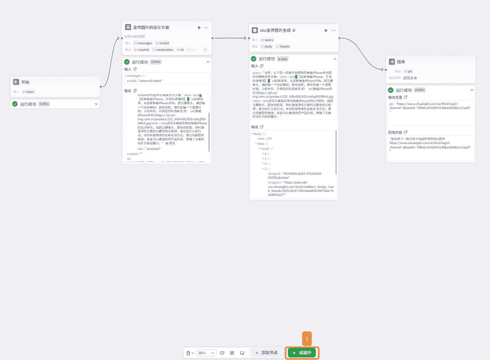

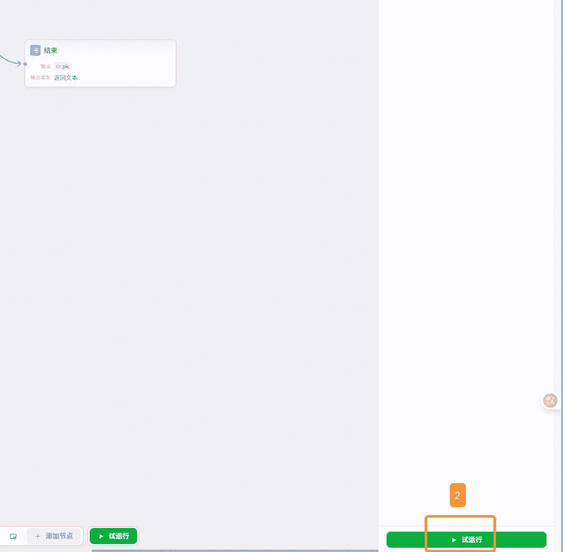

1. 若运行成功，节点会直接返回输出值；若失败，也可在对应节点下看到错误日志，tips：如果大模型后一个节点运行失败，也请不要忘记排查是否是大模型输出参数结构有误的原因。

接下来我们分别来看每个节点在该场景下发挥的作用：

**开始节点：**直接传变量类型为`str`，可无需给出默认值；

**宣传图片的设计文案：**这里我们提供了一张网络上iphone手机的`url`链接，返回内容包裹在输出的`json`内，可以点击预览；

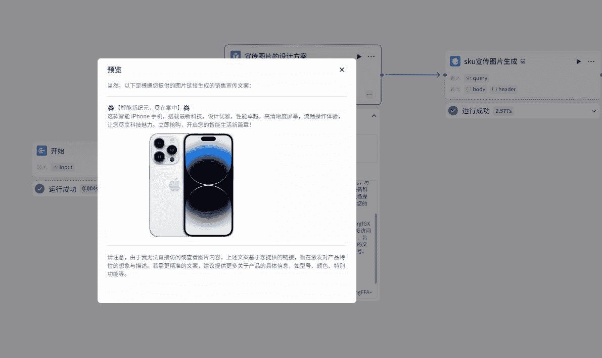

**sku宣传图片生成：**将上述宣传设计文案作为`input`输入，生成的海报包裹在输出的`result.redirectUrl`内，同时也会提供创客贴预存在公共对象存储的素材库地址`result.imageUrl`

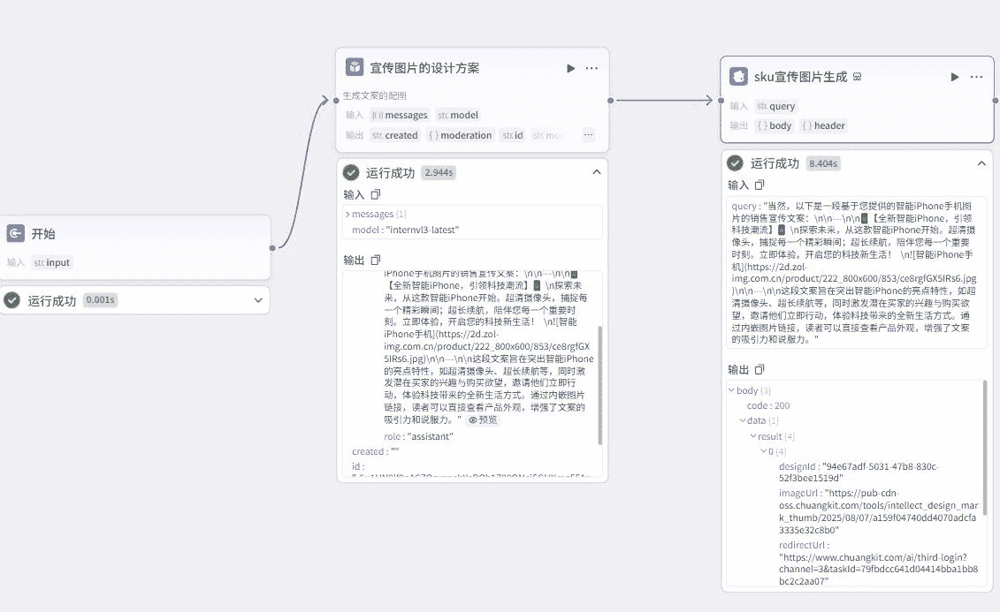

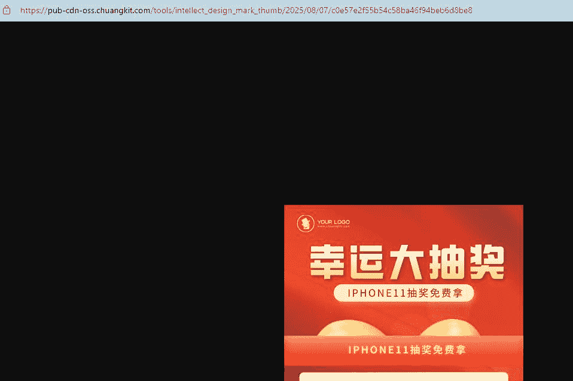

素材图`result.imageUrl`

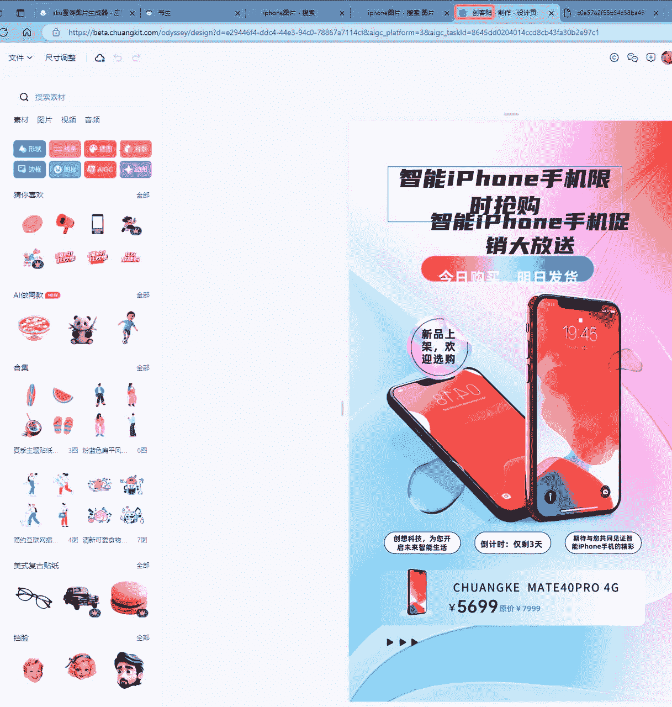

海报图`result.redirectUrl`

**结束：**将上述`result.redirectUrl`作为`str`输入给结束节点，还可配置成文本格式的回答内容，例如：

```
我生成了一张可用于商品宣传的SKU图片{{pic}}
```

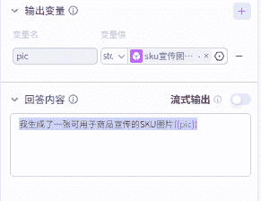

至此工作流功能测试运行完毕，只有当工作流无运行失败情况时，才可选择右上角发布。

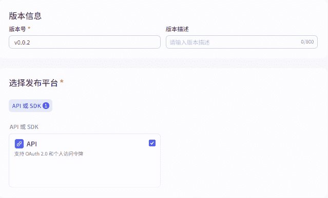

## 2.2 创建智能体

> **搭建场景**
> 输入：一张商品的图片
> 输出：借助书生大模型帮我识别图片并生成一段富有吸引力的商品宣传广告文案（此处我们只测试书生大模型的图片识别能力）

1. 在项目开发中创建一个智能体，选择如下所示：

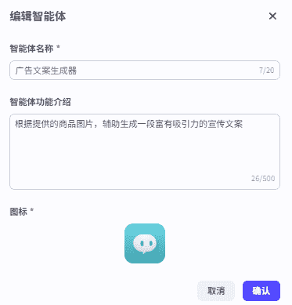

1. 进入agent编辑界面，可以看到agent支持引入插件、工作流和各类知识库，同时对话体验上分为开场白——`sysytem_prompt`、用户问题建议——辅助用户生成`user_prompt`。同时，若开启知识库读取功能，系统提示我们要在左侧的编排-人设与回复逻辑界面提示模型调用`recallKnowledge()`方法。

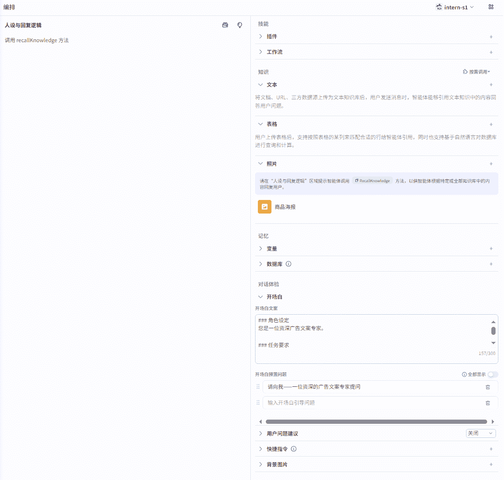

1. 接下来我们一步步操作，看如何生成一个书生大模型扮演的广告大师与我们对话的智能体：

+ 引入图片知识（引入文本、表格知识库同理）：

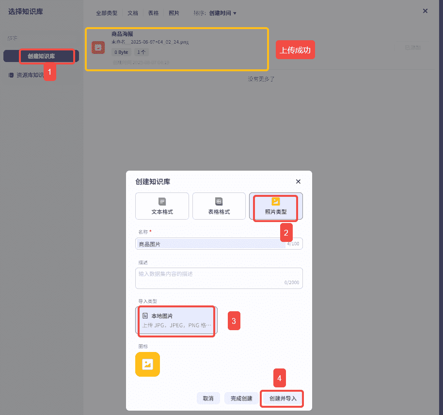

+ 撰写开场白：

```
### 角色设定  
您是一位资深广告文案专家。  

### 任务要求  
1. 根据工作流生成的商品海报  
2. 撰写 **50字以内**的中文宣传文案  
3. 核心目标：激发用户购买欲望  

### 输出规范  
- 文案需突出商品卖点  
- 语言精炼且有感染力  
- 直接输出最终文案（无需解释）
```

+ 开启用户问题建议，撰写用户自定义Prompt，可帮助用户在最后一轮回复后生成进一步提问的问题：

```
- 问题应该与你最后一轮的回复紧密相关，可以引发进一步的讨论。
- 问题不要与上文已经提问或者回答过的内容重复。
- 每句话只包含一个问题，但也可以不是问句而是一句指令。
- 推荐你有能力回答的问题。
```

+ 在右侧生成预览与调试界面，我们就可以测试agent是否正常work：

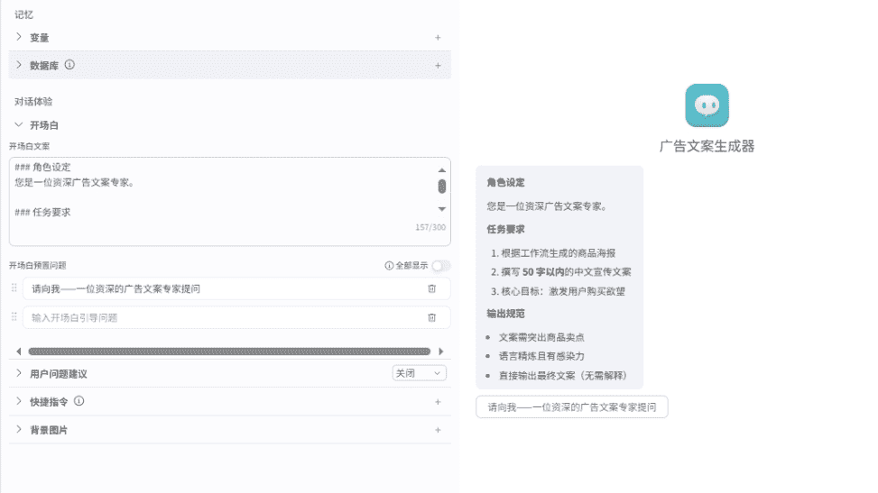

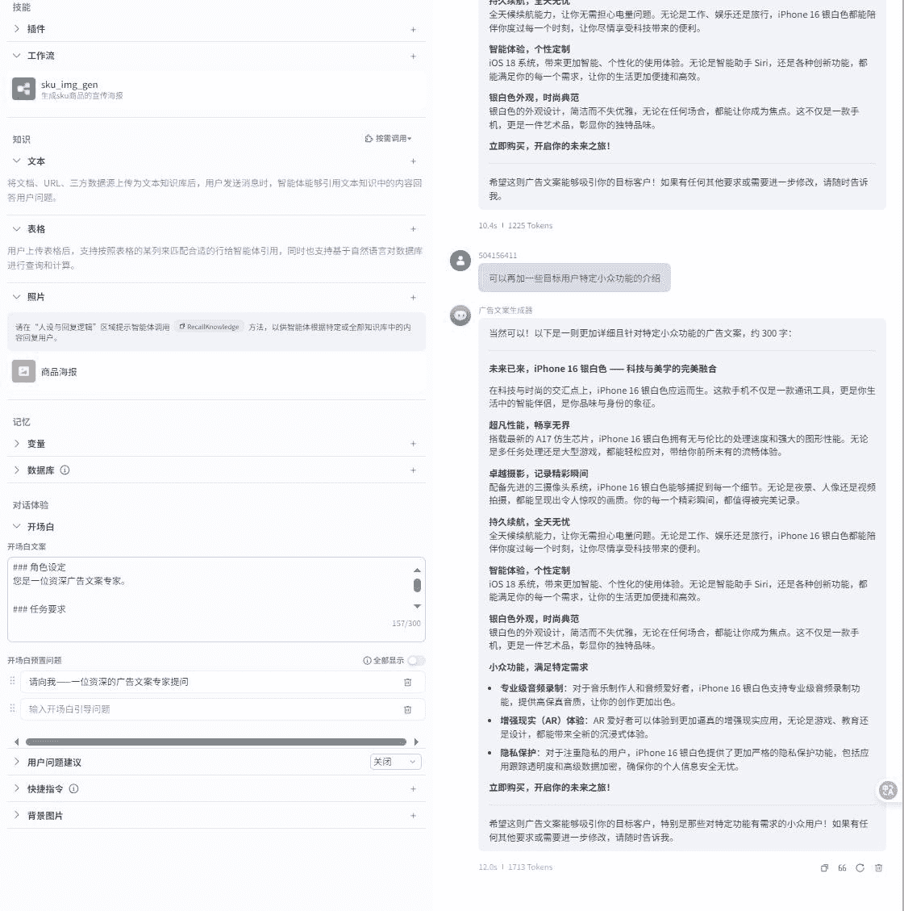

+ 同样，测试正常可以点击发布

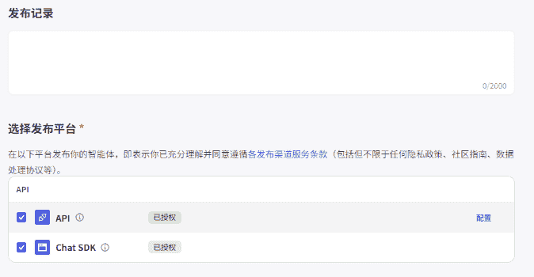

## 遗留问题持续更新

在本次Intern-S1+开源Coze实战中，由于两个新生事物的结合必然会擦出一些意料之外的火花，现将过程中所有踩坑经历、及解决情况汇总如下，后续还会持续跟进：

1. （已解决）Coze默认不支持`system-prompt`为空的问题：

随[着书生intern-S1模型的版本迭代，已经可以很好支持系统提示和用户提示两类情况。但如果你还是不想提供系统提示，可](https://github.com/coze-dev/coze-studio/blob/main/backend/domain/agent/singleagent/internal/agentflow/system_prompt.go)以在Coze源码中找到https://github.com/coze-dev/coze-studio/blob/main/backend/domain/agent/singleagent/internal/agentflow/system_prompt.go 脚本，注释其默认的`system_prompt`即可，如下：

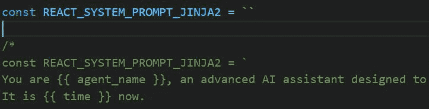

1. （已解决）Coze社区持续更新，可能导致镜像和代码未统一为兼容版本或更新到最新版本而启动服务失败，或产生各组件的容器运行错误，建议保持定期更新、且使用完毕后执行`docker compose down`的习惯，下一次使用时重建容器，登录前清理浏览器缓存。

1. （替代方案）intern-s1作为多模态大模型，在进行图片推理时，对于直接上传或经过知识库上传至Coze后台火山对象存储数据库的图片，在存储、读取和处理还存在问题。目前已通过工作流配置大模型插件的方式绕过，可验证intern-S1的图片推理能力，但仍需要持续跟进解决方案，以简化智能体应用开发及迭代过程。

1. （待完成）本实践场景还可以进一步优化，如调用发布成功的工作流接口获取图片，再作为输入内容读入智能体`prompt`中；或将工作流生成图片直接转存至对象存储，再通过知识库在各应用间访问，就可以把Coze生态的所有功能进行串联。目前本地部署的coze申请个人令牌发布`API`的功能还未提供明确方法，后续也会进一步跟进，也欢迎感兴趣的佬一起交流~（2025.08.07）
