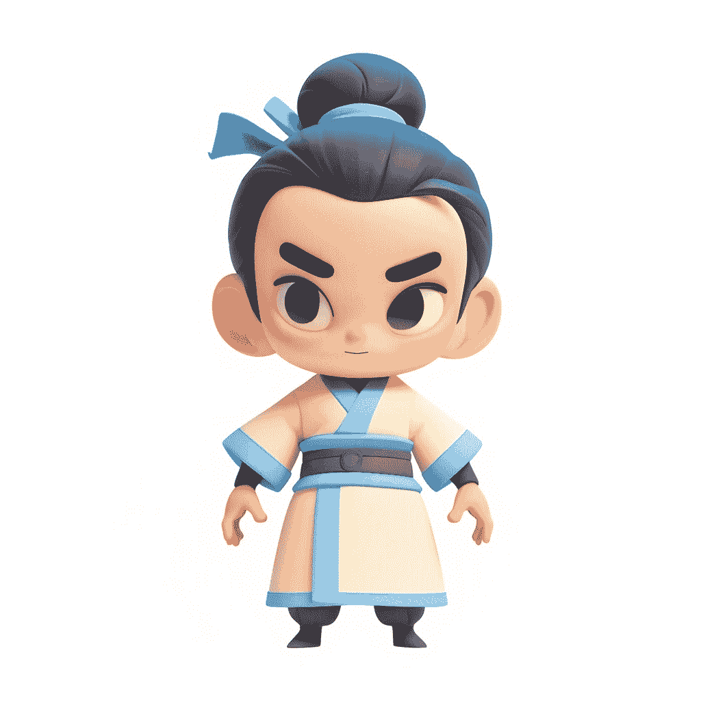
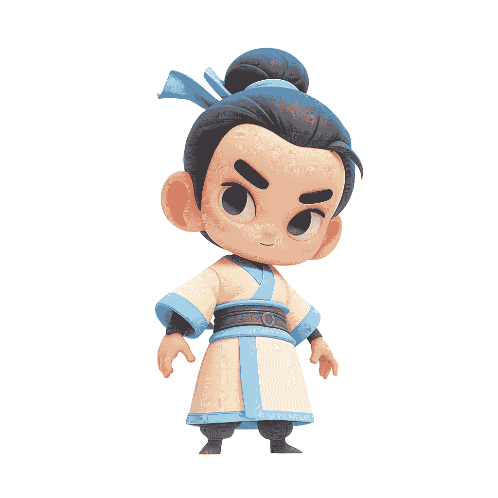
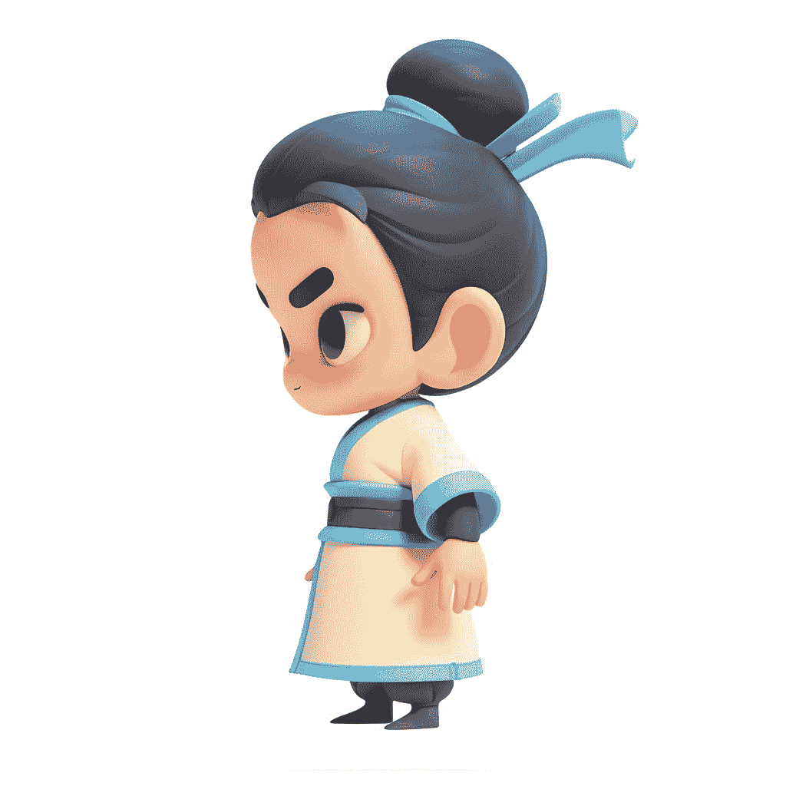
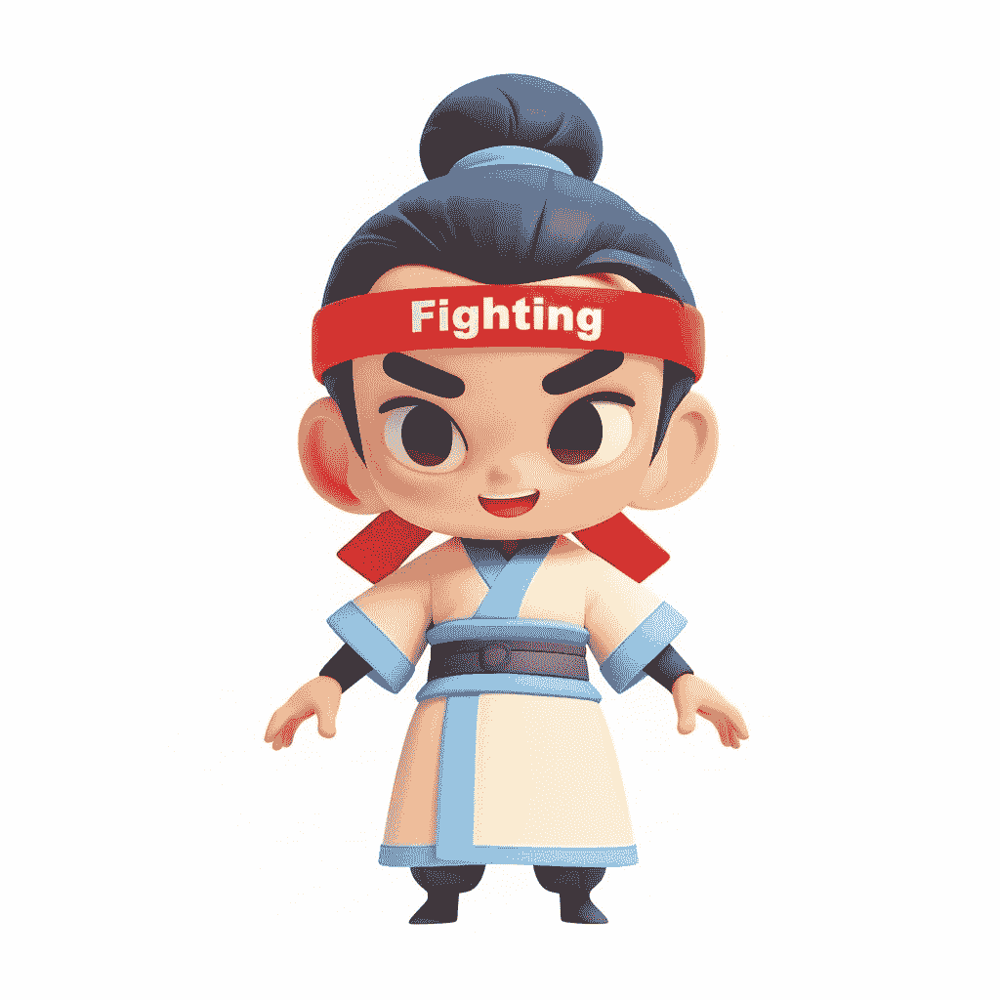
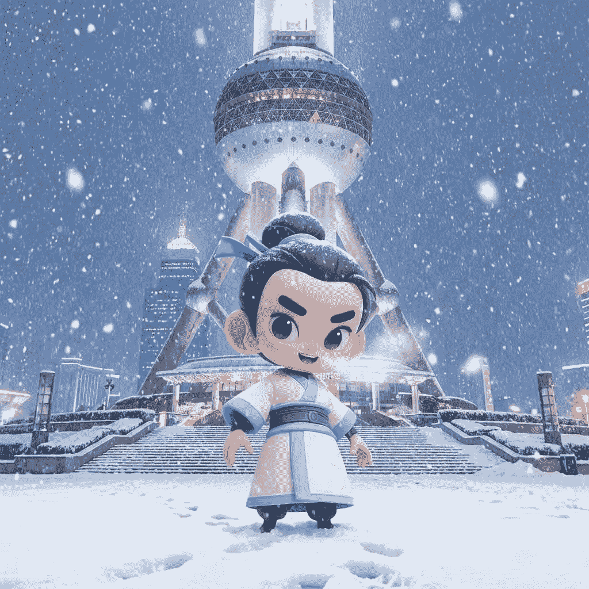

# 书生 IP 及文创

> 来源：[https://aicarrier.feishu.cn/docx/VIKadTyvto9VRoxs8G5cwKXXnNb](https://aicarrier.feishu.cn/docx/VIKadTyvto9VRoxs8G5cwKXXnNb)

**原始书生 IP 形象：**

https://oss.openmmlab.com/model-center/puyu/IP/intern.png

https://oss.openmmlab.com/model-center/puyu/IP/intern0.png

https://oss.openmmlab.com/model-center/puyu/IP/intern1.png

https://oss.openmmlab.com/model-center/puyu/IP/intern2.png

## 衍生形象

