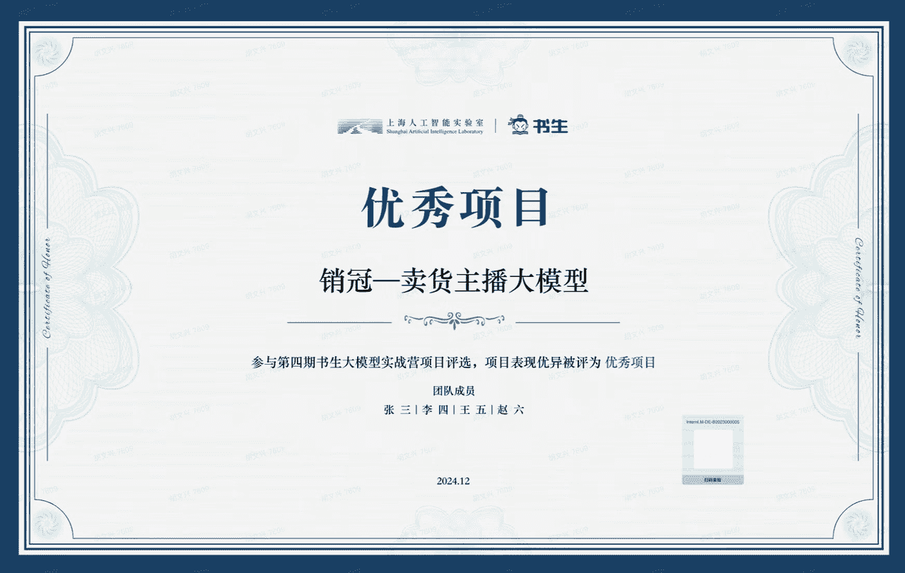
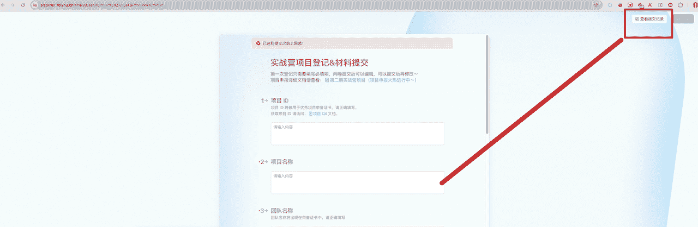

# 🔥书生大模型开源社区项目申报🔥

> 来源：[https://aicarrier.feishu.cn/docx/OyMCdVNvfoCSO4x3CeRc1QHfnXg](https://aicarrier.feishu.cn/docx/OyMCdVNvfoCSO4x3CeRc1QHfnXg)

**样例证书**

近期优秀项目推荐参加近期举办的兴智杯赛事

🔥书生大模型实战营的小伙伴们，书生团队为实战营的小伙伴提供了丰富的算力和案例帮助大家项目出圈和科研，详细安排如下～🔥

| 项目时间线 |  |
| --- | --- |
| 五期实战营项目申请 | 即日起 |
| 材料提交截止 | 待定 |
| 优秀项目公布&amp;人气奖拉票 | 待定 |
| 人气项目&amp;明星项目公布 | x 月 x 日 |

<https://aicarrier.feishu.cn/sync/OsSedA8ZssKa6ubIiiLcin22nFh>

# 需提交的材料

参加实战营项目的小伙伴请通过问卷登记团队信息（提交后问卷可以更改，先不用纠结先提交），登记了项目之后联系  兑换算力～

https://aicarrier.feishu.cn/share/base/form/shrcnZAhJeT6PYxhkvRxCnPljkf

提交完成后，点击此处即可修改记录

**加入群聊找「闻星」兑换算力**

# 项目申请激励

| 阶段 | 事项 | 算力激励（可灵活申请） | API Token 激励（可灵活申请） |
| --- | --- | --- | --- |
| 1 | 项目登记 | 168 算力点 | 500W |
| 2 | 初版GitHub Repo和技术架构图 | 333 算力点 | 2500W |
| 3 | 高质量架构图和方案 | 1688 算力点 | 1亿（部分项目可解锁 50 RPM） |
| 4 | 高质量的视频(项目视频播放量超500，且制作精良)，或者有其他突出亮点。 | 3600 算力点 | 2亿（50RPM） |
| 5 | 于优秀项目中评选，在👸号文章发起投票，票数前 10 名的项目。 | 3600 算力点 | 5 亿 (50RPM) |
| 5 | 项目视频播放量超 5K、GitHub Repo Star 超 500 | 7200 算力点 | 10亿（50RPM） |
| **特**别项目特别支持，近期发布了 Intern-S1 模型，部分优秀项目可获得 666 亿 API 算力 Tokens 支持！！！ |  |  |  |

「优秀项目」

备注：「项目登记」「潜力项目」和「高潜项目」阶段的算力有效期为 1 个月，根据项目需要灵活支持非永久，保留随时回收算力资源的权限。每个月底会对项目进行盘点重新分配资源。

优秀项目

# 平台

**InternStudio：**https://studio.intern-ai.org.cn/

**浦语API：**https://internlm.intern-ai.org.cn/api/document

# 常见问题 QA

<https://aicarrier.feishu.cn/sync/YF4fd8DGrsM0kabILLAcUxm0nWe>