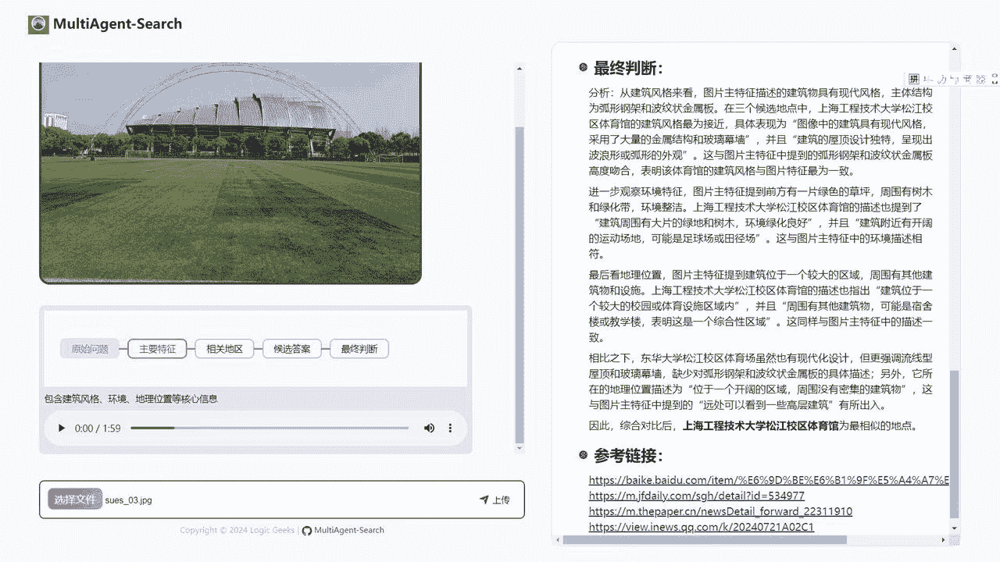
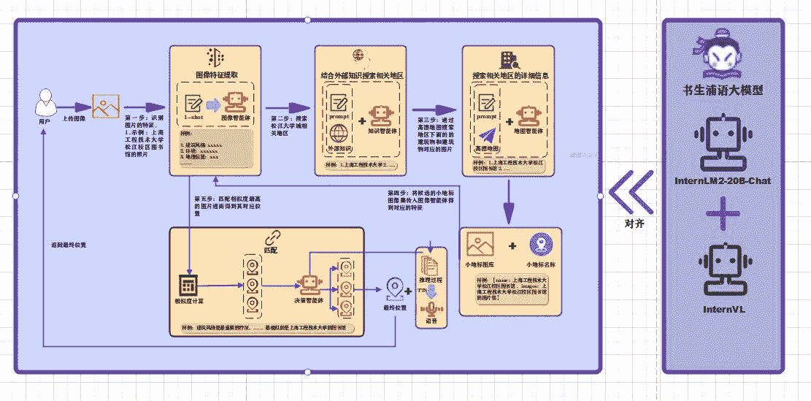
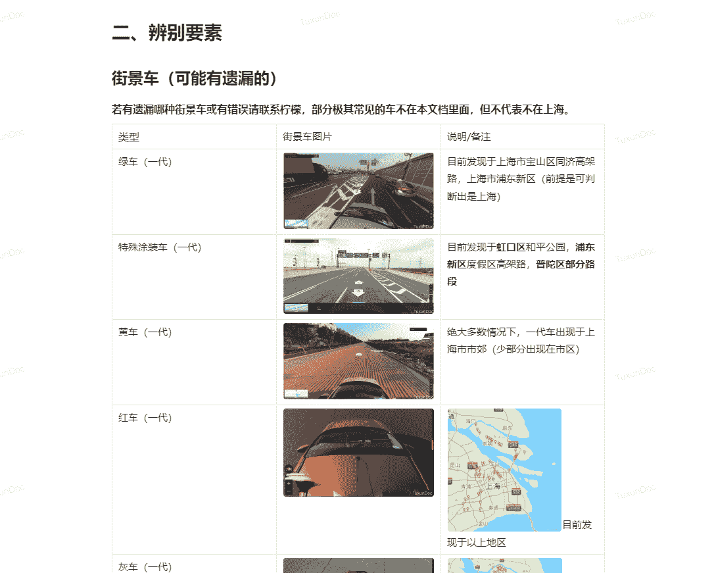
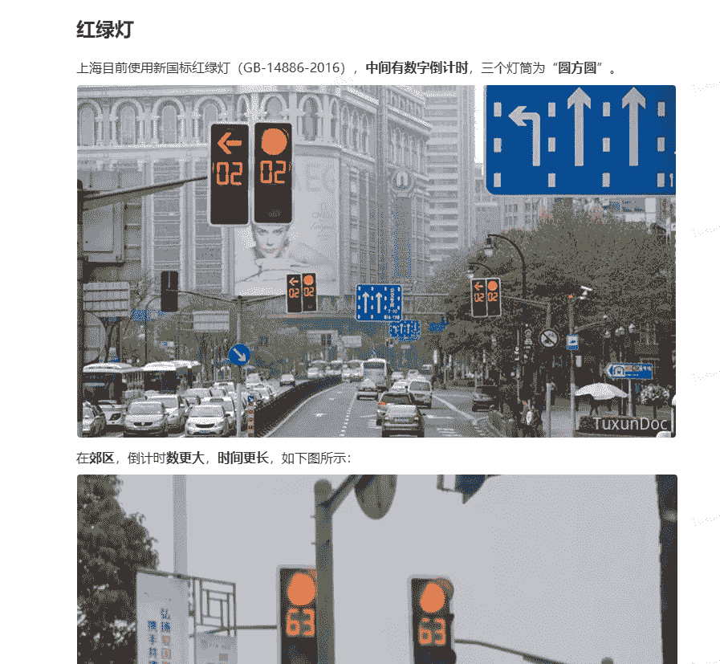
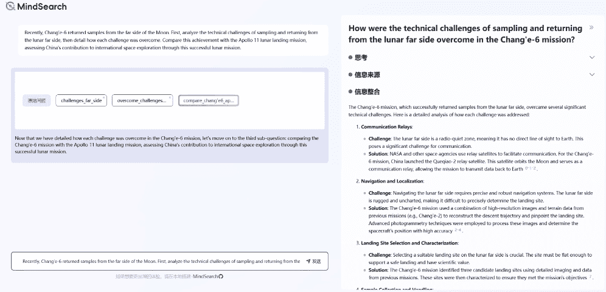

# 基于多智能体的图像信息定位系统 MultiAgent-Search | 与书生共创

> 来源：[https://aicarrier.feishu.cn/docx/K7MTduQW8otwPMxR2OycalOxn6a](https://aicarrier.feishu.cn/docx/K7MTduQW8otwPMxR2OycalOxn6a)

基于多智能体的图像信息定位系统 MultiAgent-Search | 与书生共创

基于书生系列大模型，社区用户不断创造出令人耳目一新的项目，从灵感萌发到落地实践，每一个都充满智慧与价值。“与书生共创”将陆续推出一系列文章，分享这些项目背后的故事与经验。欢迎订阅并积极投稿，一起分享经验与成果，推动大模型技术的普及与进步。

本文来自社区投稿，作者邬雨航，书生大模型实战营学员。本文将向大家介绍孵化于书生大模型实战营的项目 MultiAgent-Search（一款基于多智能体的图像信息定位系统）。

### 鸣谢

大家好，我是上海工程技术大学研一的学生。非常感谢书生大模型实战营提供的支持，感谢导师熊玉洁老师的悉心指导，让我得以完成 MultiAgent-Search 这个项目。

特别要提的是，实战营提供的免费课程、模型和算力的支持，极大地帮助了像我这样的普通学生。在此，我表示衷心的感谢！

大家好，我是来自上海工程技术大学研一的一名学生，非常感谢上海人工智能实验室的书生大模型实战营提供的课程及算力支持，以及我的导师熊玉洁老师的悉心指导，让我得以完成 MultiAgent-Search 这个项目。

注：以下的内容都离不开书生·浦语大模型的支持，这对本次项目的研究至关重要。我非常感激社区提供的免费课程和算力支持，这些资源极大地帮助了像我这样的普通学生。衷心感谢你们的慷慨贡献！！😭

> **相关链接：**

+   https://github.com/InternLM/Tutorial

+   https://github.com/InternLM/InternLM

+   https://github.com/InternLM/agentlego

+   https://github.com/InternLM/MindSearch

+   https://github.com/langchain-ai/langchain

### 项目介绍

目前图寻地址主要依赖计算机视觉（CV）方法，通过与大量卫星图像比对来确定位置。尽管这些方法效果显，但随着大模型的应运而生，依据人对于图像地理知识及相关特征的推理未免不是一个好的解决方案。因此，我开发了一种基于多智能体的图像识别与位置推理系统。旨在通过视觉、知识与决策等多智能体协同工作，能够有效分析城市地标的多维信息，通过逐步推理的方式得到准确的地理位置。

项目展示

项目目前已提交到 GitHub上，地址为：https://github.com/Wuyuhang11/MultiAgent-Search （还在不断完善中...）

项目架构图

<https://player.bilibili.com/player.html?bvid=1BcUmYtESj&spm_id_from=333.999.0.0&vd_source=c26467ea02ffdfe56f9235ba44d99e62>

介绍视频

### 技术方法

**图像智能体**

在视觉智能体的实现技术上，提供了 few-shot 的学习环境图像中提取关键特征信息。这些特征信息包括建筑风格、地标名称、地理位置等，将被用于后续的地理位置推理。

**知识智能体**

知识智能体利用 Prompt 技术引导模型理解和分析从视觉智能体提取的图像信息，并结合外部的地理知识和网页上关于图像的特征与用户问题的相关信息进行分析，旨在复杂的城市环境中缩小区域检索范围。在技术实现方面，该智能体采用了 RAG (Retriever-Augmented Generation）框架，不仅利用内部已有信息，还能利用图像信息从外部数据库和知识库中检索与其相关的额外信息，帮助确定位置大致范围。

**地图智能体**

根据知识智能体提供的区域信息，使用高德地图 POI 功能的 API 进行详细区域检索，以获取每个片区里面所有小建筑物的图像特征和对应名称，封装为 k-v 键值对形式，以实现对地理信息进行精细化处理。

**决策智能体输出最终位置**

通过收集到的已知信息进行分析，首先将小建筑物地标的所有特征嵌入为向量形式，然后利用欧几里得算法计算建筑物之间的相似度，选择 top-k 作为候选位置。传入并利用生成对抗网络 GANs 技术的对抗思想和思维链 CoT 的推理方式进行最后的决策过程，以筛选出与实际图像特征最佳匹配的地标位置。

**RAG**

RAG 顾名思义为检索增强生成,它的本质是外部数据源和大模型GPT的结合去完成用户特殊的请求。

**RAG的流程：**

+   文档与用户问题的上传

+   对文档预处理并将处理后的外部文档与问题通过向量模型进行嵌入

+   在向量数据库中进行检索得到相关知识

+   对召回数据进行重排序

+   将外部知识与用户问题组合成上下文给到下游模型生成最终响应

**地理信息文档：**我们利用图寻地址相关的知识文档对大模型的推理提供相关依据，以便于获取更为准确的答案，减缓幻觉现象的发生。

地理信息文档

**AgentLego的使用**

AgentLego是一个多功能工具 API 的开源库，用于扩展和增强基于大型语言模型（LLM）的代理，具有以下突出功能：

+   用于 LLM 代理的多模态扩展的丰富工具集，包括视觉感知、图像生成和编辑、语音处理和视觉语言推理等。

+   **灵活的工具界面**，允许用户使用任意类型的参数和输出轻松扩展自定义工具。

+   **与基于 LLM 的代理框架（**如 [LangChain](https://github.com/langchain-ai/langchain)、T[ransfo](https://github.com/InternLM/lagent)rmers Agents、Lagent）轻松集成。

+   **支持工具服务和远程访问**，这对于具有大量 ML 模型（例如 ViT）或特殊环境要求（例如 GPU 和 CUDA）的工具特别有用。

**智能体的构建：**

我们以知识智能体的构建举例，首先从 AgentLego 的库中通过 load_tool 函数加载 Google 搜索工具（国内的话，可以用博查AI），然后利用 Lagent 初始化我们的智能体（Langchain也可以），然后我们通过 Lagent 中的行为链 ActionExecutor 执行智能体的动作，并导入 ReAct 模块结合语言模型和动作执行器，更好地实现对话和执行任务的能力。

**TTS：**

我们只需加载相关依赖 TTS、langid，即可通过 AgentLego 中提供的文本转语音工具（TextToSeepch）进行加载，输出语音内容。

**相关****链接**

https://github.com/InternLM/agentlego

https://github.com/InternLM/lagent

https://github.com/langchain-ai/langchain

**前端页面**

前端页面的风格我们借鉴了`MindSearch`，将一个宏观上较为庞大的问题拆分为几个小问题，然后通过智能体之间的协同工作，以模仿人类思维解决解决原始问题。

MindSearch 展示图

**MindSearch：**

https://github.com/InternLM/MindSearch

### 未来展望

1.  该项目目前只在上海松江大学城进行试验，当地域较大时，无法单靠大模型进行准确推理。

1.  未来我们将 CV 与大语言模型进行相结合，利用大模型的推理放大特征的表现，缩小图像所在的位置范围。

1.  目前，我们还在探索与大模型越狱相关的研究工作，非常期待能够跟各位大佬进行交流和学习。