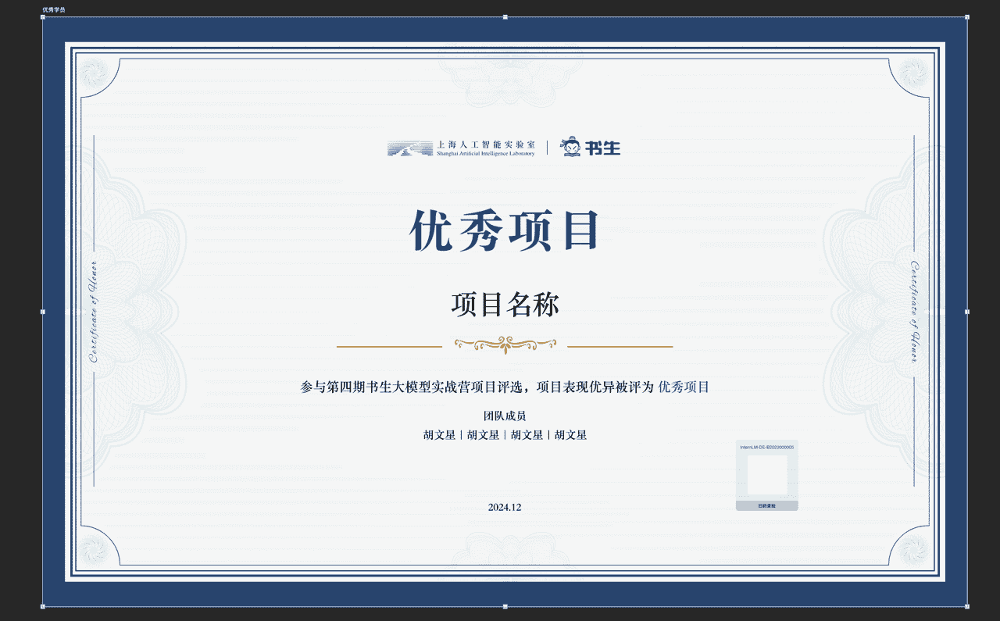
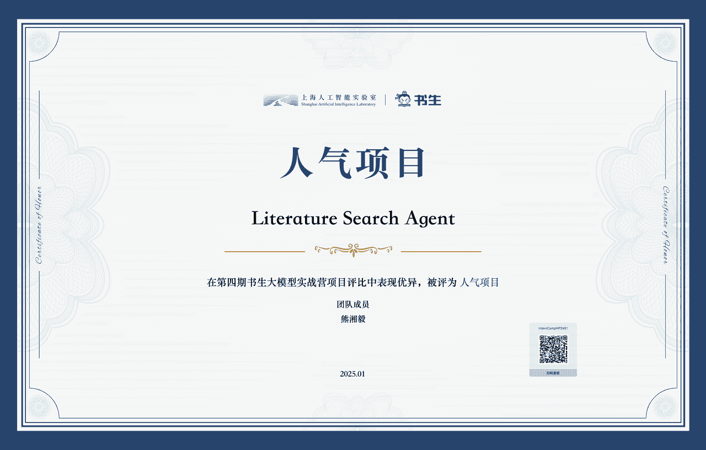
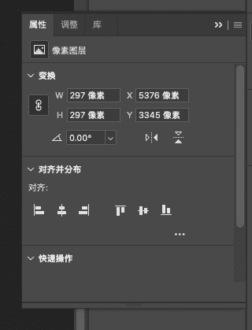

# 优秀项目证书制作

> 来源：[https://aicarrier.feishu.cn/docx/SKl8d0ng5oVIRqxy74FcApshnkV](https://aicarrier.feishu.cn/docx/SKl8d0ng5oVIRqxy74FcApshnkV)

信息请和问卷中保持一致，如更新请问卷也更新一份：

https://aicarrier.feishu.cn/share/base/form/shrcnZAhJeT6PYxhkvRxCnPljkf

| 项目 ID | 项目名称 | 团队成员 | 证书类型（优秀项目/人气项目） | 证书领取 |
| --- | --- | --- | --- | --- |
| 2451 | Literature Search Agent | 熊湘毅 | 优秀项目/人气项目 |  |
| 2797 | 智能医导大模型 | 冯程欣、潘燕、何山 | 优秀项目/人气项目 |  |
| 2173 | Minstrel - 轻松定义你的专属AI助手 | 王明、刘远忠、欧炜庭 | 优秀项目/人气项目 |  |
| 2012 | 古韵流芳非遗文化探秘 | 张昊宇、申雅月、何山 | 人气项目 |  |
| 1938 | 文物小助手 | 李泓宇｜杜泉方｜何山 | 优秀项目/人气项目 |  |
| 2611 | Nana：准实时私人AI口语导师 | 汤璐阳 | 优秀项目/人气项目 |  |
| 1997 | 法律灯塔：精准法律咨询大模型 | 凌锐，赵海如，何山 | 优秀项目/人气项目 |  |
| 2507 | 风力发电智能运维AI助手 | 李剑宏 | 优秀项目 |  |
| 2421 | InvestFU 投资助手 | 刁永亮，刘晨，仲夏欣 | 优秀项目/人气项目 |  |
| 2395 | MultiAgent-Search：基于多智能体识别图像位置系统 | 邬雨航，张恒华 | 优秀项目/人气项目 |  |
| 1862 | 大咖伴游 | 胡宇薇、李婷、何山 | 人气项目 |  |
|  |  |  |  |  |
|  |  |  |  |  |

**案例链接：**https://internlm.intern-ai.org.cn/certificate/InternCampHP2451

二维码坐标