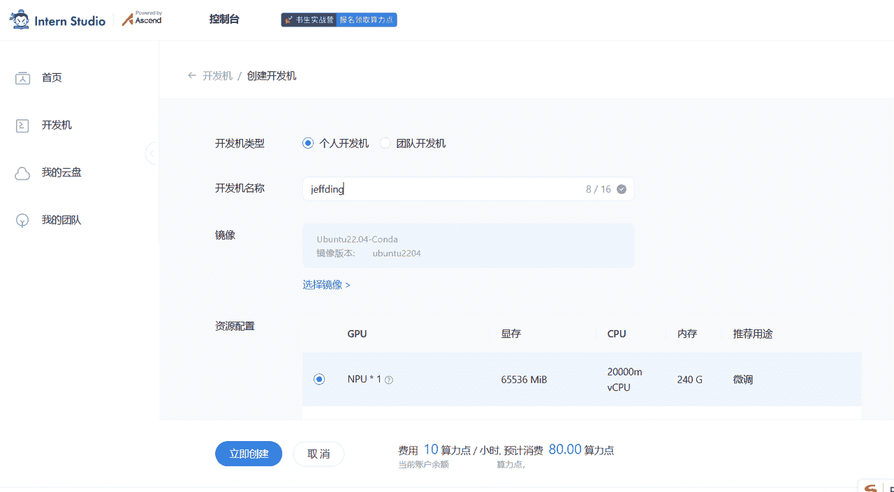
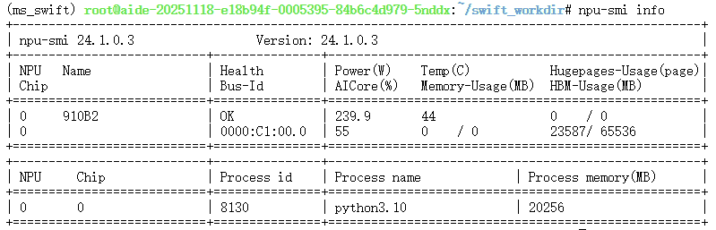
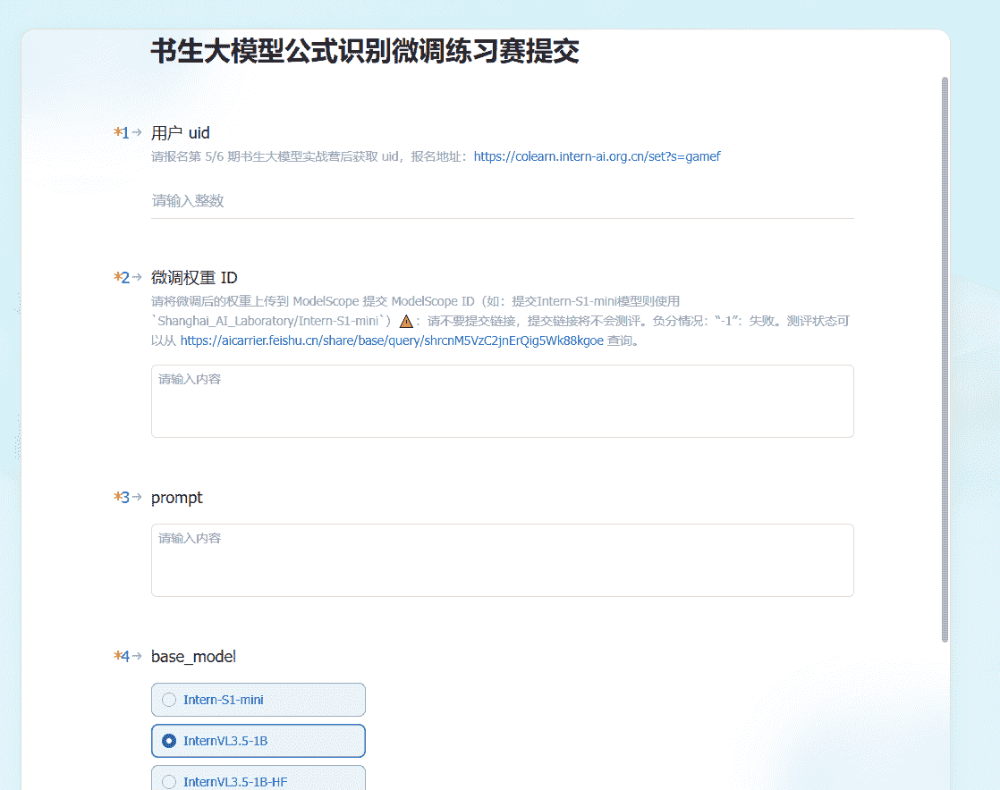

# Ascend 微调 InternVL/Intern-S1-Mini 实践

> 来源：[https://aicarrier.feishu.cn/docx/Q0rddqiEdoOyzBxq03FcojwenPd](https://aicarrier.feishu.cn/docx/Q0rddqiEdoOyzBxq03FcojwenPd)

本教程基于国产昇腾NPU计算平台，在Swift框架下使用LoRA技术对`InternVL3.5-1B`模型进行监督微调（SFT），完成公式识别竞赛任务。实验设置如下：训练数据量3,000条，学习率设为5×10⁻⁵，训练1个epoch，耗时约1小时左右。微调完成后，将LoRA权重与基座模型合并，并上传至魔搭（ModelScope）平台。比赛流程采用飞书表单提交模型信息，后台自动评测耗时约30分钟。性能评估结果显示，模型得分从微调前的0分提升至43.75分，验证了本方法的有效性。

## 环境配置

算力券联系 领取！！！

### 创建算力实例

平台地址：`https://internstudio-ascend.intern-ai.org.cn/`

#### 创建算力开发机

【开发机】-【创建开发机】-【个人开发机】

参数如下：

开发机名称：任意

镜像：`Ubuntu22.04-Conda`

资源配置：`1*NPU`

点击【立即创建】



### 环境安装

安装必要的包：

```
cd /root/
conda create -n ms_swift python=3.10 -y
conda activate ms_swift
pip install torch==2.6.0 torch-npu==2.6.0 torchaudio==2.6.0 torchvision decorator \
  -i https://pypi.tuna.tsinghua.edu.cn/simple
pip install ms-swift==3.12 -i https://pypi.tuna.tsinghua.edu.cn/simple

pip install timm==1.0.9 msgspec==0.19.0 -i https://pypi.tuna.tsinghua.edu.cn/simple
pip install numpy==1.26.4 -i https://pypi.tuna.tsinghua.edu.cn/simple
```

`pip` 下载速度慢可以试试换源，如清华、阿里、中科院、上交等等，哪个快用哪个。

### 数据集下载

```
pip install modelscope
modelscope download --dataset JimmyMa99/VLM-formula-recognition-dataset_intern_camp --local_dir  /root/dataset/VLM-formula-recognition-dataset_intern_camp
```

数据集的 `json` 文件需要转化处理，将图片路径变成绝对路径，创建转换脚本 `convert.py`。

创建文件：

```
mkdir /root/swift_workdir/
cd /root/swift_workdir/
vim convert.py
```

脚本内容：

```
import json, os, sys

in_path  = "/root/dataset/VLM-formula-recognition-dataset_intern_camp/train/train_mini.jsonl"
out_path = "/root/dataset/VLM-formula-recognition-dataset_intern_camp/train/train_mini_abs.jsonl"
base = "/root/dataset/VLM-formula-recognition-dataset_intern_camp/train/"

def to_abs(p):
    if not p: return p
    return p if os.path.isabs(p) else os.path.join(base, p)

n = 0
m = 0
with open(in_path, 'r', encoding='utf-8') as fin, open(out_path, 'w', encoding='utf-8') as fout:
    for line in fin:
        if not line.strip(): continue
        obj = json.loads(line)
        changed = False
        if 'images' in obj and isinstance(obj['images'], list):
            obj['images'] = [to_abs(x) for x in obj['images']]
            changed = True
        if 'messages' in obj:
            for msg in obj['messages']:
                c = msg.get('content')
                if isinstance(c, list):
                    for part in c:
                        if part.get('type') == 'image' and 'image' in part:
                            part['image'] = to_abs(part['image'])
                            changed = True
        fout.write(json.dumps(obj, ensure_ascii=False) + '\n')
        n += 1
        m += changed
print(f"processed lines={n}, patched={m}, saved -> {out_path}")
```

执行：

```
python convert.py
```

## InternVL3_5-1B 微调

### 创建微调配置文件

```
cd /root/swift_workdir
mkdir config
cd config
vim internvl3.5_1b_train_npu.sh
```

配置文件内容：

```
#!/bin/bash

# 创建日志目录
LOG_DIR="logs"
mkdir -p $LOG_DIR

# 获取当前时间戳
TIMESTAMP=$(date +"%Y%m%d_%H%M%S")
LOG_FILE="$LOG_DIR/internvl3.5_1b_sft_${TIMESTAMP}.log"

# 设置环境变量
# export ENABLE_AUDIO_OUTPUT=False
export OMP_NUM_THREADS=1
export ASCEND_RT_VISIBLE_DEVICES=0
export NPROC_PER_NODE=1

# 设置随机端口号，避免端口冲突
export MASTER_PORT=$((10000 + RANDOM % 50000))

# 先打印启动信息
echo "Starting training..."
echo "Log file: $LOG_FILE"
echo "Using port: $MASTER_PORT"

# 没有指定 model_type
# 启动训练并获取PID
nohup swift sft \
    --model '/share/new_models/InternVL3.5/InternVL3_5-1B' \
    --dataset '/root/dataset/VLM-formula-recognition-dataset_intern_camp/train/train_mini_abs.jsonl' \
    --eval_steps 100 \
    --train_type lora \
    --lora_rank 16 \
    --lora_dropout 0.01 \
    --lora_alpha 32 \
    --torch_dtype bfloat16 \
    --num_train_epochs 1 \
    --per_device_train_batch_size 2 \
    --per_device_eval_batch_size 2 \
    --learning_rate 5e-5 \
    --warmup_ratio 0.05 \
    --gradient_accumulation_steps 4 \
    --save_steps 500 \
    --save_total_limit 3 \
    --gradient_checkpointing_kwargs '{"use_reentrant": false}' \
    --logging_steps 10 \
    --max_length 8000 \
    --output_dir ./swift_output/SFT-InternVL3_5-1B \
    --dataset_num_proc 8 \
    --dataloader_num_workers 8 \
    --metric acc \
    --freeze_vit true \
    > "$LOG_FILE" 2>&1 &

# 获取PID并等待一下确保进程启动
TRAIN_PID=$!
sleep 2

# 检查进程是否还在运行
if kill -0 $TRAIN_PID 2>/dev/null; then
    echo "Training started successfully with PID $TRAIN_PID"
    echo "To view logs in real-time, use:"
    echo "tail -f $LOG_FILE"
    echo ""
    echo "To stop training, use:"
    echo "kill -9 $TRAIN_PID"
else
    echo "Failed to start training process"
    echo "Check log file for errors: $LOG_FILE"
fi
```

其中选手可以自行调整 `lr`、`lora` 等参数。

### 启动微调

```
cd /root/swift_workdir
bash config/internvl3.5_1b_train_npu.sh
```

使用 `npu-smi info` 命令可以查看NPU使用情况，如果想要实时监控可以使用 `watch -n 1 npu-smi info`。

### 合并权重

运行以下命令：

```
swift export --adapters "微调生成的checkpoint文件目录" --merge_lora True
```

## Intern-S1-mini 微调

### 创建微调配置文件

```
cd /root/swift_workdir
mkdir config
cd config
vim interns1-mini_train_npu.sh
```

配置文件内容：

```
#!/bin/bash

# 创建日志目录
LOG_DIR="logs"
mkdir -p $LOG_DIR

# 获取当前时间戳
TIMESTAMP=$(date +"%Y%m%d_%H%M%S")
LOG_FILE="$LOG_DIR/interns1mini_sft_${TIMESTAMP}.log"

# 设置环境变量
# export ENABLE_AUDIO_OUTPUT=False
export NPROC_PER_NODE=1
export OMP_NUM_THREADS=1
export ASCEND_RT_VISIBLE_DEVICES=0

# 设置随机端口号，避免端口冲突
export MASTER_PORT=$((10000 + RANDOM % 50000))

# 先打印启动信息
echo "Starting training..."
echo "Log file: $LOG_FILE"
echo "Using port: $MASTER_PORT"

# 没有指定 model_type
# 启动训练并获取PID
nohup swift sft \
    --model '/share/new_models/Intern-S1-mini' \
    --dataset '/root/dataset/VLM-formula-recognition-dataset_intern_camp/train/train_mini_abs.jsonl' \
    --eval_steps 1000 \
    --train_type lora \
    --lora_rank 16 \
    --lora_dropout 0.01 \
    --lora_alpha 32 \
    --torch_dtype bfloat16 \
    --num_train_epochs 1 \
    --per_device_train_batch_size 1 \
    --per_device_eval_batch_size 1 \
    --learning_rate 1e-4 \
    --warmup_ratio 0.05 \
    --gradient_accumulation_steps 4 \
    --save_steps 500 \
    --save_total_limit 10 \
    --gradient_checkpointing_kwargs '{"use_reentrant": false}' \
    --logging_steps 1 \
    --max_length 8000 \
    --output_dir ./swift_output/SFT-Interns1mini \
    --dataset_num_proc 16 \
    --dataloader_num_workers 16 \
    --model_author JeffDing \
    --model_name SFT-camp6 \
    --metric acc \
    --freeze_vit true \
    > "$LOG_FILE" 2>&1 &

# 获取PID并等待一下确保进程启动
TRAIN_PID=$!
sleep 2

# 检查进程是否还在运行
if kill -0 $TRAIN_PID 2>/dev/null; then
    echo "Training started successfully with PID $TRAIN_PID"
    echo "To view logs in real-time, use:"
    echo "tail -f $LOG_FILE"
    echo ""
    echo "To stop training, use:"
    echo "kill $TRAIN_PID"
else
    echo "Failed to start training process"
    echo "Check log file for errors: $LOG_FILE"
fi
```

其中选手可以自行调整 `lr`、`lora` 等参数。

### 启动微调

```
cd /root/swift_workdir
bash config/interns1-mini_train_npu.sh
```

使用 `npu-smi info` 命令可以查看NPU使用情况。



### 合并权重

运行以下命令：

```
swift export --adapters "微调生成的checkpoint文件目录" --merge_lora True
```

### 补全模型文件


```
SRC="/share/new_models/InternVL3.5/InternVL3_5-1B-HF"    #源模型地址
DST="/root/llamafactory_workdir/saves/InternVL3_5-1B/lora/megred-model-path" #微调后模型地址
rsync -ah --ignore-existing --exclude='/proc' --exclude='proc' "$SRC"/ "$DST"/
```

# 提交结果

## 上传

创建`upload.py`脚本

```
cd /root/swift_workdir
vim upload.py
```

`upload.py`脚本内容：

```
from modelscope.hub.api import HubApi
from modelscope.hub.constants import Licenses, ModelVisibility

# 配置基本信息
YOUR_ACCESS_TOKEN = "ms-9fxx7e"  # 填写自己的 api token ，获取方式点击：https://modelscope.cn/my/myaccesstoken
api = HubApi()
api.login(YOUR_ACCESS_TOKEN)

# 取名字
owner_name = "xx"  # ModelScope 的用户名
model_name = "xx"  # 为模型库取个响亮优雅又好听的名字，需根据自己情况修改
model_id = f"{owner_name}/{model_name}"

# 创建模型仓库
api.create_model(
    model_id,
    visibility=ModelVisibility.PUBLIC,
    license=Licenses.APACHE_V2,
    chinese_name=f"{owner_name}的书生大模型实战营-公式微调分类比赛",
)

# 上传模型到仓库
api.upload_folder(
    repo_id=f"{owner_name}/{model_name}",
    folder_path="xx",  # 微调后模型的文件夹名称
    commit_message="upload model folder to repo",  # 写上传信息
)
```

运行`upload.py`上传模型

```
python upload.py
```

提交表单的 `prompt` 参考如下,这里也有优化空间，可自行探索最优 prompt：

```
请根据图片中的公式生成对应的 latex 公式文本
```

## 赛流程

### 报名

点击以下链接进行报名,获取 `uid`

https://colearn.intern-ai.org.cn/set?s=gamef

### 提交参赛权重

微调后的权重请从以下链接入口提交，不要填写链接，参考截图。

**提交表单**：https://aicarrier.feishu.cn/share/base/form/shrcnXjK6zERK7z4pPU85PLO80c



**注意：需要选择好 base `model`，本次比赛请选择 `InternVL3_5-1B` ，如提交其他会出现测评异常情况！**

本次测评会提取模型返回中的**最后一个 `latex` 块**

```
```latex

E = mc^2

```
```

### 查看状态/分数

点击以下链接

https://aicarrier.feishu.cn/share/base/query/shrcnM5VzC2jnErQig5Wk88kgoe

进行查看，输入你的 `uid`，比如闻星（`uid`：4）


### 排行榜

https://aicarrier.feishu.cn/share/base/dashboard/shrcnrA82hMMRd1FUuWs8EhOjag

<https://aicarrier.feishu.cn/share/base/dashboard/shrcnrA82hMMRd1FUuWs8EhOjag?iframeFrom=docx&ccm_open=iframe>
