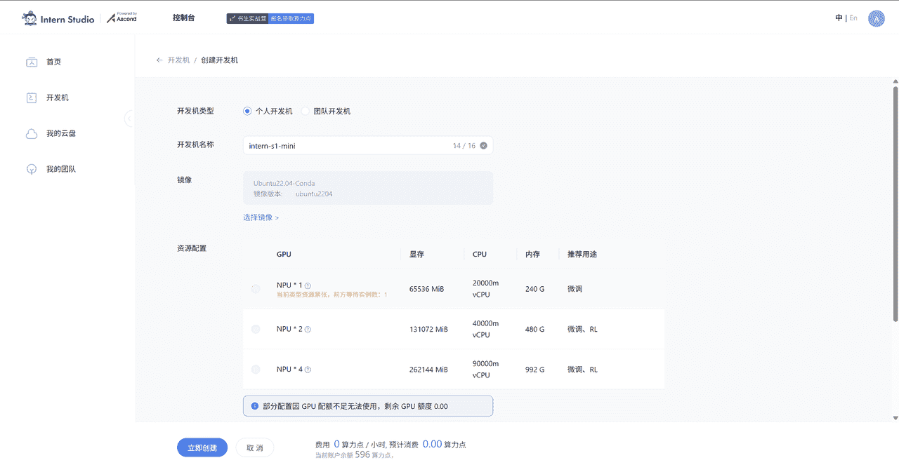
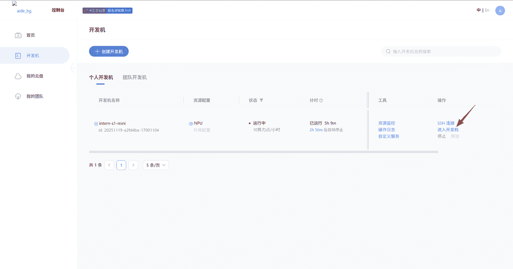
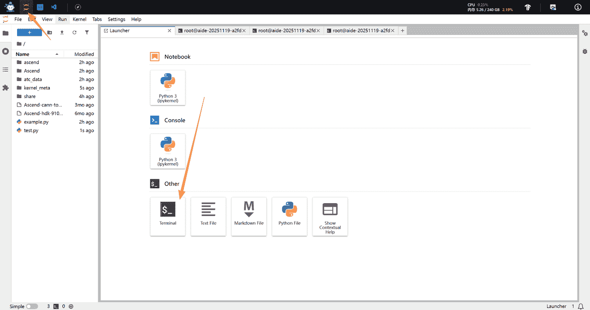
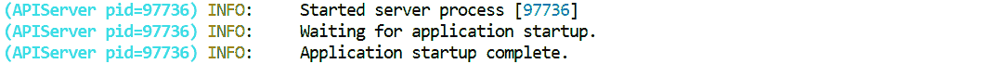
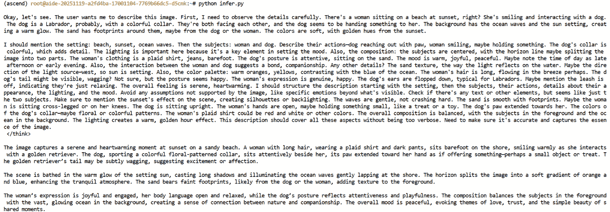

# Ascend NPU vLLM 部署Intern-S1-mini

> 来源：[https://aicarrier.feishu.cn/docx/WBXpde6gtoZLEQxnmuwcM61QnMe](https://aicarrier.feishu.cn/docx/WBXpde6gtoZLEQxnmuwcM61QnMe)

# 一、环境准备

## 1.创建开发机

前往InternStudio Ascend控制台创建开发机



填写开发机名称、选择镜像、资源配置选择NPU*1最后点击立即创建。



开发机点击并且创建成功后，点击进入开发机



进入开发机后默认应该处于熟悉的Jupyterlab页面，再点击Terminal打开终端

在终端输入

```
npu-smi info
```

查看NPU 信息

## 2.准备vllm环境

### 2-1.创建conda环境python版本选择3.11

```
conda create -n ascend python=3.11 -y
```

### 2-2.激活conda环境并且安装 uv

```
conda activate ascend
pip config set global.index-url https://mirrors.tuna.tsinghua.edu.cn/pypi/web/simple
pip install uv
```

### 2-3.安装vllm和vllm-ascend

```
uv pip install vllm==0.11.0
uv pip install vllm-ascend==0.11.0rc1
```

## 3.设置昇腾相关环境变量

```
source /usr/local/Ascend/ascend-toolkit/set_env.sh
source /usr/local/Ascend/nnal/atb/set_env.sh 
```

# 二、下载模型

## 1.安装modelscope

```
uv pip install modelscope
```

## 2.下载 [Intern-S1-mini](https://modelscope.cn/models/Shanghai_AI_Laboratory/Intern-S1-mini/summary)

```
modelscope download Shanghai_AI_Laboratory/Intern-S1-mini
```

# 三、启动vLLM 服务

```
export VLLM_USE_MODELSCOPE=true
vllm serve Shanghai_AI_Laboratory/Intern-S1-mini --trust-remote-code --enforce-eager
```

观察启动日志，当出现如下图的日志时说明vllm服务启动成功



# 四、推理测试

                    &quot;url&quot;: &quot;https://qianwen-res.oss-cn-beijing.aliyuncs.com/Qwen-VL/assets/demo.jpeg&quot;,

```
from openai import OpenAI
client = OpenAI(api_key=&#x27;&#x27;, base_url=&#x27;http://0.0.0.0:8000/v1&#x27;)
model_name = client.models.list().data[0].id
messages = [
    {
        &quot;role&quot;: &quot;user&quot;,
        &quot;content&quot;: [
            {
                &quot;type&quot;: &quot;image_url&quot;,
                &quot;image_url&quot;:{
                }
            },
            {&quot;type&quot;: &quot;text&quot;, &quot;text&quot;: &quot;Describe this image.&quot;},
        ],
    }
]
response = client.chat.completions.create(
    model=model_name,
    messages=messages,
    temperature=0.8,
    top_p=0.8,
    max_tokens=2048,
)
print(response.choices[0].message.content)
```

将以上代码保存成infer.py并运行：

```
uv run infer.py
```

你也可以用python运行

```
python infer.py
```



# 五、参考文档

vLLM-Ascend Installation

[昇腾社区](https://www.hiascend.com/)

[昇腾开源](https://ascend.github.io/docs/sources/ascend/quick_install.html)