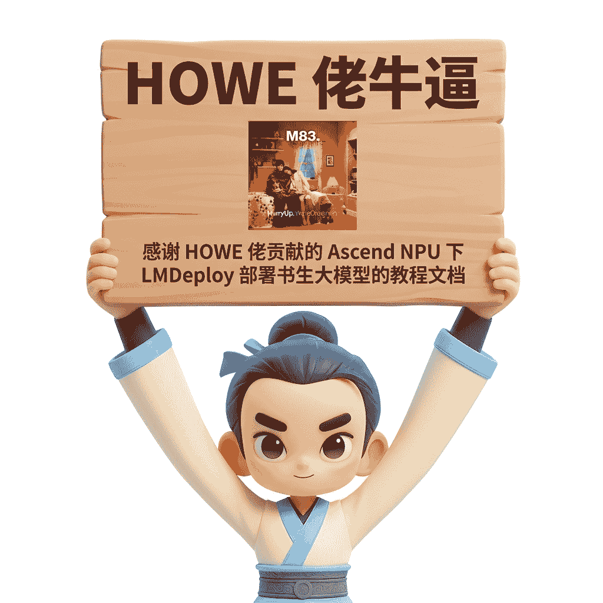
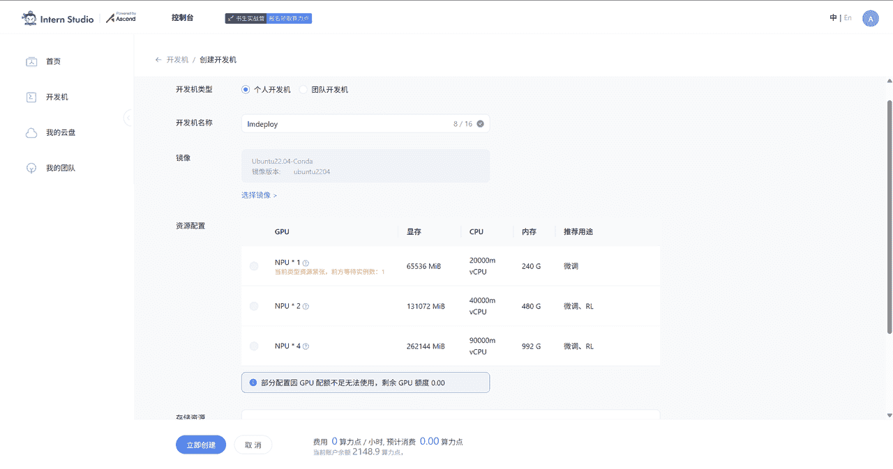
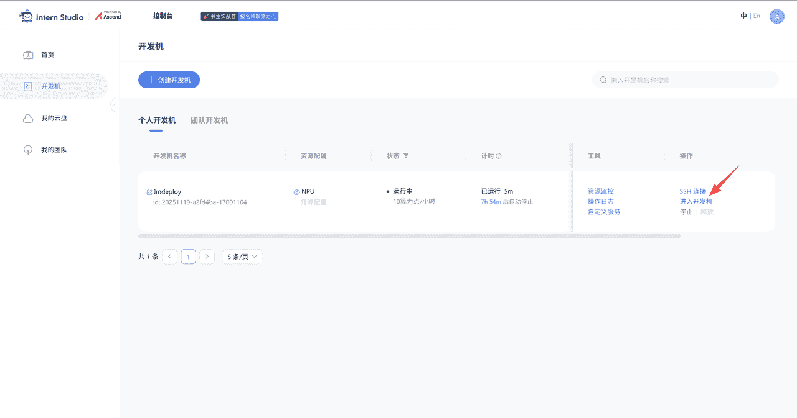
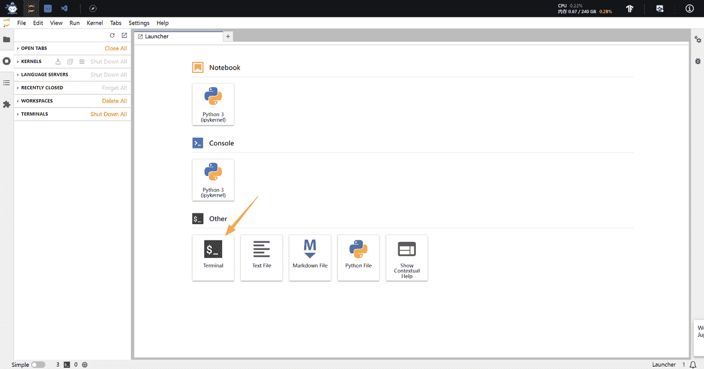
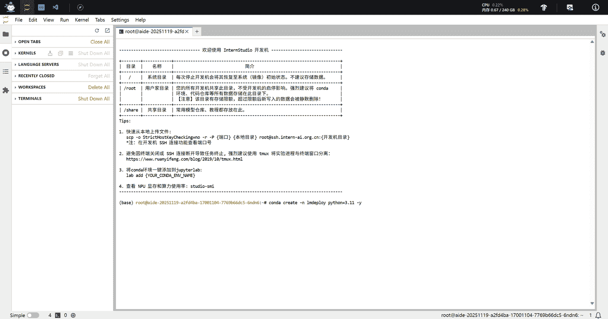
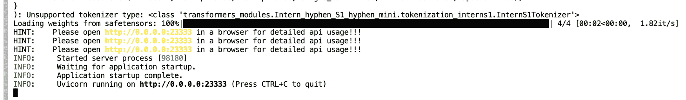
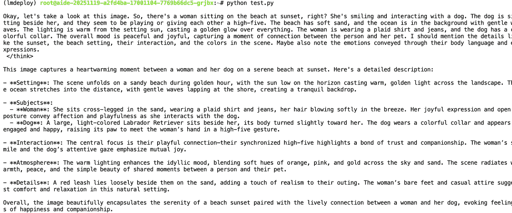

# 0Ascend NPU LMDeploy 部署Intern-S1-mini

> 来源：[https://aicarrier.feishu.cn/docx/Ja7QdM0G4oegpFxCgvgc4ywwnUg](https://aicarrier.feishu.cn/docx/Ja7QdM0G4oegpFxCgvgc4ywwnUg)



# 一、环境准备

## 1.开发机

### 1-1.创建开发机

前往[InternStudio](https://internstudio-ascend.intern-ai.org.cn/console/dashboard)控制台 创建开发机->填写开发机名称->选择镜像->选择资源配置NPU*1，最后点击立即创建



### 1-2.进入开发机

当开发机的状态变成 【运行中】时点击进入开发机



### 1-3.打开终端



## 2.Conda环境

### 2-1.创建

在终端中输入：

```
conda create -n lmdeploy python=3.11 -y
```



### 2-2.激活

```
conda activate lmdeploy
```

2-3.设置镜像加速

```
pip config set global.index-url https://pypi.tuna.tsinghua.edu.cn/simple &amp;&amp; pip config set global.trusted-host pypi.tuna.tsinghua.edu.cn
```

## 3.Dlinfer

### 3-1.克隆dlinfer仓库

```
git clone https://github.com/DeepLink-org/dlinfer.git
```

### 3-2.切换分支

```
cd dlinfer
git checkout tags/v0.2.3.post2 -b v0.2.3.post2
```

### 3-3.安装依赖

```
pip3 install -r requirements/ascend/full.txt
```

### 3-4.编译dlinfer-ascend

```
DEVICE=ascend python3 setup.py develop
```

## 4.Lmdeploy

### 4-1.克隆lmdeploy仓库

```
git clone https://github.com/InternLM/lmdeploy.git
```

### 4-2.切换分支

```
cd lmdeploy
git checkout tags/v0.10.2 -b v0.10.2
```

### 4-3.安装依赖

```
LMDEPLOY_TARGET_DEVICE=ascend pip install -e .
```

# 二、模型下载

## 1.安装modelscope

```
pip install modelscope
```

## 2.下载Intern-S1-mini

```
modelscope download Shanghai_AI_Laboratory/Intern-S1-mini
```

# 三、启动lmdeploy服务

## 1.设置NNAL环境变量

```
source /usr/local/Ascend/nnal/atb/set_env.sh
```

## 2.启动服务

```
export LMDEPLOY_USE_MODELSCOPE=True
lmdeploy serve api_server --backend pytorch --device ascend --eager-mode Shanghai_AI_Laboratory/Intern-S1-mini
```

观察日志当出现如下图所示的日志时表示服务启动成功



# 四、推理测试

```
from openai import OpenAI
client = OpenAI(api_key=&#x27;&#x27;, base_url=&#x27;http://0.0.0.0:23333/v1&#x27;)
model_name = client.models.list().data[0].id
messages = [
    {
        &quot;role&quot;: &quot;user&quot;,
        &quot;content&quot;: [
            {
                &quot;type&quot;: &quot;image_url&quot;,
                &quot;image_url&quot;:{
                    &quot;url&quot;: &quot;https://qianwen-res.oss-cn-beijing.aliyuncs.com/Qwen-VL/assets/demo.jpeg&quot;,
                }
            },
            {&quot;type&quot;: &quot;text&quot;, &quot;text&quot;: &quot;Describe this image.&quot;},
        ],
    }
]

response = client.chat.completions.create(
    model=model_name,
    messages=messages,
    temperature=0.8,
    top_p=0.8,
    max_tokens=2048,
)
print(response.choices[0].message.content)
```

将上述代码保存成test.py

```
python test.py
```



# 五、参考文档

[Lmdeploy README](https://github.com/InternLM/lmdeploy)

[Dlinfer README](https://github.com/DeepLink-org/dlinfer)