# Ascend NPU 下 OpenCompass 评测书生大模型

> 来源：[https://aicarrier.feishu.cn/docx/CpihdMy81o7LRFxczJecDd86nrg](https://aicarrier.feishu.cn/docx/CpihdMy81o7LRFxczJecDd86nrg)

**OpenCompass**是由上海人工智能实验室开发的开源大模型评测平台，旨在全面评估[L2 OpenCompass 评测书生大模型实践](https://aicarrier.feishu.cn/wiki/SZy6waBpziuF3zkUuvkcvMYtneb)语言模型和多模态模型的能力。本教程基于 ，尝试在Ascend NPU上利用OpenCompass进行书生大模型评测。

# 环境准备

首先注册算力平台账号，创建开发机并安装OpenCompass。

## 注册算力平台

**平台地址：**[https://internstudio-asce](https://internstudio-ascend.intern-ai.org.cn/)nd.intern-ai.org.cn/

## 创建开发机

在创建开发机界面选择镜像为 Cuda12.8-conda，并选择 GPU 为 30% A100。

【开发机】-【创建开发机】-【个人开发机】

参数如下：

开发机名称：任意

镜像：Ubuntu22.04-Conda

资源配置：1*NPU

点击【立即创建】

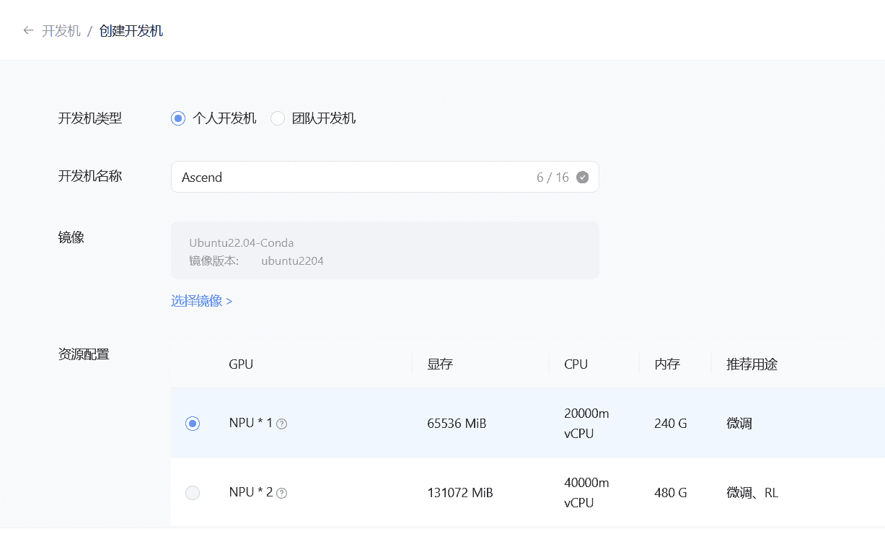

创建成功后即可启动并进入开发机

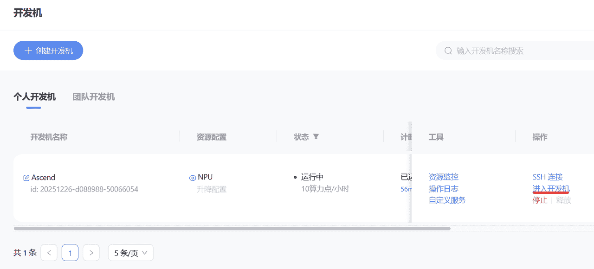

进入开发机后默认是JupyterLab界面

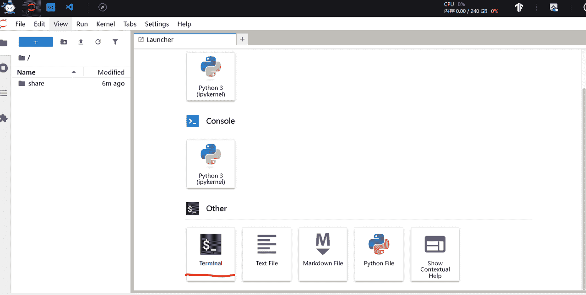

点击Terminal可打开终端

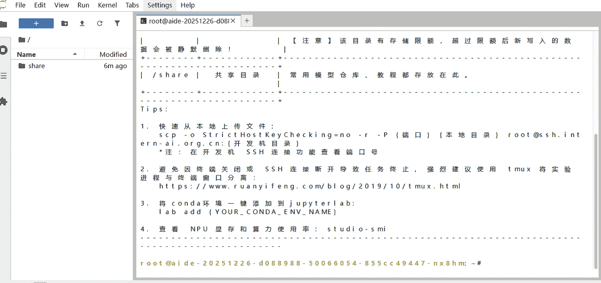

## 安装OpenCompass

```
# 创建虚拟环境
conda create -n opencompass python=3.10 -y
conda activate opencompass

cd /root
git clone https://gh.llkk.cc/https://github.com/open-compass/opencompass.git opencompass
cd opencompass
pip install -e .
pip install opencompass[api]
pip install cloudpickle ml-dtypes tornado
```

# Intern-S1 API评测

## 数据集下载

首先将数据集下载到本地:

```
apt-get update &amp;&amp; apt-get install -y unzip
cd /root/opencompass
wget https://ghfast.top/https://github.com/open-compass/opencompass/releases/download/0.2.2.rc1/OpenCompassData-core-20240207.zip
unzip OpenCompassData-core-20240207.zip
```

查看解压后的数据集

```
ls /root/opencompass/data
```

可以看到 OpenCompass 下data文件夹里面包含的数据集。

## 使用Intern-s1 API评测C-Eval 选择题

在opencompass/opencompass/configs文件夹下创建eval_tutorial_demo1.py

```
cd /root/opencompass/opencompass/configs
touch eval_tutorial_demo1.py
```

打开eval_tutorial_demo1.py 输入以下代码。[注](https://internlm.intern-ai.org.cn/api/tokens?lang=zh-CN)意需要将key替换为自己的key。未申请过书生API key的，在下面链接申请： https://internlm.intern-ai.org.cn/api/tokens?lang=zh-CN

```
from mmengine.config import read_base
from opencompass.models import OpenAISDK

# 配置模型
models = [
    dict(
        type=OpenAISDK,
        path=&#x27;intern-s1&#x27;,  # 明确模型名称
        key=&#x27;sk-xxx&#x27;,  # 替换为的API密钥
        openai_api_base=&#x27;https://chat.intern-ai.org.cn/api/v1&#x27;,  # API地址
        rpm_verbose=True,
        query_per_second=1,  # 根据 rpm 限制,进行调整.rpm==30
        max_out_len=512,
        max_seq_len=4096,
        temperature=0.01,
        batch_size=10,# 根据 rpm 限制,进行调整.rpm==30
        retry=5,  # 增加重试次数
    )
]

# 配置数据集（只取每个子数据集的1个样本）
with read_base():
    from .datasets.ceval.ceval_gen import ceval_datasets

#datasets=ceval_datasets #测试完整的数据集

# 缩小数据集规模为五个子数据集，每个子数据集仅保留10个样本,缩短测评时间
datasets = []
for d in ceval_datasets[:5]:
    # 添加前缀标识这是演示用的精简数据集
    d[&#x27;abbr&#x27;] = &#x27;demo_&#x27; + d[&#x27;abbr&#x27;]
    # 仅使用第1个样本（索引0）
    d[&#x27;reader_cfg&#x27;][&#x27;test_range&#x27;] = &#x27;[0:10]&#x27;
    datasets.append(d)
```

启动评测

```
cd /root/opencompass
python run.py opencompass/configs/eval_tutorial_demo1.py --debug
```

评测过程

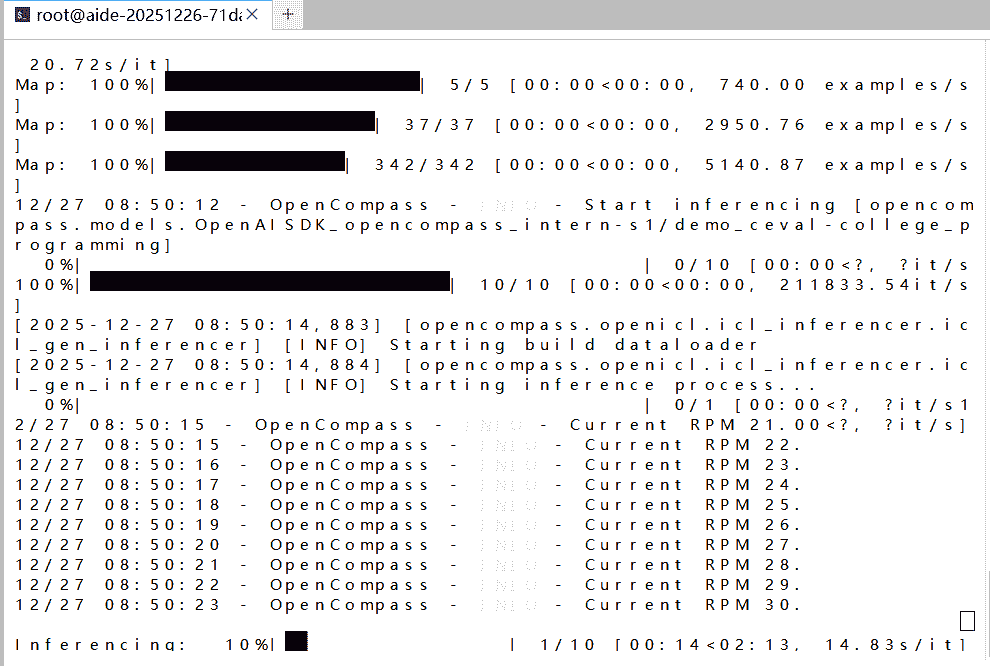

评测结果

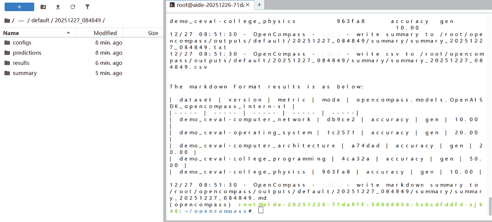

所有运行输出默认放在 outputs/default/ 目录，结构如下：

```
outputs/default/
├── 20200220_120000
├── 20230220_183030     # 每个实验一个文件夹
│   ├── configs         # 用于记录的已转储的配置文件。如果在同一个实验文件夹中重新运行了不同的实验，可能会保留多个配置
│   ├── logs            # 推理和评估阶段的日志文件
│   │   ├── eval
│   │   └── infer
│   ├── predictions   # 每个任务的推理结果
│   ├── results       # 每个任务的评估结果
│   └── summary       # 单个实验的汇总评估结果
├── ...
```

## 使用Intern-s1评测自建数据集

这里评测一下论文分类比赛的数据，newformat_sft_test_data.csv是A榜测试数据，将其放在/root/opencompass/newformat_sft_test_data.csv位置

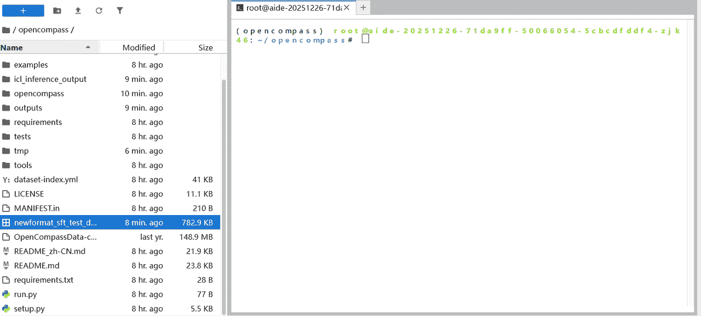

在configs文件夹下创建eval_tutorial_demo2.py

```
cd /root/opencompass/opencompass/configs
touch eval_tutorial_demo2.py
```

文件内容如下，同样需要将key替换成自己的书生API key。

```
from opencompass.models import OpenAISDK

# 配置模型
models = [
    dict(
        type=OpenAISDK,
        path=&#x27;intern-s1&#x27;,  # 明确模型名称
        key=&#x27;sk-xxxx&#x27;,  # 你的API密钥
        openai_api_base=&#x27;https://chat.intern-ai.org.cn/api/v1&#x27;,  # API地址
        rpm_verbose=True,
        query_per_second=1,  # 根据 rpm 限制,进行调整.rpm==30
        max_out_len=512,
        max_seq_len=4096,
        temperature=0.01,
        batch_size=8,# 根据 rpm 限制,进行调整.rpm==30
        retry=5,  # 增加重试次数
    )
]

# 配置数据集
datasets = [
    dict(
        path=&#x27;/root/opencompass/newformat_sft_test_data.csv&#x27;,
        data_type=&#x27;mcq&#x27;,
        infer_method=&#x27;gen&#x27;
    )
]
```

运行评测

```
#在opencompass目录下
cd /root/opencompass
python run.py opencompass/configs/eval_tutorial_demo2.py --debug
```

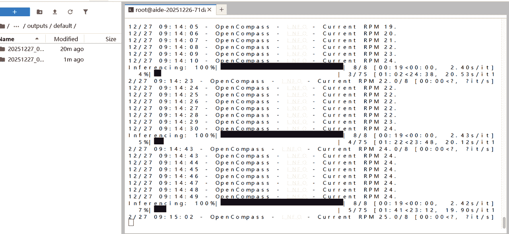

评测结果

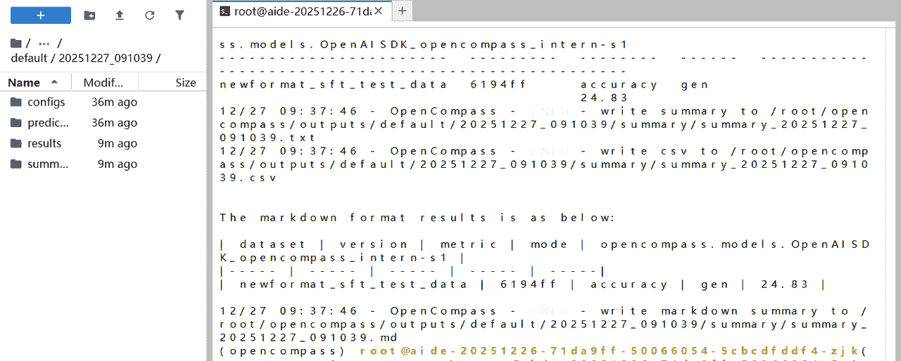

# 本地部署internlm3-8b-instruct评测

这里以下载到本地的internlm3-8b-instruct模型为例，进行本地模型评测，数据集与上一节相同。

## 安装lmdeploy

按照以下步骤安装lmdeploy

```
# 创建虚拟环境
conda create -n lmdeploy python=3.10 -y
conda activate lmdeploy

# 编译安装dlinfer
git clone https://github.com/DeepLink-org/dlinfer.git
cd dlinfer
git checkout tags/v0.2.3.post2 -b v0.2.3.post2
pip3 install -r requirements/ascend/full.txt
DEVICE=ascend python3 setup.py develop

# 编译安装lmdeploy
cd /root
git clone https://github.com/InternLM/lmdeploy.git
cd lmdeploy
git checkout tags/v0.10.2 -b v0.10.2
LMDEPLOY_TARGET_DEVICE=ascend pip install -e .

# 设置环境变量
source /usr/local/Ascend/nnal/atb/set_env.sh
```

## **lmdeploy部署模型API**

```
conda activate lmdeploy
cd /root/lmdeploy
# export LMDEPLOY_USE_MODELSCOPE=True
lmdeploy serve api_server /root/share/new_models/internlm3/internlm3-8b-instruct \
        --model-name internlm3-8b-instruct \
        --server-name 0.0.0.0 \
        --server-port 8000 \
        --api-keys &quot;123456&quot; \
        --backend pytorch \
        --device ascend
```

出现以下结果表示部署成功

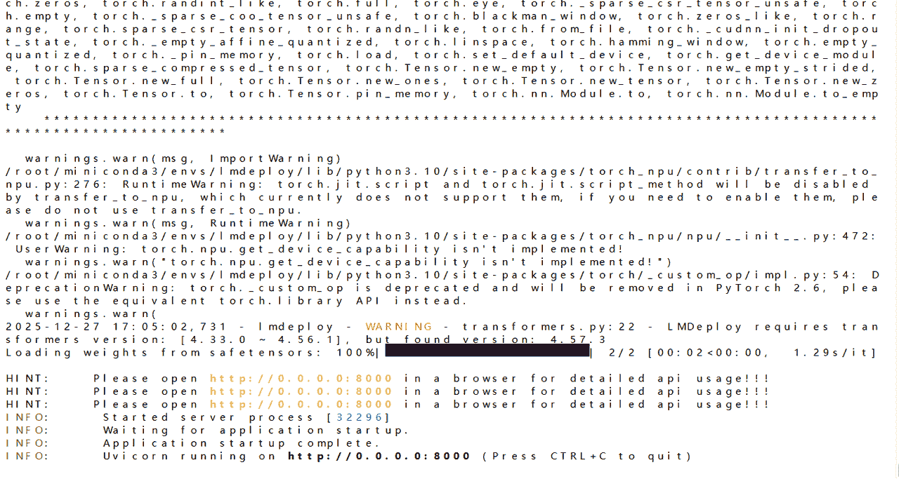

## C-Eval数据集评测

修改eval_tutorial_demo1.py中的模型设置，主要是path、key、openai_api_base三项。

```
from mmengine.config import read_base
from opencompass.models import OpenAISDK

# 配置模型
# models = [
#     dict(
#         type=OpenAISDK,
#         path=&#x27;intern-s1&#x27;,  # 明确模型名称
#         key=&#x27;xxx&#x27;,  # 替换为的API密钥
#         openai_api_base=&#x27;https://chat.intern-ai.org.cn/api/v1&#x27;,  # API地址
#         rpm_verbose=True,
#         query_per_second=1,  # 根据 rpm 限制,进行调整.rpm==30
#         max_out_len=512,
#         max_seq_len=4096,
#         temperature=0.01,
#         batch_size=10,# 根据 rpm 限制,进行调整.rpm==30
#         retry=5,  # 增加重试次数
#     )
# ]

models = [
    dict(
        type=OpenAISDK,
        path=&#x27;internlm3-8b-instruct&#x27;,  # 明确模型名称
        key=&#x27;123456&#x27;,  # 替换为自己的API密钥
        openai_api_base=&#x27;http://0.0.0.0:8000/v1&#x27;,  # API地址
        rpm_verbose=True,
        query_per_second=1,  # 根据 rpm 限制,进行调整
        max_out_len=512,
        max_seq_len=4096,
        temperature=0.01,
        batch_size=10,# 根据 rpm 限制,进行调整
        retry=5,  # 增加重试次数
    )
]

# 配置数据集（只取每个子数据集的1个样本）
with read_base():
    from .datasets.ceval.ceval_gen import ceval_datasets

#datasets=ceval_datasets #测试完整的数据集

# 缩小数据集规模为五个子数据集，每个子数据集仅保留10个样本,缩短测评时间
datasets = []
for d in ceval_datasets[:5]:
    # 添加前缀标识这是演示用的精简数据集
    d[&#x27;abbr&#x27;] = &#x27;demo_&#x27; + d[&#x27;abbr&#x27;]
    # 仅使用第1个样本（索引0）
    d[&#x27;reader_cfg&#x27;][&#x27;test_range&#x27;] = &#x27;[0:10]&#x27;
    datasets.append(d)
 
```

另外打开一个终端，进行如下操作启动评测

```
conda activate opencompass
cd /root/opencompass
python run.py opencompass/configs/eval_tutorial_demo1.py --debug
```

评测过程

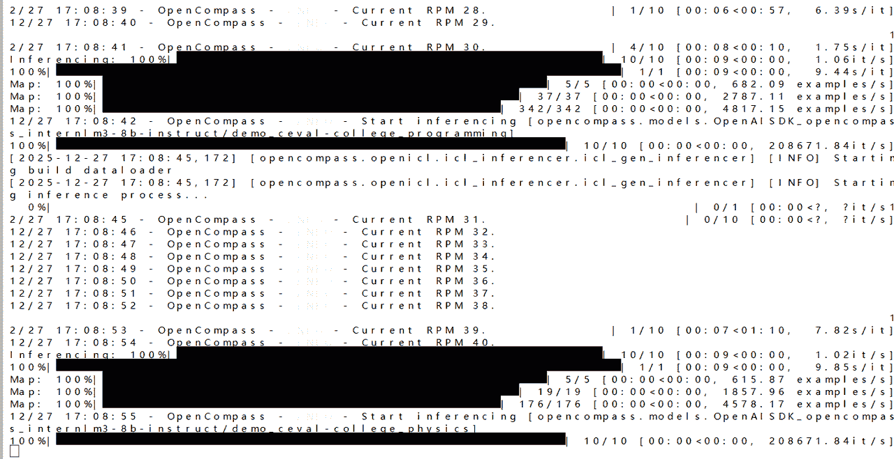

评测结果

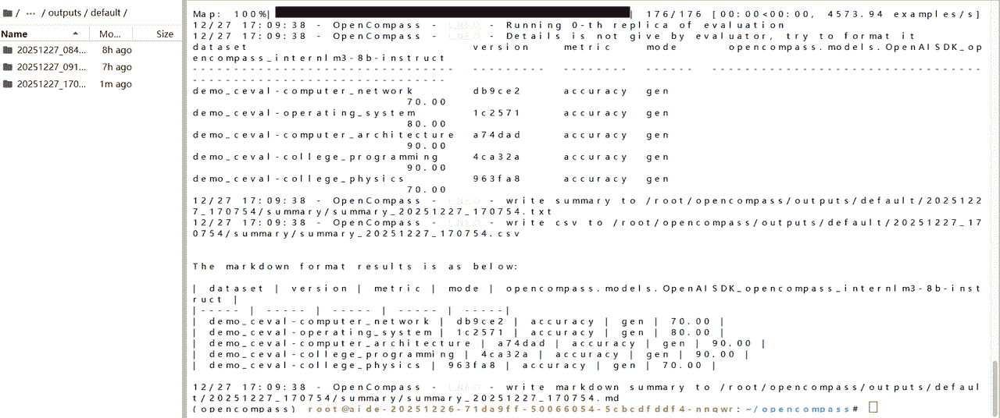

## 自建数据集评测

修改eval_tutorial_demo2.py中的模型设置，同样主要是path、key、openai_api_base三项。

```
from opencompass.models import OpenAISDK

# 配置模型
# models = [
#     dict(
#         type=OpenAISDK,
#         path=&#x27;intern-s1&#x27;,  # 明确模型名称
#         key=&#x27;xxx&#x27;,  # 你的API密钥
#         openai_api_base=&#x27;https://chat.intern-ai.org.cn/api/v1&#x27;,  # API地址
#         rpm_verbose=True,
#         query_per_second=1,  # 根据 rpm 限制,进行调整.rpm==30
#         max_out_len=512,
#         max_seq_len=4096,
#         temperature=0.01,
#         batch_size=8,# 根据 rpm 限制,进行调整.rpm==30
#         retry=5,  # 增加重试次数
#     )
# ]

models = [
    dict(
        type=OpenAISDK,
        path=&#x27;internlm3-8b-instruct&#x27;,  # 明确模型名称
        key=&#x27;123456&#x27;,  # 替换为自己的API密钥
        openai_api_base=&#x27;http://0.0.0.0:8000/v1&#x27;,  # API地址
        rpm_verbose=True,
        query_per_second=1,  # 根据 rpm 限制
        max_out_len=512,
        max_seq_len=4096,
        temperature=0.01,
        batch_size=10,# 根据 rpm 限制,进行调整
        retry=5,  # 增加重试次数
    )
]

# 配置数据集
datasets = [
    dict(
        path=&#x27;/root/opencompass/newformat_sft_test_data.csv&#x27;,
        data_type=&#x27;mcq&#x27;,
        infer_method=&#x27;gen&#x27;
    )
]
```

启动评测

```
conda activate opencompass
cd /root/opencompass
python run.py opencompass/configs/eval_tutorial_demo2.py --debug
```

评测结果

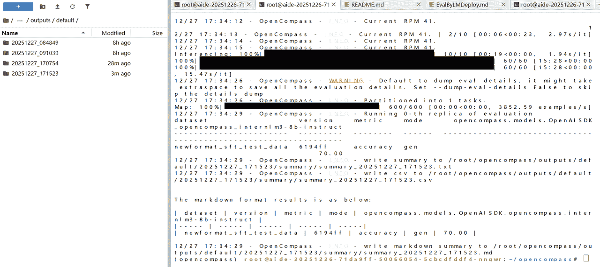

# InternVL3_5-1B评测

本节以MME数据集为例，对InternVL3_5-1B多模态模型进行评测，包括API模型评测和非API模型评测两种方式。首先采用API模型评测方案，利用LMDeploy本地部署InternVL3_5-1B模型API，再使用VLMEvalKit调用模型API进行评测。然后，通过修改VLMEvalKit中的internvl_chat.py实现非API模型评测。

## VLMEvalKit安装

VLMEvalKit是一个专为大型视觉语言模型评测设计的开源工具包。它支持在各种基准测试上对大型视觉语言模型进行一键评估，无需进行繁重的数据准备工作，使评估过程更加简便。VLMEvalKit适用于图文多模态模型的评测，支持单对图文输入或是任意数量的图文交错输入。它通过实现70多个基准测试，覆盖了多种任务，包括但不限于图像描述、视觉问答、图像字幕生成等。

使用VLMEvalKit进行评测需要先安装，具体步骤如下：

```
# 拉取源代码
cd /root/opencompass
git clone https://gh.llkk.cc/https://github.com/open-compass/VLMEvalKit.git

# 创建虚拟环境
conda create -n VLMEvalKit python=3.11 -y
conda activate VLMEvalKit

# 编译安装
cd VLMEvalKit
# 备份原文件
cp requirements.txt requirements.txt.bak
# 移除包含 decord 的行，暂时用不到该包，先去掉避免报错
sed -i &#x27;/decord/d&#x27; requirements.txt
# 安装依赖
pip install -r requirements.txt
# 编译安装
pip install -e .
# pip install datasets
```

## API模型评测方法

### lmdeploy部署InternVL3_5-1B

与上一节部署Internlm3-8b-instruct模式类似，在终端中运行以下命令：

```
conda activate lmdeploy
cd /root/lmdeploy
source /usr/local/Ascend/nnal/atb/set_env.sh
lmdeploy serve api_server /root/share/new_models/InternVL3.5/InternVL3_5-1B \
        --model-name InternVL3_5-1B \
        --backend pytorch \
        --device ascend
```

### 使用MME数据进行评测

新开一个终端，设置环境变量

```
cd /root/opencompass/VLMEvalKit
touch .env
```

.env文件中进行如下设置。

注意：

+   如果在4.2节中部署InternVL3_5-1B 时设置了api-key，则LMDEPLOY_API_KEY的值应与部署模型时的api-key一致，若未设置api-key，则LMDEPLOY_API_KEY可设为任意非空字符；

+   若4.2节指定了server-name和server-port，则相应修改LMDEPLOY_API_BASE的值。

```
LMDEPLOY_API_BASE=http://localhost:23333/v1/chat/completions
LMDEPLOY_API_KEY=&quot; &quot;
```

启动评测

```
cd /root/opencompass/VLMEvalKit
conda activate VLMEvalKit
python run.py --data MME --model lmdeploy --api-nproc 4  
```

注意，这里的--model应设置为VLMEvalKit/vlmeval/config.py中定义的api_models中LMDeployAPI类对应的模型，而不是lmdeploy部署命令中的--model-name参数值。如果设置为InternVL3_5-1B，由于config.py中的InternVL3_5-1B为非API模型，程序会自动从Huggingface下载模型，并采用本地GPU进行推理而不是调用lmdeploy部署的API。

评测过程如下：

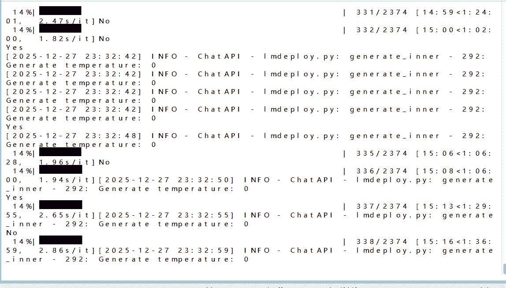

大约2个小时完成评测，结果文件默认放在 VLMEvalKit/outputs/lmdeploy目录中。

```
[2025-12-28 01:08:50] INFO - RUN - run.py: main - 469: The evaluation of model lmdeploy x dataset MME has finished! 
[2025-12-28 01:08:50] INFO - RUN - run.py: main - 470: Evaluation Results:
[2025-12-28 01:08:50] INFO - RUN - run.py: main - 476: 
---------------------  --------
perception             1369.34
reasoning               487.857
OCR                      80
artwork                 134.25
celebrity               131.471
code_reasoning          117.5
color                   130
commonsense_reasoning   117.857
count                   133.333
existence               195
landmark                143
numerical_calculation    82.5
position                133.333
posters                 130.952
scene                   158
text_translation        170
---------------------  --------
```

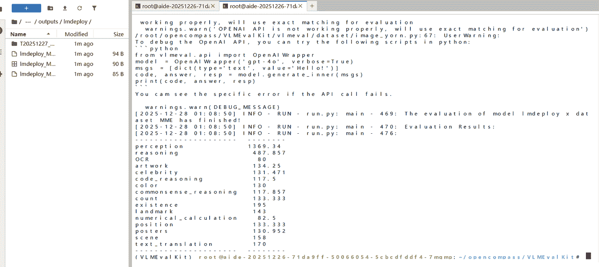

## 非API模型评测方法

### 安装torch_npu

步骤如下：

```
conda activate VLMEvalKit
pip uninstall torch torchvision torchaudio -y
pip install torch==2.6.0 torch-npu==2.6.0 torchaudio==2.6.0 torchvision decorator
pip install opencv-python==4.7.0.72
pip install pyyaml attrs psutil absl-py cloudpickle ml-dtypes scipy tornado numpy==1.26.4
source /usr/local/Ascend/ascend-toolkit/set_env.sh
source /usr/local/Ascend/nnal/atb/set_env.sh
```

测试是否安装成功

```
python -c &quot;import torch;import torch_npu; a = torch.ones(3, 4).npu(); print(a + a);&quot;
```

输出如下内容表明torch_npu安装成功

```
Warning: Warning: Device do not support double dtype now, dtype cast repalce with float. (function operator())
tensor([[2., 2., 2., 2.],
        [2., 2., 2., 2.],
        [2., 2., 2., 2.]], device=&#x27;npu:0&#x27;)
```

### 修改internvl_chat.py

VLMEvalKit默认采用GPU进行推理，没有适配 Ascend NPU，需要修改i**nternvl_chat.py文件，以支持通过NPU加载****本**地InternVL3_5-1B模型进行推理。该文件位于VLMEvalKit/vlmeval/vlm/internvl/internvl_chat.py。

主要修改其中InternVLChat类的init函数：

+   在该函数中的if use_lmdeploy:前增加如下代码

```
import torch_npu
if torch.npu.is_available():
        self.device = torch.device(&quot;npu:0&quot;)
        self.device_type = &quot;ascend&quot;
```

+   将if use_lmdeploy:部分修改为

```
if use_lmdeploy:
   from lmdeploy import TurbomindEngineConfig, PytorchEngineConfig, VisionConfig, pipeline
   engine_type = PytorchEngineConfig if &quot;internvl3_5&quot; in model_path.lower() else TurbomindEngineConfig
   vision_config = VisionConfig(max_batch_size=4)

   self.model = pipeline(
         model_path,
         vision_config=vision_config,
         backend_config=engine_type(
                 session_len=max(16384, kwargs.get(&quot;max_new_tokens&quot;, 16384)),
                  cache_max_entry_count=0.5,
                  tp=1, 
                  device_type=self.device_type,
         )
    )

else:
    self.model = AutoModel.from_pretrained(
          model_path,
          torch_dtype=torch.bfloat16,
          load_in_8bit=load_in_8bit,
          trust_remote_code=True,
          low_cpu_mem_usage=True,
    )
    self.model = self.model.to(self.device)
    self.model.eval()
```

### 模型评测

```
 cd /root/opencompass/VLMEvalKit
 conda activate VLMEvalKit
 python run.py --data MME --model InternVL3_5-1B --verbose
```

评测过程

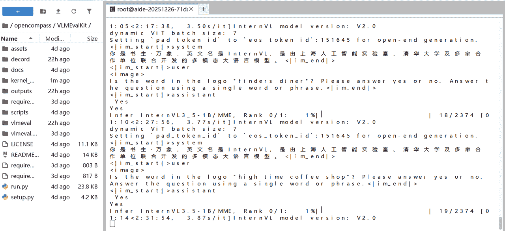

评测结果

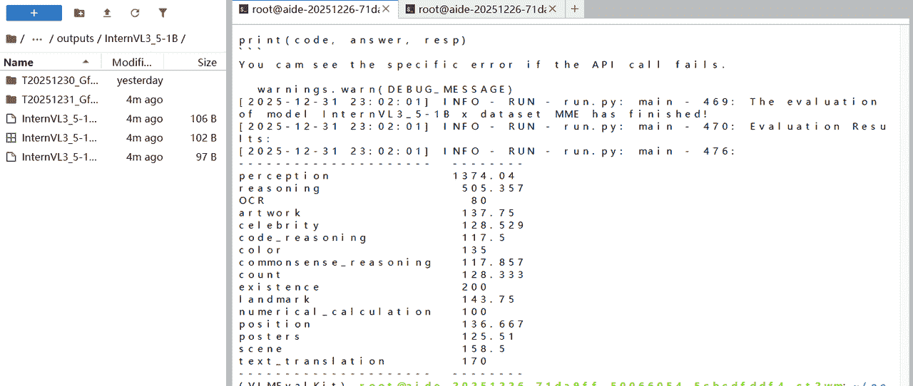

```
 [2025-12-31 23:02:01] INFO - RUN - run.py: main - 469: The evaluation of model InternVL3_5-1B x dataset MME has finished!
 [2025-12-31 23:02:01] INFO - RUN - run.py: main - 470: Evaluation Results:
 [2025-12-31 23:02:01] INFO - RUN - run.py: main - 476: 
 perception             1374.04
 reasoning               505.357
 OCR                      80
 artwork                 137.75
 celebrity               128.529
 code_reasoning          117.5
 color                   135
 commonsense_reasoning   117.857
 count                   128.333
 existence               200
 landmark                143.75
 numerical_calculation   100
 position                136.667
 posters                 125.51
 scene                   158.5
 text_translation        170
```

# 参考文档

[Ascend NPU LMDeploy 部署Intern-S1-mini](https://aicarrier.feishu.cn/wiki/DerLwIfgXiHlCDkt6v9cW9kxnmf)

L2 OpenCompass 评测书生大模型实践

安装 — OpenCompass 0.5.1 文档

https://github.com/open-compass/VLMEvalKit/blob/main/docs/zh-CN/Quickstart.md

https://github.com/open-compass/VLMEvalKit/blob/main/docs/zh-CN/EvalByLMDeploy.md