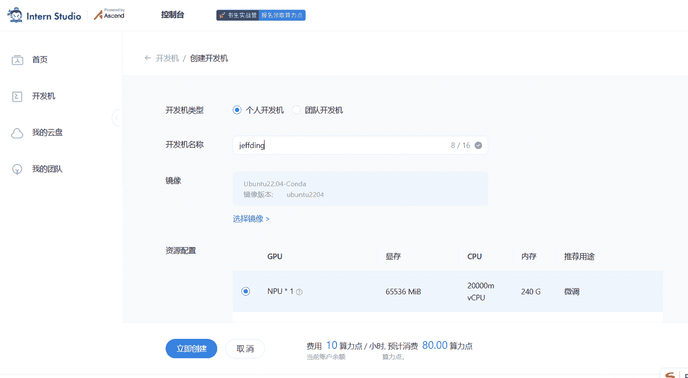
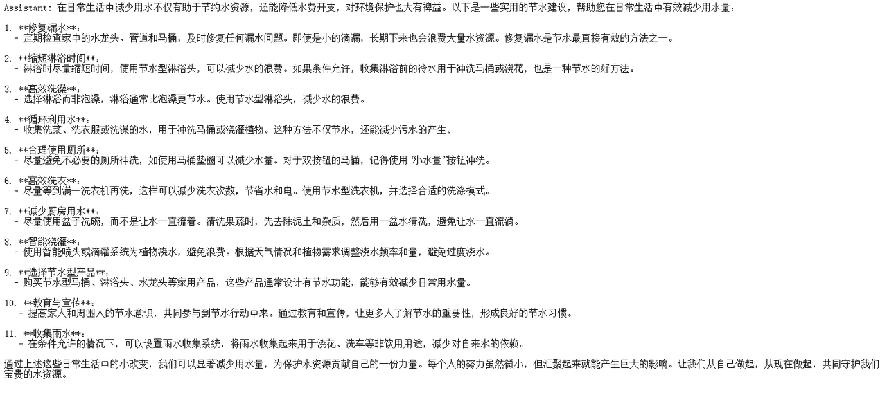

# Ascend NPU 下 LlamaFactory 训练书生大模型实践

> 来源：[https://aicarrier.feishu.cn/docx/BiaTdcO6tolU7lx9d8ocYg3xnPh](https://aicarrier.feishu.cn/docx/BiaTdcO6tolU7lx9d8ocYg3xnPh)

## 环境配置

算力券联系 领取！！！

### 创建算力开发机

平台地址：`https://internstudio-ascend.intern-ai.org.cn/`

【开发机】-【创建开发机】-【个人开发机】

参数如下：

开发机名称：任意

镜像：`Ubuntu22.04-Conda`

资源配置：1*NPU

点击【立即创建】



### 环境安装

安装必要的包：

```
cd /root/
conda create -y -n llamafactory_lab python=3.10
conda activate llamafactory_lab
git clone https://gh.llkk.cc/https://github.com/hiyouga/LLaMA-Factory.git
cd LLaMA-Factory
git checkout v0.9.3
pip install -e &quot;.[torch-npu,metrics]&quot; -i https://pypi.tuna.tsinghua.edu.cn/simple
pip install torch==2.6.0 torch-npu==2.6.0 torchvision
```

### 安装校验

使用以下指令对 `LLaMA-Factory` × 昇腾的安装进行校验：

```
llamafactory-cli env
```

显示结果

```
- `llamafactory` version: 0.9.3
- Platform: Linux-5.15.0-25-generic-aarch64-with-glibc2.39
- Python version: 3.10.19
- PyTorch version: 2.5.1 (NPU)
- Transformers version: 4.52.1
- Datasets version: 3.6.0
- Accelerate version: 1.7.0
- PEFT version: 0.15.2
- TRL version: 0.9.6
- NPU type: Ascend910B2
- CANN version: 8.2.RC2
- Default data directory: detected
```

## InternLM3-8B推理

### 安装依赖

```
pip install transformers==4.47.1
```

### 通过环境变量设置单卡 NPU

```
export ASCEND_RT_VISIBLE_DEVICES=0
```

### 启动推理

```
llamafactory-cli chat --model_name_or_path /share/new_models/internlm3/internlm3-8b-instruct --trust_remote_code True
```

### 输出结果



PS：输出后会不断地输出空白行，目前还没找到发生了什么，但是他会有结束的时候的，稍微等等就好。输入`exit`就可以退出会话了

## InternLM3-8B微调

### 安装依赖

```
pip install transformers==4.47.1
pip install huggingface_hub==0.34.0
```

### 创建工作目录

```
mkdir /root/llamafactory_workdir
```

### 数据集下载

```
export HF_ENDPOINT=https://hf-mirror.com
huggingface-cli download --repo-type dataset --resume-download llamafactory/alpaca_en --local-dir /root/dataset/alpaca_en
huggingface-cli download --repo-type dataset --resume-download llamafactory/alpaca_zh --local-dir /root/dataset/alpaca_zh
```

### 创建`dataset_info.json`文件

创建`dataset_info.json`文件

```
mkdir /root/llamafactory_workdir/data
cd /root/llamafactory_workdir/data
touch dataset_info.json
```

`dataset_info.json`文件内容如下：

```
{
    &quot;alpaca_en&quot;:{
        &quot;file_name&quot;: &quot;/root/dataset/alpaca_en/alpaca_data_en_52k.json&quot;,
        &quot;columns&quot;: {
            &quot;prompt&quot;: &quot;instruction&quot;,
            &quot;query&quot;: &quot;input&quot;,
            &quot;response&quot;: &quot;output&quot;
        }
    },
    &quot;alpaca_zh&quot;:{
        &quot;file_name&quot;: &quot;/root/dataset/alpaca_zh/alpaca_data_zh_51k.json&quot;,
        &quot;columns&quot;: {
            "prompt": "instruction",
            "query": "input",
            "response": "output"
        }
    }
}
```

### Yaml配置文件

创建`internlm3_lora_sft_ds.yaml`文件

```
cd /root/llamafactory_workdir
touch internlm3_lora_sft_ds.yaml
```

`internlm3_lora_sft_ds.yaml`文件内容如下

```
### model
model_name_or_path: /share/new_models/internlm3/internlm3-8b-instruct
trust_remote_code: True

### method
stage: sft
do_train: true
finetuning_type: lora
lora_target: q_proj,v_proj

### dataset
dataset: alpaca_en,alpaca_zh
template: intern2
cutoff_len: 1024
max_samples: 1000
overwrite_cache: true
preprocessing_num_workers: 16

### output
output_dir: saves/internlm3-8b-instruct/lora/sft
logging_steps: 10
save_steps: 500
plot_loss: true
overwrite_output_dir: true

### train
per_device_train_batch_size: 1
gradient_accumulation_steps: 2
learning_rate: 0.0001
num_train_epochs: 3.0
lr_scheduler_type: cosine
warmup_ratio: 0.1
fp16: true

### eval
val_size: 0.1
per_device_eval_batch_size: 1
eval_strategy: steps
eval_steps: 500
```

### 开启微调

```
torchrun --nproc_per_node 1 \
    --nnodes 1 \
    --node_rank 0 \
    --master_addr 127.0.0.1 \
    --master_port 7007 \
    /root/LLaMA-Factory/src/train.py internlm3_lora_sft_ds.yaml
```

### 动态合并 LoRA 的推理

```
cd /root/llamafactory_workdir
llamafactory-cli chat --model_name_or_path /share/new_models/internlm3/internlm3-8b-instruct \
            --adapter_name_or_path saves/internlm3-8b-instruct/lora/sft \
            --template intern \
            --finetuning_type lora \
            --trust_remote_code True
```

### 输出结果


从推理结果看和源模型的输出有所区别了，那就说明微调完成了，至于输出结果不太行，那和微调的参数有关，有兴趣的话可以不断调参尝试

### 模型合并导出

LoRA 模型合并和导出时，可通过指定 `export_device` 参数为 `auto` 来自动检测当前加速卡环境， 启用 NPU 作为导出设备：

```
ASCEND_RT_VISIBLE_DEVICES=0
llamafactory-cli export \
            --model_name_or_path /share/new_models/internlm3/internlm3-8b-instruct \
            --adapter_name_or_path saves/internlm3-8b-instruct/lora/sft  \
            --template intern2 \
            --finetuning_type lora \
            --export_dir saves/internlm3-8b-instruct/lora/megred-model-path \
            --export_device auto \
            --export_legacy_format False \
            --trust_remote_code True
```

## Intern-VL3.5-1B微调

### 数据集下载

```
modelscope download --dataset JimmyMa99/VLM-formula-recognition-dataset_intern_camp --local_dir  /root/dataset/VLM-formula-recognition-dataset_intern_camp
```

### 数据集转换

数据集的`json`文件需要转化处理下，将图片路径变成绝对路径，创建转换脚本`convert.py`

创建数据集转换文件`convert.py`

```
mkdir /root/llamafactory_workdir/  #如果上一个例子已经转换过可以跳过这一步
cd /root/llamafactory_workdir/
vim convert.py
```

`convert.py`脚本内容：


## 数据预处理

```python
import json
import os

def to_abs(base_path, path):
    if not path or os.path.isabs(path):
        return path
    abs_path = os.path.join(base_path, path)
    if not os.path.exists(abs_path):
        raise FileNotFoundError(f"图像文件不存在: {abs_path}")
    return abs_path

def process_jsonl(input_path, output_path, base_dir):
    processed_lines = 0
    modified_lines = 0

    with open(input_path, 'r', encoding='utf-8') as infile, \
         open(output_path, 'w', encoding='utf-8') as outfile:

        for line in infile:
            if not line.strip():
                continue

            data = json.loads(line)
            changed = False

            # 处理顶层 images 列表
            if 'images' in data and isinstance(data['images'], list):
                data['images'] = [to_abs(base_dir, img) for img in data['images']]
                changed = True

            # 处理 messages 中的 content
            if 'messages' in data:
                for msg in data['messages']:
                    # 转换 role -> from
                    if 'role' in msg:
                        role = msg.pop('role')
                        msg['from'] = 'human' if role == 'user' else 'gpt'
                    
                    # 转换 content -> value，并确保保留 <image> 标签
                    if 'content' in msg:
                        content = msg.pop('content')
                        # 如果 content 是字符串且包含 <image>，保留标签
                        if isinstance(content, str) and '<image>' in content:
                            msg['value'] = content  # 直接保留原始字符串
                        else:
                            msg['value'] = content  # 其他情况直接赋值
                        changed = True

            # 写入数据
            outfile.write(json.dumps(data, ensure_ascii=False) + '\n')
            processed_lines += 1
            if changed:
                modified_lines += 1

    print(f"处理完成：总行数={processed_lines}，修改行数={modified_lines}，输出路径：{output_path}")

# 配置路径
INPUT_PATH = "/root/dataset/VLM-formula-recognition-dataset_intern_camp/train/train_mini.jsonl"
OUTPUT_PATH = "/root/dataset/VLM-formula-recognition-dataset_intern_camp/train/train_mini_lf.jsonl"
BASE_DIR = "/root/dataset/VLM-formula-recognition-dataset_intern_camp/train/"

# 执行处理
process_jsonl(INPUT_PATH, OUTPUT_PATH, BASE_DIR)
```

### 执行

```bash
python convert.py
```

## 创建 dataset_info.json 文件

创建 `dataset_info.json` 文件

```bash
mkdir /root/llamafactory_workdir/data # 如果上一个例子已经转换过可以跳过这一步
cd /root/llamafactory_workdir/data
touch dataset_info.json
```

`dataset_info.json` 文件内容如下：

```json
{
    "VLM-formula-recognition": {
        "file_name": "/root/dataset/VLM-formula-recognition-dataset_intern_camp/train/train_mini_lf.jsonl",
        "formatting": "sharegpt",
        "columns": {
            "messages": "messages",
            "images": "images"
        }
    }
}
```

## Yaml 配置文件

创建 `internvl3_5_1B_lora_sft_ds.yaml` 文件

```bash
mkdir /root/llamafactory_workdir
cd /root/llamafactory_workdir
touch internvl3_5_1B_lora_sft_ds.yaml
```

`internvl3_5_1B_lora_sft_ds.yaml` 文件内容如下

```yaml
### model
model_name_or_path: /share/new_models/InternVL3.5/InternVL3_5-1B-HF
image_max_pixels: 262144
video_max_pixels: 16384
trust_remote_code: true

### method
stage: sft
do_train: true
finetuning_type: lora
lora_rank: 8
lora_target: all

### dataset
dataset: VLM-formula-recognition  # video: mllm_video_demo
template: intern_vl
cutoff_len: 2048
max_samples: 8000
overwrite_cache: true
preprocessing_num_workers: 1
dataloader_num_workers: 4

### output
output_dir: saves/InternVL3_5-1B/lora/sft
logging_steps: 10
save_steps: 2000
plot_loss: true
overwrite_output_dir: true
save_only_model: false
report_to: none  # choices: [none, wandb, tensorboard, swanlab, mlflow]

### train
per_device_train_batch_size: 1
gradient_accumulation_steps: 8
learning_rate: 1.0e-6
num_train_epochs: 3.0
lr_scheduler_type: cosine
warmup_ratio: 0.1
bf16: true
ddp_timeout: 180000000
resume_from_checkpoint: null

### eval
val_size: 0.1
per_device_eval_batch_size: 1
eval_strategy: steps
eval_steps: 2000
```

## 安装依赖

```bash
pip install transformers==4.52.1
```

## 开启微调

```bash
torchrun --nproc_per_node 1 \
    --nnodes 1 \
    --node_rank 0 \
    --master_addr 127.0.0.1 \
    --master_port 7007 \
    /root/LLaMA-Factory/src/train.py internvl3_5_1B_lora_sft_ds.yaml
```

## 模型合并导出

LoRA 模型合并和导出时，可通过指定 `export_device` 参数为 `auto` 来自动检测当前加速卡环境，启用 NPU 作为导出设备：

```bash
ASCEND_RT_VISIBLE_DEVICES=0 
llamafactory-cli export \
            --model_name_or_path /share/new_models/InternVL3.5/InternVL3_5-1B-HF \
            --adapter_name_or_path saves/InternVL3_5-1B/lora/sft  \
            --template intern_vl \
            --finetuning_type lora \
            --export_dir saves/InternVL3_5-1B/lora/megred-model-path \
            --export_device auto \
            --export_legacy_format False \
            --trust_remote_code True
```

# 参考文档

https://ascend.github.io/docs/index.html

https://ascend.github.io/docs/sources/llamafactory/index.html
