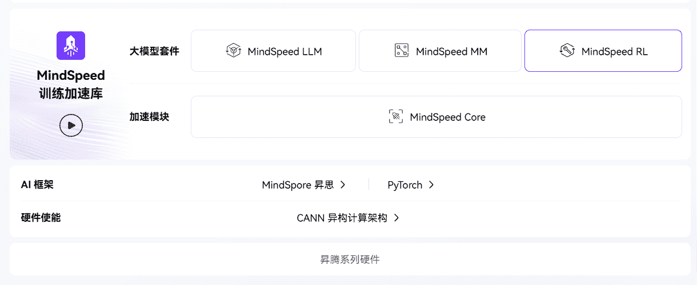
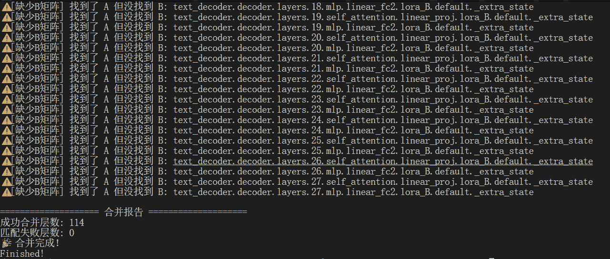
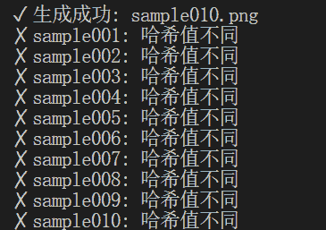
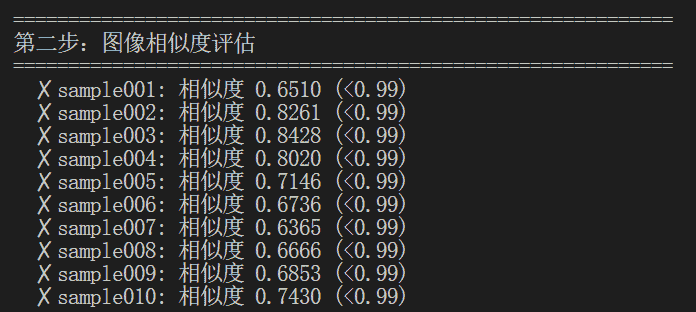
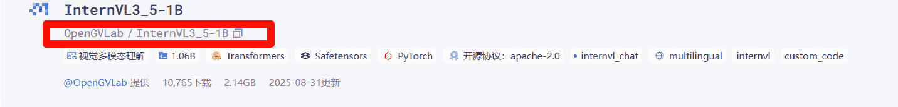
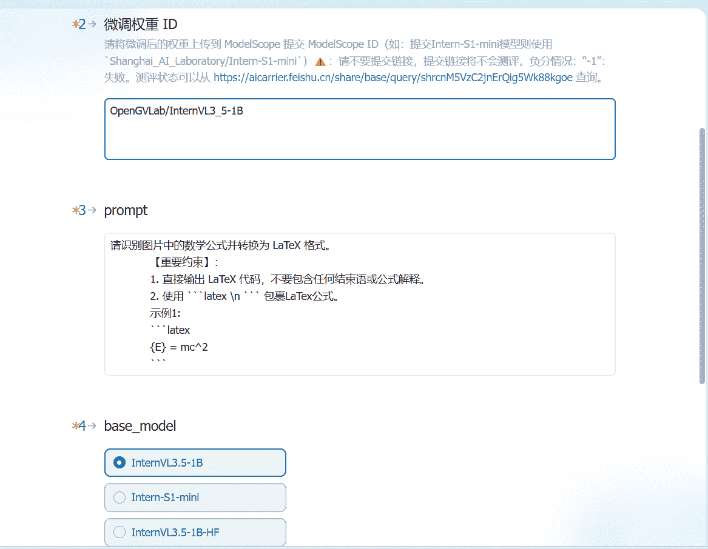

# Ascend NPU 下 MindSpore +MindSpeed-MM微调InternVL3.5

> 来源：[https://aicarrier.feishu.cn/docx/LNDXdfXxco6mOax303jcY6denSh](https://aicarrier.feishu.cn/docx/LNDXdfXxco6mOax303jcY6denSh)

# 常用链接：

比赛项目地址：https://github.com/JimmyMa99/VLM-formula-recognition-dataset?tab=readme-ov-file

比赛报名链接：https://colearn.intern-ai.org.cn/set?s=gamef

比赛权重提交地址：https://aicarrier.feishu.cn/share/base/form/shrcnXjK6zERK7z4pPU85PLO80c

服务器平台：https://internstudio-ascend.intern-ai.org.cn/console/instance

权重评测结果查询地址：https://aicarrier.feishu.cn/share/base/query/shrcnM5VzC2jnErQig5Wk88kgoe

练习赛排行榜：https://aicarrier.feishu.cn/share/base/dashboard/shrcnrA82hMMRd1FUuWs8EhOjag

# 背景介绍

本项目基于 MindSpore + MindSpeed-MM 框架在华为 NPU 服务器上对 Internvl3.5-1B 模型进行微调训练。然后对微调训练好的模型进行公式识别训练赛线下验证和线上提交测评。从软件应用层到硬件层华为大模型（深度学习）分别经过 MindSpeed（包含MindSpeed-LLM、MindSpeed-MM、MindSpeed-RL）、MindSpore、CANN 三大模块，架构如下图所示：



## MindSpore

**  **MindSpore（昇思） 是由 华为 开源的一个全场景深度学习框架。简单来说，可以把它理解为 “华为版的 PyTorch 或 TensorFlow”。

在人工智能的生态系统中，它的地位如下：

+   PyTor**ch/TensorF**low 是基于 NVIDIA GPU 生态的主流框架。

+   **MindSpore** 是基于 华为 Ascend（昇腾）NPU 生态的核心框架。

## MindSpeed

**      MindSpeed** 是华为针对 **升腾 (Ascend) NPU** 硬件推出的、基于 **PyTorch** 的大模型训练与推理加速库。可以简单地把它理解为：“华为版的 Megatron-LM + DeepSpeed”。

在华为昇腾生态中，目前有两种跑大模型的主要方式：

+   **路**线 A（原生派）：MindSpore + MindFormers（类似于Hugginface 的 Transformers库）

+   使用华为自研的 AI 框架（MindSpore）。

+   **优点**：性能最高，底层优化最好。

+   **缺点**：你需要把代码从 PyTorch 重写成 MindSpore，迁移成本高。

+   路线 B（兼容派）：PyTorch-Npu + MindSpeed

+   **优点**：**生态兼容性好**。绝大多数开源模型（如 LLaMA, Qwen, InternVL）都是用 PyTorch 写好的，使用 MindSpeed 可以几乎不动代码就在华为 NPU 上跑起来。

+   **MindSpeed 的作用**：它在这个路线中负责提供**分布式训练**（如模型并行、流水线并行）和**算子优化**（如 Flash Attention），解决“原生 PyTorch 在 NPU 上跑不快或跑不起来”的问题。

## MIndSpeed-MM

**   MindSp****eed-MM 是 MindSpeed 套件的一个子集或**分支，专门用于支持 多模态大模型（Multimodal Large Language Models, MLLMs） 在华为昇腾（Ascend）NPU 上的训练和推理。

在华为的 PyTorch 生态栈中，它的位置如下：

+   **底层**：Ascend 910B 硬件 + CANN 驱动

+   **框架**：PyTorch-Npu / MindSpore

+   **核心加速库**：MindSpeed (提供基础的算子优化、通信优化、Megatron 分布式能力)

+   **多模态层**：**MindSpeed-MM** (在 MindSpeed 基础上，增加了对 Vision Encoder、Projector 等多模态组件的支持)

+   **应用层**：**InternVL** / LLaVA / Qwen-VL 等模型

# 环境配置

## 首先创建 conda 环境

```
conda create -n test python=3.10 -y
conda activate test
```

## 搭建 MindSpeed-MM 环境

**source aut****o_convert.**sh mm 这一步会把你的整个MindSpeed-Core-MS目录进行格式化！！！

如果想重新配置 MindSpeed-MM 先把 MindSpeed-Core-MS 中的 MindSpeed-MM 和 MindSpeed 文件夹备份好。source auto_convert.sh mm后再拷贝进去。这样不需要再按照步骤配置 hf_mm 的转换环境和微调环境，直接就可以进行微调。

```
cd ~
git clone https://gitcode.com/Ascend/MindSpeed-Core-MS.git -b r0.4.0
cd MindSpeed-Core-MS
pip install -r requirements.txt
source auto_convert.sh mm

cd MindSpeed-MM
cp examples/mindspore/qwen2vl/dot_product_attention.py ../MindSpeed/mindspeed/core/transformer/dot_product_attention.py
mkdir ckpt
mkdir data
mkdir logs
mkdir outputs
mkdir outputs-merged
```

简介：

+   /root/MindSpeed-Core-MS/MindSpeed-MM目录：是我们主要的工作目录，大部分微调、合并权重、权重转换指令都在这个目录下进行。

+   ckpt目录：是我们存放模型权重的地方，建议大家在此目录下再新建一个 mm_path 目录和 hf_path 目录，分别存放不同的权重。

+   data目录：这里是存放训练数据的地方。

+   logs目录：存放训练日志的地方。

+   outputs目录：存放微调成功后保存的MM权重。

+   outputs-merged目录：后续存放我们将lora权重合并后的MM权重。

### 配置环境变量。

在 /root/MindSpeed-Core-MS/MindSpeed-MM 环境下创建一个 env.sh 文件。每次进入工**作目录的时候****都可以用 source e****nv.sh 便携的添加环****境变量，卸载****环境变量使用 uset PYT**HONPATH。但是有可能 source env.sh 不会生效，只需要进入 env.sh 复制到终端里运行一下就行了。

需要配置环境变量的原因在于 MindSpeed-MM 很多代码是对于 Pytorch 进行了适配的。代码安装环境里会安装 torch，但是仓库中的 MSAdapter 会把 torch 的代码包装成适合 MindSpore 的代码。这就导致了如果没有配置环境变量，代码找不到 MSAdapter位置，就会把 torch 拿来使用，但是 torch 跟被包装的 MSAdapter 不一样就会报错。

同理，当使用 torch 的代码时，如果不 uset PYTHONPATH 就会 使用 MSAdapter 替代 torch，从而报错。

```
# env.sh 内容
export WORKSPACE_DIR=&quot;/root/MindSpeed-Core-MS&quot;
export PYTHONPATH=${WORKSPACE_DIR}/MindSpeed-MM:${WORKSPACE_DIR}/MSAdapter:${WORKSPACE_DIR}/MSAdapter/msa_thirdparty:${WORKSPACE_DIR}/MindSpeed:${WORKSPACE_DIR}/Megatron-LM:$PYTHONPATH
source /usr/local/Ascend/ascend-toolkit/set_env.sh
export ATB_HOME_PATH=/usr/local/Ascend/nnal/atb/8.2.RC2/atb/cxx_abi_1
# 2. 将 ATB 的库文件加入动态链接库路径
export LD_LIBRARY_PATH=$ATB_HOME_PATH/lib:$LD_LIBRARY_PATH
echo &quot;PYTHONPATH set to: $PYTHONPATH&quot;

```

## 安装mindspore

```
pip install mindspore==2.7.1 -i https://repo.mindspore.cn/pypi/simple --trusted-host repo.mindspore.cn --extra-index-url https://repo.huaweicloud.com/repository/pypi/simple
```

### 安装相关依赖（2.2基本上安装好了，没有提示缺库什么的就不用运行）

```
pip install decorator jinja2 attrs absl-py cloudpickle ml-dtypes tornado
```

# 微调流程

## 数据下载

```
cd /root/MindSpeed-Core-MS/MindSpeed-MM/data
modelscope download --dataset JimmyMa99/VLM-formula-recognition-dataset_intern_camp --local_dir ./VLM-formula-recognition-dataset_intern_camp
```

## 数据格式转换

需要把原来的数据模板转换为gpt格式。在数据集目录 VLM-formula-recognition-dataset_intern_camp下面新建一个 python 文件 convert_data.py ，填入以下内容并运convert_data.py。

```
import json
import os
import argparse

def convert_line(data):
    &quot;&quot;&quot;
    将单行 Swift 格式数据转换为 MindSpeed-MM InternVL 格式
    &quot;&quot;&quot;
    new_data = {}

    # 1. 提取图片路径
    # Swift 格式通常是 &quot;images&quot;: [&quot;/path/to/img.png&quot;]
    if &quot;images&quot; in data and isinstance(data[&quot;images&quot;], list) and len(data[&quot;images&quot;]) &gt; 0:
        new_data[&quot;image&quot;] = data[&quot;images&quot;][0]
    elif &quot;image&quot; in data:
        # 如果已经是 image 字段，直接保留
        new_data[&quot;image&quot;] = data[&quot;image&quot;]
    else:
        # 如果没有图片，可能不是多模态数据，跳过或保留
        return None

    # 2. 转换对话格式
    if &quot;messages&quot; in data:
        source_msgs = data[&quot;messages&quot;]
    elif &quot;conversations&quot; in data:
        source_msgs = data[&quot;conversations&quot;]
    else:
        return None

    new_conversations = []
    
    for i, msg in enumerate(source_msgs):
        # 获取角色和内容 (兼容 role/from 和 content/value)
        role = msg.get(&quot;role&quot;) or msg.get(&quot;from&quot;)
        content = msg.get(&quot;content&quot;) or msg.get(&quot;value&quot;)
        
        # 映射角色名
        if role in [&quot;user&quot;, &quot;human&quot;]:
            new_role = &quot;human&quot;
        elif role in [&quot;assistant&quot;, &quot;gpt&quot;]:
            new_role = &quot;gpt&quot;
        else:
            new_role = role  # system 等其他角色保持不变

        # 处理 User 的 &lt;image&gt; 占位符
        new_content = content
        if new_role == &quot;hunman&quot;:
            # 检查是否是第一条 User 消息（通常图片跟第一句话）
            # 或者当前内容里包含 &lt;image&gt;
            if &quot;&lt;image&gt;&quot; in content:
                # 强制替换为带换行的格式，并防止重复换行
                new_content = content.replace(&quot;&lt;image&gt;&quot;, &quot;&lt;image&gt;\n&quot;).replace(&quot;&lt;image&gt;\n\n&quot;, &quot;&lt;image&gt;\n&quot;)
            else:
                # 如果是第一条消息且原文本里没写 &lt;image&gt;，强制加在最前面
                if i == 0: 
                    new_content = &quot;&lt;image&gt;\n&quot; + content
        
        new_conversations.append({
            &quot;from&quot;: new_role,
            &quot;value&quot;: new_content
        })

    new_data[&quot;conversations&quot;] = new_conversations
    return new_data

def main():
    parser = argparse.ArgumentParser(description=&quot;Convert Swift format to MindSpeed-MM format&quot;)
    parser.add_argument(&quot;--input&quot;, type=str, required=True, help=&quot;Input JSONL file path&quot;)
    parser.add_argument(&quot;--output&quot;, type=str, required=True, help=&quot;Output JSONL file path&quot;)
    args = parser.parse_args()

    print(f&quot;正在转换数据: {args.input} -&gt; {args.output}&quot;)
    
    count = 0
    with open(args.input, &#x27;r&#x27;, encoding=&#x27;utf-8&#x27;) as f_in, \
         open(args.output, &#x27;w&#x27;, encoding=&#x27;utf-8&#x27;) as f_out:
        
        for line in f_in:
            if not line.strip():
                continue
            try:
                data = json.loads(line)
                converted_data = convert_line(data)
                
                if converted_data:
                    f_out.write(json.dumps(converted_data, ensure_ascii=False) + &quot;\n&quot;)
                    count += 1
            except json.JSONDecodeError:
                print(f&quot;跳过无效的 JSON 行: {line[:50]}...&quot;)
                continue

    print(f&quot;转换完成！共处理 {count} 条数据。&quot;)

if __name__ == &quot;__main__&quot;:
    main()
```

运行使用

```
cd /root/MindSpeed-Core-MS/MindSpeed-MM/data/VLM-formula-recognition-dataset_intern_camp/
python convert_data.py --input train_mini.jsonl  --output train_mindspeed.jsonl
```

调整后的数据长这样：

```
{&quot;image&quot;: &quot;mini_train/sample09567.png&quot;, &quot;conversations&quot;: [{&quot;from&quot;: &quot;human&quot;, &quot;value&quot;: &quot;&lt;image&gt;请根据图片中的公式生成对应的 latex 公式文本&quot;}, {&quot;from&quot;: &quot;gpt&quot;, &quot;value&quot;: &quot;\\int_{-\\infty}^{\\infty} \\sum_{i=1}^{100} \\frac{\\sin(x^2 + \\theta_i)}{x^2 + \\theta_i} dx = \\pi \\sum_{i=1}^{100} e^{-2\\pi^2 \\theta_i^2}&quot;}]}
```

## HF 权重转换为 MM 权重

MindSpeed-MM 需要使用 MM 格式的模型权重来进行训练，因为修改了某些模型参数的名字，所以可能和 HuggingFace 模型的参数名字不一样，需要进行一次参数名称转换。 MindSpeed-MM 有自己设计的权重转换工具。但是目前不支持 Internvl3.5 的权重转换。因此需要自定义修改一下。

### 添加映射逻辑

修改 /root/MindSpeed-Core-MS/MindSpeed-MM/checkpoint/vlm_model/converters/internvl.py

在 create_intern_vl_ops() 里，增加一个  'Qwen3ForCausalLM'逻辑分支，因为 Internvl3.5-1B的 HF 配置文件中的文本架构是 Qwen3ForCausalLM：

```

    elif llm_arch == &#x27;Qwen3ForCausalLM&#x27;:
        rename_op += (
            (r&#x27;language_model.lm_head&#x27;, r&#x27;text_decoder.output_layer&#x27;),
            (r&#x27;language_model.model.embed_tokens&#x27;, r&#x27;text_decoder.embedding.word_embeddings&#x27;),
            (r&#x27;language_model.model.norm&#x27;, r&#x27;text_decoder.decoder.final_layernorm&#x27;),
            (r&#x27;language_model.model.layers.(.*).self_attn.q_proj&#x27;,
             r&#x27;text_decoder.decoder.layers.(.*).self_attention.linear_q&#x27;),
            (r&#x27;language_model.model.layers.(.*).self_attn.k_proj&#x27;,
             r&#x27;text_decoder.decoder.layers.(.*).self_attention.linear_k&#x27;),
            (r&#x27;language_model.model.layers.(.*).self_attn.v_proj&#x27;,
             r&#x27;text_decoder.decoder.layers.(.*).self_attention.linear_v&#x27;),
            (r&#x27;language_model.model.layers.(.*).self_attn.o_proj&#x27;,
             r&#x27;text_decoder.decoder.layers.(.*).self_attention.linear_proj&#x27;),

            (r&#x27;language_model.model.layers.(.*).self_attn.q_norm&#x27;, 
             r&#x27;text_decoder.decoder.layers.(.*).self_attention.q_layernorm&#x27;),
            (r&#x27;language_model.model.layers.(.*).self_attn.k_norm&#x27;, 
             r&#x27;text_decoder.decoder.layers.(.*).self_attention.k_layernorm&#x27;),

            (r&#x27;language_model.model.layers.(.*).post_attention_layernorm&#x27;,
             r&#x27;text_decoder.decoder.layers.(.*).pre_mlp_layernorm&#x27;),
            (r&#x27;language_model.model.layers.(.*).gate_proj&#x27;,
             r&#x27;text_decoder.decoder.layers.(.*).linear_fc1_gate&#x27;),
            (r&#x27;language_model.model.layers.(.*).up_proj&#x27;,
             r&#x27;text_decoder.decoder.layers.(.*).linear_fc1_up&#x27;),
            (r&#x27;language_model.model.layers.(.*).down_proj&#x27;,
             r&#x27;text_decoder.decoder.layers.(.*).linear_fc2&#x27;),
            (r&#x27;language_model.model.layers&#x27;, r&#x27;text_decoder.decoder.layers&#x27;),
        )
```

在下方的  qkv_merge_ops = [] 后     ops = [ .... 前也要加入一个逻辑分支：

```
    elif llm_arch == &#x27;Qwen3ForCausalLM&#x27;:
        # Qwen3 通常也需要把 q/k/v 合并成 Megatron 的 linear_qkv
        qkv_merge_ops = [QKVMergeOp(
                            raw_names=(r&quot;text_decoder.decoder.layers.(\d+).self_attention.linear_q.weight&quot;,
                                    r&quot;text_decoder.decoder.layers.(\d+).self_attention.linear_k.weight&quot;,
                                    r&quot;text_decoder.decoder.layers.(\d+).self_attention.linear_v.weight&quot;),
                            new_name=r&quot;text_decoder.decoder.layers.(\d+).self_attention.linear_qkv.weight&quot;,
                            group=llm_num_query_groups,
                            q_size=llm_q_size,
                            k_size=llm_kv_size,
                            v_size=llm_kv_size,
                        )]
```

### 修改head_dim获取逻辑

因为 Internvl3.5 的 head_dim 不是 hidden(1024) / n_heads(16)的 64 而是 128 ，因此需要从配置文件获取，不能通过原始脚本中的函数自动计算得到。

修改 /root/MindSpeed-Core-MS/MindSpeed-MM/checkpoint/vlm_model/converters/internvl.py

将  _create_opts() 修改为如下：

```
def _create_ops(config: Any) -&gt; List[Operator]:
        # 基本参数
        hidden = config.llm_config.hidden_size
        n_heads = config.llm_config.num_attention_heads
        n_kv = config.llm_config.num_key_value_heads
        
        # =========== 【优化点 1】 ===========
        # 优先直接读取 head_dim，因为在 InternVL3.5 (Qwen3) 中，
        # head_dim (128) 不等于 hidden // n_heads (64)。
        # 这样写既兼容标准模型，也兼容这种特殊模型。
        if hasattr(config.llm_config, &#x27;head_dim&#x27;):
            head_dim = config.llm_config.head_dim
        else:
            head_dim = hidden // n_heads
        # ==================================

        llm_arch = config.llm_config.architectures[0]
        
        # Q 的总维度 (例如 16 * 128 = 2048)
        q_total = n_heads * head_dim
        
        # KV 的总维度 (例如 8 * 128 = 1024)
        kv_total = n_kv * head_dim

        # GQA 分组数量通常等于 KV 头数
        llm_num_query_groups = n_kv
        
        # 计算每个 Group 需要切分的 Q 和 KV 大小
        # q_size = 2048 // 8 = 256
        llm_q_size = q_total // llm_num_query_groups
        # kv_size = 1024 // 8 = 128
        llm_kv_size = kv_total // llm_num_query_groups
        # ===================================================

        ops = create_intern_vl_ops(llm_arch, llm_num_query_groups, llm_q_size, llm_kv_size)
        return ops
```

### 修改 HF 模型导入逻辑

在进行 mm_to_hf 的时候还会有一个问题，工具会默认 HF 目录下存在模型切片索引 index.json 文件，但是小模型一般都不会进行切片，因此没有 index.json。所以在把 MM 格式模型转换为 HF 格式模型时就会切分失败。

找到 /root/MindSpeed-Core-MS/MindSpeed-MM/checkpoint/vlm_model/mm_to_hf.py

修改 split_by_index_json()

```
def split_by_index_json(state_dict: STATE_DICT_T, hf_dir: Path) -&gt; List[STATE_DICT_T]:
    &quot;&quot;&quot;
    根据 index.json 将完整的 state_dict 拆分为多个分片。
    如果不存在 index.json，则假设是单文件模型，不进行拆分。
    &quot;&quot;&quot;
    # 1. 尝试查找 .safetensors 的索引文件
    index_json_path = hf_dir.joinpath(&#x27;model.safetensors.index.json&#x27;)
    # 兼容性：如果找不到 safetensors index，尝试找 pytorch_model.bin.index.json
    if not index_json_path.exists():
        index_json_path = hf_dir.joinpath(&#x27;pytorch_model.bin.index.json&#x27;)
    
    # 如果找不到索引文件，不要报错，而是检查是否存在单文件权重
    if not index_json_path.exists():
        # 检查是否是单文件模型
        single_safetensor = hf_dir.joinpath(&#x27;model.safetensors&#x27;)
        single_bin = hf_dir.joinpath(&#x27;pytorch_model.bin&#x27;)
        
        if single_safetensor.exists() or single_bin.exists():
            print(f&quot;[INFO] No index file found, assuming single-file model in {hf_dir}. Returning full state_dict.&quot;)
            # 对于单文件模型，直接返回包含完整字典的列表 (相当于 index=1 的情况)
            return [state_dict]
        else:
            # 如果既没索引也没权重文件，那才是真的错了
            raise ValueError(f&quot;Neither index file nor weight file found in {hf_dir}&quot;)
    # ==================================

    return_dicts = []
    # 读取映射表
    try:
        with index_json_path.open(&#x27;r&#x27;, encoding=&#x27;utf-8&#x27;) as f:
            weight_map = json.load(f).get(&#x27;weight_map&#x27;, {})
    except Exception as e:
        raise ValueError(f&quot;Failed to read index json: {e}&quot;)

    for key, value in weight_map.items():
        parts = value.split(&#x27;-&#x27;)
        if len(parts) &gt;= 2 and parts[1].isdigit():
            index = int(parts[1])
        else:
            index = 1
        
        while index &gt; len(return_dicts):
            return_dicts.append({})

        if key in state_dict:
            return_dicts[index - 1][key] = state_dict[key]

    return return_dicts
```

同时还要修改保存函数，防止模型保存为切片模型的名称如 model-00001-of-00097.safetensors 这种形式，我们只需要 model.safetensor 格式就行了。找到 convert_mm_to_hf 函数（通常在文件末尾部分）。

```
def convert_mm_to_hf(convert_config: ConvertHFConfig,
                     ops: List[Operator],
                     tp_patterns: TP_PATTERN_T,
                     merge_source: bool = False):
    # 临时导入依赖，防止外部未导入
    import os
    import json
    from safetensors.torch import save_file

    parallel_config = convert_config.parallel_config
    # 找到最大的tp
    max_tp_size = max(parallel_config.tp_size, parallel_config.vit_tp_size, parallel_config.audio_tp_size)
    
    # 加载权重字典
    state_dicts = load_from_mm(convert_config.mm_dir, parallel_config.vit_pp_layers, parallel_config.llm_pp_layers,
                               max_tp_size, parallel_config.audio_pp_layers)
    
    # 合并 TP 并执行逆操作
    state_dict = merge_by_tp(state_dicts, tp_patterns, parallel_config.tp_size, parallel_config.vit_tp_size, parallel_config.audio_tp_size)
    for op in ops:
        op.revert(state_dict)  # 执行逆操作
        
    if merge_source:
        state_dict = {**load_from_hf(convert_config.hf_config.hf_dir), **state_dict}
    
    # 使用修改过的 split_by_index_json (单文件会返回 len=1 的 list)
    state_dicts = split_by_index_json(state_dict, convert_config.hf_config.hf_dir)
    
    # 复制配置文件
    copy_files_except_suffix(convert_config.hf_config.hf_dir, convert_config.save_hf_dir)
    
    save_dir = convert_config.save_hf_dir
    
    if len(state_dicts) == 1:
        # 【场景A：单文件模型】(如 1B)
        # 直接保存为 model.safetensors，不生成 index.json
        save_path = os.path.join(save_dir, &quot;model.safetensors&quot;)
        print(f&quot;[INFO] Saving single-file model to {save_path} ...&quot;)
        save_file(state_dicts[0], save_path, metadata={&quot;format&quot;: &quot;pt&quot;})
        
    else:
        # 【场景B：多文件分片模型】(如 7B/70B)
        # 保存为 model-xxxxx-of-xxxxx.safetensors 并生成 index.json
        print(f&quot;[INFO] Saving sharded model ({len(state_dicts)} parts) ...&quot;)
        weight_map = {}
        
        for i, sd in enumerate(state_dicts):
            save_filename = f&quot;model-{i+1:05d}-of-{len(state_dicts):05d}.safetensors&quot;
            save_path = os.path.join(save_dir, save_filename)
            
            save_file(sd, save_path, metadata={&quot;format&quot;: &quot;pt&quot;})
            
            # 记录到 weight_map
            for key in sd.keys():
                weight_map[key] = save_filename
        
        # 只有分片模式才生成索引文件
        index_path = os.path.join(save_dir, &quot;model.safetensors.index.json&quot;)
        with open(index_path, &quot;w&quot;, encoding=&#x27;utf-8&#x27;) as f:
            json.dump({&quot;metadata&quot;: {}, &quot;weight_map&quot;: weight_map}, f, indent=2)
```

### hf_to_mm权重转换指令

**      记得途中按y确认，它的询**问时间很短，可能一会儿没按就自动取消了。

微调之前我们需要使用这个指令，把原来的HF模型权重变成MM格式的权重。根据自身需求修改 MM 格式保存的位置  --cfg.mm_dir 。

+   --cfg.hf_config.hf_dir：源 HF 权重目录。

+   --cfg.mm_dir：转换为 MM 权重后保存的目录，建议和笔者保持一致。

+   --cfg.parallel_config.tp_size 和 --cfg.parallel_config.ep_size：并行训练的参数，我们不并行保持为1即可。

+   --cfg.parallel_config.llm_pp_layers：用于并行训练的文本模型切分参数，不切分，使用模型文本架构的层数。

+   --cfg.parallel_config.vit_pp_layers：用于并行训练的视觉模型切分参数，不切分，使用模型视觉架构的层数。

+   --cfg.trust_remote_code：信任外部文件（/root/MindSpeed-Core-MS/MindSpeed-MM外）。

```
mm-convert InternVLConverter hf_to_mm \
  --cfg.hf_config.hf_dir /root/share/new_models/InternVL3.5/InternVL3_5-1B \
  --cfg.mm_dir /root/MindSpeed-Core-MS/MindSpeed-MM/ckpt/mm_path/internvl3_5_1b \
  --cfg.parallel_config.tp_size 1 \
  --cfg.parallel_config.ep_size 1 \
  --cfg.parallel_config.llm_pp_layers [[28]] \
  --cfg.parallel_config.vit_pp_layers [[24]] \
  --cfg.trust_remote_code true
```

### mm_to_hf权重转换指令

**这个命令用于在微调结束之后，将MM格式权重重新转换为HF格式权**重，微调前不需要运行，放这里是为了对比。

要确保 /outputs/latest_checkpointed_iteration.txt中的数字是你想要转换的模型后缀（比如转换 iter_0002000 目录的权重，要求 latest_checkpointed_iteration.txt 中的数字是2000 ）

+   --cfg.hf_config.hf_dir HF 源权重目录，会从这个目录自动补充缺失的文件。

+   --cfg.mm_dir：要转换的 MM 权重目录，本文中是合并了 lora 权重的目录。

+   --cfg.save_hf_dir：转换后 HF 权重的保存路径，这也是我们最终上传模型的存放路径。

```
mm-convert InternVLConverter mm_to_hf \
  --cfg.hf_config.hf_dir /root/share/new_models/InternVL3.5/InternVL3_5-1B \
  --cfg.mm_dir /root/MindSpeed-Core-MS/MindSpeed-MM/outputs/internvl3_5_1_B/ \
  --cfg.save_hf_dir /root/MindSpeed-Core-MS/MindSpeed-MM/ckpt/hf_path/lora_fine_1600 \
  --cfg.parallel_config.tp_size 1 \
  --cfg.parallel_config.ep_size 1 \
  --cfg.parallel_config.llm_pp_layers [28] \
  --cfg.parallel_config.vit_pp_layers [24] 
```

## 微调启动

### 修改设备不一致 bug

由于我是用的 CANN 框架是 8.2RC，可能导致了 npu 设备名叫 ascend，这会导致微调训练的时候，报一个所有数据不在同一设备的错误。如果微调训练没有报这个错误就不用修改。

找到 /root/MindSpeed-Core-MS/MindSpeed-MM/mindspeed_mm/models/common/communications.py

修改 _gather 函数。

```
def _gather(input_: torch.Tensor, 
    pg: dist.ProcessGroup, 
    dim: int = -1,
    gather_sizes: List = None
):
    input_ = input_.contiguous()
    world_size = dist.get_world_size(pg)

    # =========== 【核心修复：扩大设备白名单】 ===========
    # 获取设备类型的字符串（转为小写以防万一）
    dev_type = str(input_.device.type).lower()
    
    # 将 &quot;ascend&quot; 加入允许列表
    valid_devices = [&quot;cuda&quot;, &quot;npu&quot;, &quot;ascend&quot;]
    
    if dev_type not in valid_devices:
        # 如果还在报错，建议直接注释掉下面这行 raise，强行跑过去
        print(f&quot;[WARN] Unknown device type: {dev_type}. Assuming it&#x27;s valid NPU.&quot;)
        # raise AssertionError(f&quot;input tensor must in {valid_devices}, but got {dev_type}&quot;)
    # =================================================
        return input_

    # all gather
    if gather_sizes is not None:
        tensor_list = []
        tensor_shape_base = input_.size()
        for i in range(world_size):
            tensor_shape = list(tensor_shape_base)
            tensor_shape[dim] = gather_sizes[i]
            tensor_list.append(torch.empty(tensor_shape, dtype=input_.dtype, device=input_.device))
    else:
        tensor_list = [torch.empty_like(input_) for _ in range(world_size)]
    
    torch.distributed.all_gather(tensor_list, input_, group=pg)

    # concat
    output = torch.cat(tensor_list, dim=dim).contiguous()

    return output
```

### 修改Qwen3文本框架

在MindSpeed-MM的默认代码中，使用 model_id=qwen3_lm会使用qwen3_lm的文本层进行构建，然后对构建好的“空壳”导入预训练模型。但是 qwen3_lm 文本构建层使用了 Qwen2vlSelfAttention 注意力层进行构建，会与internvl3.5 不兼容。因此需要我们自定义一个用 qwen3_lm 名字，但是调用 internvl 文本层进行构建的函数。

在/root/MindSpeed-Core-MS/MindSpeed-MM/mindspeed_mm/models/common/module_spec下创建一个 my_layer_spec.py来正确加载 internvl3.5 模型的预训练参数。

```
from megatron.core.fusions.fused_bias_dropout import get_bias_dropout_add
from megatron.core.tensor_parallel.layers import ColumnParallelLinear, RowParallelLinear
from megatron.core.transformer.attention import SelfAttention, SelfAttentionSubmodules
from megatron.core.extensions.transformer_engine import TENorm
from megatron.core.transformer.dot_product_attention import DotProductAttention
from megatron.core.transformer.enums import AttnMaskType
from megatron.core.transformer.identity_op import IdentityOp
from megatron.core.transformer.mlp import MLP, MLPSubmodules
from megatron.core.transformer.spec_utils import ModuleSpec
from megatron.core.transformer.transformer_layer import TransformerLayer, TransformerLayerSubmodules
from mindspeed_mm.models.vision.vision_encoders.internvit_model import InternVitSelfAttention, InternVitTransformerLayer

def get_my_layer_spec(config=None, *args, **kwargs) -&gt; ModuleSpec:
    &quot;&quot;&quot; 
    Custom fixed layer spec for Qwen2/2.5 based InternVL 
    Forces TENorm for QK to match checkpoint weights.
    &quot;&quot;&quot;
    print(&quot;&gt;&gt;&gt;&gt;&gt;&gt;&gt;&gt;&gt;&gt; [DEBUG] Running MY CUSTOM FIXED Layer Spec &lt;&lt;&lt;&lt;&lt;&lt;&lt;&lt;&lt;&lt;&quot;, flush=True)
    
    # 这一行其实可以保留，为了保险
    if config:
        config.qk_layernorm = True

    mlp = get_mlp_layer_spec()
    
    return ModuleSpec(
        module=TransformerLayer,
        submodules=TransformerLayerSubmodules(
            input_layernorm=TENorm,
            self_attention=ModuleSpec(
                module=SelfAttention,
                params={&quot;attn_mask_type&quot;: AttnMaskType.causal},
                submodules=SelfAttentionSubmodules(
                    linear_qkv=ColumnParallelLinear,
                    core_attention=DotProductAttention,
                    linear_proj=RowParallelLinear,
                    
                    # =========== 【强制使用 TENorm】 ===========
                    q_layernorm=TENorm,
                    k_layernorm=TENorm
                    # =========================================
                )
            ),
            self_attn_bda=get_bias_dropout_add,
            pre_cross_attn_layernorm=IdentityOp,
            pre_mlp_layernorm=TENorm,
            mlp=mlp,
            mlp_bda=get_bias_dropout_add,
            
            # =========== 【映射表】 ===========
            sharded_state_dict_keys_map={
                &#x27;input_layernorm.&#x27;: &#x27;self_attention.linear_qkv_layer_norm_&#x27;,
                &#x27;pre_mlp_layernorm.&#x27;: &#x27;mlp.linear_fc1.layer_norm_&#x27;,

                &#x27;self_attention.q_layernorm.&#x27;: &#x27;self_attn.q_norm.&#x27;,
                &#x27;self_attention.k_layernorm.&#x27;: &#x27;self_attn.k_norm.&#x27;
            }
            # ================================
        )
    )

def get_vit_layer_spec(config=None, *args, **kwargs) -&gt; ModuleSpec:
    mlp = get_mlp_layer_spec()
    return ModuleSpec(
        module=InternVitTransformerLayer,
        submodules=TransformerLayerSubmodules(
            input_layernorm=TENorm,
            self_attention=ModuleSpec(
                module=InternVitSelfAttention,
                params={&quot;attn_mask_type&quot;: AttnMaskType.causal},
                submodules=SelfAttentionSubmodules(
                    linear_qkv=ColumnParallelLinear,
                    core_attention=DotProductAttention,
                    linear_proj=RowParallelLinear,
                    q_layernorm=TENorm if config.qk_layernorm else IdentityOp,
                    k_layernorm=TENorm if config.qk_layernorm else IdentityOp,
                ),
            ),
            self_attn_bda=get_bias_dropout_add,
            pre_mlp_layernorm=TENorm,
            mlp=mlp,
            mlp_bda=get_bias_dropout_add,
        )
    )

def get_mlp_layer_spec(config=None, *args, **kwargs):
    return ModuleSpec(
        module=MLP,
        submodules=MLPSubmodules(
            linear_fc1=ColumnParallelLinear,
            linear_fc2=RowParallelLinear,
        )
    )
```

在/root/MindSpeed-Core-MS/MindSpeed-MM/mindspeed_mm/models/common/module_spec/get_layer_spec.py下修改llm_layer_specs 的导入。

```
#加上我们自己的自定义层结构
from mindspeed_mm.models.common.module_spec.my_layer_spec import get_my_layer_spec

llm_layer_specs = {&#x27;qwen2lm&#x27;: get_qwen2vl_llm_layer_spec,
                   &#x27;qwen2_5_lm&#x27;: get_qwen2vl_llm_layer_spec,
                   &#x27;qwen2_5_omni_thinker&#x27;: get_qwen2vl_llm_layer_spec,
                   &#x27;internllm&#x27;: get_language_layer_spec,
                   &#x27;llava&#x27;: get_layer_spec,
                   &#x27;deepseek&#x27;: get_deepseekvl_model_spec,
                #    &quot;qwen3_lm&quot;: get_qwen3vl_llm_layer_local_spec,
                   &quot;qwen3_lm&quot;: get_my_layer_spec,           #修改这个地方
                   &quot;glm4v_lm&quot;: get_glm4v_layer_spec,
                   &quot;videoalign_lm&quot;: get_videoalign_llm_layer_spec}

```

### 创建配置文件

在 /root/MindSpeed-Core-MS/MindSpeed-MM/examples/mindspore目录下新建一个 internvl3.5 的文件夹，用来保存我们微调的各种配置信息。

新建三个文件，分别是 internvl3.5_1B_model.json、internvl3.5_1B_data.json、internvl3.5_1B_fine.sh。分别保存模型的结构配置信息、训练数据配置信息、微调启动脚本。

internvl3.5_1B_fine.sh和internvl3.5_1B_data.json配置文件中的路径信息需要按照自身需求进行修改。

此外，internvl3.5_1B_data.json中要引入tokenizer，建议把/root/share/new_models/InternVL3.5/InternVL3_5-1B复制到 /root 下，/root 下不行就导入到 /root/MindSpeed-Core-MS/MindSpeed-MM 下，不然可能会报无法安全访问的错误。

```
cd ~
cp -r /root/share/new_models/InternVL3.5/InternVL3_5-1B /root/workspace
```

```
{
  &quot;model_id&quot;: &quot;InternVL3&quot;,
  &quot;pre_process&quot;: true,
  &quot;post_process&quot;: true,
  &quot;add_text_encoder&quot;: false,
  &quot;img_embedding_idx&quot;: 1,
  &quot;downsample_ratio&quot;: 0.5,
  &quot;select_layer&quot;: -1,
  &quot;ps_version&quot;: &quot;v2&quot;,
  &quot;add_rmsnorm_offset&quot;: false,
  &quot;img_context_token_id&quot;: 151655,
  &quot;text_decoder&quot;: {
    &quot;model_id&quot;: &quot;qwen3_lm&quot;,
    &quot;num_layers&quot;: 28,
    &quot;pipeline_num_layers&quot;: [
      28
    ],
    &quot;hidden_size&quot;: 1024,
    &quot;ffn_hidden_size&quot;: 3072,
    &quot;num_attention_heads&quot;: 16,
    &quot;max_position_embeddings&quot;: 40960,
    &quot;vocab_size&quot;: 151936,
    &quot;rotary_percent&quot;: 1.0,
    &quot;rotary_base&quot;: 1000000,
    &quot;attention_dropout&quot;: 0.0,
    &quot;init_method_std&quot;: 0.02,
    &quot;hidden_dropout&quot;: 0.0,
    &quot;position_embedding_type&quot;: &quot;rope&quot;,
    &quot;normalization&quot;: &quot;RMSNorm&quot;,
    &quot;activation_func&quot;: &quot;silu&quot;,
    &quot;attention_softmax_in_fp32&quot;: true,
    &quot;use_fused_rotary_pos_emb&quot;: false,
    &quot;params_dtype&quot;: &quot;bf16&quot;,
    &quot;bf16&quot;: true,
    &quot;fp16_lm_cross_entropy&quot;: false,
    &quot;parallel_output&quot;: true,
    &quot;num_query_groups&quot;: 8,
    &quot;kv_channels&quot;: 128,
    &quot;qk_layernorm&quot;: true,
    &quot;moe_grouped_gemm&quot;: false,
    &quot;gated_linear_unit&quot;: true,
    &quot;layernorm_epsilon&quot;: 1e-06,
    &quot;add_bias_linear&quot;: false,
    &quot;add_qkv_bias&quot;: false
  },
  &quot;image_encoder&quot;: {
    &quot;vision_encoder&quot;: {
      &quot;model_id&quot;: &quot;InternViT&quot;,
      &quot;num_layers&quot;: 24,
      &quot;pipeline_num_layers&quot;: [
        24
      ],
      &quot;hidden_size&quot;: 1024,
      &quot;ffn_hidden_size&quot;: 4096,
      &quot;num_attention_heads&quot;: 16,
      &quot;num_channels&quot;: 3,
      &quot;patch_size&quot;: 14,
      &quot;image_size&quot;: 448,
      &quot;add_qkv_bias&quot;: true,
      &quot;qk_layernorm&quot;: false,
      &quot;activation_func&quot;: &quot;gelu&quot;,
      &quot;normalization&quot;: &quot;LayerNorm&quot;,
      &quot;layernorm_epsilon&quot;: 1e-06,
      &quot;hidden_dropout&quot;: 0.0,
      &quot;drop_path_rate&quot;: 0.1,
      &quot;attention_dropout&quot;: 0.0,
      &quot;init_method_std&quot;: 0.02,
      &quot;initializer_factor&quot;: 1.0,
      &quot;output_hidden_states&quot;: false,
      &quot;use_return_dict&quot;: false,
      &quot;params_dtype&quot;: &quot;bf16&quot;,
      &quot;post_layer_norm&quot;: false,
      &quot;downsample_ratio&quot;: 0.5,
      &quot;fp16&quot;: false,
      &quot;bf16&quot;: true,
      &quot;attention_softmax_in_fp32&quot;: false,
      &quot;select_layer&quot;: -1,
      &quot;ps_version&quot;: &quot;v2&quot;,
      &quot;freeze&quot;: true
    },
    &quot;vision_projector&quot;: {
      &quot;model_id&quot;: &quot;InternVLMLP&quot;,
      &quot;downsample_ratio&quot;: 0.5,
      &quot;vit_hidden_size&quot;: 1024,
      &quot;llm_hidden_size&quot;: 1024
    }
  },
  &quot;text_encoder&quot;: null,
  &quot;video_encoder&quot;: null
}

```

```
{
  &quot;dataset_param&quot;: {
    &quot;dataset_type&quot;: &quot;multimodal&quot;,
    &quot;basic_parameters&quot;: {
      &quot;data_path&quot;: &quot;./data/VLM-formula-recognition-dataset_intern_camp/train/train_mindspeed.jsonl&quot;,
      &quot;data_folder&quot;: &quot;./data/VLM-formula-recognition-dataset_intern_camp/train&quot;
    },
    &quot;preprocess_parameters&quot;: {
            &quot;image_reader_type&quot;: &quot;torchvision&quot;,
            &quot;train_pipeline&quot;: {
              &quot;image&quot;: [
                        {&quot;trans_type&quot;: &quot;Pad2Square&quot;, &quot;param&quot;: {&quot;mean&quot;: [0.485, 0.456, 0.406]}},
                        {&quot;trans_type&quot;: &quot;Resize&quot;, &quot;param&quot;: {&quot;size&quot;: [448, 448], &quot;interpolation&quot;: &quot;BICUBIC&quot;, &quot;antialias&quot;: null}},
                        {&quot;trans_type&quot;: &quot;ToTensor&quot;},
                        {&quot;trans_type&quot;: &quot;norm_fun&quot;, &quot;param&quot;: {&quot;mean&quot;:[0.485, 0.456, 0.406], &quot;std&quot;: [0.229, 0.224, 0.225]}}
                      ]
              }
    },
    &quot;tokenizer_config&quot;: {
          &quot;hub_backend&quot;: &quot;hf&quot;,
          &quot;autotokenizer_name&quot;: &quot;AutoTokenizer&quot;,
          &quot;from_pretrained&quot;: &quot;/root/workspace/hf_template/InternVL3_5-1B&quot;,
          &quot;add_eos_token&quot;: false,
          &quot;use_fast&quot;: true
    },
    &quot;template_name&quot;: &quot;internvit_qwen3&quot;,
    &quot;use_text_processer&quot;: true,
    &quot;patch_size&quot;: 14,
    &quot;image_size&quot;: 448,
    &quot;down_sample_ratio&quot;: 0.5,
    &quot;group_by_length&quot;: true,
    &quot;dynamic_image_size&quot;: true,
    &quot;use_thumbnail&quot;: true,
    &quot;min_dynamic_patch&quot;: 1,
    &quot;max_dynamic_patch&quot;: 6,
    &quot;min_num_frame&quot;: 4,
    &quot;max_num_frame&quot;: 12,
    &quot;sampling_method&quot;: &quot;rand&quot;
  },
  &quot;dataloader_param&quot;: {
        &quot;dataloader_mode&quot;: &quot;sampler&quot;,
        &quot;shuffle&quot;: true,
        &quot;drop_last&quot;: true,
        &quot;pin_memory&quot;: true,
        &quot;sampler_type&quot;: &quot;BaseRandomBatchSampler&quot;,
        &quot;collate_param&quot;: {
            &quot;model_name&quot;: &quot;internvl&quot;,
            &quot;pad_id&quot;: 2
        }
    }
}

```

```
#!/bin/bash
# Single-card (1 NPU) LoRA finetune for InternVL3.5-1B style (Qwen3 text) on MindSpore+MindSpeed-MM (msrun).

source /usr/local/Ascend/ascend-toolkit/set_env.sh
export ASCEND_SLOG_PRINT_TO_STDOUT=0
export ASCEND_GLOBAL_LOG_LEVEL=3
export TASK_QUEUE_ENABLE=2
export COMBINED_ENABLE=1
export CPU_AFFINITY_CONF=1
export HCCL_CONNECT_TIMEOUT=1200
# 该变量只用于规避megatron对其校验，对npu无效
export CUDA_DEVICE_MAX_CONNECTIONS=1
export PYTORCH_NPU_ALLOC_CONF=expandable_segments:True
export ACLNN_CACHE_LIMIT=100000

# --------- single node / single card ----------
NPUS_PER_NODE=1
MASTER_ADDR=localhost
MASTER_PORT=6000
NNODES=1
NODE_RANK=0
WORLD_SIZE=$(($NPUS_PER_NODE*$NNODES))
export LOCAL_WORLD_SIZE=$NPUS_PER_NODE

# --------- parallel config ----------
TP=1
PP=1
CP=1
DP=$(($WORLD_SIZE/$TP/$PP/$CP))

# --------- batch config ----------
MBS=2
GRAD_ACC_STEP=4
GBS=$(($MBS*$GRAD_ACC_STEP*$DP))

# --------- paths (edit these) ----------
MM_DATA=&quot;./examples/mindspore/internvl3.5/internvl3.5_1B_data.json&quot;          # you should edit data_path/data_folder in this json
MM_MODEL=&quot;./examples/mindspore/internvl3.5/internvl3.5_1B_model.json&quot;
MM_TOOL=&quot;./mindspeed_mm/tools/tools.json&quot;

# NOTE: LOAD_PATH should point to converted MindSpeed-MM ckpt (mm_path/*), not HF directly
LOAD_PATH=&quot;/root/MindSpeed-Core-MS/MindSpeed-MM/ckpt/mm_path/internvl3_5_1b&quot;
SAVE_PATH=&quot;./outputs/internvl3_5_1_B&quot;
LOG_PATH=&quot;./logs&quot;

MM_ARGS=&quot;
    --mm-data $MM_DATA \
    --mm-model $MM_MODEL \
    --mm-tool $MM_TOOL
&quot;

DISTRIBUTED_ARGS=&quot;
    --local_worker_num $NPUS_PER_NODE \
    --worker_num $WORLD_SIZE \
    --node_rank $NODE_RANK \
    --master_addr $MASTER_ADDR \
    --master_port $MASTER_PORT \
    --log_dir $LOG_PATH \
    --bind_core=True \
    --join True \
&quot;

# --------- training args ----------
GPT_ARGS=&quot;
    --tensor-model-parallel-size $TP \
    --encoder-tensor-model-parallel-size $TP \
    --pipeline-model-parallel-size $PP \
    --context-parallel-size $CP \
    --micro-batch-size $MBS \
    --global-batch-size $GBS \
    --seq-length 6000 \
    --tokenizer-type NullTokenizer \
    --vocab-size 151936 \
    --make-vocab-size-divisible-by 1 \
    --position-embedding-type rope \
    --rotary-base 1000000 \
    --normalization RMSNorm \
    --use-fused-rmsnorm \
    --swiglu \
    --use-fused-swiglu \
    --no-masked-softmax-fusion \
    --lr 1e-4 \
    --min-lr 1e-5 \
    --lr-decay-style cosine \
    --weight-decay 0.05 \
    --train-iters 1600 \
    --lr-warmup-fraction 0.1 \
    --adam-beta1 0.9 \
    --adam-beta2 0.999 \
    --clip-grad 0.1\
    --seed 123 \
    --bf16 \
    --use-distributed-optimizer \
    --no-load-optim \
    --no-load-rng \
    --no-save-optim \
    --no-save-rng \
    --num-workers 4 \
    --use-flash-attn \
    --variable-seq-lengths \
    --group-query-attention \
    --num-query-groups 8 \
    --untie-embeddings-and-output-weights \
    --kv-channels 128 \
    
    --load $LOAD_PATH \

&quot;

# LoRA on Megatron layer module names
LORA_ARGS=&quot;
    --lora-target-modules linear_qkv linear_proj linear_fc1 linear_fc2 mlp1 \
    --lora-r 16 \
    --lora-alpha 32 \
    --lora-dropout 0.05
&quot;

OUTPUT_ARGS=&quot;
    --log-interval 20 \
    --save-interval 400 \
    --eval-interval 400 \
    --eval-iters 10 \
    --save $SAVE_PATH \
    --ckpt-format torch \
    --log-tps \
&quot;

logfile=$(date +%Y%m%d)_$(date +%H%M%S)
mkdir -p logs
msrun $DISTRIBUTED_ARGS \
    pretrain_vlm.py \
    $GPT_ARGS \
    $MM_ARGS \
    $LORA_ARGS \
    $OUTPUT_ARGS \
    --distributed-backend nccl \
    --ai-framework mindspore \
    2&gt;&amp;1 | tee logs/train_${logfile}.log

chmod 440 logs/train_${logfile}.log

```

设置完之后，在/root/MindSpeed-Core-MS/MindSpeed-MM/目录下， bash ./examples/mindspore/internvl3.5/internvl3.5_1B_fine.sh 启动微调。

微调时间大概为一个小时十分钟左右，可以在日志中查看训练进度。

## 合并权重

在目录 /root/MindSpeed-Core-MS/MindSpeed-MM/checkpoint/common/merge_base_lora_weight.py 有官方的原生权重合并脚本。但是这个脚本不能满足我们的需求，还需要稍微更改一下模型结构名称查找的逻辑。用下面的代码替换其中的 lora_merge_to_base 函数

```
def lora_merge_to_base(base_state_dict, lora_state_dict, lora_target_modules, scaling):
    &quot;&quot;&quot;
    智能合并函数：带有详细日志，支持前缀模糊匹配
    &quot;&quot;&quot;
    print(f&quot;\n{&#x27;=&#x27;*20} 开始智能合并 {&#x27;=&#x27;*20}&quot;)
    print(f&quot;DEBUG: 目标模块关键词: {lora_target_modules}&quot;)
    
    # 1. 建立 Base Model 的 Key 索引 (去除 model. 前缀以便对比)
    base_keys_map = {} # {short_name: real_full_name}
    for k in base_state_dict.keys():
        # 有些 Base Key 可能带有 &#x27;model.&#x27; 前缀，有些没有，统一去掉前缀做索引
        clean_k = k.replace(&#x27;model.&#x27;, &#x27;&#x27;, 1) if k.startswith(&#x27;model.&#x27;) else k
        base_keys_map[clean_k] = k

    merged_count = 0
    skipped_count = 0
    
    # 2. 遍历 LoRA 权重
    for lora_key in lora_state_dict.keys():
        # 只处理 lora_A (因为找到A就自动找B)
        if &#x27;lora_A&#x27; not in lora_key:
            continue
            
        # 3. 提取核心层名 (去掉 lora_A.default.weight 等后缀)
        # 例如: image_encoder.projector.linear_fc1.lora_A... -&gt; image_encoder.projector.linear_fc1
        prefix = lora_key.split(&#x27;.lora_A&#x27;)[0]
        
        # 4. 判断是否在目标列表里 (模糊匹配)
        # 只要 key 里包含 linear_fc1 或者 projector 或者 mlp1 就算命中
        is_target = False
        for target in lora_target_modules:
            if target in prefix:
                is_target = True
                break
        
        # 特殊补丁：如果包含 projector，强制视为目标
        if &quot;projector&quot; in prefix: 
            is_target = True

        if not is_target:
            continue

        # 5. 寻找对应的 Base Key
        # LoRA Key 也可能带 model. 前缀，也可能不带，清理一下再找
        clean_prefix = prefix.replace(&#x27;model.&#x27;, &#x27;&#x27;, 1) if prefix.startswith(&#x27;model.&#x27;) else prefix
        base_weight_key_clean = clean_prefix + &quot;.weight&quot;
        
        real_base_key = base_keys_map.get(base_weight_key_clean)

        # 6. 开始合并
        if real_base_key:
            lora_a = lora_state_dict[lora_key]
            # 拼凑 lora_B 的名字 (把 lora_A 换成 lora_B)
            lora_b_key = lora_key.replace(&#x27;lora_A&#x27;, &#x27;lora_B&#x27;)
            
            if lora_b_key in lora_state_dict:
                lora_b = lora_state_dict[lora_b_key]
                
                # 执行加法: W_base = W_base + B @ A * scaling
                # 注意数据类型转换，防止 fp16/fp32 冲突
                base_dtype = base_state_dict[real_base_key].dtype
                update_term = (lora_b.float() @ lora_a.float()) * scaling
                
                base_state_dict[real_base_key].data += update_term.to(base_dtype)
                
                merged_count += 1
                if merged_count &lt;= 5: # 只打印前5个避免刷屏
                    print(f&quot;✅ [合并成功] {prefix} -&gt; {real_base_key}&quot;)
            else:
                print(f&quot;⚠️ [缺少B矩阵] 找到了 A 但没找到 B: {lora_b_key}&quot;)
        else:
            skipped_count += 1
            #LoRA 有这个层，但基座里找不到
            if skipped_count &lt;= 10:
                print(f&quot;❌ [匹配失败] LoRA层: {base_weight_key_clean} 不在 Base Model 中。&quot;)
                print(f&quot;   (Base Model 里的类似 Key 示例: {list(base_keys_map.keys())[:3]})&quot;)

    print(f&quot;\n{&#x27;=&#x27;*20} 合并报告 {&#x27;=&#x27;*20}&quot;)
    print(f&quot;成功合并层数: {merged_count}&quot;)
    print(f&quot;匹配失败层数: {skipped_count}&quot;)
    
    if merged_count == 0:
        print(&quot;💀 严重错误：没有合并任何层！请检查 Base Model 和 LoRA 的 Key 是否前缀不一致。&quot;)
    else:
        print(&quot;🎉 合并完成！&quot;)

    return base_state_dict
```

运行启动脚本，主要修改其中的文件路径。

+   --base_save_dir：原始的 MM 权重路径。

+   --merge_save_dir：微调以后，需要合并的 lora MM 权重路径。

+   --lora_target_modules：微调的模块，与配置文件一致。

+   --lora_r：与配置文件一致。

+   --lora_alpha：与配置文件一致。

```
cd /root/MindSpeed-Core-MS/MindSpeed-MM/

python checkpoint/common/merge_base_lora_weight.py --base_save_dir /root/MindSpeed-Core-MS/MindSpeed-MM/ckpt/mm_path/internvl3_5_1b/ \
--lora_save_dir /root/MindSpeed-Core-MS/MindSpeed-MM/outputs/internvl3_5_1_B/ \
--merge_save_dir /root/MindSpeed-Core-MS/MindSpeed-MM/outputs-merged/400_iter \
--lora_target_modules linear_qkv linear_proj linear_fc1 linear_fc2 mlp1 projector \
--lora_r 16 \
--lora_alpha 32 \
--tp_size 1 \
--pp_size 1
```

结果如下，成功合并数是114，文本框架每一层我们微调了 4 个模块：qkv, proj, fc1, fc2，文本模型有28层，最后加上两个视觉模型与文本模型连接处的线性层正好是 114 。其他报错的层是模型 lora 训练时保存的元数据，用来记录训练过程，不会影响模型。



## HF 权重还原

合并权重完成之后，运行以下指令将 MM 格式的权重转换为 HF 格式权重。再次注意，默认会按照latest_checkpointed_iteration.txt中的数字对相应的 iter 文件进行转换。如果你想转换的权重不是最后一次更新的权重一定要修改为自己想要的数字。

+   --cfg.hf_config.hf_dir：源 HF 权重路径。

+   --cfg.mm_dir：lora 合并权重后的 MM 权重路径。

+   --cfg.save_hf_dir：转换后 HF 权重保存的路径，也是我们上传模型的路径。

```
mm-convert InternVLConverter mm_to_hf   --cfg.hf_config.hf_dir /root/share/new_models/InternVL3.5/InternVL3_5-1B \   
--cfg.mm_dir /root/MindSpeed-Core-MS/MindSpeed-MM/outputs-merged/400_iter/ \  
--cfg.save_hf_dir /root/MindSpeed-Core-MS/MindSpeed-MM/ckpt/hf_path/lora_fine_400 \
--cfg.parallel_config.tp_size 1 \
--cfg.parallel_config.ep_size 1 \
--cfg.parallel_config.llm_pp_layers [28] \
--cfg.parallel_config.vit_pp_layers [24]
```

## 模型评估

这一部分建议用另一个环境进行，因为会用到 torch 和其他依赖，容易破坏我们脆弱的微调环境。

因此新建一个环境用于评估。

```
create -n eval_model python==3.10
conda activate eval_model
```

克隆仓库

```
cd ~
git clone https://github.com/JimmyMa99/VLM-formula-recognition-dataset.git
cd VLM-formula-recognition-dataset-main
```

安装依赖，每次服务器启动都需要安装一次：

```
apt-get update
apt-get install -y texlive-latex-base texlive-binaries dvipng texlive-latex-extra
```

验证：

```
latex --version
dvipng --version
```

防止微调时的环境变量影响，需要去除环境变量。并且引入Ascend工具。

```
unset PATHONEPATH
source /usr/local/Ascend/ascend-toolkit/set_env.sh 
```

评估启动

+   --model-path：要评估的模型目录。

+   --input-dir：输入模型的图片目录。

+   --output-dir：公式文本结果保存的目录。

+   --report-path：评估报告保存的目录。

+   --model-type：模型类型，vl 即可。

```
source /usr/local/Ascend/ascend-toolkit/set_env.sh 

python eval.py --model-path /root/MindSpeed-Core-MS/MindSpeed-MM/ckpt/hf_path/lora_fine_400/ \
--input-dir ./data/output_eval/ \
--output-dir ./results/ \
--report-path ./evaluation_report.txt \
--model-type vl
```

评估结果

这个可以不用管，因为好像所有模型好像都无法通过，本地的哈希值可能判定过于严格导致大部分还原的图片被判定为哈希值不同。



主要看这个，一定程度上代表用你模型生成的 Latex公式 还原的图片与原图片有多像。但是评估函数仅供参考，主要以线上评估得分为主。括号里的 0.99 是相似度阈值，代表相似度超过多少才算分。可以自己调整。



原始的 HF 模型评估出来的相似度普遍在 0.68-0.72 之间，如果微调出来的模型测评出来不优于这个分数的话，代表微调模型与原始模型在公式识别上的能力相差不大。

## 模型上传

这一步可以在微调环境中，也可以在测评环境中，推荐在测评环境中。

安装依赖

```
pip install modelscope
```

上传脚本

运行上传脚本 python upload.py

```
from modelscope.hub.api import HubApi
from modelscope.hub.constants import Licenses, ModelVisibility

# 配置基本信息
YOUR_ACCESS_TOKEN = &quot;ms-77xx&quot;  # 填写自己的 api token ，获取方式点击：https://modelscope.cn/my/myaccesstoken
api = HubApi()
api.login(YOUR_ACCESS_TOKEN)

# 取名字
owner_name = &quot;用户名&quot;  # ModelScope 的用户名
model_name = &quot;上传后模型叫什么&quot;  # 为模型库取个响亮优雅又好听的名字，需根据自己情况修改
model_id = f&quot;{owner_name}/{model_name}&quot;

# 创建模型仓库
api.create_model(
    model_id,
    visibility=ModelVisibility.PUBLIC,
    license=Licenses.APACHE_V2,
    chinese_name=f&quot;{owner_name}的书生大模型实战营-公式微调分类比赛&quot;,
)

# 上传模型到仓库
api.upload_folder(
    repo_id=f&quot;{owner_name}/{model_name}&quot;,
    folder_path=&quot;模型路径&quot;,  # 微调后模型的文件夹名称
    commit_message=&quot;upload model folder to repo&quot;,  # 写上传信息
)

```

在[魔搭社区主页](https://modelscope.cn/)找到上传的模型，复制自己模型的名称：



在[书生大模型公式识别微调练习赛](https://aicarrier.feishu.cn/share/base/form/shrcnXjK6zERK7z4pPU85PLO80c?chunked=false)提交页面进行提交



在[查询页面](https://aicarrier.feishu.cn/share/base/query/shrcnM5VzC2jnErQig5Wk88kgoe)查询结果：

提示词如下：

```
请识别图片中的数学公式并转换为 LaTeX 格式。
            【重要约束】：
            1. 直接输出 LaTeX 代码，不要包含任何结束语或公式解释。
            2. 使用 ```latex \n ``` 包裹LaTex公式。
            示例1:
            ```latex
            {E} = mc^2
            ```
```

优化提示词应该是最简单、提分最快的选择了，笔者在这里仅给出一个比初始提示词好用一点的提示词。大家可以在提示词上面多多优化。然后再尝试数据预处理和模型调参。祝大家在比赛中取得一个好成绩。

练习赛榜单最终得分：


参考文章：

1.  [Mindspeed-mm仓库](https://gitcode.com/Ascend/MindSpeed-MM)。

1.  [CANN 安装文档](https://www.hiascend.com/document/detail/zh/CANNCommunityEdition/82RC1/softwareinst/instg/instg_quick.html?Mode=PmIns&InstallType=netconda&OS=openEuler&Software=cannToolKit)。