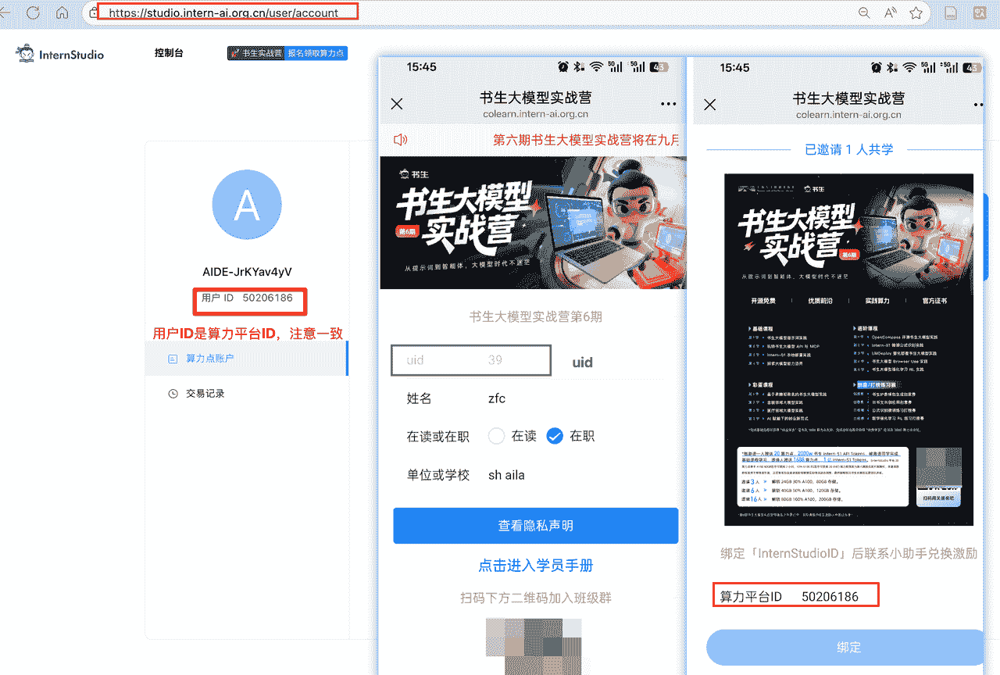
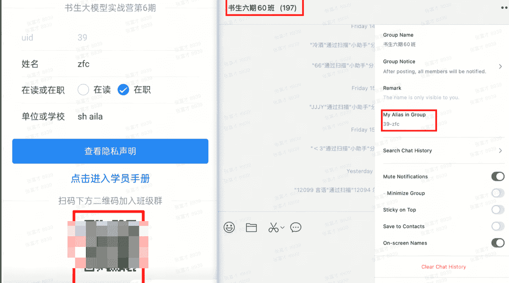
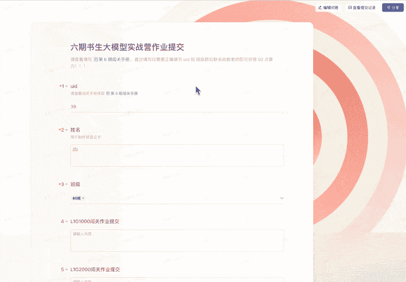
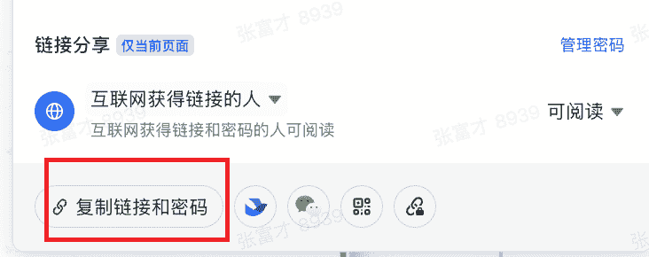
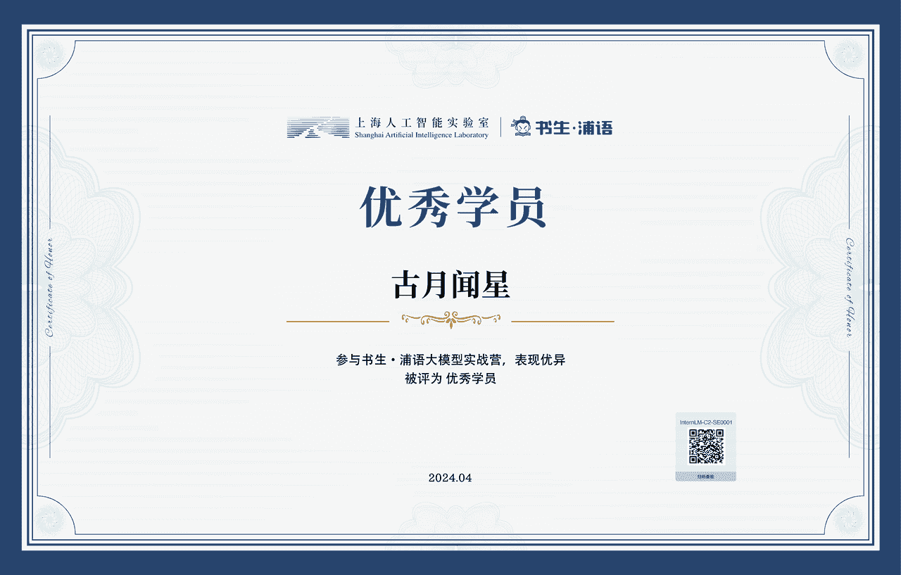
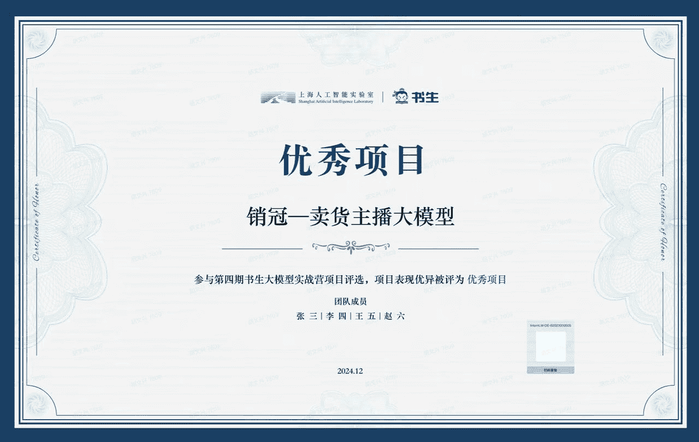
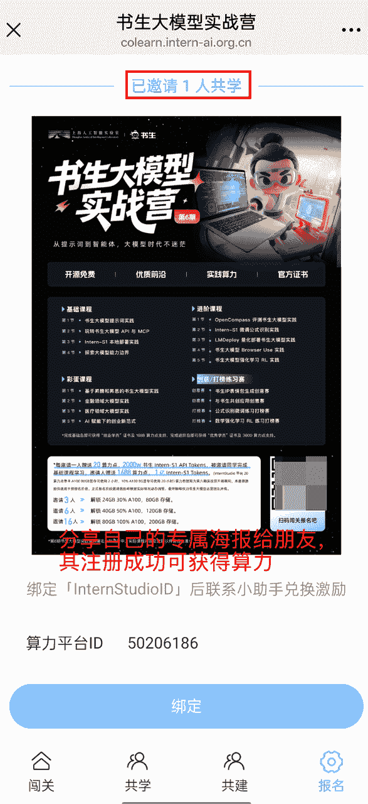

# 第 6 期闯关手册

> 来源：[https://aicarrier.feishu.cn/docx/Ley4d8cTRoIdOnxKhmzcmpZwnog](https://aicarrier.feishu.cn/docx/Ley4d8cTRoIdOnxKhmzcmpZwnog)

**本期实战营已经截止报名并不再批改作业，4 月初**将回收所有算力资源，中下旬将开启下一期。

> 结营时间：2026 年 2 月 28 日

> **书生ChatWeb:**  https://chat.intern-ai.org.cn/

> InternStudio 算力平台：https://studio.intern-ai.org.cn/

> 👉 [10 万奖金池，书生大模型 「公式识别」RL/ SFT 打榜赛](https://aicarrier.feishu.cn/wiki/MlbXw4rgQiitCrkZRmZcMyxKnmg)

> 👉

> 注意：所有算力资源仅第 6 期内有效。

# 闯关前准备

## 1.1 扫码报名

首先手机扫码报名,注意uid（报名id）、Internstudio id (算力平台ID) 参考下图

算力平台 ID 查看:https://studio.intern-ai.org.cn/user/account

需要去搞清楚报名平台和Intern studio上机平台的id正确绑定：

+   用户 ID(算力平台 ID)查看：https://studio.intern-ai.org.cn/user/account，

+   uid（报名id）是自动获取： https://colearn.intern-ai.org.cn/c6

##  加入班级群并改名 [uid--昵称]

##  提交作业获得首次 A100 算力

+   点击作业提交地址：https://aicarrier.feishu.cn/share/base/form/shrcnbguDXSzIZV5Dkapw39BJ0f

提交作业显示 “已达到提交次数上限”应该怎么解决？点击右上角编辑问卷，可以参考下图 gif。

**重要提示****：每次提交作业时，请务必**确认已开启 “互联网获得链接的人可阅读” 权限，再复[提交公开链接作业用飞书.mp4](https://aicarrier.feishu.cn/file/RxNnbCpSmogzaUxH3nFctVIPnwb?from=from_copylink)链接到到作业表单，助教老师才能批改。如下图所示，不会操作同学可以看参考视频： 。

# 闯关

## 闯关关卡

作业参考:[20240701-浦语Camp3](https://sap7x39yn02.feishu.cn/wiki/SwbAwb3T0is0F8kcIRWcQGQTnbh)

| 仅需要在 A100 算力平台下完成作业即可结营～ |  |  |  |  |
| --- | --- | --- | --- | --- |
| 基础岛 |  |  |  |  |
|  | 关卡编号 | 关卡名称 | 关卡资料 | 通关激励（A100 算力激励） |
| 第1关 | L1G1000 | 书生大模型提示词实践 | [文档](https://aicarrier.feishu.cn/wiki/KrulwQ4P6iOLggkjrrpcqYoInZc)、[视频](https://www.bilibili.com/video/BV1vUjYz2Eys/) | 50 算力点 |
| 第2关 | L1G2000 | 玩转书生大模型 API和 MCP | [文档](https://aicarrier.feishu.cn/wiki/US0jw9aglijRHykmPGvc6AjRnGg) | 50 算力点，30% A100 权限，60GB 磁盘存储 |
| 第3关 | L1G3000 | Intern-S1 本地部署实践 | [文档](https://aicarrier.feishu.cn/wiki/PcP5wY2qvirGgnkFjtwcz0HOnvg)、[Ascend 文档](https://aicarrier.feishu.cn/wiki/DerLwIfgXiHlCDkt6v9cW9kxnmf) | 50 算力点 |
| 第4关 | L1G4000 | 探索大模型能力边界 | [文档](https://aicarrier.feishu.cn/wiki/BXrBwdfR9iFXorkclaKcGXKnnBh) | 50 算力点 |
| 🔥 与[书生共创应用创意赛](https://aicarrier.feishu.cn/wiki/JuXvwHzGni2A2Rksd8Rczpvxngb) |  |  |  |  |
| 进阶岛 |  |  |  |  |
|  | 关卡编号 | 关卡名称 | 关卡资料 | 通关激励 |
| 第1关 | L2G1000 | OpenCompass 评测书生大模型实践 | [文档](https://aicarrier.feishu.cn/wiki/SZy6waBpziuF3zkUuvkcvMYtneb?from=from_copylink) | 50 算力点 |
| 第2关 | L2G2000 | Intern-S1 微调公式识别实践 | [**文档**](https://aicarrier.feishu.cn/wiki/Buj1wRAZii4xSok9FTscAxnangf?from=from_copylink) | 50 算力点 |
| 第3关 | L2G3000 | LMDeploy 量化部署书生大模型实践 | [文档](https://aicarrier.feishu.cn/wiki/ZrbowJQhDifIrKkvj9xc5FjYnnf?from=from_copylink) | 50 算力点 |
| 第4关 | L2G4000 | 书生大模型 Browse Use 实践 | [文档](https://aicarrier.feishu.cn/wiki/PwzbwH4m4iLFFhkZrsvcZIj5nee?from=from_copylink) | 50 算力点 |
| 第5关 | L2G5000 | 书生大模型强化学习 RL 实践 | [文档](https://aicarrier.feishu.cn/wiki/YYV9wWiU0iyMjnklrfbcStIInIc) | 50 算力点 |
| [公式识别微调练习打榜赛（内测试运行）](https://aicarrier.feishu.cn/wiki/JSA8wmd7liiQ72kBf8dcLnDxnHb) |  |  |  |  |
| 彩蛋岛（选修） |  |  |  |  |
|  | 关卡编号 | 关卡名称 | 关卡资料 | 通关激励 |
| 第1关 | EG1000 | 医疗领域大模型实践 | [文档](https://aicarrier.feishu.cn/wiki/E90awOlsPiIWW3kh1Vyc0a6tnmf)、[视频](https://www.bilibili.com/video/BV1gfqJBNEmT/) |  |
| 第2关 | EG2000 | AI 赋能下的创业新范式 | [视频1](https://www.bilibili.com/video/BV1gAmnBZEuK)、[视频2](https://www.bilibili.com/video/BV1hwmnBbE7d/) |  |
| 第3关 | EG3000 | Agent Skills 彩蛋共建共学 | [文档](https://aicarrier.feishu.cn/wiki/WMMxwEdz5iouSMk4iYzcelAfndn) |  |
| 第4关 | EG4000 | Ascend NPU 闯关联名周边等你来拿 | [六期书生大模型实战营「昇腾」彩蛋闯关](https://aicarrier.feishu.cn/wiki/OlSWwo3VAigM3ckBBRXcKV3nnPg) |  |
| 彩蛋岛创意赛：[书生IP表情包生成创意赛](https://aicarrier.feishu.cn/wiki/XUcGwznnUiTsduk9FNschSSynme) |  |  |  |  |
| [书生大模型 「公式识别」RL/ SFT 打榜赛](https://aicarrier.feishu.cn/wiki/MlbXw4rgQiitCrkZRmZcMyxKnmg) |  |  |  |  |

## 查询作业批改情况

https://aicarrier.feishu.cn/share/base/query/shrcn6AgNu53kvMqbGIg5E8Fznf

## 如何下载证书

联系助教老师或者  发送 uid 可领取证书。

# 项目申请

第六期项目申报地址：[🔥书生大模型开源社区项目申报🔥](https://aicarrier.feishu.cn/wiki/JuXvwHzGni2A2Rksd8Rczpvxngb?open_in_browser=true)

| 阶段 | 事项 | 算力激励 | API Token 激励 |
| --- | --- | --- | --- |
| 1 | 项目登记 | 168 算力点 | 500W |
| 2 | 初版GitHub Repo和技术架构图 | 333 算力点 | 2500W |
| 3 | 高质量架构图和方案 | 1688 算力点 | 1亿（部分项目可解锁 50 RPS） |
| 4 | 高质量的视频(项目视频播放量超500，且制作精良) | 3600 算力点 | 2亿（50RPM） |
| 5 | 于优秀项目中评选，在公众号文章发起投票，票数前 10 名的项目。 | 3600 算力点 | 5 亿 (50RPM) |
| 5 | 项目视频播放量超 5K、GitHub Repo Star 超 500 | 7200 算力点 | 10亿（50RPM） |

**优秀项目证书**

<https://aicarrier.feishu.cn/sync/OsSedA8ZssKa6ubIiiLcin22nFh>

# 书生共学计划获取海量算力

小伙伴们可以在报名界面(https://colearn.intern-ai.org.cn/c6)制作并转发自己的专属海报。

**每邀请 1 人获得：**

+   A100 InternStudio 平台 30 元 A100 算力券。

+   d.run 平台 30 元 曦云 C 系列算力券。

+   Ascend InternStudio 平台 60 元 昇腾算力券。

本活动规则可能根据实际情况进行调整，活动最终解释权由书生大模型运营团队所有。

