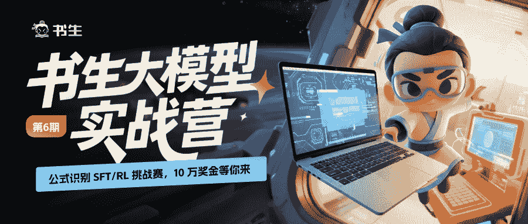
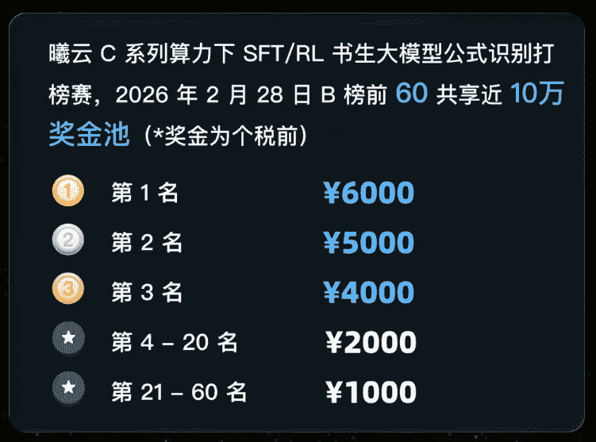

# 10 万奖金池，书生大模型 「公式识别」RL/ SFT 打榜赛（曦云 C 系列算力）

> 来源：[https://aicarrier.feishu.cn/docx/F53bd7lLUo7vxrxUSq2csWo2nIc](https://aicarrier.feishu.cn/docx/F53bd7lLUo7vxrxUSq2csWo2nIc)

比赛将在 2 月 28 号 23:59 分截止提交，待评测系统评测完毕并且剔除无效分数后，确定排名后收集奖金发放信息！

记得清理文件存储到免费空间20G ！

# 比赛背景

**第 6 期书生大模型实战营**特别增设近 10 万元奖金池的「书生大模型 SFT/RL 公式识别打榜赛」，以赛促学，实战赋能，助力开发者全面掌握大模型核心能力。

本挑战赛**限定**邀请选手在**曦云 C 系列算力平台****上****使用 SFT/RL 等方式提**升 InternVL3.5-1B 模型的公式识别能力，参与本次赛事打榜。A 榜已公开，2026 年 1 月中下旬公开 B 榜实时榜单，2 月 28 日 B 榜截止提交，所有模型测试完毕后前 60 共享近 10 万奖金池。

# 赛事时间线

| 事项 | 时间（暂） |
| --- | --- |
| 报名 | 即日起 |
| 开启 B 榜 | 1 月中下旬 |
| 停止提交 | 2 月 28 日 |
| 公布排名00 | 3 月初 |

# 提交、排行榜、成绩查询

赛事模型提交地址：https://aicarrier.feishu.cn/share/base/form/shrcnRzFT7AatAZWolO7A3zsiKg

排行榜地址：https://aicarrier.feishu.cn/share/base/dashboard/shrcns0G2aJjSO4QXhQcGtv8XIh

详细成绩查询地址：https://aicarrier.feishu.cn/share/base/query/shrcnvGInFWkTavPofVvaOwkHFc

<https://aicarrier.feishu.cn/share/base/dashboard/shrcnffsLX5F6IbozXjYDfjp5nc?iframeFrom=docx&ccm_open=iframe>

<https://aicarrier.feishu.cn/share/base/dashboard/shrcns0G2aJjSO4QXhQcGtv8XIh?iframeFrom=docx&ccm_open=iframe>

# **曦云 C 系列算力券获取**

本赛事算力平台为 https://www.d.run/

|  | 简要描述 | 详细步骤 |
| --- | --- | --- |
| 初始算力 | +   访问 https://colearn.intern-ai.org.cn/c6 报名第六期实战营并获取 uid 并加入班级群。 | [详细步骤戳我](https://aicarrier.feishu.cn/wiki/EHlTwu2a1iW9g9kNIJ6ck0KKnRe#share-L6Rcd2s0eoLqyVx3Of7cNsN9ntg) |
| 结营算力 | 完成 6 期书生大模型实战营基础课程学习获得 ¥500 算力券支持。 | [详细步骤戳我](https://aicarrier.feishu.cn/wiki/EHlTwu2a1iW9g9kNIJ6ck0KKnRe#share-AWMSd9jfSoZQp9xrRT1cIzmtnQc) |
| 邀请算力 | 共学计划邀请 1 人参加 6 期获得 ¥30 算力激励。 | [详细步骤戳我](https://aicarrier.feishu.cn/wiki/EHlTwu2a1iW9g9kNIJ6ck0KKnRe#share-FO6idF7QMotpaWx2gRJcEAANnLh) |
| 彩蛋算力 | 赛事举办期间将有小的活动发放算力券 | [详细步骤戳我](https://aicarrier.feishu.cn/wiki/EHlTwu2a1iW9g9kNIJ6ck0KKnRe#share-Y5QjdsYHyoXflrxlQ7JcJjZrnyb) |

**温馨提示：**d.run 算力平台仅使用算力券资源即可，不需要充值费用。

+   请科学合理使用存储一般情况下不需要扩容存储，扩容后的存储按天收费请及时缩容以免欠费。

+   不使用机器时请及时关机，以免欠费。

# 赛事 Baseline

| 版本 | 入口 |
| --- | --- |
| XTuner 版本 Baseline | https://aicarrier.feishu.cn/wiki/C4Z5wnvD8iOQPhk3aZhcWVRhndh |
| Swift 版本 Baseline | 可参考练习赛代码 |

# **小提示**

+   本次比赛可能会涉及一些基础图像增强变换，包括但不限于：

1.  **几何与空间变换**

+   旋转 (Rotation)

+   透视变换 (Perspective)

+   仿射变换 (Affine: 含缩放与错切)

+   镜头畸变 (Lens Distortion)

+   画布扩展与边缘裁剪 (Canvas Expansion & Border Trimming)

1.  **颜色与光照调整**

+   颜色抖动 (Color Jitter: 含亮度与对比度)

+   RGB 通道偏移 (RGB Shift)

+   色温调整 (Color Temperature)

+   Gamma 校正 (Gamma Correction)

+   通道随机丢失 (Channel Dropout)

1.  **噪声干扰**

+   高斯噪声 (Gaussian Noise)

+   椒盐噪声 (Salt & Pepper Noise)

+   泊松噪声 (Poisson Noise)

+   散斑噪声 (Speckle Noise)

1.  **模糊与画质损伤**

+   高斯模糊 (Gaussian Blur)

+   运动模糊 (Motion Blur)

+   JPEG 压缩伪影 (JPEG Artifacts)

+   本次比赛只能使用 **InternVL3.5-1B****  和 沐曦算力平台**，但不限定数据、和方法

+   可以使用 SFT

+   可以使用 RL

# 赛事激励

近 10 W 奖金，前 60 名都有。

**注意：**

+   不要一个人多个号提交，一经发现取消竞赛资格。

+   **组委会会对最终前 ****6**0 名的队伍的比赛方案及面试抽查，检查模型是否是选手本人训练出来的。

# 其他

提交地址：https://aicarrier.feishu.cn/share/base/form/shrcnRzFT7AatAZWolO7A3zsiKg

**模型上传之后千万不要换和删除**

**新模型上传到新的仓库**

否则复查时出现问题当成绩无效处理

| **注意**：飞书表格的评测提交时间一定要晚于「模型仓库的最后更新时间」，否则该次提交成绩无效。 |  |
| --- | --- |
| **飞书表格的评测提交时间** | **模型仓库最后更新时间** |