# L1 玩转书生大模型 API 与 MCP

> 来源：[https://aicarrier.feishu.cn/docx/L4EwdWeeaouG51xQYnzcDLhbnwb](https://aicarrier.feishu.cn/docx/L4EwdWeeaouG51xQYnzcDLhbnwb)


本指南将带您深入探索如何在书生开发机上使用 `Intern-S1 Pro API`，并结合 `MCP`（Model Control Protocol）实现突破性的 AI 功能扩展。从传统的对话交互到具备文件操作、外部数据获取能力的智能助手，让我们一起解锁 AI 的无限潜能。

## 前置准备

### 1. 获取 `API KEY`

`Intern` 系列模型提供免费的 `OpenAI` 兼容格式 `API`。获取步骤如下：

1. [访问 `https://internlm.intern-ai.org.cn/api/tokens`](https://internlm.intern-ai.org.cn/api/tokens)
1. 确保使用正常注册且可用的账户
1. 为 `API Token` 命名并生成
1. **重要提醒**：`API Token` 只能复制一次，生成后请妥善保管，切勿在代码中显式暴露

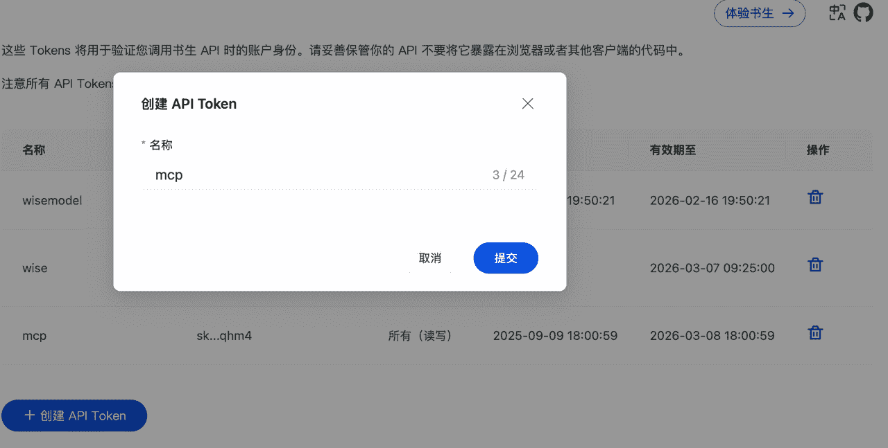

### 2. 开发机配置

在创建开发机界面进行如下配置：

+ **镜像选择**：`Cuda12.8-conda`
+ **GPU 配置**：`10% A100`

本节课程不需要显存，故最小资源即可。

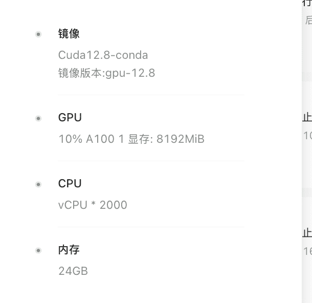

## 快速开始

### 环境安装

```
conda activate base
pip install openai requests
```

### 文本生成

`Intern API` 兼容 [`OpenAI`](https://chat.intern-ai.org.cn/) `API`，为最新的`Intern-S1-Pro` 模型提供了一个简单的接口，用于文本生成、自然语言处理、计算机视觉等。本示例是文生文，根据提示生成文本输出——像您在使用网页端 `Intern` 一样。

```
from openai import OpenAI
client = OpenAI(
      api_key="eyJ0eXxx",  # 此处传token，不带Bearer
      base_url="https://chat.intern-ai.org.cn/api/v1/",
)

completion = client.chat.completions.create(
    model="intern-s1-pro",
    messages=[
        {
            "role": "user",
            "content": "你是什么模型，介绍一下你自己"
        }
    ]
)

print(completion.choices[0].message.content)
```

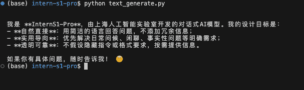

### 分析图像输入

你也可以向模型提供图像输入。扫描收据、分析截图，或使用计算机视觉技术在现实世界中寻找物体。

#### 输入图像为 url

这里转化图片为 `url` 的工具：`https://www.superbed.cn/`

`"url": "https://hips.hearstapps.com/hmg-prod/images/dog-puppy-on-garden-royalty-free-image-1586966191.jpg",`

```
from openai import OpenAI

client = OpenAI(
      api_key="eyJ0eXxx",  # 此处传token，不带Bearer
    base_url="https://chat.intern-ai.org.cn/api/v1/",
)

response = client.chat.completions.create(
    model="intern-s1-pro",
    messages=[
        {
            "role": "user",
            "content": [
                {"type": "text", "text": "图片里有什么？"},
                {
                    "type": "image_url",
                    "image_url": {
                    },
                },
            ],
        }
    ],
    extra_body={"thinking_mode": True,}, # 开启提下thinking 模式
)

print(response.choices[0].message.content)
```

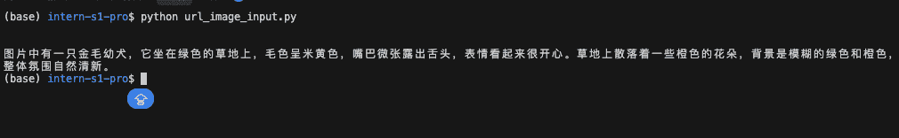

#### 输入图像为文件


```
import base64
from openai import OpenAI

client = OpenAI(
      api_key="eyJ0eXxx",  # 此处传token，不带Bearer
    base_url="https://chat.intern-ai.org.cn/api/v1/",
)
# Function to encode the image
def encode_image(image_path):
    with open(image_path, "rb") as image_file:
        return base64.b64encode(image_file.read()).decode("utf-8")


# Path to your image
image_path = "/root/share/intern.jpg"

# Getting the Base64 string
base64_image = encode_image(image_path)

completion = client.chat.completions.create(
    model="intern-s1-pro",
    messages=[
        {
            "role": "user",
            "content": [
                { "type": "text", "text": "图片里有什么?" },
                {
                    "type": "image_url",
                    "image_url": {
                        "url": f"data:image/jpeg;base64,{base64_image}",
                    },
                },
            ],
        }
    ],
)

print(completion.choices[0].message.content)
```

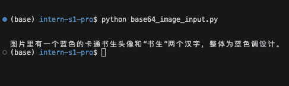

### 模型使用工具

#### OpenAI 格式

```
from openai import OpenAI


client = OpenAI(     
    api_key="sk-lYQQ6Qxx”，不带Bearer
    base_url="https://chat.intern-ai.org.cn/api/v1/",
)

# openai-sdk function caling schema
tools = [{
    "type": "function",
    "function": {
        "name": "get_weather",
        "description": "Get current temperature for a given location.",
        "parameters": {
            "type": "object",
            "properties": {
                "location": {
                    "type": "string",
                    "description": "City and country e.g. Bogotá, Colombia"
                }
            },
            "required": [
                "location"
            ],
            "additionalProperties": False
        },
        "strict": True
    }
}]

completion = client.chat.completions.create(
    model="intern-s1-pro",
    messages=[{"role": "user", "content": "What is the weather like in Paris today?"}],
    tools=tools
)

print(completion.choices[0].message.tool_calls)
```

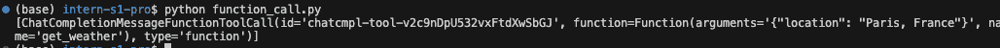

#### Python 原生调用


## 天气查询示例

```
import requests
import json

# API 配置
API_KEY = "eyJ0exxxxQ"
BASE_URL = "https://chat.intern-ai.org.cn/api/v1/"
ENDPOINT = f"{BASE_URL}chat/completions"

# 定义天气查询工具
WEATHER_TOOLS = [{
    "type": "function",
    "function": {
        "name": "get_weather",
        "description": "获取指定城市或坐标的当前温度（摄氏度）",
        "parameters": {
            "type": "object",
            "properties": {
                "latitude": {"type": "number", "description": "纬度"},
                "longitude": {"type": "number", "description": "经度"}
            },
            "required": ["latitude", "longitude"],
            "additionalProperties": False
        },
        "strict": True
    }
}]

def get_weather(latitude, longitude):
    """
    获取指定坐标的天气信息
    
    Args:
        latitude: 纬度
        longitude: 经度
    
    Returns:
        当前温度（摄氏度）
    """
    try:
        # 调用开放气象API
        response = requests.get(
            f"https://api.open-meteo.com/v1/forecast?latitude={latitude}&longitude={longitude}&current=temperature_2m,wind_speed_10m&hourly=temperature_2m,relative_humidity_2m,wind_speed_10m"
        )
        data = response.json()
        temperature = data['current']['temperature_2m']
        return f"{temperature}"
    except Exception as e:
        return f"获取天气信息时出错: {str(e)}"

def make_api_request(messages, tools=None):
    """发送API请求"""
    headers = {
        "Content-Type": "application/json",
        "Authorization": f"Bearer {API_KEY}"
    }
    
    payload = {
        "model": "Intern-S1-Pro",
        "messages": messages,
        "temperature": 0.7
    }
    
    if tools:
        payload["tools"] = tools
        payload["tool_choice"] = "auto"
    
    try:
        response = requests.post(ENDPOINT, headers=headers, json=payload, timeout=30)
        response.raise_for_status()
        return response.json()
    except requests.exceptions.RequestException as e:
        print(f"API请求失败: {e}")
        return None

def main():
    # 初始消息 - 巴黎的坐标
    messages = [{"role": "user", "content": "请查询当前北京的温度"}]
    
    print("🌤️ 正在查询天气...")
    
    # 第一轮API调用
    response = make_api_request(messages, WEATHER_TOOLS)
    if not response:
        return
    
    assistant_message = response["choices"][0]["message"]
    
    # 检查工具调用
    if assistant_message.get("tool_calls"):
        print("🔧 执行工具调用...")
        print("tool_calls:", assistant_message.get("tool_calls"))
        messages.append(assistant_message)
        
        # 处理工具调用
        for tool_call in assistant_message["tool_calls"]:
            function_name = tool_call["function"]["name"]
            function_args = json.loads(tool_call["function"]["arguments"])
            tool_call_id = tool_call["id"]
            
            if function_name == "get_weather":
                latitude = function_args["latitude"]
                longitude = function_args["longitude"]
                weather_result = get_weather(latitude, longitude)
                print(f"温度查询结果: {weather_result}°C")
                
                # 添加工具结果
                tool_message = {
                    "role": "tool", 
                    "content": weather_result,
                    "tool_call_id": tool_call_id
                }
                messages.append(tool_message)
        
        # 第二轮API调用获取最终答案
        final_response = make_api_request(messages)
        
        if final_response:
            final_message = final_response["choices"][0]["message"]
            print(f"✅ 最终回答: {final_message['content']}")
    else:
        print(f"直接回答: {assistant_message.get('content', 'No content')}")

if __name__ == "__main__":
    main()
```

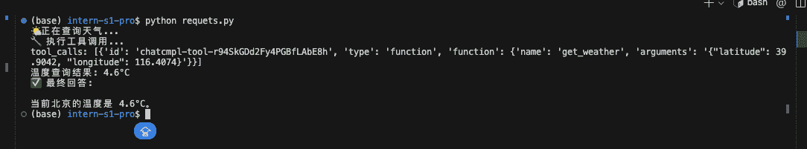

## 使用流式传输

`stream=True`[,打开流式传](https://chat.intern-ai.org.cn/)输，体验如同网页端 Intern 吐字的感觉。

```
from openai import OpenAI

client = OpenAI(
    api_key="eyxxxx",
    base_url="https://chat.intern-ai.org.cn/api/v1/",
)

stream = client.chat.completions.create(
    model="intern-s1-pro",
    messages=[
        {
            "role": "user",
            "content": "Say '1 2 3 4 5 6 7' ten times fast.",
        },
    ],
    stream=True,
)

# 只打印逐字输出的内容
for chunk in stream:
    if chunk.choices[0].delta.content:
        print(chunk.choices[0].delta.content, end="", flush=True)  # 逐字输出，不换行
```

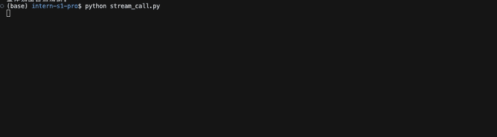

## 开关think 模式

通过`extra_body={"thinking_mode": True}`打开思考模式

```
from openai import OpenAI

client = OpenAI(
    api_key="sk-xxx",
    base_url="https://chat.intern-ai.org.cn/api/v1/",
)

def chat(thinking_mode=False):
    completion = client.chat.completions.create(
        model="intern-s1-pro",
        messages=[
            {"role": "user", "content": "写一个关于独角兽的睡前故事"}
        ],
        extra_body={"thinking_mode": thinking_mode},
    )

    msg = completion.choices[0].message

    reasoning = getattr(msg, "reasoning_content", None)
    content = getattr(msg, "content", None)

    if thinking_mode:
        print("【Reasoning】")
        if reasoning:
            print(reasoning)
        else:
            print("(接口未返回 reasoning_content)")

    print("【Answer】")
    if content:
        print(content)
    print("\n")

print("=======Thinking Mode=======")
chat(thinking_mode=True)

print("=======Normal Mode=======")
chat(thinking_mode=False)
```

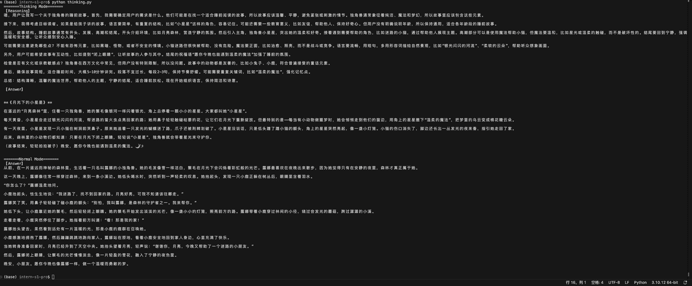

## 2.6 科学能力

### 数学

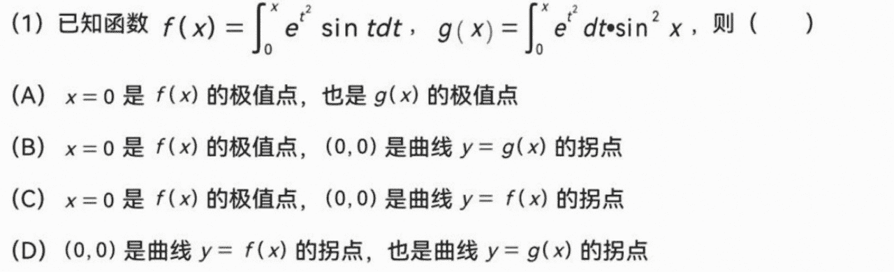

具体细节:https://zhuanlan.zhihu.com/p/1916892757294843774

`"url": "https://pic1.imgdb.cn/item/68d24759c5157e1a882b2505.jpg",`

```
from openai import OpenAI

client = OpenAI(
    api_key="sk-xxx",  # 此处传token，不带Bearer
    base_url="https://chat.intern-ai.org.cn/api/v1/",
)

response = client.chat.completions.create(
    model="intern-s1-pro",
    messages=[
        {
            "role": "user",
            "content": [
                {"type": "text", "text": "这道题选什么"},
                {
                    "type": "image_url",
                    "image_url": {
                    },
                },
            ],
        }
    ],
    extra_body={"thinking_mode": True,},
)

print(response.choices[0].message.content)
```

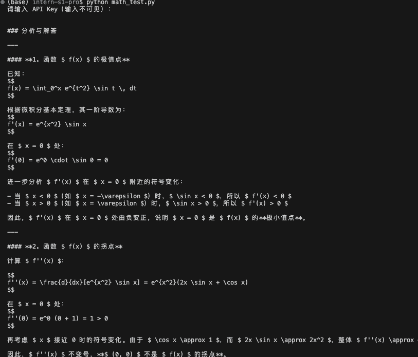

### 化学


具体细节:https://www.chembk.com/cn/chem/2,5-%E4%BA%8C%E7%94%B2%E5%9F%BA%E5%93%8C%E5%97%AA(%E9%A1%BA%E5%BC%8F)

`"url": "https://pic1.imgdb.cn/item/68d23c82c5157e1a882ad47f.png",`


```python
from openai import OpenAI

client = OpenAI(
    api_key="sk-xxx",  # 此处传token，不带Bearer
    base_url="https://chat.intern-ai.org.cn/api/v1/",
)

response = client.chat.completions.create(
    model="intern-s1-pro",
    messages=[
        {
            "role": "user",
            "content": [
                {"type": "text", "text": "从左到右，给出图中反应物的化学式"},
                {
                    "type": "image_url",
                    "image_url": {
                    },
                },
            ],
        }
    ],
    extra_body={
        "thinking_mode": True,
        "temperature": 0.7,
        "top_p": 1.0,
        "top_k": 50,
        "min_p": 0.0,
    },
)

print(response.choices[0].message.content)
```

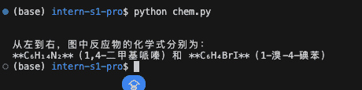

# 玩转 MCP

## 什么是 MCP？


MCP（Model Control Protocol）是一种专为 AI 设计的协议（类别 USB-C接口转换器），其核心作用是扩充 AI 的能力。通过 MCP，AI 可以：

+ 获取外部数据
+ 操作文件系统
+ 调用各种服务接口
+ 实现复杂的工作流程

通过本教程，您将掌握如何让 Intern-S1-Pro API 突破传统对话限制，实现以下核心功能：

+ 外部数据获取：连接并处理来自各种外部源的数据
+ 文件系统操作：具备完整的文件创建、读取、修改和删除能力，实现一个命令行版本的 cursor。

让我们开始探索 MCP 的无限可能！

## 项目结构

```
mcp_tutorial/
├── mcp-client/          # 客户端应用
├── mcp-server/          # 服务端微服务
│   ├── podcast/         # 播客服务
│   ├── weather/         # 天气服务
│   ├── gmail/           # Gmail服务
│   └── filesystem/      # 文件管理服务
├── install.sh           # 一键安装环境脚本
└── README.md            # 说明文档
```

Github 代码：https://github.com/fak111/mcp_tutorial，欢迎👏大家点 star 🌟


## 1. 环境准备

```
#git clone https://github.com/fak111/mcp_tutorial.git
git clone https://gh.llkk.cc/https://github.com/fak111/mcp_tutorial.git
cd mcp_tutorial
bash install.sh
```

## 2. 配置 API

```
cd mcp-client
cp .env.example .env
```

Vscode模式下,在相应的文件目录中创建 `.env` 文件，填写你的 `API_KEY`。

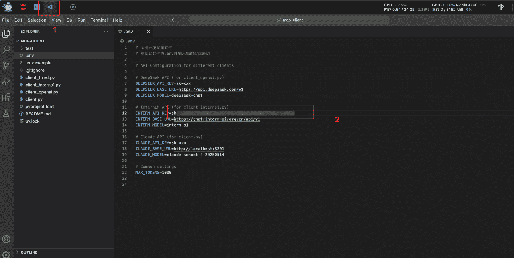

推荐：学习阶段建议使用书生的intern-s1-pro模型，访问 https://internlm.intern-ai.org.cn/api/strategy 获取详细信息。

## 🌤️ 天气服务使用示例

### 启动天气服务

```
cd mcp-client
source .venv/bin/activate
uv run client_interns1.py  ../mcp-server/weather/build/index.js
```

### 使用方法

```
get_weather Beijing 
```

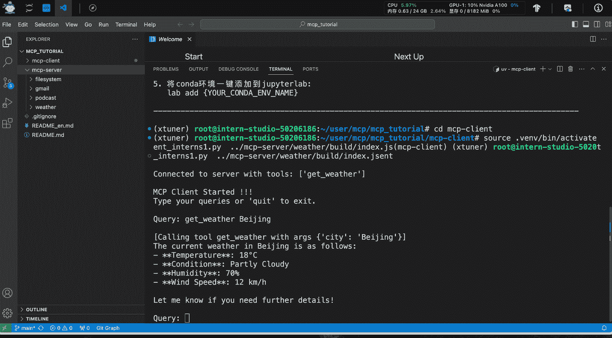

### 重要问题分析：参数匹配问题

在实际使用中，你可能会遇到以下现象：

| 输入 | 工具调用 | 结果 | 原因分析 |
| --- | --- | --- | --- |
| 查询"北京"天气 | {'city': '北京'} | ❌ 失败 | 数据中无中文城市名 |
| 查询"beijing"天气 | {'city': 'beijing'} | ❌ 失败 | AI 自动转换了大小写 |
| 查询"Beijing"天气 | {'city': 'Beijing'} | ✅ 成功 | 完全匹配 |

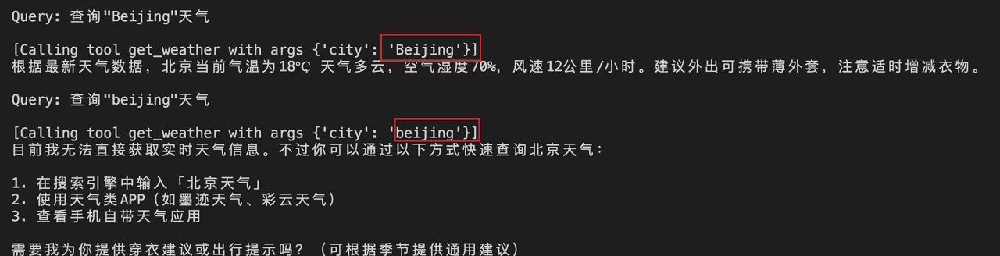

问题根源：

mcp 服务器关于数据的命名必须与工具调用一致，否则不会返回。可能的改进：客户端写专门的提示词帮助 ai 转化成正确的工具调用所需参数。

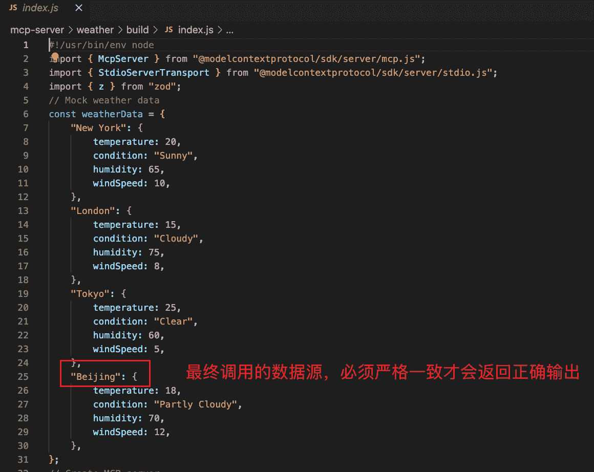

---

## 📁 文件系统服务

### 启动文件服务

文件服务的启动命令格式如下：

文件服务启动 `uv run client_fixed.py arg1 arg2`

参数说明：

+ `arg1`：MCP 文件操作服务的路径
+ `arg2`：运行文件操作的工作目录路径

```
cd mcp-client
source .venv/bin/activate
uv run client_fixed.py ../mcp-server/filesystem/dist/index.js ../
```

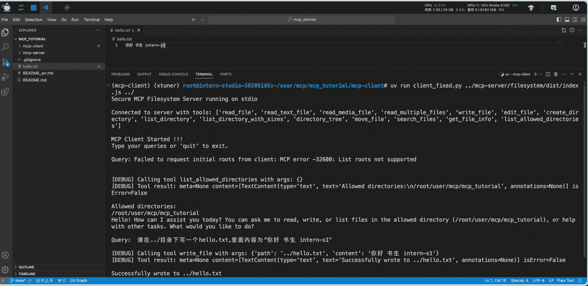

### 功能示例

+ 列出文件：列出当前目录下的所有文件
+ 读取文件：读取 `README.md` 文件的内容
+ 创建文件：请在`../`目录下写一个`hello.txt`,里面内容为“你好 书生 intern-s1-pro"
+ 搜索文件：搜索所有 `.md` 文件

## 总结

恭喜您完成了玩转书生大模型 API 与 MCP！通过本指南，您已经掌握了：

✅ 核心技能

+ Intern-S1-Pro API 的高级应用
+ MCP 协议的实战运用
+ 天气服务与文件系统的集成操作

✅ 实践成果

+ 构建了具备外部数据获取能力的智能助手
+ 实现了完整的文件系统操作功能
+ 认识到 MCP 协议中参数匹配问题

🚀 下一步展望

现在您已经打开了 AI 能力扩展的大门，可以继续探索更多 MCP 服务，如 Gmail 集成、生成播客等，构建属于您的智能工作流！

感谢您的学习，期待看到您创造出更多精彩的 AI 应用！ 🌟

参考文档：

+ 官方文档：[书生·浦语官网](https://internlm.intern-ai.org.cn/)
+ MCP：[模型上下文协议](https://modelcontextprotocol.io/docs/getting-started/intro)
+ OepnAI：[api 文档](https://platform.openai.com/)

## 作业

基本要求：获取书生 `apikey` 成功调用文本生成截图，天气服务运行成功截图

进阶要求：完成2、3 章节所有内容并贴运行成功截图

+ 作业提交地址：https://aicarrier.feishu.cn/share/base/form/shrcnbguDXSzIZV5Dkapw39BJ0f
+ 完成闯关练习助教批改后可获得 50 算力点激励，30% A100 权限，60GB 磁盘存储
