# L1 Intern-S1-mini 本地部署实践

> 来源：[https://aicarrier.feishu.cn/docx/MSJpd8LT9oFk7wxiIt1cs0hZnTc](https://aicarrier.feishu.cn/docx/MSJpd8LT9oFk7wxiIt1cs0hZnTc)


本文带你快速三种部署方式：lmdeploy、vllm、sglang ，将InternLM/Intern-S1-mini 模型在书生开发机上进行部署与调用。

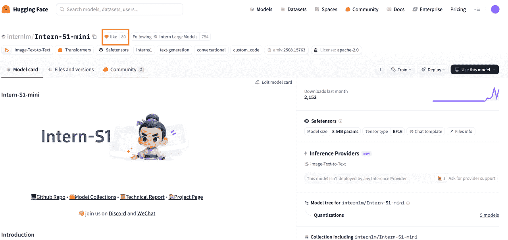

继 7 月 26 日开源**『书生』科学多模态大模型 In**tern-S1 之后，上海人工智能实验室（上海AI实验室）今天推出了轻量化版本 Intern-S1-mini。

凭借领先的通用与专业科学能力，Intern-S1 上线后连续多日霸榜 HuggingFace 多模态 Trending 全球第一，并在开源社区引发了广泛关注。作为 8B 参数的“迷你模型”，Intern-S1-mini 同样兼具通用能力与专业科学能力，且更加适合快速部署和二次开发。Intern-S1-mini 性能速览：

+   通用能力稳居同量级第一梯队：在 MMLU-Pro、AIME2025、MMMU 等多项权威基准上表现卓越，展现出兼具稳定性与竞争力的综合实力；

+   科学专业能力优异：在化学、材料等任务表现尤为突出，在 SmolInstruct、ChemBench、MatBench 等基准测试中显著领先；在物理、地球、生物等学科任务中也保持第一梯队水平，体现出扎实的科学理解与跨领域泛化能力；

+   减身材不减实力，助力科研、开发、教育多种场景。

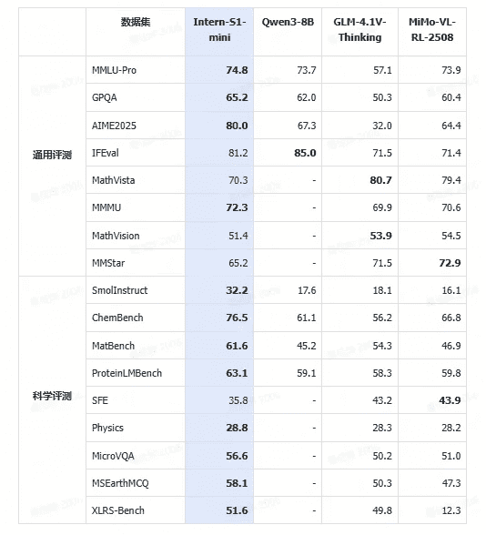

[Inte](https://chat.intern-ai.org.cn/)r[n-S1-m](https://github.com/InternLM/Intern-S1)i[ni 可通过 体验页面](https://huggingface.co/internlm/Intern-S1-mini)、Gi[tHub、Huggi](https://modelscope.cn/models/Shanghai_AI_Laboratory/Intern-S1-mini)ngFace 和 Mo**de**lScope 获取与体验,欢迎大家点赞、下载来玩👏

# vL**LM 部**署 Intern-S1-mini

## 开发机的选择

在创建开发机界面选择镜像为 Cuda11.7-conda，并选择 GPU 为 30% A100。

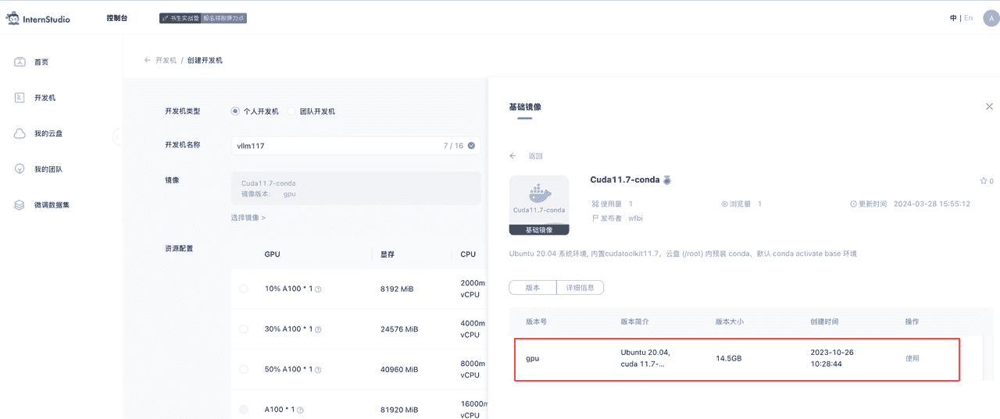

## 环境配置

1.  创建 conda 环境

建议单独为 vLLM 建立环境，例如 Python 3.12：

```
conda create -n vllm python=3.12 -y
conda activate vllm
pip install vllm
```

1.  启动模型服务

安装完成后就可以跑Intern-S1-mini模型了：

```
vllm serve  /root/share/new_models/Intern-S1-mini\
  --trust-remote-code \
  --port 54257 \
  --max-model-len 8000 \
  --gpu-memory-utilization 0.90 \
  --max-num-seqs 8 \
  --swap-space 8 \
  --enforce-eager

```

## 调用示例

### 文本

我们可以在终端输入下面命令：

```
curl http://localhost:54257/v1/chat/completions \
  -H &quot;Content-Type: application/json&quot; \
  -d &#x27;{
        &quot;model&quot;: &quot;/root/share/new_models/Intern-S1-mini&quot;,
        &quot;messages&quot;: [
          {&quot;role&quot;: &quot;system&quot;, &quot;content&quot;: &quot;You are a helpful assistant.&quot;},
          {&quot;role&quot;: &quot;user&quot;, &quot;content&quot;: &quot;你好，能帮我写一个关于春天的五言绝句吗？&quot;}
        ]
      }&#x27;
```

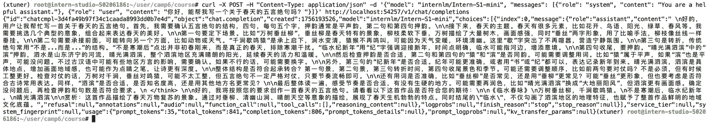

### 图像

网络照片调用

```
curl http://localhost:54257/v1/chat/completions \
  -H &quot;Content-Type: application/json&quot; \
  -d &#x27;{
    &quot;model&quot;: &quot;/root/share/new_models/Intern-S1-mini&quot;,
    &quot;messages&quot;: [
      {
        &quot;role&quot;: &quot;user&quot;,
        &quot;content&quot;: [
          { &quot;type&quot;: &quot;text&quot;, &quot;text&quot;: &quot;Please describe the image explicitly.&quot; },
          { &quot;type&quot;: &quot;image_url&quot;, &quot;image_url&quot;: { &quot;url&quot;: &quot;http://images.cocodataset.org/val2017/000000039769.jpg&quot; } }
        ]
      }
    ]
  }&#x27;

```

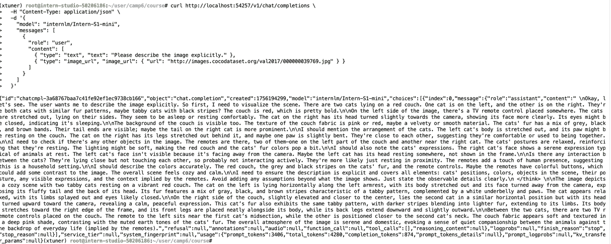

本地照片调用

```
# 1. 获取图片b[ase64编码
img_base64=$(b](http://localhost:54257/v1/chat/completions)ase64 -w 0 /root/user/camp6/course/s1.jpg)

# 2. 用jq生成JSON，通过管道直接传给curl（curl从标准输入读取数据）
echo &quot;$img_base64&quot; | jq -R -s &#x27;{
  &quot;model&quot;: &quot;/root/share/new_models/Intern-S1-mini&quot;,
  &quot;messages&quot;: [
    {
      &quot;role&quot;: &quot;user&quot;,
      &quot;content&quot;: [
        {&quot;type&quot;: &quot;text&quot;, &quot;text&quot;: &quot;请描述这张图片的内容&quot;},
        {&quot;type&quot;: &quot;image_url&quot;, &quot;image_url&quot;: {&quot;url&quot;: &quot;data:image/jpeg;base64,\(.)&quot;}}
      ]
    }
  ]
}&#x27; | curl http://localhost:54257/v1/chat/completions \
  -X POST \
  -H &quot;Content-Type: application/json&quot; \
  -d @-  # 关键：@-表示从标准输入读取请求体数据
```

```
curl http://localhost:54257/v1/chat/completions \
  -H &quot;Content-Type: application/json&quot; \
  -d &quot;$(jq -n --arg img &quot;data:image/jpeg;base64,$(base64 -w 0 /root/user/camp6/course/s1.jpg)&quot; &#x27;{
    model: &quot;/root/share/new_models/Intern-S1-mini&quot;,
    messages: [
      {
        role: &quot;user&quot;,
        content: [
          {type: &quot;text&quot;, text: &quot;请描述这张图片的内容&quot;},
          {type: &quot;image_url&quot;, image_url: {url: $img}}
        ]
      }
    ]
  }&#x27;)&quot;

```

/root/user/camp6/course/s1.jpg位置为本地图片位置


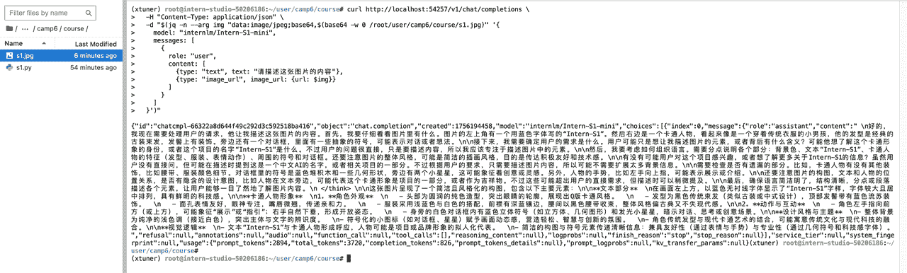

## 端口转发

我们不可以直接访问书生开发机的ip ，但可通过一行命令将书生的开发机网络资源进行调用。这行神奇的命令就是如下：

```
ssh -CNg -L23333:127.0.0.1:23333 root@ssh.intern-ai.org.cn -p 你的ssh端口号
```

参数含义

+   ssh
 使用 ssh 连接远程服务器。

+   -CNg

+   -C：压缩数据传输，加快速度。

+   -N：不执行远程命令，只做端口转发。

+   -g：允许远程主机连接到本地转发的端口（通常为了共享，单机用不用加都行）。

+   -L [本地端口]:[远程地址]:[远程端口]
 这才是端口转发核心：

+   本地端口 → 你本地机器用来访问的端口

+   远程地址 → 在远程开发机上服务监听的地址（通常是 127.0.0.1）

+   远程端口 → 远程开发机服务的端口（比如 vLLM 是 54257）

+   root@ssh.intern-ai.org.cn
 这里 root 是登录用户名，ssh.intern-ai.org.cn 是跳板机域名。

+   -p 你的ssh端口号
 指定 ssh 登录端口号（不是 vLLM 服务端口，是书生开发机给你的 ssh 登录端口）。

### 举例：转发 vLLM 服务

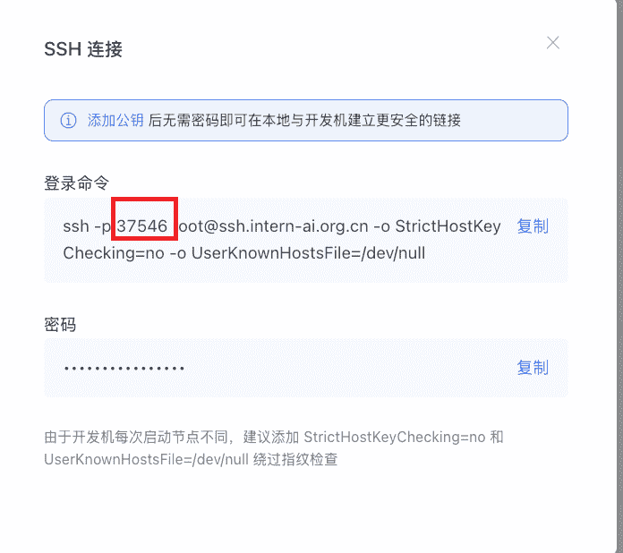

+   书生开发机的 ssh 登录端口号是 37546

+   你在开发机里启动的 vLLM 服务端口是 54257

那么你本地执行：

```
ssh -CNg -L 23333:127.0.0.1:54257 root@ssh.intern-ai.org.cn -p 37546
```

解释：

+   本地 23333 → 你访问的端口（随便挑没被占用的）

+   127.0.0.1:54257 → 转发到远程开发机的 vLLM 服务

+   登录账号是 root，服务器是 ssh.intern-ai.org.cn，ssh 端口是 37546

---

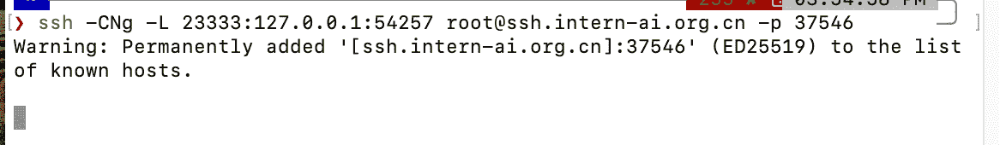

这样后，你在本地就能去调用 vLLM，就像它跑在你本机一样：

```
http://127.0.0.1:23333/v1/chat/completions
```

```
curl http://127.0.0.1:23333/v1/chat/completions \
  -H &quot;Content-Type: application/json&quot; \
  -d &#x27;{
        &quot;model&quot;: &quot;internlm/Intern-S1-mini&quot;,
        &quot;messages&quot;: [
          {&quot;role&quot;: &quot;system&quot;, &quot;content&quot;: &quot;You are a helpful assistant.&quot;},
          {&quot;role&quot;: &quot;user&quot;, &quot;content&quot;: &quot;你好，能帮我写一个关于春天的五言绝句吗？&quot;}
        ]
      }&#x27;
```

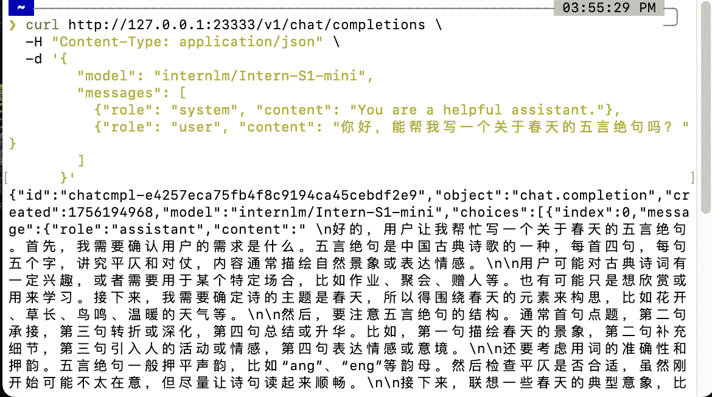

## QA

一些可能的 bug，可以尝试关掉现有的需要重新换一个新的开发机，下面是一些验证操作：

### bug1 :需安装环境

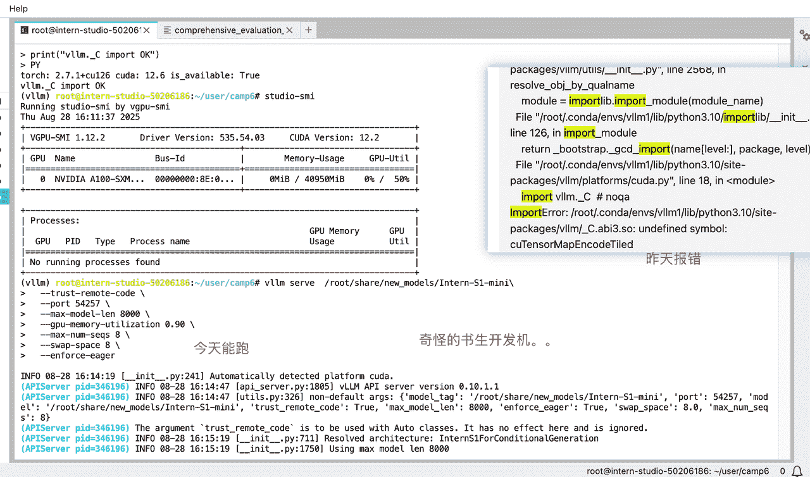

```
pip install vllm --upgrade
```

成功启动如下图：

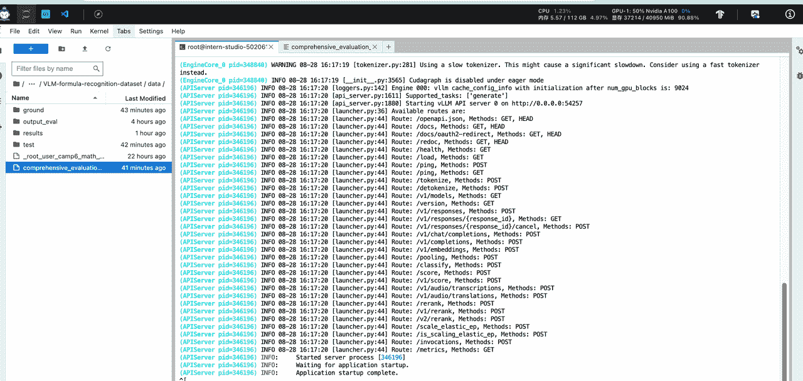

### bug2：指定 transformers 版本 4.55.4

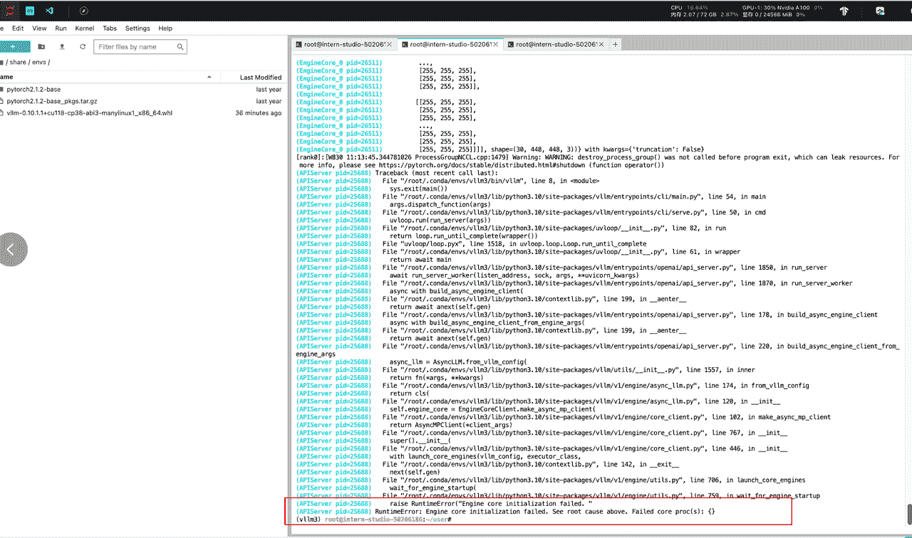

```
pip install transformers==4.55.4
```

#  LMDeploy 部署

## 开发机的选择

在创建开发机界面选择镜像为 Cuda12.2-conda，并选择 GPU 为 30%A100

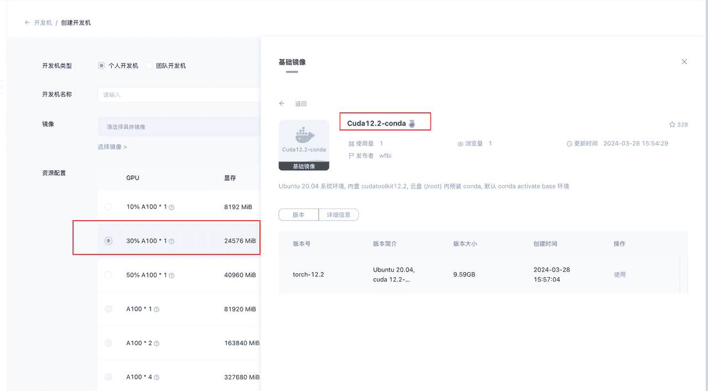

安装依赖

```
conda create -n lmdeploy python=3.10 -y
conda activate lmdeploy
```

```
pip install &quot;lmdeploy==0.9.2.post1&quot; &quot;transformers==4.55.2&quot;
```

## 启动

```
lmdeploy serve api_server /root/share/new_models/Intern-S1-mini \
    --reasoning-parser intern-s1 \
    --tool-call-parser intern-s1 \
    --cache-max-entry-count 0.1 \
    --max-batch-size 8 \
    --backend turbomind \
    --session-len 2048
```

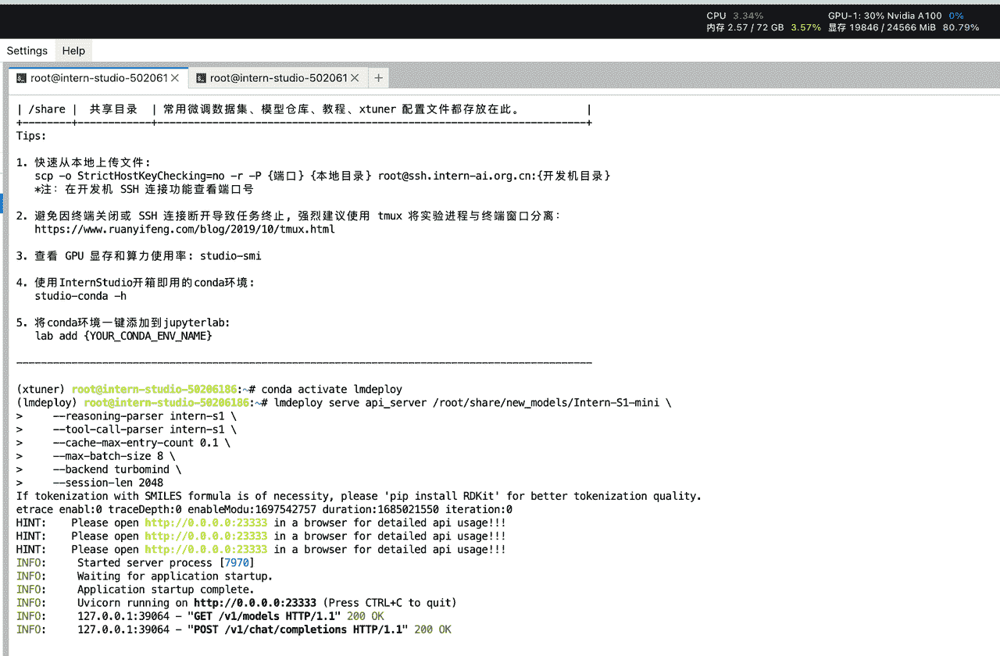

## 推理

```
from openai import OpenAI
import json

messages = [
{
    &#x27;role&#x27;: &#x27;user&#x27;,
    &#x27;content&#x27;: &#x27;who are you&#x27;
}, {
    &#x27;role&#x27;: &#x27;assistant&#x27;,
    &#x27;content&#x27;: &#x27;I am an AI&#x27;
}, {
    &#x27;role&#x27;: &#x27;user&#x27;,
    &#x27;content&#x27;: &#x27;AGI is?&#x27;
}]

openai_api_key = &quot;EMPTY&quot;
openai_api_base = &quot;http://0.0.0.0:23333/v1&quot;
client = OpenAI(
    api_key=openai_api_key,
    base_url=openai_api_base,
)
model_name = client.models.list().data[0].id

response = client.chat.completions.create(
    model=model_name,
    messages=messages,
    temperature=0.8,
    top_p=0.8,
    max_tokens=2048,
    extra_body={
        &quot;enable_thinking&quot;: False,
    }
)
print(json.dumps(response.model_dump(), indent=2, ensure_ascii=False))

```

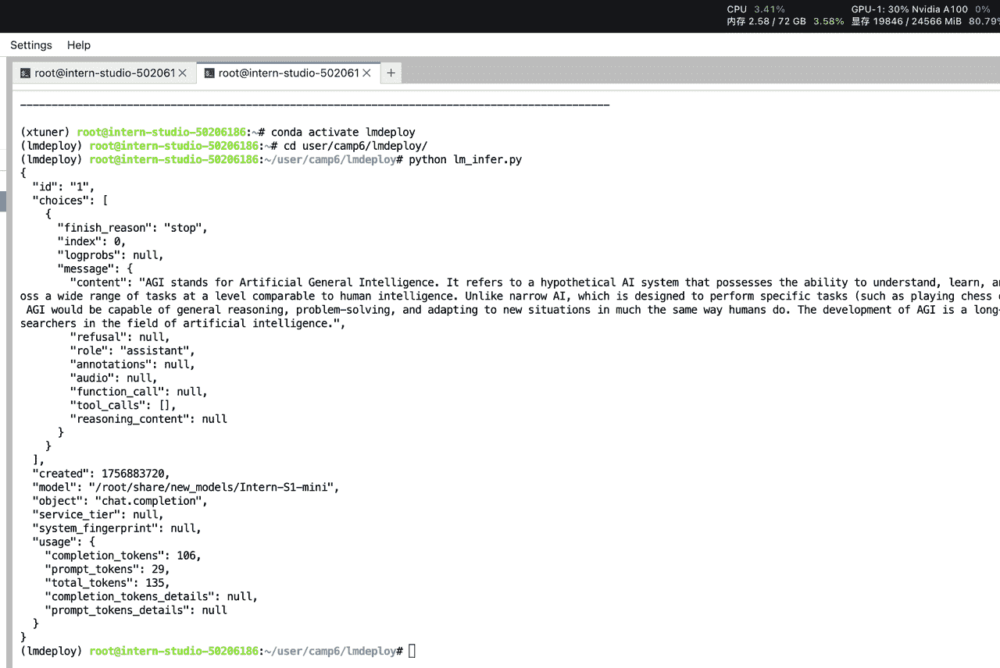

# SGLang 部署 Intern-S1-**mini**

## 开发环境配置

在创建开发机界面选择镜像为** Cuda11.7-conda**，并选择 GPU 为30% A100

如无算力配额，申请助教老师开通。

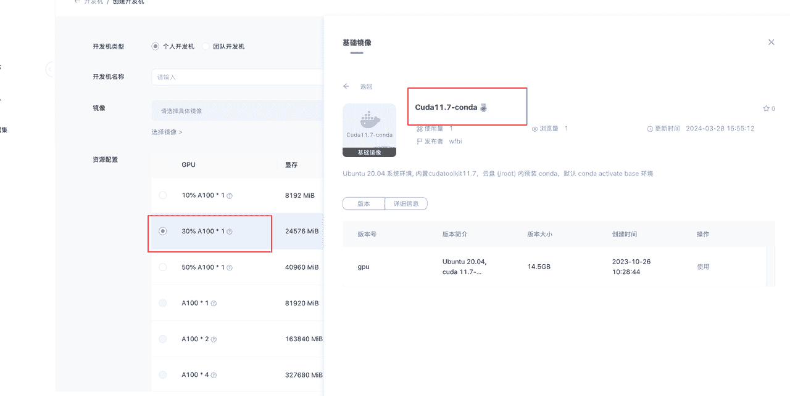

```
conda create -n sglang python=3.10 -y
conda activate sglang
```

```
uv pip install &quot;sglang[all]&gt;=0.5.2rc1&quot; -i https://pypi.tuna.tsinghua.edu.cn/simple
```

## 开始推理

```
python3 -m sglang.launch_server \
  --model-path /root/share/new_models/Intern-S1-mini \
  --trust-remote-code \
  --grammar-backend none \
  --attention-backend triton \
  --port 30001 \
  --max-total-tokens 2048 \
  --max-running-requests 4 \
  --chunked-prefill-size 512 \
  --disable-radix-cache \
  --cpu-offload-gb 4
```

```
import openai
client = openai.Client(
    base_url=&quot;http://127.0.0.1:30001/v1&quot;, api_key=&quot;EMPTY&quot;)

# Chat completion
response = client.chat.completions.create(
    model=&quot;default&quot;,
    messages=[
        {&quot;role&quot;: &quot;system&quot;, &quot;content&quot;: &quot;You are a helpful AI assistant&quot;},
        {&quot;role&quot;: &quot;user&quot;, &quot;content&quot;: &quot;List 3 countries and their capitals.&quot;},
    ],
    temperature=0,
    max_tokens=64,
)
print(response)
```

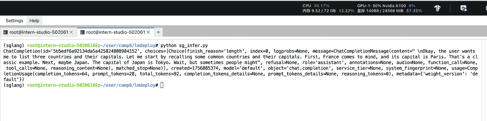

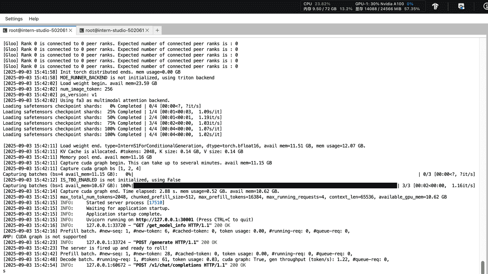

# 作业

基本要求：三选一完成即可

+   作业提交地址：https://aicarrier.feishu.cn/share/base/form/shrcnbguDXSzIZV5Dkapw39BJ0f

+   完成闯关练习助教批改后可获得 50 算力点激励。