# L2 OpenCompass 评测书生大模型实践

> 来源：[https://aicarrier.feishu.cn/docx/GJOgdmYY8ofPtkxOTpKctJ8mnod](https://aicarrier.feishu.cn/docx/GJOgdmYY8ofPtkxOTpKctJ8mnod)

本课程将带您掌握 OpenCompass 大模型评测平台的核心应用，从环境配置、数据集下载，到用配置脚本评测 Intern-s1 模型的 C-Eval 选择题，同时还会教学多模态模型评测工具VLMEvalKit ，对InternVL3_5-1B在MME 评测实操，让您从理论到实战全面落地模型评估。

# OpenCompass 概述

**OpenCompass**是由上海人工智能实验室开发的开源大模型评测平台，旨在全面评估大语言模型和多模态模型的能力。

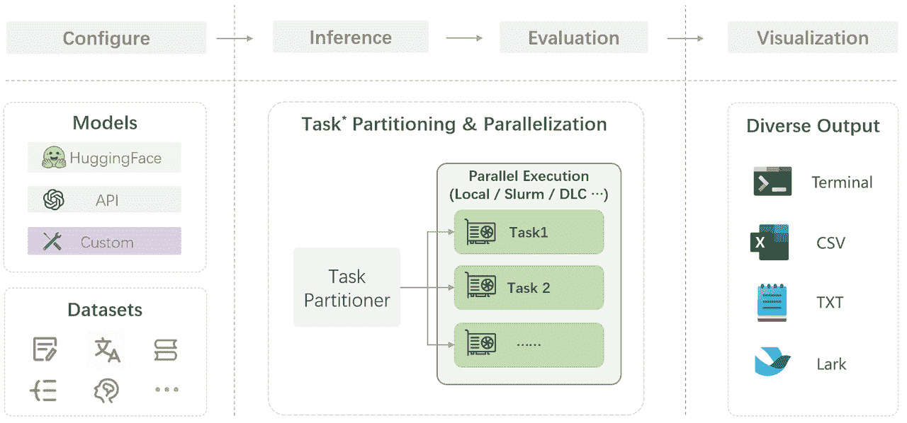

**在 **Open**Co**mpas**s **中评估一**个模型**通常包括以下几个阶段：配置 -> 推理 -> 评估 -> 可视化。

**配置**：这是整个工作流的起点。您需要配置整个评估过程，选择要评估的模型和数据集。此外，还可以选择评估策略、计算后端等，并定义显示结果的方式。

**推理与评估**：在这个阶段，OpenCompass 将**会开****始对**模型[和数据集进行并](https://opencompass.readthedocs.io/zh-cn/latest/get_started/faq.html#id6)行推理和评估。推理阶段主要是让模型从数据集产生输出，而评估阶段则是衡量这些输出与标准答案的匹配程度。这两个过程会被拆分为多个同时运行的“任务”以提高效率，但请注意，如果计算资源有限，这种策略可能会使评测变得更慢。如果需要了解该问题及解决方案，可以参考 FAQ: 效率。

**可视化**：评估完成后，OpenCompass 将结果整理成易读的表格，并将其保存为 CSV 和 TXT 文件。你也可以激活飞书状态上报功能，此后可以在飞书客户端中及时获得评测状态报告。

对于其他模型，请参考 [configs 目录](https://github.com/open-compass/opencompass/tree/main/configs) 中提供的其他示例。

# 评测环境配置

## 开发机的选择

在创建开发机界面选择镜像为 Cuda12.8-conda，并选择 GPU 为 30% A100。

如无算力配额，申请助教老师开通。开通后还是爆显存，调低batch size===1。

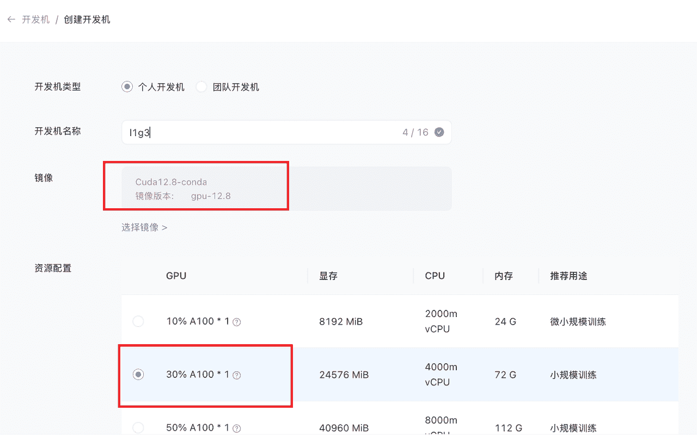

## 2.2 conda环境安装

```
**c**ond**a** create -n opencompass10 python=3.10
conda activate opencompass10

# 注意：一定要先 cd /root
cd /root
git clone -b 0.5.0 https://gh.llkk.cc/https://github.com/open-compass/opencompass.git opencompass
cd opencompass
pip install -e .
pip install opencompass[api]
pip install jmespath
```

# 评测不同类型的题目

## 3.0 数据集的下载

OpenCompass 支持的数据集主要包括三个部分：

1.  **Hugg**ingface 数据集： Huggingface Dataset 提供了大量的数据集，这部分数据集运行时会自动下载。

1.  ModelScope 数据集：ModelScope OpenCompass Dataset 支持从 ModelScope 自动下载数据集。

要启用此功能，请设置环境变量：export DATASET_SOURCE=ModelScope，可用的数据集包括（来源于 OpenCompassData-core.zip）：humaneval, triviaqa, commonsenseqa, tydiqa, strategyqa, cmmlu, lambada, piqa, ceval, math, LCSTS, Xsum, winogrande, openbookqa, AGIEval, gsm8k, nq, race, siqa, mbpp, mmlu, hellaswag, ARC, BBH, xstory_cloze, summedits, GAOKAO-BENCH, OCNLI, cmnli

1.  自建以及第三方数据集：OpenCom**pa**ss 还提供了一些第**三方数据集及**自建中文数据集。运行以下命令手动下载解压。

为了方便评测，我们首先将数据集下载到本地:

```
apt-get update &amp;&amp; apt-get install -y unzip
cd /root/opencompass
wget https://ghfast.top/https://github.com/open-compass/opencompass/releases/download/0.2.2.rc1/OpenCompassData-core-20240207.zip
unzip OpenCompassData-core-20240207.zip
```

将会在 OpenCompass 下看到data文件夹，里面包含的数据集如下图所示：

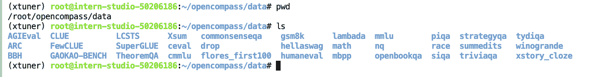

## 使用Intern-s1评测C-Eval 选择题

评测数据集为C-Eval，格式为csv，摘出部分内容如下所示：

有两种方式运行，命令行&&配置脚本运行。但如果要更高定制化需求，需要些配置脚本运行更合适。故下文用配置脚本 进行教学.

### 3.1.1 写配置脚本运行

OpenCompass 允许用户在配置文件中编写实验的完整配置脚本，并通过run.py直接运行它。

配置文件就像一个指令集，告诉评测系统用什么模型(model)测什么数据(datasets)。

用 read_base () 直接复用已有配置，不用重复编写。比如代码中通过 with read_base () 块，直接引入了 ceval 数据集和其他模型配置，再组合成当前所需的完整配置。

在opencompass/opencompass/configs文件夹下创建eval_tutorial_demo1.py

```
cd /root/opencompass/opencompass/configs
touch eval_tutorial_demo1.py
```

打开eval_tutorial_demo1.py 贴入以下代码

```
from mmengine.config import read_base
from opencompass.models import OpenAISDK

# 配置模型
models = [
    dict(
        type=OpenAISDK,
        path=&#x27;intern-s1&#x27;,  # 明确模型名称
        key=&#x27;sk-xxx&#x27;,  # 你的API密钥
        openai_api_base=&#x27;https://chat.intern-ai.org.cn/api/v1&#x27;,  # API地址
        rpm_verbose=True,
        query_per_second=1,  # 根据 rpm 限制,进行调整.rpm==30
        max_out_len=512,
        max_seq_len=4096,
        temperature=0.01,
        batch_size=10,# 根据 rpm 限制,进行调整.rpm==30
        retry=5,  # 增加重试次数
    )
]

# 配置数据集（只取每个子数据集的1个样本）
with read_base():
    from .datasets.ceval.ceval_gen import ceval_datasets

#datasets=ceval_datasets #测试完整的数据集

# 缩小数据集规模为五个子数据集，每个子数据集仅保留10个样本,缩短测评时间
datasets = []
for d in ceval_datasets[:5]:
    # 添加前缀标识这是演示用的精简数据集
    d[&#x27;abbr&#x27;] = &#x27;demo_&#x27; + d[&#x27;abbr&#x27;]
    # 仅使用第1个样本（索引0）
    d[&#x27;reader_cfg&#x27;][&#x27;test_range&#x27;] = &#x27;[0:10]&#x27;
    datasets.append(d)
 
```

因此，运行任务时，我们只需将配置文件的路径参数传递给 run.py：

```
cd /root/opencompass
python run.py opencompass/configs/eval_tutorial_demo1.py --debug
```

### 3.1.2 结果

因为只取了小部分数据集进行测试，5min左右就会出现一下结果：

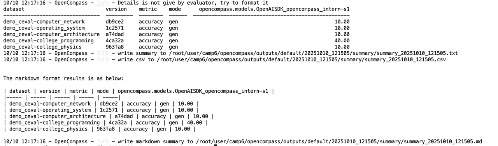

所有运行输出将定向到 outputs/ 目录，结构如下（下面为完整数据集测试输出图）：

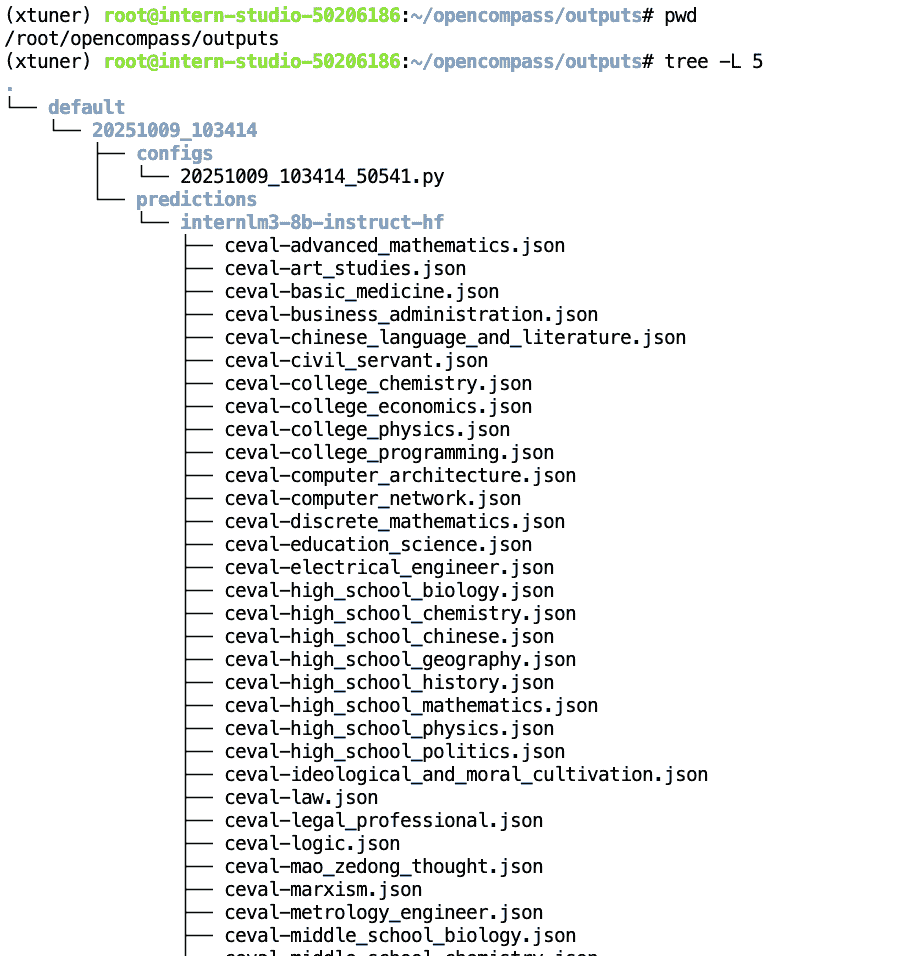

打印评测结果的过程可被进一步定制化，用于输出一些数据集的平均分 (例如 MMLU, C-Eval 等)。

[关于评测](https://opencompass.readthedocs.io/zh-cn/latest/user_guides/summarizer.html)结果输出的更多介绍可阅读 结果展示。

## 使用Intern-s1评测自建数据集进行

这里我们评测一下论文分类比赛的数据,newformat_sft_test_data.csv是A榜测试数据,将其放在/root/opencompass/newformat_sft_test_data.csv位置

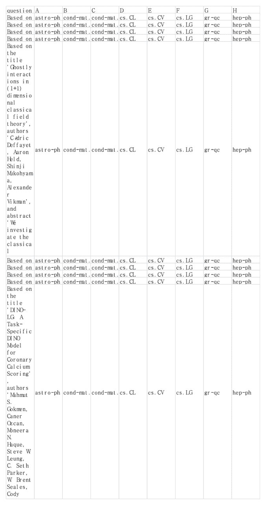

[newformat_sft_test_data.csv](https://internal-api-drive-stream.feishu.cn/space/api/box/stream/download/all/YOQUb7NRso3tEqxBUELc5UWYnhL)

在configs文件夹下创建eval_tutorial_demo2.py

```
cd /root/opencompass/opencompass/configs
touch eval_tutorial_demo2.py
```

```
from opencompass.models import OpenAISDK

# 配置模型
models = [
    dict(
        type=OpenAISDK,
        path=&#x27;intern-s1&#x27;,  # 明确模型名称
        key=&#x27;sk-xxxx&#x27;,  # 你的API密钥
        openai_api_base=&#x27;https://chat.intern-ai.org.cn/api/v1&#x27;,  # API地址
        rpm_verbose=True,
        query_per_second=1,  # 根据 rpm 限制,进行调整.rpm==30
        max_out_len=512,
        max_seq_len=4096,
        temperature=0.01,
        batch_size=8,# 根据 rpm 限制,进行调整.rpm==30
        retry=5,  # 增加重试次数
    )
]

# 配置数据集
datasets = [
    dict(
        path=&#x27;/root/opencompass/newformat_sft_test_data.csv&#x27;,
        data_type=&#x27;mcq&#x27;,
        infer_method=&#x27;gen&#x27;
    )
]
    
```

运行

```
#在opencompass目录下
python run.py opencompass/configs/eval_tutorial_demo2.py --debug
```

如果一切正常，大概 5min将会看到:

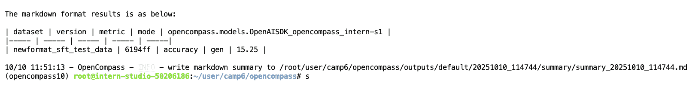

## 评测MME多模态题——InternVL3_5-1B评测实践

VLMEvalKit是一个专为大型视觉语言模型评测设计的开源工具包。它支持在各种基准测试上对大型视觉语言模型进行一键评估，无需进行繁重的数据准备工作，使评估过程更加简便。VLMEvalKit适用于图文多模态模型的评测，支持单对图文输入或是任意数量的图文交错输入。它通过实现70多个基准测试，覆盖了多种任务，包括但不限于图像描述、视觉问答、图像字幕生成等。

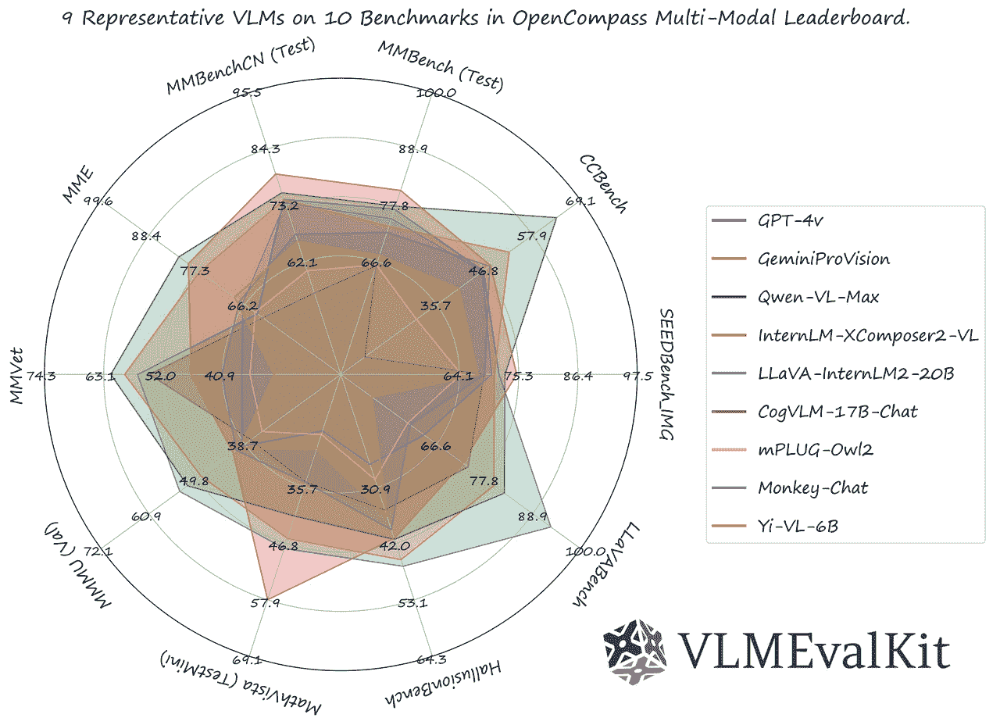

VLMEvalKit的主要用途包括以下几个方面：

1.  **多模态模型评估**：VLMEvalKit旨在为研究人员和开发人员提供一个用户友好且全面的框架，以评估现有的多模态模型并发布可重复的评估结果。它支持多种多模态模型和评测集，包括闭源和开源模型，以及多个多模态基准数据集。

1.  **模型性能比较**：通过VLMEvalKit，用户可以轻松比较不同多模态模型在各种任务上的性能。该工具包提供了详细的评测结果，并支持将结果发布在OpenCompass的多模态整体榜单上。

1.  **便捷的一站式评测**：VLMEvalKit支持一键式评测，无需手动进行数据预处理。用户只需一条命令即可完成对多个多模态模型和评测集的评测。

1.  **易于扩展**：VLMEvalKit框架支持轻松添加新的多模态模型和评测集。用户可以根据需要添加新的模型或评测集，并确保原有的评测集和模型仍然适用于新的模型或评测集。

1.  **支持多种模型和评测集**：VLMEvalKit支持超过三十个开源多模态模型和十余个开源多模态评测集，包括GPT-4v、GeminiPro、QwenVLPlus等主流模型和MME、MMBench、SEEDBench等评测集。

1.  **提供定量与定性结果**：VLMEvalKit不仅提供定量评测结果，还支持对模型的定性分析，帮助用户了解模型在特定任务上的表现和不足之处。

使用VLMEvalKit进行评测需要进行以下步骤：

### 环境准备

用以下命令安装依赖：

```
cd /root/opencompass
git clone https://gh.llkk.cc/https://github.com/open-compass/VLMEvalKit.git
conda create -n VLMEvalKit1 python=3.10
conda activate VLMEvalKit1
cd VLMEvalKit
pip install -e .  
pip install datasets transformers==4.56.1
```

> **注意：**

> 某些 VLM 可能无法在某些特定的 transformers 版本下运行，参考以下设置来评估对应的VLM:

+   **请用** t**ran**sformers==4.33.0 来运行: Qwen series, Monkey series, InternLM-XComposer Series, mPLUG-Owl2, OpenFlamingo v2, IDEFICS series, VisualGLM, MMAlaya, ShareCaptioner, MiniGPT-4 series, InstructBLIP series, PandaGPT, VXVERSE.

+   **请用** t**ran**sformers==4.37.0  来运行: LLaVA series, ShareGPT4V series, TransCore-M, LLaVA (XTuner), CogVLM Series, EMU2 Series, Yi-VL Series, MiniCPM-[V1/V2], OmniLMM-12B, DeepSeek-VL series, InternVL series, Cambrian Series, VILA Series, Llama-3-MixSenseV1_1, Parrot-7B, PLLaVA Series.

+   **请用** t**ran**sformers==4.40.0  来运行: IDEFICS2, Bunny-Llama3, MiniCPM-Llama3-V2.5, 360VL-70B, Phi-3-Vision, WeMM.

+   **请用** t**ran**sformers==latest 来运行: LLaVA-Next series, PaliGemma-3B, Chame3leon series, Video-LLaVA-7B-HF, Ovis series, Mantis series, MiniCPM-V2.6, OmChat-v2.0-13B-sinlge-beta, Idefics-3, GLM-4v-9B, VideoChat2-HD.

### 修改文件

在$VLMEvalKit/vlmeval/config.py文件中设置在 VLMEvalKit 中支持的 VLM 名称，以及模型路径。

如果你的电脑上面没有该模型的模型文件，则需要自己下载，然后更改模型路径，也可以不修改，在运行模型评测命令的时候会自动下载模型文件。

> 注：默认下载使用的是Huggingface，需要进行科学上网，也可以使用modelscope将模型下载到本地，然后更改路径。

修改VLMEvalKit/vlmeval/config.py下红框所示为

```
&quot;InternVL3_5-1B&quot;: partial(InternVLChat, model_path=&quot;/root/share/new_models/InternVL3.5/InternVL3_5-1B&quot;, version=&quot;V2.0&quot;
    ),
```

如图所示：

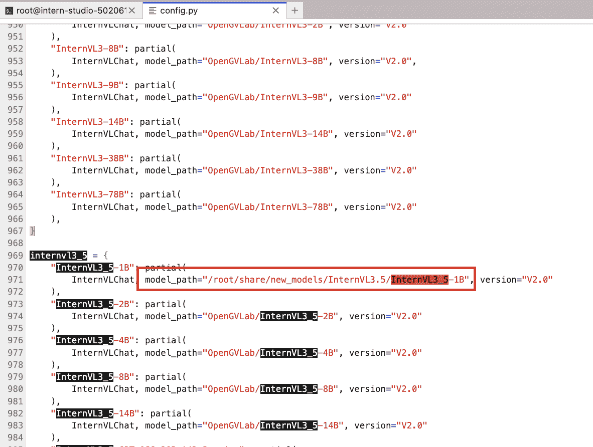

将所要评测的模型路径设置好以后就可以开始评测了。

### 模型评测

模型评测时可以使用 python 或 torchrun 来运行脚本，使用 python 运行时，只实例化一个 VLM，并且它可能使用多个 GPU。使用 torchrun 运行时，每个 GPU 上实例化一个 VLM 实例，这可以加快推理速度。

这里我们在 MME 上 进行推理和评估。

MME涵盖了感知和认知能力的考察。除了OCR外，感知包括对粗粒度和细粒度对象的识别。前者识别对象的存在、数量、位置和颜色。后者识别电影海报、名人、场景、地标和艺术作品。认知包括常识推理、数值计算、文本翻译和代码推理。总共有14个子任务。

使用以下命令开始评测：

```
python run.py --data MME --model InternVL3_5-1B --verbose
```

> **参数解释：**

+   --data (list[str]): 设置在 VLMEvalKit 中支持的数据集名称（在 vlmeval/utils/dataset_config.py 中定义）

+   --model (list[str]): 设置在 VLMEvalKit 中支持的 VLM 名称（在 vlmeval/config.py 中的 supported_VLM 中定义）

+   --mode (str, 默认值为 'all', 可选值为 ['all', 'infer'])：当 mode 设置为 "all" 时，将执行推理和评估；当设置为 "infer" 时，只执行推理

+   --nproc (int, 默认值为 4): 调用 API 的线程数

+   --work-dir (str, default to '.'): 存放测试结果的目录

+   --nframe (int, default to 8): 从视频中采样的帧数，仅对视频多模态评测集适用

+   --pack (bool, store_true): 一个视频可能关联多个问题，如 pack==True，将会在一次询问中提问所有问题

命令运行以后大约需要半小时的时间完成评测，评估结果将作为日志打印出来。

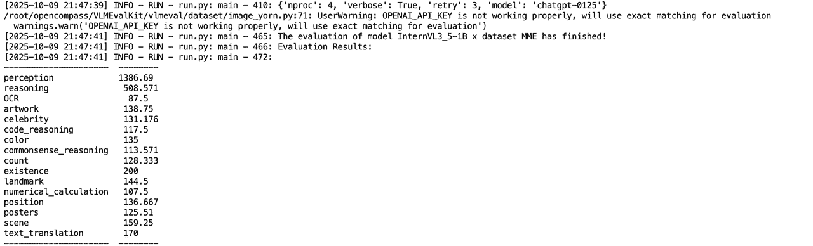

此外，**结果文件**也会在目录 VLMEvalKit/outputs/InternVL3_5-1B 中生成。以 .csv 结尾的文件包含评估的指标。

InternVL3_5-1B的MME数据集的评估结果如下：

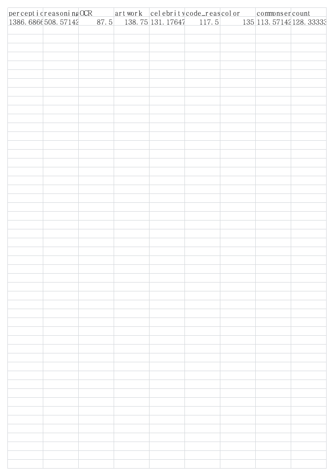

[InternVL3_5-1B_MME_score.csv](https://internal-api-drive-stream.feishu.cn/space/api/box/stream/download/all/QRv5bTRw6oRjQMxXVBEcXxaCnMf)

# 闯关任务

+   使用 OpenCompass 评测 Intern-s1(C-Eval数据集) 和 InternVL（MME数据集） 并在飞书文档中详细记录到飞书文档

+   进阶 完成3.2 自建数据集的评测

提交地址：https://aicarrier.feishu.cn/share/base/form/shrcnbguDXSzIZV5Dkapw39BJ0f

参考:

第五期:[L1G2-OpenCompass 评测书生大模型实践](https://aicarrier.feishu.cn/wiki/ZW3KwXZn8iDRPlkMKXZcARHunWg)

官方文档:https://opencompass.readthedocs.io/en/latest/get_started/installation.html#