# 沐曦（XTuner 版本 ）InternVL 微调公式识别 练习赛

> 来源：[https://aicarrier.feishu.cn/docx/D1eFdZSUio3wu9xpsI7cz4L0ngd](https://aicarrier.feishu.cn/docx/D1eFdZSUio3wu9xpsI7cz4L0ngd)

# 环境配置

算力券联系  领取！！！

## 创建算力实例

平台地址：http://d.run

### 创建算力开发机

【算力云】-【算力市场】-【上海六区】，选择MXC500，点击【立即购买】

镜像选择 **sglang**

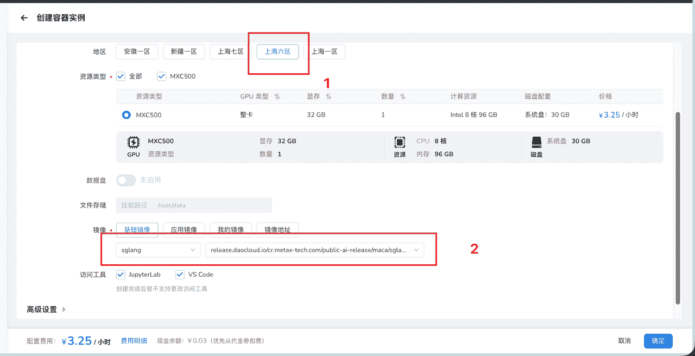

## 环境安装

安装必要的包:

```
cd /root/data
# 安装 git
apt update &amp;&amp; apt install -y git
apt install tmux -y
git clone https://github.com/InternLM/xtuner.git
cd xtuner
git checkout 4990d05c5a5416fbfd51fee9e6cf502c66947099
pip install -e . -i https://pypi.mirrors.ustc.edu.cn/simple/
pip install modelscope -i https://pypi.mirrors.ustc.edu.cn/simple/
```

pip 下载速度慢可以试试换源，如清华、阿里、中科院、上交等等，哪个快用哪个。

## 模型和数据集下载

```
modelscope download --model OpenGVLab/InternVL3_5-1B-HF --local_dir /root/data/model/InternVL3_5-1B-HF
modelscope download --dataset JimmyMa99/VLM-formula-recognition-dataset_intern_camp --local_dir  /root/data/dataset/VLM-formula-recognition-dataset_intern_camp
```

```
cd /root/data
git clone https://gh.llkk.cc/https://github.com/fak111/VLM-formula-recognition-dataset.git
cd VLM-formula-recognition-dataset
python fix.py #将数据集改造成 xtuner 格式
```

数据集的json 文件需要转化处理,转化成 xtuner 格式：

```
head -n 1 /root/data/dataset/VLM-formula-recognition-dataset_intern_camp/train/train_mini.jsonl
head -n 1 /root/data/dataset/VLM-formula-recognition-dataset_intern_camp/train/train_mini_xt.jsonl
```

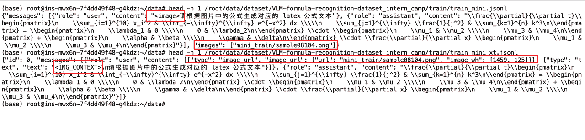

# InternVL3_5-1B-HF 微调

## 修改 xtuner 环境变量设置

得改xtuner/xtuner/v1/utils/env_check.py有关triton环境变量的代码,复制下面的代码替换源码即可:

```
from typing import Any, Callable, List

def check_torch_accelerator_available():
    &quot;&quot;&quot;Check if PyTorch is installed and the torch accelerator is available.

    Returns:
        bool: True if PyTorch is installed and the torch accelerator is available, False otherwise.
    &quot;&quot;&quot;
    try:
        import torch

        return torch.accelerator.is_available()
    except Exception:
        return False

def check_triton_available():
    &quot;&quot;&quot;Check if Triton is installed.

    Returns:
        bool: True if Triton is installed, False otherwise.
    &quot;&quot;&quot;
    import os

    if os.environ.get(&quot;XTUNER_USE_TRITON&quot;, &quot;1&quot;) == &quot;0&quot;:
        return False

    try:
        import triton  # noqa: F401

        return True
    except ImportError:
        return False

def get_env_not_available_func(env_name_list: List[str]) -&gt; Callable:
    &quot;&quot;&quot;Get a function that raises an error indicating the environment is not
    available.

    Returns:
        function: A function that raises a RuntimeError when called.
    &quot;&quot;&quot;

    def env_not_available_func(*args: Any, **kwargs: Any) -&gt; Any:
        raise RuntimeError(f&quot;{&#x27; or &#x27;.join(env_name_list)} in environment is not available.&quot;)

    return env_not_available_func

def get_rollout_engine_version() -&gt; dict:
    import os

    if os.environ.get(&quot;XTUNER_USE_LMDEPLOY&quot;, &quot;0&quot;) == &quot;1&quot;:
        import lmdeploy

        version = lmdeploy.__version__
        return {&quot;lmdeploy_version&quot;: version}
    elif os.environ.get(&quot;XTUNER_USE_SGLANG&quot;, &quot;0&quot;) == &quot;1&quot;:
        import sglang

        version = sglang.__version__
        return {&quot;sglang_version&quot;: version}
    elif os.environ.get(&quot;XTUNER_USE_VLLM&quot;, &quot;0&quot;) == &quot;1&quot;:
        import vllm

        version = vllm.__version__
        return {&quot;vllm_version&quot;: version}
    else:
        return {}

```

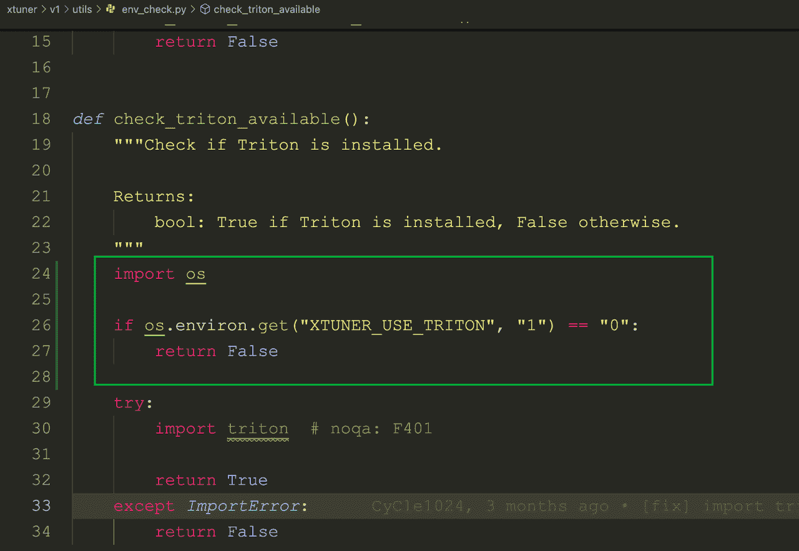

## 启动微调

```
from xtuner.v1.model import InternVL3P5Dense1BConfig
from xtuner.v1.train import Trainer, TrainerConfig
from xtuner.v1.config import AdamWConfig, LRConfig
from xtuner.v1.datasets import InternS1VLTokenizeFnConfig, DataloaderConfig, DatasetConfig
from xtuner.v1.loss import CELossConfig
import sys
# model config - 启用梯度检查点
model_cfg = InternVL3P5Dense1BConfig(
    freeze_vision=True, freeze_projector=False, freeze_language=False
)
# dataset and dataloader config
sample_max_length = 5000
pack_max_length = 5000

dataset_config = [
    {
        &quot;dataset&quot;: DatasetConfig(
            name=&quot;formula_recognition&quot;,
            anno_path=&quot;/root/data/dataset/VLM-formula-recognition-dataset_intern_camp/train/train_mini_xt.jsonl&quot;,
            media_root=&quot;/root/data/dataset/VLM-formula-recognition-dataset_intern_camp/train/&quot;,
            sample_ratio=1.0,
            class_name=&quot;VLMJsonlDataset&quot;,
        ),
        # 使用 InternVL3.5 模板，确保 prompt 与视觉 token 对齐
        &quot;tokenize_fn&quot;: InternS1VLTokenizeFnConfig(
            model_cfg=model_cfg,
            max_length=sample_max_length,
            template_name=&quot;internvl-3.5&quot;,
        ),
    }
]
dataloader_config = DataloaderConfig(
    dataset_config_list=dataset_config,
    pack_max_length=pack_max_length,
    num_workers=16,
    pack_level=&quot;soft&quot;,
    collator=&quot;intern_s1_vl_sft_collator&quot;,
)

# 优化学习率配置 - 提高学习率以加快收敛
optim_cfg = AdamWConfig(
    lr=1e-6,           # 
    weight_decay=0.01, # 添加权重衰减防止过拟合
    betas=(0.9, 0.95), # 优化Adam参数
    foreach=False
)
lr_cfg = LRConfig(
    lr_type=&quot;cosine&quot;,
    warmup_ratio=0.1,  # 增加warmup比例，让模型更稳定地开始训练
    min_lr_ratio=0.1   # 添加最小学习率比例
)


load_from = &quot;/root/data/model/InternVL3_5-1B-HF&quot;
tokenizer = &quot;/root/data/model/InternVL3_5-1B-HF&quot;

# trainer config
trainer = TrainerConfig(
    load_from=load_from,
    model_cfg=model_cfg,
    optim_cfg=optim_cfg,
    dataloader_cfg=dataloader_config,
    lr_cfg=lr_cfg,
    tokenizer_path=tokenizer,
    global_batch_size=8,
    gradient_accumulation_steps=4,
    total_epoch=5,
    work_dir=&quot;/root/data/workdir/vl_1119/&quot;,
    loss_cfg=CELossConfig(mode=&quot;chunk&quot;, chunk_size=1024),
    hf_interval=50,
    hf_max_keep=3,
)
trainer = Trainer.from_config(trainer)
# 检查模型是否正确加载了预训练权重
print(f&quot;Model device: {next(trainer._engine.model.        parameters()).device}&quot;)
print(f&quot;Model dtype: {next(trainer._engine.model.parameters()).dtype}&quot;)
# sys.exit(0)
trainer.fit()
```

选手可以修改vl.py 进行模型、数据集、优化器配置，进行训练。

```
export XTUNER_USE_TRITON=0  # avoid error:ValueError: &#x27;K&#x27; is not in list
torchrun --nproc-per-node 1 vl.py
```

### 训练策略

笔者在这里演示的微调是训练projector和 llm 部分，冻结视觉部分，选手可以自行探索策略～

```
model_cfg = InternVL3P5Dense1BConfig(
    use_gradient_checkpointing=True, freeze_vision=True, freeze_projector=False, freeze_language=True
)

```

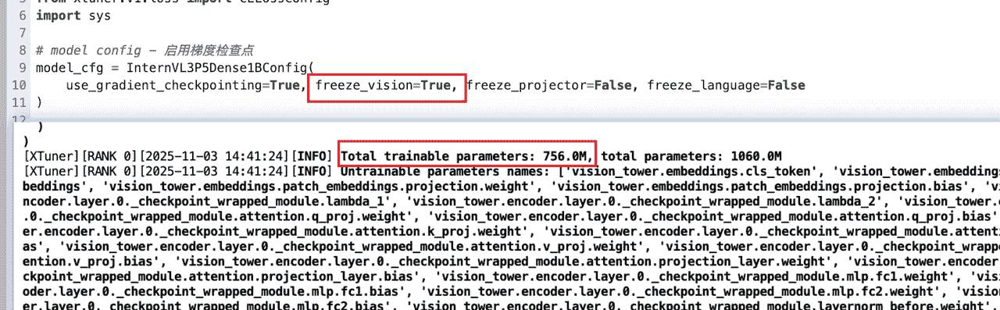

### 参赛提醒

本文方法受限于个人水平，未必最为高效。选手若想获得更佳效果，需自行探索如从构造高质量数据集、尝试不同的训练参数等方面自行探索与优化。

## 测试推理

```
import os
os.environ[&quot;USE_FLASH_ATTENTION&quot;] = &quot;0&quot;

from PIL import Image
from transformers import AutoProcessor, AutoModelForImageTextToText
import torch

model_name = &quot;/root/data/workdir/vlhf1031/20251031101422/hf-200&quot;

# 加载处理器和模型
processor = AutoProcessor.from_pretrained(model_name, trust_remote_code=True)
model = AutoModelForImageTextToText.from_pretrained(
    model_name, 
    device_map=&quot;auto&quot;, 
    torch_dtype=torch.bfloat16,  # 使用 torch_dtype 而不是 dtype
    trust_remote_code=True,
    attn_implementation=&quot;eager&quot;  # 禁用 flash attention
)

# 加载图像
image = Image.open(&quot;/root/data/dataset/VLM-formula-recognition-dataset_intern_camp/train/mini_train/sample19996.png&quot;)
prompt = &quot;describle this img&quot;

messages = [
    {
        &quot;role&quot;: &quot;user&quot;,
        &quot;content&quot;: [
            {&quot;type&quot;: &quot;image&quot;, &quot;image&quot;: image},
            {&quot;type&quot;: &quot;text&quot;, &quot;text&quot;: prompt},
        ],
    }
]

# 处理输入
inputs = processor.apply_chat_template(
    messages,
    add_generation_prompt=True,
    tokenize=True,
    return_dict=True,
    return_tensors=&quot;pt&quot;
).to(model.device)

# 确保输入数据类型与模型一致
inputs = {k: v.to(dtype=torch.bfloat16) if v.dtype == torch.float32 else v for k, v in inputs.items()}

# 生成
with torch.inference_mode():
    generate_ids = model.generate(**inputs, max_new_tokens=200)

decoded_output = processor.decode(generate_ids[0, inputs[&quot;input_ids&quot;].shape[1]:], skip_special_tokens=True)
print(&quot;current model: &quot;, model_name)
print(decoded_output)
```

运行模型进行推理，若模型输出正常且结果满意，即可提交。

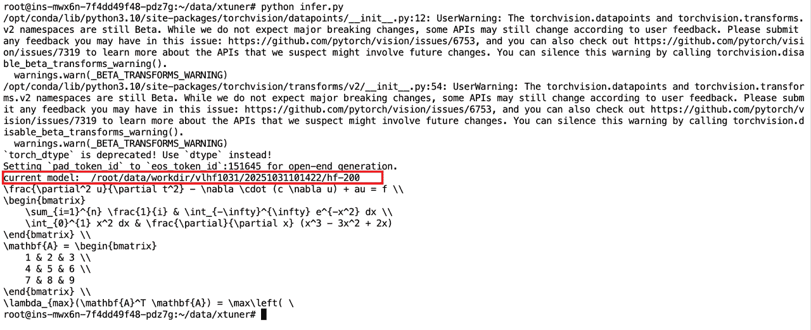

或者测这张图片：


# 提交结果

## 上传

运行upload.py 上传模型

```
from modelscope.hub.api import HubApi
from modelscope.hub.constants import Licenses, ModelVisibility

YOUR_ACCESS_TOKEN = &#x27;YOUR_ACCESS_TOKEN&#x27; #这边填你的modelscope token
api = HubApi()
api.login(YOUR_ACCESS_TOKEN)

owner_name = &#x27;your_owner_name&#x27;   #这边填你的modelscope用户名
model_name = &#x27;your_model_name&#x27;   #这边填模型名，自己起
model_id = f&quot;{owner_name}/{model_name}&quot;

api.create_model(
    model_id,
    visibility=ModelVisibility.PUBLIC,
    license=Licenses.APACHE_V2,
)

api.upload_folder(
    repo_id=f&quot;{owner_name}/{model_name}&quot;,
    folder_path=&#x27;path&#x27;,   #这边填sft后的模型路径地址
    commit_message=&#x27;upload model folder to repo&#x27;,
)
```

提交表单的 prompt 参考如下,这里也有优化空间，可自行探索最优 prompt：

```
请根据图片中的公式生成对应的 latex 公式文本
```

## 参赛流程

### 报名

点击以下链接进行报名,获取 uid

https://colearn.intern-ai.org.cn/set?s=gamef

### 提交参赛权重

微调后的权重请从以下链接入口提交，不要填写链接，参考截图。

**提交表单**：https://aicarrier.feishu.cn/share/base/form/shrcnXjK6zERK7z4pPU85PLO80c

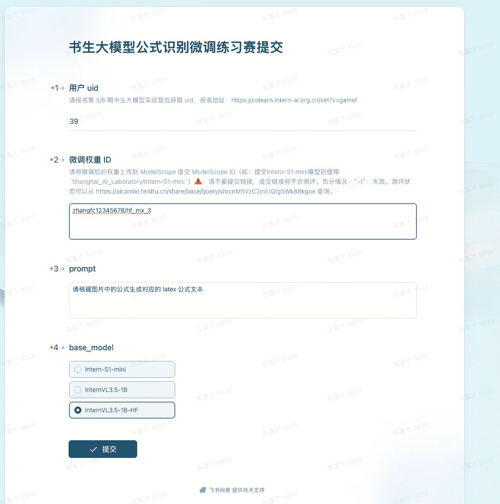

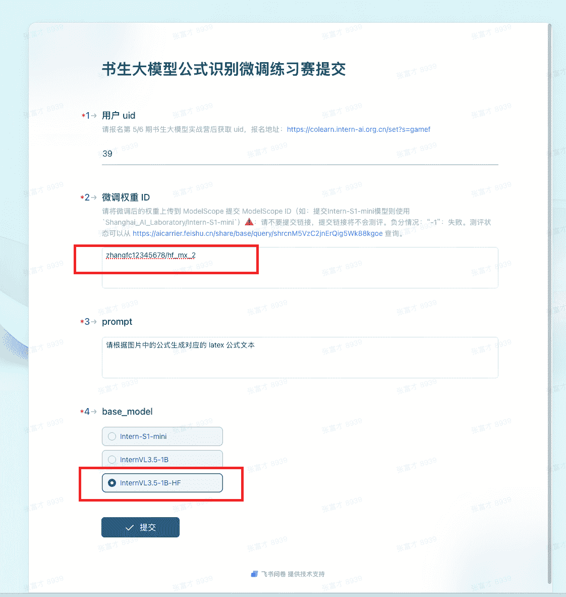

注意：需要选择好 base model，本次比赛请选择 InternVL3_5-1B-HF ，如提交其他会出现测评异常情况！

本次测评会提取模型返回中的**最后一个 latex 块**

```
```latex
E = mc^2
```
```

提交完成，等待后台半小时左右评测，最终获得成绩🎉🎉

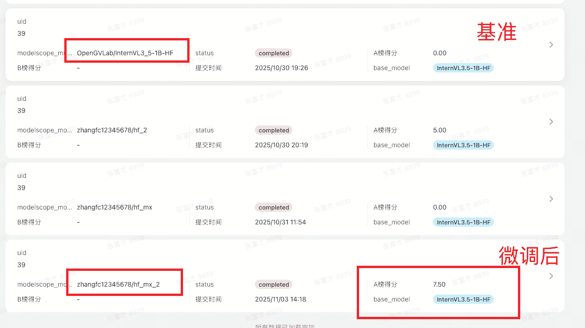

微调后有较大提升：

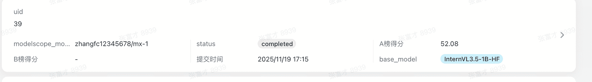

### 查看状态/分数

点击以下链接

https://aicarrier.feishu.cn/share/base/query/shrcnM5VzC2jnErQig5Wk88kgoe

进行查看，输入你的 uid，比如闻星（uid：4）


在这里能够查看状态


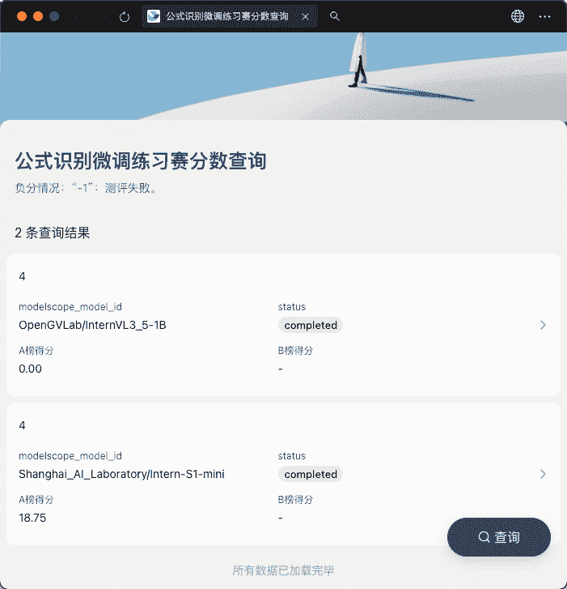

### 排行榜

https://aicarrier.feishu.cn/share/base/dashboard/shrcnrA82hMMRd1FUuWs8EhOjag

<https://aicarrier.feishu.cn/share/base/dashboard/shrcnrA82hMMRd1FUuWs8EhOjag?iframeFrom=docx&ccm_open=iframe>

## QA

### 日志

该缺陷可能导致日志写入功能异常，但不会影响模型的正常保存。

```
--- Logging error in Loguru Handler #2 ---
Record was: {&#x27;elapsed&#x27;: datetime.timedelta(seconds=2588, microseconds=214180), &#x27;exception&#x27;: None, &#x27;extra&#x27;: {}, &#x27;file&#x27;: (name=&#x27;trainer.py&#x27;, path=&#x27;/root/data/xtuner/xtuner/v1/train/trainer.py&#x27;), &#x27;function&#x27;: &#x27;_log_step&#x27;, &#x27;level&#x27;: (name=&#x27;INFO&#x27;, no=20, icon=&#x27;ℹ️&#x27;), &#x27;line&#x27;: 1026, &#x27;message&#x27;: &#x27;Step 102/290 data_time: 0.0009 lr: 2.488710e-05 time: 25.4424 text_tokens: 31805.0 total_loss: 0.20077972, reduced_llm_loss: 0.20077972, loss: 0.20077971 max_memory: 21.07 GB reserved_memory: 26.62 GB grad_norm: 0.88643903 tgs: 1250.1 e2e_tgs: 1248.5 eta: 1:19:09 &#x27;, &#x27;module&#x27;: &#x27;trainer&#x27;, &#x27;name&#x27;: &#x27;xtuner.v1.train.trainer&#x27;, &#x27;process&#x27;: (id=135707, name=&#x27;MainProcess&#x27;), &#x27;thread&#x27;: (id=139894268028736, name=&#x27;MainThread&#x27;), &#x27;time&#x27;: datetime(2025, 10, 31, 10, 57, 27, 496673, tzinfo=datetime.timezone(datetime.timedelta(seconds=28800), &#x27;CST&#x27;))}
Traceback (most recent call last):
  File &quot;/opt/conda/lib/python3.10/site-packages/loguru/_handler.py&quot;, line 206, in emit
    self._sink.write(str_record)
  File &quot;/opt/conda/lib/python3.10/site-packages/loguru/_file_sink.py&quot;, line 206, in write
    self._file.write(message)
OSError: [Errno 9] Bad file descriptor
--- End of logging error ---
[XTuner][RANK 0][2025-10-31 10:57:27][INFO] Step 102/290 data_time: 0.0009 lr: 2.488710e-05 time: 25.4424 text_tokens: 31805.0 total_loss: 0.20077972, reduced_llm_loss: 0.20077972, loss: 0.20077971 max_memory: 21.07 GB reserved_memory: 26.62 GB grad_norm: 0.88643903 tgs: 1250.1 e2e_tgs: 1248.5 eta: 1:19:09 
--- Logging error in Loguru Handler #2 ---
Record was: {&#x27;elapsed&#x27;: datetime.timedelta(seconds=2600, microseconds=218344), &#x27;exception&#x27;: None, &#x27;extra&#x27;: {}, &#x27;file&#x27;: (name=&#x27;jsonl_writer.py&#x27;, path=&#x27;/root/data/xtuner/xtuner/v1/_writer/jsonl_writer.py&#x27;), &#x27;function&#x27;: &#x27;_run&#x27;, &#x27;level&#x27;: (name=&#x27;WARNING&#x27;, no=30, icon=&#x27;⚠️&#x27;), &#x27;line&#x27;: 140, &#x27;message&#x27;: &#x27;Exception occurred during flushing /root/data/workdir/vlhf1031/20251031101422/logs/exp_tracking/rank0/tracker.jsonl&#x27;, &#x27;module&#x27;: &#x27;jsonl_writer&#x27;, &#x27;name&#x27;: &#x27;xtuner.v1._writer.jsonl_writer&#x27;, &#x27;process&#x27;: (id=135707, name=&#x27;MainProcess&#x27;), &#x27;thread&#x27;: (id=139877717894720, name=&#x27;JsonlWriterAsync&#x27;), &#x27;time&#x27;: datetime(2025, 10, 31, 10, 57, 39, 500837, tzinfo=datetime.timezone(datetime.timedelta(seconds=28800), &#x27;CST&#x27;))}
Traceback (most recent call last):
  File &quot;/root/data/xtuner/xtuner/v1/_writer/jsonl_writer.py&quot;, line 138, in _run
    writer._file_writer.flush()
OSError: [Errno 9] Bad file descriptor

During handling of the above exception, another exception occurred:

Traceback (most recent call last):
  File &quot;/opt/conda/lib/python3.10/site-packages/loguru/_handler.py&quot;, line 206, in emit
    self._sink.write(str_record)
  File &quot;/opt/conda/lib/python3.10/site-packages/loguru/_file_sink.py&quot;, line 206, in write
    self._file.write(message)
OSError: [Errno 9] Bad file descriptor
--- End of logging error ---
[XTuner][RANK 0][2025-10-31 10:57:39][WARNING] Exception occurred during flushing /root/data/workdir/vlhf1031/20251031101422/logs/exp_tracking/rank0/tracker.jsonl

```

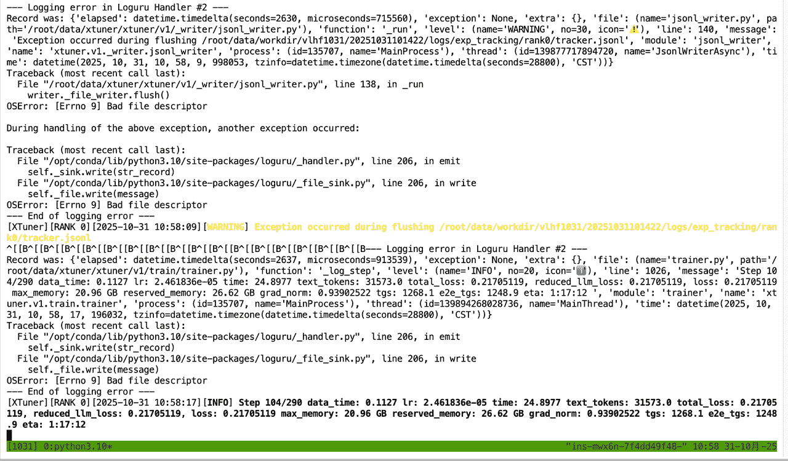

### 分数不够高

笔者也尝试调低 lr,最终排查是数据集的格式问题，转化成 xtuner数据集格式代码如下：

```
&quot;&quot;&quot;
将数据集格式转成如下 xtuner 格式(https://xtuner.readthedocs.io/zh-cn/latest/get_started/mllm_sft.html):
{&quot;id&quot;: 0, &quot;messages&quot;: [{&quot;role&quot;: &quot;user&quot;, &quot;content&quot;: &quot;The distance between two stars is 6.52 \u00d7 10^5 light years. What is the distance between the two stars in parsecs? (1 parsec = 3.26 light years)\nAnswer Choices: (A) 2 \u00d7 10^5 (B) 4 \u00d7 10^6 (C) 5 \u00d7 10^7 (D) 7 \u00d7 10^7 (E) 9 \u00d7 10^8&quot;}, {&quot;from&quot;: &quot;assistant&quot;, &quot;value&quot;: &quot;Let&#x27;s think about the multi-choice question.\n6.52 \u00d7 10^5 ly / (3.26 ly/parsec) = 2 x 10^5 persec\nThe answer is A.&quot;}]}
{&quot;id&quot;: 1, &quot;messages&quot;: [{&quot;role&quot;: &quot;user&quot;, &quot;content&quot;: &quot;How many ways can the letters in the word COMMON be arranged?\nAnswer Choices: (A) 6 (B) 30 (C) 90 (D) 120 (E) 180&quot;}, {&quot;from&quot;: &quot;assistant&quot;, &quot;value&quot;: &quot;Let&#x27;s solve the multi-choice question step by step.\nAccording to the above the # of permutations of 6 letters COMMON out of which 2 O&#x27;s and 2 M&#x27;s are identical is 6!2!\u22172!=180\nThe answer is E.&quot;}]}
{&quot;id&quot;: 2, &quot;messages&quot;: [{&quot;role&quot;: &quot;user&quot;, &quot;content&quot;: [{&quot;type&quot;: &quot;image_url&quot;, &quot;image_url&quot;: {&#x27;url&#x27;:&quot;resource/mscoco_dog_000000319154.jpg&quot;,&quot;image_wh&quot;: [375, 500]}}, {&quot;type&quot;: &quot;text&quot;, &quot;text&quot;: &quot;&lt;IMG_CONTEXT&gt;\n图片中的狗是什么颜色？&quot;}]}, {&quot;role&quot;: &quot;assistant&quot;, &quot;content&quot;: &quot;图片中的狗是棕色的。&quot;}, {&quot;role&quot;: &quot;user&quot;, &quot;content&quot;: &quot;这只狗有什么类型的项圈？&quot;}, {&quot;role&quot;: &quot;assistant&quot;, &quot;content&quot;: &quot;这只狗有一条红色的项圈。&quot;}, {&quot;role&quot;: &quot;user&quot;, &quot;content&quot;: &quot;那只狗在窗后的位置是什么？&quot;}, {&quot;role&quot;: &quot;assistant&quot;, &quot;content&quot;: &quot;那只狗正坐在窗户后面。&quot;}, {&quot;role&quot;: &quot;user&quot;, &quot;content&quot;: &quot;那只狗望着窗外时，它的表情是怎样的？&quot;}, {&quot;role&quot;: &quot;assistant&quot;, &quot;content&quot;: &quot;当狗凝视窗外的时候，它看起来是在渴望着什么东西。 这也许暗示了它想要到外面去或者与某人或某物进行互动。&quot;}, {&quot;role&quot;: &quot;user&quot;, &quot;content&quot;: &quot;你能描述一下狗的毛吗？&quot;}, {&quot;role&quot;: &quot;assistant&quot;, &quot;content&quot;: &quot;这只狗有蓬松、毛茸茸的棕色皮毛，使它看起来既可爱又温顺。&quot;}]}
{&quot;id&quot;: 3, &quot;messages&quot;: [{&quot;role&quot;: &quot;user&quot;, &quot;content&quot;: [{&quot;type&quot;: &quot;image_url&quot;, &quot;image_url&quot;: {&#x27;url&#x27;:&quot;resource/mscoco_dog_000000319154.jpg&quot;,&quot;image_wh&quot;: [375, 500]}}, {&quot;type&quot;: &quot;text&quot;, &quot;text&quot;: &quot;&lt;IMG_CONTEXT&gt;\n图片中的狗是什么颜色？&quot;}]}, {&quot;role&quot;: &quot;assistant&quot;, &quot;content&quot;: &quot;图片中的狗是棕色的。&quot;}]}
&quot;&quot;&quot;

import json
import os
from PIL import Image

# 1. 定义路径
dataset_root = &quot;/root/data/dataset/VLM-formula-recognition-dataset_intern_camp&quot;
# 图片所在的根目录，对应 vl.py 中的 media_root
media_root = os.path.join(dataset_root, &quot;train&quot;)

input_file = os.path.join(dataset_root, &quot;train/train_mini.jsonl&quot;)
output_file = os.path.join(dataset_root, &quot;train/train_mini_xt.jsonl&quot;)

print(f&quot;Processing file: {input_file}&quot;)

with (
    open(input_file, &quot;r&quot;, encoding=&quot;utf-8&quot;) as fin,
    open(output_file, &quot;w&quot;, encoding=&quot;utf-8&quot;) as fout,
):
    for i, line in enumerate(fin):
        data = json.loads(line)

        new_entry = {&quot;id&quot;: i, &quot;messages&quot;: []}

        # 获取图片路径
        image_path = (
            data[&quot;images&quot;][0] if &quot;images&quot; in data and len(data[&quot;images&quot;]) &gt; 0 else None
        )

        # 获取图片尺寸 (W, H)
        image_wh = [0, 0]
        if image_path:
            # 修正：图片路径应该是相对于 media_root 的
            full_img_path = os.path.join(media_root, image_path)
            try:
                if os.path.exists(full_img_path):
                    with Image.open(full_img_path) as img:
                        image_wh = list(img.size)
                else:
                    print(f&quot;Warning: Image not found at {full_img_path}&quot;)
            except Exception as e:
                print(f&quot;Error reading image {full_img_path}: {e}&quot;)

        for msg in data[&quot;messages&quot;]:
            if msg[&quot;role&quot;] == &quot;user&quot;:
                # --- 关键修复开始 ---
                # 1. 先把原来的 &lt;image&gt; 删掉，防止重复或位置不对
                clean_text = msg[&quot;content&quot;].replace(&quot;&lt;image&gt;&quot;, &quot;&quot;).strip()

                new_content_list = []

                if image_path:
                    # 2. 如果有图片，必须在 text 字段里手动加上 &lt;IMG_CONTEXT&gt; 标签！
                    # XTuner 需要这个标签来定位图片 embedding 的插入位置
                    # 注意：XTuner 默认使用 &lt;IMG_CONTEXT&gt; 作为占位符，而不是 &lt;image&gt;
                    final_text = f&quot;&lt;IMG_CONTEXT&gt;\n{clean_text}&quot;

                    new_content_list.append(
                        {
                            &quot;type&quot;: &quot;image_url&quot;,
                            &quot;image_url&quot;: {
                                &quot;url&quot;: image_path,  # 这里保持相对路径，XTuner 会结合 media_root 使用
                                &quot;image_wh&quot;: image_wh,
                            },
                        }
                    )
                else:
                    # 如果没图片，就不加标签
                    final_text = clean_text

                # 添加文本部分
                new_content_list.append({&quot;type&quot;: &quot;text&quot;, &quot;text&quot;: final_text})
                # --- 关键修复结束 ---

                new_entry[&quot;messages&quot;].append(
                    {&quot;role&quot;: &quot;user&quot;, &quot;content&quot;: new_content_list}
                )

            else:
                new_entry[&quot;messages&quot;].append(
                    {&quot;role&quot;: &quot;assistant&quot;, &quot;content&quot;: msg[&quot;content&quot;]}
                )

        fout.write(json.dumps(new_entry, ensure_ascii=False) + &quot;\n&quot;)

print(f&quot;Done! Output saved to: {output_file}&quot;)

```