# L2 Intern-S1/InternVL 微调公式识别实践（xtuner 版本）

> 来源：[https://aicarrier.feishu.cn/docx/GqgPdBBg4oIyFTxhbi1cIhdyncd](https://aicarrier.feishu.cn/docx/GqgPdBBg4oIyFTxhbi1cIhdyncd)

本课程将带您基于 XTuner 框架，完成 Intern-S1-mini 与 InternVL3_5-1B 两款模型的公式识别任务微调，从GPU环境配置，到超参数调整，再到最终模型上传至ModelScope并提交评测。

# 环境配置

在[创建开发机界面](https://studio.intern-ai.org.cn/console/instance)选择镜像为Cuda12.8-conda，并选择 GPU 为 50% A100

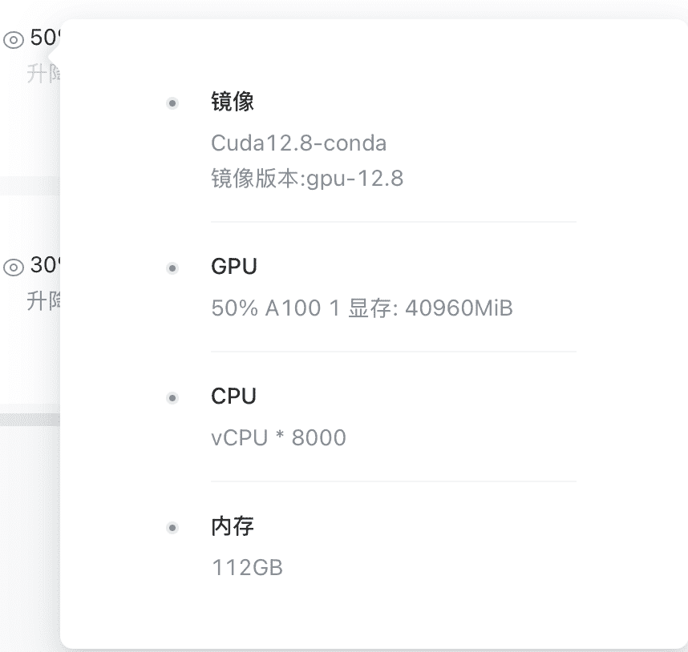

安装依赖

```
conda create -n xtuner-formula python=3.10 -y

cd /root/VLM-formula-recognition-dataset
pip install -r requirements.txt
pip install transformers -U

git clone https://github.com/InternLM/xtuner.git
cd xtuner
git checkout 4990d05c5a5416fbfd51fee9e6cf502c66947099c
pip install -e .
pip install modelscope

# 按需安装，如果安装，建议通过本地whl文件安装
pip install flash_attn
```

> 小提示

> 通过前面的课程，可能你的开发机的存储空间已经填满，可以通过一下命令腾出一些空间以便保存模型

+   du -sh 文件夹路径                               # 查看文件夹大小

+   rm -rf ~/.cache/*                                  # 删除缓存

+   conda env remove -n 你的环境名称  # 删除conda环境，请按需删除

# InternS1-mini 微调

XTuner的训练入口支持两种启动方式：传入配置文件/直接传命令行参数，但这两种方式是互斥的。

## 2.1 配置文件微调

本次课程，提供InternS1-mini 训练配置文件，可以在开发机中创建intern_s1_mini_train_simple.py的训练脚本，将以下代码复制到脚本中

```
from xtuner.v1.model import InternS1MiniConfig
from xtuner.v1.train import Trainer, TrainerConfig
from xtuner.v1.config import (
    AdamWConfig,
    LRConfig,
    FSDPConfig
)
from xtuner.v1.datasets import InternS1VLTokenizeFnConfig, DataloaderConfig, DatasetConfig
from xtuner.v1.loss import CELossConfig

# 模型配置 - 使用InternS1mini配置文件配置模型
model_cfg = InternS1MiniConfig(
    vision_feature_layer: int = -1     # 指定从视觉编码器的哪一层提取特征，默认是最后一层
    downsample_ratio: float = 0.5      # 控制视觉特征图的下采样程度
    dynamic_image_size: bool = True    # 是否支持动态输入图像尺寸
    use_thumbnail: bool = True         # 是否在预处理时生成缩略图
    min_dynamic_patch: int = 1         # 动态分块的最小patch数量限制
    max_dynamic_patch: int = 12        # 动态分块的最大patch数量限制
    image_token_id: int = 152957       # 图像特殊标记在词表中的ID
    freeze_projector: bool = False     # 是否冻结投影层
    use_gradient_checkpointing=True,
    freeze_language=True,              # 冻结语言模型
    freeze_vision=True,                # 冻结视觉模型
    freeze_projector = False,          # 不冻结投影层
)

# 序列长度优化 - 使用更合理的值
sample_max_length = 1024    # 增加单序列最大长度，提高模型理解能力
pack_max_length = 2048      # 增加打包后最大长度，提高训练效率

# 数据集配置
dataset_config = [
    {
        &quot;dataset&quot;: DatasetConfig(
            name=&#x27;formula_recognition&#x27;,   # 数据集名称，用于日志
            anno_path=&#x27;/root/share/datasets/VLM-formula-recognition-dataset_intern_camp/train/train_mini.jsonl&#x27;, # 标注文件路径
            media_root=&#x27;/root/share/datasets/VLM-formula-recognition-dataset_intern_camp/train/&#x27;,                # 图片/视频文件路径
            sample_ratio=1.0,               # 数据采样比例
            class_name=&#x27;VLMJsonlDataset&#x27;    # 数据集类型 JsonlDataset（普通文本数据集） 或 VLMJsonlDataset（视觉语言模型数据集）
        ),
        # 数据Token化配置，定义如何将文本（和图像）转换成模型可输入的格式
        &quot;tokenize_fn&quot;: InternS1VLTokenizeFnConfig(model_cfg=model_cfg, max_length=sample_max_length),
    }
]

# 数据加载器配置
dataloader_config = DataloaderConfig(
    dataset_config_list=dataset_config,         # 数据集配置，可以包含多个数据集
    pack_max_length=pack_max_length,            # 短序列打包到最大长度，减少padding，提高GPU利用率
    num_workers=1,                              # 适当增加数据加载的worker数量提高数据加载效率
    pack_level=&quot;soft&quot;,                          # 打包策略，soft（软打包），hard（硬打包），None（不打包），__legacy（传统打包（仅调试））
    
    # 数据整理器，sft_llm_collator(标准LLM), intern_s1_vl_sft_collator(Intern-S1视觉语言模型), 
    # qwen3_vl_sft_collator(Qwen3视觉语言模型), fake_collator(伪整理器)
    collator=&#x27;intern_s1_vl_sft_collator&#x27;,  
    
    group_by_length=True,                       # 按长度分组，将相似长度的序列放在一起，减少padding
    shuffle=True,                               # 添加数据打乱
)

# 优化学习率配置 - 提高学习率以加快收敛
# 目前仅支持AdamW
optim_cfg = AdamWConfig(
    lr=3e-5,           # 学习率，从1e-6到1e-4
    weight_decay=0.01, # 添加权重衰减防止过拟合
    betas=(0.9, 0.95), # 动量系数，优化Adam参数
    # eps = 1e-8       # 数值稳定系数
    foreach=False      # 性能优化
)
# 学习率配置 
lr_cfg = LRConfig(
    lr_type=&quot;cosine&quot;,  # 学习率调整策略：cosine(余弦退火)，linear（线性衰减），constant（恒定学习率）
    warmup_ratio=0.1,  # 增加warmup比例，让模型更稳定地开始训练
    min_lr_ratio=0.1   # 添加最小学习率比例
)

load_from = &quot;/root/share/new_models/Intern-S1-mini&quot;   # 加载权重路径
tokenizer = &quot;/root/share/new_models/Intern-S1-mini&quot;   # 训练好的文本分词器

# 训练器配置
trainer = TrainerConfig(
    load_from=load_from,               # 模型权重
    model_cfg=model_cfg,               # 模型配置
    optim_cfg=optim_cfg,               # 优化器配置
    dataloader_cfg=dataloader_config,  # 数据加载器配置
    lr_cfg=lr_cfg,                     # 学习率配置 
    tokenizer_path=tokenizer,          # 文本分词器

    # FSDP配置 - 内存换显存
    # FSDP 一种数据并行的训练策略，当模型过大时，将模型参数、梯度、优化器状态“分片” 到所有参与训练的GPU上，提高训练效率
    fsdp_cfg=FSDPConfig(
        cpu_offload=True,                # 将参数、梯度和优化器状态卸载到CPU内存, 缓解显存压力
        recompute_ratio=0.5,             # 梯度检查点比率，控制激活权重计算的层数比例，在反向传播时会重新计算非检查点的激活值
        reshard_after_forward=True,      # 前向传播后立即释放不需要的参数分片，反向传播时再重新分片
        param_dtype=&quot;torch.bfloat16&quot;,    # 模型参数存储的数据类型
        reduce_dtype=&quot;torch.bfloat16&quot;,   # 梯度规约（All-Reduce）操作的数据类型，即梯度汇总平均的数据类型
    ),

    # 训练配置优化
    global_batch_size=1,            # 增加批次大小提高训练稳定性
    gradient_accumulation_steps=2,  # 使用梯度累积模拟更大批次
    total_epoch=5,                  # 增加训练轮数
    work_dir=&#x27;./workdir/s11031&#x27;,    # 存储路径

    # 优化的loss配置
    loss_cfg=CELossConfig(          # CELoss
        mode=&quot;chunk&quot;,               # 损失计算模式：eager（逐元素计算）、chunk（分块计算）、liger（高性能内核）
        chunk_size=1024,            # 增加chunk大小提高计算效率
        loss_reduction=&quot;token&quot;      # 损失缩减模式：token（按token平均）、sample（按样本平均）、square（平方损失）
    )
    
    # 可选参数
    hf_interval=1,                  # HuggingFace格式检查点保存间隔
    hf_max_keep=2,                  # 最大保留的HuggingFace检查点数量
)

trainer = Trainer.from_config(trainer)
trainer.fit()
```

可以看到，配置文件主要分为两大模块：模型配置和训练器配置，我们可以根据每个参数的含义微调自己的模型

当配置文件修改完成后，启动如下命令即可开始训练

```
export PYTORCH_CUDA_ALLOC_CONF=max_split_size_mb:128         # PyTorch CUDA内存分配器的配置命令，用于优化GPU内存使用和减少内存碎片
torchrun --nproc-per-node 1 intern_s1_mini_train_simple.py   # py文件为你的配置文件路径
```

启动后，可以看到

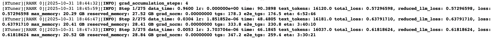

设备的大致负载情况

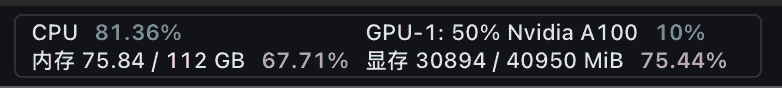

> 小提示

+   针对 50%GPU 开发机来说，InternS1mini因模型大，无法直接训练，需要冻结视觉模型以及语言模型，仅训练projector层

+   冻结后，也需要开启FSDP的cpu_offload以节省显存

+   需要调整sample_max_length和pack_max_length参数，防止保存模型时因内存不足导致终止进程

## 2.2 命令行微调

我们可以使用如下命令查看XTuner训练入口的命令

```
python xtuner/v1/train/cli/sft.py --help
```

参数如下：

+   基础配置

+   --config：配置文件路径

+   --help：显示帮助信息

+   --version：显示版本信息

+   模型相关

+   **--load-from****：预训练模型路径，例如：****"/root/share/new_mo**dels/Intern-S1-mini"

+   --model-cfg：模型配置

+   --chat-template：对话模板

+   --tokenize-fn：分词函数

+   --tokenizer-path：分词器路径

+   数据集相关

+   **--dataset****：数据集路径**

+   --dataset-config-list：多个数据集配置

+   --collator：数据整理器：sft_llm_collator - 标准文本SFT；intern_s1_vl_sft_collator - Intern-S1多模态；qwen3_vl_sft_collator - Qwen-VL多模态；fake_collator - 测试用

+   --pack-to-max-length：是否将序列打包到最大长度（节省内存）

+   --pack-level：打包级别

+   --pack-max-length：打包后的最大序列长度

+   --max-length：单个序列的最大长度

+   --num-workers：数据加载的并行工作进程数

+   优化器相关

+   --lr：学习率

+   --optim：优化器类型

+   学习率调度

+   --lr-min：最小学习率

+   --scheduler-type：调度器类型：cosine/linear/constant

+   --warmup-ratio：热身阶段比例

+   损失函数

+   --loss-config.ignore-idx：损失计算忽略的token ID

+   --loss-config.mode：损失计算模式：eager/chunk/liger

+   --loss-config.chunk-size：chunk模式的分块大小

+   --loss-config.loss-reduction：损失规约方式：token/sample/square

+   训练器配置

+   --total-step：总训练步数

+   --epoch-num：训练轮数

+   --work-dir：输出目录

+   --global-batch-size：全局批次大小

+   检查点

+   --load-model：从检查点加载模型权重：True or False

+   --load-optimizer：加载优化器状态：True or False

+   --load-dataset：加载数据集状态：True or False

+   --load-scheduler：加载调度器状态：True or False

+   分布式训练

+   --fsdp-config.tp-size：张量并行大小

+   --fsdp-config.sp-size：序列并行大小

+   --fsdp-config.ep-size：专家并行大小

+   --fsdp-config.cpu-offload：CPU卸载（节省GPU内存）：True or False

+   --fsdp-config.param-dtype：模型参数数据类型：

启用如下命令即可进行微调

> 当选用命令行进行微调时，上述命令中红色字的命令为必填项

> 目前命令行模式，暂不支持InternS1-mini

```
torchrun --nproc-per-node 1  \
         /root/VLM-formula-recognition-dataset/xtuner/xtuner/v1/train/cli/sft.py  \
         --load-from &quot;/root/share/new_models/Intern-S1-mini&quot; \
         --dataset /root/share/datasets/VLM-formula-recognition-dataset_intern_camp/train  \
         --epoch-num 5 \
         --work-dir &#x27;./workdir/s11031&#x27;
```

## 2.3 模型推理

当微调完成后，在work-dir路径下会生成与模型权重相关的文件，如下图所示

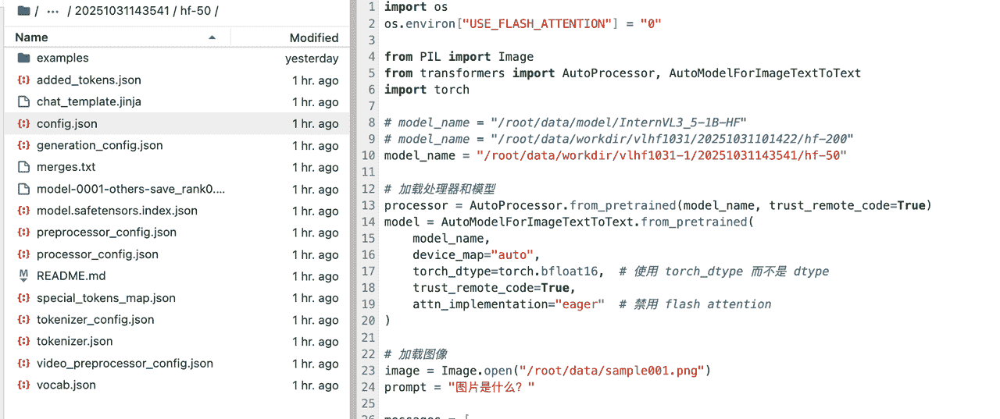

我们可以进行推理测试

```
from PIL import Image
from transformers import AutoProcessor, AutoModelForImageTextToText, AutoModelForCausalLM
import torch

model_name = &quot;/root/s11031/20251030103622/hf-2250&quot;  # 你的权重保存路径

# 加载处理器(Processor)
processor = AutoProcessor.from_pretrained(model_name, trust_remote_code=True)  # 设置为信任模式

# 加载因果语言模型(AutoModelForCausalLM)
model = AutoModelForCausalLM.from_pretrained(model_name, 
                                             device_map=&quot;auto&quot;, 
                                             dtype=&quot;auto&quot;, 
                                             trust_remote_code=True)

device = &quot;cuda&quot; if torch.cuda.is_available() else &quot;cpu&quot;
model = model.to(device)

# 加载图像
image = Image.open(&quot;/root/VLM-formula-recognition-dataset/data/output_eval/sample001.png&quot;)

# 设置提示词
prompt =&quot;describle this img&quot;
# prompt =&quot;&quot;&quot;请根据图片中的公式生成对应的 latex 公式文本，不要任何解释。

#   输出格式要求：
#   1. 必须使用 ```latex 代码块包裹
#   2. 仅包含 LaTeX 代码，无任何文字说明
#   3. 确保语法正确，下标用 {} 括起来

#   输出案例：
#   案例 1：
#   ```latex
#   \sum_{i=1}^{n} x_i = \mu
#   ```

#   案例 2：
#   ```latex
#   \begin{bmatrix}
#   a &amp; b \\
#   c &amp; d
#   \end{bmatrix}
#   ```
# &quot;&quot;&quot;

# 构建对话消息格式
messages = [
    {
        &quot;role&quot;: &quot;user&quot;,
        &quot;content&quot;: [
            {&quot;type&quot;: &quot;image&quot;, &quot;image&quot;: image},  # PIL图像对象
            {&quot;type&quot;: &quot;text&quot;, &quot;text&quot;: prompt},
        ],
    }
]

# 使用处理器应用聊天模板，准备模型输入
inputs = processor.apply_chat_template(
    messages,                             # 对话消息列表
    add_generation_prompt=True,           # 添加生成提示符
    tokenize=True,                        # 进行tokenization(分词)
    return_dict=True,                     # 返回字典格式
    return_tensors=&quot;pt&quot;                   # 返回PyTorch张量
).to(model.device, dtype=torch.bfloat16)

# 使用模型生成文本
generate_ids = model.generate(**inputs, max_new_tokens=10000)    # 解包输入参数，设置最大生成长度

# 解码生成的token ID为可读文本
decoded_output = processor.decode(generate_ids[0, inputs[&quot;input_ids&quot;].shape[1]:],   # 跳过输入部分，只解码新生成的内容
                                  skip_special_tokens=True                          # 跳过特殊token
                                  )
print(&quot;current model: &quot;, model_name)
print(decoded_output)
```

推理后，可输出如下结果

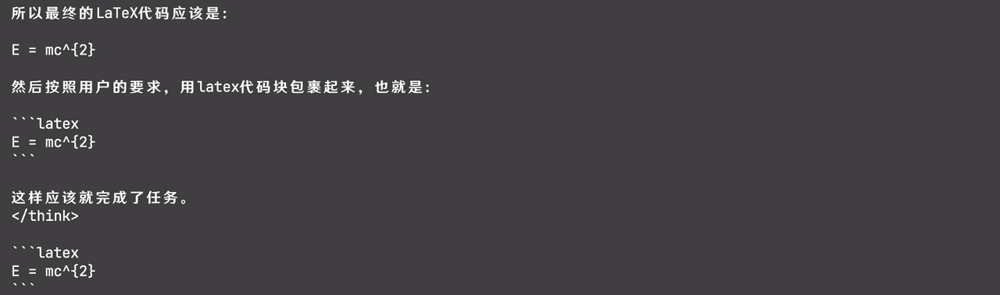

## 2.4 模型上传

在模型推理验证无误后，可以上传模型至 modelscope 社区：upload.py

```
from modelscope.hub.api import HubApi
from modelscope.hub.constants import Licenses, ModelVisibility

# 配置基本信息
YOUR_ACCESS_TOKEN = &#x27;ms-9fxx7e&#x27;#填写自己的 api token
api = HubApi()
api.login(YOUR_ACCESS_TOKEN)

# 取名字
owner_name = &#x27;xx&#x27;    # ModelScope 的用户名，需根据自己情况修改
model_name = &#x27;xx&#x27;    # 为模型库取个响亮优雅又好听的名字，需根据自己情况修改
model_id = f&quot;{owner_name}/{model_name}&quot;

#创建模型仓库
api.create_model(
     model_id,
     visibility=ModelVisibility.PUBLIC,
     license=Licenses.APACHE_V2,
     chinese_name=f&quot;{owner_name}的 latex 分类&quot;
    )

#上传模型到仓库
api.upload_folder(
    repo_id=f&quot;{owner_name}/{model_name}&quot;,
    folder_path=&#x27;xx&#x27;,    # 微调后模型的文件夹名称
    commit_message=&#x27;upload model folder to repo&#x27;,    # 写上传信息
)
```

上传进行时

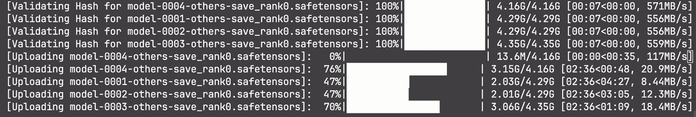

# InternVL3_5-1B 微调

本次实验选用 InternVL3.5 的 1B 参数 HuggingFace 版本（InternVL3_5-1B-HF），相较于 InternS1-mini 的 8B 模型，参数量大幅减少，仅需约 50% 的 GPU 显存即可完成微调，满足比赛资源要求。

## 3.1 环境配置

在开始前，请确认 ~/xtuner/v1/model/__init__.py 文件中是否已包含 InternVL3P5Dense1BConfig 和 Qwen3Dense0P6BConfig 这两个配置类。若缺失任一配置，请重新下载完整的 Xtuner 代码库或者手动添加，以确保微调过程顺利进行。

```
git clone https://github.com/InternLM/xtuner.git
```

```
class InternVL3P5Dense1BConfig(InternVLBaseConfig):
    vision_config: InternVLVisionConfig = InternVLVisionConfig()
    projector_config: InternVLProjectorConfig = InternVLProjectorConfig(text_hidden_size=1024)
    text_config: Qwen3Dense0P6BConfig = Qwen3Dense0P6BConfig()

    @property
    def hf_config(self):
        # TODO(pppppM) Support saving HuggingFace format config
        logger.warning(
            f&quot;{type(self)} does not support conversion to HuggingFace config format. &quot;
            &quot;Only the original HuggingFace config will be retained in the saved HuggingFace format checkpoint. &quot;
            f&quot;If you have changed the default values in {type(self)}, it may cause the config in the saved &quot;
            &quot;HuggingFace format checkpoint to not match the weights.&quot;
        )
        return None
```

```
class Qwen3Dense0P6BConfig(Qwen3DenseConfig):
    vocab_size: int = 151936
    max_position_embeddings: int = 40960
    pad_token_id: int = 151643
    eos_token_id: int = 151645
    bos_token_id: int = 151643
    num_hidden_layers: int = 28
    max_window_layers: int = 28
    hidden_size: int = 1024
    intermediate_size: int = 3072
    rms_norm_eps: float = 1e-6
    rope_theta: float = 1000000.0
    hidden_act: str = &quot;silu&quot;

    attention: MHAConfig = MHAConfig(
        num_attention_heads=16, num_key_value_heads=8, head_dim=128, qk_norm=True, sliding_window=None
    )
    tie_word_embeddings: bool = False  # 官方的是 False
```

## 3.2 配置文件

完成配置后，创建intern_vl35_train_sample.py，将配置信息拷贝进文件

```
from xtuner.v1.model import InternVL3P5Dense1BConfig
from xtuner.v1.train import Trainer, TrainerConfig
from xtuner.v1.config import AdamWConfig, LRConfig
from xtuner.v1.datasets import InternS1VLTokenizeFnConfig, DataloaderConfig, DatasetConfig
from xtuner.v1.loss import CELossConfig
import sys
# model config - 启用梯度检查点
model_cfg = InternVL3P5Dense1BConfig(use_gradient_checkpointing=True)  # 添加这一行

# dataset and dataloader config
sample_max_length = 4000
pack_max_length = 8000

dataset_config = [
    {
        &quot;dataset&quot;: DatasetConfig(
            name=&quot;formula_recognition&quot;,
            anno_path=&quot;/root/share/datasets/VLM-formula-recognition-dataset_intern_camp/train/train_mini.jsonl&quot;,
            media_root=&quot;/root/share/datasets/VLM-formula-recognition-dataset_intern_camp/train/&quot;,
            sample_ratio=1.0,
            class_name=&quot;VLMJsonlDataset&quot;,
        ),
        # 使用 InternVL3.5 模板，确保 prompt 与视觉 token 对齐
        &quot;tokenize_fn&quot;: InternS1VLTokenizeFnConfig(
            model_cfg=model_cfg,
            max_length=sample_max_length,
            template_name=&quot;internvl-3.5&quot;,
        ),
    }
]
dataloader_config = DataloaderConfig(
    dataset_config_list=dataset_config,
    pack_max_length=pack_max_length,
    num_workers=1,
    pack_level=&quot;soft&quot;,
    collator=&quot;intern_s1_vl_sft_collator&quot;,
)

# 优化学习率配置 - 提高学习率以加快收敛
optim_cfg = AdamWConfig(
    lr=1e-6,           # 提高学习率，从1e-6到3e-5
    weight_decay=0.01, # 添加权重衰减防止过拟合
    betas=(0.9, 0.95), # 优化Adam参数
    foreach=False
)
lr_cfg = LRConfig(
    lr_type=&quot;cosine&quot;,
    warmup_ratio=0.1,  # 增加warmup比例，让模型更稳定地开始训练
    min_lr_ratio=0.1   # 添加最小学习率比例
)

load_from = &quot;/root/share/new_models/InternVL3.5/InternVL3_5-1B-HF&quot;
tokenizer = &quot;/root/share/new_models/InternVL3.5/InternVL3_5-1B-HF&quot;

# trainer config
trainer = TrainerConfig(
    load_from=load_from,
    model_cfg=model_cfg,
    optim_cfg=optim_cfg,
    dataloader_cfg=dataloader_config,
    lr_cfg=lr_cfg,
    tokenizer_path=tokenizer,
    global_batch_size=1,
    gradient_accumulation_steps=2,
    total_epoch=10,
    work_dir=&quot;./workdir/hfvl1031/&quot;,
    loss_cfg=CELossConfig(mode=&quot;chunk&quot;, chunk_size=1024),
    hf_interval=50,
    hf_max_keep=3,
)
trainer = Trainer.from_config(trainer)
# 检查模型是否正确加载了预训练权重
print(f&quot;Model device: {next(trainer._engine.model.parameters()).device}&quot;)
print(f&quot;Model dtype: {next(trainer._engine.model.parameters()).dtype}&quot;)
# sys.exit(0)
trainer.fit()
```

同样可以参考[L2 Intern-S1/InternVL 微调公式识别实践（xtuner 版本）](https://aicarrier.feishu.cn/wiki/PUdpwRBeCiKvQ6kA0accboIsn7e#share-ZM52dXQMYoruefx1qhCc8OHmnjg)中的配置文件说明微调属于你的模型

## 3.3 启动微调

当配置文件修改完成后，启动如下命令即可开始训练

```
torchrun --nproc-per-node 1 intern_vl35_train_sample.py  # 你的配置文件
```

启动后，可以看到

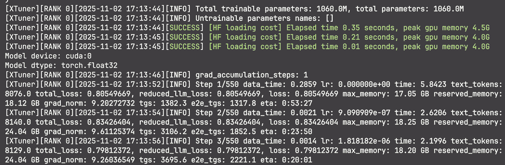

设备的大致负载情况

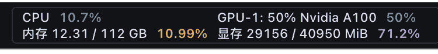

微调完成后，在work-dir路径下会生成与模型权重相关的文件，如下图所示

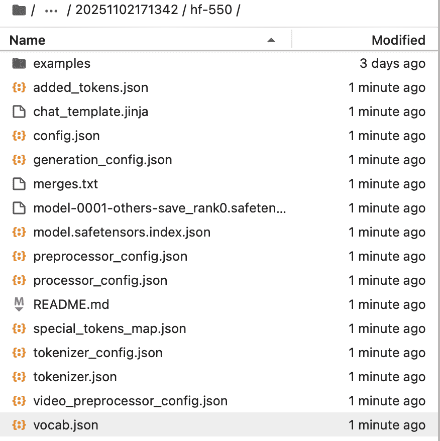

## 3.4 模型推理

我们可以进行推理测试

```
from PIL import Image
from transformers import AutoProcessor, AutoModelForImageTextToText, AutoModelForCausalLM
import torch

model_name = &quot;/root/xtuner/build3/20251102171342/hf-550&quot;

processor = AutoProcessor.from_pretrained(model_name, trust_remote_code=True)
model = AutoModelForImageTextToText.from_pretrained(model_name, device_map=&quot;auto&quot;, dtype=&quot;auto&quot;, trust_remote_code=True)

device = &quot;cuda&quot; if torch.cuda.is_available() else &quot;cpu&quot;
model = model.to(device)

# 加载图像
image = Image.open(&quot;/root/VLM-formula-recognition-dataset/data/output_eval/sample001.png&quot;)
prompt =&quot;describle this img&quot;
# prompt =&quot;&quot;&quot;请根据图片中的公式生成对应的 latex 公式文本，不要任何解释。

#   输出格式要求：
#   1. 必须使用 ```latex 代码块包裹
#   2. 仅包含 LaTeX 代码，无任何文字说明
#   3. 确保语法正确，下标用 {} 括起来

#   输出案例：
#   案例 1：
#   ```latex
#   \sum_{i=1}^{n} x_i = \mu
#   ```

#   案例 2：
#   ```latex
#   \begin{bmatrix}
#   a &amp; b \\
#   c &amp; d
#   \end{bmatrix}
#   ```
# &quot;&quot;&quot;

messages = [
    {
        &quot;role&quot;: &quot;user&quot;,
        &quot;content&quot;: [
            {&quot;type&quot;: &quot;image&quot;, &quot;image&quot;: image},  # PIL图像对象
            {&quot;type&quot;: &quot;text&quot;, &quot;text&quot;: prompt},
        ],
    }
]

inputs = processor.apply_chat_template(
    messages,
    add_generation_prompt=True,
    tokenize=True,
    return_dict=True,
    return_tensors=&quot;pt&quot;
).to(model.device, dtype=torch.bfloat16)

generate_ids = model.generate(**inputs, max_new_tokens=10000)
decoded_output = processor.decode(generate_ids[0, inputs[&quot;input_ids&quot;].shape[1]:], skip_special_tokens=True)
print(&quot;current model: &quot;, model_name)
print(decoded_output)
```

如果模型推理验证无误后，可以参考2.4 模型上传，将模型至 modelscope 社区

# 参赛流程

## 4.1 报名

点击以下链接进行报名

https://colearn.intern-ai.org.cn/set?s=gamef

## 4.2 提交参赛权重

微调后的权重请从以下链接入口提交，请注意截图内容，不要填写链接，本次比赛你可以选择自己的提示词，这有可能提高你的模型识别精度

https://aicarrier.feishu.cn/share/base/form/shrcnXjK6zERK7z4pPU85PLO80c

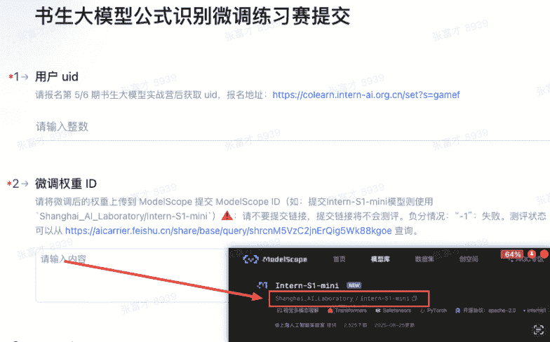

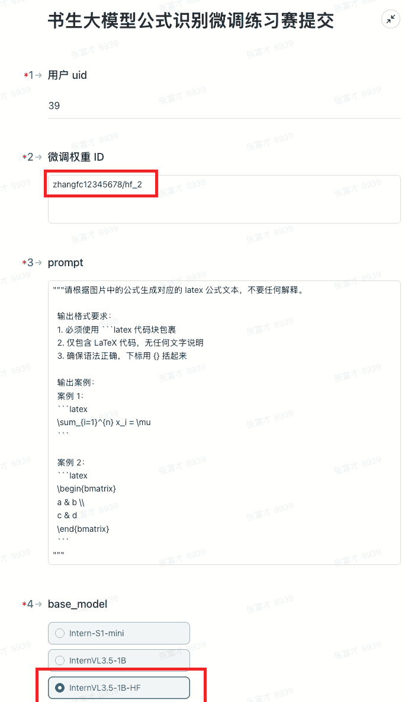

```
&quot;&quot;&quot;请根据图片中的公式生成对应的 latex 公式文本，不要任何解释。

   输出格式要求：
   1. 必须使用 ```latex 代码块包裹
   2. 仅包含 LaTeX 代码，无任何文字说明
   3. 确保语法正确，下标用 {} 括起来

   输出案例：
   案例 1：
   ```latex
   \sum_{i=1}^{n} x_i = \mu
   ```

   案例 2：
   ```latex
   \begin{bmatrix}
   a &amp; b \\
   c &amp; d
   \end{bmatrix}
   ```
&quot;&quot;&quot;
```

注意：需要选择好 base model，本次提供三个模型给大家进行选择，如不在此范围内的模型请勿提交，否则可能会出现测评异常情况。

必须保持一致！

本次测评会提取模型返回中的**最后一个 latex 块**

```
```latex
E = mc^2
```
```

## 4.3 查看状态

点击以下链接

https://aicarrier.feishu.cn/share/base/query/shrcnM5VzC2jnErQig5Wk88kgoe

进行查看，输入你的 uid，比如闻星（uid：4）

## 4.4 排行榜

https://aicarrier.feishu.cn/share/base/dashboard/shrcnrA82hMMRd1FUuWs8EhOjag

# 闯关任务

+   请从 Intern-S1-mini微调 与 InternVL3_5-1B-HF微调 两项任务中择一完成微调实践，确保成功提交并获得评分。

+   实践过程中的全部笔记与最终评分结果截图，整理至飞书文档提交

提交地址：https://aicarrier.feishu.cn/share/base/form/shrcnbguDXSzIZV5Dkapw39BJ0f