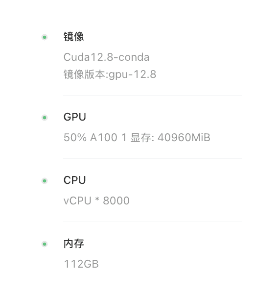
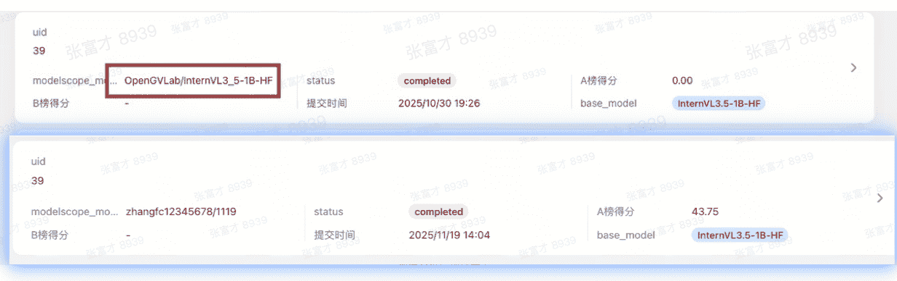
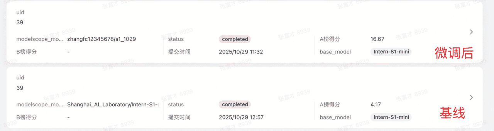
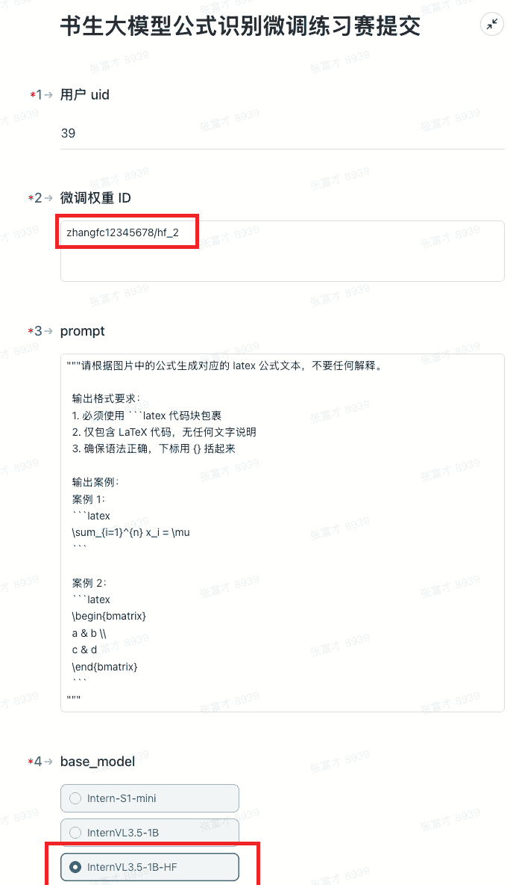
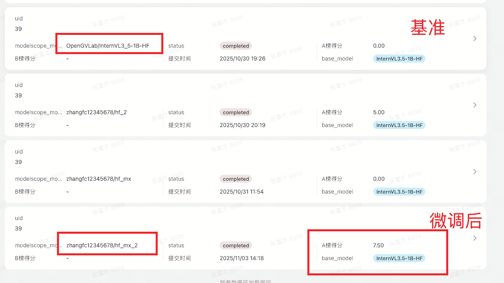
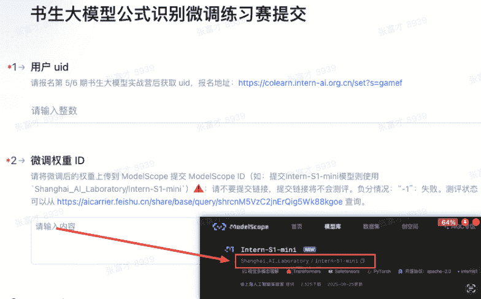
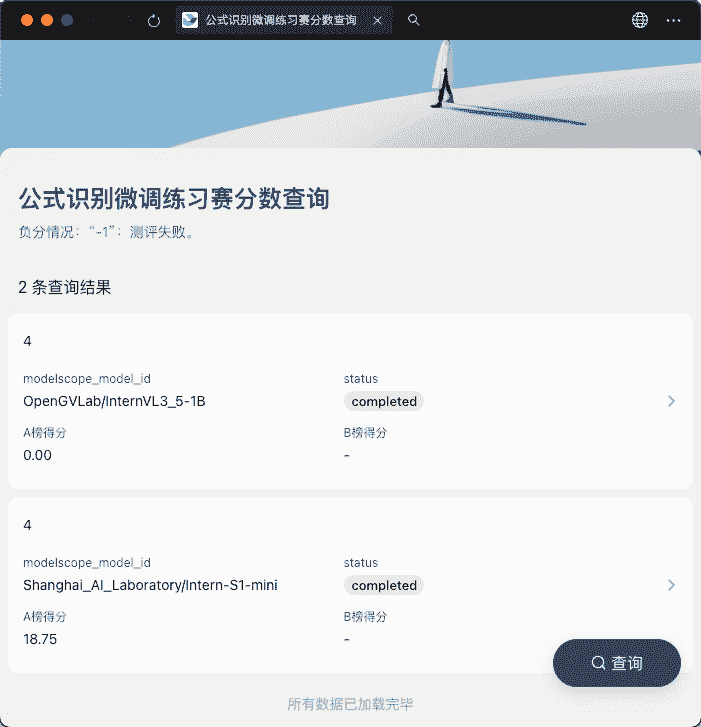

# L2 Intern-S1/InternVL微调公式识别实践（XTuner）

> 来源：[https://aicarrier.feishu.cn/docx/F0wdd54uXoTGXqxbjSEcOe97nDf](https://aicarrier.feishu.cn/docx/F0wdd54uXoTGXqxbjSEcOe97nDf)

## 环境安装

在[创建开发机界面](https://studio.intern-ai.org.cn/console/instance)选择镜像为`Cuda12.8-conda`，并选择 GPU 为 50% A100



安装必要的包：

```
conda create -n xtuner2 python=3.10 -y
conda activate xtuner2

git clone https://gh.llkk.cc/https://github.com/InternLM/xtuner.git
cd xtuner
git checkout 4990d05c5a5416fbfd51fee9e6cf502c66947099

pip install -e '.[deepspeed]' -i https://pypi.mirrors.ustc.edu.cn/simple/
pip install modelscope
```

pip 下载速度慢可以试试换源，如清华、阿里、中科院、上交等等，哪个快用哪个。

## 前置知识

### 查看XTuner训练所需的参数

运行以下命令：

```
python -m xtuner.v1.train.cli.sft --help
```

参数类别 | 参数 | 类型 | 默认值 | 说明
--- | --- | --- | --- | ---
基础配置 | `--config` | 文件路径 | 无 | 配置文件路径，用于批量设置参数
基础配置 | `--help / -h` | 标志 | 无 | 显示帮助信息
基础配置 | `--version` | 标志 | 无 | 显示版本信息
模型相关 | `--load-from` | 路径 | 必填 | 预训练模型路径（你的 `Intern-S1-mini`）
模型相关 | `--model-cfg` | 字符串 | 无 | 模型配置，当前只支持 `'qwen3-moe-30BA3'`
模型相关 | `--chat-template` | 枚举 | 无 | 对话模板：`internlm2`/`qwen3`/`gpt-oss`/`deepseek-v3`
模型相关 | `--tokenize-fn` | 枚举 | `openai` | 分词函数：`ftdp`/`openai`
模型相关 | `--tokenizer-path` | 路径 | 无 | 分词器路径，通常自动从模型目录加载
数据集相关 | `--dataset` | 路径 | 必填 | 数据集路径（`JSONL`文件或目录）
数据集相关 | `--dataset-config-list` | 列表 | 无 | 多个数据集配置
数据集相关 | `--collator` | 枚举 | `sft_llm_collator` | 数据整理器：`sft_llm_collator` - 标准文本SFT；`intern_s1_vl_sft_collator` - Intern-S1多模态；`qwen3_vl_sft_collator` - Qwen-VL多模态；`fake_collator` - 测试用
数据集相关 | `--pack-to-max-length` | 布尔 | `True` | 是否将序列打包到最大长度（节省内存）
数据集相关 | `--pack-level` | 枚举 | `soft` | 打包级别：`soft`/`none`/`__legacy`/`hard`
数据集相关 | `--pack-max-length` | 整数 | 32768 | 打包后的最大序列长度
数据集相关 | `--max-length` | 整数 | 4096 | 单个序列的最大长度
数据集相关 | `--num-workers` | 整数 | 0 | 数据加载的并行工作进程数
优化器相关 | `--lr` | 浮点数 | 6e-05 | 学习率，通常 1e-5 到 5e-5
优化器相关 | `--optim` | 枚举 | `AdamW` | 优化器类型，目前只支持 `AdamW`
学习率调度 | `--lr-min` | 浮点数 | 1e-06 | 最小学习率
学习率调度 | `--scheduler-type` | 枚举 | `cosine` | 调度器类型：`cosine`/`linear`/`constant`
学习率调度 | `--warmup-ratio` | 浮点数 | 0.03 | 热身阶段比例（总步数的3%）
损失函数 | `--loss-config.ignore-idx` | 整数 | -100 | 损失计算忽略的token ID
损失函数 | `--loss-config.mode` | 枚举 | `eager` | 损失计算模式：`eager`/`chunk`/`liger`
损失函数 | `--loss-config.chunk-size` | 整数 | 1024 | chunk模式的分块大小
损失函数 | `--loss-config.loss-reduction` | 枚举 | `token` | 损失归约方式：`token`/`sample`/`square`
训练配置 | `--total-step` | 整数 | 无 | 总训练步数（你的设置：100）
训练配置 | `--epoch-num` | 整数 | 无 | 训练轮数
训练配置 | `--work-dir` | 路径 | `work_dir` | 输出目录（你的设置：`/root/xtuner/output`）
训练配置 | `--global-batch-size` | 整数 | 自动 | 全局批次大小
检查点 | `--load-model` | 布尔 | `True` | 从检查点加载模型权重
检查点 | `--load-optimizer` | 布尔 | `True` | 加载优化器状态
检查点 | `--load-dataset` | 布尔 | `True` | 加载数据集状态
检查点 | `--load-scheduler` | 布尔 | `True` | 加载调度器状态
分布式训练 | `--fsdp-config.tp-size` | 整数 | 1 | 张量并行大小
分布式训练 | `--fsdp-config.sp-size` | 整数 | 1 | 序列并行大小
分布式训练 | `--fsdp-config.ep-size` | 整数 | 1 | 专家并行大小
分布式训练 | `--fsdp-config.cpu-offload` | 布尔 | `False` | CPU卸载（节省GPU内存）
分布式训练 | `--fsdp-config.param-dtype` | 类型 | `torch.bfloat16` | 模型参数数据类型

### 省显存的方法

下面我们的配置文件有几个操作介绍下：

1. `fsdp`是内存换显存的方法，因为单纯训 `s1` 显存有限，很难跑起来。

   ```
   # 优雅的FSDP配置 - 内存换显存
   fsdp_cfg=FSDPConfig(
       cpu_offload=True,           # 必须开启，否则爆显存
       recompute_ratio=0.5,        # 梯度检查点
       reshard_after_forward=True, # 前向后重新分片
       param_dtype="torch.bfloat16",  # 使用bfloat16节省内存
       reduce_dtype="torch.bfloat16",
   ),
   ```

1. 冰冻 `vision`、`llm`，只训 `projector` 层。

   ```
   # 模型配置 - 使用梯度检查点
   model_cfg = InternS1MiniConfig(
       use_gradient_checkpointing=True,
       freeze_language=True,
       freeze_vision=True,
   )
   ```

### 推理

训练完的模型我们可以进行推理测试，输出无误即可提交：

```
from PIL import Image
from transformers import AutoProcessor, AutoModelForImageTextToText
import torch

# model_name = "/root/xtuner/build/vl1030/20251030103622/hf-2250"
model_name = "/root/share/new_models/InternVL3.5/InternVL3_5-1B-HF"
# model_name = "/root/user/xtuner/test_pr/vlhf/20251030150211/hf-114"
processor = AutoProcessor.from_pretrained(model_name, trust_remote_code=True)
model = AutoModelForImageTextToText.from_pretrained(model_name, device_map="auto", dtype="auto", trust_remote_code=True)

# 加载图像
image = Image.open("/root/VLM-formula-recognition-dataset/data/output_eval/sample001.png")
prompt = "describle this img"
# prompt = """请根据图片中的公式生成对应的 latex 公式文本，不要任何解释。

#   输出格式要求：
#   1. 必须使用 ```latex 代码块包裹

#   2. 仅包含 LaTeX 代码，无任何文字说明

#   3. 确保语法正确，下标用 {} 括起来

#   输出案例：

#   案例 1：

#   ```latex
#   \sum_{i=1}^{n} x_i = \mu
#   ```

#   案例 2：

#   ```latex
#   \begin{bmatrix}
#   a & b \\
#   c & d
#   \end{bmatrix}
#   ```

# """

messages = [

    {

        "role": "user",

        "content": [

            {"type": "image", "image": image},  # PIL图像对象

            {"type": "text", "text": prompt},

        ],

    }

]

inputs = processor.apply_chat_template(

    messages,

    add_generation_prompt=True,

    tokenize=True,

    return_dict=True,

    return_tensors="pt"

).to(model.device, dtype=torch.bfloat16)

generate_ids = model.generate(**inputs, max_new_tokens=200)

decoded_output = processor.decode(generate_ids[0, inputs["input_ids"].shape[1]:], skip_special_tokens=True)

print("current model: ", model_name)

print(decoded_output)
```

## Internvl3.5-1B-HF微调

```
torchrun --nproc-per-node 1 vl.py
```

```
from xtuner.v1.model import InternVL3P5Dense1BConfig

from xtuner.v1.train import Trainer, TrainerConfig

from xtuner.v1.config import AdamWConfig, LRConfig, FSDPConfig

from xtuner.v1.datasets import InternS1VLTokenizeFnConfig, DataloaderConfig, DatasetConfig

from xtuner.v1.loss import CELossConfig

import sys

# model config - 启用梯度检查点
model_cfg = InternVL3P5Dense1BConfig(
    freeze_vision=True, freeze_projector=False, freeze_language=False
)

# dataset and dataloader config
sample_max_length = 5000 
pack_max_length = 5000

dataset_config = [

    {

        "dataset": DatasetConfig(

            name="formula_recognition",

            anno_path="/root/share/datasets/VLM-formula-recognition-dataset_intern_camp/train/train_mini_xt.jsonl",

            media_root="/root/share/datasets/VLM-formula-recognition-dataset_intern_camp/train/",

            sample_ratio=1,

            class_name="VLMJsonlDataset",

        ),

        # 使用 InternVL3.5 模板，确保 prompt 与视觉 token 对齐

        "tokenize_fn": InternS1VLTokenizeFnConfig(

            model_cfg=model_cfg,

            max_length=sample_max_length,

            template_name="internvl-3.5",

        ),

    },

]

dataloader_config = DataloaderConfig(

    dataset_config_list=dataset_config,

    pack_max_length=pack_max_length,

    num_workers=8,

    pack_level="soft",

    collator="intern_s1_vl_sft_collator",

)

# 优化学习率配置 - 提高学习率以加快收敛

optim_cfg = AdamWConfig(

    lr=1e-6,           # 

    weight_decay=0.01, # 添加权重衰减防止过拟合

    betas=(0.9, 0.95), # 优化Adam参数

    foreach=False

)

lr_cfg = LRConfig(

    lr_type="cosine",

    warmup_ratio=0.1,  # 增加warmup比例，让模型更稳定地开始训练

    min_lr_ratio=0.1   # 添加最小学习率比例

)

model1="/root/share/new_models/InternVL3.5/InternVL3_5-1B-HF"

load_from = model1

tokenizer = model1

# trainer config

trainer = TrainerConfig(

    load_from=load_from,

    tokenizer_path=tokenizer,

    model_cfg=model_cfg,

    optim_cfg=optim_cfg,

    dataloader_cfg=dataloader_config,

    lr_cfg=lr_cfg,

    global_batch_size=16,  # 计算

    gradient_accumulation_steps=8,  # 对齐 gradient_accumulation_steps: 8

    total_epoch=4,         # 对齐 num_train_epochs: 8

    work_dir="./work_dirs/vl_1b_xt_novision/",

    loss_cfg=CELossConfig(mode="chunk", chunk_size=1024),

    fsdp_cfg=FSDPConfig(

        cpu_offload=False,           # 必须开启，否则爆显存

        recompute_ratio=0,        # 梯度检查点

        reshard_after_forward=False, # 前向后重新分片

        param_dtype="torch.bfloat16",  # 使用bfloat16节省内存

        reduce_dtype="torch.bfloat16",

    ),

    hf_interval=50,

    hf_max_keep=3,

)

trainer = Trainer.from_config(trainer)

# 检查模型是否正确加载了预训练权重


```
print(f"Model device: {next(trainer._engine.model.parameters()).device}")

print(f"Model dtype: {next(trainer._engine.model.parameters()).dtype}")

# sys.exit(0)

trainer.fit()
```

微调前后对比：



# Intern-S1-mini微调

完整的微调脚本文件如下：

```
from xtuner.v1.model import InternS1MiniConfig

from xtuner.v1.train import Trainer, TrainerConfig

from xtuner.v1.config import (

    AdamWConfig,

    LRConfig,

    FSDPConfig

)

from xtuner.v1.datasets import InternS1VLTokenizeFnConfig, DataloaderConfig, DatasetConfig

from xtuner.v1.loss import CELossConfig

# 模型配置 - 使用梯度检查点

model_cfg = InternS1MiniConfig(

    use_gradient_checkpointing=True,

    freeze_language=True,

    freeze_vision=True,

)

# 序列长度优化 - 使用更合理的值

sample_max_length = 2048    # 增加单序列最大长度，提高模型理解能力

pack_max_length = 4096      # 增加打包后最大长度，提高训练效率

dataset_config = [

    {

        "dataset": DatasetConfig(

            name='formula_recognition',

            anno_path="/root/share/datasets/VLM-formula-recognition-dataset_intern_camp/train/train_mini_xt.jsonl",

            media_root='/root/share/datasets/VLM-formula-recognition-dataset_intern_camp/train/',

            sample_ratio=1.0,

            class_name='VLMJsonlDataset'

        ),

        "tokenize_fn": InternS1VLTokenizeFnConfig(model_cfg=model_cfg, max_length=sample_max_length),

    }

]

dataloader_config = DataloaderConfig(

    dataset_config_list=dataset_config,

    pack_max_length=pack_max_length,

    num_workers=1,          # 适当增加worker数量提高数据加载效率

    pack_level="soft",

    collator='intern_s1_vl_sft_collator',

    group_by_length=True,   # 按长度分组，提高打包效率

    shuffle=True,           # 添加数据打乱

)

# 优化学习率配置 - 提高学习率以加快收敛

optim_cfg = AdamWConfig(

    lr=3e-5,           # 提高学习率，从1e-6到3e-5

    weight_decay=0.01, # 添加权重衰减防止过拟合

    betas=(0.9, 0.95), # 优化Adam参数

    foreach=False

)

lr_cfg = LRConfig(

    lr_type="cosine",

    warmup_ratio=0.1,  # 增加warmup比例，让模型更稳定地开始训练

    min_lr_ratio=0.1   # 添加最小学习率比例

)

load_from = "/root/share/new_models/Intern-S1-mini"

tokenizer = "/root/share/new_models/Intern-S1-mini"

# 关键：优雅的FSDP配置

trainer = TrainerConfig(

    load_from=load_from,

    model_cfg=model_cfg,

    optim_cfg=optim_cfg,

    dataloader_cfg=dataloader_config,

    lr_cfg=lr_cfg,

    tokenizer_path=tokenizer,

    # 优雅的FSDP配置 - 内存换显存

    fsdp_cfg=FSDPConfig(

        cpu_offload=True,           # 必须开启，否则爆显存

        recompute_ratio=0.5,        # 梯度检查点

        reshard_after_forward=True, # 前向后重新分片

        param_dtype="torch.bfloat16",  # 使用bfloat16节省内存

        reduce_dtype="torch.bfloat16",

    ),

    # 训练配置优化

    global_batch_size=1,        # 增加批次大小提高训练稳定性

    gradient_accumulation_steps=2,  # 使用梯度累积模拟更大批次

    total_epoch=5,              # 增加训练轮数

    work_dir='./workdir/s11031',

    # 优化的loss配置

    loss_cfg=CELossConfig(

        mode="chunk",

        chunk_size=1024,        # 增加chunk大小提高计算效率

        loss_reduction="token"

    )

)

trainer = Trainer.from_config(trainer)

trainer.fit()
```

## 启动命令

```

# 运行前设置环境变量

export PYTORCH_CUDA_ALLOC_CONF=max_split_size_mb:128

torchrun --nproc-per-node 1 s1.py

```

微调前后对比：



# 提交结果

## 上传

运行`upload.py` 上传模型

```

from modelscope.hub.api import HubApi

from modelscope.hub.constants import Licenses, ModelVisibility

# 配置基本信息

YOUR_ACCESS_TOKEN = 'ms-9fxx7e'#填写自己的 api token

api = HubApi()

api.login(YOUR_ACCESS_TOKEN)

# 取名字

owner_name = 'xx'    # ModelScope 的用户名，需根据自己情况修改

model_name = 'xx'    # 为模型库取个响亮优雅又好听的名字，需根据自己情况修改

model_id = f"{owner_name}/{model_name}"

#创建模型仓库

api.create_model(

     model_id,

     visibility=ModelVisibility.PUBLIC,

     license=Licenses.APACHE_V2,

     chinese_name=f"{owner_name}的 latex 分类"

    )

#上传模型到仓库

api.upload_folder(

    repo_id=f"{owner_name}/{model_name}",

    folder_path='xx',    # 微调后模型的文件夹名称

    commit_message='upload model folder to repo',    # 写上传信息

)

```

提交表单的 `prompt` 参考如下,这里也有优化空间，可自行探索最优 `prompt`：

````

"""请根据图片中的公式生成对应的 latex 公式文本，不要任何解释。

  输出格式要求：

  1. 必须使用 ```latex 代码块包裹
  2. 仅包含 LaTeX 代码，无任何文字说明
  3. 确保语法正确，下标用 {} 括起来

  输出案例：
  案例 1：
  ```latex

  \sum_{i=1}^{n} x_i = \mu

  ```

  案例 2：
  ```latex

  \begin{bmatrix}

  a & b \\

  c & d

  \end{bmatrix}

  ```
"""

````

填写表单：https://aicarrier.feishu.cn/share/base/form/shrcnXjK6zERK7z4pPU85PLO80c

注意模型权重 `id` 和 base model写对如下图：



提交完成，等待后台半小时左右评测，最终获得成绩🎉🎉



## 参赛流程

### 报名

点击以下链接进行报名

https://colearn.intern-ai.org.cn/set?s=gamef

### 提交参赛权重

微调后的权重请从以下链接入口提交，请注意截图内容，不要填写链接，本次比赛你可以选择自己的提示词，这有可能提高你的模型识别精度

https://aicarrier.feishu.cn/share/base/form/shrcnXjK6zERK7z4pPU85PLO80c



注意：需要选择好 `base model`，本次提供两个模型给大家进行选择，如不在此范围内的模型请勿提交，否则可能会出现测评异常情况。

必须保持一致！

本次测评会提取模型返回中的最后一个 latex 块

````

```
```latex

E = mc^2

```
```

````

### 查看状态

点击以下链接

https://aicarrier.feishu.cn/share/base/query/shrcnM5VzC2jnErQig5Wk88kgoe

进行查看，输入你的 `uid`，比如闻星（`uid`：4）

在这里能够查看状态



### 排行榜

https://aicarrier.feishu.cn/share/base/dashboard/shrcnrA82hMMRd1FUuWs8EhOjag

<https://aicarrier.feishu.cn/share/base/dashboard/shrcnrA82hMMRd1FUuWs8EhOjag?iframeFrom=docx&ccm_open=iframe>

# 闯关任务

+ 请从`Intern-S1-mini微调` 与 `InternVL3_5-1B-HF微调` 两项任务中择一完成微调实践，确保成功提交并获得评分。

+ 实践过程中的全部笔记与最终评分结果截图，整理至飞书文档提交

提交地址：https://aicarrier.feishu.cn/share/base/form/shrcnbguDXSzIZV5Dkapw39BJ0f
