# 沐曦(Swift)  Intern-S1/InternVL 微调公式识别实践

> 来源：[https://aicarrier.feishu.cn/docx/AkDndLgNuo5QrNxJP85cPsH6nAf](https://aicarrier.feishu.cn/docx/AkDndLgNuo5QrNxJP85cPsH6nAf)

本教程基于国产沐曦计算平台，在Swift框架下使用LoRA技术对InternVL3.5-1B模型进行监督微调（SFT），完成公式识别竞赛任务。实验设置如下：训练数据量3,000条，学习率设为5×10⁻⁵，训练1个epoch，耗时约2小时。微调完成后，将LoRA权重与基座模型合并，并上传至魔搭（ModelScope）平台。比赛流程采用飞书表单提交模型信息，后台自动评测耗时约30分钟。性能评估结果显示，模型得分从微调前的0分提升至43.75分，验证了本方法的有效性。

# 环境配置

算力券联系  领取！！！

## 创建算力实例

平台地址：http://d.run

### 创建算力开发机

【算力云】-【算力市场】-【上海六区】，选择MXC500，点击【立即购买】

镜像选择 **sglang**

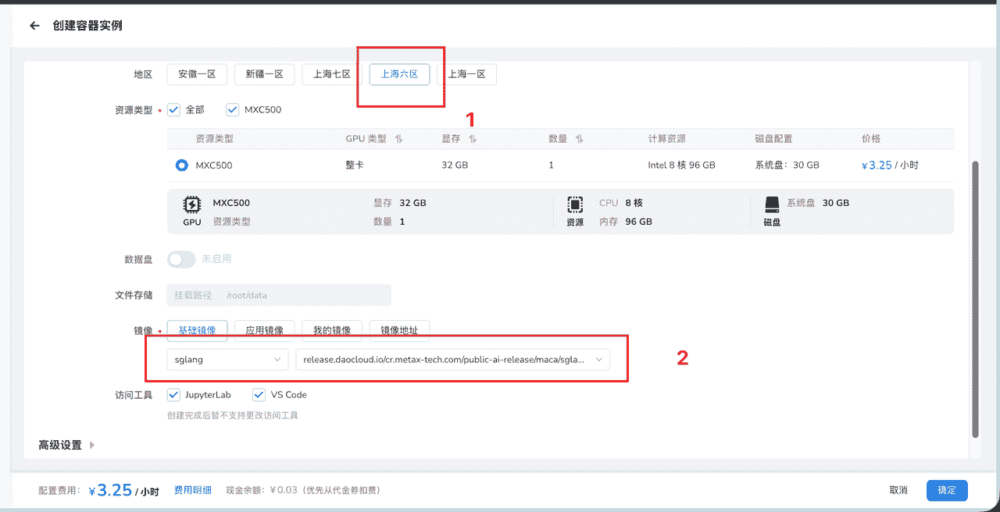

## 环境安装

安装必要的包:

```
cd /root/data
git clone https://gh.llkk.cc/https://github.com/fak111/VLM-formula-recognition-dataset.git
cd VLM-formula-recognition-dataset
git clone https://gh.llkk.cc/https://github.com/modelscope/ms-swift.git
cd ms-swift
git checkout cab4aa59
pip install -e .
pip install timm==1.0.9 msgspec==0.19.0
```

pip 下载速度慢可以试试换源，如清华、阿里、中科院、上交等等，哪个快用哪个。

## 模型和数据集下载：

```
modelscope download --model OpenGVLab/InternVL3_5-1B  --local_dir /root/data/model/InternVL3_5-1B
modelscope download --dataset JimmyMa99/VLM-formula-recognition-dataset_intern_camp --local_dir  /root/data/dataset/VLM-formula-recognition-dataset_intern_camp
```

数据集 的json 文件需要转化处理下,将图片路径变成绝对路径：

```
cd /root/data/VLM-formula-recognition-dataset
python convert.py
```

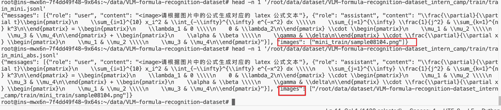

# InternVL3_5-1B 微调

## 启动微调

```
cd /root/data/VLM-formula-recognition-dataset
bash swift_config/internvl3.5_1b_train_mx.sh
```

微调配置：

```
#!/bin/bash

# 创建日志目录
LOG_DIR=&quot;logs&quot;
mkdir -p $LOG_DIR

# 获取当前时间戳
TIMESTAMP=$(date +&quot;%Y%m%d_%H%M%S&quot;)
LOG_FILE=&quot;$LOG_DIR/[SFT]internvl3.5_1b_${TIMESTAMP}.log&quot;

# 设置环境变量
# export ENABLE_AUDIO_OUTPUT=False
export OMP_NUM_THREADS=1
export CUDA_VISIBLE_DEVICES=0

# 设置随机端口号，避免端口冲突
export MASTER_PORT=$((10000 + RANDOM % 50000))

# 先打印启动信息
echo &quot;Starting training...&quot;
echo &quot;Log file: $LOG_FILE&quot;
echo &quot;Using port: $MASTER_PORT&quot;

# 没有指定 model_type
# 启动训练并获取PID
nohup swift sft \
    --model &#x27;/root/data/model/InternVL3_5-1B&#x27;\
    --dataset &#x27;/root/data/dataset/VLM-formula-recognition-dataset_intern_camp/train/train_mini_abs.jsonl&#x27; \
    --eval_steps 100 \
    --train_type lora \
    --lora_rank 16 \
    --lora_dropout 0.01 \
    --lora_alpha 32 \
    --torch_dtype bfloat16 \
    --num_train_epochs 1 \
    --per_device_train_batch_size 2 \
    --per_device_eval_batch_size 2 \
    --learning_rate 5e-5 \
    --warmup_ratio 0.05 \
    --gradient_accumulation_steps 4 \
    --save_steps 25 \
    --save_total_limit 3 \
    --gradient_checkpointing_kwargs &#x27;{&quot;use_reentrant&quot;: false}&#x27; \
    --logging_steps 10 \
    --max_length 8000 \
    --output_dir ./swift_output/SFT-InternVL3_5-1B\
    --dataset_num_proc 8 \
    --dataloader_num_workers 8 \
    --metric acc \
    --freeze_vit true \
    &gt; &quot;$LOG_FILE&quot; 2&gt;&amp;1 &amp;

# 获取PID并等待一下确保进程启动
TRAIN_PID=$!
sleep 2

# 检查进程是否还在运行
if kill -0 $TRAIN_PID 2&gt;/dev/null; then
    echo &quot;Training started successfully with PID $TRAIN_PID&quot;
    echo &quot;To view logs in real-time, use:&quot;
    echo &quot;tail -f $LOG_FILE&quot;
    echo &quot;&quot;
    echo &quot;To stop training, use:&quot;
    echo &quot;kill -9 $TRAIN_PID&quot;
else
    echo &quot;Failed to start training process&quot;
    echo &quot;Check log file for errors: $LOG_FILE&quot;
fi

```

其中选手可以自行调整 lr、lora 等参数

## 合并权重

运行以下命令：

```
swift export --adapters xx  --merge_lora True
```

示例：

```
swift export --adapters /root/data/VLM-formula-recognition-dataset/swift_output/SFT-InternVL3_5-1B/v8-20251112-171238/checkpoint-375  --merge_lora True
```

## 参赛提醒

本文方法受限于个人水平，未必最为高效。选手若想获得更佳效果，需自行探索如从构造高质量数据集、尝试不同的训练参数等方面自行探索与优化。

# 提交结果

## 上传

运行upload.py 上传模型

```
cd /root/data/VLM-formula-recognition-dataset
python upload.py
```

```
from modelscope.hub.api import HubApi
from modelscope.hub.constants import Licenses, ModelVisibility

# 配置基本信息
YOUR_ACCESS_TOKEN = &quot;ms-9fxx7e&quot;  # 填写自己的 api token ，获取方式点击：https://modelscope.cn/my/myaccesstoken
api = HubApi()
api.login(YOUR_ACCESS_TOKEN)

# 取名字
owner_name = &quot;xx&quot;  # ModelScope 的用户名
model_name = &quot;xx&quot;  # 为模型库取个响亮优雅又好听的名字，需根据自己情况修改
model_id = f&quot;{owner_name}/{model_name}&quot;

# 创建模型仓库
api.create_model(
    model_id,
    visibility=ModelVisibility.PUBLIC,
    license=Licenses.APACHE_V2,
    chinese_name=f&quot;{owner_name}的书生大模型实战营-公式微调分类比赛&quot;,
)

# 上传模型到仓库
api.upload_folder(
    repo_id=f&quot;{owner_name}/{model_name}&quot;,
    folder_path=&quot;xx&quot;,  # 微调后模型的文件夹名称
    commit_message=&quot;upload model folder to repo&quot;,  # 写上传信息
)

```

示例：

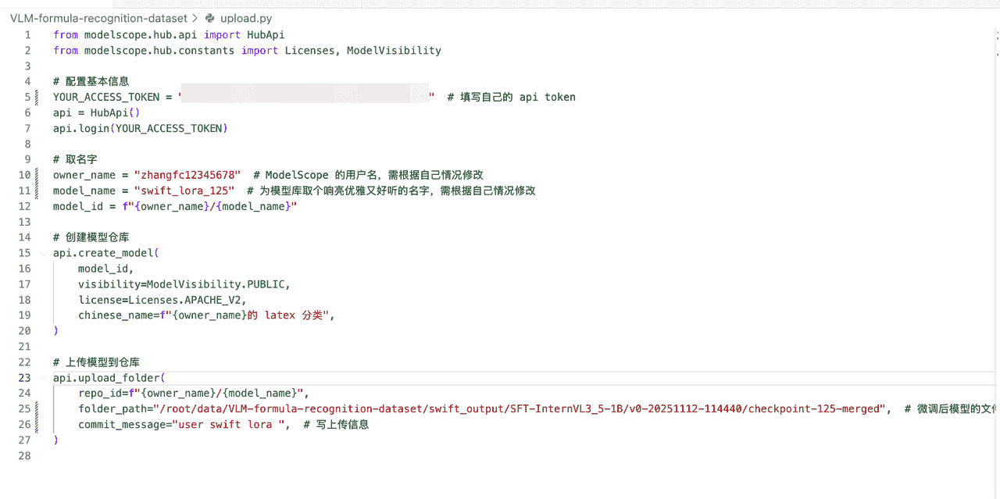

提交表单的 prompt 参考如下,这里也有优化空间，可自行探索最优 prompt：

```
请根据图片中的公式生成对应的 latex 公式文本
```

## 参赛流程

### 报名

点击以下链接进行报名,获取 uid

https://colearn.intern-ai.org.cn/set?s=gamef

### 提交参赛权重

微调后的权重请从以下链接入口提交，不要填写链接，参考截图。

**提交表单**：https://aicarrier.feishu.cn/share/base/form/shrcnXjK6zERK7z4pPU85PLO80c

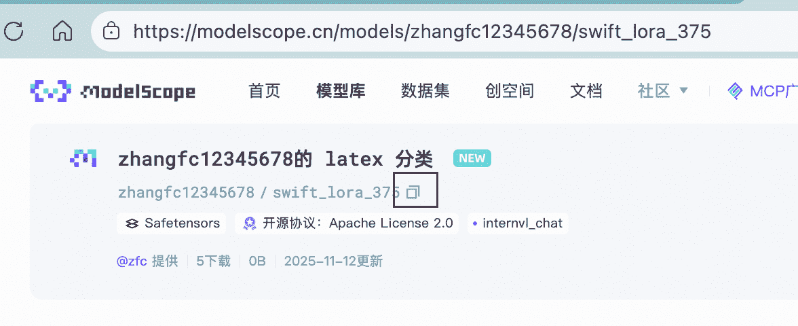

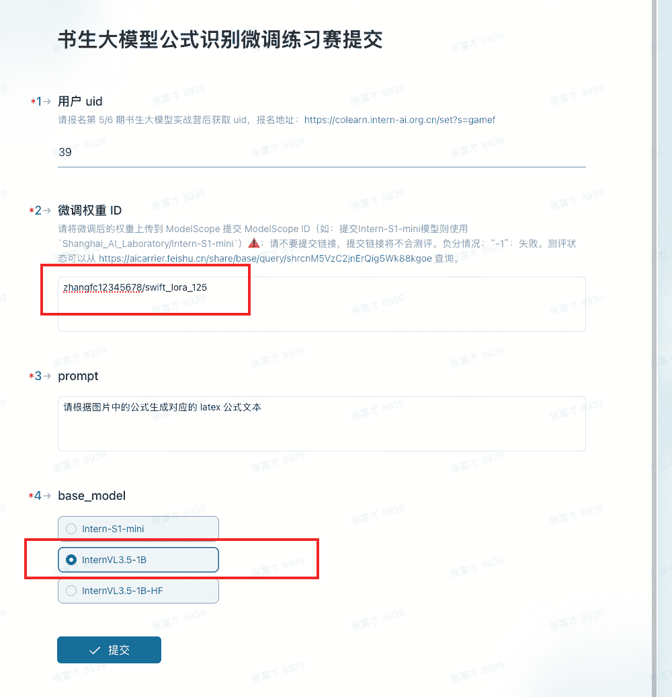

**注意：需要选择好 base **model，本次比赛请选择 InternVL3_5-1B ，如提交其他会出现测评异常情况！

本次测评会提取模型返回中的**最后一个 latex 块**

```
```latex
E = mc^2
```
```

提交完成，等待后台半小时左右评测，最终获得成绩🎉🎉

微调前：

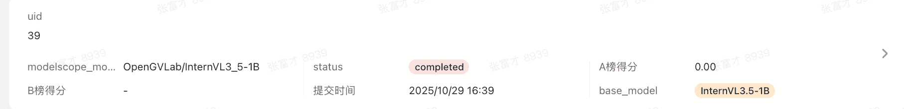

微调后：

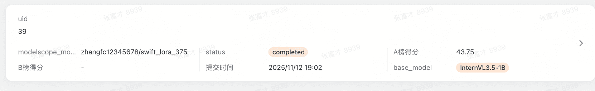

### 查看状态/分数

点击以下链接

https://aicarrier.feishu.cn/share/base/query/shrcnM5VzC2jnErQig5Wk88kgoe

进行查看，输入你的 uid，比如闻星（uid：4）

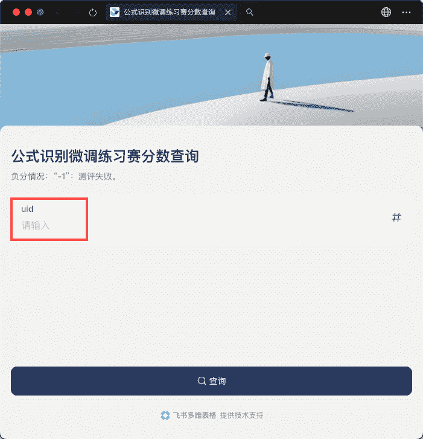

在这里能够查看状态

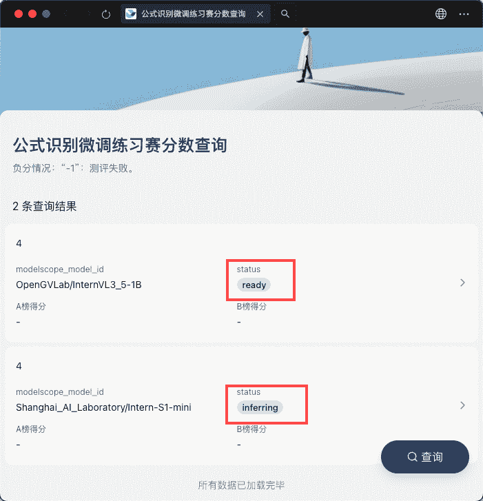

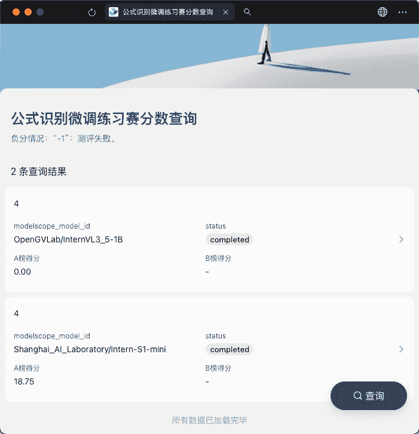

### 排行榜

https://aicarrier.feishu.cn/share/base/dashboard/shrcnrA82hMMRd1FUuWs8EhOjag

<https://aicarrier.feishu.cn/share/base/dashboard/shrcnrA82hMMRd1FUuWs8EhOjag?iframeFrom=docx&ccm_open=iframe>

## QA

### 日志

该缺陷可能导致日志写入功能异常，但不会影响模型的正常保存。

```
--- Logging error in Loguru Handler #2 ---
Record was: {&#x27;elapsed&#x27;: datetime.timedelta(seconds=2588, microseconds=214180), &#x27;exception&#x27;: None, &#x27;extra&#x27;: {}, &#x27;file&#x27;: (name=&#x27;trainer.py&#x27;, path=&#x27;/root/data/xtuner/xtuner/v1/train/trainer.py&#x27;), &#x27;function&#x27;: &#x27;_log_step&#x27;, &#x27;level&#x27;: (name=&#x27;INFO&#x27;, no=20, icon=&#x27;ℹ️&#x27;), &#x27;line&#x27;: 1026, &#x27;message&#x27;: &#x27;Step 102/290 data_time: 0.0009 lr: 2.488710e-05 time: 25.4424 text_tokens: 31805.0 total_loss: 0.20077972, reduced_llm_loss: 0.20077972, loss: 0.20077971 max_memory: 21.07 GB reserved_memory: 26.62 GB grad_norm: 0.88643903 tgs: 1250.1 e2e_tgs: 1248.5 eta: 1:19:09 &#x27;, &#x27;module&#x27;: &#x27;trainer&#x27;, &#x27;name&#x27;: &#x27;xtuner.v1.train.trainer&#x27;, &#x27;process&#x27;: (id=135707, name=&#x27;MainProcess&#x27;), &#x27;thread&#x27;: (id=139894268028736, name=&#x27;MainThread&#x27;), &#x27;time&#x27;: datetime(2025, 10, 31, 10, 57, 27, 496673, tzinfo=datetime.timezone(datetime.timedelta(seconds=28800), &#x27;CST&#x27;))}
Traceback (most recent call last):
  File &quot;/opt/conda/lib/python3.10/site-packages/loguru/_handler.py&quot;, line 206, in emit
    self._sink.write(str_record)
  File &quot;/opt/conda/lib/python3.10/site-packages/loguru/_file_sink.py&quot;, line 206, in write
    self._file.write(message)
OSError: [Errno 9] Bad file descriptor
--- End of logging error ---
[XTuner][RANK 0][2025-10-31 10:57:27][INFO] Step 102/290 data_time: 0.0009 lr: 2.488710e-05 time: 25.4424 text_tokens: 31805.0 total_loss: 0.20077972, reduced_llm_loss: 0.20077972, loss: 0.20077971 max_memory: 21.07 GB reserved_memory: 26.62 GB grad_norm: 0.88643903 tgs: 1250.1 e2e_tgs: 1248.5 eta: 1:19:09 
--- Logging error in Loguru Handler #2 ---
Record was: {&#x27;elapsed&#x27;: datetime.timedelta(seconds=2600, microseconds=218344), &#x27;exception&#x27;: None, &#x27;extra&#x27;: {}, &#x27;file&#x27;: (name=&#x27;jsonl_writer.py&#x27;, path=&#x27;/root/data/xtuner/xtuner/v1/_writer/jsonl_writer.py&#x27;), &#x27;function&#x27;: &#x27;_run&#x27;, &#x27;level&#x27;: (name=&#x27;WARNING&#x27;, no=30, icon=&#x27;⚠️&#x27;), &#x27;line&#x27;: 140, &#x27;message&#x27;: &#x27;Exception occurred during flushing /root/data/workdir/vlhf1031/20251031101422/logs/exp_tracking/rank0/tracker.jsonl&#x27;, &#x27;module&#x27;: &#x27;jsonl_writer&#x27;, &#x27;name&#x27;: &#x27;xtuner.v1._writer.jsonl_writer&#x27;, &#x27;process&#x27;: (id=135707, name=&#x27;MainProcess&#x27;), &#x27;thread&#x27;: (id=139877717894720, name=&#x27;JsonlWriterAsync&#x27;), &#x27;time&#x27;: datetime(2025, 10, 31, 10, 57, 39, 500837, tzinfo=datetime.timezone(datetime.timedelta(seconds=28800), &#x27;CST&#x27;))}
Traceback (most recent call last):
  File &quot;/root/data/xtuner/xtuner/v1/_writer/jsonl_writer.py&quot;, line 138, in _run
    writer._file_writer.flush()
OSError: [Errno 9] Bad file descriptor

During handling of the above exception, another exception occurred:

Traceback (most recent call last):
  File &quot;/opt/conda/lib/python3.10/site-packages/loguru/_handler.py&quot;, line 206, in emit
    self._sink.write(str_record)
  File &quot;/opt/conda/lib/python3.10/site-packages/loguru/_file_sink.py&quot;, line 206, in write
    self._file.write(message)
OSError: [Errno 9] Bad file descriptor
--- End of logging error ---
[XTuner][RANK 0][2025-10-31 10:57:39][WARNING] Exception occurred during flushing /root/data/workdir/vlhf1031/20251031101422/logs/exp_tracking/rank0/tracker.jsonl

```

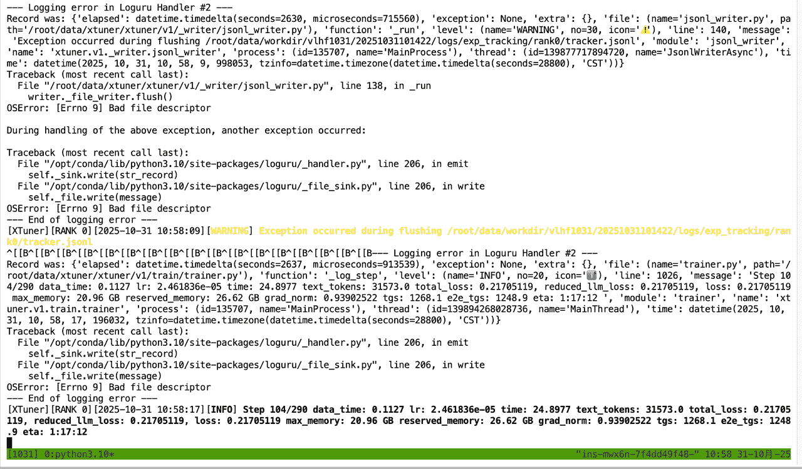