# L2 Intern-S1/InternVL微调公式识别实践（llama-factory）

> 来源：[https://aicarrier.feishu.cn/docx/X2frdw6pdo5cWgxfqAqc0JTynnb](https://aicarrier.feishu.cn/docx/X2frdw6pdo5cWgxfqAqc0JTynnb)

本课程将带您基于 LLaMA Factory 框架，完成 Intern-S1-mini 与 InternVL3_5-1B 两款模型的公式识别任务微调，从 GPU 环境配置，到超参数调整，再到最终模型上传至 ModelScope 并提交评测。

[LLaMA Factory](https://llamafactory.readthedocs.io/zh-cn/latest/) 是一个简单易用且高效的大型语言模型（Large Language Model）训练与微调平台。通过 LLaMA Factory，可以在无需编写任何代码的前提下，在本地完成上百种预训练模型的微调，框架特性包括：

+ 模型种类：LLaMA、LLaVA、Mistral、Mixtral-MoE、Qwen、Yi、Gemma、Baichuan、ChatGLM、Intern 等等。

+ 训练算法：（增量）预训练、（多模态）指令监督微调、奖励模型训练、PPO 训练、DPO 训练、KTO 训练、ORPO 训练等等。

+ 运算精度：16 比特全参数微调、冻结微调、LoRA 微调和基于 AQLM/AWQ/GPTQ/LLM.int8/H🐧/EETQ 的 2/3/4/5/6/8 比特 QLoRA 微调。

+ 优化算法：GaLore、BAdam、DoRA、LongLoRA、LLaMA Pro、Mixture-of-Depths、LoRA+、LoftQ 和 PiSSA。

+ 加速算子：FlashAttention-2 和 Unsloth。

+ 推理引擎：Transformers 和 vLLM。

+ 实验监控：LlamaBoard、TensorBoard、Wandb、MLflow、SwanLab 等等。

## 1. 环境配置

```
conda create -n llamafactory python=3.12 -y
conda activate llamafactory

git clone --depth 1 https://github.com/hiyouga/LLaMA-Factory.git
cd LLaMA-Factory
pip install -e ".[torch,metrics]"
```

> 使用 LLaMA Factory 微调 Intern 模型需要版本：`pip install transformers >= 4.55.2 torchvision python >= 3.12.0`

检查是否安装成功，如图所示，表明安装成功

```
llamafactory-cli version
```

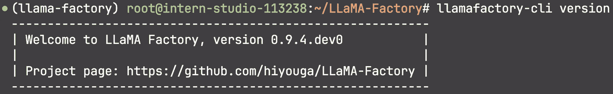

## 数据处理

目前 [LLaMA Factory](https://llamafactory.readthedocs.io/zh-cn/latest/getting_started/data_preparation.html#alpaca) 支持 Alpaca 格式和 [ShareGPT](https://llamafactory.readthedocs.io/zh-cn/latest/getting_started/data_preparation.html#sharegpt) 格式的 json 数据集。

需要将我们的 JSONL 数据转换成 JSON 格式，我们以 Alpaca 格式为例

```
import json

def convert_jsonl_to_instruction_format(input_file, output_file):
    """转换 JSONL 格式的数据为 Alpaca 格式"""
    
    converted_data = []
    processed_count = 0
    error_count = 0
    
    with open(input_file, 'r', encoding='utf-8') as f_in:
        for line_num, line in enumerate(f_in, 1):
            line = line.strip()
            if not line:
                continue
                
            try:
                # 解析每行的 JSON 对象
                item = json.loads(line)
                
                # 提取用户消息
                user_content = item["messages"][0]["content"].strip()
                
                # 提取助手回复
                assistant_content = item["messages"][1]["content"]
                
                # 提取图片路径
                images = item.get("images", [])
                
                # 构建新格式
                converted_item = {
                    "instruction": user_content,
                    "input": "",
                    "output": assistant_content,
                    "images": images
                }
                
                converted_data.append(converted_item)
                processed_count += 1
                
                # 每处理100条显示进度
                if processed_count % 100 == 0:
                    print(f"已处理 {processed_count} 条数据...")
                    
            except json.JSONDecodeError as e:
                print(f"第 {line_num} 行 JSON 解析错误: {e}")
                error_count += 1
            except KeyError as e:
                print(f"第 {line_num} 行缺少必要字段: {e}")
                error_count += 1
            except Exception as e:
                print(f"第 {line_num} 行处理异常: {e}")
                error_count += 1
    
    # 保存转换后的数据
    with open(output_file, 'w', encoding='utf-8') as f_out:
        json.dump(converted_data, f_out, ensure_ascii=False, indent=2)
    
    print(f"\n转换完成！")
    print(f"成功处理: {processed_count} 条")
    print(f"处理失败: {error_count} 条")
    print(f"输出文件: {output_file}")

# 使用示例
if __name__ == "__main__":
    # 替换为您的输入文件路径
    input_file = "/root/LF_config/VLM-formula-recognition-dataset_intern_camp/train/train_mini_abs.jsonl"
    # 输出文件路径
    output_file = "/root/LF_config/VLM-formula-recognition-dataset_intern_camp/train/train_mini_alpaca.json"
    
    convert_jsonl_to_instruction_format(input_file, output_file)
```

转换完成后

```
{
    "instruction": "<image>请根据图片中的公式生成对应的 latex 公式文本",
    "input": "",
    "output": "\\frac{\\partial}{\\partial t}\\begin{pmatrix}\n    \\sum_{i=1}^{10} x_i^2 & \\int_{-\\infty}^{\\infty} e^{-x^2} dx \\\\\n    \\sum_{j=1}^{\\infty} \\frac{1}{j^2} & \\sum_{k=1}^{n} k^3\n\\end{pmatrix} = \\begin{pmatrix}\n    \\lambda_1 & 0 \\\\\n    0 & \\lambda_2\n\\end{pmatrix} \\cdot \\begin{pmatrix}\n    \\mu_1 & \\mu_2 \\\\\n    \\mu_3 & \\mu_4\n\\end{pmatrix} + \\begin{pmatrix}\n    \\alpha & \\beta \\\\\n    \\gamma & \\delta\n\\end{pmatrix} \\cdot \\frac{\\partial}{\\partial x} \\begin{pmatrix}\n    \\mu_1 & \\mu_2 \\\\\n    \\mu_3 & \\mu_4\n\\end{pmatrix}",
    "images": [
      "/root/share/datasets/VLM-formula-recognition-dataset_intern_camp/train/mini_train/sample08104.png"
    ]
  },
```

我们还需要在 `/root/LLaMA-Factory/data/dataset_info.json` 文件中，添加我们的数据集及其内容的定义

```
"formula": {
    "file_name": "/root/LF_config/VLM-formula-recognition-dataset_intern_camp/train/train_mini_alpaca.json",
    "columns": {
      "prompt": "instruction",
      "query": "input",
      "response": "output",
      "images": "images"
    }
  }
```

数据准备完成后，可以进行下一步的微调

## InternVL3.5-1B 微调

LLaMA Factory 支持三种微调：命令行、配置文件以及 Web UI 界面，我们本次采用配置文件以及 Web UI 界面两种方式

LLaMA Factory 多数参数详情：LLaMA Factory 参数详情

### 3.1 Yaml 配置文件微调

在开发机中创建配置文件 `intern_vl35_config.yaml`


```
# 模型
model_name_or_path: /root/share/new_models/InternVL3.5/InternVL3_5-1B-HF # 模型路径，需要HF格式
trust_remote_code: true

### method
stage: sft                            # 训练阶段 —— SFT
do_train: true                        # 开启训练模式           
finetuning_type: lora                 # 开启 Lora
lora_rank: 32                         # Lora 秩
lora_alpha: 64                        # LoRA 缩放系数
lora_target: all                      # 应用 LoRA 方法的模块名称，all表示所有模块
freeze_vision_tower: false            # 是否冻结vision
freeze_multi_modal_projector: false   # 是否冻结projector
freeze_language_model: false          # 是否冻结language

### dataset
dataset: formula                               # 使用的数据集，使用”,”分隔多个数据集
dataset_dir: /root/LLaMA-Factory/data          # dataset_info.json 根目录
media_dir: /root/LF_config/VLM-formula-recognition-dataset_intern_camp/train  # 图片数据路径，如果是相对路径，此项必有
template: intern_vl                            # 训练和推理时构造 prompt 的模板
cutoff_len: 4096                               # 输入的最大 token 数，超过该长度会被截断
max_samples: 100000                            # 每个数据集的最大样本数
overwrite_cache: true                          # 是否覆盖缓存的训练和评估数据集
preprocessing_num_workers: 1                   # 预处理时使用的进程数量
dataloader_num_workers: 8                      # 用于数据加载的子进程数量 num_workers

### output
output_dir: saves/internvl35-1B-lora-sft       # 输出文件夹
logging_steps: 10                              # 日志输出步数间隔
save_steps: 500                                # 模型断点保存间隔
plot_loss: true                                # 是否保存训练过程中的损失曲线
overwrite_output_dir: true                     # 是否允许覆盖输出目录
save_only_model: false                         # 仅保存模型权重

### train
per_device_train_batch_size: 8                 # batch size
gradient_accumulation_steps: 8                 # 梯度积累步数
learning_rate: 5.0e-5                          # 学习率
num_train_epochs: 8                            # epoch
lr_scheduler_type: cosine                      # 学习率调整策略
warmup_ratio: 0.01                             # 学习率预热比例
bf16: true                                     # 是否使用 bf16 格式
ddp_timeout: 180000000                         # 分布式数据并行的超时时间。
flash_attn: auto                               # 是否启用 FlashAttention
max_grad_norm: 1.0                             # 最大梯度，超过裁剪
weight_decay: 0.1                              # 权重衰减
```

通过上述参数说明，可以根据自己任务调整参数，训练专属于自己的模型

配置完成参数后，启动以下命令启动微调

```
llamafactory-cli train intern_vl35_config.yaml  # 你的配置路径
```

此处 token 化较慢（CPU），请耐心等待

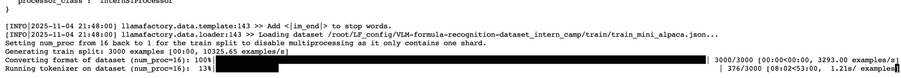

> 如果你介意下面的警告，可以使用：`export TOKENIZERS_PARALLELISM="false"`

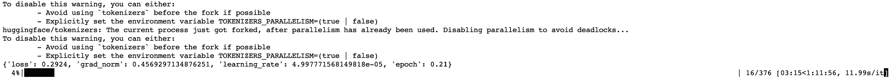

训练完成后，可以得到如下包含适配器权重的相关文件

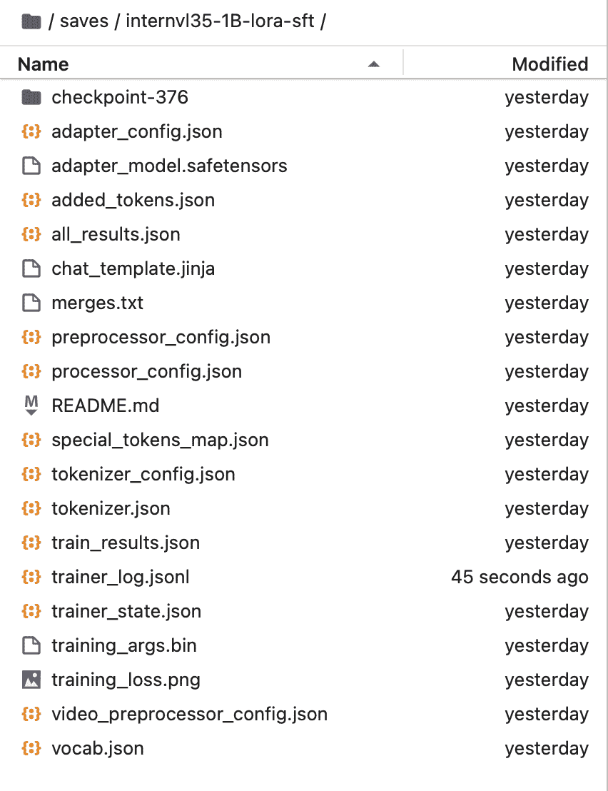

## 3.2 Web UI 界面微调

除了上述配置文件微调外，也可以使用命令行开启 Web UI 界面，参数配置更加清晰

```
llamafactory-cli webui
```

> 最好在本地电脑通过SSH进行连接

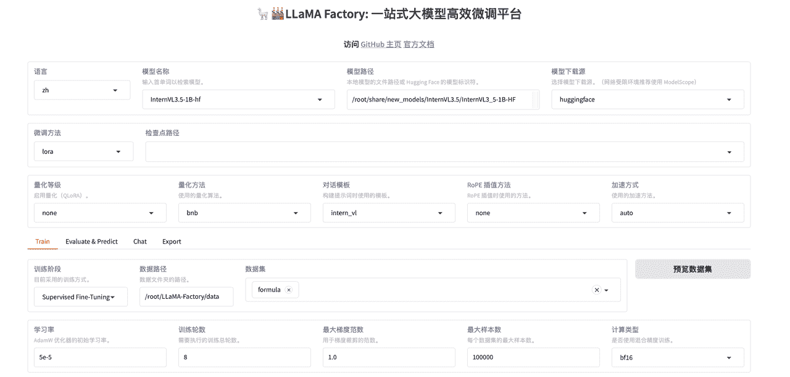

完成参数配置后，可以使用 “预览命令”，查看配置文件

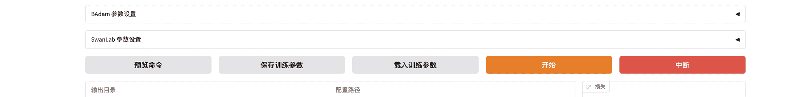

预览命令

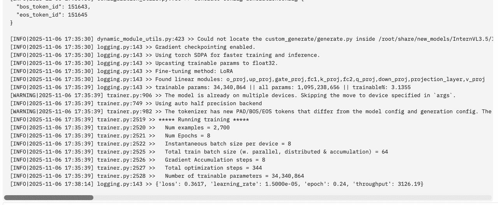

点击开始，即可开始训练，同样 token 化部分加载数据较慢

[如果想要查看详细的训练](https://docs.swanlab.cn/guide_cloud/general/quick-start.html)过程，则可以开启SwanLab，SwanLab参考文档

```
pip install swanlab                 # cloud
pip install 'swanlab[dashboard]'    # local
```

调整如下参数

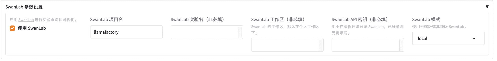

训练过程中，开启swanlab

> 本次使用本地模式监控训练曲线，你也可以通过云端监控，即将模式修改为cloud即可（需要提前注册账号）

```
swanlab watch /root/swanlog
```

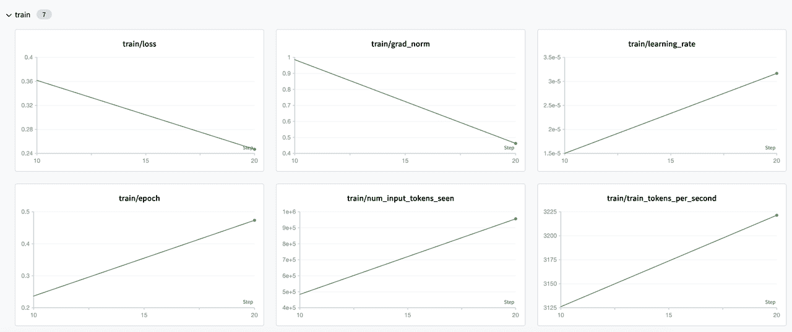

## 3.3 权重合并

训练完成后，将 lora 微调产生的部分权重和源权重进行合并

先创建合并配置文件 `internvl35_merge_config.yaml`

```
# model
model_name_or_path: /root/share/new_models/InternVL3.5/InternVL3_5-1B-HF   # 源权重文件
adapter_name_or_path: /root/saves/internvl35-1B-lora-sft                   # lora权重文件
template: intern_vl                                                        # 训练和推理时构造 prompt 的模板
finetuning_type: lora                                                      # 微调类型
trust_remote_code: True

# export
export_dir: models/internvl35_1B_lora_sft     # 导出模型保存目录的路径。
export_size: 5                                # 导出模型的文件分片大小（以GB为单位）。
export_device: auto                           # 导出模型时使用的设备，auto 可自动加速导出。
export_legacy_format: false                   # True： .bin 格式保存。 False： .safetensors 格式保存。
```

使用以下命令进行合并

```
llamafactory-cli export internvl35_merge_config.yaml # 你的配置文件路径
```

## 3.4 模型测试

将合并完成的模型，使用以下代码进行测试

```
from PIL import Image
from transformers import AutoProcessor, AutoModelForImageTextToText, AutoModelForCausalLM
import torch

# model_name = '/root/models/interns1_lora_sft'
model_name = '/root/models/internvl35_1B_lora_sft'   # 合并后的模型路径

processor = AutoProcessor.from_pretrained(model_name, trust_remote_code=True)
# model = AutoModelForCausalLM.from_pretrained(model_name, 
#                                              device_map=None, 
#                                              dtype="auto", 
#                                              trust_remote_code=True)

model = AutoModelForImageTextToText.from_pretrained(model_name, device_map="auto", dtype="auto", trust_remote_code=True)

device = "cuda" if torch.cuda.is_available() else "cpu"
model = model.to(device)

# 加载图像
image = Image.open("/root/VLM-formula-recognition-dataset/data/output_eval/sample001.png")
# prompt ="describle this img"
prompt ="""请根据图片中的公式生成对应的 latex 公式文本，不要任何解释。

  输出格式要求：
  1. 必须使用 ```latex 代码块包裹

  2. 仅包含 LaTeX 代码，无任何文字说明

  3. 确保语法正确，下标用 {} 括起来

  输出案例：

  案例 1：

  ```latex
  \sum_{i=1}^{n} x_i = \mu
  ```

  案例 2：

  ```latex
  \begin{bmatrix}
  a & b \\
  c & d
  \end{bmatrix}
  ```

"""

messages = [

    {

        "role": "user",

        "content": [

            {"type": "image", "image": image},  # PIL图像对象

            {"type": "text", "text": prompt},

        ],

    }

]

inputs = processor.apply_chat_template(

    messages,

    add_generation_prompt=True,

    tokenize=True,

    return_dict=True,

    return_tensors="pt"

).to(model.device, dtype=torch.bfloat16)

generate_ids = model.generate(**inputs, max_new_tokens=10000)

decoded_output = processor.decode(generate_ids[0, inputs["input_ids"].shape[1]:], skip_special_tokens=True)

print("current model: ", model_name)

print(decoded_output)
```

## 3.5 权重上传

测试无误后，可以使用以下代码将模型上传至 modelscope 社区

```
from modelscope.hub.api import HubApi

from modelscope.hub.constants import Licenses, ModelVisibility

# 配置基本信息

YOUR_ACCESS_TOKEN = 'ms-9fxx7e'#填写自己的 api token

api = HubApi()

api.login(YOUR_ACCESS_TOKEN)

# 取名字

owner_name = 'xx'    # ModelScope 的用户名，需根据自己情况修改

model_name = 'xx'    # 为模型库取个响亮优雅又好听的名字，需根据自己情况修改

model_id = f"{owner_name}/{model_name}"

#创建模型仓库

api.create_model(

     model_id,

     visibility=ModelVisibility.PUBLIC,

     license=Licenses.APACHE_V2,

     chinese_name=f"{owner_name}的 latex 分类"

    )

#上传模型到仓库

api.upload_folder(

    repo_id=f"{owner_name}/{model_name}",

    folder_path='xx',    # 微调后模型的文件夹名称

    commit_message='upload model folder to repo',    # 写上传信息

)
```

# InternS1-mini 微调

本次使用 LLama Factory 对 InternS1-mini进行微调

## 4.1 Yaml 配置文件微调

在开发机中创建配置文件 `interns1_mini_config.yaml`

```
### model
model_name_or_path:  /root/share/new_models/Intern-S1-mini   # 模型名称或路径
trust_remote_code: true

### method
stage: sft                                     # 训练阶段
do_train: true                                 # true用于训练, false用于评估
finetuning_type: lora                          # 微调方式。可选: freeze, lora, full
freeze_vision_tower: false                     # 是否冻结vision
freeze_multi_modal_projector: false            # 是否冻结projector
freeze_language_model: false                   # 是否冻结language
lora_rank: 8                                   # LoRA 微调的本征维数 r， r 越大可训练的参数越多。默认值为 8
```


## 4.1 参数配置

### model

`lora_target: all` # 应用 LoRA 方法的模块名称。使用逗号分隔多个模块，使用 `all` 指定所有模块。默认值为 `all`

### dataset

`dataset: formula` # 使用的数据集，使用“，”分隔多个数据集

`dataset_dir: /root/LLaMA-Factory/data`

`media_dir: /root/LF_config/VLM-formula-recognition-dataset_intern_camp/train`

`template: intern_s1` # 数据集模板，请保证数据集模板与模型相对应。

`cutoff_len: 1024` # `sample_max_length` 输入的最大 token 数，超过该长度会被截断。

`max_samples: 3000` # 每个数据集的最大样本数：设置后，每个数据集的样本数将被截断至指定的 `max_samples`。

`overwrite_cache: true` # 是否覆盖缓存的训练和评估数据集。

`preprocessing_num_workers: 16` # 预处理时使用的进程数量。

`dataloader_num_workers: 4` # 用于数据加载的子进程数量 `num_workers`

### output

`output_dir: saves/interns1_mini/full/sft` # 输出路径

`logging_steps: 10` # 日志输出步数间隔

`save_steps: 500` # 模型断点保存间隔

`plot_loss: true` # 是否保存训练过程中的损失曲线。

`overwrite_output_dir: true` # 是否允许覆盖输出目录

`save_only_model: false` # 仅保存模型权重

`report_to: none` # choices: [`none`, `wandb`, `tensorboard`, `swanlab`, `mlflow`]

### train

`per_device_train_batch_size: 1` # 每个设备上训练的批次大小

`gradient_accumulation_steps: 2` # 梯度积累步数

`learning_rate: 1.0e-5` # 学习率

`num_train_epochs: 3.0` # 训练周期数

`lr_scheduler_type: cosine` # 学习率曲线，可选 `linear`, `cosine`, `polynomial`, `constant` 等。

`warmup_ratio: 0.1` # 学习率预热比例

`bf16: true` # 是否使用 `bf16` 格式

`ddp_timeout: 180000000` # 分布式数据并行的超时时间。

`resume_from_checkpoint: null` # 恢复上次训练的所有状态，包括优化器、数据以及参数

### eval

```
# val_size: 0.1
# per_device_eval_batch_size: 1
# eval_strategy: steps
# eval_steps: 500
```

通过上述参数说明，可以根据自己任务调整参数，训练专属于自己的模型

配置完成参数后，启动以下命令启动微调

```
llamafactory-cli train interns1_mini_config.yaml  # 你的配置路径
```

同样，你也可以尝试使用 Web UI 界面对模型进行微调

## 4.2 权重合并

训练完成后，创建合并配置文件 `interns1_mini_merge_config.yaml`

```
# model

model_name_or_path: /root/share/new_models/Intern-S1-mini

adapter_name_or_path: saves/interns1_mini/full/sft

template: intern_s1

finetuning_type: lora

trust_remote_code: True

# export

export_dir: models/interns1_lora_sft  

export_size: 4                        

export_device: auto                  

export_legacy_format: false           
```

输入命令，启动合并

```
llamafactory-cli export interns1_mini_merge_config.yaml # 你的配置文件路径
```

合并完成后，可以选择尝试测试模型，并提交模型至 modelscope 社区，完成比赛

# 参赛流程

## 5.1 报名

点击以下链接进行报名

`https://colearn.intern-ai.org.cn/set?s=gamef`

## 5.2 提交参赛权重

微调后的权重请从以下链接入口提交，请注意截图内容，不要填写链接，本次比赛你可以选择自己的提示词，这有可能提高你的模型识别精度

`https://aicarrier.feishu.cn/share/base/form/shrcnXjK6zERK7z4pPU85PLO80c`

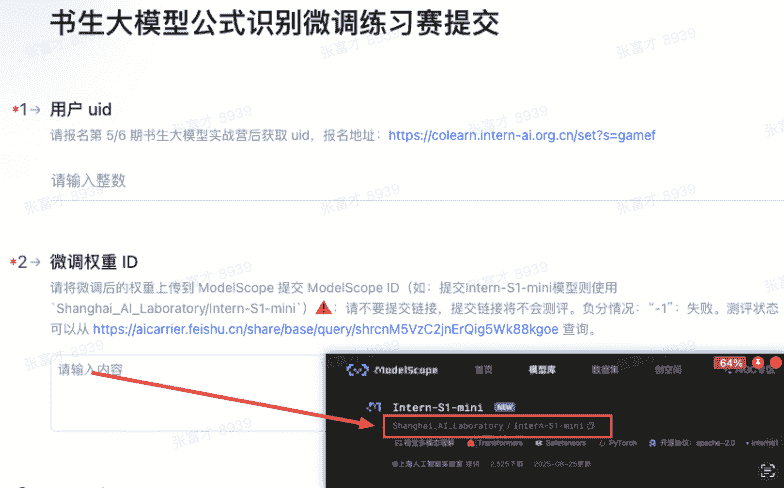

``````
&quot;&quot;&quot;请根据图片中的公式生成对应的 latex 公式文本，不要任何解释。

   输出格式要求：

   1. 必须使用 ```latex 代码块包裹
   2. 仅包含 LaTeX 代码，无任何文字说明
   3. 确保语法正确，下标用 {} 括起来

   输出案例：
   案例 1：
   ```latex

   \sum_{i=1}^{n} x_i = \mu

   ```

   案例 2：
   ```latex

   \begin{bmatrix}

   a &amp; b \\

   c &amp; d

   \end{bmatrix}

   ```
&quot;&quot;&quot;
``````

提交完成后，等待半个小时即可获得结果

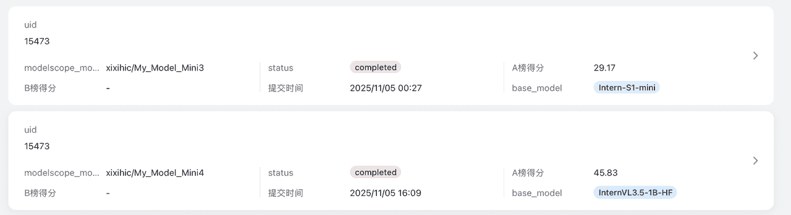

> 需要选择好 base model，本次提供三个模型进行选择，如不在此范围内的模型请勿提交，否则可能会出现测评异常情况。

## 5.3 查看状态

点击以下链接

`https://aicarrier.feishu.cn/share/base/query/shrcnM5VzC2jnErQig5Wk88kgoe`

进行查看，输入你的 `uid`，比如闻星（`uid`：4）

## 5.4 排行榜

`https://aicarrier.feishu.cn/share/base/dashboard/shrcnrA82hMMRd1FUuWs8EhOjag`

# 闯关任务

+   请从 `Intern-S1-mini` 微调 与 `InternVL3_5-1B-HF` 微调 两项任务中择一完成微调实践，确保成功提交并获得评分。

+   实践过程中的全部笔记与最终评分结果截图，整理至飞书文档提交

提交地址：`https://aicarrier.feishu.cn/share/base/form/shrcnbguDXSzIZV5Dkapw39BJ0f`
