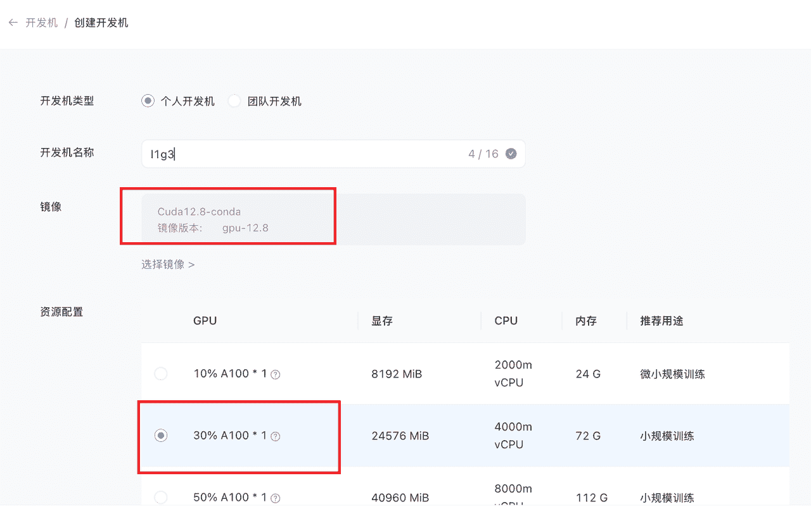
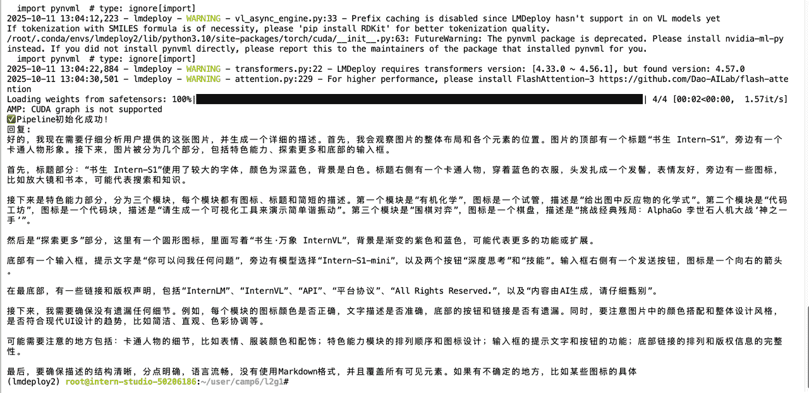
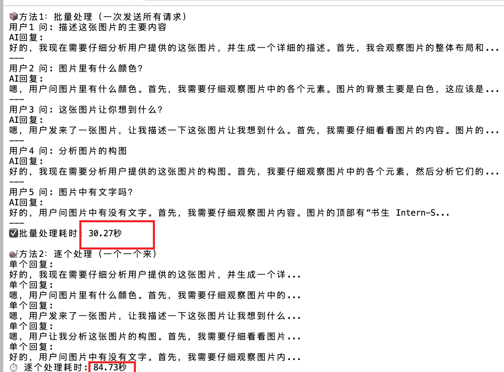
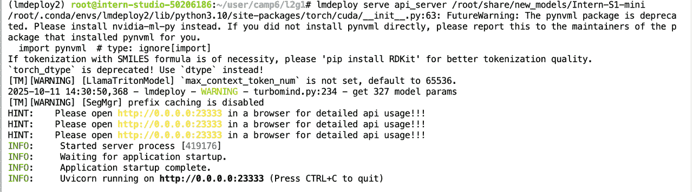
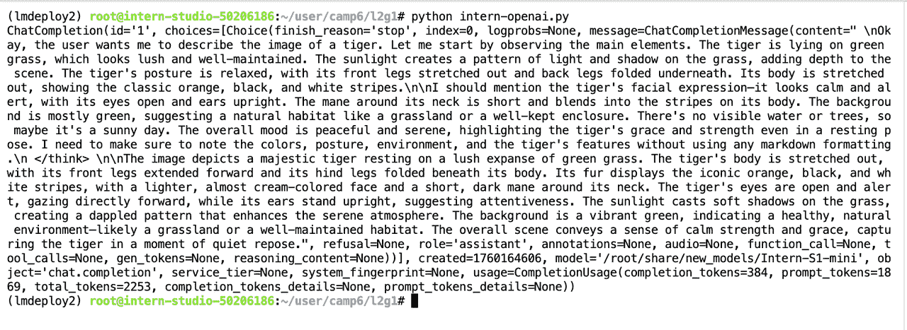
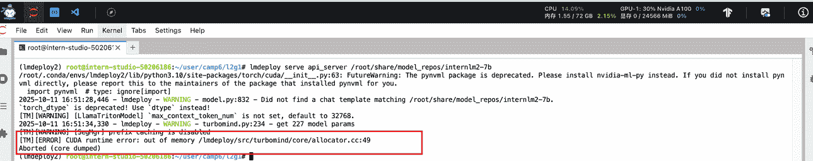
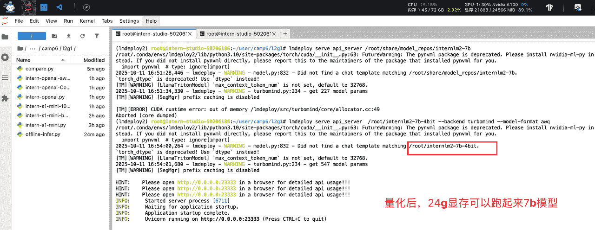
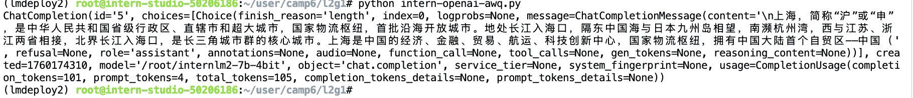
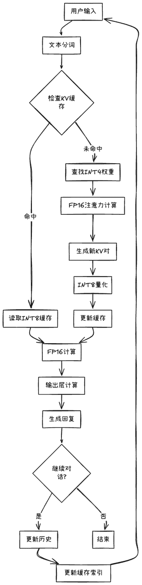

# L2 LMDeploy 量化部署书生大模型实践

> 来源：[https://aicarrier.feishu.cn/docx/Po5Odc9QzoTDzrx4pjNc82PKnfb](https://aicarrier.feishu.cn/docx/Po5Odc9QzoTDzrx4pjNc82PKnfb)

本课程将以**LMDeploy 工具为核心**，带您掌握大模型部署全链路实战。学员将掌握如何搭建一个支持多模态任务的 OpenAI 兼容 API 服务，解决显存不足问题并通过 INT4 量化技术优化模型性能。此外，我们还将通过批处理和 KV Cache 技术，显著提升并发能力，确保大规模用户请求下的高效响应。

## 环境安装

在创建开发机界面选择镜像为 Cuda12.8-conda，并选择 GPU 为 30% A100



首先创建并激活 Conda 环境，安装 lmdeploy 库：

```
conda create -n lmdeploy2 python=3.10 -y
conda activate lmdeploy2
pip install lmdeploy openai datasets jmespath
```

## 快速开始

以下示例演示了如何使用 LMDeploy 构建一个支持多模态任务的推理服务。通过配置 PytorchEngineConfig 中的关键参数，可以优化模型在并发、缓存和会话管理方面的表现：

    image_path = &quot;https://pic1.imgdb.cn/item/68d20846c5157e1a8828f9bf.jpg&quot;  # 替换为实际图片路径

```
from lmdeploy import pipeline, PytorchEngineConfig
from lmdeploy.vl import load_image

def main():
    # 初始化pipeline
    pipe = pipeline(&quot;/root/share/new_models/Intern-S1-mini&quot;,
                    backend_config=PytorchEngineConfig(
                        max_batch_size=32,
                        enable_prefix_caching=True,
                        cache_max_entry_count=0.1,
                        session_len=4096,
                    ))
    
    print(&quot;✅ Pipeline初始化成功！&quot;)
    
    # 测试推理
    prompt = &quot;请描述这张图片的内容&quot;
    
    response = pipe([(prompt, load_image(image_path))])
    print(&quot;回复:&quot;, response[0].text)
    
    return pipe

if __name__ == &#x27;__main__&#x27;:
    pipe = main()
```



```
backend_config=PytorchEngineConfig(
    max_batch_size=32,
    enable_prefix_caching=True,
    cache_max_entry_count=0.1,
    session_len=4096,
)
```

**配置参数说明**

我们可以将 PytorchEngineConfig 的配置类比为经营一家智能快餐店，每个参数对应一个运营环节：

+   max_batch_size=32：如同厨房一次可接受32个订单，显著提升请求并发处理能力；

+   enable_prefix_caching=True：类似预制常用食材，对相似请求可复用中间结果，加快推理速度；

+   cache_max_entry_count=0.1：控制缓存区大小，合理分配内存资源，避免浪费或不足；

+   session_len=4096：设定对话记忆长度，保持上下文连贯性，同时防止内存过载。

这些参数协同作用，构建出一个高吞吐、低延迟、资源可控的推理服务。

### **高并发请求实战示例**

在实际应用中，若需处理大量并发请求，可参考以下示例，体验 max_batch_size 带来的性能优势：

        (&quot;描述这张图片的主要内容&quot;, &quot;https://pic1.imgdb.cn/item/68d20846c5157e1a8828f9bf.jpg&quot;),
        (&quot;图片里有什么颜色？&quot;, &quot;https://pic1.imgdb.cn/item/68d20846c5157e1a8828f9bf.jpg&quot;), 
        (&quot;这张图片让你想到什么？&quot;, &quot;https://pic1.imgdb.cn/item/68d20846c5157e1a8828f9bf.jpg&quot;),
        (&quot;分析图片的构图&quot;, &quot;https://pic1.imgdb.cn/item/68d20846c5157e1a8828f9bf.jpg&quot;),
        (&quot;图片中有文字吗？&quot;, &quot;https://pic1.imgdb.cn/item/68d20846c5157e1a8828f9bf.jpg&quot;)

```
from lmdeploy import pipeline, PytorchEngineConfig
from lmdeploy.vl import load_image
import time

def main():
    # 初始化pipeline - 设置批量处理能力
    pipe = pipeline(&quot;/root/share/new_models/Intern-S1-mini&quot;,
                    backend_config=PytorchEngineConfig(
                        max_batch_size=32,  # 一次能处理32个请求
                        enable_prefix_caching=True,
                        cache_max_entry_count=0.1,
                        session_len=4096,
                    ))
    
    print(&quot;✅ Pipeline初始化成功！&quot;)
    print(&quot;🚀 模拟多个用户同时请求...&quot;)
    
    # 准备多个不同的图片和问题（模拟多个用户）
    requests = [
    ]
    
    # 方法1：一次性批量发送所有请求（就像快餐店一次接多个订单）
    print(&quot;\n📦 方法1：批量处理（一次发送所有请求）&quot;)
    batch_inputs = []
    for prompt, img_path in requests:
        batch_inputs.append((prompt, load_image(img_path)))
    
    start_time = time.time()
    batch_responses = pipe(batch_inputs)  # 一次处理所有请求
    end_time = time.time()
    
    for i, response in enumerate(batch_responses):
        print(f&quot;用户{i+1} 问: {requests[i][0]}&quot;)
        print(f&quot;AI回复: {response.text[:50]}...&quot;)  # 只显示前50个字
        print(&quot;---&quot;)
    
    print(f&quot;✅ 批量处理耗时: {end_time - start_time:.2f}秒&quot;)
    
    # 方法2：逐个发送请求（对比效果）
    print(&quot;\n🐌 方法2：逐个处理（一个一个来）&quot;)
    start_time = time.time()
    for prompt, img_path in requests:
        single_response = pipe([(prompt, load_image(img_path))])
        print(f&quot;单个回复: {single_response[0].text[:30]}...&quot;)
    end_time = time.time()
    print(f&quot;⏱️  逐个处理耗时: {end_time - start_time:.2f}秒&quot;)
    
    return pipe

if __name__ == &#x27;__main__&#x27;:
    pipe = main()
```



## 模型服务

使用以下命令即可将模型部署为 OpenAI 格式的 API [L1 玩转书生大模型 API 与 MCP](https://aicarrier.feishu.cn/wiki/US0jw9aglijRHykmPGvc6AjRnGg)务，然后 API 服务请求示例可以参考

```
lmdeploy serve api_server /root/share/new_models/Intern-S1-mini \
  --backend pytorch \
  --server-name 0.0.0.0 \
  --server-port 23333 \
  --dtype float16 \
  --quant-policy 0
```



                &#x27;https://raw.githubusercontent.com/open-mmlab/mmdeploy/main/tests/data/tiger.jpeg&#x27;,

```
from openai import OpenAI

client = OpenAI(api_key=&#x27;YOUR_API_KEY&#x27;, # A dummy api_key is required
                base_url=&#x27;http://0.0.0.0:23333/v1&#x27;)
model_name = client.models.list().data[0].id
response = client.chat.completions.create(
    model=model_name,
    messages=[{
        &#x27;role&#x27;:
        &#x27;user&#x27;,
        &#x27;content&#x27;: [{
            &#x27;type&#x27;: &#x27;text&#x27;,
            &#x27;text&#x27;: &#x27;Describe the image please&#x27;,
        }, {
            &#x27;type&#x27;: &#x27;image_url&#x27;,
            &#x27;image_url&#x27;: {
                &#x27;url&#x27;:
            },
        }],
    }],
    temperature=0.8,
    top_p=0.8)
print(response)
```

运行后，会得到如下输出



## **模型**量化

当显存资源充足时，可直接启动模型服务：：

lmdeploy serve api_server /root/share/model_repos/internlm2-7b

**然而，在**显存不足的情况下，直接运行会导致启动失败，如下图。此时需要通过模型量化技术，在可接受的性能损失范围内降低显存需求，确保服务能够正常运行。



### INT4 模型量化和部署

#### 执行模型量化

使用以下命令将原始模型转换为4-bit量化版本：

```
lmdeploy lite auto_awq  /root/share/model_repos/internlm2-7b --work-dir  /root/internlm2-7b-4bit
```

如遇到RuntimeError: Dataset scripts are no longer supported, but found ptb_text_only.py,可以加上--calib-dataset wikitext 启动:

```
lmdeploy lite auto_awq  /root/share/model_repos/internlm2-7b --work-dir  /root/internlm2-7b-4bit --calib-dataset wikitext
```

#### 部署量化模型

```
lmdeploy serve api_server  /root/internlm2-7b-4bit 
```



量化服务部署成功后，可通过OpenAI兼容接口进行调用：

```
from openai import OpenAI

client = OpenAI(api_key=&#x27;YOUR_API_KEY&#x27;,  # A dummy api_key is required
                base_url=&#x27;http://0.0.0.0:23333/v1&#x27;)
model_name = client.models.list().data[0].id
response = client.chat.completions.create(
    model=model_name,
    messages=[{
        &#x27;role&#x27;: &#x27;user&#x27;,
        &#x27;content&#x27;: [{
            &#x27;type&#x27;: &#x27;text&#x27;,
            &#x27;text&#x27;: &quot;上海有什么？&quot;  # 这里将外层单引号改为双引号
        }],
    }],
    temperature=0.8,
    top_p=0.8,
    max_tokens=100)
print(response)
```



通过以上流程，即可在有限显存环境下成功部署并调用大语言模型服务。

### Key-Value(KV) Cache 量化

#### **KV Cache量化的作用**

**上面的模型量化**就像把厚重的纸质书扫描成电子版（📚→💾），让书本体积大幅缩小，原来只能放1000本的书架现在能存4000本。

**KV Cache量化**则像增加阅览座位（🪑→🪑🪑🪑），原来只能同时服务8位读者，现在能接待32位。

通过 LMDeploy 应用 kv 量化非常简单，只需要设定 quant_policy 参数。

**LMDeploy 规定 ****qant_policy=4**** 表示 kv int4 量化，****quant_policy=8**** 表示 kv int8 量化。**

两者结合：既用电子书节省空间，又增加座位服务更多读者，让整个图书馆在有限场地内实现最高效运营——这就是量化技术的完美协同。

```
def compare_quantization_effects():
    &quot;&quot;&quot;对比三种量化的不同效果&quot;&quot;&quot;
    
    # 场景1：只有Weight量化（模型瘦身）
    print(&quot;🔵 场景1: 仅Weight量化&quot;)
    pipe_weight_only = pipeline(
        &quot;/root/internlm2-7b-4bit&quot;,  # 量化后的模型
        backend_config=PytorchEngineConfig(
            model_format=&#x27;awq&#x27;,
            quant_policy=0,  # 关闭KV量化
            max_batch_size=8
        )
    )
    # ✅ 效果：小显存能跑大模型
    # ❌ 限制：并发数仍然受限
    
    # 场景2：只有KV量化（服务扩容）  
    print(&quot;🟢 场景2: 仅KV量化&quot;)
    pipe_kv_only = pipeline(
        &quot;/root/share/model_repos/internlm2-7b&quot;,  # 原始模型
        backend_config=PytorchEngineConfig(
            model_format=&#x27;hf&#x27;, 
            quant_policy=4,  # 开启KV量化
            max_batch_size=32
        )
    )
    # ❌ 限制：需要足够显存加载原始模型
    # ✅ 效果：高并发、高吞吐
    
    # 场景3：双重量化（最佳效果）
    print(&quot;🚀 场景3: Weight + KV双重量化&quot;)
    pipe_both = pipeline(
        &quot;/root/internlm2-7b-4bit&quot;,  # 量化模型
        backend_config=PytorchEngineConfig(
            model_format=&#x27;awq&#x27;,
            quant_policy=4,  # 开启KV量化
            max_batch_size=32,
            cache_max_entry_count=0.6
        )
    )
    # ✅ 效果：小显存 + 高并发
```

#### **量化的最佳实践**

那么最佳实践就是，也就是相比之前多了个--quant-policy 8 ，但会在有大量请求时候表现更佳。

```
lmdeploy serve api_server /root/internlm2-7b-4bit --quant-policy 8 
```

这个配置的含义是：

+   ✅ 模型权重：使用4-bit量化版本

+   ✅ KV Cache：使用INT8量化

+   ✅ 计算精度：保持FP16（默认）

实际工作流程：



## 闯关任务

+   实践过程中的全部笔记与运行结果截图，整理至飞书文档提交

提交地址：https://aicarrier.feishu.cn/share/base/form/shrcnbguDXSzIZV5Dkapw39BJ0f