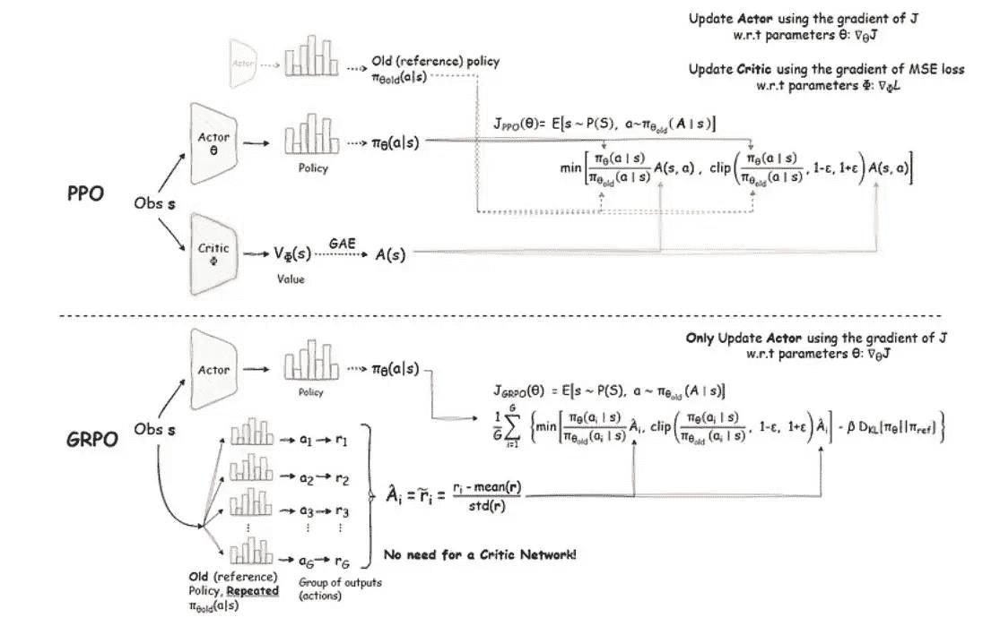

# 书生大模型强化学习 RL 实践（Internlm2.5-1.8B swift GRPO gsm8k）

> 来源：[https://aicarrier.feishu.cn/docx/FBvcdOCJTotUIlx7ymQcroIKn0g](https://aicarrier.feishu.cn/docx/FBvcdOCJTotUIlx7ymQcroIKn0g)

> 内容更新中


> 本文展示了一个在**gsm8k数据集**上使用ms-swift框架，对Inte**rnlm2.**5-1.8B模型进行grpo微调的复现文档，

> **reward f**uncs使用s**wift 框架自带的**accurary和一个自**定义的box_re****ward，用了**gsm8k**训练集的40**00/7473，训练2 epoch，gsm8k 测试集 的accurary 从19.86 % 提升到 34.50% ，如有疑问 ，欢迎在书生班级群以及大佬群内交流。

# PPO, GRPO, DPO原理速览

在 RLVR（Reinforcement Learning with Verification/Reward）流程中，模型经历 SFT（监督微调）和 RM（奖励建模）后，通过强化学习进一步对齐人类偏好或增强逻辑推理能力。PPO、DPO 和 GRPO 代表了这一阶段的三种不同演进方向。

## PPO (Proximal Policy Optimization)

PPO 由 OpenAI (201**7) 提出，是 RLHF **的**基石。它**采用 Actor-Critic 架构，既训练策略网络（Actor）也训练价值网络（Critic）。为了解决训练不稳定的问题，PPO 引入了“裁剪机制”来限制更新步长，并结合价值估计误差和熵正则项构成最终的优化目标。

PPO 的loss函数由三部分加权组成，旨在平衡策略提升、价值评估准确性和探索能力：

该公式包含三个关键项：

+   **策略裁剪损失 (** **)**：这是核心项，用于安全地更新策略。公式为**  。**它通过概率比   和优势函数   (GAE)衡量动作的好坏，并强制新旧策略的差异保持在   邻域内，防止更新幅度过大导致模型崩溃。

+   **价值函数损失 (** **)**：这是 Critic 网络的损失，通常为均方误差  。它迫使价值模型准确预测当前状态的真实回报，从而为计算优势函数  提供准确的基准。

+   **熵正则项 (** **)**：即策略分布的熵。最大化这一项可以给予模型“探索奖励”，防止策略过早收敛到局部最优（即防止模型变得过于自信而不再尝试其他可能性）。

## DPO (Direct Preference Optimization)

D**PO 由**斯坦福 (2023) 提出。它通过数学推导发现，强化学习的最优策略可以用封闭形式表示。因此，DPO 直接利用偏好数据（好回答   vs 坏回答  ）进行训练，将强化学习问题转化为一个分类形式的监督学习问题。它彻底省去了复杂的奖励模型（RM）和价值模型训练过程。

DPO 的损失函数直接根据人类偏好数据优化策略模型  ，同时使用参考模型  （通常是 SFT 模型）作为约束：

这里的   是温度系数，用于控制对参考模型的偏离程度（KL)。公式直观含义是：增加“好回答”与参考模型的相对概率，同时降低“坏回答”的相对概率。

## GRPO (Group Relative Policy Optimization)

GRPO 由 DeepSeek (2024) 提出，专为数学推理等有明确评判标准（如答案对错**）的任务设计**。它融合了 PPO 的形式与 DPO 的高效性，核心创新在于移除了 PPO 中昂贵的价值模型（Critic），改用“组内相对优势”来指导优化，大幅降低了显存占用。

GRPO 的运行机制分为三步流转：

首先是组采样。对于通过指令  ，策略模型   采样生成一组共   个输出  。

其次是组内优势计算。利用奖励模型或规则给每个输出打分得到  。GRPO 不依赖神经网络预测基线，而是计算这组得分的均值   和标准差  ，直接得出第   个回答的归一化优势：

最后是策略更新。将上述计算出的   代入类似 PPO 的裁剪损失函数中进行更新：

## 总结对比

+   **PPO**：机制最复杂，损失函数包含策略、价值和熵三部分，需维护四个模型，但通用性和稳定性极高。

+   **DPO**：机制最简，仅需两个模型，无需显式奖励建模，计算效率高，适合通用对话对齐。

+   **GRPO**：针对性最强，去掉了 Critic 模型，利用“组内统计”替代“模型估值”，在数学和代码推理任务中实现了效率与效果的平衡。



# GRPO 实践

## 机器环境

Cuda 12.6

A100 50%

## 创建conda环境

如果你已经有了**ms-swift**环境，可以尝试先跑一下试试，安装缺失的包，或者新创建一个ms-swift环境（如下）

```
conda create -n ms-swift python=3.10 -y
conda activate ms-swift
```

安装依赖

```
pip install uv

uv pip install -U \
  ms-swift \
  torch==2.8.0 \
  torchvision \
  torchaudio \
  transformers==4.57.1 \
  modelscope&gt;=1.23 \
  &quot;peft&gt;=0.11,&lt;0.19&quot; \
  trl==0.23.1 \
  deepspeed==0.17.6 \
  vllm==0.11.0 \
  lmdeploy==0.10.2 \
  evalscope&gt;=1.0 \
  gradio==5.32.1 \
  math_verify==0.5.2 \
  -i https://mirrors.tuna.tsinghua.edu.cn/pypi/web/simple

```

```
mkdir gsm8k_rl
cd ./gsm8k_rl
```

## GRPO

### 数据集处理

开发机的share目录下已经有gsm8k数据集，不需要我们再进行下载

```
/share/datasets/gsm8k_datas/
```

先把数据集处理成用于grpo训练的格式data_pre.py

```
import re
from datasets import Dataset
import os
import json

SYSTEM_PROMPT = &quot;You are a meticulous mathematical reasoning assistant.&quot;

def parse_gsm8k_final_number(raw_answer: str) -&gt; str:
    s = &quot;&quot; if raw_answer is None else str(raw_answer).strip()

    try:
        tail = s.split(&quot;####&quot;)[-1].strip()
        m = re.search(r&quot;(-?\d+(?:\.\d+)?(?:/\d+(?:\.\d+)?)?)&quot;, tail)
        return m.group(1) if m else tail
    except:
        print(&quot;ERROR&quot;)

def to_target_schema(ex):
    q = (ex.get(&quot;question&quot;) or &quot;&quot;).strip()
    a = ex.get(&quot;answer&quot;)
    ans = parse_gsm8k_final_number(a)

    return {
        &quot;messages&quot;: [
            {&quot;role&quot;: &quot;system&quot;, &quot;content&quot;: SYSTEM_PROMPT},
            {&quot;role&quot;: &quot;user&quot;, &quot;content&quot;:&quot;Please reason step by step, and put your final answer within \\boxed{}\n&quot; + q},
        ],
        &quot;solution&quot;: f&quot;\\boxed{{{ans}}}&quot;,
    }

def load_split(split: str):
    path = f&quot;/share/datasets/gsm8k_datas/main/{split}-00000-of-00001.parquet&quot;
    ds = Dataset.from_parquet(path)
    out = ds.map(to_target_schema, remove_columns=ds.column_names)
    return out

train_ds = load_split(&quot;train&quot;)
test_ds = load_split(&quot;test&quot;)

def save_as_jsonl(dataset, save_path):
    os.makedirs(os.path.dirname(save_path), exist_ok=True)
    with open(save_path, &quot;w&quot;, encoding=&quot;utf-8&quot;) as f:
        for item in dataset:
            f.write(json.dumps(item, ensure_ascii=False) + &quot;\n&quot;)

train_out = &quot;./data/train.jsonl&quot;
test_out  = &quot;./data/test.jsonl&quot;

save_as_jsonl(train_ds, train_out)
save_as_jsonl(test_ds, test_out)

print(f&quot;Saved train set to: {train_out}&quot;)
print(f&quot;Saved test  set to: {test_out}&quot;)
```

数据集处理后的格式

```
{
  &quot;messages&quot;: [
    {
      &quot;role&quot;: &quot;system&quot;,
      &quot;content&quot;: &quot;You are a meticulous mathematical reasoning assistant.&quot;
    },
    {
      &quot;role&quot;: &quot;user&quot;,
      &quot;content&quot;: &quot;Please reason step by step, and put your final answer within \\boxed{}\nNatalia sold clips to 48 of her friends in April, and then she sold half as many clips in May. How many clips did Natalia sell altogether in April and May?&quot;
    }
  ],
  &quot;solution&quot;: &quot;\\boxed{72}&quot;
}
```

### Eval 评测

使用vllm进行评测，Temperature 设置为0，测试脚本eval.py

```
import json
import os
from typing import List, Dict, Any
from tqdm import tqdm
from vllm import LLM, SamplingParams
from datasets import Dataset

class MathAccuracy:  
    &quot;&quot;&quot;数学准确率评估器，使用math_verify包进行LaTeX解析和验证,参考swift accurary reward&quot;&quot;&quot;

    def __init__(self):
        import importlib.util
        assert importlib.util.find_spec(&#x27;math_verify&#x27;) is not None, (
            &quot;The math_verify package is required but not installed. &quot;
            &quot;Please install it using &#x27;pip install math_verify&#x27;.&quot;)

    def __call__(self, completions: List[str], solution: List[str], **kwargs) -&gt; List[float]:
        from latex2sympy2_extended import NormalizationConfig
        from math_verify import LatexExtractionConfig, parse, verify

        rewards = []
        for content, sol in zip(completions, solution):
            gold_parsed = parse(sol, extraction_mode=&#x27;first_match&#x27;,
                              extraction_config=[LatexExtractionConfig()])

            if len(gold_parsed) != 0:
                # 解析模型生成的答案
                answer_parsed = parse(
                    content,
                    extraction_config=[
                        LatexExtractionConfig(
                            normalization_config=NormalizationConfig(
                                nits=False,
                                malformed_operators=False,
                                basic_latex=True,
                                boxed=True,
                                units=True,
                            ),
                            # 确保优先尝试匹配boxed内容
                            boxed_match_priority=0,
                            try_extract_without_anchor=False,
                        )
                    ],
                    extraction_mode=&#x27;first_match&#x27;,
                )
                # 如果内容与标准答案匹配，奖励为1，否则为0
                reward = float(verify(answer_parsed, gold_parsed))
            else:
                # 如果标准答案无法解析，跳过该样本并奖励1
                reward = 1.0

            rewards.append(reward)

        return rewards

def load_dataset(data_path: str) -&gt; Dataset:
    if not os.path.exists(data_path):
        raise FileNotFoundError(f&quot;数据集文件不存在: {data_path}&quot;)

    # 读取JSONL文件
    data = []
    with open(data_path, &#x27;r&#x27;, encoding=&#x27;utf-8&#x27;) as f:
        for line in f:
            if line.strip():
                data.append(json.loads(line.strip()))

    # 转换为Dataset对象
    dataset = Dataset.from_list(data)
    print(f&quot;加载了 {len(dataset)} 个样本&quot;)

    return dataset

def format_prompt(messages: List[Dict[str, str]], tokenizer) -&gt; str:
    # 检查是否有 chat template
    if hasattr(tokenizer, &#x27;chat_template&#x27;) and tokenizer.chat_template is not None:
        try:
            # 使用模型的chat template格式化消息
            prompt = tokenizer.apply_chat_template(
                messages,
                tokenize=False,
                add_generation_prompt=True,
            )
        except Exception as e:
            # 如果模板应用失败，回退到原始格式
            print(f&quot;警告: 应用chat template失败 ({e})，使用备用格式&quot;)
            prompt = _format_fallback(messages)
    else:
        # 没有chat template，使用原始消息格式
        prompt = _format_fallback(messages)

    return prompt

def _format_fallback(messages: List[Dict[str, str]]) -&gt; str:
    &quot;&quot;&quot;
    备用格式化函数，当没有chat template时使用
    使用标准的 &lt;s&gt;&lt;|im_start|&gt;{role}\n{content}&lt;|im_end|&gt; 格式
    &quot;&quot;&quot;
    prompt = &quot;&lt;s&gt;&quot;
    for message in messages:
        role = message.get(&quot;role&quot;, &quot;user&quot;)
        content = message.get(&quot;content&quot;, &quot;&quot;)
        prompt += f&quot;&lt;|im_start|&gt;{role}\n{content}&lt;|im_end|&gt;\n&quot;

    # 添加assistant前缀，准备生成
    prompt += &quot;&lt;|im_start|&gt;assistant\n&quot;

    return prompt

def run_evaluation(
    model_path: str,
    data_path: str,
    output_path: str = None,
    tensor_parallel_size: int = 1,
    temperature: float = 0.0,
    max_tokens: int = 2048,
    batch_size: int = 32,
    seed: int = 42,
):
    dataset = load_dataset(data_path)

    prompts = []
    solutions = []

    for item in dataset:
        messages = item.get(&quot;messages&quot;, [])
        solution = item.get(&quot;solution&quot;, &quot;&quot;)
        prompts.append(messages)  # 先保存原始messages
        solutions.append(solution)


    # 初始化vLLM模型
    llm = LLM(
        model=model_path,
        tensor_parallel_size=tensor_parallel_size,
        seed=seed,
        dtype=&quot;half&quot;,  
        trust_remote_code=True,  
    )

    # 获取模型的tokenizer用于应用chat template
    tokenizer = llm.get_tokenizer()

    # 格式化提示词
    formatted_prompts = []
    for messages in prompts:
        prompt = format_prompt(messages, tokenizer)
        formatted_prompts.append(prompt)


    # 配置采样参数
    sampling_params = SamplingParams(
        temperature=temperature,
        max_tokens=max_tokens,
        stop=[&quot;&lt;|endoftext|&gt;&quot;, &quot;&lt;|im_end|&gt;&quot;],
    )

    # 分批生成答案
    print(&quot;inferring...&quot;)
    all_completions = []

    for i in tqdm(range(0, len(formatted_prompts), batch_size), desc=&quot;生成进度&quot;):
        batch_prompts = formatted_prompts[i:i + batch_size]

        outputs = llm.generate(
            batch_prompts,
            sampling_params=sampling_params,
            use_tqdm=False,
        )

        for output in outputs:
            # 获取生成的文本
            generated_text = output.outputs[0].text
            all_completions.append(generated_text)

    # 评估答案准确率
    print(&quot;evaluating...&quot;)
    evaluator = MathAccuracy()
    rewards = evaluator(all_completions, solutions)

    # 计算统计信息
    correct_count = sum(rewards)
    total_count = len(rewards)
    accuracy = correct_count / total_count * 100

    print(f&quot;\n========== 评估结果 ==========&quot;)
    print(f&quot;总样本数: {total_count}&quot;)
    print(f&quot;正确数: {correct_count}&quot;)
    print(f&quot;准确率: {accuracy:.2f}%&quot;)
    print(f&quot;================================\n&quot;)

    # 保存详细结果
    if output_path:
        os.makedirs(os.path.dirname(output_path), exist_ok=True)

        results = {
            &quot;model_path&quot;: model_path,
            &quot;data_path&quot;: data_path,
            &quot;total_samples&quot;: total_count,
            &quot;correct_count&quot;: correct_count,
            &quot;accuracy&quot;: accuracy,
            &quot;individual_results&quot;: []
        }

        for i, (prompt, completion, solution, reward) in enumerate(zip(
            formatted_prompts, all_completions, solutions, rewards
        )):
            results[&quot;individual_results&quot;].append({
                &quot;index&quot;: i,
                &quot;prompt&quot;: prompt,
                &quot;completion&quot;: completion,
                &quot;solution&quot;: solution,
                &quot;reward&quot;: reward,
            })

        with open(output_path, &#x27;w&#x27;, encoding=&#x27;utf-8&#x27;) as f:
            json.dump(results, f, ensure_ascii=False, indent=2)

        print(f&quot;详细结果已保存到: {output_path}&quot;)

    # 保存简洁结果（便于快速查看）
    summary_path = output_path.replace(&#x27;.json&#x27;, &#x27;_summary.json&#x27;) if output_path else None
    if summary_path:
        summary = {
            &quot;model_path&quot;: model_path,
            &quot;total_samples&quot;: total_count,
            &quot;correct_count&quot;: correct_count,
            &quot;accuracy&quot;: accuracy,
        }

        with open(summary_path, &#x27;w&#x27;, encoding=&#x27;utf-8&#x27;) as f:
            json.dump(summary, f, ensure_ascii=False, indent=2)

        print(f&quot;简洁结果已保存到: {summary_path}&quot;)

    return accuracy

def main():
    &quot;&quot;&quot;主函数&quot;&quot;&quot;
    import argparse

    parser = argparse.ArgumentParser(description=&quot;GSM8K数学问题评估&quot;)

    parser.add_argument(&quot;--model_path&quot;, type=str,
                       default=&quot;/root/gsm8k_rl/output/Qwen2.5-Math-1.5B/checkpoint-2000&quot;,
                       help=&quot;模型路径或名称&quot;)
    parser.add_argument(&quot;--data_path&quot;, type=str,
                       default=&quot;/root/gsm8k_rl/data/test.jsonl&quot;,
                       help=&quot;数据集路径&quot;)
    parser.add_argument(&quot;--output_path&quot;, type=str,
                       default=&quot;/root/gsm8k_rl/eval_results.json&quot;,
                       help=&quot;输出结果路径&quot;)
    parser.add_argument(&quot;--tensor_parallel_size&quot;, type=int, default=1,
                       help=&quot;张量并行大小&quot;)
    parser.add_argument(&quot;--temperature&quot;, type=float, default=0.0,
                       help=&quot;采样温度（0表示贪婪解码）&quot;)
    parser.add_argument(&quot;--max_tokens&quot;, type=int, default=2048,
                       help=&quot;最大生成长度&quot;)
    parser.add_argument(&quot;--batch_size&quot;, type=int, default=32,
                       help=&quot;批处理大小&quot;)
    parser.add_argument(&quot;--seed&quot;, type=int, default=42,
                       help=&quot;随机种子&quot;)

    args = parser.parse_args()

    # 运行评估
    accuracy = run_evaluation(
        model_path=args.model_path,
        data_path=args.data_path,
        output_path=args.output_path,
        tensor_parallel_size=args.tensor_parallel_size,
        temperature=args.temperature,
        max_tokens=args.max_tokens,
        batch_size=args.batch_size,
        seed=args.seed,
    )

    return accuracy

if __name__ == &quot;__main__&quot;:
    main()

```

在训练之前可以先测试一下base模型的准确度，大概十分钟左右,正确率19.86%

```
python eval.py \
      --model_path  /share/new_models/Shanghai_AI_Laboratory/internlm2_5-1_8b \
      --data_path /root/gsm8k_rl/data/test.jsonl \
      --output_path ./result/base.json \
      --batch_size 32 \
      --max_tokens 1024 
```

```
{
  &quot;model_path&quot;: &quot;/share/new_models/Shanghai_AI_Laboratory/internlm2_5-1_8b&quot;,
  &quot;total_samples&quot;: 1319,
  &quot;correct_count&quot;: 262.0,
  &quot;accuracy&quot;: 19.863532979529946
}
```

### 奖励函数

我们这里用了两个reward func，一个是accurary,另一个是box_reward

**accurary **

swift 自带，该函数将模型的生成结果与数据集中的 solution 列进行比较，计算准确率分数。如果生成结果与标准答案一致，则得分为 1.0；否则为 0.0。

**box_reward **

自定义的奖励，如果模型输出的solution包裹在\boxed{}中 返回1，否则0

box_reward.py

```
import re
from typing import List
from swift.plugin import ORM, orms

class BoxedReward(ORM):
    &quot;&quot;&quot;Reward: check whether output contains \\boxed{...}&quot;&quot;&quot;

    def __call__(self, completions, **kwargs) -&gt; List[float]:
        pattern = re.compile(r&quot;\\boxed\s*\{.*?\}&quot;, re.DOTALL)
        return [1.0 if pattern.search(str(c)) else 0.0 for c in completions]

orms[&quot;box_reward&quot;] = BoxedReward
```

### 模型训练

```
#!/bin/bash
set -e
# 创建日志目录
LOG_DIR=&quot;./logs&quot;
mkdir -p &quot;$LOG_DIR&quot;

# 获取当前时间戳
TIMESTAMP=$(date +&quot;%Y%m%d_%H%M%S&quot;)
LOG_FILE=&quot;$LOG_DIR/[GRPO]internlm_${TIMESTAMP}.log&quot;

export OMP_NUM_THREADS=1
export CUDA_VISIBLE_DEVICES=0
export MASTER_PORT=$((10000 + RANDOM % 50000))

export VLLM_WORKER_MULTIPROC_METHOD=spawn
export VLLM_LOGGING_LEVEL=INFO

{
  echo &quot;===== Training start: $(date) =====&quot;
  echo &quot;Log file: $LOG_FILE&quot;
  echo &quot;Using port: $MASTER_PORT&quot;
  echo &quot;CUDA_VISIBLE_DEVICES=$CUDA_VISIBLE_DEVICES&quot;
  echo &quot;Enable vLLM: true&quot;
} &gt;&gt; &quot;$LOG_FILE&quot;

nohup swift rlhf \
  --rlhf_type grpo \
  --model &#x27;/share/new_models/Shanghai_AI_Laboratory/internlm2_5-1_8b&#x27; \
  --dataset &#x27;./data/train.jsonl#4000&#x27; \
  --external_plugins ./box_reward.py \
  --reward_funcs accuracy box_reward \
  --reward_weights 0.5 0.5 \
  --eval_steps 50 \
  --train_type lora \
  --target_modules all-linear \
  --max_completion_length 768 \
  --torch_dtype bfloat16 \
  --num_train_epochs 2 \
  --per_device_train_batch_size 8 \
  --per_device_eval_batch_size 4 \
  --learning_rate 5e-6 \
  --warmup_ratio 0.05 \
  --gradient_accumulation_steps 4 \
  --save_steps 50 \
  --save_total_limit 5 \
  --gradient_checkpointing_kwargs &#x27;{&quot;use_reentrant&quot;: false}&#x27; \
  --logging_steps 5 \
  --max_length 2048 \
  --output_dir ./grpo_out \
  --dataset_num_proc 8 \
  --dataloader_num_workers 0 \
  --freeze_vit true \
  --log_completions true \
  --use_vllm true \
  --vllm_gpu_memory_utilization 0.50 \
  --vllm_max_model_len 2048 \
  --vllm_tensor_parallel_size 1 \
  --vllm_enforce_eager false \
  --vllm_mode colocate \
  &gt; &quot;$LOG_FILE&quot; 2&gt;&amp;1 &amp;

TRAIN_PID=$!
sleep 2

if kill -0 &quot;$TRAIN_PID&quot; 2&gt;/dev/null; then
  echo &quot;Training started successfully with PID $TRAIN_PID&quot;
  echo &quot;To view logs in real-time, use:&quot;
  echo &quot;tail -f $LOG_FILE&quot;
  echo &quot;&quot;
  echo &quot;To stop training, use:&quot;
  echo &quot;kill -9 $TRAIN_PID&quot;
else
  echo &quot;Failed to start training process&quot;
  echo &quot;Check log file for errors: $LOG_FILE&quot;
fi
```

**TIPs:**

1.  **时间：**这个脚本大概跑了**8h**，数据选择了4000/7473，可以从以下方面减少训练时间成本，

1.  **数据量**：--datasets 参数重的#4000 为#2000，减少一半，最终效果应该也会降低

1.  **epoch：**原来设置是2，大家可以调整为1

1.  这里两个奖励函数的权重设置为0.5 0.5 ，大家可以自行探索更好的权重设置

1.  --num_generations 参数，这里没有指定，用的默认的8，挺合适，不用修改

1.  Swift 默认使用lora，这里也都使用的默认参数

1.  ...

**合并模型**

注意换成你自己的lora adapter checkpoint路径

```
swift export --adapter &quot;/root/gsm8k_rl/grpo_out/v0-20251230-214229/checkpoint-2000&quot; --merge_lora True
```

**eval训练后的模型**

注意换成自己merged后的模型路径

```
python eval.py \
      --model_path  /root/gsm8k_rl/grpo_out/v0-20251230-214229/checkpoint-2000-merged \
      --data_path /root/gsm8k_rl/data/test.jsonl \
      --output_path ./result/grpo.json \
      --batch_size 32 \
      --max_tokens 1024 
```

```
{
  &quot;model_path&quot;: &quot;/root/gsm8k_rl/grpo_out/v0-20251230-214229/checkpoint-2000-merged&quot;,
  &quot;total_samples&quot;: 1319,
  &quot;correct_count&quot;: 455.0,
  &quot;accuracy&quot;: 34.495830174374525
}
```

# 任务

复现本文档，RL 前和 RL 后有涨点

> 作业提交链接：https://aicarrier.feishu.cn/share/base/form/shrcnbguDXSzIZV5Dkapw39BJ0f