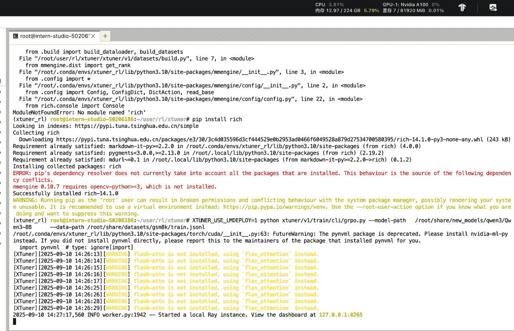
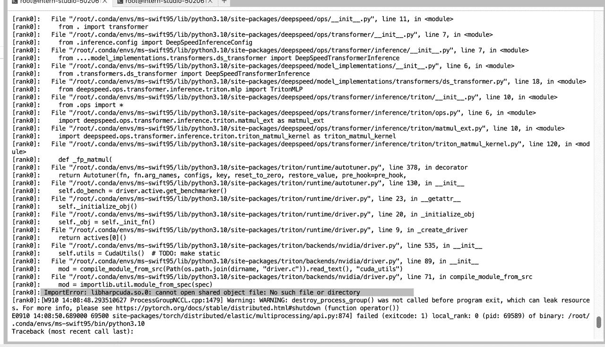
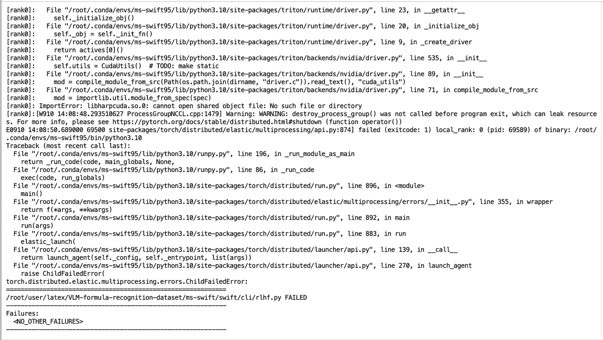

#

> 来源：[https://aicarrier.feishu.cn/docx/BCizdzIdyoYvWwxeGMocVQ2znmb](https://aicarrier.feishu.cn/docx/BCizdzIdyoYvWwxeGMocVQ2znmb)

## xtuner

参考文档：https://xtuner.readthedocs.io/zh-cn/latest/get_started/grpo.html

```

conda create -n xtuner_rl python=3.10 -y
conda activate xtuner_rl

git clone https://gh.llkk.cc/https://github.com/InternLM/xtuner.git
cd xtuner
pip install -e &#x27;.[rl]&#x27;

pip install cyclopts

#lmdeploy
pip install lmdeploy

#flash attention


```

```
XTUNER_USE_LMDEPLOY=1 python xtuner/v1/train/cli/grpo.py --model-path   /root/share/new_models/qwen3/Qwen3-8B      --data-path /root/share/datasets/gsm8k/train.jsonl
```

```
ssh -CNg -L 18265:127.0.0.1:8265 root@ssh.intern-ai.org.cn -p 49674

```

```
http://localhost:18265

```



## swift

大概率原因：cuda 版本不对 现在 12.2

类似报错：

https://github.com/sgl-project/sglang/issues/5999

https://github.com/unslothai/unsloth/issues/872

```
CUDA_VISIBLE_DEVICES=0 WANDB_API_KEY=fea9cf136f5002ee3f17df55be344dc3f1f3c36d NPROC_PER_NODE=1 swift rlhf \
    --rlhf_type grpo \
    --model /root/share/new_models/qwen3/Qwen3-0.6B-Base \
    --external_plugins examples/train/grpo/plugin/plugin.py \
    --reward_funcs external_countdown format \
    --use_vllm true \
    --vllm_mode colocate \
    --train_type full \
    --dataset &#x27;zouxuhong/Countdown-Tasks-3to4#50000&#x27; \
    --max_length 2048 \
    --max_completion_length 1024 \
    --num_train_epochs 1 \
    --per_device_train_batch_size 8 \
    --per_device_eval_batch_size 8 \
    --learning_rate 5e-7 \
    --gradient_accumulation_steps 8 \
    --torch_dtype bfloat16 \
    --eval_steps 500 \
    --save_steps 100 \
    --save_total_limit 20 \
    --logging_steps 1 \
    --output_dir output/GRPO_COUNTDOWN \
    --warmup_ratio 0.01 \
    --dataloader_num_workers 4 \
    --num_generations 8 \
    --temperature 1.0 \
    --system &#x27;You are a helpful assistant. You first thinks about the reasoning process in the mind and then provides the user with the answer.&#x27; \
    --log_completions true \
    --report_to wandb \
    --beta 0.001 \
    --num_iterations 1
```



