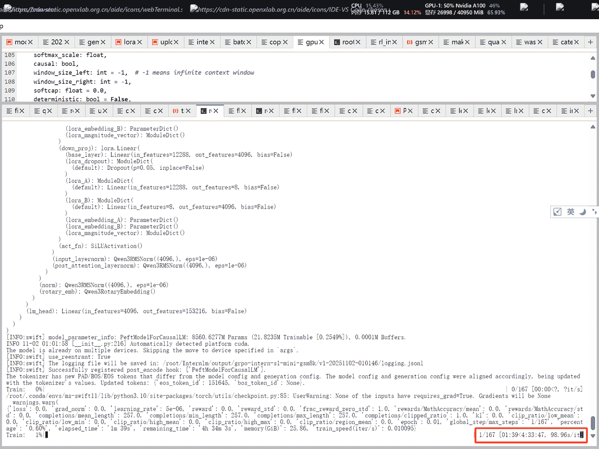
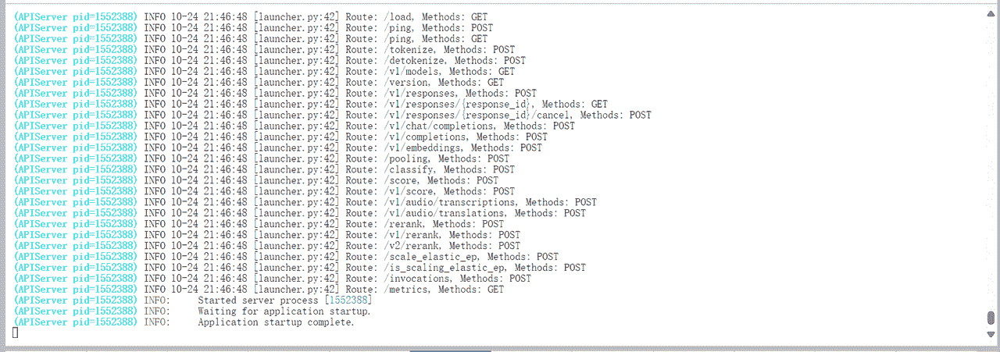

# L2 书生大模型强化学习 RL 实践(ms-swift)

> 来源：[https://aicarrier.feishu.cn/docx/BgFEdFdVJoGVL4xP2Xbc5OwNnYf](https://aicarrier.feishu.cn/docx/BgFEdFdVJoGVL4xP2Xbc5OwNnYf)

## 环境安装

使用环境基于L2G2的Intern-S1-mini微调的ms-swift11环境，

> 如果没有装的话，可以用下面命令重新装一下。

> 创建环境：

```
conda create -n ms-swift11 python=3.10 -y
conda activate ms-swift11

```

> 安装VLM的依赖：

```
conda activate ms-swift11
cd /root
git clone https://gh.llkk.cc/https://github.com/fak111/VLM-formula-recognition-dataset.git
cd VLM-formula-recognition-dataset
pip install -r requirements.txt
pip install transformers -U
```

> 安装ms-swift的依赖：

```
cd /root
git clone https://gh.llkk.cc/https://github.com/modelscope/ms-swift.git
cd ms-swift
git checkout cab4aa59
pip install -e .
pip install msgspec
```

> end

然后安装grpo微调需要的依赖：

```
conda activate ms-swift11
pip install math_verify==0.5.2 vllm
```

## 模型下载

模型下载部分直接跳过，改为本地intern-s1-mini的路径：/share/new_models/Intern-S1-mini或者/share/new_models/InternVL3.5/InternVL3_5-4B。

## 数据集下载

使用的数据集需要用固定格式，并且加上thinking的思维链内容，可以使用的训练数据示例如下：

```
{
    &quot;data_source&quot;: &quot;openai/gsm8k&quot;, 
    &quot;ability&quot;: &quot;math&quot;, 
    &quot;reward_model&quot;: 
        {&quot;ground_truth&quot;: &quot;72&quot;, &quot;style&quot;: &quot;rule&quot;}, 
    &quot;extra_info&quot;: 
        {&quot;answer&quot;: &quot;Natalia sold 48/2 = &lt;&lt;48/2=24&gt;&gt;24 clips in May.\nNatalia sold 48+24 = &lt;&lt;48+24=72&gt;&gt;72 clips altogether in April and May.\n#### 72&quot;, &quot;index&quot;: 0, &quot;question&quot;: &quot;Natalia sold clips to 48 of her friends in April, and then she sold half as many clips in May. How many clips did Natalia sell altogether in April and May?&quot;, &quot;split&quot;: &quot;train&quot;}, 
    &quot;messages&quot;: 
        [{&quot;content&quot;: &quot;Natalia sold clips to 48 of her friends in April, and then she sold half as many clips in May. How many clips did Natalia sell altogether in April and May? Let&#x27;s think step by step and output the final answer after \&quot;####\&quot;.&quot;, &quot;role&quot;: &quot;user&quot;, &quot;type&quot;: &quot;text&quot;}], 
    &quot;solution&quot;: &quot;72&quot;
}
{
    &quot;data_source&quot;: &quot;openai/gsm8k&quot;, 
    &quot;ability&quot;: &quot;math&quot;, 
    &quot;reward_model&quot;: {&quot;ground_truth&quot;: &quot;10&quot;, &quot;style&quot;: &quot;rule&quot;}, 
    &quot;extra_info&quot;: {&quot;answer&quot;: &quot;Weng earns 12/60 = $&lt;&lt;12/60=0.2&gt;&gt;0.2 per minute.\nWorking 50 minutes, she earned 0.2 x 50 = $&lt;&lt;0.2*50=10&gt;&gt;10.\n#### 10&quot;, &quot;index&quot;: 1, &quot;question&quot;: &quot;Weng earns $12 an hour for babysitting. Yesterday, she just did 50 minutes of babysitting. How much did she earn?&quot;, &quot;split&quot;: &quot;train&quot;}, 
    &quot;messages&quot;: [{&quot;content&quot;: &quot;Weng earns $12 an hour for babysitting. Yesterday, she just did 50 minutes of babysitting. How much did she earn? Let&#x27;s think step by step and output the final answer after \&quot;####\&quot;.&quot;, &quot;role&quot;: &quot;user&quot;, &quot;type&quot;: &quot;text&quot;}], 
    &quot;solution&quot;: &quot;10&quot;
}
...
```

已经准备好了gsm8k数据集里筛选出来的2000条数据：


[camp6_l2g4_grpo_gsm8k_trainset.jsonl](https://internal-api-drive-stream.feishu.cn/space/api/box/stream/download/all/TonKbJQBSoUZKdxy7g5cS3STnEa)

数据集下载后，存放于/root/share/datasets里。

## 直接训练

```
conda activate ms-swift11
CUDA_VISIBLE_DEVICES=0 swift rlhf \
  --rlhf_type grpo \
  --model &quot;/root/share/new_models/Intern-S1-mini&quot; \
  --train_type lora \
  --lora_rank 8 \
  --lora_alpha 16 \
  --target_modules all-linear \
  --dataset &#x27;/root/share/datasets/camp6_l2g4_grpo_gsm8k_trainset.jsonl&#x27; \
  --torch_dtype bfloat16 \
  --num_train_epochs 1 \
  --per_device_train_batch_size 6 \
  --gradient_accumulation_steps 4 \
  --learning_rate 5e-6 \
  --save_total_limit 2 \
  --logging_steps 10 \
  --save_strategy steps \
  --save_steps 500 \
  --output_dir &#x27;/root/Internlm/output/grpo-intern-s1-mini-gsm8k&#x27; \
  --max_completion_length 256 \
  --reward_funcs accuracy \
  --num_generations 2 \
  --generation_batch_size 6 \
  --use_vllm false \
  --offload_model true \
  --offload_optimizer true \
  --freeze_llm false \
  --freeze_vit true \
  --dataloader_num_workers 4 \
  --lazy_tokenize True

```

顺利执行训练：



## 模型合并

合并用swift export命令

```
conda activate ms-swift11
swift export --adapters &lt;last_model_checkpoint_path&gt; --merge_lora True
```

实际路径为：/root/Internlm/output/grpo-intern-s1-mini-gsm8k/v1-20251102-010146/checkpoint-167，因此合并的命令为：

```
conda activate ms-swift11
swift export --adapters &#x27;/root/Internlm/output/grpo-intern-s1-mini-gsm8k/v1-20251102-010146/checkpoint-167&#x27; --merge_lora True
```

合并后，模型的路径是：/root/Internlm/output/grpo-intern-s1-mini-gsm8k/v1-20251102-010146/checkpoint-167-merged

## 模型推理

使用vllm在服务端把merge完成的模型部署了，然后新开终端，在http://localhost:54257/v1/chat/completions调用即可。

基于L1G1课程的vllm_py312环境，快速给这个微调后的qwen3-4b模型部署出来：

> 如果L1G1没有使用vllm，那么需要如下命令安装vllm_py312的环境：

```
conda create -n vllm_py312 python=3.12 -y
conda activate vllm_py312
pip install vllm
```

服务端用vllm部署：

```
conda activate vllm_py312
vllm serve /root/Internlm/output/grpo-intern-s1-mini-gsm8k/v1-20251102-010146/checkpoint-167-merged \
  --trust-remote-code \
  --port 54257 \
  --max-model-len 8000 \
  --gpu-memory-utilization 0.90 \
  --max-num-seqs 8 \
  --swap-space 8 \
  --enforce-eager
```



部署就绪了，等待客户端发送请求。

客户端执行：

```
curl http://localhost:54257/v1/chat/completions \
    -H &quot;Content-Type: application/json&quot; \
    -d &#x27;{
        &quot;model&quot;: &quot;//root/Internlm/output/grpo-intern-s1-mini-gsm8k/v1-20251102-010146/checkpoint-167-merged&quot;,
        &quot;messages&quot;: [
          {&quot;role&quot;: &quot;system&quot;, &quot;content&quot;: &quot;You are a helpful assistant.&quot;},
          {&quot;role&quot;: &quot;user&quot;, &quot;content&quot;: &quot;Weng earns $12 an hour for babysitting. Yesterday, she just did 50 minutes of babysitting. How much did she earn? Lets think step by step and output the final answer after \&quot;####\&quot;.&quot;}
        ]
      }&#x27;
```

发送后即可顺利得到推理的结果。

参考教程：[L2 书生大模型强化学习 RL 实践(ms-swift)](https://aicarrier.feishu.cn/wiki/HU1TwFFBVi8tcAkz3mocazqOnle)