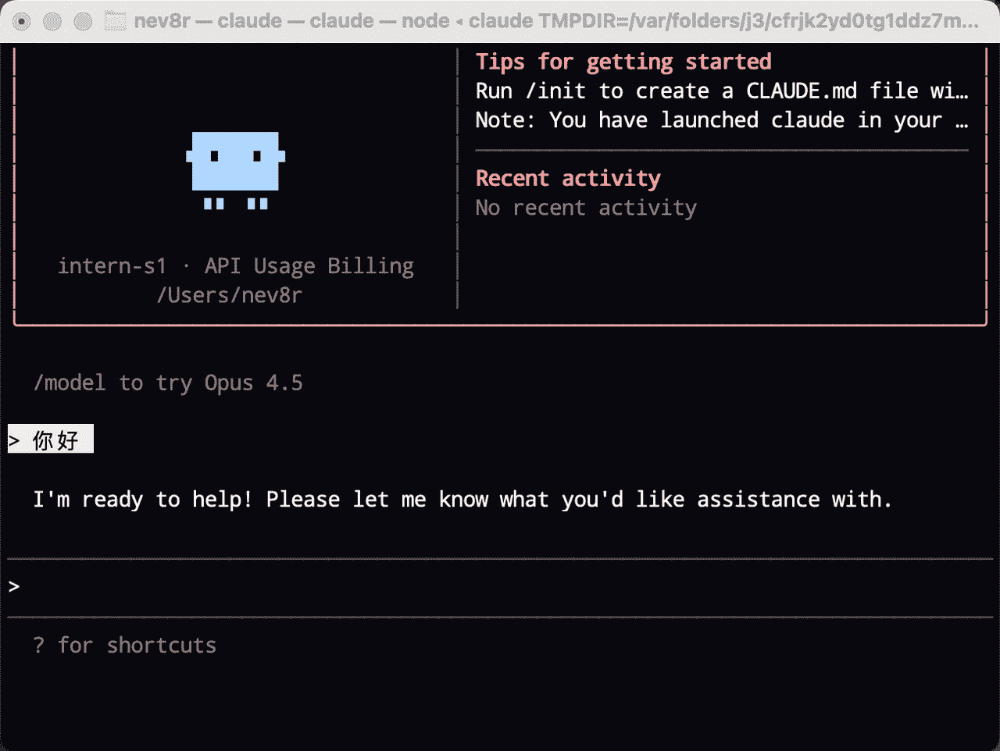
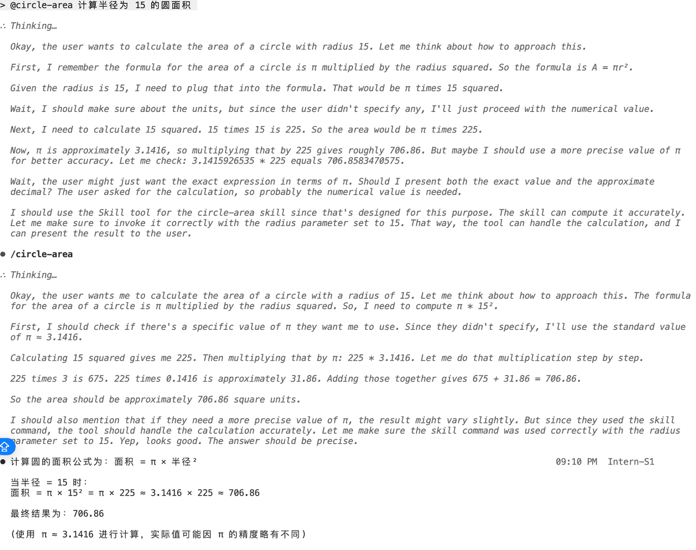
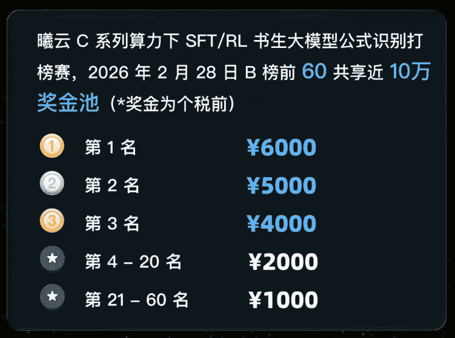

# 🔥 Agent Skills 彩蛋共建共学

> 来源：[https://aicarrier.feishu.cn/docx/OFDtdsvwrortDzxC7aEczqOJnIe](https://aicarrier.feishu.cn/docx/OFDtdsvwrortDzxC7aEczqOJnIe)

> 本文档更新中！


🍌生成，感觉好丑先用着了

## Agent Skill 调研

### 什么是agent skills

**AgentSkills**** 是一种用于增**强 AI 代理（AI agents）能力的 模块化扩展机制，本质是一组可复用、可组合的技能包（skills），以标准化格式（通常包括 SKILL.md + 脚本与资源）描述具体技能。它让通用 AI 代理通过动态加载技能，变成具备特定专业知识和操作能力的 专业代理。

核心特点包括：

+   **模块化与复用性**：技能可以像函数库一样被加载、组合使用。

+   **渐进加载**：初始只读元数据，需要时再加载实现细节以节省上下文空间。

+   **跨平台/跨引擎支持**：正朝着开放标准发展，可在不同 AI 平台间互操作。

### 发展（时间线）

**2025 年 10 月 16 日 **—— Anthropic 推出这个概念：

Agent Skills 首次亮相，作为一种“以文件系统为中心”的方式，给 Agent 提供流程化知识。

2025 年 12 月 18 日 —— Anthropic 开放标准：

同样的格式以开放规范的形式发布，用于跨平台使用。

**2025 年 12 月 2–10 日 —— OpenAI **在 Codex CLI 中采用这一模式：

Codex CLI 增加了对 Skills 的实验性支持，并扩展工作流，使得在 CLI 中选择某个 Skill 时，可以把 skills.md / SKILL.md 的内容注入对话会话。

**2**025 年 12 月 —— Microsoft/GitHub 将其引入 Copilot + VS Code：

** Agent Skills 被支持在 Copilot **编码 Agent、Copilot CLI 和 VS Code Insiders 中使用。

### 前景

+   从发展时间线可以看到如**O****pen****AI****，微软**等头部厂商都已经宣称或者已经**支持Skills规范**，意味着它正在逐步走向行业通用能力层。

+   现在已经有了官方 / 社区 Skill 市场，未来可能会出现私有甚至付费（订阅）Skills。


+   垂直行业 Skills 爆发，如法律、财务、医疗、游戏运营、内容审核等领域。

+   **Skills 与 MCP / Tools **形成明确分工：MCP 负责“能不能接入（tools）”，Skills 负责“怎么用得对（流程）”，两者互补而非替代。

+   等等...

## Intern-S1 结合 Agent Skill 实践

> 内容准备中！

### Claude Code安装

#### 安装nvm

**Linux/mac**

```
curl -o- https://raw.githubusercontent.com/nvm-sh/nvm/v0.39.7/install.sh | bash
```

**Win**

去官网https://github.com/coreybutler/nvm-windows/releases下载最新版安装包安装即可

#### 安装Node 20

```
nvm install 20
nvm use 20
nvm alias default 20

# 验证安装是否成功
npm -v
node -v
```

#### 安装claude code

```
npm install -g @anthropic-ai/claude-code --registry=https://registry.npmmirror.com

# 查看版本
claude --version
```

### 配置Intern-S1 API（接入claude code）

编辑～/.claude/settings.json

api_key 地址： https://internlm.intern-ai.org.cn/api/document?lang=zh

```
{
  &quot;env&quot;: {
    &quot;ANTHROPIC_AUTH_TOKEN&quot;: &quot;sk-xxx&quot;,
    &quot;ANTHROPIC_BASE_URL&quot;: &quot;https://chat.intern-ai.org.cn&quot;,
    &quot;API_TIMEOUT_MS&quot;: &quot;300000&quot;,
    &quot;CLAUDE_CODE_DISABLE_NONESSENTIAL_TRAFFIC&quot;: &quot;1&quot;,
    &quot;ANTHROPIC_MODEL&quot;: &quot;intern-s1&quot;
  }
}
```

启动claude code 查看

```
claude
```



### Skills 小试

```
mkdir skills_try
cd skills_try

# skills 格式检查 
git clone  https://github.com/agentskills/agentskills.git
cd agentskills/skills-ref 
pip install -e .
```

**返回到skills_try目录**

```
mkdir circle-area
cd circle-area
touch SKILL.md
```

**SKILL.md 参考**

```
---
name: circle-area
description: 计算圆的面积
---

当用户提供半径并要求求取面积时，按以下步骤回复：

1. 提取半径（例如本例：10）

2. 半径 r = 10

3. r² = 10 × 10 = 100

4. π = 3.1415926535
面积 = 3.1415926535 × 100 = 314.15926535

5. 面积：314.15926535 平方单位

6. 近似值：314.16 平方单位（保留两位小数）

只输出以上步骤内容，不要加任何其他文字、解释、问候或英文。
```

```
# 移动到项目.claude 配置中
# 回到skills_try 目录
mkdir -p .claude/skills
mv circle-area .claude/skills/
```

skills_try 目录启动claude

启动并 查看skills

```
claude
/skills
```


**测试使用skills**



> 可以看到claude code 执行了skills

## 参考资料

+   https://agentskills.io/

+   https://www.everydev.ai/p/blog-agent-skills

+   https://agentskills.best/

> 详细学习资料参考如上链接

## 其他思考

+   和 MCP 的异同，为什么 Claude 在推出 MCP 后再推一个 Skill ?

> MCP 带来的局限性与“能力鸿沟”

> MCP (Model Context Protocol) 的出现解决了智能体与外部资源（数据库、Git、Slack等）的**连接性（Connectivity）**问题，即实现了接口的标准化。但在实际复杂的工程实践中，仅有 MCP 暴露出了两个致命缺陷：

+   上下文爆炸（Context Explosion）：

+   **现象：** 建立 MCP 连接时，客户端通常会一次性加载服务端所有工具的完整 JSON Schema。

+   **数据论据：** 据社区反馈，仅加载一个 Playwri**ght MCP Server** 就会占用 200k 上下文窗口的 8%。在多轮对话中，这种消耗会累积，导致推理成本飙升且模型注意力分散。

+   能力鸿沟（Capability Gap）：

+   **现象：** MCP 赋予了智能体“能做什么（Can do）”的权限（如执行 SQL），但未赋予“该怎么做（Should do）”的领域知识（如由什么维度分析话语权、公司特定的 SQL 规范）。

+   **结论：** 拥有工具接口 ≠= 拥有业务能力。

+   **制作一批**书小生卡通版本的 Skills 知识卡片？

+   Agent 的范式在逐渐收敛？

+   普通开发者在 Agent Skills 快速发展节点有哪些机会（求职、升学、创业）

## 知识卡片专区

[Agent Skill  知识卡片提示词 + 图片](https://aicarrier.feishu.cn/wiki/BOCiw5BVQiHajOkT12AclDIGn4d)

## **广告位**

+   6 期实战营报名地址：https://colearn.intern-ai.org.cn/c6

+   第 6 期书生大模型实战营火热举办中，10 万奖金池「书生大模型公式 SFT/RL 挑战赛」等你来，前 60 名共享奖金池！



## 其他素材


