# Intern-S1-mini 部署实践 （vLLM 版）

> 来源：[https://aicarrier.feishu.cn/docx/Owd8dt0uHoDubexc2VWcq4yjnzN](https://aicarrier.feishu.cn/docx/Owd8dt0uHoDubexc2VWcq4yjnzN)

本文将带你快速上手 InternLM/Intern-S1-mini 在书生开发机上的部署与调用。从环境配置到模型服务，再到文本与图像的推理示例，以及端口转发访问，完整覆盖常用实践场景。

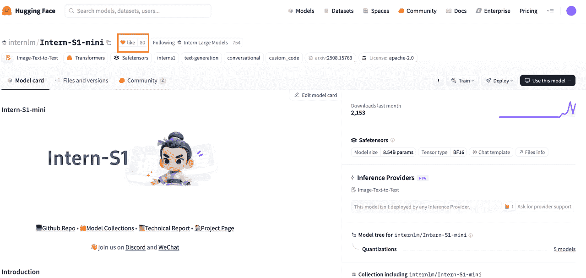

hf模型链接: InternLM/Intern-S1-mini，欢迎大家点赞、下载来玩👏

网页书生对话在线体验：https://chat.intern-ai.org.cn/

## 开发机的选择

在创建开发机界面选择镜像为 Cuda11.7-conda，并选择 GPU 为 30% A100。

如无算力配额，申请助教老师开通。开通后还是爆显存，调低batch size===1。

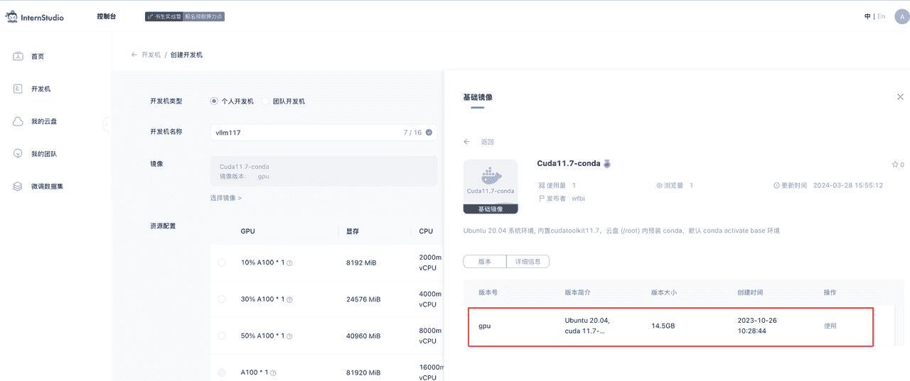

## 环境配置

1.  创建 conda 环境

建议单独为 vLLM 建立环境，例如 Python 3.10：

```
conda create -n vllm python=3.10 -y
conda activate vllm
```

---

---

1.  安装 vLLM

然后装 vLLM：

```
cd  /share/envs
pip install transformers==4.55.4 vllm-0.10.1.1+cu118-cp38-abi3-manylinux1_x86_64.whl 
```

---

1.  启动模型服务

安装完成后就可以跑Intern-S1-mini模型了：

```
vllm serve  /root/share/new_models/Intern-S1-mini\
  --trust-remote-code \
  --port 54257 \
  --max-model-len 8000 \
  --gpu-memory-utilization 0.90 \
  --max-num-seqs 8 \
  --swap-space 8 \
  --enforce-eager

```

## 调用示例

## 文本

我们可以在终端输入下面命令：

```
curl http://localhost:54257/v1/chat/completions \
  -H &quot;Content-Type: application/json&quot; \
  -d &#x27;{
        &quot;model&quot;: &quot;/root/share/new_models/Intern-S1-mini&quot;,
        &quot;messages&quot;: [
          {&quot;role&quot;: &quot;system&quot;, &quot;content&quot;: &quot;You are a helpful assistant.&quot;},
          {&quot;role&quot;: &quot;user&quot;, &quot;content&quot;: &quot;你好，能帮我写一个关于春天的五言绝句吗？&quot;}
        ]
      }&#x27;
```

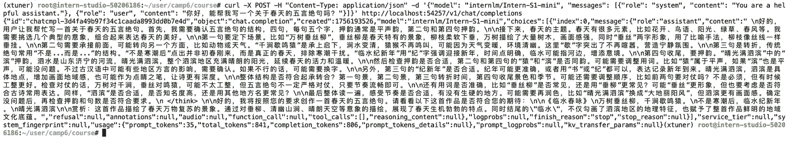

## 图像

网络照片调用

          { &quot;type&quot;: &quot;image_url&quot;, &quot;image_url&quot;: { &quot;url&quot;: &quot;http://images.cocodataset.org/val2017/000000039769.jpg&quot; } }

```
curl http://localhost:54257/v1/chat/completions \
  -H &quot;Content-Type: application/json&quot; \
  -d &#x27;{
    &quot;model&quot;: &quot;internlm/Intern-S1-mini&quot;,
    &quot;messages&quot;: [
      {
        &quot;role&quot;: &quot;user&quot;,
        &quot;content&quot;: [
          { &quot;type&quot;: &quot;text&quot;, &quot;text&quot;: &quot;Please describe the image explicitly.&quot; },
        ]
      }
    ]
  }&#x27;

```

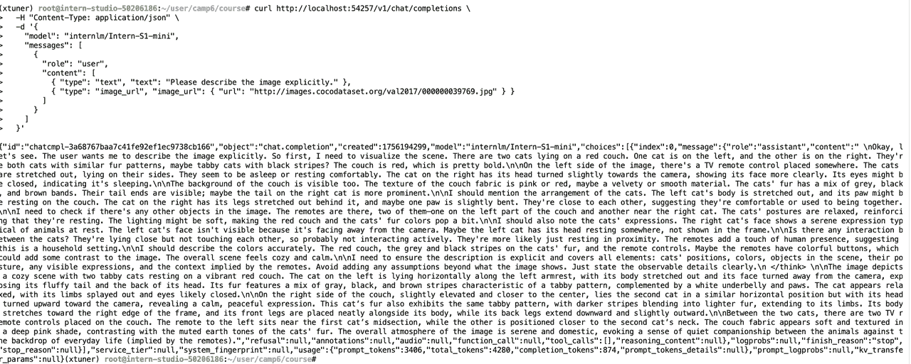

本地照片调用

```
curl http://localhost:54257/v1/chat/completions \
  -H &quot;Content-Type: application/json&quot; \
  -d &quot;$(jq -n --arg img &quot;data:image/jpeg;base64,$(base64 -w 0 /root/user/camp6/course/s1.jpg)&quot; &#x27;{
    model: &quot;internlm/Intern-S1-mini&quot;,
    messages: [
      {
        role: &quot;user&quot;,
        content: [
          {type: &quot;text&quot;, text: &quot;请描述这张图片的内容&quot;},
          {type: &quot;image_url&quot;, image_url: {url: $img}}
        ]
      }
    ]
  }&#x27;)&quot;

```

/root/user/camp6/course/s1.jpg位置为本地图片位置


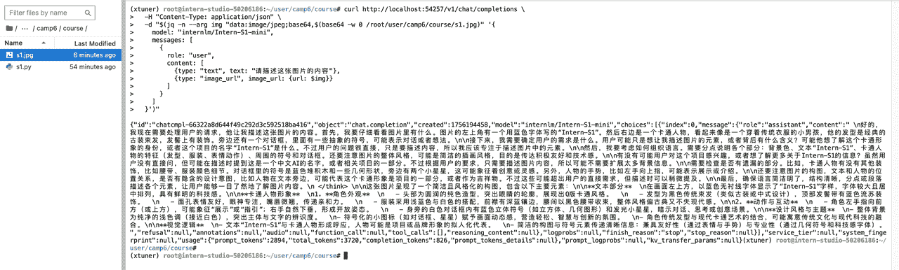

## 端口转发

我们不可以直接访问书生开发机的ip ，但可通过一行命令将书生的开发机网络资源进行调用。这行神奇的命令就是如下：

```
ssh -CNg -L23333:127.0.0.1:23333 root@ssh.intern-ai.org.cn -p 你的ssh端口号
```

参数含义

+   ssh
 使用 ssh 连接远程服务器。

+   -CNg

+   -C：压缩数据传输，加快速度。

+   -N：不执行远程命令，只做端口转发。

+   -g：允许远程主机连接到本地转发的端口（通常为了共享，单机用不用加都行）。

+   -L [本地端口]:[远程地址]:[远程端口]
 这才是端口转发核心：

+   本地端口 → 你本地机器用来访问的端口

+   远程地址 → 在远程开发机上服务监听的地址（通常是 127.0.0.1）

+   远程端口 → 远程开发机服务的端口（比如 vLLM 是 54257）

+   root@ssh.intern-ai.org.cn
 这里 root 是登录用户名，ssh.intern-ai.org.cn 是跳板机域名。

+   -p 你的ssh端口号
 指定 ssh 登录端口号（不是 vLLM 服务端口，是书生开发机给你的 ssh 登录端口）。

### 举例：转发 vLLM 服务

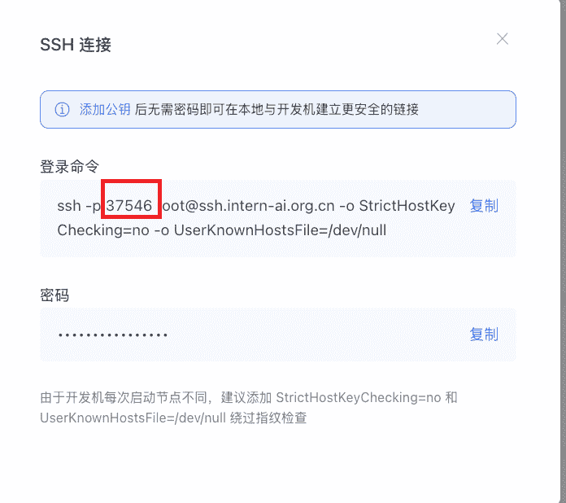

+   书生开发机的 ssh 登录端口号是 37546

+   你在开发机里启动的 vLLM 服务端口是 54257

那么你本地执行：

```
ssh -CNg -L 23333:127.0.0.1:54257 root@ssh.intern-ai.org.cn -p 37546
```

解释：

+   本地 23333 → 你访问的端口（随便挑没被占用的）

+   127.0.0.1:54257 → 转发到远程开发机的 vLLM 服务

+   登录账号是 root，服务器是 ssh.intern-ai.org.cn，ssh 端口是 37546

---

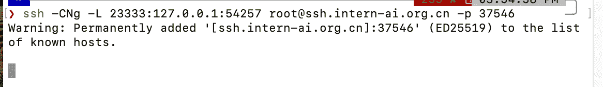

这样后，你在本地就能用：

```
http://127.0.0.1:23333/v1/chat/completions
```

去调用 vLLM，就像它跑在你本机一样。

```
curl http://127.0.0.1:23333/v1/chat/completions \
  -H &quot;Content-Type: application/json&quot; \
  -d &#x27;{
        &quot;model&quot;: &quot;internlm/Intern-S1-mini&quot;,
        &quot;messages&quot;: [
          {&quot;role&quot;: &quot;system&quot;, &quot;content&quot;: &quot;You are a helpful assistant.&quot;},
          {&quot;role&quot;: &quot;user&quot;, &quot;content&quot;: &quot;你好，能帮我写一个关于春天的五言绝句吗？&quot;}
        ]
      }&#x27;
```

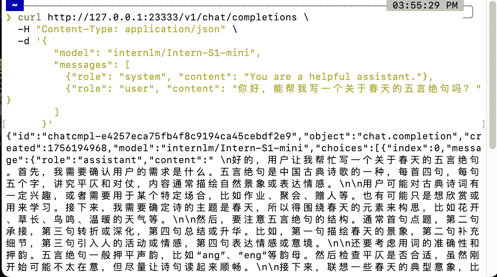

## 结语

👍 至此，恭喜你掌握了 Intern-s1-mini的vLLM部署与调用流程🎉

## QA

###

一些可能的 bug，可以尝试关掉现有的需要重新换一个新的开发机，下面是一些验证操作：

### bug1 :需要按教程 11.7cuda 版本然后一步步安装环境

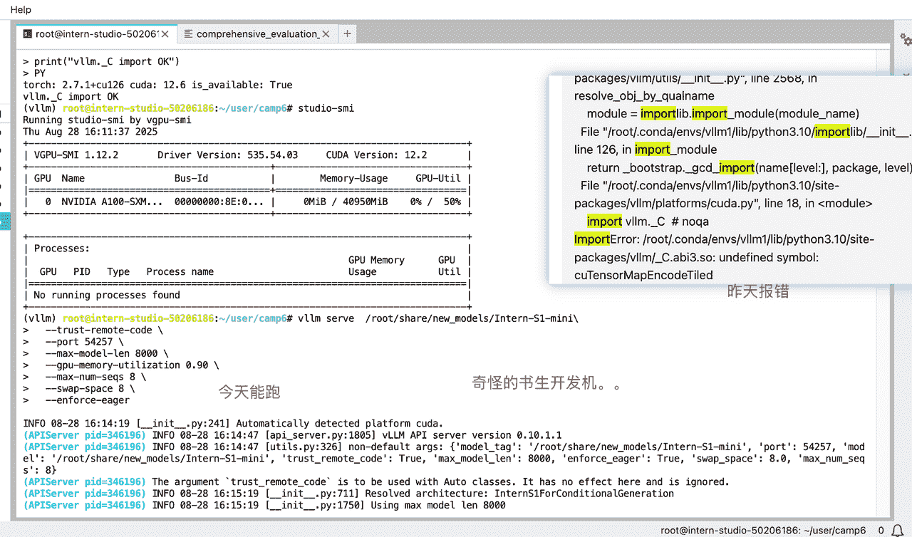

成功启动如下图：

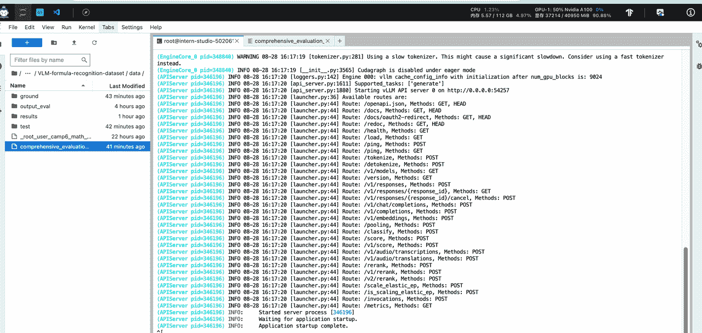

### bug2：指定 transformers 版本 4.55.4

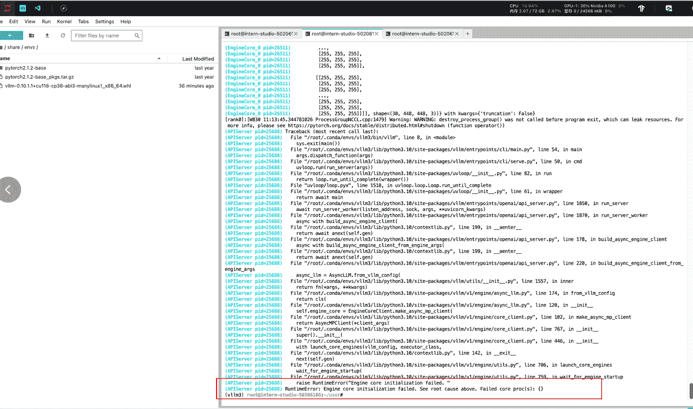

```
pip install transformers==4.55.4
```