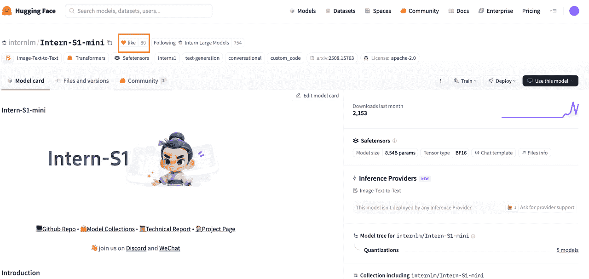
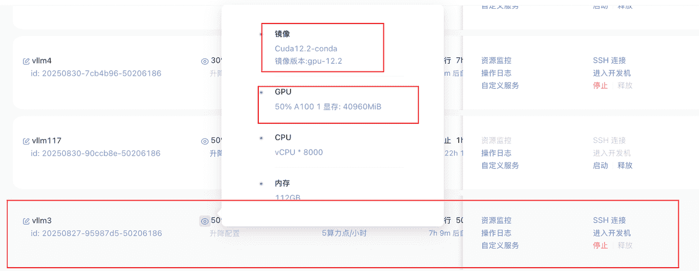
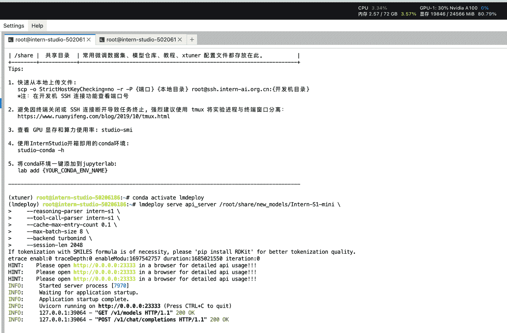
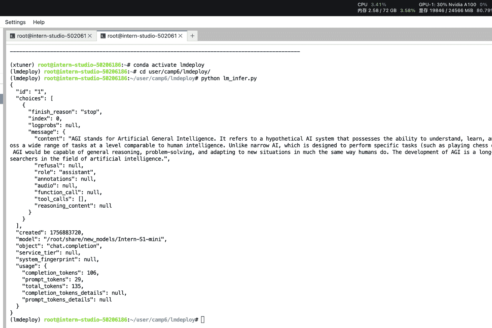

# Intern-S1-mini 部署实践 （lmdeploy 版）

> 来源：[https://aicarrier.feishu.cn/docx/BD5fdhf68oh0WrxCR8OcvutDnlb](https://aicarrier.feishu.cn/docx/BD5fdhf68oh0WrxCR8OcvutDnlb)

本文将带你快速上手 InternLM/Intern-S1-mini 在书生开发机用户lmdeploy进行部署与调用。



hf模型链接: Inter**nL**M/Intern-S1-mini，欢迎大家点赞、下载来玩👏

网页书生对话在线体验：https://chat.intern-ai.org.cn/

## 开发机的选择

在创建开发机界面选择镜像为 Cuda12.2-conda，并选择 GPU 为 30%A100 or 50 % A100 (有条件越大越好)。



安装依赖

```
conda create -n lmdeploy python=3.10 -y
conda activate lmdeploy
```

```
pip install &quot;lmdeploy==0.9.2.post1&quot; &quot;transformers==4.55.2&quot;
```

## 启动

```
lmdeploy serve api_server /root/share/new_models/Intern-S1-mini \
    --reasoning-parser intern-s1 \
    --tool-call-parser intern-s1 \
    --cache-max-entry-count 0.1 \
    --max-batch-size 8 \
    --backend turbomind \
    --session-len 2048
```



## 推理

```
from openai import OpenAI
import json

messages = [
{
    &#x27;role&#x27;: &#x27;user&#x27;,
    &#x27;content&#x27;: &#x27;who are you&#x27;
}, {
    &#x27;role&#x27;: &#x27;assistant&#x27;,
    &#x27;content&#x27;: &#x27;I am an AI&#x27;
}, {
    &#x27;role&#x27;: &#x27;user&#x27;,
    &#x27;content&#x27;: &#x27;AGI is?&#x27;
}]

openai_api_key = &quot;EMPTY&quot;
openai_api_base = &quot;http://0.0.0.0:23333/v1&quot;
client = OpenAI(
    api_key=openai_api_key,
    base_url=openai_api_base,
)
model_name = client.models.list().data[0].id

response = client.chat.completions.create(
    model=model_name,
    messages=messages,
    temperature=0.8,
    top_p=0.8,
    max_tokens=2048,
    extra_body={
        &quot;enable_thinking&quot;: False,
    }
)
print(json.dumps(response.model_dump(), indent=2, ensure_ascii=False))

```

