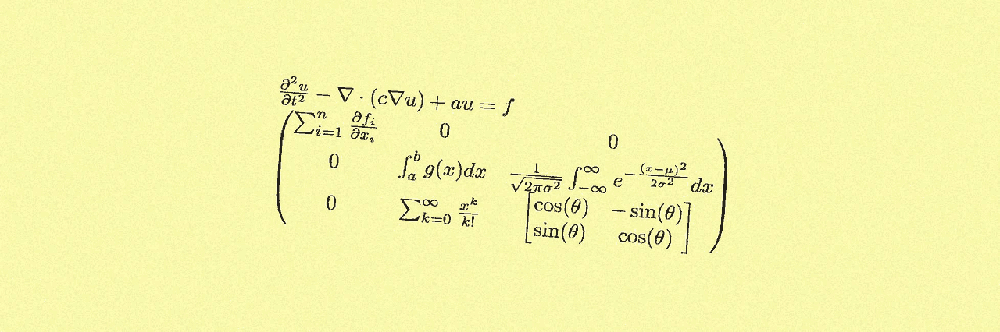

# Intern-S1-mini 公式识别微调练习赛复现(xtuner版本) （未完成）

> 来源：[https://aicarrier.feishu.cn/docx/WNLEd6ouJoh75cxO9QJcgKY0nyc](https://aicarrier.feishu.cn/docx/WNLEd6ouJoh75cxO9QJcgKY0nyc)

欢迎参加“Intern-S1 公式识别微调练习赛”！本次比赛旨在鼓励开发者利用 InternVL 模型，通过微调提升其在数学公式识别任务上的性能。

# 赛事简介

数学公式识别是计算机视觉领域一个富有挑战性的任务。本次练习赛提供了一个完整的框架，帮助您快速上手、验证和评估您的微调模型。您将使用提供的数据集对 InternVL 模型进行微调，并通过一个结合了哈希值比对和图像相似度的综合评估系统来检验您的模型性能。



## 项目结构

Github 代码：https://github.com/JimmyMa99/VLM-formula-recognition-dataset?tab=readme-ov-file

```
├── data/                     # 示例数据
│   ├── output_eval/          # 用于评估的参考图片 (Ground Truth)
│   ├── samples/              # 训练样本的 LaTeX 文本
│   └── samples_test/         # 测试样本的 LaTeX 文本
├── eval_core/                # 评估核心逻辑
│   ├── cal_score.py          # 图像相似度计算
│   └── cal_score_hash.py     # 哈希值比较
├── infer_core/               # 推理核心逻辑
│   ├── inferVLM.py           # VLM模型推理脚本
│   └── ...
├── main_eval.py              # 主评估脚本
├── swift_config/             # Swift 微调配置
│   └── internvl3_1b_train.sh # 训练脚本示例
├── env.sh                    # 环境配置脚本
└── requirements.txt          # Python 依赖
```

```
git clone https://gh.llkk.cc/https://github.com/JimmyMa99/VLM-formula-recognition-dataset.git
```

## 参赛流程

xx

# 微调环节

## 环境配置

```
cd VLM-formula-recognition-dataset
```

安装 `ms-swift` 其他环境

```
conda create -n ms-swift python=3.10 -y
conda activate ms-swift

pip install -r requirements.txt
```

## 数据集下载

```
apt-get install git-lfs
git lfs install
git clone https://www.modelscope.cn/datasets/JimmyMa99/VLM-formula-recognition-dataset_intern_camp.git
```

数据集网站：https://modelscope.cn/datasets/JimmyMa99/VLM-formula-recognition-dataset_intern_camp

需要将数据集的 `train_mini.jsonl` 中关于图片位置换成绝对位置，另存一份文件 `train_mini_abs.jsonl`

`in_path`: 下载后 `train_mini.jsonl` 的绝对路径

`out_path`: 转化 `train_mini.jsonl` 后的绝对路径

`base`: `train_swift.jsonl` 所在的文件夹

我们需要填好三个字段，终端运行以下命令：

```
python - << 'PY'
import json, os, sys

in_path  = "xx/VLM-formula-recognition-dataset/train/train_mini.jsonl"       # 你的现用 jsonl
out_path = "xx/VLM-formula-recognition-dataset/train/train_mini_abs.jsonl"   # 输出到新文件jsonl
base = "xx/VLM-formula-recognition-dataset_intern_camp/train"  # train_swift.jsonl所在的文件夹

def to_abs(p):
    if not p: return p
    # 仅当是相对路径时拼接；已是绝对路径则保留
    return p if os.path.isabs(p) else os.path.join(base, p)

n=0; m=0
with open(in_path, 'r', encoding='utf-8') as fin, open(out_path, 'w', encoding='utf-8') as fout:
    for line in fin:
        if not line.strip(): continue
        obj = json.loads(line)
        changed = False
        # 兼容两种常见结构：images: [..] 或 messages[].content[].image
        if 'images' in obj and isinstance(obj['images'], list):
            obj['images'] = [to_abs(x) for x in obj['images']]
            changed = True
        if 'messages' in obj:
            for msg in obj['messages']:
                c = msg.get('content')
                if isinstance(c, list):
                    for part in c:
                        if part.get('type') == 'image' and 'image' in part:
                            part['image'] = to_abs(part['image'])
                            changed = True
        fout.write(json.dumps(obj, ensure_ascii=False) + '\n')
        n += 1
        m += changed
print(f"processed lines={n}, patched={m}, saved -> {out_path}")
PY
```

## 模型微调

我们推荐使用 Swift 框架进行模型微调。在 `swift_config/` 目录下，我们提供了一个训练脚本 `interns1_mini_train.sh` 作为参考。

您可以根据自己的需求，调整脚本中的超参数，例如：

+   `dataset` 替换成自己服务器数据位置

+   `learning_rate` 自调

+   `num_train_epochs` 自调

配置完成后，执行训练脚本：

```
#!/bin/bash

# 创建日志目录
LOG_DIR="logs"
mkdir -p $LOG_DIR

# 获取当前时间戳
TIMESTAMP=$(date +"%Y%m%d_%H%M%S")
LOG_FILE="$LOG_DIR/[SFT]interns1mini_${TIMESTAMP}.log"

# 设置环境变量
# export ENABLE_AUDIO_OUTPUT=False
export OMP_NUM_THREADS=1
export CUDA_VISIBLE_DEVICES=0


# 设置随机端口号，避免端口冲突
export MASTER_PORT=$((10000 + RANDOM % 50000))


# 先打印启动信息
echo "Starting training..."
echo "Log file: $LOG_FILE"
echo "Using port: $MASTER_PORT"

# 没有指定 model_type
# 启动训练并获取PID
nohup swift sft \
    --model '/root/share/new_models/Intern-S1-mini'\
    --dataset '/root/user/camp6/math/VLM-formula-recognition-dataset/VLM-formula-recognition-dataset_intern_camp/train/train_mini_abs.jsonl' \
    --eval_steps 1000 \
    --train_type lora \
    --lora_rank 8 \
    --lora_dropout 0.01 \
    --lora_alpha 16 \
    --torch_dtype bfloat16 \
    --num_train_epochs 5 \
    --per_device_train_batch_size 1 \
    --per_device_eval_batch_size 1 \
    --learning_rate 1e-4 \
    --warmup_ratio 0.05 \
    --gradient_accumulation_steps 4 \
    --save_steps 2000 \
    --save_total_limit 10 \
    --gradient_checkpointing_kwargs '{"use_reentrant": false}' \
    --logging_steps 1 \
    --max_length 8000 \
    --output_dir ./swift_output/SFT-Interns1mini\
    --dataset_num_proc 16 \
    --dataloader_num_workers 16 \
    --model_author JimmyMa99 \
    --model_name SFT-camp6 \
    --metric acc \
    --freeze_vit true \
    > "$LOG_FILE" 2>&1 &

# 获取PID并等待一下确保进程启动
TRAIN_PID=$!
sleep 2

# 检查进程是否还在运行
if kill -0 $TRAIN_PID 2>/dev/null; then
    echo "Training started successfully with PID $TRAIN_PID"
    echo "To view logs in real-time, use:"
    echo "tail -f $LOG_FILE"
    echo ""
    echo "To stop training, use:"
    echo "kill $TRAIN_PID"
else
    echo "Failed to start training process"
    echo "Check log file for errors: $LOG_FILE"
fi
```

启动

```
cd VLM-formula-recognition-dataset
bash swift_config/interns1_mini_train.sh 
```

输入下面命令可以查看 log

```
tail -f xxx.log
```

等微调运行完成后，将 `lora` 微调产生的部分权重和源权重进行合并。

```
swift export --adapters   /root/user/camp6/VLM-formula-recognition-dataset/swift_output/SFT-Interns1mini/v0-20250829-105735/checkpoint-375    --model   /root/share/new_models/Intern-S1-mini  --merge_lora true 
```

请将以上黄色的路径替换为实际存储在您服务器上的模型权重文件路径：

# 测评环节

## 下载 latex 资源

```
bash env.sh
```

这一步下载 latex 资源因网速不定，可能 1hours+。

## 数据准备

本次比赛的样例数据集存放在 `data/` 目录下。

+   `data/samples/`: 包含用于训练的 LaTeX 文本文件。

+   `data/output_eval/`: 包含与训练样本对应的原始渲染图片，作为 Ground Truth。

您需要利用这些数据来准备您的测试集。

## 模型评估

微调完成后，您需要使用 `eval.py` 脚本对测试图片进行公式识别。

请修改以下路径：

+   `model-path`: 输入待测试的模型路径

+   `input_dir`: 输入待测试的图片目录

+   `output_dir`:  输出用于保存模型生成的 LaTeX 文本的目录。

+   `report_path`: 输出报告结果的路径。

然后运行评估脚本：

```
python eval.py \
  --model-path /root/user/camp6/VLM-formula-recognition-dataset/swift_output/SFT-Interns1mini/v0-20250829-105735/checkpoint-375-merged \
  --input-dir ./data/output_eval \
  --output-dir ./data/results \
  --report-path ./evaluation_report.txt
```

```
python eval.py \
  --model-path /root/share/new_models/Intern-S1-mini\
  --input-dir ./data/output_eval \
  --output-dir ./data/results \
  --report-path ./evaluation_report.txt
```

```
python eval.py \
  --model-path /root/share/new_models/InternVL3/InternVL3-1B\
  --input-dir ./data/output_eval \
  --output-dir ./data/results \
  --report-path ./evaluation_report.txt
```

脚本将在控制台输出详细的评估结果，并生成一份评估报告。

## 评估指标概述

+   哈希比较成功率：模型生成的图片与参考图片哈希值完全相同的样本比例。

+   相似度比较成功率：模型生成的图片与参考图片的图像相似度高于阈值的样本比例。

+   最终综合得分：上述两项成功率的加权平均值，全面反映模型的性能。

### 哈希比较原理

#### 基本概念

哈希比较是一种通过计算文件数字指纹来判断两个文件是否完全相同的方法。本脚本使用加密哈希函数对 LaTeX 生成的图片和参考图片进行比较。

#### 哈希函数原理

哈希函数是一种单向数学函数，可以将任意长度的输入数据映射为固定长度的输出值：

```
H(data) → hash_value
```

其中：

+   `H` 表示哈希函数

+   `data` 是输入的文件二进制数据

+   `hash_value` 是固定长度的哈希值（数字指纹）

#### 支持的哈希算法

脚本支持三种常用的加密哈希算法：

+   `MD5`: 生成128位（32个十六进制字符）的哈希值

+   `SHA1`: 生成160位（40个十六进制字符）的哈希值

+   `SHA256`: 生成256位（64个十六进制字符）的哈希值

#### 文件哈希计算过程

##### 分块读取策略

为了处理大文件并避免内存溢出，脚本采用分块读取的方式：


## 文件哈希计算与判断

```
for chunk in iter(lambda: f.read(4096), b""):
    hasher.update(chunk)
```

数学表示为：

```
hash = H(chunk₁ || chunk₂ || ... || chunkₙ)
```

其中 `||` 表示数据连接操作。

### 计算流程

1. **初始化**：根据指定算法创建哈希对象
1. **分块读取**：按4096字节分块读取文件
1. **逐块更新**：将每个数据块输入哈希函数
1. **生成摘要**：获得最终的十六进制哈希值

### 相似度判断机制

#### 完全匹配原则

脚本采用严格的二进制比较方式：

```
identical = (hash_generated == hash_reference)
```

判断逻辑：

+   **相同**：`hash₁ == hash₂` → 文件在字节级别完全相同
+   **不同**：`hash₁ ≠ hash₂` → 文件存在任何差异

#### 整体相似度计算

批量比较的相似度用相同文件的比例表示：

```
相似度(%) = (相同文件数量 / 总文件数量) × 100
```

## 图像相似度比较原理

### 概述

图像相似度比较是通过多种数学方法量化两幅图像之间视觉相似程度的技术。本脚本实现了五种不同的相似度计算方法，并通过加权平均得到综合相似度分数。

### 核心算法原理

#### 直方图相似度 (Histogram Similarity)

直方图描述了图像中像素强度的分布特征。

**计算步骤：**

1. 将图像转换为灰度图
1. 计算像素强度直方图：`H(i) = count(pixels with intensity i)`
1. 归一化直方图：`H_norm(i) = H(i) / Σ H(i)`

**相似度计算方法：**

+   相关系数法 (Correlation)：

```
similarity = Σ(H₁(i) × H₂(i)) / √(Σ H₁²(i) × Σ H₂²(i))
```

+   卡方距离法 (Chi-Square)：

```
χ² = Σ((H₁(i) - H₂(i))² / (H₁(i) + H₂(i)))
similarity = 1 / (1 + χ²)
```

+   巴氏距离法 (Bhattacharyya)：

```
similarity = 1 - √(1 - Σ√(H₁(i) × H₂(i)))
```

#### 结构相似性指数 (SSIM)

SSIM通过比较亮度、对比度和结构信息来评估图像质量。

**数学公式：**

```
SSIM(x,y) = [l(x,y)]^α × [c(x,y)]^β × [s(x,y)]^γ
```

其中：

+   **亮度比较**：`l(x,y) = (2μₓμᵧ + c₁) / (μₓ² + μᵧ² + c₁)`
+   **对比度比较**：`c(x,y) = (2σₓσᵧ + c₂) / (σₓ² + σᵧ² + c₂)`
+   **结构比较**：`s(x,y) = (σₓᵧ + c₃) / (σₓσᵧ + c₃)`

参数说明：

+   `μₓ, μᵧ`：图像均值
+   `σₓ, σᵧ`：图像标准差
+   `σₓᵧ`：协方差
+   `c₁, c₂, c₃`：稳定常数

**取值范围**：[-1, 1]，1表示完全相同

#### 均方误差相似度 (MSE Similarity)

基于像素级差异的相似度计算。

**MSE计算公式：**

```
MSE = (1/N) × Σᵢ(I₁(i) - I₂(i))²
```

其中：

+   `N`：像素总数
+   `I₁(i), I₂(i)`：对应位置的像素值

**相似度转换：**

```
similarity = 1 - (MSE / MSE_max)
```

其中 `MSE_max = 255²` 为最大可能的MSE值。

#### 特征点相似度 (Feature Similarity)

通过检测和匹配图像特征点来计算相似度。

**算法流程：**

1. **特征检测**：使用ORB或SIFT算法检测关键点
1. **描述符计算**：为每个关键点计算特征描述符
1. **特征匹配**：使用暴力匹配器进行特征匹配
1. **相似度计算**：

```
similarity = good_matches / max(keypoints₁, keypoints₂)
```

**ORB特征**：

+   使用FAST角点检测器
+   采用BRIEF描述符
+   汉明距离匹配

**SIFT特征**：

+   尺度不变特征变换
+   欧几里得距离匹配

#### 感知哈希相似度 (Perceptual Hash)

基于图像感知特征的哈希算法，对轻微变化具有鲁棒性。

**pHash算法步骤：**

1. **缩放图像**：调整到 `(hash_size+1) × hash_size`
1. **计算梯度**：`diff(i,j) = image(i,j+1) > image(i,j)`
1. **生成哈希**：将布尔梯度数组转换为二进制哈希值

**相似度计算：**

```
hamming_distance = popcount(hash₁ ⊕ hash₂)
similarity = 1 - (hamming_distance / hash_bits)
```

其中 `⊕` 表示异或运算，`popcount` 计算1的个数。

### 综合相似度计算

#### 加权平均方法

```
comprehensive_score = Σ(wᵢ × scoreᵢ)
```

**默认权重配置：**

+   直方图相似度：20%
+   SSIM：30%
+   MSE相似度：20%
+   特征点相似度：20%
+   感知哈希：10%

#### 阈值判断机制

最终评分采用二进制判断：

```
final_score = {
    1, if comprehensive_score ≥ threshold
    0, if comprehensive_score < threshold
}
```

**评估流程：**

1. **LaTeX编译**：将文本转换为图像
1. **多方法计算**：并行计算五种相似度分数
1. **加权融合**：计算综合相似度分数
1. **阈值判断**：输出0或1的最终得分
1. **批量统计**：计算通过率百分比

### 算法特点分析

#### 各方法的优势

+   **直方图**：对颜色分布敏感，计算简单
+   **SSIM**：符合人眼视觉感知，结构感知强
+   **MSE**：像素级精确比较，对细微差异敏感
+   **特征点**：对几何变换鲁棒，关注局部特征
+   **感知哈希**：对小幅变化容忍度高，抗噪声

### 互补性设计

通过组合多种方法，可以：

+   平衡精确性和鲁棒性
+   综合全局和局部特征
+   适应不同类型的图像差异
+   提高评估的可靠性

这种多算法融合的方法特别适合LaTeX公式图片的精确比较，既能检测到细微的数学符号差异，又能容忍渲染过程中的微小变化。

祝您在比赛中取得优异成绩！
