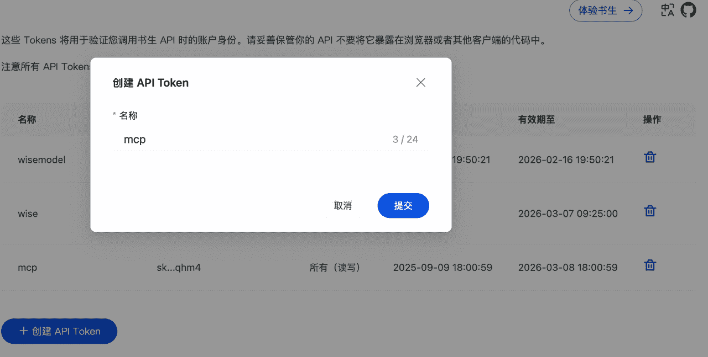
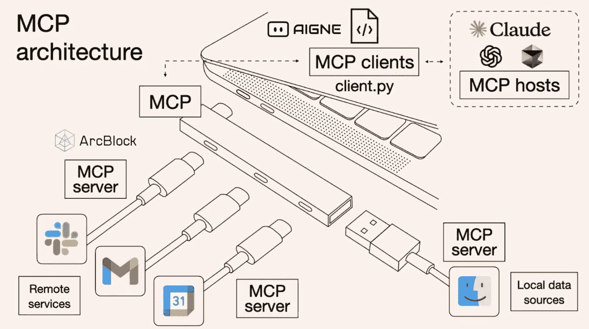
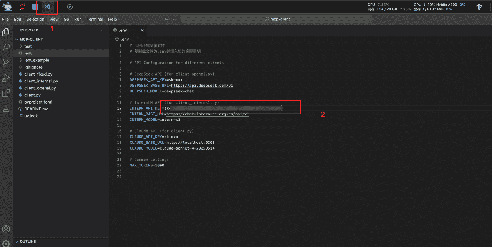
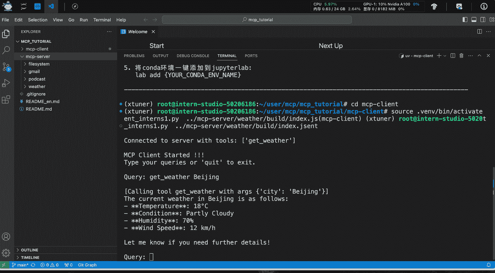
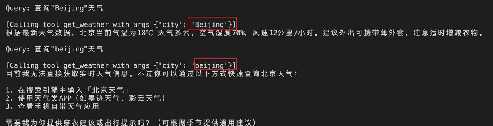
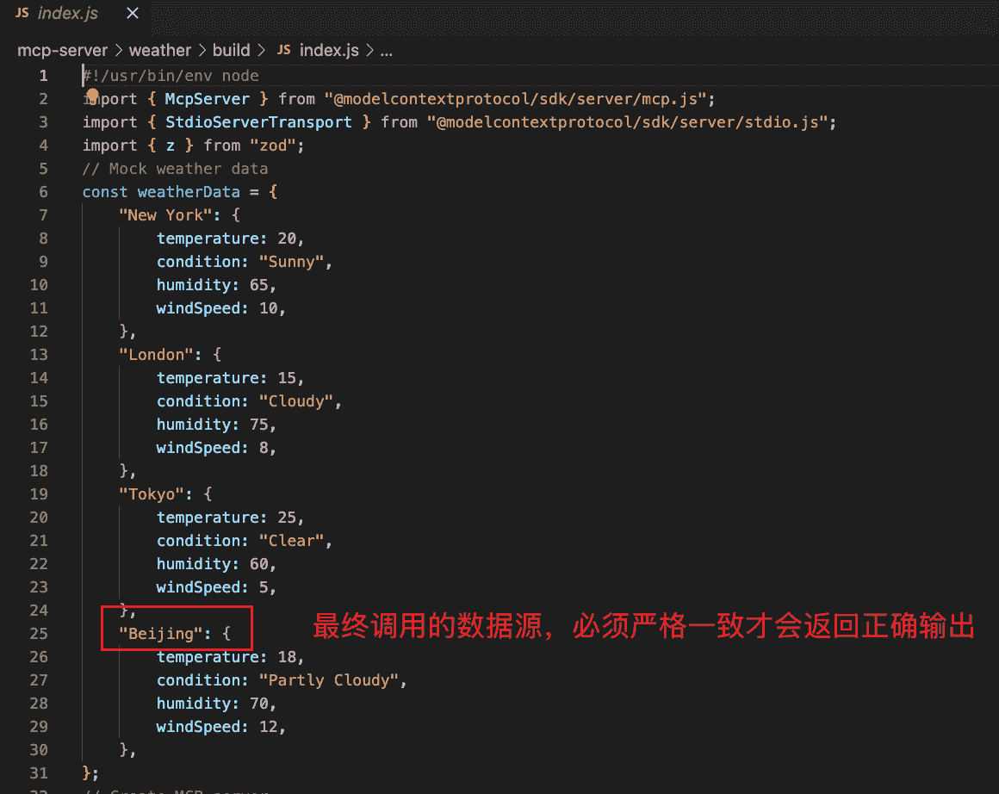
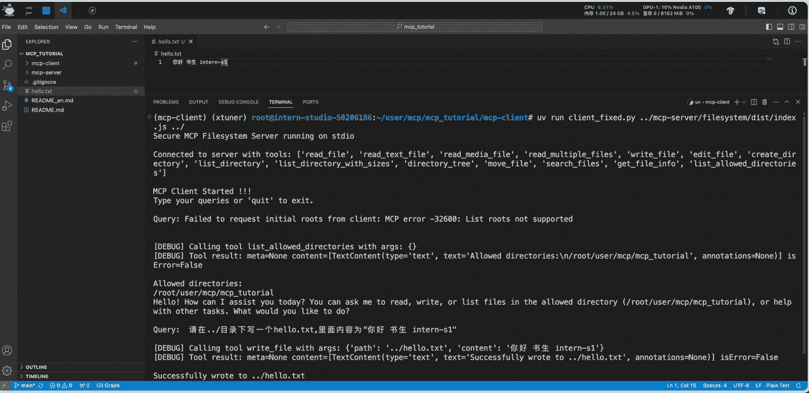

# Intern-S1 MCP 狂飙指南：AI能力无限扩展

> 来源：[https://aicarrier.feishu.cn/docx/WEDWdrIsMo4WIixaV3gcpgCjnGb](https://aicarrier.feishu.cn/docx/WEDWdrIsMo4WIixaV3gcpgCjnGb)

本指南将带您深入探索如何在书生开发机上使用 Intern-S1 API 结合 MCP（Model Control Protocol）实现突破性的 AI 功能扩展。从传统的对话交互到具备文件操作、外部数据获取能力的智能助手，让我们一起解锁 AI 的无限潜能。

## 前置准备

### 1. 获取 API KEY

Intern 系列模型提供免费的 OpenAI 兼容格式 API。获取步骤如下：

1.  访问 [https://internlm.intern-](https://internlm.intern-ai.org.cn/api/tokens)ai.org.cn/api/tokens

1.  确保使用正常注册且可用的账户

1.  为 API Token 命名并生成

1.  **重要提醒**：API Token 只能复制一次，生成后请妥善保管，切勿在代码中显式暴露



### 2. 开发机配置

在创建开发机界面进行如下配置：

+   **镜像选择**：Cuda11.7-conda

+   **GPU 配置**：10% A100

本节课程不需要显存，故最小资源即可。

##  什么是 MCP？



MCP（Model Control Protocol）是**一种专为 AI 设**计的协议，其核心作用是扩充 AI 的能力。通过 MCP，AI 可以：

+   获取外部数据

+   操作文件系统

+   调用各种服务接口

+   实现复杂的工作流程

通过本教程，您将**掌握****如何让 Inte**rn-S1 API 突破传统对话限制，实现以下核心功能：

+   **外部数据获取**：连接并处理来自各种外部源的数据

+   **文件系统操作**：具备完整的文件创建、读取、修改和删除能力，实现一个命令行版本的 cursor。

让我们开始探索 MCP 的无限可能！

### 项目结构

```
mcp_tutorial/
├── mcp-client/           # 客户端应用
├── mcp-server/          # 服务端微服务
│   ├── podcast/         # 播客服务
│   ├── weather/         # 天气服务
│   ├── gmail/           # Gmail服务
│   └── filesystem/      # 文件管理服务
└── README.md            # 说明文档
```

Github 代码：https://github.com/fak111/mcp_tutorial，欢迎👏大家动动小手点点 star 🌟！


### 1. 环境准备

```
git clone https://xget.xi-xu.me/gh/fak111/mcp_tutorial.git
cd mcp_tutorial
bash install.sh
```

### 2. 配置 API

```
cd mcp-client
cp .env.example .env
```

在相应的服务目录中创建 .env 文件，填写你的 API_KEY。



**推荐**[：学习阶段建议使用书生的 S1 模型，访问 http](https://internlm.intern-ai.org.cn/api/strategy)s://internlm.intern-ai.org.cn/api/strategy 获取详细信息。

## 🌤️ 天气服务使用示例

### 启动天气服务

```
cd mcp-client
source .venv/bin/activate
uv run client_interns1.py  ../mcp-server/weather/build/index.js
```

### 使用方法

```
get_weather Beijing 
```



### 重要问题分析：参数匹配问题

在实际使用中，你可能会遇到以下现象：

| 输入 | 工具调用 | 结果 | 原因分析 |
| --- | --- | --- | --- |
| 查询&quot;北京&quot;天气 | {&#x27;city&#x27;: &#x27;北京&#x27;} | ❌ 失败 | 数据中无中文城市名 |
| 查询&quot;beijing&quot;天气 | {&#x27;city&#x27;: &#x27;beijing&#x27;} | ❌ 失败 | AI 自动转换了大小写 |
| 查询&quot;Beijing&quot;天气 | {&#x27;city&#x27;: &#x27;Beijing&#x27;} | ✅ 成功 | 完全匹配 |



**问题根源**：

mcp 服务器关于数据的命名必须与工具调用一致，否则不会返回。

可能的改进：客户端写专门的提示词帮助 ai 转化成正确的工具调用所需参数。



---

## 📁 文件系统服务

### 启动文件服务

文件服务的启动命令格式如下：

文件服务启动 uv run client_fixed.py arg1 arg2

**参数说明：**

+   arg1：MCP 文件操作服务的路径

+   arg2：运行文件操作的工作目录路径

```
cd mcp-client
source .venv/bin/activate
uv run client_fixed.py ../mcp-server/filesystem/dist/index.js ../
```



### 功能示例

+   **列出文件**：列出当前目录下的所有文件

+   **读取文件**：读取 README.md 文件的内容

+   **创建文件**：请在../目录下写一个hello.txt,里面内容为“你好 书生 intern-s1"

+   **搜索文件**：搜索所有 .md 文件

## ** 总结**

恭喜您完成了这次 AI 能力扩展之旅！通过本指南，您已经掌握了：

✅ **核心技能**

+   Intern-S1 API 的高级应用

+   MCP 协议的实战运用

+   天气服务与文件系统的集成操作

✅ **实践成果**

+   构建了具备外部数据获取能力的智能助手

+   实现了完整的文件系统操作功能

+   认识到 MCP 协议中参数匹配问题

🚀 下**一步展望

**现在您已经打开了 AI 能力扩展的大门，可以继续探索更多 MCP 服务，如 Gmail 集成、播客管理等，构建属于您的智能工作流！

感谢您的学习，期待看到您创造出更多精彩的 AI 应用！ 🌟

参考文档：

+   **官方文档**：[书生·浦语官](https://internlm.intern-ai.org.cn/)

+   **MCP**：[模型上下文协议](https://modelcontextprotocol.io/docs/getting-started/intro)