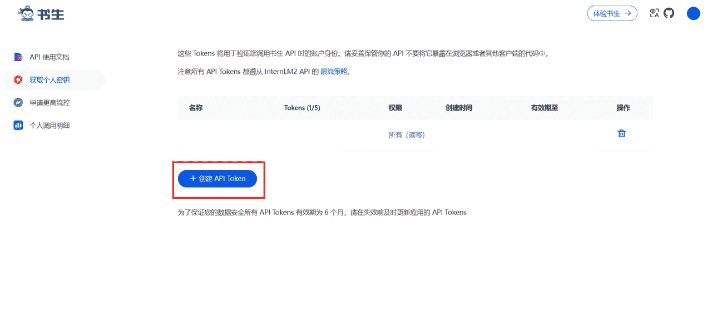
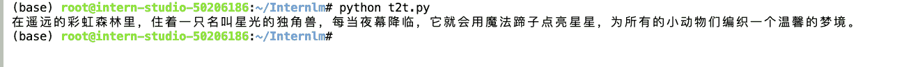
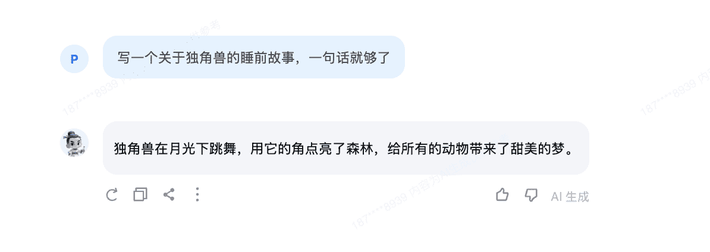
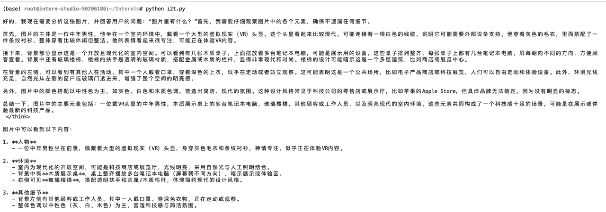
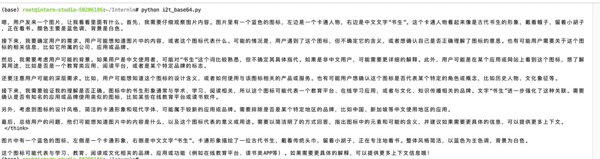
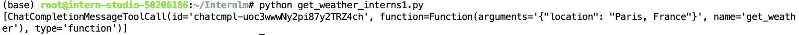
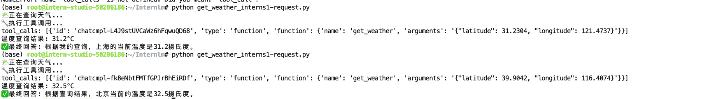
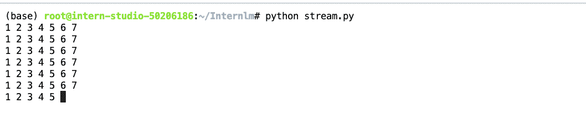
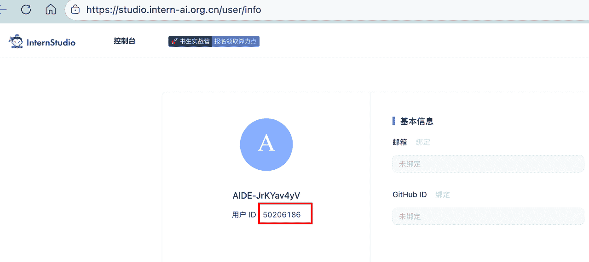
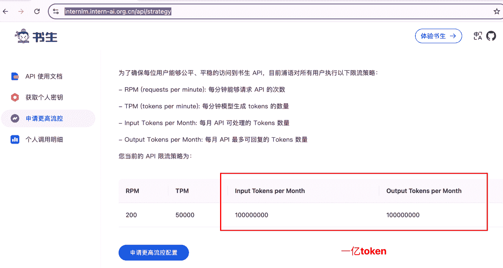

# Intern-S1 ✖️

> 来源：[https://aicarrier.feishu.cn/docx/DMt5dFcY2odnc5xlI8vcHZkrnxe](https://aicarrier.feishu.cn/docx/DMt5dFcY2odnc5xlI8vcHZkrnxe)

# 获取 API KEY

InternLM 系列模型提供了免费的 OpenAI 兼容格式 API，我们首先需要获取 API Key，可以从 https://internlm.intern-ai.org.cn/api/tokens 获取。

请确保您拥有一个正常注册且可使用的账户。要生成您的私有 API KEY可以参考我们的图示。



# 快速开始

环境安装

```
pip install openai
```

## 文本生成

Intern API [兼容 Ope](https://chat.intern-ai.org.cn/)nAI API，为最新的Intern-S1 模型提供了一个简单的接口，用于文本生成、自然语言处理、计算机视觉等。本示例是文生文，根据提示生成文本输出——像您在使用网页端 Intern 一样。

```
from openai import OpenAI
client = OpenAI(
      api_key=&quot;eyJ0eXxx&quot;,  # 此处传token，不带Bearer
    base_url=&quot;https://chat.intern-ai.org.cn/api/v1/&quot;,
)

completion = client.chat.completions.create(
    model=&quot;intern-s1&quot;,
    messages=[
        {
            &quot;role&quot;: &quot;user&quot;,
            &quot;content&quot;: &quot;写一个关于独角兽的睡前故事，一句话就够了。&quot;
        }
    ]
)

print(completion.choices[0].message.content)
```





## 分析图像输入

你也可以向模型提供图像输入。扫描收据、分析截图，或使用计算机视觉技术在现实世界中寻找物体。

### 输入图像为 url

```
from openai import OpenAI

client = OpenAI(
      api_key=&quot;eyJ0eXxx&quot;,  # 此处传token，不带Bearer
    base_url=&quot;https://chat.intern-ai.org.cn/api/v1/&quot;,
)

response = client.chat.completions.create(
    model=&quot;intern-s1&quot;,
    messages=[
        {
            &quot;role&quot;: &quot;user&quot;,
            &quot;content&quot;: [
                {&quot;type&quot;: &quot;text&quot;, &quot;text&quot;: &quot;图片里有什么？&quot;},
                {
                    &quot;type&quot;: &quot;image_url&quot;,
                    &quot;image_url&quot;: {
                        &quot;url&quot;: &quot;https://upload.wikimedia.org/wikipedia/commons/thumb/d/dd/Gfp-wisconsin-madison-the-nature-boardwalk.jpg/2560px-Gfp-wisconsin-madison-the-nature-boardwalk.jpg&quot;,
                    },
                },
            ],
        }
    ],
    extra_body={&quot;thinking_mode&quot;: True,},
)

print(response.choices[0].message.content)
```



### 输入图像为文件


```
import base64
from openai import OpenAI

client = OpenAI(
      api_key=&quot;eyJ0eXxx&quot;,  # 此处传token，不带Bearer
    base_url=&quot;https://chat.intern-ai.org.cn/api/v1/&quot;,
)
# Function to encode the image
def encode_image(image_path):
    with open(image_path, &quot;rb&quot;) as image_file:
        return base64.b64encode(image_file.read()).decode(&quot;utf-8&quot;)


# Path to your image
image_path = &quot;/root/share/intern.jpg&quot;

# Getting the Base64 string
base64_image = encode_image(image_path)

completion = client.chat.completions.create(
    model=&quot;intern-s1&quot;,
    messages=[
        {
            &quot;role&quot;: &quot;user&quot;,
            &quot;content&quot;: [
                { &quot;type&quot;: &quot;text&quot;, &quot;text&quot;: &quot;图片里有什么?&quot; },
                {
                    &quot;type&quot;: &quot;image_url&quot;,
                    &quot;image_url&quot;: {
                        &quot;url&quot;: f&quot;data:image/jpeg;base64,{base64_image}&quot;,
                    },
                },
            ],
        }
    ],
)

print(completion.choices[0].message.content)
```



## 模型使用工具

Openai 格式

```
from openai import OpenAI


client = OpenAI(     api_key=&quot;sk-lYQQ6Qxx，不带Bearer
    base_url=&quot;https://chat.intern-ai.org.cn/api/v1/&quot;,
)
tools = [{
    &quot;type&quot;: &quot;function&quot;,
    &quot;function&quot;: {
        &quot;name&quot;: &quot;get_weather&quot;,
        &quot;description&quot;: &quot;Get current temperature for a given location.&quot;,
        &quot;parameters&quot;: {
            &quot;type&quot;: &quot;object&quot;,
            &quot;properties&quot;: {
                &quot;location&quot;: {
                    &quot;type&quot;: &quot;string&quot;,
                    &quot;description&quot;: &quot;City and country e.g. Bogotá, Colombia&quot;
                }
            },
            &quot;required&quot;: [
                &quot;location&quot;
            ],
            &quot;additionalProperties&quot;: False
        },
        &quot;strict&quot;: True
    }
}]

completion = client.chat.completions.create(
    model=&quot;intern-s1&quot;,
    messages=[{&quot;role&quot;: &quot;user&quot;, &quot;content&quot;: &quot;What is the weather like in Paris today?&quot;}],
    tools=tools
)

print(completion.choices[0].message.tool_calls)
```



Python 原生调用

```
import requests
import json

# API 配置
API_KEY = &quot;eyJ0exxxxQ&quot;
BASE_URL = &quot;https://chat.intern-ai.org.cn/api/v1/&quot;
ENDPOINT = f&quot;{BASE_URL}chat/completions&quot;

# 定义天气查询工具
WEATHER_TOOLS = [{
    &quot;type&quot;: &quot;function&quot;,
    &quot;function&quot;: {
        &quot;name&quot;: &quot;get_weather&quot;,
        &quot;description&quot;: &quot;获取指定城市或坐标的当前温度（摄氏度）&quot;,
        &quot;parameters&quot;: {
            &quot;type&quot;: &quot;object&quot;,
            &quot;properties&quot;: {
                &quot;latitude&quot;: {&quot;type&quot;: &quot;number&quot;, &quot;description&quot;: &quot;纬度&quot;},
                &quot;longitude&quot;: {&quot;type&quot;: &quot;number&quot;, &quot;description&quot;: &quot;经度&quot;}
            },
            &quot;required&quot;: [&quot;latitude&quot;, &quot;longitude&quot;],
            &quot;additionalProperties&quot;: False
        },
        &quot;strict&quot;: True
    }
}]

def get_weather(latitude, longitude):
    &quot;&quot;&quot;
    获取指定坐标的天气信息
    
    Args:
        latitude: 纬度
        longitude: 经度
    
    Returns:
        当前温度（摄氏度）
    &quot;&quot;&quot;
    try:
        # 调用开放气象API
        response = requests.get(
            f&quot;https://api.open-meteo.com/v1/forecast?latitude={latitude}&amp;longitude={longitude}&amp;current=temperature_2m,wind_speed_10m&amp;hourly=temperature_2m,relative_humidity_2m,wind_speed_10m&quot;
        )
        data = response.json()
        temperature = data[&#x27;current&#x27;][&#x27;temperature_2m&#x27;]
        return f&quot;{temperature}&quot;
    except Exception as e:
        return f&quot;获取天气信息时出错: {str(e)}&quot;

def make_api_request(messages, tools=None):
    &quot;&quot;&quot;发送API请求&quot;&quot;&quot;
    headers = {
        &quot;Content-Type&quot;: &quot;application/json&quot;,
        &quot;Authorization&quot;: f&quot;Bearer {API_KEY}&quot;
    }
    
    payload = {
        &quot;model&quot;: &quot;intern-s1&quot;,
        &quot;messages&quot;: messages,
        &quot;temperature&quot;: 0.7
    }
    
    if tools:
        payload[&quot;tools&quot;] = tools
        payload[&quot;tool_choice&quot;] = &quot;auto&quot;
    
    try:
        response = requests.post(ENDPOINT, headers=headers, json=payload, timeout=30)
        response.raise_for_status()
        return response.json()
    except requests.exceptions.RequestException as e:
        print(f&quot;API请求失败: {e}&quot;)
        return None

def main():
    # 初始消息 - 巴黎的坐标
    messages = [{&quot;role&quot;: &quot;user&quot;, &quot;content&quot;: &quot;请查询当前北京的温度&quot;}]
    
    print(&quot;🌤️ 正在查询天气...&quot;)
    
    # 第一轮API调用
    response = make_api_request(messages, WEATHER_TOOLS)
    if not response:
        return
    
    assistant_message = response[&quot;choices&quot;][0][&quot;message&quot;]
    
    # 检查工具调用
    if assistant_message.get(&quot;tool_calls&quot;):
        print(&quot;🔧 执行工具调用...&quot;)
        print(&quot;tool_calls:&quot;,assistant_message.get(&quot;tool_calls&quot;))
        messages.append(assistant_message)
        
        # 处理工具调用
        for tool_call in assistant_message[&quot;tool_calls&quot;]:
            function_name = tool_call[&quot;function&quot;][&quot;name&quot;]
            function_args = json.loads(tool_call[&quot;function&quot;][&quot;arguments&quot;])
            tool_call_id = tool_call[&quot;id&quot;]
            
            if function_name == &quot;get_weather&quot;:
                latitude = function_args[&quot;latitude&quot;]
                longitude = function_args[&quot;longitude&quot;]
                weather_result = get_weather(latitude, longitude)
                print(f&quot;温度查询结果: {weather_result}°C&quot;)
                
                # 添加工具结果
                tool_message = {
                    &quot;role&quot;: &quot;tool&quot;, 
                    &quot;content&quot;: weather_result,
                    &quot;tool_call_id&quot;: tool_call_id
                }
                messages.append(tool_message)
        
        # 第二轮API调用获取最终答案
        final_response = make_api_request(messages)
        
        if final_response:
            final_message = final_response[&quot;choices&quot;][0][&quot;message&quot;]
            print(f&quot;✅ 最终回答: {final_message[&#x27;content&#x27;]}&quot;)
    else:
        print(f&quot;直接回答: {assistant_message.get(&#x27;content&#x27;, &#x27;No content&#x27;)}&quot;)

if __name__ == &quot;__main__&quot;:
    main()
```



## 使用流式传输

stream=True[,打开流式传](https://chat.intern-ai.org.cn/)输，体验如同网页端 Intern 吐字的感觉。

```
from openai import OpenAI

client = OpenAI(
    api_key=&quot;eyxxxx&quot;,
    base_url=&quot;https://chat.intern-ai.org.cn/api/v1/&quot;,
)

stream = client.chat.completions.create(
    model=&quot;intern-s1&quot;,
    messages=[
        {
            &quot;role&quot;: &quot;user&quot;,
            &quot;content&quot;: &quot;Say &#x27;1 2 3 4 5 6 7&#x27; ten times fast.&quot;,
        },
    ],
    stream=True,
)

# 只打印逐字输出的内容
for chunk in stream:
    if chunk.choices[0].delta.content:
        print(chunk.choices[0].delta.content, end=&quot;&quot;, flush=True)  # 逐字输出，不换行
```



## 开关think 模式

通过extra_body={"thinking_mode": True}打开思考模式

```
from openai import OpenAI
client = OpenAI(
      api_key=&quot;eyxxA&quot;,  # 此处传token，不带Bearer
    base_url=&quot;https://chat.intern-ai.org.cn/api/v1/&quot;,
)

completion = client.chat.completions.create(
    model=&quot;intern-s1&quot;,
    messages=[
        {
            &quot;role&quot;: &quot;user&quot;,
            &quot;content&quot;: &quot;写一个关于独角兽的睡前故事，一句话就够了。&quot;
        }
    ],
    extra_body={&quot;thinking_mode&quot;: True,},
)

print(completion.choices[0].message)
```

```
from openai import OpenAI
client = OpenAI(
      api_key=&quot;eyJ0xxxmA&quot;,  # 此处传token，不带Bearer
    base_url=&quot;https://chat.intern-ai.org.cn/api/v1/&quot;,
)

completion = client.chat.completions.create(
    model=&quot;intern-s1&quot;,
    messages=[
        {
            &quot;role&quot;: &quot;user&quot;,
            &quot;content&quot;: &quot;写一个关于独角兽的睡前故事，一句话就够了。&quot;
        }
    ],
    extra_body={&quot;thinking_mode&quot;: False,},
)

print(completion.choices[0].message)
```

# 参考

1.   https://platform.openai.com/

1.  https://internlm.intern-ai.org.cn/api/document

# QA：怎么兑换活动API token

1.  登录网页获取用户 id（算力 id）：https://studio.intern-ai.org.cn/user/info



1.  入群联系小助手私发用户 id（算力 id）

1.  获取 API Key，可以从 https://internlm.intern-ai.org.cn/api/tokens 获取。

1.  等小助手发完，API token 到账。

查收链接：https://internlm.intern-ai.org.cn/api/strategy

