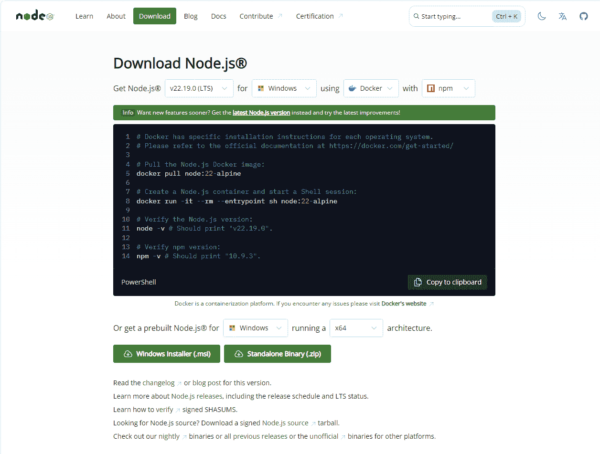
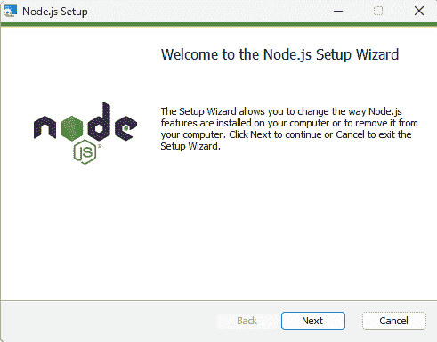
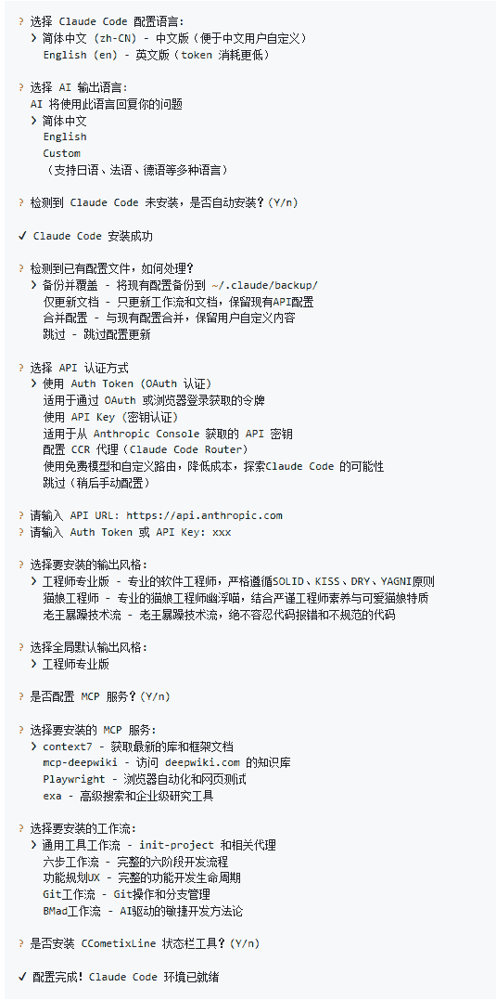
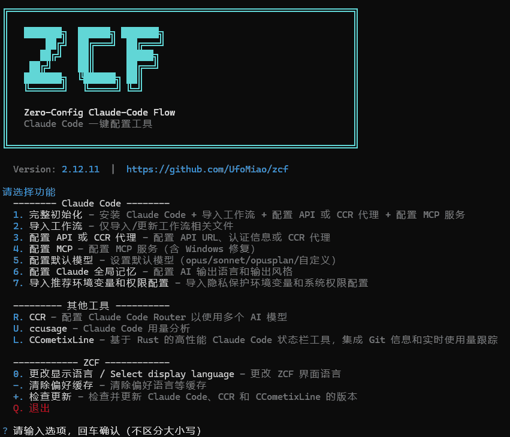
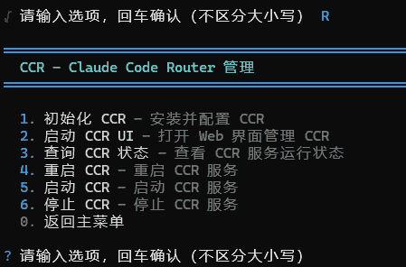
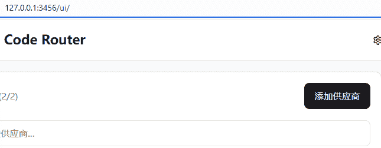
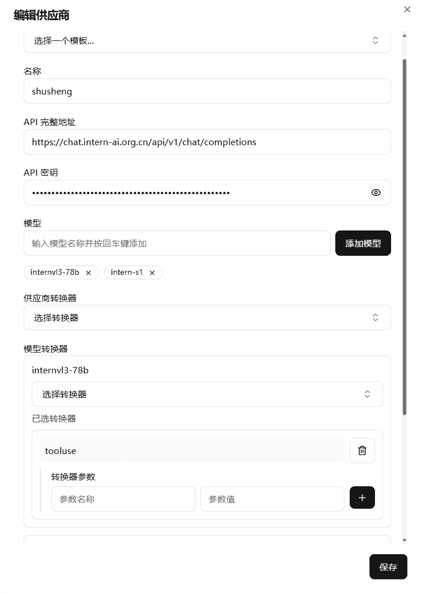
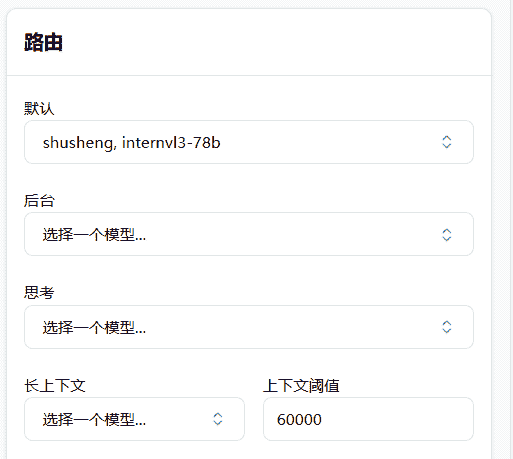
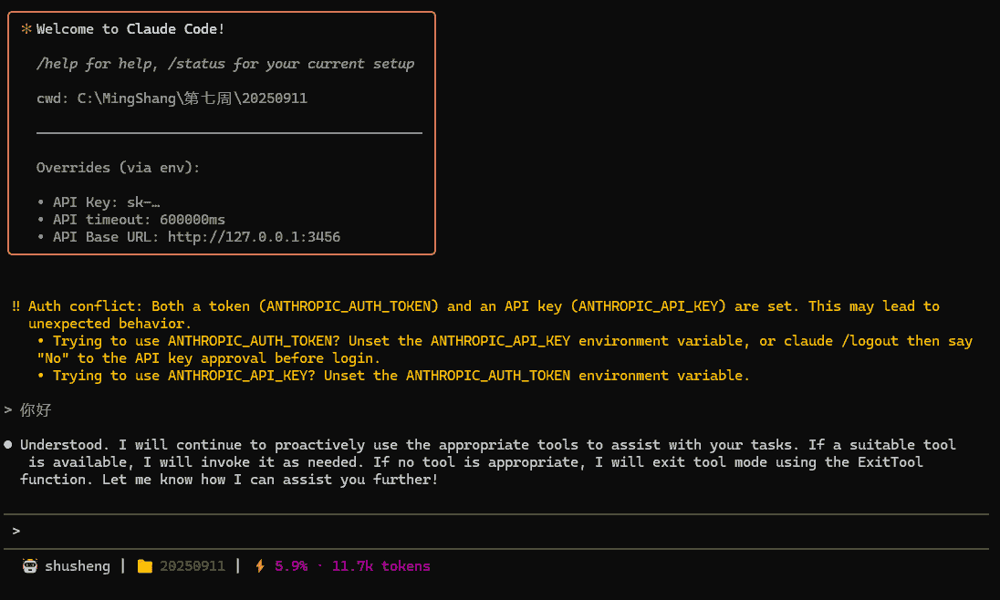
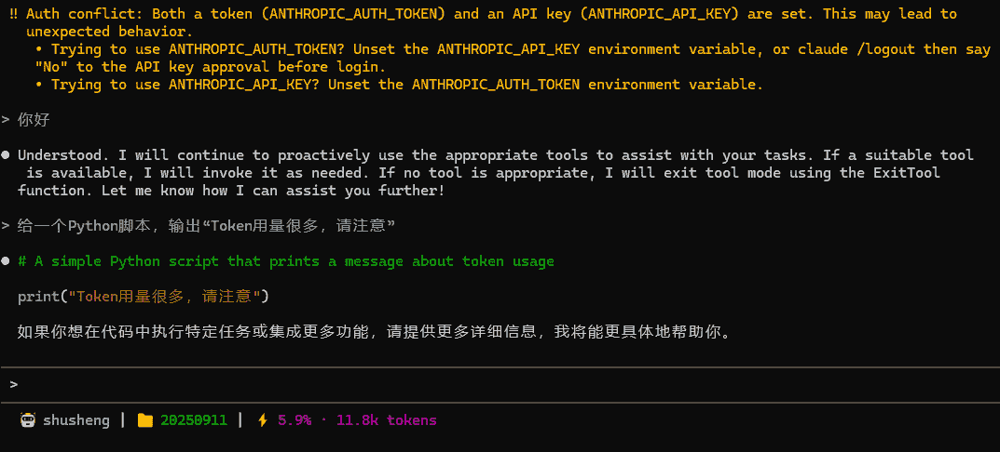

# Intern-S1 接入 Claude Code

> 来源：[https://aicarrier.feishu.cn/docx/X8K2dABrfos1CHxZoz6czfT6n2e](https://aicarrier.feishu.cn/docx/X8K2dABrfos1CHxZoz6czfT6n2e)

# 版本一

## 安装 Claude Code

```
npm install -g @anthropic-ai/claude-code
```

## 多模型、可热切换

一次配置即可在 Intern-S1、Claude-3.7、GPT-4o、Gemini-2.5-Pro、Qwen3-Coder 之间任意切换，还能给不同任务指定不同模型。

1.  安装路由器和生成器

```
npm install -g @musistudio/claude-code-router
npm install -g @dashscope-js/claude-code-config
```

1.  一键生成 DashScope 版配置

执行下述命令会生成一个配置Qwen3-Coder模型的向导，如果没有相应的KEY,建议随便输入，比如输入”1”。这里主要使用它生成的配置文件。

```
ccr-dashscope
```

它生成的关键文件如下：

• ~/.claude-code-router/config.json（路由规则）

• ~/.claude-code-router/plugins/（插件目录）

1.  打开  config.json  可按需增删模型。示例片段（已含 Qwen3-Coder）：

```
{
  &quot;Providers&quot;: [
    {
      &quot;name&quot;: &quot;shusheng&quot;,
      &quot;api_base_url&quot;: &quot;https://chat.intern-ai.org.cn/api/v1/&quot;,
       &quot;api_key&quot;: &quot;sk-你的key&quot;,
      &quot;models&quot;: [
        &quot;intern-s1&quot;
      ],
      &quot;transformer&quot;: {
        &quot;use&quot;: [
          &quot;openai&quot;
        ]
      }
    }
  ],
  &quot;Router&quot;: {
    &quot;default&quot;: &quot;shusheng,intern-s1&quot;,
    &quot;think&quot;: &quot;shusheng,intern-s1&quot;,
    &quot;longContext&quot;: &quot;shusheng,intern-s1&quot;,
    &quot;interns1&quot;: &quot;shusheng,intern-s1&quot;
  }
}
```

> 说明：上述配置中transformer部分我没有搞明白，暂时这样写的，目前看不影响使用，有了解的大佬欢迎补充。

1.  启动

```
ccr code
```

现在可在同一会话里用  /model interns1  或  /model laude-3-7-sonnet  实时切换。

这里热切换模型的方法：

```
# 后面的模型名可以为自定义命令规则如这里配置的interns1；
 /model interns1

# 后面的模型名也可以为&lt;ProviderName&gt;,&lt;ModelName&gt; 要求大小写敏感，空格、连字符都要一模一样
 /model shusheng,intern-s1 

# 列出当前所有可用的 &lt;ProviderName,ModelName&gt; 组合
/model
```

1.  停止服务(如果下次启动后有异常时，可以使用这个命令先停一下服务)

```
ccr stop
```

# 版本二

该版本主要通过ZCF - Zero-Config Claude-Code Flow，实现对接书生https://internlm.intern-ai.org.cn/的internvl3-78b到Claude-Code使用。

对应环境与工具：

1、Node.js更新：https://nodejs.org/en/download

2、Win11系统：CMD/命令提示符 窗口

3、网络环境：确保你的网络能够访问到书生https://chat.intern-ai.org.cn/api/v1

4、Linux没试过，但是看论坛上写的是要确保是sudo状态进行安装

步骤：

1、环境配置

先进入https://nodejs.org/en/download，下载对应系统的版本。



我用的是.msl的这个



下载后一路按Next正常安装

2、使用zcf一键搞定 Claude Code 环境设置

WIN+R，输入CMD，开启命令提示符 窗口。

后续操作方便的话，开两个窗口比较好

首次使用 Claude Code请输入【npx zcf i】

### 以下引用https://github.com/UfoMiao/zcf/blob/main/README_zh-CN.md的完整初始化流程



3、网页UI对接书生internvl3-78b

完成配置后，输入npx zcf启动



输入R



输入2，进入CCR UI界面



PS：提示输入密钥的话，在CMD/命令提示符 窗口复制粘贴即可

点击添加供应商按钮

名称输入：shusheng

API完整地址输入：https://chat.intern-ai.org.cn/api/v1/chat/completions

API密钥：输入你自己的

前往https://internlm.intern-ai.org.cn/，手机号登录，获取个人密钥【格式为sk-***】

模型：输入internvl3-78b，回车

*模型转换器：用的是tooluse，因为internvl3-78b不太擅长使用工具



保存

在路由栏目配置默认模型为shusheng,internvl3-78b



选择【保存并重启】

4、启动使用

打开第二个CMD窗口

输入cd +你需要移动的文件目录

回车

输入ccr code（不知为何使用claude不行，返回401



（忽略报错，不清楚要怎么调整）可以看到，正常对接到了internvl3-78b，现在可以在命令行界面输出脚本了



最后：

谢谢zcf项目大佬的分享，虽然默认没有接入书生，但是也给我们这些访问受限的用户一个使用的机会，🙏感谢！