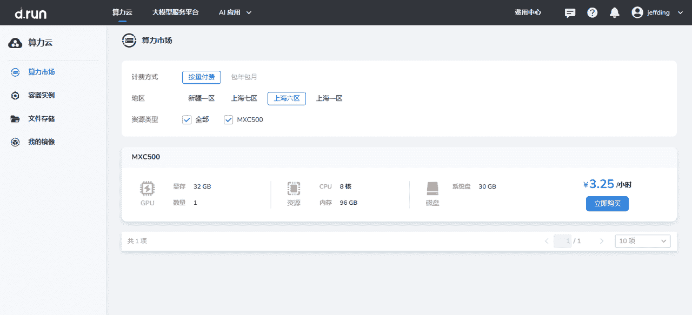
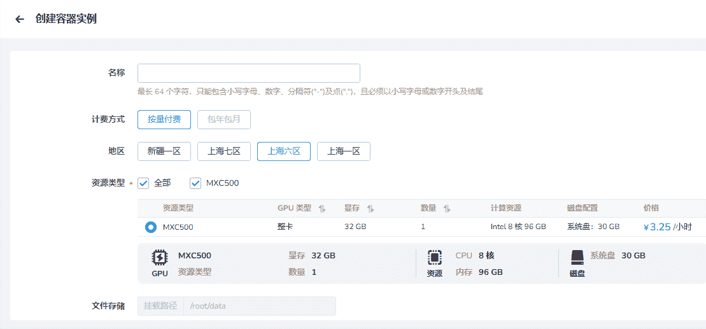
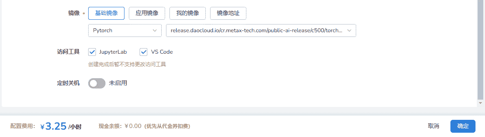
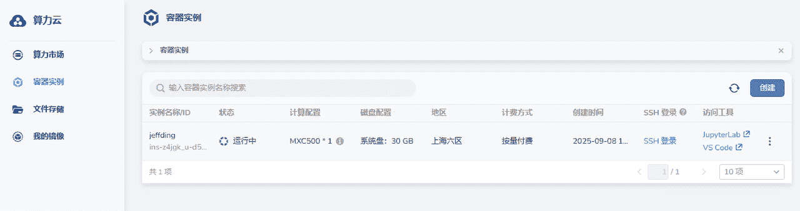
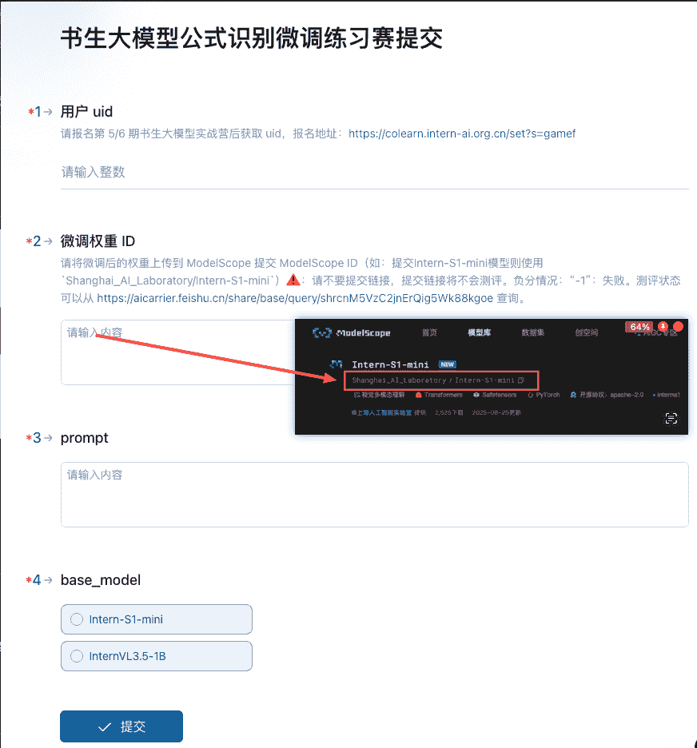
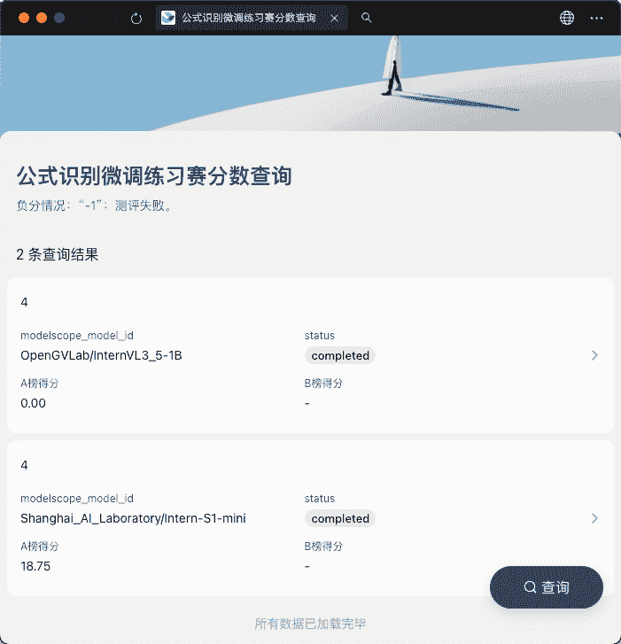

# 沐曦算力 Baseline

> 来源：[https://aicarrier.feishu.cn/docx/X1N3dodK6o3kPZx08F3c2ssrn0d](https://aicarrier.feishu.cn/docx/X1N3dodK6o3kPZx08F3c2ssrn0d)

## 创建算力实例

平台地址：http://d.run

### 创建算力

【算力云】-【算力市场】-【上海六区】，选择MXC500，点击【立即购买】



### 创建容器实例





参数选择

名称：任意

地区：上海六区

资源类型：MXC500

镜像：基础镜像-Pytorch

访问工具：根据自己需要

定时关机：根据自己需要，不要忘记关机，不然会一直扣费

最后点【确定】完成创建

### 启动实例



创建完成后再【容器实例】中可以看到前面创建的实例，等到【状态】变成【运行中】，点击【JupyterLab】或者【VS Code】就可以开始体验环境

## 环境准备

### 添加环境变量

```
export PATH=/opt/conda/bin:$PATH
```

### 安装conda

```
conda create -p envs/ms_swift python=3.10 -y
conda activate envs/ms_swift
```

### 安装依赖

创建requirements.txt安装基础依赖

```
apex==0.1+metax2.31.0.4
torch==2.4.0+metax2.31.0.4
torchaudio==2.4.1+metax2.31.0.4
torchvision==0.15.1+metax2.31.0.4
triton==3.0.0+metax2.31.0.4
```

安装

```
pip install -r requirements.txt -i https://repos.metax-tech.com/r/maca-pypi/simple --trusted-host repos.metax-tech.com --no-build-isolation
```

### 源码安装ms-swift

```
mkdir tools
cd tools

# 安装ms-swift
pip install ms-swift==3.5.0

pip install wandb timm numpy==1.26.4 transformers==4.53.0
```

### 模型下载

Intern-S1-mini

```
cd /root/data
mkdir model
cd model
modelscope download --model Shanghai_AI_Laboratory/Intern-S1-mini --local_dir ./Intern-S1-mini
```

InternVL3-1B

```
cd /root/data
mkdir model
cd model
modelscope download --model OpenGVLab/InternVL3-1B --local_dir ./InternVL3-1B
```

### 数据集下载

```
cd /root/data
mkdir dataset
cd dataset
modelscope download --dataset JimmyMa99/VLM-formula-recognition-dataset_intern_camp --local_dir ./VLM-formula-recognition-dataset_intern_camp
```

### 创建工作目录&复制数据集

```
mkdir /root/data/work_dir
cd /root/data/work_dir
mv /root/data/dataset/VLM-formula-recognition-dataset_intern_camp/train/* ./
mkdir script
cd script
```

## Intern-S1-mini微调

### 创建微调配置文件intern-s1-train-lora-gpu.sh

```
#!/bin/bash

# 创建日志目录
LOG_DIR=&quot;logs&quot;
mkdir -p $LOG_DIR

# 获取当前时间戳
TIMESTAMP=$(date +&quot;%Y%m%d_%H%M%S&quot;)
LOG_FILE=&quot;$LOG_DIR/interns1mini_lora_${TIMESTAMP}.log&quot;

# 设置环境变量
# export ENABLE_AUDIO_OUTPUT=False
export NPROC_PER_NODE=1
export OMP_NUM_THREADS=1
export CUDA_VISIBLE_DEVICES=0

# 设置随机端口号，避免端口冲突
export MASTER_PORT=$((10000 + RANDOM % 50000))


# 先打印启动信息
echo &quot;Starting training...&quot;
echo &quot;Log file: $LOG_FILE&quot;
echo &quot;Using port: $MASTER_PORT&quot;

# 没有指定 model_type
# 启动训练并获取PID
nohup swift sft \
    --model &#x27;/root/data/model/Intern-S1-mini&#x27;\
    --dataset &#x27;/root/data/work_dir/train_mini.jsonl&#x27; \
    --eval_steps 1000 \
    --train_type lora \
    --lora_rank 1 \
    --lora_dropout 0.01 \
    --lora_alpha 2 \
    --torch_dtype float16 \
    --num_train_epochs 3 \
    --per_device_train_batch_size 1 \
    --per_device_eval_batch_size 1 \
    --learning_rate 1e-4 \
    --warmup_ratio 0.05 \
    --gradient_accumulation_steps 4 \
    --save_steps 2000 \
    --save_total_limit 10 \
    --gradient_checkpointing_kwargs &#x27;{&quot;use_reentrant&quot;: false}&#x27; \
    --logging_steps 1 \
    --max_length 8000 \
    --output_dir ./swift_output/SFT-Interns1mini\
    --dataset_num_proc 2 \
    --dataloader_num_workers 2 \
    --model_author JeffDing \
    --model_name SFT-camp6 \
    --metric acc \
    --freeze_vit true \
    &gt; &quot;$LOG_FILE&quot; 2&gt;&amp;1 &amp;

# 获取PID并等待一下确保进程启动
TRAIN_PID=$!
sleep 2

# 检查进程是否还在运行
if kill -0 $TRAIN_PID 2&gt;/dev/null; then
    echo &quot;Training started successfully with PID $TRAIN_PID&quot;
    echo &quot;To view logs in real-time, use:&quot;
    echo &quot;tail -f $LOG_FILE&quot;
    echo &quot;&quot;
    echo &quot;To stop training, use:&quot;
    echo &quot;kill $TRAIN_PID&quot;
else
    echo &quot;Failed to start training process&quot;
    echo &quot;Check log file for errors: $LOG_FILE&quot;
fi
```

### 启动微调训练

```
cd ..
bash script/intern-s1-train-lora-gpu.sh
```

### 合并权重

```
swift export --adapters 模型输出文件夹 --merge_lora True
```

## InternVL3-1B微调

### 安装依赖

```
pip install transformers==4.48.3
```

### 创建微调配置文件internvl3-1b-train-lora-gpu.sh

```
#!/bin/bash

# 创建日志目录
LOG_DIR=&quot;logs&quot;
mkdir -p $LOG_DIR

# 获取当前时间戳
TIMESTAMP=$(date +&quot;%Y%m%d_%H%M%S&quot;)
LOG_FILE=&quot;$LOG_DIR/internvl3_1b_sft_${TIMESTAMP}.log&quot;

# 设置环境变量
# export ENABLE_AUDIO_OUTPUT=False
export NPROC_PER_NODE=1
export OMP_NUM_THREADS=1
export CUDA_VISIBLE_DEVICES=0


# 设置随机端口号，避免端口冲突
export MASTER_PORT=$((10000 + RANDOM % 50000))


# 先打印启动信息
echo &quot;Starting training...&quot;
echo &quot;Log file: $LOG_FILE&quot;
echo &quot;Using port: $MASTER_PORT&quot;

# 启动训练并获取PID
nohup swift sft \
    --model   &quot;/root/data/model/InternVL3-1B&quot; \
    --model_type internlm3 \
    --dataset &quot;/root/data/work_dir/train_mini.jsonl&quot; \
    --eval_steps 1000 \
    --train_type lora \
    --lora_rank 8 \
    --lora_dropout 0.01 \
    --lora_alpha 16 \
    --torch_dtype bfloat16 \
    --num_train_epochs 5 \
    --per_device_train_batch_size 4 \
    --per_device_eval_batch_size 4 \
    --learning_rate 1e-4 \
    --warmup_ratio 0.05 \
    --gradient_accumulation_steps 2 \
    --save_steps 2000 \
    --save_total_limit 10 \
    --gradient_checkpointing_kwargs &#x27;{&quot;use_reentrant&quot;: false}&#x27; \
    --logging_steps 1 \
    --max_length 8000 \
    --output_dir ./swift_output/SFT-InternVL3-1B-lora \
    --dataset_num_proc 16 \
    --dataloader_num_workers 16 \
    --model_author JeffDing \
    --model_name SFT-camp6 \
    --metric acc \
    &gt; &quot;$LOG_FILE&quot; 2&gt;&amp;1 &amp;

# 获取PID并等待一下确保进程启动
TRAIN_PID=$!
sleep 2

# 检查进程是否还在运行
if kill -0 $TRAIN_PID 2&gt;/dev/null; then
    echo &quot;Training started successfully with PID $TRAIN_PID&quot;
    echo &quot;To view logs in real-time, use:&quot;
    echo &quot;tail -f $LOG_FILE&quot;
    echo &quot;&quot;
    echo &quot;To stop training, use:&quot;
    echo &quot;kill $TRAIN_PID&quot;
else
    echo &quot;Failed to start training process&quot;
    echo &quot;Check log file for errors: $LOG_FILE&quot;
fi
```

### 启动微调训练

```
cd ..
bash script/internvl3-1b-train-lora-gpu.sh
```

### 合并权重

```
swift export --adapters 模型输出文件夹 --merge_lora True
```

## 复制文件

快捷补全文件命令，注意把DST 换成微调后权重的目录位置即可：

```
SRC=&quot;&quot; DST=&quot;&quot; rsync -ah --ignore-existing &quot;$SRC&quot;/ &quot;$DST&quot;/
```

## 上传模型到ModelScope

### 模型上传代码upload_modelscope.py

```
from modelscope.hub.api import HubApi
from modelscope.hub.constants import Licenses, ModelVisibility


YOUR_ACCESS_TOKEN = &#x27;YOUR_ACCESS_TOKEN&#x27; #这边填你的modelscope token
api = HubApi()
api.login(YOUR_ACCESS_TOKEN)

owner_name = &#x27;your_owner_name&#x27;   #这边填你的modelscope用户名
model_name = &#x27;your_model_name&#x27;   #这边填模型名，自己起
model_id = f&quot;{owner_name}/{model_name}&quot;

api.create_model(
    model_id,
    visibility=ModelVisibility.PUBLIC,
    license=Licenses.APACHE_V2,
)

api.upload_folder(
    repo_id=f&quot;{owner_name}/{model_name}&quot;,
    folder_path=&#x27;path&#x27;,   #这边填合并模型后的路径地址
    commit_message=&#x27;upload model folder to repo&#x27;,
)
```

## 参赛流程

### 报名

点击以下链接进行报名

https://colearn.intern-ai.org.cn/set?s=gamef

### 提交参赛权重

微调后的权重请从以下链接入口提交，请注意截图内容，不要填写链接，本次比赛你可以选择自己的提示词，这有可能提高你的模型识别精度

https://aicarrier.feishu.cn/share/base/form/shrcnXjK6zERK7z4pPU85PLO80c



注意：需要选择好 base model，本次提供两个模型给大家进行选择，如不在此范围内的模型请勿提交，否则可能会出现测评异常情况。

本次测评会提取模型返回中的**最后一个 latex 块**

```
```latex
E = mc^2
```
```

### 查看状态

点击以下链接

https://aicarrier.feishu.cn/share/base/query/shrcnM5VzC2jnErQig5Wk88kgoe

进行查看，输入你的 uid，比如闻星（uid：4）


在这里能够查看状态




### 排行榜

https://aicarrier.feishu.cn/share/base/dashboard/shrcnrA82hMMRd1FUuWs8EhOjag

<https://aicarrier.feishu.cn/share/base/dashboard/shrcnrA82hMMRd1FUuWs8EhOjag?iframeFrom=docx&ccm_open=iframe>