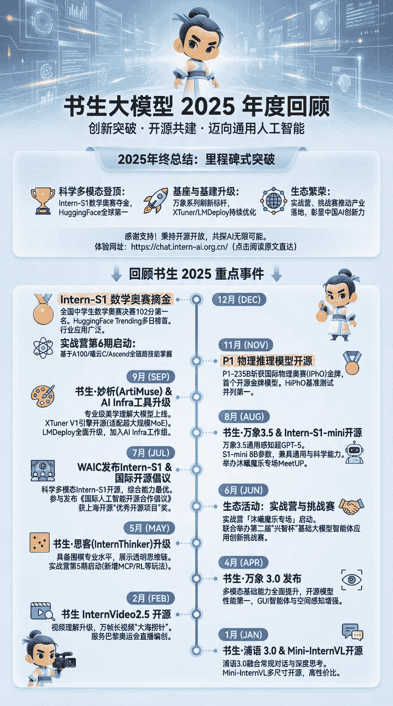
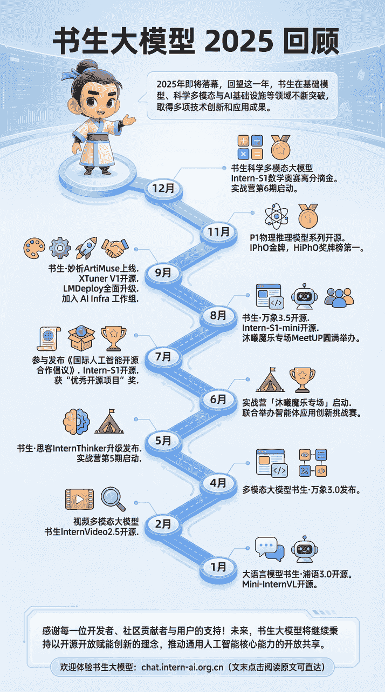
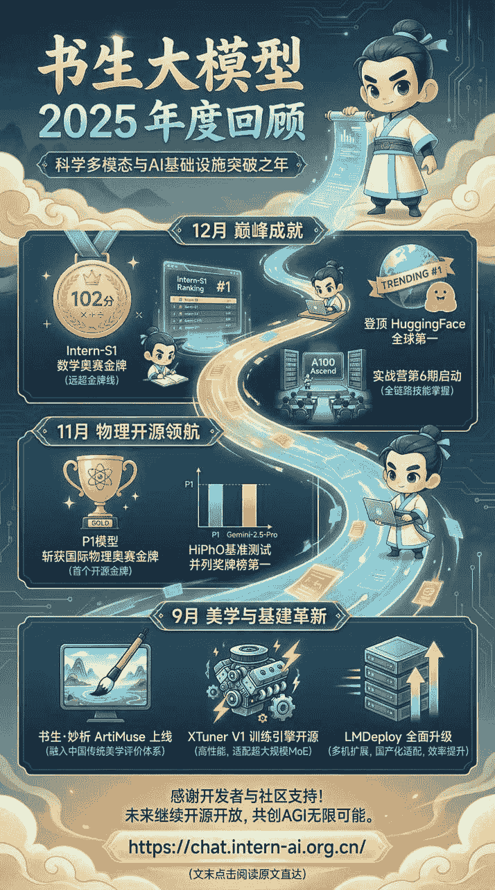
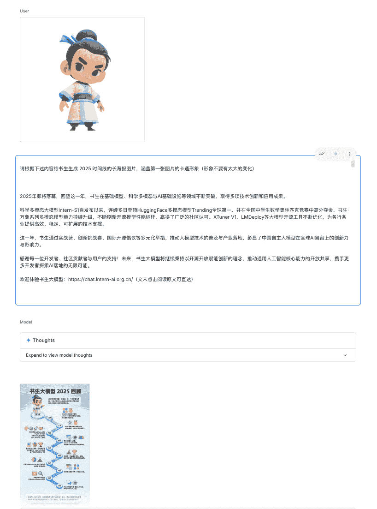

# 书小生 IP「表情包/视频」生成创意赛

> 来源：[https://aicarrier.feishu.cn/docx/Lt4jd0NGmolOWLxnArQccjKQn0d](https://aicarrier.feishu.cn/docx/Lt4jd0NGmolOWLxnArQccjKQn0d)

第六期书生大模型实战营书生IP「表情包/视频」生成创意赛，即日起至 3 月 31 日充分发挥您的想象力创造精彩的书小生宇宙。


+   书小生版热门论文海报

+   各大知名开源算法库和 AI 产品发版书生小生海报

提交方式：直接在文档评论区评论图片

# 推荐工具

谷歌官方 Nano-banana-Pro https://aistudio.google.com/

# 书生 X 昇腾 Ascend 表情包生成

生成书生 X 昇腾 Ascend 生态联创**「表情包/视频」 **，被收录表情包，获得 抱枕、咖啡杯、贴纸 周边激励。


案例表情包

# 书生 2025 年度回顾海报生成

## 参考提示词

**模型：**nano-banana-pro

**素材来源：**[公众号推文](https://mp.weixin.qq.com/s/tgMJbHlMYYxkWElsol1WAg?click_id=45)

**模型图片输入：**


**模型文本输入：**

```

请根据下述内容给书生生成 2025 时间线的长海报图片，涵盖第一张图片的卡通形象（形象不要有太大的变化）


2025年即将落幕，回望这一年，书生在基础模型、科学多模态与AI基础设施等领域不断突破，取得多项技术创新和应用成果。

科学多模态大模型Intern-S1自发布以来，连续多日登顶HuggingFace多模态模型Trending全球第一，并在全国中学生数学奥林匹克竞赛中高分夺金。书生·万象系列多模态模型能力持续升级，不断刷新开源模型性能标杆，赢得了广泛的社区认可。XTuner V1、LMDeploy等大模型开源工具不断优化，为各行各业提供高效、稳定、可扩展的技术支撑。

这一年，书生通过实战营、创新挑战赛、国际开源倡议等多元化举措，推动大模型技术的普及与产业落地，彰显了中国自主大模型在全球AI舞台上的创新力与影响力。

感谢每一位开发者、社区贡献者与用户的支持！未来，书生大模型将继续秉持以开源开放赋能创新的理念，推动通用人工智能核心能力的开放共享，携手更多开发者探索AI落地的无限可能。

欢迎体验书生大模型：https://chat.intern-ai.org.cn/（文末点击阅读原文可直达）

  

（接下来就让我们一起回顾下书生大模型2025年部分重点事件叭~）

  

  

12月

  

书生科学多模态大模型Intern-S1数学奥赛高分摘金

  

在2025年全国中学生数学奥林匹克竞赛决赛中，书生科学多模态大模型（Intern-S1-20251122）以102分（满分126分），位列大模型得分榜第一名，远超金牌线78分和国家集训队入选线87分。

自今年7月发布以来，Intern-S1连续多日登顶HuggingFace多模态模型Trending全球第一。目前Intern-S1模型下载量超过36万，累计收到近200家企事业单位或科研机构的合作申请，展现出广泛的行业吸引力。应用范围广泛覆盖金融、教育、旅游、工业、科研、游戏、政务与企业服务等多个关键领域，充分体现了Intern-S1作为通用科学模型在多行业、多场景中的落地能力。

书生大模型实战营第6期启动

  

本次课程全面升级，将在A100、曦云C系列及Ascend多个算力平台，以科学多模态大模型Intern-S1为载体，带领学员掌握大模型部署、微调、评测全链路技能。

自2023年底书生大模型实战营推出以来，已有五期学员共同进行了学习和开发实践，吸引超过25万人次在线学习，孵化出近1500个创意项目。部分由实战营产生项目展现出广阔的商业前景和社会价值，已进入应用落地阶段。

  

  

11月

  

P1物理推理模型系列开源

  

在通用模型的基础上，P1通过大规模、多阶段强化学习重点升级了物理专业能力。其中，P1-235B-A22B在2025年国际物理奥林匹克大赛（IPhO）拿下金牌，成为首个也是唯一获得金牌的开源模型；在覆盖2024-2025年全球13场顶级物理竞赛的HiPhO基准测试中，与Gemini-2.5-Pro并列奖牌榜第一。

  

  

9月

  

专业级美学理解大模型书生·妙析ArtiMuse上线

  

ArtiMuse利用超过30万张图像作为训练集，其中包含1万张自建的精标注图像，具有80亿参数，能够对多种类的图像进行精细化、多维度的分项评估，还能生成具有专业水准的美学点评，为艺术教育、审美评价、美育普及提供了精确的量化工具。ArtiMuse还首次将中国传统美学思想与评价体系融入AI算法逻辑，为我国在AI美学标准制定方面赢得话语权奠定技术基础。

新一代训练引擎XTuner V1开源

  

相较于传统的3D并行训练引擎，XTuner V1兼顾复杂场景与高性能，尤其适配超大规模稀疏混合专家模型训练。基于昇腾超节点深度优化，理论算力落后情况下，最终实现训练吞吐超过H800近5%，MFU反超20%以上。

书生首创面向大模型研发与应用的全链条开源体系（覆盖大模型数据处理、预训练、微调、部署、评测及应用）。自XTuner开源以来，广受社区好评，GitHub星标数超过5000。

大模型推理部署工具LMDeploy全面升级

  

LMDeploy持续迭代多个版本，实现了多机扩展、推理加速、强化学习集成、国产化适配等一系列关键突破。新增对多机部署的全面支持，显著提升超大规模模型的推理效率。TurboMind核心引擎在卡间通信、MoE支持与FP8/FP4量化等方面实现关键突破，显著降低显存占用、提升计算性能；同时全面适配华为昇腾、沐曦、寒武纪等国产AI加速卡及主流操作系统。

目前LMDeploy GitHub星标数超过7400，将持续为社区提供更高效、更稳定、可扩展的推理部署方案。

加入 AI Infra 工作组，共建开源生态新篇章

  

上海人工智能实验室大模型中心加入AI Infra工作组，将加速AI基础设施技术的标准化与产业化进程，推动其创新与普及，为行业发展带来多重积极影响。实验室将通过开源方式，助力解决AI训练和推理过程中的&quot;效率瓶颈&quot;与&quot;成本问题&quot;，使更多企业和研究机构得以负担大模型的训练与部署。

  

  

8月

  

书生多模态大模型书生·万象3.5开源

  

通用能力、推理能力与部署效率全面升级。开源9种尺寸的模型，参数涵盖 10亿-2410亿，可满足各场景需求；通用感知能力超越 GPT-5，文本能力领跑主流开源多模态大模型；在图形用户界面智能体、具身空间感知、矢量图像理解与生成等特色任务上实现显著提升。

书生科学多模态大模型Intern-S1-mini开源

  

作为8B参数的“迷你模型”，Intern-S1-mini同样兼具通用能力与专业科学能力，且更加适合快速部署和二次开发。通用能力稳居同量级第一梯队；科学专业能力优异；减身材不减实力，助力科研、开发、教育多种场景。

书生大模型实战营沐曦魔乐专场MeetUP圆满举办

  

由书生大模型社区、沐曦、魔乐社区、算丰和 DaoCloud 道客等联合打造的「书生大模型实战营沐曦魔乐专场 MeetUP 暨颁奖仪式」在上海漕河泾国际孵化中心圆满举办。来自全国各地的近70位社区开发者与行业嘉宾齐聚一堂，畅聊前沿技术、分享成长故事、展望AI未来。

  

  

7月

  

书生开源社区参与发布《国际人工智能开源合作倡议》

  

工业和信息化部推动中国—金砖国家人工智能发展与合作中心，联合书生开源社区等组织，共同发布《国际人工智能开源合作倡议》。鼓励各方以开源为纽带，深化人工智能领域开源合作，携手打造中国主导、金砖协同、全球辐射的人工智能开源开放生态体系。作为重要参与方之一，书生开源社区始终秉持“以高质量开源赋能创新”的理念，持续推动大模型技术的开源化与普惠化。

书生科学多模态大模型Intern-S1开源

  

在WAIC 2025科学前沿全体会议上，书生科学多模态大模型Intern-S1开源发布。提供241B、8B双尺寸，是综合能力最优的开源模型，超 InternVL3，Qwen2.5-VL 等；在化学、材料、生命、地球等多学科专业任务基准，Intern-S1超过Grok-4；通过大规模多任务强化学习，齐头并进，Intern-S1一面能力全面，一面专业精通。

书生·浦语获“优秀开源项目”奖

  

凭借在技术创新、社区生态和开源贡献方面的卓越表现，从书生·浦语众多项目中脱颖而出，荣获2025上海开源创新菁英奖“优秀开源项目”奖。

  

  

6月

  

书生大模型实战营「沐曦魔乐专场」启动

  

本期实战营依托国产沐曦算力平台，打造大模型实战课程，覆盖部署、微调、评测全链路技能。同时举办近10万元奖金池的「论文分类微调打榜赛」，以赛促学，实战赋能，助力开发者全面掌握大模型核心能力！

联合举办第二届“兴智杯”基础大模型智能体应用创新挑战赛

  

由中国信息通信研究院主办，联合上海人工智能实验室、阿里云等头部机构共同设置的第二届&quot;兴智杯&quot;全国人工智能创新应用大赛大模型创新主题赛启动！书生大模型独家支持其中的「基础大模型智能体应用创新挑战赛」，面向全球招募开发者。

  

  

5月

  

书生·思客InternThinker升级发布

  

专业推理能力大幅提升，成为首个既具备围棋专业水平，又能展示透明思维链的大模型。新生代世界围棋冠军王星昊九段在与InternThinker对弈后评价道：“能解说思考过程的AI还是第一次见，感觉它分析得非常好；从布局看棋力可能在职业3-5段之间。

通过创造性地构建“加速训练营”（InternBootcamp），InternThinker已实现在奥赛级数学、科学对象理解与推理、算法编程、棋类游戏、智力谜题等多个专业任务同步学习演进，并在多任务混合强化学习过程中出现智能“涌现时刻”。

书生大模型实战营第5期启动

  

本期实战营增设书生大模型与MCP、RL（强化学习）和MinerU等技术结合的全新“玩法”，带领学员基于DeepLink在国产AI平台部署、微调书生系列基础模型，并新增「论文分类打榜赛」帮助学员更好地掌握大模型技能，学员参与实战营项目开发期间，可获得丰厚算力支持。

  

  

4月

  

多模态大模型书生·万象3.0发布

  

多模态基础能力全面提升，在专家级基准测试、多模态性能全面测试中，10亿~780亿参数的全量级版本在开源模型中性能均位列第一，同时大幅提升了图形用户界面（GUI）智能体、建筑场景图纸理解、空间感知推理以及通识学科推理等方面的能力。

  

  

2月

  

视频多模态大模型书生InternVideo2.5开源

  

在视频理解领域，全新升级的InternVideo2.5取得时间跨度与细粒度的双维提升，“记忆力”较前代模型扩容6倍，具备万帧长视频中精准“大海捞针”能力，AI视频理解既能“短平快”，亦可“长深细”。书生InternVideo系列模型此前已应用于中央广播电视总台巴黎奥运会直播，准确定位运动员的得分瞬间及相关慢动作，显著提升电视节目编创效率。

  

  

1月

  

大语言模型书生·浦语3.0开源

  

通过精炼数据框架，书生·浦语3.0大幅提升了数据效率，并实现思维密度的跃升。仅使用4T训练数据的InternLM3-8B-Instruct，其综合性能超过了同量级开源模型，节约训练成本75%以上。同时，书生·浦语3.0首次在通用模型中实现了常规对话与深度思考能力融合，可应对更多真实使用场景。

  

多模态大模型Mini-InternVL开源

  

书生·万象多模态大模型迎来“迷你版”Mini-InternVL，为满足不同需求层级，Mini-InternVL开源了1B、2B和4B三个参数版本。评测结果显示，Mini-InternVL-4B仅以5%的参数量，即实现了InternVL2-76B约九成性能，显著减少计算成本。
```

## **生成案例：**









AI Studio 生成截图