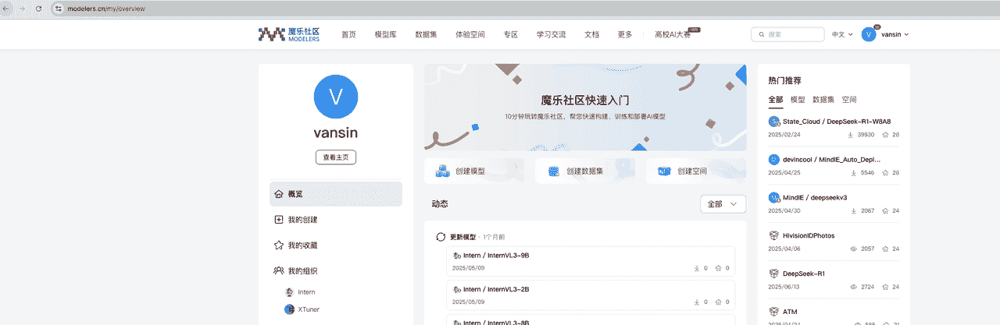
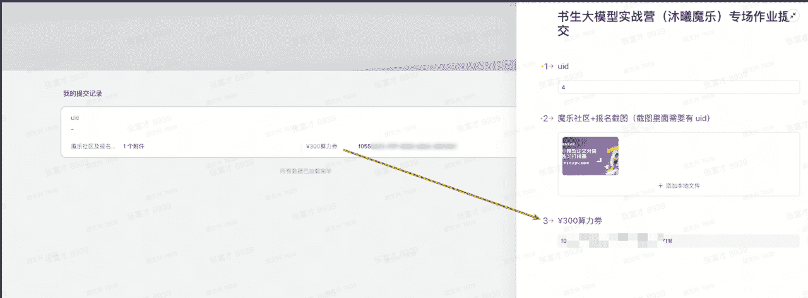
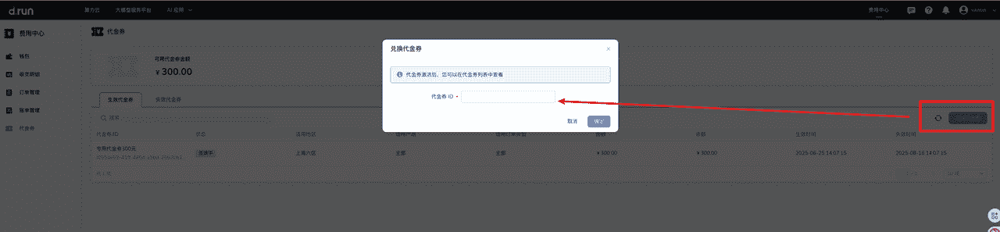
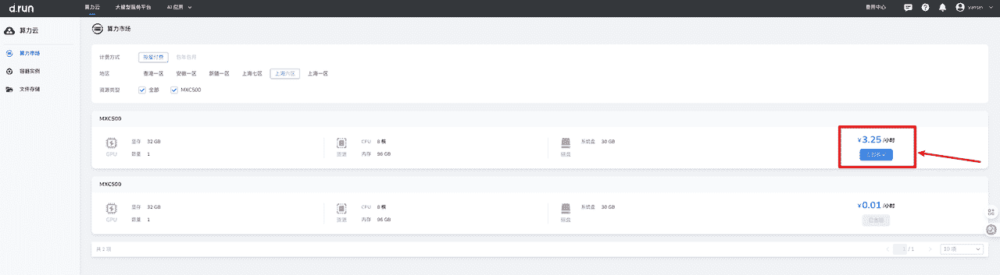
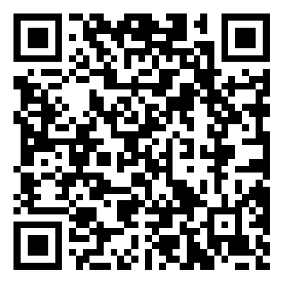
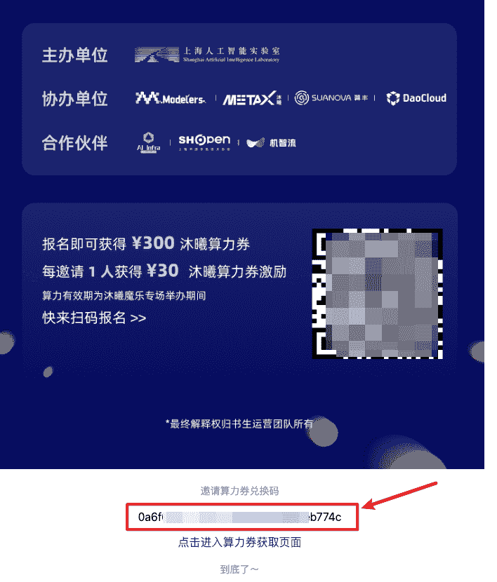
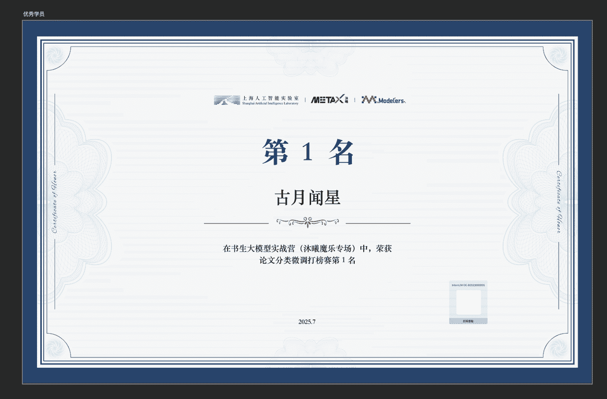
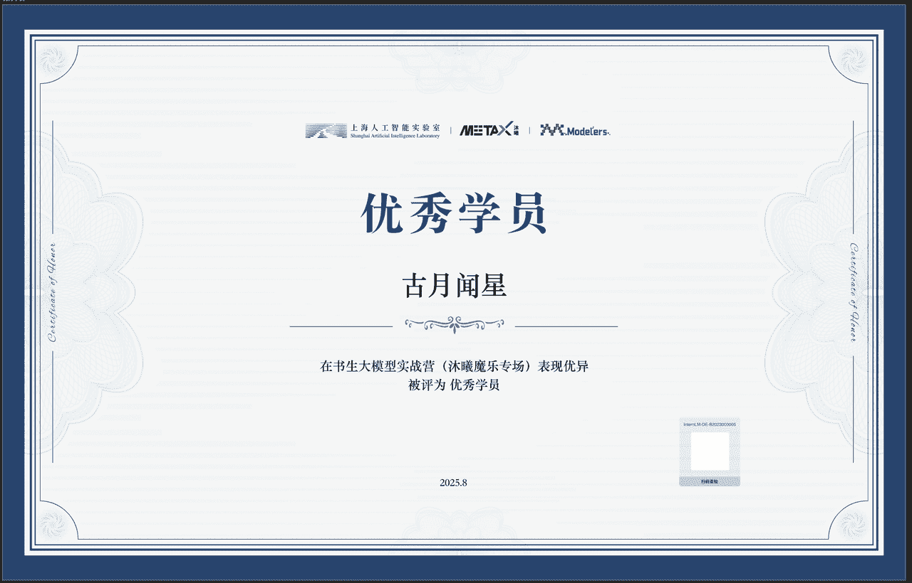
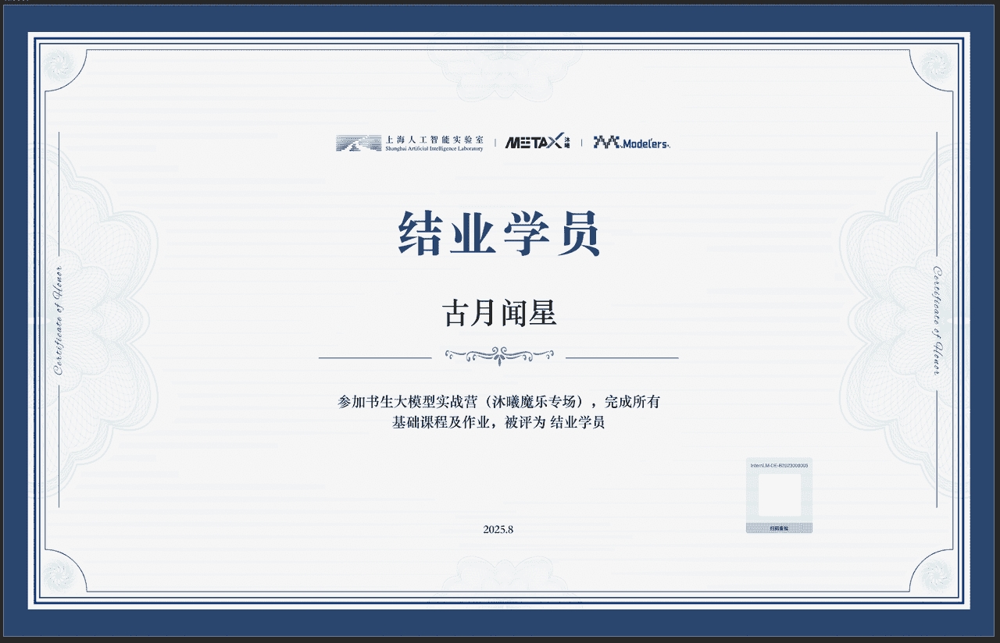

# 闯关手册——书生大模型实战营（沐曦+魔乐）专场

> 来源：[https://aicarrier.feishu.cn/docx/VISTdkEcjoozLGx3v0Wc73jZnTd](https://aicarrier.feishu.cn/docx/VISTdkEcjoozLGx3v0Wc73jZnTd)

**欢迎参加书生大模型**实战营「沐曦魔乐专场」，本专场以「论文分类微调赛」为载体以赛代练，带大家熟悉书生大模型「部署」「评测」「微调」全链路技能，比赛前 60 名共享近 10W 现金奖金池（个税前）。

## 时间线

|  |  |
| --- | --- |
| 报名 | 即日起到 7 月 20 日 |
| 课程学习 | 7 月 5 日 —— 8 月 5 日 |
| 打榜赛 | 7 月 5 日 —— 8 月 5 日 |
| 线下meetup+颁奖 | 8 月 9 日（暂） |

## 报名

https://colearn.intern-ai.org.cn/mm?s=lark

## **课前准备**

### 提交截图获取 ¥300 算力券

登陆 https://[mode](https://modelers.cn/my/overview)lers.cn/ 魔社区注册，在个人中心截图，如下图所示：

在以下的问卷中提交**「魔乐社区个人中心截图」**和**「报名截图」**，助教批改后即可获得 ¥300 算力券。

https://aicarrier.feishu.cn/share/base/form/shrcn7VkevbXwMmX7vr6SpPD9cr

### 兑换算力

[将上述流程中获得的「算力券](https://console.d.run/leopard/vouchers/effective)」去 DaoCloud 官网地址兑换，该算力券仅上海六区沐曦卡可使用！！！

兑换地址：https://console.d.run/leopard/vouchers/effective

上海六区地址：https://console.d.run/zestu/market?regionId=sh-06

### 分享给好友获取每人¥30 算力券

微信扫码二维码网页拉到底可以生产「专属海报」，每邀请 1 位好友扫描该「专属海报」报名可获得 ¥30 算力券。

页面拉到底可以获取「邀请算力券兑换码」

在以下网站中输入「邀请算力券兑换码」可以获取邀请共学获得的算力券（系统 1 天更新一次）

https://aicarrier.feishu.cn/share/base/query/shrcn7cJftsFGRV0OSnYIRyEG0Q

## 论文微调练习赛

比赛入口：https://ai⬇️carrier.feishu.cn/wiki/Gr7Iw6vhTiniMUkBIPvcfBiAnkg

比赛证书

## 课程内容

| 课程内容 |  |  |  |  |
| --- | --- | --- | --- | --- |
|  | 关卡名称 | 课程贡献者 | 关卡资料 | 闯关激励 |
| 第1 课 | 玩转魔乐社区 |  | [文档](https://aicarrier.feishu.cn/wiki/LRTcwMqacicQUGkQq2Jc7cIgnMg) |  |
| 第2课 | 书生大模型提示词实践 |  | [文档](https://aicarrier.feishu.cn/wiki/Lu31wWMk6i8KLikg0BycFejLn4f) |  |
| 第3课 | 玩转书生大模型 API 之 Browse Use实践 |  | [文档](https://aicarrier.feishu.cn/wiki/Twy0w3oOMi3o24kVncNc0Bo5nMu) |  |
| 第4课 | 沐曦硬件下OpenCompass 评测书生大模型实践 |  | [文档](https://aicarrier.feishu.cn/wiki/X0QgwYemkiPWBdkrQ7qcyWVgn1e) |  |
| 第5课 | 沐曦硬件下 InternLM 论文分类微调实践 |  | [文档](https://aicarrier.feishu.cn/wiki/RpVvwq7N5iWzBBk2nKDcZV92nWd) |  |
| 第6课 | 沐曦硬件下 LMDeploy 部署 InternLM、InternVL 实践 |  | [文档](https://aicarrier.feishu.cn/wiki/EsmmwaCtgifiNYk48vycGcusndc) |  |
| 第7课 | 沐曦硬件下InternVL 部署微调实践 |  | [文档](https://aicarrier.feishu.cn/wiki/YHmMwXnejie1DCk4vH1cd7BMnIf) |  |
| 完成课程学习获得「课程结营」证书 ！！！ |  |  |  |  |
| 沐曦硬件下论文分类微调赛 |  |  |  |  |

微调赛前 60 名可以获得优秀学员

完成课程学习成功参加比赛并提交复现文档可获得结业「学员证书」

## 合作伙伴

