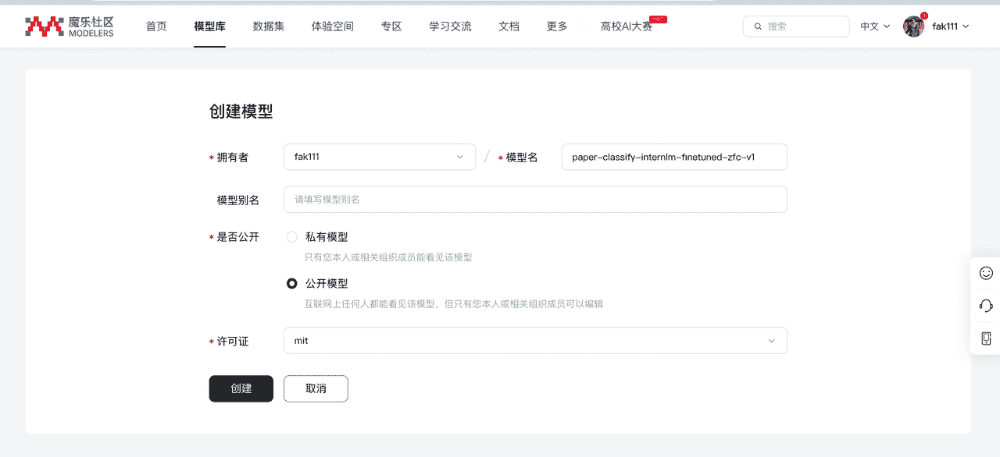
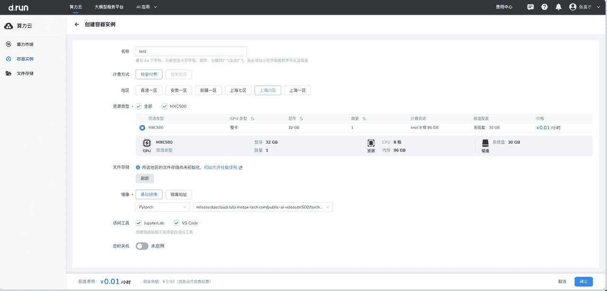
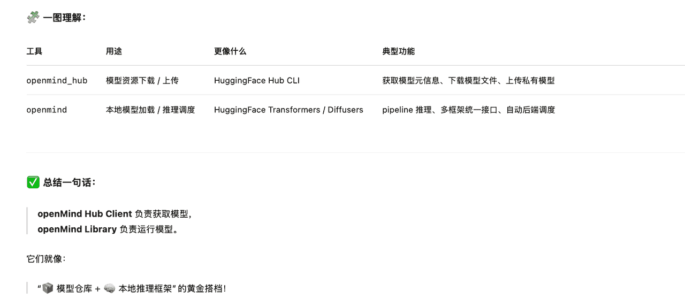
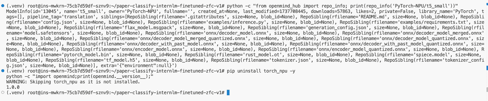
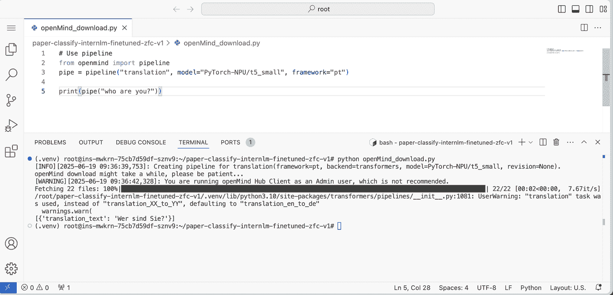
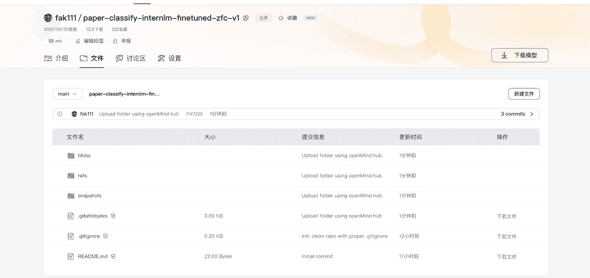
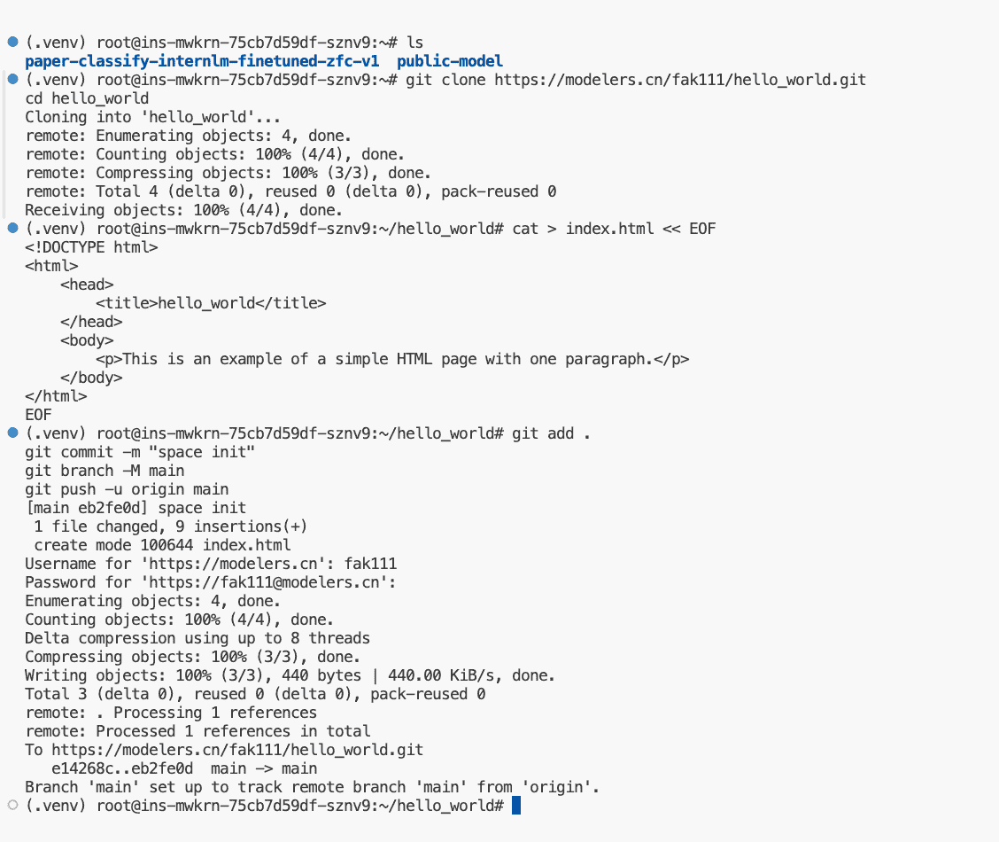

# G0 玩转魔乐社区

> 来源：[https://aicarrier.feishu.cn/docx/KgySd61YYoK2YrxMDQrc9aaonYg](https://aicarrier.feishu.cn/docx/KgySd61YYoK2YrxMDQrc9aaonYg)

在本次课程中，我们带领大家从零开始玩转魔乐社区，通过实操方式帮助大家完成国产 AI 开发的第一步，包括社区平台使用、开发环境配置、模型创建与上传、体验空间等流程，助你快速融入国产 AI 生态圈，开启 AI 模型创作之旅。

## 前提条件

1.  登录注册魔乐平台https://modelers.cn/my/overview

1.  登录注册沐曦开发机https://console.d.run/

# 创建模型

## 平台操作




关于模型名命名小规范

```
**&lt;用途关键词&gt;-&lt;模型基础&gt;-&lt;**技术关键词&gt;-&lt;版本/作者&gt;
#eg
paper-classify-internlm-finetuned-v1
```

## 配置环境

### 开发机的选择

去[开发机](https://console.d.run/zestu/instance/list)开一台机器，如图配置



下载git、python 基础工具

```
apt update &amp;&amp; apt install -y git git-lfs python3.10 python3.10-venv python3.10-distutils wget curl
```

### 配置魔乐环境

git 拉下魔乐的模型空间

```
git clone https://modelers.cn/fak111/paper-classify-internlm-finetuned-zfc-v1.git
```

配置 python 环境,   参考：https://modelers.cn/docs/zh/openmind-library/1.0.0/install.html

```
cd ~/paper-classify-internlm-finetuned-v1
python3.10 -m venv .venv
source .venv/bin/activate
pip install openmind_hub[all]
pip install &quot;openmind[pt]&quot; --extra-index-url https://download.pytorch.org/whl/cpu
```

q：如何理解openmind_hub和openmind



检查openmind_hub

```
python -c &quot;from openmind_hub import repo_info; print(repo_info(&#x27;PyTorch-NPU/t5_small&#x27;))&quot;
```

检查openmind

```
pip uninstall torch_npu -y
python -c &quot;import openmind;print(openmind.__version__);&quot;
```

输出如下图所示：



## 下载模型

下一个[小模型t5_small](https://modelers.cn/models/PyTorch-NPU/t5_small),用openMind Library下载并加载模型 方式

```
touch openMind_download.py
```

```
# Use pipeline
from openmind import pipeline
pipe = pipeline(&quot;translation&quot;, model=&quot;PyTorch-NPU/t5_small&quot;, framework=&quot;pt&quot;)

print(pipe(&quot;who are you?&quot;))
```

运行脚本

```
python openMind_download.py
```

输出如图所示



## **上传模型**

使用openmind_hub库中的upload_file向仓库中上传单个文件。文件

```
from openmind_hub import upload_folder

upload_folder(
    token=&quot;9exxd592(替换成自己的)&quot;,
    folder_path=&quot;/root/.cache/openmind/hub/models--PyTorch-NPU--t5_small&quot;,#模型位置
    repo_id=&quot;fak111/paper-classify-internlm-finetuned-zfc-v1&quot;,#模型空间名字
)
```

其中token 是访问令牌，获取方式如下图https://modelers.cn/my/tokens：


至此，我们就完成了模型上传😄



# 创建空间

## 平台操作


我们部署个简单的**静态网页应用**作为教学


## 开发机操作

```
git clone https://modelers.cn/fak111/hello-world.git
cd hello_world
```

创建index.html的脚本

```
cat &gt; index.html &lt;&lt; EOF
&lt;!DOCTYPE html&gt;
&lt;html lang=&quot;zh&quot;&gt;
&lt;head&gt;
    &lt;meta charset=&quot;UTF-8&quot;&gt;
    &lt;meta name=&quot;viewport&quot; content=&quot;width=device-width, initial-scale=1&quot;&gt;
    &lt;title&gt;书生大模型实战营（沐曦魔乐专场）&lt;/title&gt;
    &lt;style&gt;
        body {
            margin: 0;
            height: 100vh;
            display: flex;
            justify-content: center;
            align-items: center;
            background: linear-gradient(to right, #0f2027, #203a43, #2c5364);
            font-family: &#x27;Helvetica Neue&#x27;, sans-serif;
            color: #ffffff;
        }

        .container {
            text-align: center;
            max-width: 90%;
        }

        h1 {
            font-size: 2.8em;
            margin-bottom: 0.4em;
            background: linear-gradient(90deg, #00c6ff, #0072ff);
            -webkit-background-clip: text;
            -webkit-text-fill-color: transparent;
        }

        p {
            font-size: 1.3em;
            color: #e0e0e0;
            margin-top: 0;
        }
    &lt;/style&gt;
&lt;/head&gt;

&lt;body&gt;
    &lt;div class=&quot;container&quot;&gt;
        &lt;h1&gt;书生大模型实战营（沐曦魔乐专场）&lt;/h1&gt;
        &lt;p&gt;🏆欢迎报名&lt;/p&gt;
    &lt;/div&gt;
&lt;/body&gt;

&lt;/html&gt;

EOF
```

提交index 文件

```
git add .
git commit -m &quot;space init&quot;
git branch -M main
git push -u origin main
```

完整操作的流程截图



效果如下图所示：


# 总结

通过今天的学习，大家成功掌握了魔乐社区平台的基本功能，从环境搭建到模型、空间上传，整个流程简单流畅。希望大家能继续实践探索，借助魔乐社区轻松上手 AI 模型开发，一起助力国产 AI 更进一步！