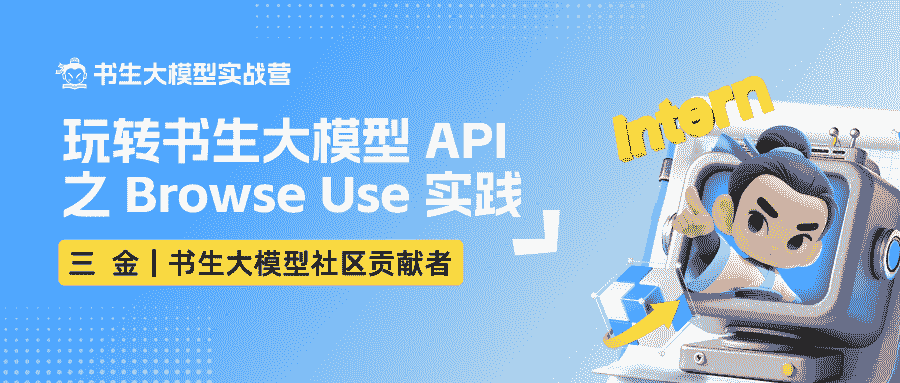
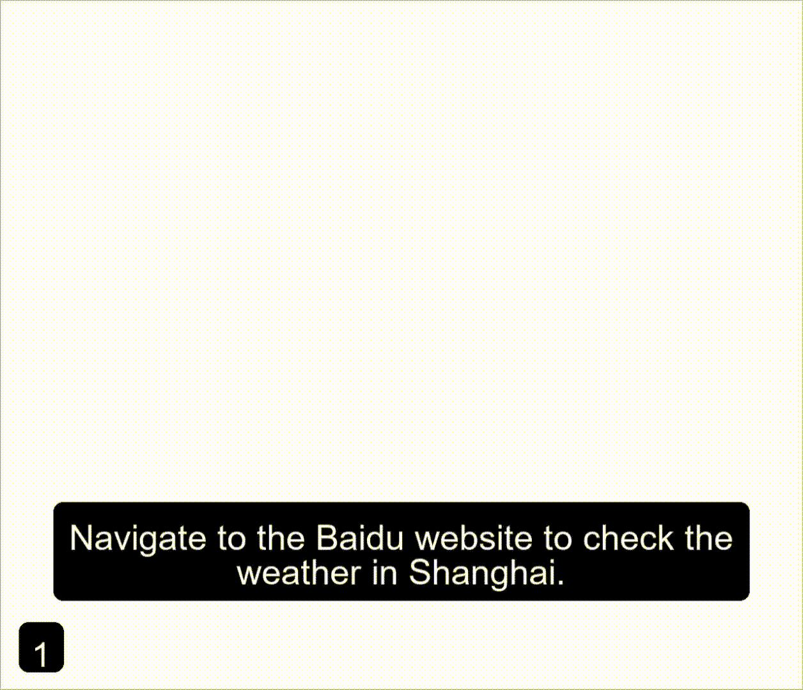
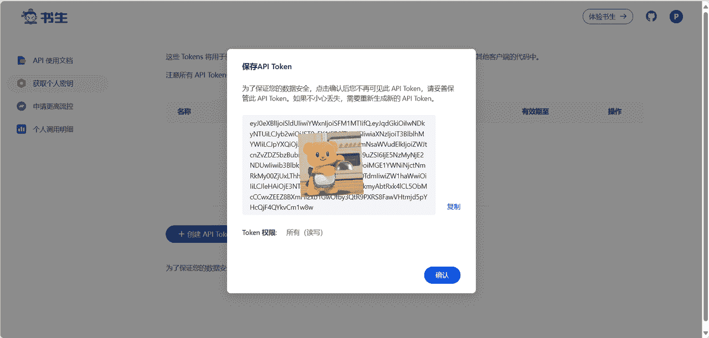
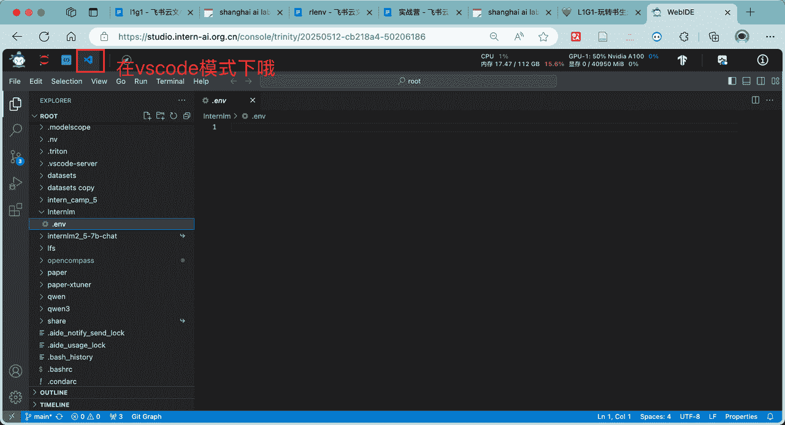
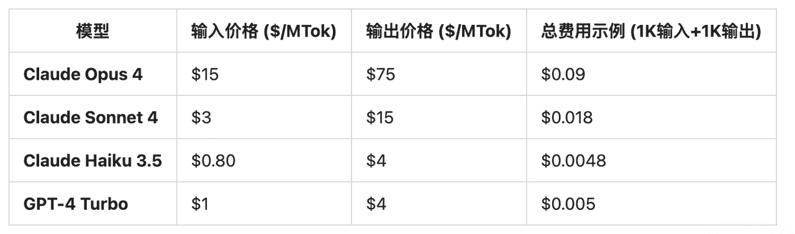
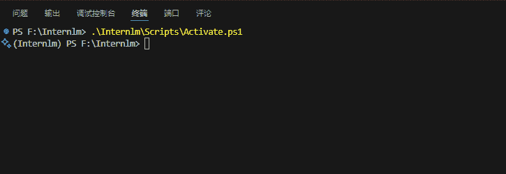
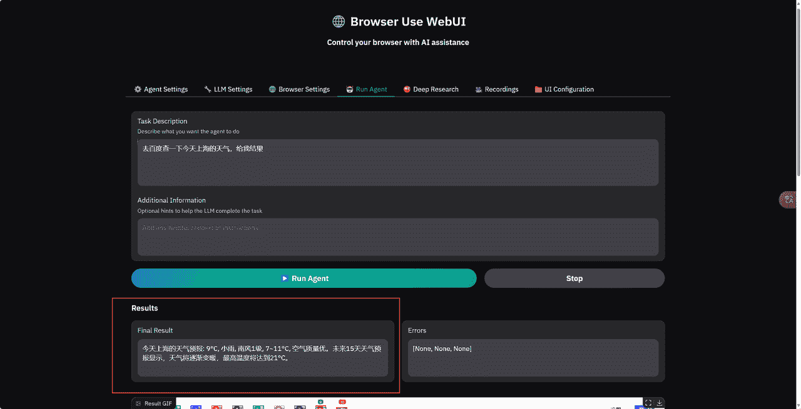
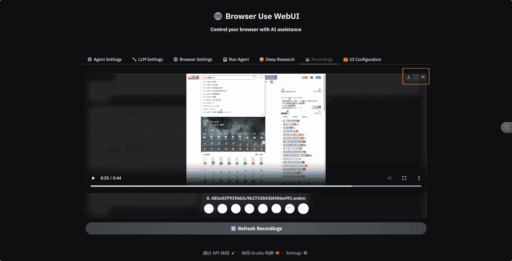
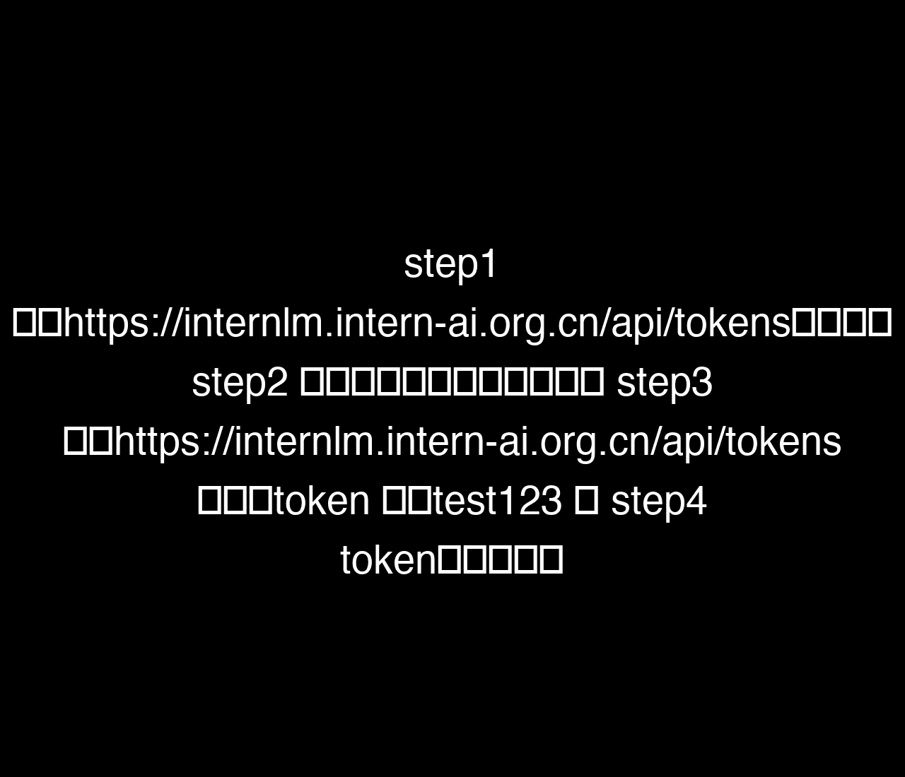

# G2 玩转书生大模型 API 之 Browse Use 实践

> 来源：[https://aicarrier.feishu.cn/docx/LYGrdggbPoLOwIxj0xTc9vvKnUi](https://aicarrier.feishu.cn/docx/LYGrdggbPoLOwIxj0xTc9vvKnUi)



## 0. 课程开头

欢迎大家来到玩转书生大模型 API 之 Browse Use 实践课程

在人工智能技术飞速发展的今天，掌握AI应用开发已成为技术从业者的核心竞争力。本课程由书生平台倾力打造，并得到书生模型的全程技术支持，旨在为学员提供从理论到实践的完整AI开发体验。

Browser-Use 是一款专为 Agent 与浏览器交互设计的工具，旨在通过简单而强大的自动化界面，让 Agent 轻松访问和操作网页。它提供了连接大模型与浏览器的便捷桥梁，使开发者能够快速实现网页自动化任务，无需复杂编码。

为了让每位学员都能专注于学习核心技术，无需为API成本担忧，书生平台特别为本课程学员免费提供API调用服务。这意味着您可以充分体验和实验各种AI功能，从基础的文本处理到多模态再到复杂的智能交互，都能在真实的开发环境中进行练习。还等什么，开始发车！



## 1. 闯关任务

1. 构建一个包含 3 轮对话的上下文，调用 API 获取最终回复 and 发送一张图片并获取描述。

1. 自行探索，并使用 Browser-use Web-UI 自带的录制功能，将书生大模型操作浏览器过程录制下来，放到作业中。

作业提交地址：https://aicarrier.feishu.cn/share/base/form/shrcnkSJ97ykqRSz4fgyCJbvCsb

（更新中）

## 2. 课程内容

### 2.1 书生 API 介绍及实践

书生 API 是上海人工智能实验室推出的核心产品之一，旨在为开发者提供便捷、高效的大模型调用能力。作为书生大模型全链路开源体系的重要组成部分，其依托 `InternLM` 系列模型（如 `InternLM3`、`InternVL2.5` 等）及工具链生态（`XTuner`、`LMDeploy` 等），支持文本交互、多模态处理及智能体开发。

本课程仅对API调用作基础讲解~，更多详细内容请参考https://internlm.intern-ai.org.cn/api/document

#### 2.1.1 环境搭建

目前浦语 `ChatAPI` 兼容了 `openai python sdk` 内的部分方法，仍在继续适配中...

推荐大家使用原生的 `python` 或 `curl` 请求访问书生 API。

需要使用 `Python 3.8` 及更高版本，需确保版本兼容 OpenAI API 的最新特性。

##### 步骤 1. 安装依赖库

```
pip install requests openai  #推荐使用官方SDK或原生requests库
```

##### 步骤 2. 获取API Token

+ 访问 [书生 AI 官网](https://internlm.intern-ai.org.cn/) 注册并申请 API 权限。

+ 进入到API页面（https://internlm.intern-ai.org.cn/api/tokens）之后，点击获取个人密钥，接着创建API Token。

+ 给你的API Token取个名字，接着就能得到一串字符，注意，API Token 只能复制一次，点击确认之后，便不可见，妥善保管自己的API Token。且在使用过程中，不要显式地暴露在代码中。



#### 2.1.2 基础文本交互

##### 步骤 1. 创建一个新的文件夹

```
mkdir -p /root/Internlm && cd /root/Internlm
```

##### 步骤 2. 创建 `.env` 用来保存API Token

```
#在 /root/Internlm 目录下
touch .env
```

`vscode` 模式下能查看到 `.env`



并将 API Token 按以下形式填入 `.env`

```
InternLM="your_api_token"
```

##### 步骤 3. Python 代码调用

首先安装 `dotenv` 用于加载环境变量

```
pip install dotenv
```

在 `/root/Internlm` 目录下

+ 使用 `openai python sdk`

```
from openai import OpenAI
from dotenv import load_dotenv
import os

InternLM_api_key = os.getenv("InternLM", load_dotenv())
client = OpenAI(
    api_key=InternLM_api_key,  
    base_url="https://chat.intern-ai.org.cn/api/v1/",
)

chat_rsp = client.chat.completions.create(
     model="internlm3-latest",
     messages=[{
            "role": "user",         #role 支持 user/assistant/system/tool
            "content": "你知道刘慈欣吗？"
    }, {
            "role": "assistant",
            "content": "为一个人工智能助手，我知道刘慈欣。他是一位著名的中国科幻小说家和工程师，曾经获得过多项奖项，包括雨果奖、星云奖等。"
    },{
            "role": "user",
            "content": "他什么作品得过雨果奖？"
    }],
    stream=False
)

for choice in chat_rsp.choices:
    print(choice.message.content)
#若使用流式调用：stream=True，则使用下面这段代码
#for chunk in chat_rsp:
#    print(chunk.choices[0].delta.content)
```

+ 原生调用

```
import requests
import json
from dotenv import load_dotenv
import os
InternLM_api_key = os.getenv("InternLM", load_dotenv())

url = 'https://chat.intern-ai.org.cn/api/v1/chat/completions'
header = {
    'Content-Type': 'application/json',
    "Authorization": "Bearer " + InternLM_api_key,
}
data = {
    "model": "internlm3-latest",  
    "messages": [{
        "role": "user",
        "content": "你好~"
    }],
    "n": 1,
    "temperature": 0.8,
    "top_p": 0.9
}

res = requests.post(url, headers=header, data=json.dumps(data))
print(res.status_code)
print(res.json())
print(res.json()["choices"][0]["message"]["content"])
```

##### 请求参数说明

更多参数请参见文档~

##### 模型列表

+ 大语言模型

+ 多模态模型

##### 返回参数说明

#### 2.1.3 多模态交互

+ 使用 `openai python sdk`

```
"url": "https://static.openxlab.org.cn/internvl/demo/visionpro.png"  #支持互联网公开可访问的图片 url 或图片的 base64 编码
"url": "https://static.openxlab.org.cn/puyu/demo/000-2x.jpg"
```

```
from openai import OpenAI
from dotenv import load_dotenv
import os

InternLM_api_key = os.getenv("InternLM", load_dotenv())
client = OpenAI(
    api_key=InternLM_api_key,  
    base_url="https://chat.intern-ai.org.cn/api/v1/",
)

chat_rsp = client.chat.completions.create(
     model="internvl2.5-latest",
     messages=[
        {
            "role": "user",
            "content": "你好"
        },
        {
            "role": "assistant",
            "content": "你好，我是 internvl"
        },
        {
            "role": "user",
            "content": [                                    #用户的图文提问内容，数组形式
                {
                    "type": "text",                        # 支持 text/image_url
                    "text": "Describe these two images please"
                },
                {
                    "type": "image_url",
                    "image_url": {
                    }
                },
                {
                    "type": "image_url",                                                     # 单轮对话支持上传多张图片
                    "image_url": {
                    }
                }
            ]
        }
    ],
    n=1,
    stream=False
)

for choice in chat_rsp.choices:
    print(choice.message.content)
```

#### 2.1.4 三轮对话示例代码

```
"url": "https://static.openxlab.org.cn/internvl/demo/visionpro.png"
"url": "https://static.openxlab.org.cn/puyu/demo/000-2x.jpg"
```


```
from openai import OpenAI
from dotenv import load_dotenv
import os

# 加载环境变量
load_dotenv()
InternLM_api_key = os.getenv("InternLM")

# 初始化客户端
client = OpenAI(
    api_key=InternLM_api_key,  
    base_url="https://chat.intern-ai.org.cn/api/v1/",
)

# 构建包含3轮对话的上下文
messages = [
    # 第一轮对话
    {
        "role": "user",
        "content": "你好，请介绍一下你自己"
    },
    {
        "role": "assistant",
        "content": "你好！我是 InternVL，一个多模态AI助手。我可以理解和分析文本与图像，帮助您处理各种任务，包括图像描述、视觉问答、文档理解等。有什么我可以帮助您的吗？"
    },
    
    # 第二轮对话
    {
        "role": "user",
        "content": "你能处理哪些类型的图像任务？"
    },
    {
        "role": "assistant",
        "content": "我可以处理多种图像任务：\n1. 图像描述：详细描述图片内容\n2. 视觉问答：回答关于图片的问题\n3. 图像对比：分析多张图片的异同\n4. OCR识别：提取图片中的文字\n5. 图表分析：理解图表、图形数据\n6. 场景理解：识别图片中的物体、人物和场景"
    },
    
    # 第三轮对话 - 包含图像
    {
        "role": "user",
        "content": [
            {
                "type": "text",
                "text": "请分析这两张图片，告诉我它们分别展示了什么产品，以及它们的主要特点"
            },
            {
                "type": "image_url",
                "image_url": {
                }
            },
            {
                "type": "image_url",
                "image_url": {
                }
            }
        ]
    }
]

# 调用API获取最终回复
try:
    chat_rsp = client.chat.completions.create(
        model="internvl2.5-latest",
        messages=messages,
        n=1,
        stream=False,
        temperature=0.8,  # 控制回复的创造性
        max_tokens=500    # 限制回复长度
    )
    
    # 打印最终回复
    print("=== API 最终回复 ===")
    for choice in chat_rsp.choices:
        print(choice.message.content)
        
    # 可选：打印整个对话历史
    print("\n=== 完整对话历史 ===")
    for i, msg in enumerate(messages):
        print(f"\n轮次 {i//2 + 1}:")
        if msg["role"] == "user":
            if isinstance(msg["content"], str):
                print(f"用户: {msg['content']}")
            else:
                print(f"用户: {msg['content'][0]['text']}")
                print(f"      (包含 {len(msg['content'])-1} 张图片)")
        else:
            print(f"助手: {msg['content']}")
            
except Exception as e:
    print(f"API调用出错: {str(e)}")
```

Model api计费规则示例：

```
# GPT-4 Turbo 价格（2024年）
输入价格：$0.01 / 1K tokens
输出价格：$0.03 / 1K tokens（输出更贵！）

# 一轮对话
你：“帮我写个Python排序函数”（10 tokens）
AI：“def sort_list(lst):...”（100 tokens）

费用 = 10×0.00001 + 100×0.00003 = $0.0031
```

当然现在的顶级模型api价格感人，书生api免费给大家玩！



## 2.2 Browser-Use 简介

Browser-Use 是一款专为 Agent 与浏览器交互设计的工具，旨在通过简单而强大的自动化界面，让 Agent 轻松访问和操作网页。它提供了连接大模型与浏览器的便捷桥梁，使开发者能够快速实现网页自动化任务，无需复杂编码。

## 2.3 开发环境配置

此项目需在本地电脑(os:Windows,macOS)实现,方便观察 Agent 操控操作网页过程~

### 步骤 1.安装 `git`

**Windows:**

+   [下载并安装](https://git-scm.com/download/win)适合您 `Windows` 版本的安装程序：下载地址

+   按照安装向导完成安装。(默认设置安装即可)

+   打开终端，输入指令 `git --version` 检查是否安装成功

**MacOS:**

+   [下载并安装](https://git-scm.com/downloads/mac)适合您 `MacOS` 版本的安装程序：下载地址

+   按照安装向导完成安装。(默认设置安装即可)

+   打开终端，输入指令 `git --version` 检查是否安装成功

### 步骤 2.安装 `uv` 并创建项目环境

这里我们使用 `uv` 进行项目环境管理

首先我们新建一个 `Internlm` 文件夹，并用 `vscode` 打开，启动终端

直接使用 `Python` 自带的 `pip` 安装，兼容性最佳，这里需要 `python` 版本为 `3.8` 及以上：

```
pip install uv  
# 检测是否安装成功，出现版本号则成功
uv --version 
```

如果没安装 `python` 需要去 [Python 官网](https://www.python.org/) 下载安装包，安装时勾选 `Add Python to PATH`（安装向导底部），并选择 自定义安装 → 确保勾选 `Install pip`。

另外，如果网速不行 `pip` 下载包的时候可以加 `-i https://pypi.tuna.tsinghua.edu.cn/simple/` 起到一个换下载源加速的作用。

接着输入以下命令来创建项目环境并进入

```
uv venv Internlm --python 3.11
#Activate the virtual environment:
#Windows (PowerShell):
Set-ExecutionPolicy -Scope Process -ExecutionPolicy Bypass
.\Internlm\Scripts\Activate.ps1
#macOS
source Internlm/bin/activate
```

如下所示，进入了项目环境



### 步骤 3.在项目环境下安装依赖

首先使用 `git` 将 `browser-use` 项目克隆到本地

```
git clone https://github.com/sanjion/Web-ui.git
cd web-ui
```

安装项目依赖

```
uv pip install -r requirements.txt  
playwright install --with-deps chromium
```

`web-ui` 下有个 `.env.example` 文件，这是我们项目的启动配置，复制一份并重命名为 `.env`

```
# Windows (PowerShell):
cp .env.example .env
# macOS/Linux/Windows (PowerShell):
cp .env.example .env
```

## 2.3 启动 Browser-use Web-UI

### 2.3.1 运行 Web-UI

运行 `WebUI`，完成上面的安装步骤后，启动应用程序：

```
python webui.py --ip 127.0.0.1 --port 7788
```

若启动时遇到以下错误

```
ERROR:    Exception in ASGI application
……
TypeError: argument of type 'bool' is not iterable
```

将 `gradio` 升级到最新版本即可解决

```
uv pip install --upgrade gradio  -i https://pypi.tuna.tsinghua.edu.cn/simple/
```

缺相应包 `httpx[socks]` 安装就好了

```
uv pip install "httpx[socks]" -i https://pypi.tuna.tsinghua.edu.cn/simple/
```

启动后，打开 `http://127.0.0.1:7788` 即可看到以下界面

### 2.3.2 Web-UI 选项配置

在 `LLM Settings` 下选择 `Intern`

模型选择 `internvl-latest`

(如果选择 `Internlm`，注意把 `Agent Settings` 中的 `Use Vison` 选项去掉，`Internlm` 是文本模型，不支持图像识别)

`API KEY` 位置填入你的 `API Token`

`API KEY` 也可以直接写入 `.env` 文件中

### 2.3.3 案例一：查看上海天气

在 `Run Agent` 中输入任务，点击 `Run Agent`

例如 `"去百度查一下今天上海的天气，给我结果"` ,模型执行过程如下




在 `Rcordings` 界面可以把 Agent 执行过程下载下来



### 2.3.4  案例二：拿书生 api-key

```
step1 访问https://internlm.intern-ai.org.cn/api/tokens这个网站
step2 等我大概一分钟，你再操作
step3  访问https://internlm.intern-ai.org.cn/api/tokens 获取到token 命名test123 。
step4 token结果给我。
```



更多的有趣的案例请同学们自行探索~
