# G3 (更新中)沐曦硬件下 OpenCompass 评测书生大模型实践

> 来源：[https://aicarrier.feishu.cn/docx/WXmGdBLkDoyxJgxe8L3cWch5nSg](https://aicarrier.feishu.cn/docx/WXmGdBLkDoyxJgxe8L3cWch5nSg)


# OpenCompass 概述

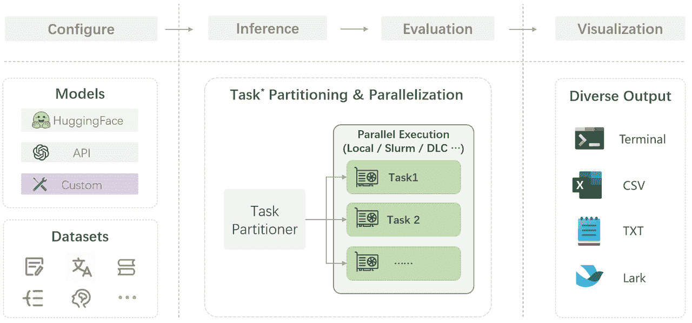

**在 **Open**Co**mpas**s **中评估一**个模型**通常包括以下几个阶段：配置 -> 推理 -> 评估 -> 可视化。

**配置**：这是整个工作流的起点。您需要配置整个评估过程，选择要评估的模型和数据集。此外，还可以选择评估策略、计算后端等，并定义显示结果的方式。

**推理与评估**：在这个阶段，OpenCompass 将**会开****始对**模型[和数据集进行并](https://opencompass.readthedocs.io/zh-cn/latest/get_started/faq.html#id6)行推理和评估。推理阶段主要是让模型从数据集产生输出，而评估阶段则是衡量这些输出与标准答案的匹配程度。这两个过程会被拆分为多个同时运行的“任务”以提高效率，但请注意，如果计算资源有限，这种策略可能会使评测变得更慢。如果需要了解该问题及解决方案，可以参考 FAQ: 效率。

**可视化**：评估完成后，OpenCompass 将结果整理成易读的表格，并将其保存为 CSV 和 TXT 文件。你也可以激活飞书状态上报功能，此后可以在飞书客户端中及时获得评测状态报告。

对于其他模型，请参考 [configs 目录](https://github.com/open-compass/opencompass/tree/main/configs) 中提供的其他示例。

# 评测环境配置（更新中）

## 开发机的选择

在创建开发机界面选择镜像为 Cuda12.2-conda，并选择 GPU 为 30% A100。

如无算力配额，申请助教老师开通。开通后还是爆显存，调低batch size===1。

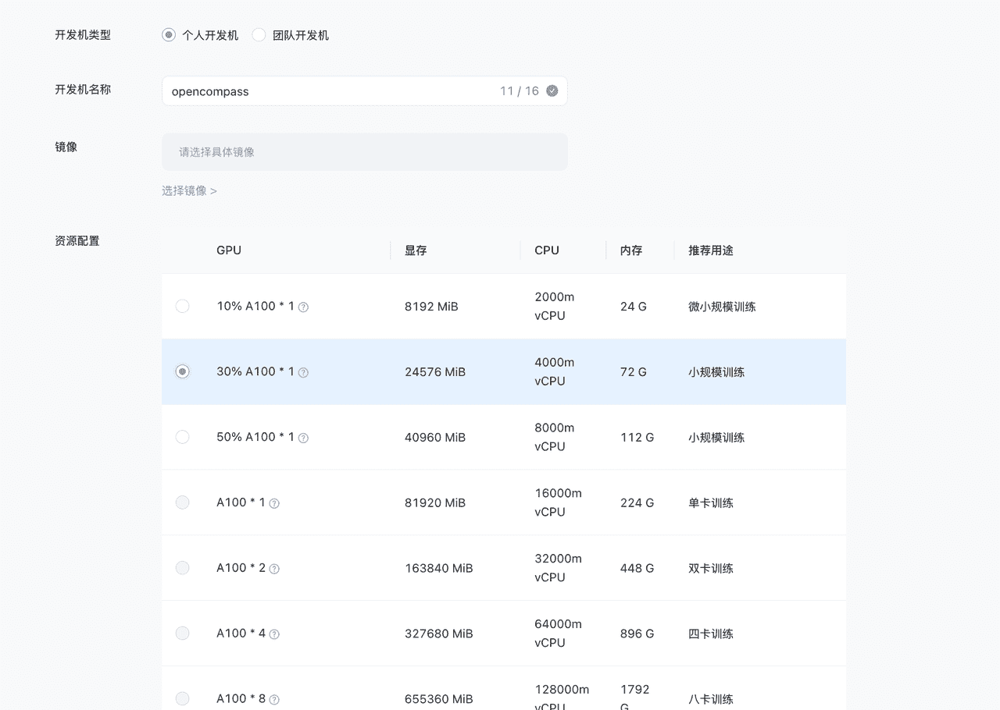

## 2.2 conda环境安装

```
conda create -n opencompass python=3.10
conda activate opencompass

# 注意：一定要先 cd /root
cd /root
 git clone -b 0.4.2 https://github.com/open-compass/opencompass.git opencompass
cd opencompass
pip install -e .

pip install sentencepiece
#升级datasets 避免不识别新的功能
pip install datasets==3.2.0
pip install modelscope
```

##

# 评测不同类型的题目

## 3.0 数据集的下载

OpenCompass 支持的数据集主要包括三个部分：

1.  **Hugg**ingface 数据集： Huggingface Dataset 提供了大量的数据集，这部分数据集运行时会自动下载。

1.  ModelScope 数据集：ModelScope OpenCompass Dataset 支持从 ModelScope 自动下载数据集。

要启用此功能，请设置环境变量：export DATASET_SOURCE=ModelScope，可用的数据集包括（来源于 OpenCompassData-core.zip）：

```
humaneval, triviaqa, commonsenseqa, tydiqa, strategyqa, cmmlu, lambada, piqa, ceval, math, LCSTS, Xsum, winogrande, openbookqa, AGIEval, gsm8k, nq, race, siqa, mbpp, mmlu, hellaswag, ARC, BBH, xstory_cloze, summedits, GAOKAO-BENCH, OCNLI, cmnli
```

1.  自建以及第三方数据集：OpenCom**pa**ss 还提供了一些第**三方数据集及**自建中文数据集。运行以下命令手动下载解压。

为了方便评测，我们首先将数据集下载到本地:

```
cd /root/opencompass
wget https://ghfast.top/https://github.com/open-compass/opencompass/releases/download/0.2.2.rc1/OpenCompassData-core-20240207.zip
unzip OpenCompassData-core-20240207.zip
```

将会在 OpenCompass 下看到data文件夹，里面包含的数据集如下图所示：

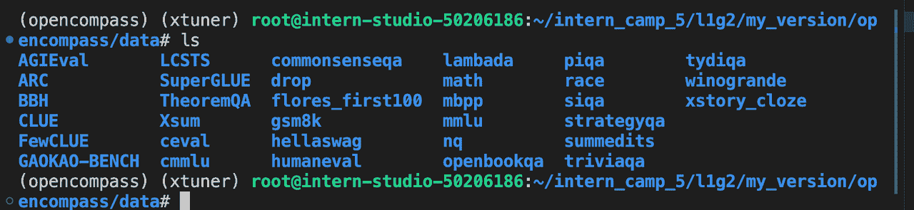

## 评测C-Eval 选择题

有两种方式运行，推荐命令行运行简单。但如果要更高定制化需求，需要些配置脚本运行更合适。

### 3.1.1 命令行运行

修改评测模型地址为本地，**不用下载更节省时间**。

opencompass/opencompass/configs/models/hf_internlm/hf_internlm3_8b_instruct.py，贴入以下代码：

```
from opencompass.models import HuggingFacewithChatTemplate

models = [
    dict(
        type=HuggingFacewithChatTemplate,
        abbr=&#x27;internlm3-8b-instruct-hf&#x27;,
        path=&#x27;/root/share/new_models/internlm3/internlm3-8b-instruct&#x27;,
        max_out_len=8192,
        batch_size=8,
        run_cfg=dict(num_gpus=1),
    )
]
```

评测数据集为C-Eval，格式为csv，摘出部分内容如下所示：

可以通过以下命令评测 internlm3_8b_instruct 模型在 C-Eval 数据集上的性能：

```
python run.py --datasets ceval_gen --models hf_internlm3_8b_instruct --debug
```

Notice: 由于 OpenCompass 默认并行启动评估过程，我们可以在第一次运行时以 --debug 模式启动评估，并检查是否存在问题。在 --debug 模式下，任务将按顺序执行，并实时打印输出。

如果一切正常，您应该看到屏幕上显示：

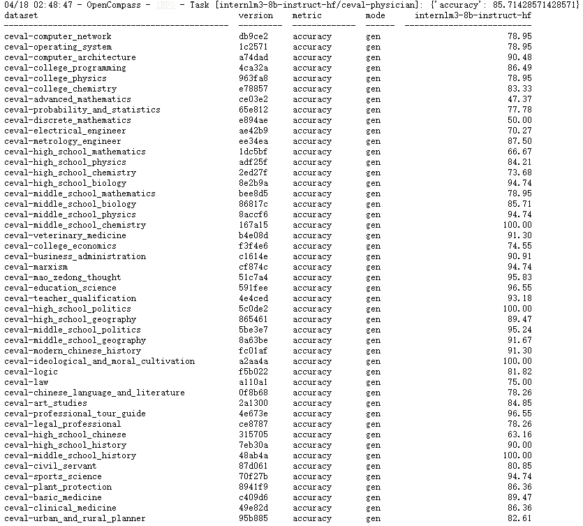

### 3.1.2 写配置脚本运行

除了通过命令行配置实验外，OpenCompass 还允许用户在配置文件中编写实验的完整配置脚本，并通过 run.py 直接运行它。配置文件是以 Python 格式组织的，并且必须包括 datasets 和 models 字段。本次测试配置在 configs文件夹 中。此配置通过 继承机制 引入所需的数据集和模型配置，并以所需格式组合 datasets 和 models 字段。

运行以下代码，在configs文件夹下创建eval_tutorial_demo.py

```
cd /root/opencompass/opencompass/configs
touch eval_tutorial_demo.py
```

打开eval_tutorial_demo.py 贴入以下代码

```
from mmengine.config import read_base

with read_base():
    from .datasets.ceval.ceval_gen import ceval_datasets
    from .models.hf_internlm.hf_internlm3_8b_instruct import models as hf_internlm3_8b_instruct

datasets = ceval_datasets
models = hf_internlm3_8b_instruct
```

因此，运行任务时，我们只需将配置文件的路径参数传递给 run.py：

```
cd /root/opencompass
python run.py opencompass/configs/eval_tutorial_demo.py --debug
```

### 3.1.3 结果

大约20min评测完成后，将会看到：

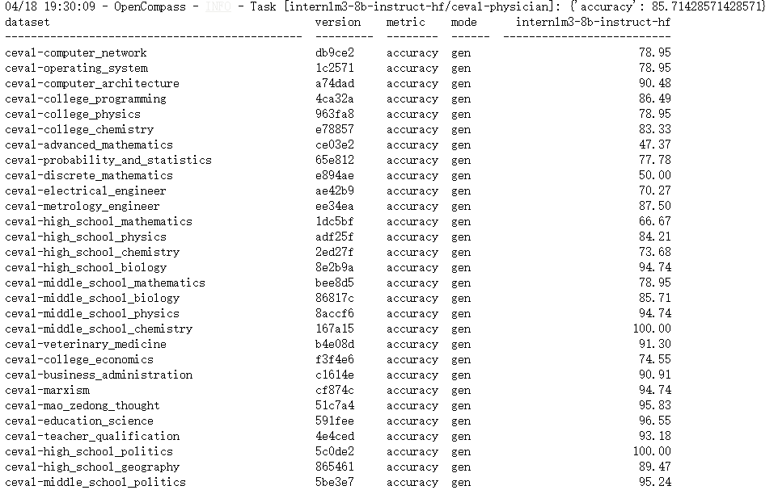

和使用命令行的方法一致

所有运行输出将定向到 outputs/demo/ 目录，结构如下：

```
outputs/default/
├── 20200220_120000
├── 20230220_183030     # 每个实验一个文件夹
│   ├── configs         # 用于记录的已转储的配置文件。如果在同一个实验文件夹中重新运行了不同的实验，可能会保留多个配置
│   ├── logs            # 推理和评估阶段的日志文件
│   │   ├── eval
│   │   └── infer
│   ├── predictions   # 每个任务的推理结果
│   ├── results       # 每个任务的评估结果
│   └── summary       # 单个实验的汇总评估结果
├── ...
```

打印评测结果的过程可被进一步定制化，用于输出一些数据集的平均分 (例如 MMLU, C-Eval 等)。

[关于评测](https://opencompass.readthedocs.io/zh-cn/latest/user_guides/summarizer.html)结果输出的更多介绍可阅读 结果展示。

## 评测math_gen计算题

评测数据集为math，格式为json，如下所示：

```
{&quot;modeling/MATH/data/test/number_theory_170.json&quot;: {&quot;problem&quot;: &quot;If the pattern shown continues, what is the letter in the $2010$th position? MATHLETEMATHLETEMATHLETE...&quot;, &quot;level&quot;: &quot;Level 2&quot;, &quot;type&quot;: &quot;Number Theory&quot;, &quot;solution&quot;: &quot;The pattern repeats with every 8 letters, so we can determine the letter in the $n$th position by finding the remainder when $n$ is divided by 8.  We can check that 2008 is a multiple of 8. That means 2010 has a remainder of 2 when divided by 8. The letter in the $2010$th position will be the same as the letter in the second position of the pattern, which is $\\boxed{A}$.&quot;}
```

运行以下代码

```
python run.py --datasets math_gen --models hf_internlm3_8b_instruct --debug
```

顺利的话，会看到：

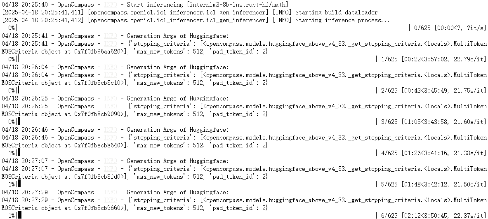

在opencompass/outputs/default/20250418_021334下可以看到最后结果为

| dataset | version | metric | mode | internlm3-8b-instruct-hf |
| --- | --- | --- | --- | --- |
| math | 265cce | accuracy | gen | 50.00 |

## 评测MME多模态题——InternVL3-2B评测实践

VLMEvalKit是一个专为大型视觉语言模型评测设计的开源工具包。它支持在各种基准测试上对大型视觉语言模型进行一键评估，无需进行繁重的数据准备工作，使评估过程更加简便。VLMEvalKit适用于图文多模态模型的评测，支持单对图文输入或是任意数量的图文交错输入。它通过实现70多个基准测试，覆盖了多种任务，包括但不限于图像描述、视觉问答、图像字幕生成等。

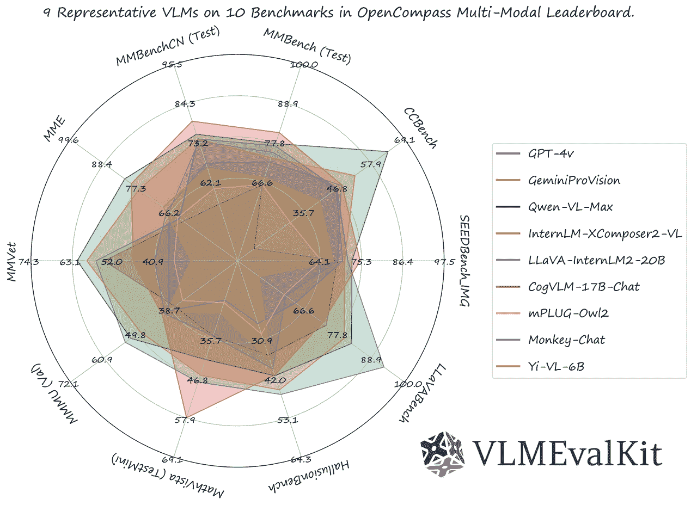

VLMEvalKit的主要用途包括以下几个方面：

1.  **多模态模型评估**：VLMEvalKit旨在为研究人员和开发人员提供一个用户友好且全面的框架，以评估现有的多模态模型并发布可重复的评估结果。它支持多种多模态模型和评测集，包括闭源和开源模型，以及多个多模态基准数据集。

1.  **模型性能比较**：通过VLMEvalKit，用户可以轻松比较不同多模态模型在各种任务上的性能。该工具包提供了详细的评测结果，并支持将结果发布在OpenCompass的多模态整体榜单上。

1.  **便捷的一站式评测**：VLMEvalKit支持一键式评测，无需手动进行数据预处理。用户只需一条命令即可完成对多个多模态模型和评测集的评测。

1.  **易于扩展**：VLMEvalKit框架支持轻松添加新的多模态模型和评测集。用户可以根据需要添加新的模型或评测集，并确保原有的评测集和模型仍然适用于新的模型或评测集。

1.  **支持多种模型和评测集**：VLMEvalKit支持超过三十个开源多模态模型和十余个开源多模态评测集，包括GPT-4v、GeminiPro、QwenVLPlus等主流模型和MME、MMBench、SEEDBench等评测集。

1.  **提供定量与定性结果**：VLMEvalKit不仅提供定量评测结果，还支持对模型的定性分析，帮助用户了解模型在特定任务上的表现和不足之处。

使用VLMEvalKit进行评测需要进行以下步骤：

### 环境准备用以下命令安装依赖：

```
# 基于conda环境
conda create -n VLMEvalKit python=3.10
conda activate VLMEvalKit
pip install idna requests
pip3 install torch torchvision torchaudio --index-url https://download.pytorch.org/whl/cu118

git clone https://ghfast.top/https://github.com/open-compass/VLMEvalKit.git
cd VLMEvalKit
pip install -e .
pip install einops timm validators sty decord httpx xlsxwriter pandas matplotlib tabulate rich portalocker imageio 
```

> **注意：**

> 某些 VLM 可能无法在某些特定的 transformers 版本下运行，参考以下设置来评估对应的VLM:

+   **请用** t**ran**sformers==4.33.0 来运行: Qwen series, Monkey series, InternLM-XComposer Series, mPLUG-Owl2, OpenFlamingo v2, IDEFICS series, VisualGLM, MMAlaya, ShareCaptioner, MiniGPT-4 series, InstructBLIP series, PandaGPT, VXVERSE.

+   **请用** t**ran**sformers==4.37.0  来运行: LLaVA series, ShareGPT4V series, TransCore-M, LLaVA (XTuner), CogVLM Series, EMU2 Series, Yi-VL Series, MiniCPM-[V1/V2], OmniLMM-12B, DeepSeek-VL series, InternVL series, Cambrian Series, VILA Series, Llama-3-MixSenseV1_1, Parrot-7B, PLLaVA Series.

+   **请用** t**ran**sformers==4.40.0  来运行: IDEFICS2, Bunny-Llama3, MiniCPM-Llama3-V2.5, 360VL-70B, Phi-3-Vision, WeMM.

+   **请用** t**ran**sformers==latest 来运行: LLaVA-Next series, PaliGemma-3B, Chame3leon series, Video-LLaVA-7B-HF, Ovis series, Mantis series, MiniCPM-V2.6, OmChat-v2.0-13B-sinlge-beta, Idefics-3, GLM-4v-9B, VideoChat2-HD.

### 修改文件

在$VLMEvalKit/vlmeval/config.py文件中设置在 VLMEvalKit 中支持的 VLM 名称，以及模型路径。

如果你的电脑上面没有该模型的模型文件，则需要自己下载，然后更改模型路径，也可以不修改，在运行模型评测命令的时候会自动下载模型文件。

> 注：默认下载使用的是Huggingface，需要进行科学上网，也可以使用modelscope将模型下载到本地，然后更改路径。

修改VLMEvalKit/vlmeval/config.py下第852行为

```
InternVLChat, model_path=&quot;/root/share/new_models/InternVL3/InternVL3-2B&quot;, version=&quot;V2.0&quot;
```

如图所示：

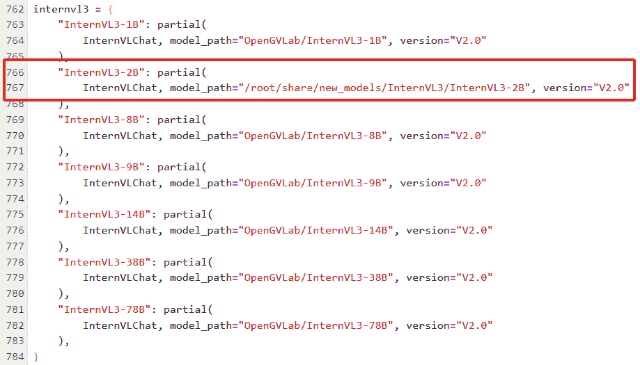

将所要评测的模型路径设置好以后就可以开始评测了。

### 模型评测

模型评测时可以使用 python 或 torchrun 来运行脚本，使用 python 运行时，只实例化一个 VLM，并且它可能使用多个 GPU。使用 torchrun 运行时，每个 GPU 上实例化一个 VLM 实例，这可以加快推理速度。

这里我们在 MME 上 进行推理和评估。

MME涵盖了感知和认知能力的考察。除了OCR外，感知包括对粗粒度和细粒度对象的识别。前者识别对象的存在、数量、位置和颜色。后者识别电影海报、名人、场景、地标和艺术作品。认知包括常识推理、数值计算、文本翻译和代码推理。总共有14个子任务。

使用以下命令开始推理和评估：

```
python run.py --data MME --model InternVL3-2B --verbose
```

```
torchrun --nproc-per-node=1 run.py --data MME --model InternVL3-2B --verbose
```

> **参数解释：**

+   --data (list[str]): 设置在 VLMEvalKit 中支持的数据集名称（在 vlmeval/utils/dataset_config.py 中定义）

+   --model (list[str]): 设置在 VLMEvalKit 中支持的 VLM 名称（在 vlmeval/config.py 中的 supported_VLM 中定义）

+   --mode (str, 默认值为 'all', 可选值为 ['all', 'infer'])：当 mode 设置为 "all" 时，将执行推理和评估；当设置为 "infer" 时，只执行推理

+   --nproc (int, 默认值为 4): 调用 API 的线程数

+   --work-dir (str, default to '.'): 存放测试结果的目录

+   --nframe (int, default to 8): 从视频中采样的帧数，仅对视频多模态评测集适用

+   --pack (bool, store_true): 一个视频可能关联多个问题，如 pack==True，将会在一次询问中提问所有问题

命令运行以后大约需要半小时的时间完成评测，评估结果将作为日志打印出来。

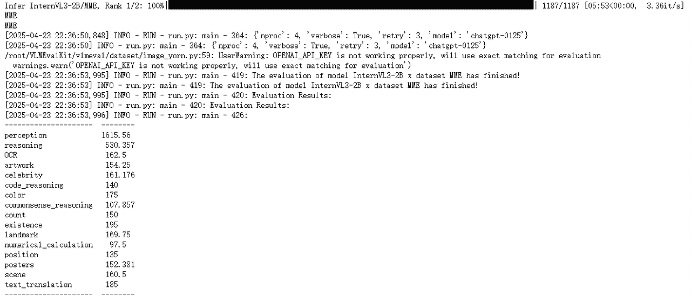

此外，**结果文件**也会在目录 VLMEvalKit/outputs/InternVL3-2B 中生成。以 .csv 结尾的文件包含评估的指标。

InternVL3-2B的MME数据集的评估结果如下：

InternVL2-2B的MME[VLMEvalKit 评测InternVL2及Qwen2VL实践](https://aicarrier.feishu.cn/wiki/TljbwJgjdi7MG1k7a80cWITpnHd?from=from_copylink)据集的评估结果如下：（过程可见于 ）

对比InternVL2-2B结果，可见InternVL3性能有明显改进。

## 自建数据集进行评测

这里我们评测一下论文分类比赛。

数据/root/datasets/train/newformat_sft_test_data.csv是A榜测试数据

运行以下代码，在configs文件夹下创建eval_tutorial_demo3.py

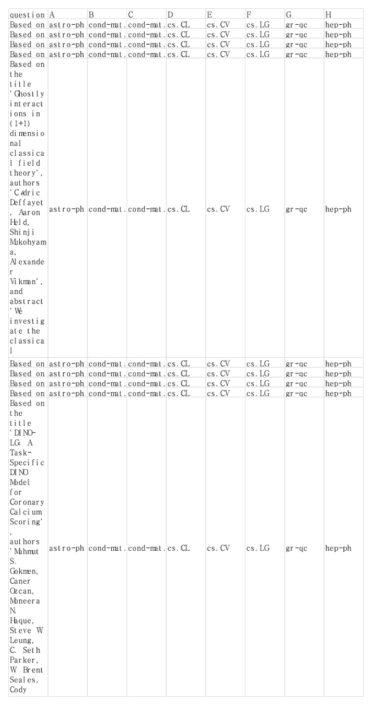

[newformat_sft_test_data.csv](https://internal-api-drive-stream.feishu.cn/space/api/box/stream/download/all/QoxDbmjUsocla5xyz8DcLYX0nOd)

```
cd /root/opencompass/opencompass/configs
touch eval_tutorial_demo3.py
```

```
from mmengine.config import read_base
from opencompass.models import OpenAISDK

# 配置模型
models = [
    dict(
        type=OpenAISDK,
        path=&#x27;internlm3-latest&#x27;,  # 请求服务时的 model name
        key=&#x27;eyJ0_your_key&#x27;,  # 缩进修正（与path、openai_api_base等对齐）
        openai_api_base=&#x27;https://internlm-chat.intern-ai.org.cn/puyu/api/v1/&#x27;,  # API 地址
        rpm_verbose=True,
        query_per_second=0.16,
        max_out_len=1024,
        max_seq_len=4096,
        temperature=0.01,
        batch_size=1,
        retry=3,
    )
]

# 配置数据集
datasets = [
    dict(
        path=&#x27;/root/opencompass/newformat_sft_test_data.csv&#x27;,
        data_type=&#x27;mcq&#x27;,
        infer_method=&#x27;gen&#x27;
    )
]
```

运行

```
#在opencompass目录下
python run.py opencompass/configs/eval_tutorial_demo3.py --debug
```

如果一切正常，将会看到

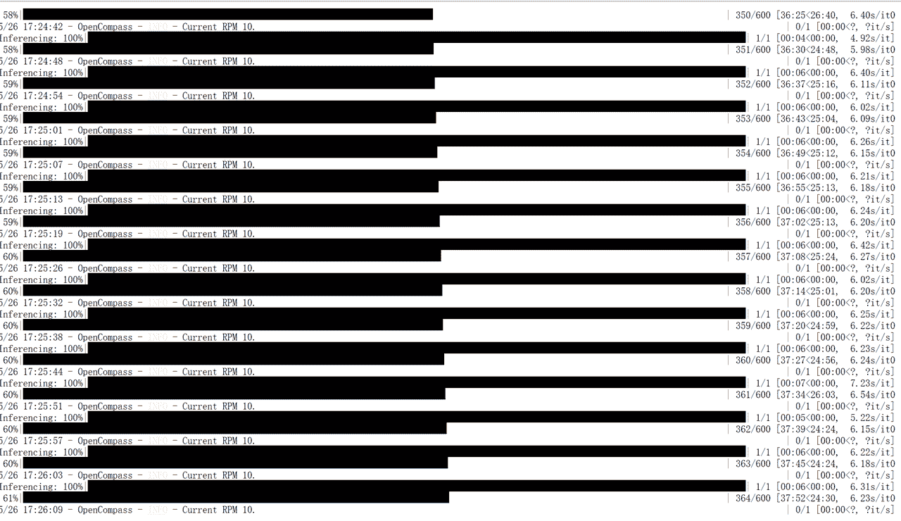

最终结果为

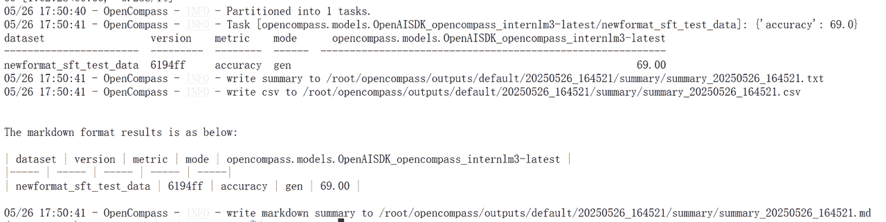

# 结语

更多评测技巧欢迎查看 [https://opencompass.readthedocs.io/z](https://opencompass.readthedocs.io/zh-cn/latest/get_started/quick_start.html)h-cn/latest/get_started/quick_start.html 文档~我们下节课再见！

# 闯关任务

+   使用 OpenCompass 评测 InternLM(C-Eval和math_gen 选做一道即可) 和 InternVL（MME数据集） 并在飞书文档中详细记录到飞书文档

+   进阶 完成3.4 自建数据集的评测

提交地址：https://aicarrier.feishu.cn/share/base/form/shrcnkSJ97ykqRSz4fgyCJbvCsb（更新中）