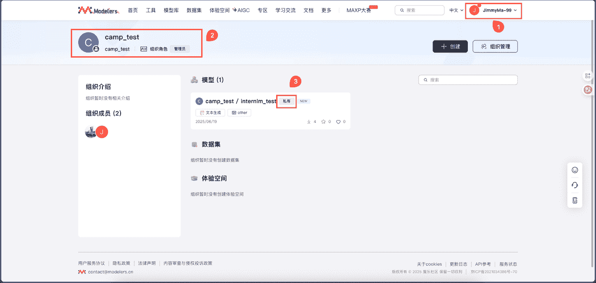
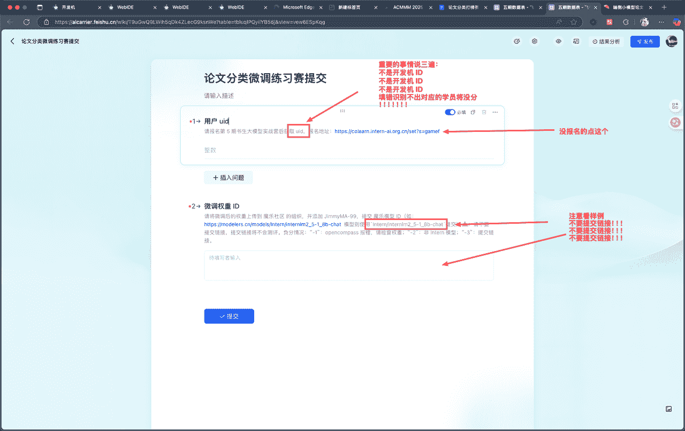

# （还在更新中）沐曦 Swift 微调 InternLM 赛事 Baseline

> 来源：[https://aicarrier.feishu.cn/docx/CUIMdSBK8ojQ4lxXTfhc79Sonxd](https://aicarrier.feishu.cn/docx/CUIMdSBK8ojQ4lxXTfhc79Sonxd)

## 数据处理

正如刚才所说，本次比赛是限定在 26 类中进行分类，以下提供一个简单脚本，可用于生成 `ms-swift` 的 `sft` 数据（该脚本仅用于验证，并不保证得分）。

```python
import json
import argparse
import os

def extract_category_mapping():
    """定义类别到选项的映射"""
    category_to_option = {
        'quant-ph': 'A',
        'physics.chem-ph': 'B', 
        'physics.atom-ph': 'C',
        'cond-mat.soft': 'D',
        'cs.RO': 'E',
        'cs.CL': 'F',
        'cs.SE': 'G',
        'cs.IR': 'H',
        'hep-th': 'I',
        'hep-ph': 'J',
        'physics.optics': 'K',
        'cs.AI': 'L',
        'cs.CV': 'M',
        'nucl-th': 'N',
        'astro-ph': 'O',
        'math.PR': 'P',
        'cs.OS': 'Q',
        'eess.SP': 'R',
        'math.OC': 'S',
        'math.DS': 'T',
        'math.DG': 'U',
        'math.MP': 'V',
        'cs.MM': 'W',
        'stat.ME': 'X',
        'math.CO': 'Y',
        'cs.NE': 'Z'
    }
    return category_to_option

def get_category_options_text():
    """生成选项文本"""
    options = [
        "A. quant-ph", "B. physics.chem-ph", "C. physics.atom-ph", "D. cond-mat.soft",
        "E. cs.RO", "F. cs.CL", "G. cs.SE", "H. cs.IR", "I. hep-th", "J. hep-ph",
        "K. physics.optics", "L. cs.AI", "M. cs.CV", "N. nucl-th", "O. astro-ph",
        "P. math.PR", "Q. cs.OS", "R. eess.SP", "S. math.OC", "T. math.DS",
        "U. math.DG", "V. math.MP", "W. cs.MM", "X. stat.ME", "Y. math.CO", "Z. cs.NE"
    ]
    return "\n".join(options)

def process_paper(paper_data, verbose=False):
    """处理单篇论文数据"""
    category_mapping = extract_category_mapping()
    
    # 提取基本信息
    paper_id = paper_data.get('id', '')
    title = paper_data.get('title', '').replace('\n', ' ').strip()
    authors = paper_data.get('authors', '')
    abstract = paper_data.get('abstract', '').replace('\n', ' ').strip()
    categories = paper_data.get('categories', '')
    
    # 检查是否包含多个类别（用空格分隔）
    category_list = categories.split()
    if len(category_list) > 1:
        if verbose:
            print(f"跳过多类别论文 {paper_id}: {categories}")
        return None
    
    # 检查类别是否在我们的目标列表中
    target_category = category_list[0] if category_list else ''
    if target_category not in category_mapping:
        if verbose:
            print(f"跳过非目标类别论文 {paper_id}: {target_category}")
        return None
    
    # 获取对应的选项字母
    correct_option = category_mapping[target_category]
    
    # 构建human问题
    options_text = get_category_options_text()
    human_content = f"Based on the title '{title}', authors '{authors}', and abstract '{abstract}', please determine the scientific category of this paper.\n\n{options_text}"
    
    # 构建JSONL条目
    jsonl_entry = {
        "system": "你是个优秀的论文分类师",
        "conversation": [
            {
                "human": human_content,
                "assistant": correct_option
            }
        ]
    }
    
    if verbose:
        print(f"处理论文 {paper_id}: {target_category} -> {correct_option}")
    
    return jsonl_entry

def main():
    """主函数"""
    parser = argparse.ArgumentParser(description='将arXiv论文JSON数据转换为分类训练JSONL格式')
    
    parser.add_argument('input_file', 
                        help='输入的JSON文件路径')
    parser.add_argument('output_file', 
                        help='输出的JSONL文件路径')
    parser.add_argument('--verbose', '-v', 
                        action='store_true',
                        help='显示详细处理信息')
    parser.add_argument('--force', '-f',
                        action='store_true', 
                        help='强制覆盖输出文件')
    parser.add_argument('--limit', '-l',
                        type=int,
                        help='限制处理的论文数量')
    
    args = parser.parse_args()
    
    # 检查输入文件是否存在
    if not os.path.exists(args.input_file):
        print(f"错误: 输入文件 {args.input_file} 不存在")
        return 1
    
    # 检查输出文件是否已存在
    if os.path.exists(args.output_file) and not args.force:
        response = input(f"输出文件 {args.output_file} 已存在，是否覆盖？(y/N): ")
        if response.lower() != 'y':
            print("操作取消")
            return 1
    
    try:
        # 读取JSON数据
        with open(args.input_file, 'r', encoding='utf-8') as f:
            content = f.read().strip()
        
        # 按行分割处理每个JSON对象
        lines = content.split('\n')
        
        processed_count = 0
        skipped_count = 0
        total_lines = len([line for line in lines if line.strip()])
        
        print(f"开始处理 {total_lines} 行数据...")
        
        with open(args.output_file, 'w', encoding='utf-8') as f:
            for i, line in enumerate(lines):
                if line.strip():
                    # 检查是否达到限制数量
                    if args.limit and processed_count >= args.limit:
                        print(f"达到处理限制 {args.limit}，停止处理")
                        break
                    
                    try:
                        paper_data = json.loads(line)
                        result = process_paper(paper_data, args.verbose)
                        
                        if result:
                            f.write(json.dumps(result, ensure_ascii=False) + '\n')
                            processed_count += 1
                        else:
                            skipped_count += 1
                        
                        # 显示进度
                        if not args.verbose and (i + 1) % 100 == 0:
                            print(f"已处理 {i + 1}/{total_lines} 行，成功: {processed_count}，跳过: {skipped_count}")
                            
                    except json.JSONDecodeError as e:
                        if args.verbose:
                            print(f"第 {i+1} 行JSON解析错误: {e}")
                        skipped_count += 1
        
        print(f"\n处理完成!")
        print(f"成功处理: {processed_count} 篇论文")
        print(f"跳过: {skipped_count} 篇论文")
        print(f"输出文件: {args.output_file}")
        
        return 0
        
    except FileNotFoundError:
        print(f"错误: 找不到输入文件 {args.input_file}")
        return 1
    except Exception as e:
        print(f"处理过程中出现错误: {e}")
        return 1

if __name__ == "__main__":
    exit(main())
```

用法如下：

```bash
python process_papers.py input.json output.jsonl
```


# 参数说明与数据准备

## 命令示例

```
# 显示详细处理信息
python process_papers.py input.json output.jsonl --verbose

# 强制覆盖输出文件
python process_papers.py input.json output.jsonl --force

# 限制处理前1000篇论文
python process_papers.py input.json output.jsonl --limit 1000

# 组合使用多个参数
python process_papers.py input.json output.jsonl -v -f -l 500
```

## 参数说明

- `input_file`: 必需参数，输入的JSON文件路径
- `output_file`: 必需参数，输出的JSONL文件路径
- `--verbose`, `-v`: 可选，显示详细的处理信息，包括每篇论文的处理状态
- `--force`, `-f`: 可选，强制覆盖已存在的输出文件
- `--limit`, `-l`: 可选，限制处理的论文数量，用于测试或部分处理

## 数据准备

特别注意，请先初始化共享存储，并在we端上传一个txt文件，否则可能挂载不上

转换后的数据，将SFT微调数据上传至`/root/data/datasets`（在`/root/data`目录下新建一个`datasets`目录）


[`output.jsonl`](https://internal-api-drive-stream.feishu.cn/space/api/box/stream/download/all/TwZPb3ebpoZvgcx4Zt4cgSGfnEl)

## 数据样例

```
{&quot;system&quot;: &quot;你是个优秀的论文分类师&quot;, &quot;conversation&quot;: [{&quot;human&quot;: &quot;Based on the title &#x27;Calculation of prompt diphoton production cross sections at Tevatron and   LHC energies&#x27;, authors &#x27;C. Bal\\&#x27;azs, E. L. Berger, P. M. Nadolsky, C.-P. Yuan&#x27;, and abstract &#x27;A fully differential calculation in perturbative quantum chromodynamics is presented for the production of massive photon pairs at hadron colliders. All next-to-leading order perturbative contributions from quark-antiquark, gluon-(anti)quark, and gluon-gluon subprocesses are included, as well as all-orders resummation of initial-state gluon radiation valid at next-to-next-to-leading logarithmic accuracy. The region of phase space is specified in which the calculation is most reliable. Good agreement is demonstrated with data from the Fermilab Tevatron, and predictions are made for more detailed tests with CDF and DO data. Predictions are shown for distributions of diphoton pairs produced at the energy of the Large Hadron Collider (LHC). Distributions of the diphoton pairs from the decay of a Higgs boson are contrasted with those produced from QCD processes at the LHC, showing that enhanced sensitivity to the signal can be obtained with judicious selection of events.&#x27;, please determine the scientific category of this paper.\n\nA. quant-ph\nB. physics.chem-ph\nC. physics.atom-ph\nD. cond-mat.soft\nE. cs.RO\nF. cs.CL\nG. cs.SE\nH. cs.IR\nI. hep-th\nJ. hep-ph\nK. physics.optics\nL. cs.AI\nM. cs.CV\nN. nucl-th\nO. astro-ph\nP. math.PR\nQ. cs.OS\nR. eess.SP\nS. math.OC\nT. math.DS\nU. math.DG\nV. math.MP\nW. cs.MM\nX. stat.ME\nY. math.CO\nZ. cs.NE&quot;, &quot;assistant&quot;: &quot;J&quot;}]
{&quot;system&quot;: &quot;你是个优秀的论文分类师&quot;, &quot;conversation&quot;: [{&quot;human&quot;: &quot;Based on the title &#x27;A determinant of Stirling cycle numbers counts unlabeled acyclic   single-source automata&#x27;, authors &#x27;David Callan&#x27;, and abstract &#x27;We show that a determinant of Stirling cycle numbers counts unlabeled acyclic single-source automata. The proof involves a bijection from these automata to certain marked lattice paths and a sign-reversing involution to evaluate the determinant.&#x27;, please determine the scientific category of this paper.\n\nA. quant-ph\nB. physics.chem-ph\nC. physics.atom-ph\nD. cond-mat.soft\nE. cs.RO\nF. cs.CL\nG. cs.SE\nH. cs.IR\nI. hep-th\nJ. hep-ph\nK. physics.optics\nL. cs.AI\nM. cs.CV\nN. nucl-th\nO. astro-ph\nP. math.PR\nQ. cs.OS\nR. eess.SP\nS. math.OC\nT. math.DS\nU. math.DG\nV. math.MP\nW. cs.MM\nX. stat.ME\nY. math.CO\nZ. cs.NE&quot;, &quot;assistant&quot;: &quot;Y&quot;}]
{&quot;system&quot;: &quot;你是个优秀的论文分类师&quot;, &quot;conversation&quot;: [{&quot;human&quot;: &quot;Based on the title &#x27;The Spitzer c2d Survey of Large, Nearby, Insterstellar Clouds. IX. The   Serpens YSO Population As Observed With IRAC and MIPS&#x27;, authors &#x27;Paul Harvey, Bruno Merin, Tracy L. Huard, Luisa M. Rebull, Nicholas\n  Chapman, Neal J. Evans II, Philip C. Myers&#x27;, and abstract &#x27;We discuss the results from the combined IRAC and MIPS c2d Spitzer Legacy observations of the Serpens star-forming region. In particular we present a set of criteria for isolating bona fide young stellar objects, YSO&#x27;s, from the extensive background contamination by extra-galactic objects. We then discuss the properties of the resulting high confidence set of YSO&#x27;s. We find 235 such objects in the 0.85 deg^2 field that was covered with both IRAC and MIPS. An additional set of 51 lower confidence YSO&#x27;s outside this area is identified from the MIPS data combined with 2MASS photometry. We describe two sets of results, color-color diagrams to compare our observed source properties with those of theoretical models for star/disk/envelope systems and our own modeling of the subset of our objects that appear to be star+disks. These objects exhibit a very wide range of disk properties, from many that can be fit with actively accreting disks to some with both passive disks and even possibly debris disks. We find that the luminosity function of YSO&#x27;s in Serpens extends down to at least a few x .001 Lsun or lower for an assumed distance of 260 pc. The lower limit may be set by our inability to distinguish YSO&#x27;s from extra-galactic sources more than by the lack of YSO&#x27;s at very low luminosities. A spatial clustering analysis shows that the nominally less-evolved YSO&#x27;s are more highly clustered than the later stages and that the background extra-galactic population can be fit by the same two-point correlation function as seen in other extra-galactic studies. We also present a table of matches between several previous infrared and X-ray studies of the Serpens YSO population and our Spitzer data set.&#x27;, please determine the scientific category of this paper.\n\nA. quant-ph\nB. physics.chem-ph\nC. physics.atom-ph\nD. cond-mat.soft\nE. cs.RO\nF. cs.CL\nG. cs.SE\nH. cs.IR\nI. hep-th\nJ. hep-ph\nK. physics.optics\nL. cs.AI\nM. cs.CV\nN. nucl-th\nO. astro-ph\nP. math.PR\nQ. cs.OS\nR. eess.SP\nS. math.OC\nT. math.DS\nU. math.DG\nV. math.MP\nW. cs.MM\nX. stat.ME\nY. math.CO\nZ. cs.NE&quot;, &quot;assistant&quot;: &quot;O&quot;}]
```

# 训练

## 环境安装

安装`ms-swift`由于实例重启会重置`/root/data`目录之外的所有数据，我们所有的工作目录都在`/root/data`下

```
#1.conda新建ms-swift环境
conda create --prefix=/root/data/envs/ms-swift python=3.10 -y

#2.切换conda环境
conda activate /root/data/envs/ms-swift

#3.安装ms-swift训练框架
pip install &#x27;ms-swift&#x27;
```

我们需要看见适配沐曦的特定包，新建`requirements.txt`填入以下内容

```
apex==0.1+metax2.32.0.3
torch==2.6.0+metax2.32.0.3
torchaudio==2.4.1+metax2.32.0.3
torchvision==0.15.1+metax2.32.0.3
triton==3.0.0+metax2.32.0.3 
flash_attn
```

```
##安装沐曦专用的包
pip install -r requirements.txt -i https://repos.metax-tech.com/r/maca-pypi/simple --trusted-host repos.metax-tech.com --no-build-isolation
```

## 链接模型位置

```
cd /root/data

ln -s /root/public-model/models/Shanghai_AI_Laboratory/internlm2_5-1_8b-chat ./
```

## 训练脚本

新建`paper_sft_ms-swift.sh`脚本内容如下：


# 模型训练与权重管理指南

## 训练脚本

```bash
#!/bin/bash

# 创建日志目录
LOG_DIR="logs"
mkdir -p $LOG_DIR

# 获取当前时间戳
TIMESTAMP=$(date +"%Y%m%d_%H%M%S")
LOG_FILE="$LOG_DIR/internlm2.5-1.8b_lora_sft_${TIMESTAMP}.log"

# 设置CUDA设备
#export NPROC_PER_NODE=1
export OMP_NUM_THREADS=1
export CUDA_VISIBLE_DEVICES=0

nohup swift sft \
    --model {path-of-InternLM2.5-1.8B} \
    --train_type lora \
    --dataset {path-of-your-data} \
    --torch_dtype bfloat16 \
    --num_train_epochs 4 \
    --per_device_train_batch_size 4 \
    --learning_rate 5e-5 \
    --warmup_ratio 0.1 \
    --split_dataset_ratio 0 \
    --lora_rank 8 \
    --lora_alpha 32 \
    --target_modules all-linear \
    --gradient_accumulation_steps 2 \
    --save_steps 2000 \
    --save_total_limit 5 \
    --gradient_checkpointing_kwargs '{"use_reentrant": false}' \
    --logging_steps 5 \
    --max_length 2048 \
    --output_dir ./swift_output/InternLM2.5-1.8B-Lora \
    --dataloader_num_workers 256 \
    --model_author JimmyMa99 \
    --model_name InternLM2.5-1.8B-Lora \
    > "$LOG_FILE" 2>&1 &

# 打印进程ID和日志文件位置
echo "Training started with PID $!"
echo "Log file: $LOG_FILE"

# 显示查看日志的命令
echo "To view logs in real-time, use:"
echo "tail -f $LOG_FILE"
```

### 使用说明

要注意在 `--model` 和 `--dataset` 中分别填入模型的路径和数据集的路径

在终端中运行：

```bash
bash paper_sft_ms-swift.sh
```

接着会在所在工作路径内生成 `logs`、`swift_output` 等文件夹，同时也可以根据终端显示指示来开启实时 `log` 显示。

## 合并权重

使用 `lora` 训练需要合并权重以获得完整的模型权重，使用以下命令

```bash
swift export --adapters xx/checkpoint-xxx --merge_lora true --output_dir {save-dir}
```

随后就会在对应的 `{save-dir}` 中得到合并权重

## 上传权重

为了保证比赛公正，本次使用的魔乐社区托管权重，请使用组织功能，并邀请 `JimmyMa-99` 用户加入团队，同时请将上传的权重设置为“私有”。




注意：邀请团队需要用户同意，如在 24 小时内没有同意邀请，请联系🛰️ `xxxxx`

注意：需要将训练的 `log` 和权重放在同一个文件夹一同上传

上传权重的脚本如下：

```python
from openmind_hub import upload_folder, create_repo

create_repo(
    token="",
    repo_id="",
    repo_type="model"
)

upload_folder(
    token="",
    folder_path="/root/data/swift output/internlm2 5-7b-Lora/v8-20258623-114320/checkpoint-2800-merged",
    repo_id="",
)
```

## 提交测评

提交测评前务必保证组织内模型为私有，且邀请 `JimmyMa-99` 用户加入团队，否则结果会为 -1。

提交测评的[入口](https://aicarrier.feishu.cn/share/base/form/shrcnCR6hPPtl3v3y2ZVXomhME9)：https://aicarrier.feishu.cn/share/base/form/shrcnCR6hPPtl3v3y2ZVXomhME9，输入 `uid` 和对应的微调权重的模型 `ID`。



注意看以上的红字！！！！

第一个空是 `UID`，对应的是第五期学员 `ID`，不要提交开发机 `ID`！！！！

第二个空是魔乐社区模型 `ID`，**不要提交链接！！！！**

## 查询分数

查询测评的分数[入口](https://aicarrier.feishu.cn/share/base/query/shrcn3UPdvR9e0D1REcjQ9LLNub)：https://aicarrier.feishu.cn/share/base/query/shrcn3UPdvR9e0D1REcjQ9LLNub 输入 `uid` 即可查询：
