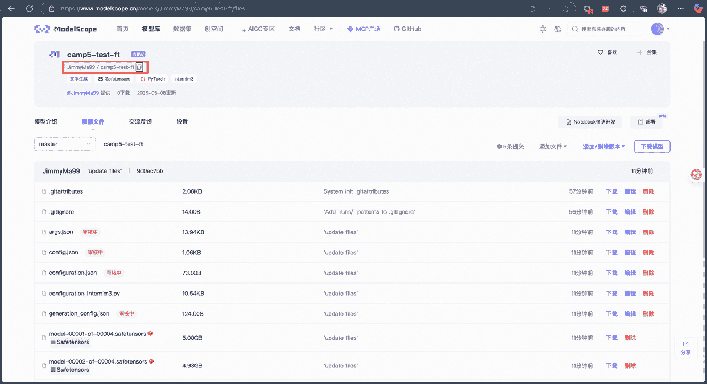
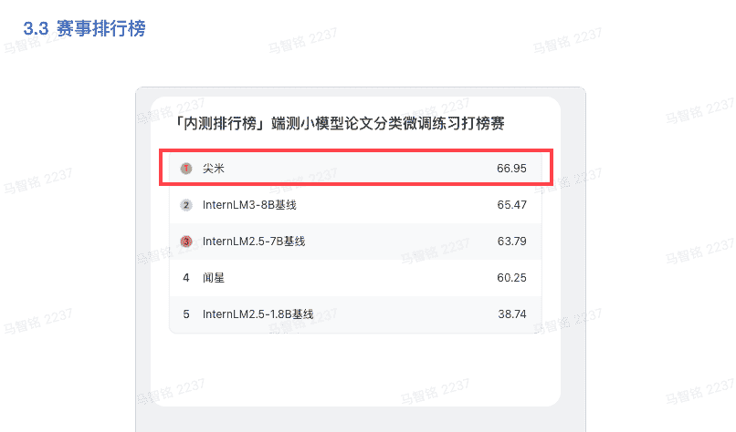

# 端侧小模型论文分类微调练习打榜赛

> 来源：[https://aicarrier.feishu.cn/docx/XbOkdsKiSo34PLx5NobcfKEOn2s](https://aicarrier.feishu.cn/docx/XbOkdsKiSo34PLx5NobcfKEOn2s)


## 练习赛介绍

### 背景

在人工智能大语言模型蓬勃发展的浪潮中，`InternLM`（书生・浦语）脱颖而出。`InternLM` 凭借出色的知识掌握、阅读理解、数学推理、多语翻译能力，在多个测试任务中成绩斐然，尤其在综合性考试中表现突出，在多项中文考试里超越了 `ChatGPT` 的成绩。其后续版本不断迭代升级，在数理、代码、对话、创作等各方面都取得长足进步，综合性能达到同量级开源模型的领先水平。

此次`InternLM` 端侧小模型论文分类微调练习打榜赛，为进一步挖掘`InternLM` 在特定领域的应用潜力搭建了舞台。比赛将使用具有丰富学术资源的 arxiv 数据集，该数据集涵盖物理学、数学、计算机科学、定量生物学、定量金融等多个学科领域的海量论文。arxiv 作为全球知名的预印本论文平台，论文更新速度快，涵盖前沿研究成果，能为模型训练提供多元且专业的学术数据。同时，比赛还引入了采集的arixv数据（包括尖米近半年挂的两篇水文），这些数据来源广泛，与原 arxiv 数据集形成互补，进一步丰富了数据的多样性与全面性，确保模型在更广泛的论文样本上进行训练，提升对不同风格、主题论文的分类能力。

在模型使用方面，参赛者需使用 `InternLM` 系列模型进行微调。参赛者应依据比赛提供的数据特点，结合自身对模型的理解与技术能力，选择合适的 `InternLM` 系列模型版本开展微调工作，严格遵循相关的技术规范和道德准则，以确保模型在论文分类任务中的稳定性和可靠性。

### 参赛指南(必看)

1. 本文档将整体（低情商笼统）的介绍比赛的赛事排行榜，模型提交，数据集介绍。

2. 具体案例请参考 4. Baseline 案例 部分进行 step by step 教学，根本不用担心学不会，更可以进群交流。

3. btw，显存如果小的话，可以调低`batch_size`为 1，就不有 CUDA out of memory 的烦恼了🎉

## 赛事排行榜

6 月 3 日 20:00 排行榜前 10 获得 2000 算力点

6 月 10 日 20:00 排行榜前 10 获得 1688 算力点

6 月 17 日 20:00 排行榜前 10 获得 999 算力点

6 月 24 日 20:00 排行榜前 10 获得 666 算力点

6 月 30 日 20:00 排行榜前 10 发放赛事 TOP 10 证书（暂定）

备注算力有效期仅第五期实战营内有效，成绩仅以 20:00 时截图为准，尽早提交没测完不等待。

<https://aicarrier.feishu.cn/share/base/dashboard/shrcnqpXY6Uy9FodNF3It75GSNe?iframeFrom=docx&ccm_open=iframe>

## 模型提交

### 3.1. 使用魔搭提交

```
swift export \
    --model output/vx-xxx/checkpoint-xxx \
    --push_to_hub true \
    --hub_model_id &#x27;&lt;model-id&gt;&#x27; \
    --hub_token &#x27;&lt;sdk-token&gt;&#x27; \
    --use_hf false
```

请将训练好的模型上传到 ModelScope 并在问卷中提交链接，提交后系统会自动拉取权重并测试结果。

提交注意事项：

模型 ID 指的是一下截图中红框部分，直接点击复制即可



测评结束后下方排行榜就会出现真实测评成绩



### 提交入口

https://aicarrier.feishu.cn/share/base/form/shrcn0JkjbZKMeMPw04uHCWc5Pg

### 成绩查询入口

https://aicarrier.feishu.cn/share/base/query/shrcndyCfksuWYkPKo6OFXWTLrg

## Baseline 案例

[L1G4- `InternLM` 论文分类微调实践（Swift 版）](https://aicarrier.feishu.cn/wiki/HfQuwYa4Xi4WJVkuNF3cygqnnch)

[L1G4- `InternLM` 论文分类微调实践（XTuner 版）](https://aicarrier.feishu.cn/wiki/D7kZw9Nx4iMyDnkpL0Gc5giNn5g)

[L1G4- `InternLM` 论文分类微调实践（Ascend+XTuner 版）](https://aicarrier.feishu.cn/wiki/MLb3w9kP1iVCOskmRBRcil0CnHb)

[`InternLM`论文分类微调实践（swift 版）](https://vwpecqie443.feishu.cn/wiki/AdRfwyZfWiJPJJkwnhucGavSnBe)

[L1G4- `InternLM` 论文分类微调实践（Ascend+XTuner 版）](https://vwpecqie443.feishu.cn/wiki/VS6bwhHSGiErfGkKeLOcAKkynch)

## 数据集介绍

本比赛选取 arXiv 数据集作为重要数据来源，首先对数据集进行系统性分析，筛选出`astro-ph`、`cond-mat.mes-hall`、`cond-mat.mtrl-sci`、`cs.CL`、`cs.CV`、`cs.LG`、`gr-qc`、`hep-ph`、`hep-th`、`quant-ph`这 10 个数据量最为丰富的学术类别。在此基础上，进一步追踪采集各对应类别的最新学术论文，通过科学的整合方法构建混合数据集。

所构建的数据集涵盖预训练数据和监督微调（SFT）数据，为模型训练提供多维度的数据支撑。验证集和测试集均从该数据集内科学抽取，确保数据的同源性和实验评估的可靠性，从而为后续研究奠定坚实的数据基础。

#### Arxiv dataset样例

```
{&quot;id&quot;: &quot;0711.3691&quot;,
 &quot;submitter&quot;: &quot;Eric Laporte&quot;,
 &quot;authors&quot;: &quot;Olivier Blanc (IGM-LabInfo), Matthieu Constant (IGM-LabInfo), Eric Laporte (IGM-LabInfo)&quot;,
 &quot;title&quot;: &quot;Outilex, plate-forme logicielle de traitement de textes \&#x27;ecrits&quot;,
 &quot;comments&quot;: null,
 &quot;journal-ref&quot;: &quot;Dans Verbum ex machina. Proceedings of TALN - Outilex, plate-forme logicielle de traitement de textes \&#x27;ecrits, Louvain : Belgique (2006)&quot;,
 &quot;doi&quot;: null,
 &quot;report-no&quot;: null,
 &quot;categories&quot;: &quot;cs.CL&quot;,
 &quot;license&quot;: null,
 &quot;abstract&quot;: &quot;The Outilex software platform, which will be made available to research, development and industry, comprises software components implementing all the fundamental operations of written text processing: processing without lexicons, exploitation of lexicons and grammars, language resource management. All data are structured in XML formats, and also in more compact formats, either readable or binary, whenever necessary; the required format converters are included in the platform; the grammar formats allow for combining statistical approaches with resource-based approaches. Manually constructed lexicons for French and English, originating from the LADL, and of substantial coverage, will be distributed with the platform under LGPL-LR license.&quot;,
 &quot;versions&quot;: [
 {&quot;version&quot;: &quot;v1&quot;, &quot;created&quot;: &quot;Fri, 23 Nov 2007 09:45:13 GMT&quot;},
 {&quot;version&quot;: &quot;v2&quot;, &quot;created&quot;: &quot;Tue, 27 Nov 2007 10:22:14 GMT&quot;}
 ],
 &quot;update_date&quot;: "2007-11-27&quot;,
 &quot;authors_parsed&quot;: [
 [&quot;Blanc&quot;, &quot;Olivier&quot;, &quot;&quot;, &quot;IGM-LabInfo&quot;],
 [&quot;Constant&quot;, &quot;Matthieu&quot;, &quot;&quot;, &quot;IGM-LabInfo&quot;],
 [&quot;Laporte&quot;, &quot;Eric&quot;, &quot;&quot;, &quot;IGM-LabInfo&quot;]
 ]}
```

#### 抽取数据集样例

```
{&quot;messages&quot;: [
 {
 &quot;role&quot;: &quot;assistant&quot;,
 &quot;content&quot;: &quot;This is a paper with ID 0711.3691, titled &quot;Outilex, plate-forme logicielle de traitement de textes \&#x27;ecrits&quot;, submitted by Eric Laporte. The authors are Olivier Blanc (IGM-LabInfo), Matthieu Constant (IGM-LabInfo), Eric Laporte (IGM-LabInfo).\nThe paper belongs to the cs.CL category and is published in Dans Verbum ex machina. Proceedings of TALN - Outilex, plate-forme\n  logicielle de traitement de textes \&#x27;ecrits, Louvain : Belgique (2006). The latest version is v2, created on November 27, 2007. No DOI information available. No license information available.\n\nAbstract:\nThe Outilex software platform, which will be made available to research, development and industry, comprises software components implementing all the fundamental operations of written text processing: processing without lexicons, exploitation of lexicons and grammars, language resource management. All data are structured in XML formats, and also in more compact formats, either readable or binary, whenever necessary; the required format converters are included in the platform; the grammar formats allow for combining statistical approaches with resource-based approaches. Manually constructed lexicons for French and English, originating from the LADL, and of substantial coverage, will be distributed with the platform under LGPL-LR license.&quot;
 }
 ]}
{&quot;system&quot;: &quot;你是个优秀的论文分类师&quot;,
 &quot;conversation&quot;: [
 {
 &quot;human&quot;: &quot;Based on the title &#x27;Outilex, plate-forme logicielle de traitement de textes \&#x27;ecrits&#x27;, authors &#x27;Olivier Blanc (IGM-LabInfo), Matthieu Constant (IGM-LabInfo), Eric\n  Laporte (IGM-LabInfo)&#x27;, and abstract &#x27;The Outilex software platform, which will be made available to research, development and industry, comprises software components implementing all the fundamental operations of written text processing: processing without lexicons, exploitation of lexicons and grammars, language resource management. All data are structured in XML formats, and also in more compact formats, either readable or binary, whenever necessary; the required format converters are included in the platform; the grammar formats allow for combining statistical approaches with resource-based approaches. Manually constructed lexicons for French and English, originating from the LADL, and of substantial coverage, will be distributed with the platform under LGPL-LR license.&#x27;, please determine the scientific category of this paper.  \n\nA. astro-ph\nB. cond-mat.mes-hall\nC. cond-mat.mtrl-sci\nD. cs.CL\nE. cs.CV\nF. cs.LG\nG. gr-qc\nH. hep-ph\nI. hep-th\nJ. quant-ph&quot;,
 &quot;assistant&quot;: &quot;D&quot;
 }
 ]}
```

### 训练集获取

训练集下载链接：https://www.modelscope.cn/datasets/JimmyMa99/smartflow-arxiv-dataset/files

```
modelscope download --dataset JimmyMa99/smartflow-arxiv-dataset swift* --local_dir ./datasets/train
```

### 验证集获取

https://www.modelscope.cn/datasets/JimmyMa99/smartflow-arxiv-dataset/files7


# 测试集介绍（可跳）

```
modelscope download --dataset JimmyMa99/smartflow-arxiv-dataset eval_oc_data.csv --local_dir ./datasets/eval
```

因为小伙伴在提交模型后，书生后台会自动评测。觉得不放心的小伙伴，可以先自己评测一下看看效果。具体见 Baseline 案例文档测评部分。

## opencompass config 如下

```
from mmengine.config import read_base
from opencompass.models import HuggingFaceCausalLM

models = [
    dict(
        type=HuggingFaceCausalLM,
        path=&#x27;{local_path}&#x27;,
        tokenizer_path=&#x27;{local_path}&#x27;,
        tokenizer_kwargs=dict(padding_side=&#x27;left&#x27;, truncation_side=&#x27;left&#x27;),
        model_kwargs=dict(
            device_map=&#x27;auto&#x27;, 
            torch_dtype=&#x27;auto&#x27;,  
        ),
        max_seq_len=4096,
        max_out_len=100,
        batch_size=4,  
        run_cfg=dict(num_gpus=1, num_procs=1),
    )
]

datasets = [
    {{&quot;path&quot;: &quot;&quot;,data_type&quot;: &quot;mcq&quot;, &quot;infer_method&quot;: &quot;gen&quot;}},
]

work_dir = &#x27;{work_dir}&#x27;
```

1. 模型配置部分：

+ 使用`HuggingFaceCausalLM`类型加载语言模型
+ 模型和分词器路径设置为`{local_path}`（实际使用时需替换为具体路径）
+ 分词器设置了左侧填充和截断
+ 模型加载设置为自动分配设备和自动选择数据类型
+ 最大序列长度设置为4096，最大输出长度为100
+ 批处理大小为4
+ 使用1个GPU和1个进程进行推理

1. 评测数据集部分：

+ 使用了生成式评测方法（`gen`）
+ 路径为空，表示可能需要补充具体数据集路径

1. 工作目录：

+ 结果将保存在`{work_dir}`指定的位置（实际使用时需替换）

这个配置适用于对大型语言模型进行评测，通过 OpenCompass 框架执行标准化的性能测试，测试模型在各种任务上的能力。评测完成后，可以获得模型在指定数据集上的表现数据，用于评估模型质量或与其他模型进行比较。

# 练习赛激励

|  | 激励 |
| --- | --- |
| Ascend 算力 | 前 5 位使用 Ascend 算力微调 InternLM3-8B、InternLM2.5-7B 或者 InternLM2.5-1.8B 任何一模型超过其基线并提交详细可复现文档，可获得一把 Ascend X 书生雨伞周边激励。 |
| Nvidia 算力 | 前 5 位使用 InternLM3-8B、InternLM2.5-7B 或者 InternLM2.5-1.8B 任何一模型超过其基线，并提交详细可复现文档，获得 1688 算力点激励（有效期到 6 月 30 日）。 |
| 沐曦算力 | 前 5 位使用沐曦算力微调 InternLM3-8B、InternLM2.5-7B 或者 InternLM2.5-1.8B 任何一模型超过其基线，并提交详细可复现文档，获得一个沐曦移动电源及 100 小时沐曦算力券（有效期到 6 月 30 日）。 |

## 正式阶段激励
