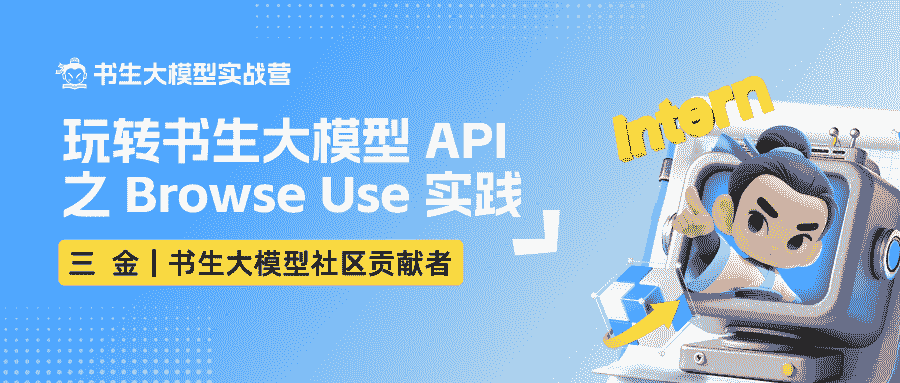
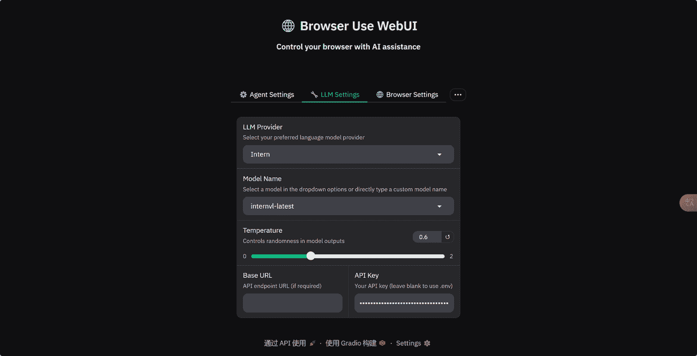
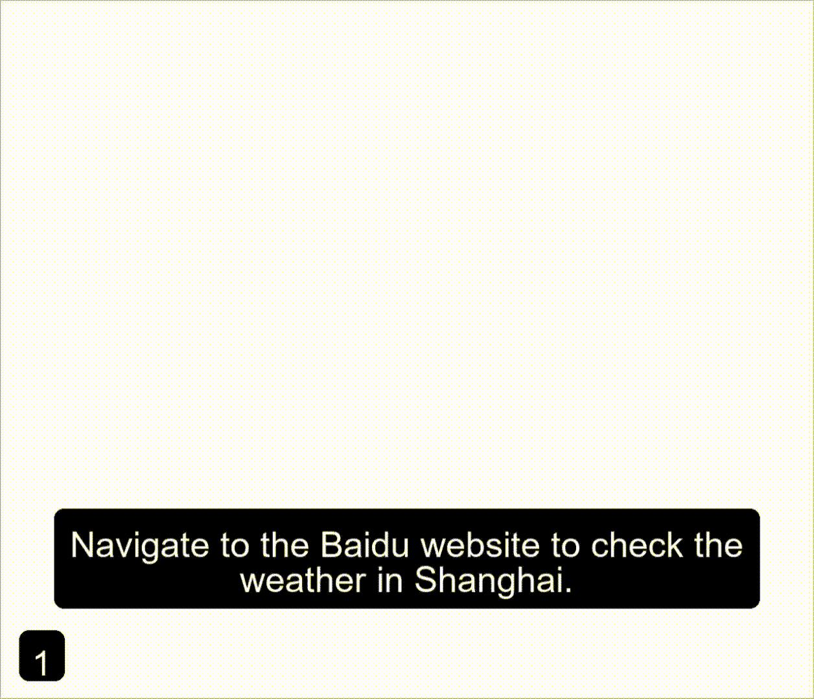
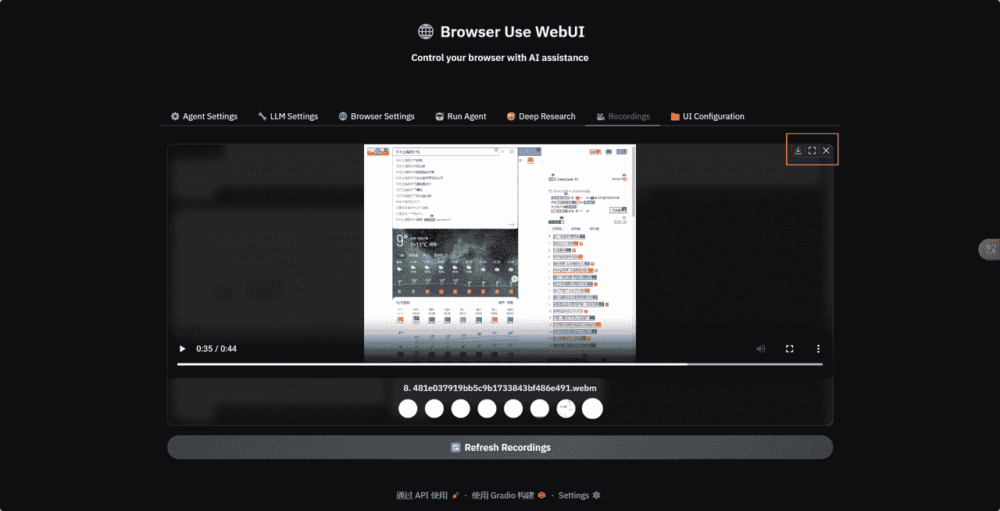

# L1G1-玩转书生大模型 API 之 Browser-Use 实践

> 来源：[https://aicarrier.feishu.cn/docx/WKBfdhCbLodH1VxqkYIcFQTwncf](https://aicarrier.feishu.cn/docx/WKBfdhCbLodH1VxqkYIcFQTwncf)



# 0. 课程开头

**欢迎大家来到****玩转**书生大模型 API之 Browse Use 实践课程

在**人工智能**技术飞速发展的今天，掌握AI应用开发已成为技术从业者的核心竞争力。本课程由书生平台倾力打造，并得到书生模型的全程技术支持，旨在为学员提供从理论到实践的完整AI开发体验。

Browser-Use 是一款专为 Agent 与浏览器交互设计的工具，旨在通过简单而强大的自动化界面，让 Agent 轻松访问和操作网页。它提供了连接大模型与浏览器的便捷桥梁，使开发者能够快速实现网页自动化任务，无需复杂编码。

为了让每位学员都能专注于学习核心技术，无需为API成本担忧，书生平台特别为本课程学员免费提供API调用服务。这意味着您可以充分体验和实验各种AI功能，从基础的文本处理到多模态再到复杂的智能交互，都能在真实的开发环境中进行练习。还等什么，开始发车！


# 1. 闯关任务

1.  构建一个包含 3 轮对话的上下文，调用 API 获取最终回复 and 发送一张图片并获取描述。

1.  自行探索，并使用 Browser-use Web-UI 自带的录制功能，将书生大模型操作浏览器过程录制下来，放到作业中。

作业提交地址：https://aicarrier.feishu.cn/share/base/form/shrcnkSJ97ykqRSz4fgyCJbvCsb

# 2.课程内容

## 2.1 书生 API 介绍及实践

书生 API 是上海人工智能实验室推出的核心产品之一，旨在为开发者提供便捷、高效的大模型调用能力。作为书生大模型全链路开源体系的重要组成部分，其依托 InternLM 系列模型（如 InternLM3、InternVL2.5 等）及工具链生态（XTuner、LMDeploy 等），支持文本交互、多模态处理及智能体开发。

本课程仅对API调用作基础讲解~，更多详细内容请参考https://internlm.intern-ai.org.cn/api/document

### 2.1.1 环境搭建

目前浦语 ChatAPI 兼容了 openai python sdk 内的部分方法，仍在继续适配中...

推荐大家使用原生的 python 或 curl 请求访问书生 API。

需要使用 Python 3.8 及更高版本，需确保版本兼容 OpenAI API 的最新特性。

#### 步骤 1.安装依赖库

```
pip install requests openai  #推荐使用官方SDK或原生requests库
```

#### 步骤 2.获取API Token

+   访问 [书生 AI 官网](https://internlm.intern-ai.org.cn/) 注册并申请 API 权限。


+   进入到API页面（https://internlm.intern-ai.org.cn/api/tokens）之后，点击获取个人密钥，接着创建API Token。


+   给你的API Token取个名字，接着就能得到一串字符，注意，API Tokne 只能复制一次，点击确认之后，便不可见，妥善保管自己的API Token。且在使用过程中，不要显式地暴露在代码中。


### 2.1.2 基础文本交互

#### **步骤 1.创建一个新的文件夹**

```
mkdir -p /root/Internlm &amp;&amp; cd /root/Internlm
```

#### 步骤 2.创建 .env 用来保存API Token

```
#在 /root/Internlm 目录下
touch .env
```

vscode模式下能查看到.env


并将API Token按以下形式填入 .env

```
InternLM=&quot;your_api_token&quot;
```

#### 步骤 3.python代码调用

首先安装 dotenv 用于加载环境变量

```
pip install dotenv
```

在 /root/Internlm 目录下

+   使用 openai python sdk

```
from openai import OpenAI
from dotenv import load_dotenv
import os

InternLM_api_key = os.getenv(&quot;InternLM&quot;, load_dotenv())
client = OpenAI(
    api_key=InternLM_api_key,  
    base_url=&quot;https://chat.intern-ai.org.cn/api/v1/&quot;,
)

chat_rsp = client.chat.completions.create(
     model=&quot;internlm3-latest&quot;,
     messages=[{
            &quot;role&quot;: &quot;user&quot;,         #role 支持 user/assistant/system/tool
            &quot;content&quot;: &quot;你知道刘慈欣吗？&quot;
    }, {
            &quot;role&quot;: &quot;assistant&quot;,
            &quot;content&quot;: &quot;为一个人工智能助手，我知道刘慈欣。他是一位著名的中国科幻小说家和工程师，曾经获得过多项奖项，包括雨果奖、星云奖等。&quot;
    },{
            &quot;role&quot;: &quot;user&quot;,
            &quot;content&quot;: &quot;他什么作品得过雨果奖？&quot;
    }],
    stream=False
)

for choice in chat_rsp.choices:
    print(choice.message.content)
#若使用流式调用：stream=True，则使用下面这段代码
#for chunk in chat_rsp:
#    print(chunk.choices[0].delta.content)
```

+   原生调用

```
import requests
import json
from dotenv import load_dotenv
import os
InternLM_api_key = os.getenv(&quot;InternLM&quot;, load_dotenv())

url = &#x27;https://chat.intern-ai.org.cn/api/v1/chat/completions&#x27;
header = {
    &#x27;Content-Type&#x27;:&#x27;application/json&#x27;,
    &quot;Authorization&quot;:&quot;Bearer &quot;+InternLM_api_key,
}
data = {
    &quot;model&quot;: &quot;internlm3-latest&quot;,  
    &quot;messages&quot;: [{
        &quot;role&quot;: &quot;user&quot;,
        &quot;content&quot;: &quot;你好~&quot;
    }],
    &quot;n&quot;: 1,
    &quot;temperature&quot;: 0.8,
    &quot;top_p&quot;: 0.9
}

res = requests.post(url, headers=header, data=json.dumps(data))
print(res.status_code)
print(res.json())
print(res.json()[&quot;choices&quot;][0][&#x27;message&#x27;][&quot;content&quot;])
```

##### **请求参数说明：**

更多参数请参见文档~

**模型列表：**

+   大语言模型

+   多模态模型

##### 返回参数说明：

### 2.1.3 多模态交互

+   使用 openai python sdk

                        &quot;url&quot;: &quot;https://static.openxlab.org.cn/internvl/demo/visionpro.png&quot;  #支持互联网公开可访问的图片 url 或图片的 base64 编码
                        &quot;url&quot;: &quot;https://static.openxlab.org.cn/puyu/demo/000-2x.jpg&quot;

```
from openai import OpenAI
from dotenv import load_dotenv
import os

InternLM_api_key = os.getenv(&quot;InternLM&quot;, load_dotenv())
client = OpenAI(
    api_key=InternLM_api_key,  
    base_url=&quot;https://chat.intern-ai.org.cn/api/v1/&quot;,
)

chat_rsp = client.chat.completions.create(
     model=&quot;internvl2.5-latest&quot;,
     messages=[
        {
            &quot;role&quot;: &quot;user&quot;,
            &quot;content&quot;: &quot;你好&quot;
        },
        {
            &quot;role&quot;: &quot;assistant&quot;,
            &quot;content&quot;: &quot;你好，我是 internvl&quot;
        },
        {
            &quot;role&quot;: &quot;user&quot;,
            &quot;content&quot;: [                                    #用户的图文提问内容，数组形式
                {
                    &quot;type&quot;: &quot;text&quot;,                        # 支持 text/image_url
                    &quot;text&quot;: &quot;Describe these two images please&quot;
                },
                {
                    &quot;type&quot;: &quot;image_url&quot;,
                    &quot;image_url&quot;: {
                    }
                },
                {
                    &quot;type&quot;: &quot;image_url&quot;,                                                     # 单轮对话支持上传多张图片
                    &quot;image_url&quot;: {
                    }
                }
            ]
        }
    ],
    n=1,
    stream=False
)

for choice in chat_rsp.choices:
    print(choice.message.content)
```

### 2.1.4 三轮对话示例代码

                    &quot;url&quot;: &quot;https://static.openxlab.org.cn/internvl/demo/visionpro.png&quot;
                    &quot;url&quot;: &quot;https://static.openxlab.org.cn/puyu/demo/000-2x.jpg&quot;

```
from openai import OpenAI
from dotenv import load_dotenv
import os

# 加载环境变量
load_dotenv()
InternLM_api_key = os.getenv(&quot;InternLM&quot;)

# 初始化客户端
client = OpenAI(
    api_key=InternLM_api_key,  
    base_url=&quot;https://chat.intern-ai.org.cn/api/v1/&quot;,
)

# 构建包含3轮对话的上下文
messages = [
    # 第一轮对话
    {
        &quot;role&quot;: &quot;user&quot;,
        &quot;content&quot;: &quot;你好，请介绍一下你自己&quot;
    },
    {
        &quot;role&quot;: &quot;assistant&quot;,
        &quot;content&quot;: &quot;你好！我是 InternVL，一个多模态AI助手。我可以理解和分析文本与图像，帮助您处理各种任务，包括图像描述、视觉问答、文档理解等。有什么我可以帮助您的吗？&quot;
    },
    
    # 第二轮对话
    {
        &quot;role&quot;: &quot;user&quot;,
        &quot;content&quot;: &quot;你能处理哪些类型的图像任务？&quot;
    },
    {
        &quot;role&quot;: &quot;assistant&quot;,
        &quot;content&quot;: &quot;我可以处理多种图像任务：\\n1. 图像描述：详细描述图片内容\\n2. 视觉问答：回答关于图片的问题\\n3. 图像对比：分析多张图片的异同\\n4. OCR识别：提取图片中的文字\\n5. 图表分析：理解图表、图形数据\\n6. 场景理解：识别图片中的物体、人物和场景&quot;
    },
    
    # 第三轮对话 - 包含图像
    {
        &quot;role&quot;: &quot;user&quot;,
        &quot;content&quot;: [
            {
                &quot;type&quot;: &quot;text&quot;,
                &quot;text&quot;: &quot;请分析这两张图片，告诉我它们分别展示了什么产品，以及它们的主要特点&quot;
            },
            {
                &quot;type&quot;: &quot;image_url&quot;,
                &quot;image_url&quot;: {
                }
            },
            {
                &quot;type&quot;: &quot;image_url&quot;,
                &quot;image_url&quot;: {
                }
            }
        ]
    }
]

# 调用API获取最终回复
try:
    chat_rsp = client.chat.completions.create(
        model=&quot;internvl2.5-latest&quot;,
        messages=messages,
        n=1,
        stream=False,
        temperature=0.8,  # 控制回复的创造性
        max_tokens=500    # 限制回复长度
    )
    
    # 打印最终回复
    print(&quot;=== API 最终回复 ===&quot;)
    for choice in chat_rsp.choices:
        print(choice.message.content)
        
    # 可选：打印整个对话历史
    print(&quot;\\n=== 完整对话历史 ===&quot;)
    for i, msg in enumerate(messages):
        print(f&quot;\\n轮次 {i//2 + 1}:&quot;)
        if msg[&quot;role&quot;] == &quot;user&quot;:
            if isinstance(msg[&quot;content&quot;], str):
                print(f&quot;用户: {msg[&#x27;content&#x27;]}&quot;)
            else:
                print(f&quot;用户: {msg[&#x27;content&#x27;][0][&#x27;text&#x27;]}&quot;)
                print(f&quot;      (包含 {len(msg[&#x27;content&#x27;])-1} 张图片)&quot;)
        else:
            print(f&quot;助手: {msg[&#x27;content&#x27;]}&quot;)
            
except Exception as e:
    print(f&quot;API调用出错: {str(e)}&quot;)
```

Model api计费规则示例：

```
# GPT-4 Turbo 价格（2024年）
输入价格：$0.01 / 1K tokens
输出价格：$0.03 / 1K tokens（输出更贵！）

# 一轮对话
你：&quot;帮我写个Python排序函数&quot;（10 tokens）
AI：&quot;def sort_list(lst):...&quot;（100 tokens）

费用 = 10×0.00001 + 100×0.00003 = $0.0031
```

当然现在的顶级模型api价格感人，书生api免费给大家玩！


## 2.2 Browser-Use 简介

Browser-Use 是一款专为 Agent 与浏览器交互设计的工具，旨在通过简单而强大的自动化界面，让 Agent 轻松访问和操作网页。它提供了连接大模型与浏览器的便捷桥梁，使开发者能够快速实现网页自动化任务，无需复杂编码。

## 2.3 开发环境配置

此项目需在本地电脑(os:Windows,macOS)实现,方便观察 Agent 操控操作网页过程~

### 步骤 1.安装 git

**Windows:**

+   [下载并安](https://git-scm.com/download/win)装适合您 Windows 版本的安装程序：下载地址

+   按照安装向导完成安装。(默认设置安装即可)

+   打开终端，输入指令 git --version 检查是否安装成功

**MacOS:**

+   [下载并安](https://git-scm.com/downloads/mac)装适合您 MacOS 版本的安装程序：下载地址

+   按照安装向导完成安装。(默认设置安装即可)

+   打开终端，输入指令 git --version 检查是否安装成功

### 步骤 2.安装 uv 并创建项目环境

这里我们使用uv进行项目环境管理

首先我们新建一个Internlm文件夹，并用vscode打开，启动终端

直接使用Python自带的pip安装，兼容性最佳，这里需要python版本为3.8及以上：

```
pip install uv  
# 检测是否安装成功，出现版本号则成功
uv --version 
```

如果没安装python需要去 [Python 官网](https://www.python.org/) 下载安装包，安装时勾选 “Add Python to PATH”（安装向导底部），并选择 自定义安装 → 确保勾选 “Install pip”。

另外，如果网速不行pip下载包的时候可以加  -i https://pypi.tuna.tsinghua.edu.cn/simple/ 起到一个换下载源加速的作用。

接着输入以下命令来创建项目环境并进入

```
uv venv Internlm --python 3.11
#Activate the virtual environment:
#Windows (PowerShell):
Set-ExecutionPolicy -Scope Process -ExecutionPolicy Bypass
.\Internlm\Scripts\Activate.ps1
#macOS
source Internlm/bin/activate
```

如下所示，进入了项目环境


### 步骤 3.在项目环境下安装依赖

首先使用git将browser-use项目克隆到本地

```
git clone https://github.com/sanjion/Web-ui.git
cd web-ui
```

安装项目依赖

```
uv pip install -r requirements.txt  
playwright install --with-deps chromium
```

web-ui下有个.env.example文件，这是我们项目的启动配置，复制一份并重命名为 .env

```
# Windows (PowerShell):
cp .env.example .env
# macOS/Linux/Windows (PowerShell):
cp .env.example .env
```

## 2.3 启动 Browser-use Web-UI

### 2.3.1 **运行 Web-UI**

运行 WebUI，完成上面的安装步骤后，启动应用程序：

```
python webui.py --ip 127.0.0.1 --port 7788
```

若启动时遇到以下错误

```
ERROR:    Exception in ASGI application
…………
TypeError: argument of type &#x27;bool&#x27; is not iterable
```

将gradio升级到最新版本即可解决

```
uv pip install --upgrade gradio  -i https://pypi.tuna.tsinghua.edu.cn/simple/
```

缺相应包httpx[socks]安装就好了

```
uv pip install &quot;httpx[socks]&quot; -i https://pypi.tuna.tsinghua.edu.cn/simple/
```

启动后，打开 http://127.0.0.1:7788 即可看到以下界面


### 2.3.2 Web-UI 选项配置

在 LLM Settings 下选择 Intern

模型选择 internvl-latest

(如果选择Internlm，注意把Agent Settings 中的Use Vison 选项去掉，Internlm是文本模型，不支持图像识别)

API KEY 位置填入你的 API Token

API KEY 也可以直接写入 .env 文件中



### 2.3.3 案例一：查看上海天气

在 Run Agent 中输入任务，点击 Run Agent

例如 "去百度查一下今天上海的天气，给我结果" ,模型执行过程如下




在Rcordings界面可以把Agent执行过程下载下来



### 2.3.4  案例二：拿书生api-key

```
step1 访问https://internlm.intern-ai.org.cn/api/tokens这个网站
step2 等我大概一分钟，你在操作
step3  访问https://internlm.intern-ai.org.cn/api/tokens 获取到token 命名test123 。
step4 token结果给我。
```


更多的有趣的**案例**请同学们自行探索~